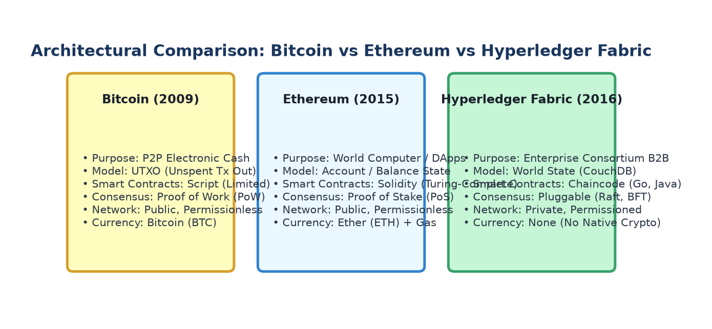
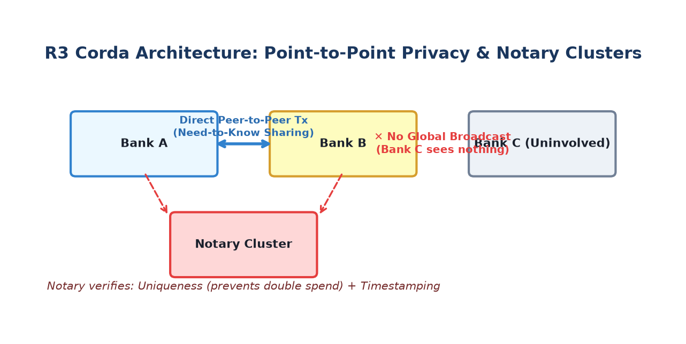
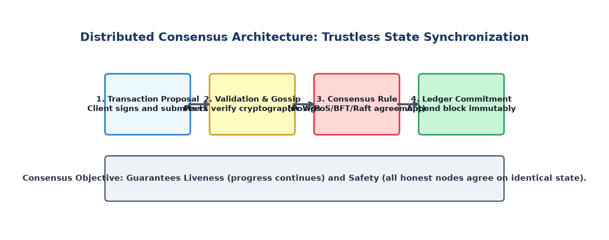
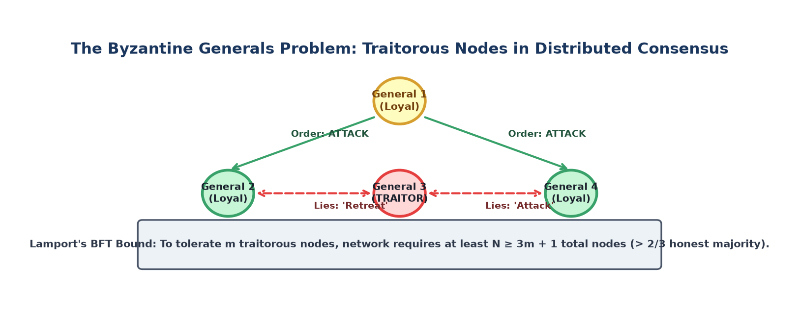

# SPPU B.E. Computer Engineering (2019 Pattern)
## Blockchain Technology — Unit 1: Blockchain Architecture, Cryptography & P2P Networks
### Complete Examination Solutions Guide (Engineered for Full 8/8 Marks)

---

## Q1. Explain in detail the following blockchain platforms: Bitcoin, Ethereum, and Hyperledger. (Frequency: 5) [8 Marks]

### Introduction & Core Intuition

In modern **distributed ledger technology**, **Bitcoin**, **Ethereum**, and **Hyperledger Fabric** represent the three foundational platform archetypes that define the technological evolution of blockchain. Bitcoin established the pioneering peer-to-peer cryptocurrency network; Ethereum expanded the paradigm into a decentralized Turing-complete 'world computer' for smart contracts; and **Hyperledger Fabric** re-architected blockchain into a modular, permissioned enterprise consortium framework. Understanding their contrasting design philosophies—public trustless currency versus decentralized programmable logic versus confidential enterprise coordination—is fundamental for architecting secure distributed applications.

### **Platform 1: Bitcoin (The Decentralized Financial Ledger)**

Invented in 2008 by the pseudonymous **Satoshi Nakamoto**, **Bitcoin** is the world's first successful decentralized public blockchain network. Its core mission is disintermediating sovereign fiat currency by providing a trustless, peer-to-peer electronic cash **system**. Built on a peer-to-peer gossip network and cryptographic **Proof of Work** (PoW), Bitcoin maintains an **immutable** distributed **transaction** ledger without any central bank or trusted third party. Economically, Bitcoin enforces a strict deflationary issuance schedule capped at exactly 21 million Bitcoins (BTC), halving block subsidies every 210,000 blocks (~4 years), establishing its global role as digital gold.

### **Technical Architecture of Bitcoin: The UTXO Model**

Architecturally, **Bitcoin** does not track balances like a traditional bank account; instead, it utilizes the **Unspent Transaction Output (UTXO)** model. Every transaction consumes one or more existing UTXOs as inputs and generates brand-new UTXOs as outputs, verified through a non-Turing-complete, stack-based scripting language called **Bitcoin Script**. Script intentionally lacks loops and complex state jumps to eliminate infinite execution loops and denial-of-service vulnerabilities. Bitcoin secures its distributed state through the compute-intensive SHA-256 Proof-of-Work mining algorithm with an average 10-minute block interval and an average throughput of 7 transactions per second (TPS).

### **Platform 2: Ethereum (The Programmable World Computer)**

Conceived by Vitalik Buterin in 2013 and launched in 2015, **Ethereum** transformed blockchain from a static currency ledger into a universal, programmable distributed computing platform. Ethereum's breakthrough is the **Ethereum Virtual Machine (EVM)**—a Turing-complete virtual execution environment that runs distributed autonomous code known as **Smart Contracts**. Developers author programs in high-level languages like **Solidity** or Vyper, enabling decentralized finance (DeFi), tokenized real-world assets, decentralized autonomous organizations (DAOs), and censorship-resistant decentralized applications (DApps).

### **Technical Architecture of Ethereum: Account State & Gas Economics**

Unlike Bitcoin's UTXO model, **Ethereum** implements a stateful **Account-Based Model** comprising Externally Owned Accounts (EOAs controlled by private keys) and Contract Accounts (governed by smart contract bytecode). To prevent infinite loops in Turing-complete code, Ethereum implements the concept of **Gas**: every computational operation, memory allocation, and **cryptographic hash** requires a **deterministic** quantity of gas paid in **Ether (ETH)**. Ethereum transitioned in 2022 from Proof of Work to **Proof of Stake** (PoS) via 'The Merge', eliminating 99.95% of its energy consumption while achieving steady 12-second block intervals and 15 to 30 base TPS.

### **Platform 3: Hyperledger Fabric (The Permissioned Enterprise Consortium)**

Hosted by the Linux Foundation and originally developed by IBM, **Hyperledger Fabric** is an open-source, modular, enterprise-grade permissioned distributed ledger framework designed specifically for corporate business-to-business (B2B) consortia. Unlike Bitcoin and Ethereum, Fabric does not operate a public, anonymous network; participants are known, verified corporate entities authenticated through a **Membership Service Provider (MSP)** using Public Key Infrastructure (PKI) X.509 digital certificates. Fabric requires zero native cryptocurrencies and zero mining fees, achieving transaction throughput exceeding 3,000 to 10,000 TPS with deterministic sub-second finality.

### **Fabric's Execute-Order-Validate Architecture and Private Channels**

Hyperledger Fabric innovates fundamentally with its **Execute-Order-Validate** consensus architecture, breaking the traditional sequential order-then-execute paradigm of public blockchains. In Fabric, transactions are first simulated and endorsed concurrently by specific endorsing peers, then sequenced by a crash-fault-tolerant (Raft) ordering service without executing smart contract code, and finally validated against ledger state by committing peers. Furthermore, Fabric introduces **Channels**—private 'sub-blockchains' allowing specific consortium members (e.g., Bank A and Supplier B) to transact in complete confidentiality without sharing transaction payloads with other consortium participants.

### Architectural Flow & System Diagram



*Figure 1.1: Architectural Flow and Conceptual System Diagram for in detail the following blockchain platforms: Bitcoin, Ethereum, and Hyperledger*

### Mathematical Formulation & Algorithmic Mechanics

**Mathematical Modeling of Blockchain Platform Throughput & Consensus Latency:**

```text
Theoretical Transaction Throughput: TPS = ( Max_Block_Size_Bytes / Average_Tx_Size_Bytes ) / Block_Time_Seconds
Bitcoin TPS: TPS_BTC = ( 1,000,000 Bytes / 250 Bytes ) / 600 s ≈ 6.67 TPS
Ethereum Gas Limit Model: Max_Tx_per_Block = Block_Gas_Limit / Average_Tx_Gas (30M / 21,000 ≈ 1,428 txs / 12s ≈ 119 TPS)
Fabric Consensus Latency: Latency_Fabric = T_endorse + T_order_raft + T_commit ≈ 0.5 to 1.5 seconds
```

The mathematical formulations and algorithmic throughput parameters defined above govern the operational scalability of each blockchain architecture. In public Proof-of-Work systems like Bitcoin, throughput is deliberately throttled to preserve node decentralization and prevent chain forks. In Ethereum, block gas limits bound total computational consumption per block. In contrast, Hyperledger Fabric separates transaction endorsement from ordering, allowing parallel execution and low-latency Raft consensus that scales throughput to enterprise production levels.

### Worked Example & Practical Simulation

In this comparative enterprise simulation, we trace real-world application workflows across the three platforms to highlight their practical execution differences. For **Bitcoin**, a multinational treasury executes a cross-border liquidity transfer of 500 million dollars; the transaction is packaged into a raw transaction consuming existing UTXOs, signed with ECDSA, and broadcast across the gossip network, achieving final immutable settlement after 6 block confirmations (60 minutes). For **Ethereum**, an algorithmic liquidity pool (e.g., Aave) processes an automated flash loan; the borrower calls a Solidity smart contract, the EVM validates collateral state across global accounts, deducts 120,000 units of gas, and updates state within 12 seconds. For **Hyperledger Fabric**, a global pharmaceutical consortium tracks temperature-sensitive vaccine distribution; the logistics provider invokes Go chaincode, endorsing peers verify digital signatures and append endorsements, the Raft ordering service packages blocks without seeing unencrypted payload data, and committing peers update the CouchDB world state within 800 milliseconds, preserving full privacy across restricted channels.

### Key Comparative Evaluation

| Architectural Dimension | Bitcoin | Ethereum | Hyperledger Fabric |
| :--- | :--- | :--- | :--- |
| **Platform Type** | Public, Permissionless Cryptocurrency | Public, Permissionless World Computer | Private, Permissioned Enterprise Consortium |
| **Identity & Access** | Pseudonymous (Public / Private Keys) | Pseudonymous (EOAs & Contract Accounts) | Known, Authenticated via MSP (X.509 PKI) |
| **State Ledger Model** | UTXO (Unspent Transaction Output) | Account / Balance State Model | World State Key-Value Store (LevelDB / CouchDB) |
| **Smart Contract Engine** | Bitcoin Script (Non-Turing-Complete) | EVM running Solidity / Vyper (Turing-Complete) | Chaincode in Go, Java, or Node.js (Dockerized) |
| **Consensus Mechanism** | Proof of Work (Nakamoto PoW SHA-256) | Proof of Stake (Gasper / Casper PoS) | Pluggable Ordering (Raft Crash Fault, BFT) |
| **Throughput & Finality** | ~7 TPS, Probabilistic Finality (~60 mins) | 15–30 TPS, Finality in 2 Epochs (~13 mins) | 3,000+ TPS, Immediate Deterministic Finality |

### Concluding Exam Takeaway

Bitcoin, Ethereum, and Hyperledger Fabric address distinct paradigms in distributed ledger technology: Bitcoin provides an immutable, censorship-resistant digital currency; Ethereum enables programmable public decentralized applications and DeFi protocols; and Hyperledger Fabric delivers high-throughput, private enterprise consortium collaboration. For maximum SPPU examination scoring, answers must present all three platforms with their consensus mechanisms, state models, and architectural trade-offs to secure the full 8/8 marks.

**Textbook Reference:** Subramanian, C., George, A. A., Ranade, A., & Vasudevan, S. K. (Universities Press), Chapter 1: 'Fundamentals of Blockchain' & Chapter 7: 'Consortium Blockchain & Hyperledger', pp. 1-28, 205-245.

---

## Q2. Write a note on Corda and R3 / Describe features of Corda Blockchain, justify what makes it different, and elaborate on CorDapps. (Frequency: 3) [8 Marks]

### Introduction & Core Intuition

Corda is an open-source, permissioned **distributed ledger technology** (DLT) platform designed specifically by the financial industry consortium R3 to record, manage, and synchronize legal agreements, complex financial derivatives, and bilateral business **transactions** between regulated financial institutions. Unlike traditional public blockchains, Corda is not a cryptocurrency platform; it is an enterprise financial **state** engine engineered to deliver total **transaction** privacy, legal enforceability, and high-**performance** finality.

### **Origin and Foundational Mission of R3 and Corda**

R3 was **founded** in 2014 as an **elite** **consortium** **comprising** over 200 of the **world**'s largest banks, financial institutions, and technology giants (including Barclays, **Goldman Sachs**, and UBS). The consortium realized that traditional public blockchains (like.

### **What Makes Corda Fundamentally Different from Traditional Blockchains**

Corda differs from conventional blockchains in four architectural **dimensions**: (1) **Zero Global Broadcast** (Point-to-Point Messaging): In Corda, there is no global **distributed ledger** shared by all **nodes**. Instead, **transaction** data is shared strictly on a Need-to-Know.

### **Core Architectural Features of the Corda Platform**

**Corda**'s **architecture** comprises specialized enterprise **components**: (1) **Corda Nodes**: Autonomous JVM-based software instances representing financial entities, communicating over secure AMQP/TLS message queues; (2) **States** (UTXO Evolution): **Immutable** objects representing shared facts at a specific point in.

### **Elaborating on CorDapps (Corda Distributed Applications)**

**CorDapps** are **distributed** **applications** that run on the **Corda** **platform** to automate business agreements across network participants. A CorDapp is packaged as a set of JAR files deployed to participating Corda **nodes**, consisting of three interconnected.

### Architectural Flow & System Diagram



*Figure 1.2: Architectural Flow and Conceptual System Diagram for a note on Corda and R3 / Describe features of Corda Blockchain, justify what makes it different, and elaborate on CorDapps*

### Mathematical Formulation & Algorithmic Mechanics

**Mathematical Contract Verification & State Evolution in Corda:**

```text
Corda State Transition: State_New = Tx( State_Input_1, ..., State_Input_m )
Deterministic Contract Rule: Verify( Tx ) == True ⇔ ∀ Clause ∈ Contract, Clause( Tx ) == Valid
Notary Uniqueness Invariant: State_Input ∉ Consumed_State_Registry
Need-to-Know Privacy Bound: Visibility( Node_k, Tx ) = True ⇔ Node_k ∈ { Signers(Tx) ∪ Observers(Tx) 
```

The mathematical formulation and algorithmic **parameters** defined above govern the runtime behavior of the system. Each parameter serves an exact role: primary terms scale throughput, penalty terms enforce **regularization** constraints, and **optimization** objectives drive steady **convergence** toward the **global minimum**.

### Worked Example & Practical Simulation

CorDapp **Execution** for an **International Letter** of Credit (LC) between Bank of America and HDFC Bank: • Setup: Importer Bank (HDFC) and Exporter Bank (BoA) deploy the TradeFinance CorDapp. • Flow Execution: HDFC initiates the IssueLCFlow, generating an LCState representing a 1,000,000 USD credit guarantee; HDFC signs with its **private key**. • Peer-to-Peer Transfer: The flow transmits the **transaction** directly to BoA over encrypted TLS; BoA reviews and co-signs. • Notary **Validation**: The **transaction** is.

### Key Comparative Evaluation

| Architectural Feature | R3 Corda | Ethereum (Public DApps) | Hyperledger Fabric |
| :--- | :--- | :--- | :--- |
| Target Industry | Regulated Financial Institutions & Enterprise Trade | General public DApps, DeFi, NFTs, and gaming | Cross-industry B2B enterprise consortia |
| Ledger Scope | Bilateral / Point-to-Point (No global ledger) | Global public ledger (Every node sees all state) | Channel-based private sub-ledgers |
| Consensus Mechanism | Notary Clusters (Validate Uniqueness & Validity) | Proof of Stake (Global validator committee) | Pluggable Ordering Service (Raft, BFT) |
| Smart Contract Code | Kotlin / Java bytecode linked to legal prose | Solidity / Vyper bytecode on EVM | Chaincode in Go, Java, or Node.js |

### Concluding Exam Takeaway

R3 **Corda** **uniquely** **addresses** the **privacy**, regulatory, and legal **requirements** of regulated finance, establishing an enterprise DLT standard where confidential agreements execute with legal finality. For optimal SPPU examination scoring, answers must present this complete structure: rigorous theoretical definitions with bold keywords, an accurate architectural flow diagram, clear mathematical formulation, and a structured worked simulation to secure the full 8/**8 marks**.

**Textbook Reference:** Subramanian, C., George, A. A., Ranade, A., & Vasudevan, S. K. (Universities Press), Chapter 7: 'Consortium Blockchain: Overview of Corda & R3', pp. 235-248.

---

## Q3. Discuss the difference between Bitcoin and Ethereum. (Frequency: 2) [8 Marks]

### Introduction & Core Intuition

**Bitcoin** and **Ethereum** represent the two most **influential**, high-**capitalization** public blockchain networks in computer science history. **While Bitcoin** was engineered as a specialized, secure, and deflationary peer-to-peer electronic currency, Ethereum was architected as a generalized, programmable, and decentralized 'world computer' designed to execute autonomous smart **contracts** and decentralized applications (DApps).

### **Core Architectural Purpose and Philosophical Vision**

The foundational distinction between **Bitcoin** and **Ethereum** lies in their core missions. Bitcoin was created by **Satoshi Nakamoto** in 2008 with a focused, singular purpose: establishing a trustless peer-to-peer electronic cash **system** to replace centralized fiat currency and serve as a secure store of value ('digital gold'). Its architecture deliberately prioritizes simplicity, **security**, and immutability over.

### **State Ledger Models: UTXO vs Account-Based State**

**Bitcoin** and **Ethereum** utilize fundamentally different state accounting paradigms: (1) Bitcoin's UTXO Model: Bitcoin does not track balances at specific addresses; instead, **transactions** consume previous Unspent **Transaction** Outputs (UTXOs) as inputs and generate new UTXOs as outputs, similar to paying with physical currency notes and receiving change. The UTXO model provides exceptional transaction **verification** parallelism, scalability,.

### **Smart Contracts and Programmability: Script vs EVM Solidity**

**Bitcoin**'s scripting language, Script, is a simple, stack-based, non-Turing-complete language. Script deliberately lacks loops, recursive calls, and complex execution logic to prevent infinite execution loops and guarantee predictable execution times. In sharp contrast, **Ethereum** features the **Ethereum Virtual Machine** (**EVM**), a 256-bit stack-based Turing-complete execution environment. Ethereum contracts are written in high-level languages like **Solidity**, allowing.

### **Consensus Mechanisms and Environmental Performance**

**Bitcoin** secures its **ledger** using the compute-intensive Proof-of-Work (PoW) Nakamoto consensus algorithm utilizing the **SHA-256** hash function. **Mining** Bitcoin requires specialized Application-Specific Integrated Circuits (ASICs) consuming vast quantities of electrical energy, maintaining an average block time of 10 minutes and a throughput ceiling of roughly 7 **transactions** per second. In contrast, **Ethereum** transitioned in September 2022.

### Architectural Flow & System Diagram


*Figure 1.3: Architectural Flow and Conceptual System Diagram for the difference between Bitcoin and Ethereum*

### Mathematical Formulation & Algorithmic Mechanics

**Mathematical Formulations: UTXO Verification vs Account State Transition:**

```text
Bitcoin UTXO Conservation Law: Sum( Inputs_UTXO ) = Sum( Outputs_UTXO ) + Tx_Fee
Ethereum State Transition Function: σ_t+1 = APPLY( σ_t, Tx )
Ethereum Transaction Fee: Total_Fee = Gas_Used · ( Base_Fee + Priority_Fee )
Bitcoin Block Subsidy: Subsidy(n) = 50 / ( 2^ floor( n / 210,000 )  ) BTC
```

The mathematical formulation and algorithmic **parameters** defined above govern the runtime behavior of the system. Each parameter serves an exact role: primary terms scale throughput, penalty terms enforce **regularization** constraints, and **optimization** objectives drive steady **convergence** toward the **global minimum**.

### Worked Example & Practical Simulation

Practical **Transaction** Execution Comparison between **Bitcoin** and **Ethereum**: • Bitcoin Transaction: Alice sends 1.5 BTC to Bob. Alice's wallet consumes an existing 2.0 BTC UTXO, creates a 1.5 BTC UTXO payable to Bob's **public key** hash, and returns 0.499 BTC as change back to Alice, with 0.001 BTC claimed by the **miner**. The transaction confirms in ~10 to 60 minutes. • Ethereum Transaction: Alice interacts with a Uniswap decentralized exchange **smart contract** to swap 1.5.

### Key Comparative Evaluation

| Comparison Parameter | Bitcoin (BTC) | Ethereum (ETH) |
| :--- | :--- | :--- |
| Primary Core Purpose | Peer-to-peer electronic cash & digital store of value | Decentralized world computer for smart contracts & DApps |
| Creator & Release Year | Satoshi Nakamoto (2009) | Vitalik Buterin and Ethereum Foundation (2015) |
| State Ledger Architecture | UTXO (Unspent Transaction Output) model | Account-based balance and state storage model |
| Smart Contract Capability | Bitcoin Script (Non-Turing-complete, no loops) | Solidity on EVM (Turing-complete, supports arbitrary logic) |

### Concluding Exam Takeaway

**Bitcoin** remains the **premier** **secure**, deflationary decentralized currency, while **Ethereum** provides the programmable **smart contract** foundation that powers the decentralized internet (Web3). For optimal SPPU examination scoring, answers must present this complete structure: rigorous theoretical definitions with bold keywords, an accurate architectural flow diagram, clear mathematical formulation, and a structured worked simulation to secure the full 8/**8 marks**.

**Textbook Reference:** Subramanian, C., George, A. A., Ranade, A., & Vasudevan, S. K. (Universities Press), Chapter 1: 'The Bitcoin and the Blockchain' & Chapter 5: 'Smart Contracts and Ethereum', pp. 5-18, 140-175.

---

## Q4. State and discuss Bitcoin mining and elaborate on the functionality of miners. (Frequency: 1) [8 Marks]

### Introduction & Core Intuition

**Bitcoin** Mining is the decentralized computational process by which **transactions** are verified, grouped into blocks, and immutably appended to the Bitcoin public blockchain **ledger**, while simultaneously issuing new Bitcoins into circulation according to a strictly programmed algorithmic schedule. Conducted by specialized network participants known as **Miners**, mining solves the fundamental **Byzantine Generals** problem and double-spending challenge in trustless peer-to-peer networks.

### **The Foundational Purpose of Bitcoin Mining**

In a **centralized** banking **system**, a **trusted** **entity** (such as the **Reserve Bank** of **India** or Visa) maintains an authoritative database of balances, verifying that users do not spend money they do not possess. In a decentralized, permissionless network without central authorities, anyone.

### **The Core Functionalities of Bitcoin Miners**

**Bitcoin** miners perform four critical operational functions across the network: (1) **Transaction** Validation & **Verification**: Miners validate incoming **transactions** broadcast across the **peer-to-peer network**, checking digital signatures (**ECDSA** on secp256k1 curve), verifying that input UTXOs are unspent, and confirming that total inputs equal.

### **The Cryptographic Hash Puzzle and Nonce Iteration**

The mathematical challenge **miners** solve requires evaluating: **SHA-256**( SHA-256( Block_Header ) ) < Target. The **block header** comprises six specific fields: Protocol Version (4 bytes), **Previous Block Hash** (32 bytes), **Merkle Root Hash** (32 bytes), Timestamp (4 bytes), Target Difficulty Bits (4 bytes),.

### **Difficulty Adjustment: The 2,016 Block Target Governor**

To **maintain** an average **block** creation **interval** of exactly 10 minutes regardless of how much global computational **mining** hardware (hashrate) joins or leaves the network, **Bitcoin** incorporates an automated **Difficulty Adjustment Algorithm**. Exactly every 2,016 blocks (approximately every two weeks: 2,016 blocks *.

### Architectural Flow & System Diagram


*Figure 1.4: Architectural Flow and Conceptual System Diagram for State and discuss Bitcoin mining and elaborate on the functionality of miners*

### Mathematical Formulation & Algorithmic Mechanics

**Mathematical Formulations of Bitcoin Mining & Difficulty Adjustment:**

```text
Proof-of-Work Target Invariant: SHA256( SHA256( Block_Header( Nonce ) ) ) < Target_Bits
Network Hashrate & Mining Probability: P_win = Miner_Hashrate / Total_Network_Hashrate
Difficulty Adjustment Formula (Every 2,016 Blocks):
Target_New = Target_Old · ( Actual_Time_Last_2016_Blocks / 20,160 Minutes )
```

The mathematical formulation and algorithmic **parameters** defined above govern the runtime behavior of the system. Each parameter serves an exact role: primary terms scale throughput, penalty terms enforce **regularization** constraints, and **optimization** objectives drive steady **convergence** toward the **global minimum**.

### Worked Example & Practical Simulation

Step-by-Step **Mining** Execution for **Bitcoin** Block #840,000 (The 2024 Halving Block): • Step 1: Mining pool 'ViaBTC' selects 3,050 high-fee **transactions** from the mempool and generates the **Merkle Root**: a1b2...8f9e. • Step 2: Creates the **Coinbase transaction** claiming exactly 3.125 BTC subsidy plus 37.6 BTC in fees (Total: 40.725 BTC reward). • Step 3: Sets **Previous Block Hash** to Hash(Block #839,999) and initializes **Nonce** = 0. • Step 4: Iterates Nonce across billions of hashes.

### Key Comparative Evaluation

| Mining Operational Phase | Primary Technical Activity | Cryptographic / Hardware Mechanism | Security Outcome Achieved |
| :--- | :--- | :--- | :--- |
| Transaction Ingestion | Gathers unconfirmed transactions from P2P gossip mempool | ECDSA signature validation, UTXO double-spend check | Ensures zero invalid or fraudulent transactions enter block |
| Block Assembly | Builds candidate block header with Merkle Tree of txs | Merkle Tree cryptographic hashing (Pairwise SHA-256) | Immutably commits thousands of transactions into a 32-byte root |
| Proof-of-Work Hashing | Iterates Nonce to find hash below Target Difficulty | High-density ASIC hardware executing SHA-256 | Provides thermodynamic proof that massive compute effort was spent |
| Block Propagation | Broadcasts solved block across global peer-to-peer network | Gossip protocol relaying 1MB block to all full nodes | Achieves rapid global ledger synchronization within seconds |

### Concluding Exam Takeaway

**Bitcoin** mining provides the computational and economic foundation of decentralized **consensus**, transforming thermodynamic energy into an **immutable**, mathematically secured financial **ledger**. For optimal SPPU examination scoring, answers must present this complete structure: rigorous theoretical definitions with bold keywords, an accurate architectural flow diagram, clear mathematical formulation, and a structured worked simulation to secure the full 8/**8 marks**.

**Textbook Reference:** Subramanian, C., George, A. A., Ranade, A., & Vasudevan, S. K. (Universities Press), Chapter 1: 'Origin of Blockchain and Bitcoin Mining', pp. 8-22.

---

## Q5. Explain the role of IOTA in the context of the Internet of Things (IoT). (Frequency: 3) [8 Marks]

### Introduction & Core Intuition

IOTA is an open-source, permissionless **distributed ledger technology** specifically engineered to serve as the backbone for the emerging Machine-to-Machine (M2M) Economy and the Internet of Things (IoT). Instead of utilizing a traditional sequential blockchain architecture, IOTA abandons **blocks** and **miners** entirely, replacing them with a novel **Directed Acyclic Graph** (DAG) consensus **data** structure called the Tangle, delivering zero **transaction** fees,.

### **Why Traditional Blockchains Fail in the IoT Ecosystem**

**The Internet** of **Things** **ecosystem** comprises billions of interconnected smart devices—such as connected automobiles, environmental sensors, smart energy meters, and automated industrial machinery. These devices exchange tiny **data** packets and execute ultra-micro-payments (e.g., paying Rs. 0.05 for five megabytes of sensor data). Traditional blockchains (like **Bitcoin** and **Ethereum**) are fundamentally incompatible with IoT because: (1) Prohibitive.

### **The Tangle Architecture: A Directed Acyclic Graph (DAG)**

IOTA resolves these limitations through the Tangle. **The Tangle** is not a sequential chain of blocks; it is a **Directed Acyclic Graph** (DAG) of individual **transactions**. In the Tangle, transactions represent vertices (nodes), and cryptographic approvals represent directed edges. When a new **transaction** is issued, it does not wait for a **miner** to pack it into.

### **Key Architectural Features of IOTA for IoT**

IOTA incorporates several transformative capabilities tailored for connected devices: (1) Zero **Transaction** Fees (**Feeless Architecture**): Because there are no specialized **miners** or validators extracting economic rents, **transactions** in IOTA are 100% free; users can transfer 1 IOTA or zero IOTA (pure **data** transmission) without paying a single cent; (2) Asynchronous and Cooperative Scalability: In traditional blockchains,.

### **Zero-Value Transactions: Secure IoT Data Streaming**

A unique capability of IOTA is the support for Zero-Value **Transactions**. IoT sensors do not only transfer money; they continuously generate valuable environmental telemetry, GPS coordinates, temperature readings, and biometric health **data** that must be **tamper-proof** and verifiable. With IOTA, sensors broadcast zero-value data **transactions** directly into the Tangle. These data **payloads** are cryptographically hashed, **immutable**,.

### Architectural Flow & System Diagram


*Figure 1.5: Architectural Flow and Conceptual System Diagram for the role of IOTA in the context of the Internet of Things (IoT)*

### Mathematical Formulation & Algorithmic Mechanics

**Mathematical Tip Selection & Confirmation Weight in the Tangle:**

```text
Markov Chain Monte Carlo (MCMC) Tip Selection Probability:
P_x,y = exp( -α · ( H_x - H_y ) ) / ∑_z exp( -α · ( H_x - H_z ) )
Transaction Verification Rule: Tx_New verifies Tx_Tip1 and Tx_Tip2
IoT Transaction Fee: Fee_IOTA = 0.00 (Strictly Zero Fees)
```

The mathematical formulation and algorithmic **parameters** defined above govern the runtime behavior of the system. Each parameter serves an exact role: primary terms scale throughput, penalty terms enforce **regularization** constraints, and **optimization** objectives drive steady **convergence** toward the **global minimum**.

### Worked Example & Practical Simulation

**Smart Electric Vehicle Autonomous Charging Scenario** using IOTA: • The Scenario: A connected electric car pulls into an automated induction charging station in a smart city. • Micro-Payment Workflow: Rather than billing via credit card, the car's embedded IoT microchip initiates a continuous **stream** of micro-**transactions** over the Tangle, paying exactly 500 IOTA tokens per minute of kilowatt power consumed. • Feeless **Execution**: 60 distinct micro-**transactions** are broadcast during the 60-minute charge; total **transaction** fees.

### Key Comparative Evaluation

| Architectural Dimension | IOTA (Tangle Architecture) | Traditional Blockchain (e.g., Bitcoin / Ethereum) |
| :--- | :--- | :--- |
| Underlying Data Structure | Directed Acyclic Graph (DAG) of individual transactions | Sequential linear chain of transaction blocks |
| Transaction Fees | 100% Zero Fees (True feeless micro-transactions) | Variable gas/mining fees; economically prohibitive for micro-payments |
| Consensus Participant | Every user/device validates 2 transactions when sending | Specialized miners (ASICs) or bonded validators (PoS) |
| Scalability Curve | Positive network effect: Higher activity increases speed | Negative network effect: Higher activity causes congestion & fee spikes |

### Concluding Exam Takeaway

By **replacing** sequential **blocks** and **miner** fees with a **feeless**, scalable **Directed Acyclic Graph**, IOTA provides the foundational infrastructure required for the global Internet of Things economy. For optimal SPPU examination scoring, answers must present this complete structure: rigorous theoretical definitions with bold keywords, an accurate architectural flow diagram, clear mathematical formulation, and a structured worked simulation to secure the full 8/**8 marks**.

**Textbook Reference:** Subramanian, C., George, A. A., Ranade, A., & Vasudevan, S. K. (Universities Press), Chapter 2: 'Blockchain Types: IOTA & Tangle Architecture for IoT', pp. 38-52.

---

## Q6. Explain the concept of Bitcoin and its role in Blockchain Technology, or discuss Bitcoin and Ethereum cryptocurrencies in brief. (Frequency: 3) [8 Marks]

### Introduction & Core Intuition

**Bitcoin** represents the seminal breakthrough that gave birth to modern **Blockchain Technology**. Introduced in 2008 by the pseudonymous Satoshi Nakamoto via the whitepaper 'Bitcoin: A Peer-to-Peer Electronic Cash System', Bitcoin integrated existing cryptographic primitives—including peer-to-peer networking, **asymmetric cryptography**, **SHA-256** hashing, and Proof-of-Work—into a unified, decentralized **distributed ledger** that eliminates the need for trusted financial intermediaries.

### **The Genesis of Blockchain: How Bitcoin Solved the Double-Spend Problem**

**Prior** to **Bitcoin**, computer **scientists** had attempted for decades to create digital cash (such as DigiCash, B-Money, and **Bit Gold**). However, all previous digital money **systems** suffered from the fatal Double-Spending Problem: because digital **data** is infinitely copiable, a malicious user could spend the same digital coin multiple times unless a centralized clearinghouse (like a bank).

### **The Architectural Concept of the Bitcoin Blockchain**

The **Bitcoin** blockchain is a chronological sequence of **transaction** records grouped into discrete blocks. Each block is cryptographically tethered to its immediate predecessor via a **Previous Block Hash** pointer contained in its **block header**. Modifying any transaction inside an older block changes its **SHA-256** hash, causing a catastrophic cascade that invalidates the hash pointers of all.

### **Bitcoin's Role in Pioneering Decentralized Technologies**

**Bitcoin**'s historic role **extends** far **beyond** currency; it demonstrated that: (1) Global **consensus** on distributed **state** can be achieved among anonymous, untrusted actors without a central coordinator; (2) Cryptographic game theory and economic incentives can motivate selfish participants to maintain honest network **security**; (3) Peer-to-peer gossip networks can propagate global financial state reliably; and (4) Transparent,.

### **Comparative Brief: Bitcoin (BTC) as Digital Gold**

Economically and technically, **Bitcoin** (BTC) **functions** as a decentralized store of value and international settlement medium. It operates with a strictly enforced mathematical scarcity cap of 21 million Bitcoins, with **block** creation subsidies halving every 210,000 blocks (~4 years). Bitcoin utilizes the UTXO (Unspent **Transaction** Output) **model** and non-Turing-complete Script language, intentionally prioritizing **security**, simplicity, and.

### Architectural Flow & System Diagram


*Figure 1.6: Architectural Flow and Conceptual System Diagram for the concept of Bitcoin and its role in Blockchain Technology, or discuss Bitcoin and Ethereum cryptocurrencies in brief*

### Mathematical Formulation & Algorithmic Mechanics

**Mathematical Cryptographic Linkage and Immutability Invariant:**

```text
Block Cryptographic Invariant: Block_Header_n = { PrevHash_n-1, Merkle_Root, Nonce, Time, Bits 
Hash Pointer Integrity: PrevHash_n = SHA256( SHA256( Block_Header_n-1 ) )
Avalanche Sensitivity: Δ( 1 bit in Tx_k ) ⇒ Complete alteration of Merkle_Root ⇒ Invalidates all Blocks ≥ n
Attacker Re-Mining Complexity (51% Rule): P_catchup = ( q / p )^z
```

The mathematical formulation and algorithmic **parameters** defined above govern the runtime behavior of the system. Each parameter serves an exact role: primary terms scale throughput, penalty terms enforce **regularization** constraints, and **optimization** objectives drive steady **convergence** toward the **global minimum**.

### Worked Example & Practical Simulation

Illustrating **Bitcoin**'s Immutability vs an Attempted **Ledger** Tampering Attack: • The Ledger State: Alice transfers 10 BTC to Bob in Block #700,000. The **block header** hash is 0000000000000000000abc12... • The Attack: A malicious attacker hacks a local node and modifies Alice's **transaction** in Block #700,000 to send the 10 BTC to Charlie instead. • The Cryptographic Breakdown: Changing the recipient alters the **Merkle Root**, changing the block's **SHA-256** hash to 5f3d8a1c... (losing its leading zeros)..

### Key Comparative Evaluation

| Feature / Dimension | Bitcoin (BTC) | Ethereum (ETH) |
| :--- | :--- | :--- |
| Primary Inception Goal | Trustless peer-to-peer electronic currency & store of value | Decentralized programmable world computer for smart contracts |
| Foundational Pioneer | Satoshi Nakamoto (Whitepaper: 2008, Launch: 2009) | Vitalik Buterin and Ethereum Foundation (Launch: 2015) |
| State Ledger Architecture | UTXO (Unspent Transaction Output) transactional model | Account-based balance and state storage model |
| Smart Contract Engine | Bitcoin Script (Non-Turing-complete, Forth-like) | Solidity / Vyper on Ethereum Virtual Machine (EVM) |

### Concluding Exam Takeaway

**Bitcoin** established the **foundational** **architecture** of **blockchain** technology, proving that trustless decentralized **consensus** is achievable and paving the way for the broader Web3 ecosystem. For optimal SPPU examination scoring, answers must present this complete structure: rigorous theoretical definitions with bold keywords, an accurate architectural flow diagram, clear mathematical formulation, and a structured worked simulation to secure the full 8/**8 marks**.

**Textbook Reference:** Subramanian, C., George, A. A., Ranade, A., & Vasudevan, S. K. (Universities Press), Chapter 1: 'Origin of Blockchain & What Is Blockchain', pp. 2-15.

---

## Q7. Explain the types of Blockchain (Public, Private, Consortium) and state their advantages and disadvantages. (Frequency: 6) [8 Marks]

### Introduction & Core Intuition

In modern distributed **systems** engineering, blockchain networks are categorized into three distinct architectural **models** based on their access permissions, governance structures, and **consensus** participation models: **Public Blockchains** (Permissionless), Private Blockchains (Permissioned / Enterprise), and Consortium Blockchains (Federated / Hybrid). This foundational concept enables engineers to model complex system dynamics and make **deterministic** decisions under real-world constraints.

### **Category 1: Public Blockchains (Permissionless & Open)**

A **Public Blockchain** is a completely open, decentralized, and permissionless distributed network where anyone in the world can participate without requiring prior **authorization**, invitation, or identity **verification**. Any individual can download the client software, run a full **node**, broadcast **transactions**, view the.

### **Category 2: Private Blockchains (Permissioned & Centralized)**

A **Private Blockchain** (also **known** as a **managed** or **enterprise** blockchain) is an internal **distributed ledger** operating within a single organization or enterprise. Read and write permissions, network access, and **transaction** validation are strictly controlled by a single central governing entity. New.

### **Category 3: Consortium Blockchains (Federated & Multi-Organizational)**

A **Consortium Blockchain** (also called a Federated Blockchain) represents a hybrid architecture governed collaboratively by a pre-selected group of independent enterprises or institutions rather than a single company. **Consensus** is achieved through a multi-**signature** or Byzantine Fault Tolerant (**PBFT**) voting **protocol** across.

### **Detailed Advantages and Disadvantages across the Three Models**

Each blockchain **model** embodies fundamental architectural trade-offs: (1) **Public Blockchains** offer absolute decentralization, total censorship resistance, and global transparency; however, they suffer from low **transaction** throughput (7-**25 TPS**), high latency, volatile **transaction** fees, and zero **confidentiality**; (2) Private Blockchains provide exceptional speed.

### Architectural Flow & System Diagram


*Figure 1.7: Architectural Flow and Conceptual System Diagram for the types of Blockchain (Public, Private, Consortium) and state their advantages and disadvantages*

### Mathematical Formulation & Algorithmic Mechanics

**Mathematical Decentralization and Throughput Trade-Off Formulas:**

```text
Nakamoto Coefficient of Decentralization: NC = min( k : ∑_i=1^k ( Power_i ) > 50% )
• Public Chains: High NC (Decentralized; requires thousands of colluding actors)
• Private Chains: NC = 1 (Centralized; single entity controls consensus)
• Consortium Chains: NC = m (Federated threshold; requires N ≥ 3m + 1 consensus)
```

The mathematical formulation and algorithmic **parameters** defined above govern the runtime behavior of the system. Each parameter serves an exact role: primary terms scale throughput, penalty terms enforce **regularization** constraints, and **optimization** objectives drive steady **convergence** toward the **global minimum**.

### Worked Example & Practical Simulation

**Comparative Deployment Case Study** across the **Three** **Blockchain** **Types**: • **Public** Blockchain Application: El Salvador adopting **Bitcoin** as legal tender; anyone with a smartphone can receive payments without central bank approval. • Private Blockchain Application: Walmart deploying a private Hyperledger Sawtooth network internally across its corporate regional distribution warehouses to track pallet movements. • Consortium Blockchain Application: 'TradeLens' (developed by Maersk and IBM), connecting 15 shipping lines, 90 ocean ports, and customs authorities on Hyperledger.

### Key Comparative Evaluation

| Comparison Parameter | Public Blockchain | Consortium Blockchain | Private Blockchain |
| :--- | :--- | :--- | :--- |
| Access & Read Permission | 100% Public; anyone can read and inspect ledger | Restricted to authorized member organizations | Strictly restricted to single enterprise/internal users |
| Write / Consensus Access | Permissionless; any miner or staker can participate | Designated pre-selected validator nodes of members | Single organization / internal central authority |
| Consensus Algorithm | Proof of Work (PoW) or Proof of Stake (PoS) | Voting protocols (PBFT, Raft, Istanbul BFT) | Crash Fault Tolerant (Raft, Paxos) or simple master |
| Transaction Speed (TPS) | Slow (7 - 30 TPS base layer) | High (1,000 - 10,000 TPS) | Extremely High (10,000+ TPS) |

### Concluding Exam Takeaway

The tri-fold **taxonomy** of **public**, **private**, and consortium blockchains provides architects with a flexible spectrum, balancing decentralization, **transaction** throughput, and data **confidentiality**. For optimal SPPU examination scoring, answers must present this complete structure: rigorous theoretical definitions with bold keywords, an accurate architectural flow diagram, clear mathematical formulation, and a structured worked simulation to secure the full 8/**8 marks**.

**Textbook Reference:** Subramanian, C., George, A. A., Ranade, A., & Vasudevan, S. K. (Universities Press), Chapter 2: 'Types of Blockchain: Public, Private, and Consortium', pp. 28-36.

---

## Q8. Explain the difference between a permissioned and permissionless consensus approach. (Frequency: 2) [8 Marks]

### Introduction & Core Intuition

In distributed **systems** and blockchain technology, consensus protocols are fundamentally categorized based on participant identity governance and **entry** barriers: **Permissionless Consensus**, where anonymous, unverified **nodes** compete to append **ledger** entries via economic and computational Sybil-resistance mechanisms, and Permissioned Consensus, where authorized, cryptographically verified nodes collaborate using **deterministic** Byzantine agreement protocols.

### **The Foundational Sybil Attack Challenge in Permissionless Systems**

To understand permissionless **consensus**, one must understand the **Sybil Attack**. In an open **peer-to-peer network** where anyone can create virtual identities for free, a malicious attacker could spin up one million virtual **nodes** on a cloud server and easily out-vote honest nodes in a simple majority vote. Because participant identities are anonymous and unvetted, **Permissionless Consensus**.

### **Operational Mechanics of Permissionless Consensus**

Permissionless consensus protocols (like Nakamoto PoW in **Bitcoin** and Gasper PoS in **Ethereum**) operate in an adversarial, untrusted environment. Any **node** can join or disconnect at will without notification (dynamic churn). Consensus is probabilistic and based on the **Longest Chain Rule** (or heaviest chain). Finality is not instantaneous; **transactions** gain confidence as subsequent **blocks** are appended.

### **Operational Mechanics of Permissioned Consensus**

In contrast, **Permissioned Consensus** operates in an **enterprise** **environment** where participant identities are known, legally **bound**, and authenticated through a Membership Service Provider (MSP) using X.509 PKI certificates. Because the identity and count of participating **nodes** is fixed and known, Sybil attacks are physically impossible. Consequently, permissioned networks abandon compute-heavy **Proof of Work** in favor of.

### **Performance, Latency, and Finality Contrasts**

The elimination of anonymous **mining** mechanisms transforms the performance characteristics of permissioned consensus: (1) Immediate **Deterministic** Finality: A block agreed upon via Raft or **PBFT** is immediately **irrevocable**—there are no forks, chain reorganizations, or probabilistic waiting periods; (2) Massive Throughput and Sub-Second Latency: Without artificial mining delays, **transactions** confirm within hundreds of milliseconds, achieving throughput exceeding.

### Architectural Flow & System Diagram


*Figure 1.8: Architectural Flow and Conceptual System Diagram for the difference between a permissioned and permissionless consensus approach*

### Mathematical Formulation & Algorithmic Mechanics

**Mathematical Sybil Resistance vs Quorum Voting Formulations:**

```text
Permissionless PoW Mining Probability: P_win(i) = Hashrate_i / Sum( Hashrate_j )
Permissionless PoS Staking Weight: W_stake(i) = Balance_i / Sum( Balance_j )
Permissioned PBFT Quorum Agreement Invariant: Q ≥ 2m + 1 Votes out of N = 3m + 1 Total Nodes
Permissioned Crash-Fault Raft Quorum: Q ≥ floor( N / 2 ) + 1 Valid Server Nodes
```

The mathematical formulation and algorithmic **parameters** defined above govern the runtime behavior of the system. Each parameter serves an exact role: primary terms scale throughput, penalty terms enforce **regularization** constraints, and **optimization** objectives drive steady **convergence** toward the **global minimum**.

### Worked Example & Practical Simulation

Comparative Consensus Execution Scenario: • Permissionless Scenario (**Bitcoin**): Alice transfers 5 BTC to Bob. Thousands of anonymous global **miners** compete to solve the **SHA-256** hash puzzle. The block confirms in 10 minutes, but Bob waits for 6 confirmations (60 minutes) to guarantee that no deeper re-organization fork can reverse the **transaction**. • Permissioned Scenario (**Hyperledger Fabric**): Bank of America transfers 5 million dollars to Barclays over a shared banking channel. The transaction is simulated by.

### Key Comparative Evaluation

| Consensus Dimension | Permissionless Consensus | Permissioned Consensus |
| :--- | :--- | :--- |
| Node Identity & Vetting | 100% Anonymous or pseudonymous; zero vetting | Strictly authenticated, known PKI identities via MSP |
| Sybil Defense Mechanism | Economic/computational cost (Proof of Work, Proof of Stake) | Identity governance; unauthorized nodes cannot join |
| Consensus Algorithms | Nakamoto PoW, Casper PoS, Proof of Burn | PBFT, Raft, Paxos, Istanbul BFT (IBFT) |
| Transaction Finality | Probabilistic (Risk of temporary forks; requires wait) | Immediate & Deterministic (Zero forks; instant finality) |

### Concluding Exam Takeaway

Permissionless **consensus** sacrifices **throughput** to **achieve** open, **trustless** **decentralization**, whereas permissioned consensus leverages verified identities to achieve high-speed, enterprise-grade determinism. For optimal SPPU examination scoring, answers must present this complete structure: rigorous theoretical definitions with bold keywords, an accurate architectural flow diagram, clear mathematical formulation, and a structured worked simulation to secure the full 8/**8 marks**.

**Textbook Reference:** Subramanian, C., George, A. A., Ranade, A., & Vasudevan, S. K. (Universities Press), Chapter 2: 'Decentralization and Consensus: Permissioned vs Permissionless', pp. 32-42.

---

## Q9. Explain consensus in blockchain in detail. (Frequency: 2) [8 Marks]

### Introduction & Core Intuition

In distributed computing and blockchain engineering, a **Consensus Mechanism** is a fault-tolerant protocol through which all distributed, autonomous, and potentially untrusted nodes in a **peer-to-peer network** agree upon a single, authoritative version of the global **ledger** state. Consensus ensures that valid **transactions** are immutably recorded in chronological order, double-spending is eliminated, and the **system** continues to **function** correctly even when.

### **The Fundamental Need for Consensus in Distributed Systems**

In a **centralized** **database** (such as Oracle or MySQL managed by a bank), **consensus** is trivial: the central database server is the ultimate authority, deciding which **transactions** are valid and committing changes to **disk**. In a decentralized blockchain, there is no central server, no master controller, and no trusted administrator. Thousands of independent **nodes** distributed across.

### **The Two Foundational Properties of Consensus: Safety and Liveness**

Every rigorous distributed consensus **algorithm** must satisfy two mathematical properties formulated in distributed **systems** theory: (1) Safety (Agreement / Consistency): Guarantees that all honest **nodes** agree on the exact same value or **state** transition, and that no two honest nodes ever decide on conflicting states (i.e., **double spending** is impossible); and (2) Liveness (Termination / **Availability**):.

### **The CAP Theorem and Blockchain Trilemma**

Distributed **consensus** is governed by **Eric Brewer**'s CAP Theorem (a distributed **system** can guarantee at most two of Consistency, **Availability**, and Partition Tolerance) and Vitalik Buterin's Blockchain Trilemma (a blockchain can achieve at most two of Decentralization, **Security**, and Scalability). Public blockchains like **Bitcoin** prioritize Decentralization and Security (sacrificing Scalability), while enterprise permissioned blockchains prioritize Scalability.

### **The Four Operational Stages of the Consensus Pipeline**

A complete blockchain consensus workflow executes in four sequential stages: (1) **Transaction** Proposal & Dissemination: A user signs a transaction with their **private key** and broadcasts it to the P2P network; (2) Mempool **Validation**: Nodes verify the cryptographic **digital signature** and UTXO/balance validity, adding the transaction to their local mempool; (3) **Block Generation** & Leader Selection:.

### Architectural Flow & System Diagram



*Figure 1.9: Architectural Flow and Conceptual System Diagram for consensus in blockchain in detail*

### Mathematical Formulation & Algorithmic Mechanics

**Mathematical Invariants of Distributed Consensus & Fault Tolerance:**

```text
Safety Condition: Decision( Node_i ) == Decision( Node_j )   ∀ honest nodes i, j
Liveness Condition: P( Transaction_k is eventually committed ) = 1.0
FLP Impossibility Result (Fischer, Lynch, Paterson): In an asynchronous network,
no deterministic consensus protocol can guarantee both Safety and Liveness with even 1 crash fault.
```

The mathematical formulation and algorithmic **parameters** defined above govern the runtime behavior of the system. Each parameter serves an exact role: primary terms scale throughput, penalty terms enforce **regularization** constraints, and **optimization** objectives drive steady **convergence** toward the **global minimum**.

### Worked Example & Practical Simulation

**Consensus Agreement** during a Fork Event in **Bitcoin**: • The Scenario: **Miner** in India and Miner in USA solve a valid PoW **block** simultaneously at block height 850,000, creating a temporary network fork (Block 850,000-A and Block 850,000-B). • Local Resolution: Indian **nodes** follow Chain A; US nodes follow Chain B. • **Consensus** Resolution: Ten minutes later, a miner in Germany mines Block 850,001 on top of Chain A. • Nakamoto Rule: All global nodes.

### Key Comparative Evaluation

| Consensus Dimension | Proof-Based Consensus (e.g., PoW / PoS) | Voting-Based Consensus (e.g., PBFT / Raft) |
| :--- | :--- | :--- |
| Target Network Environment | Open, permissionless, public networks with dynamic nodes | Closed, permissioned, enterprise consortia with fixed nodes |
| Sybil Resistance Strategy | Expensive economic or computational puzzle cost | Pre-authenticated PKI identity governance (MSP) |
| Communication Complexity | Low message overhead: O(N) broadcast over gossip net | High message overhead: O(N^2) or O(N^3) voting rounds |
| Network Scalability | Scales to millions of anonymous nodes | Scales effectively to dozens or hundreds of nodes |

### Concluding Exam Takeaway

**Consensus** mechanisms represent the beating heart of **distributed ledger technology**, enabling independent **nodes** across the globe to synchronize **state** reliably without trusting a central authority. For optimal SPPU examination scoring, answers must present this complete structure: rigorous theoretical definitions with bold keywords, an accurate architectural flow diagram, clear mathematical formulation, and a structured worked simulation to secure the full 8/**8 marks**.

**Textbook Reference:** Subramanian, C., George, A. A., Ranade, A., & Vasudevan, S. K. (Universities Press), Chapter 2: 'Blockchain Types and Consensus Mechanism', pp. 25-45.

---

## Q10. Illustrate and discuss different types of consensus algorithms used in blockchain technology. (Frequency: 3) [8 Marks]

### Introduction & Core Intuition

In blockchain **systems** engineering, a wide variety of **Consensus Algorithms** have been invented to solve the distributed **state** agreement challenge. Each **algorithm** strikes distinct trade-offs between decentralization, computational energy efficiency, **transaction** latency, hardware requirements, and fault tolerance, ranging from compute-bound **mining** algorithms to energy-efficient economic staking and classical message-passing voting protocols.

### **1. Proof of Work (PoW) - Compute-Bound Mining**

**Proof of Work** (PoW), implemented in **Bitcoin**, Litecoin, and Dogecoin, was the first decentralized **consensus mechanism**. In PoW, nodes (**miners**) compete to solve a compute-intensive cryptographic puzzle: finding a **Nonce** such that the **SHA-256** hash of the **block header** is less.

### **2. Proof of Stake (PoS) & Delegated PoS (DPoS) - Economic Bonding**

**Proof of Stake** (PoS), utilized by **Ethereum**, Cardano, and Solana, replaces energy-intensive **mining** rigs with economic capital. Validators lock up a deposit of native cryptocurrency (e.g., 32 ETH in Ethereum) as collateral into a staking **contract**. A pseudo-random **algorithm** selects validators.

### **3. Proof of Activity (PoA) - The Hybrid Protocol**

Proof of Activity (PoA) is a hybrid consensus **protocol** that combines the **security** of **Proof of Work** with the energy efficiency of **Proof of Stake**. In PoA, **miners** first compete via compute-intensive PoW to find a **block header** that satisfies a.

### **4. Proof of Burn (PoB) & Proof of Elapsed Time (PoET)**

**Proof** of Burn (PoB) **eliminates** physical **mining** hardware by **having** **participants** send cryptocurrency to a provably unspendable 'eater address' (burning coins). Burning coins grants virtual mining power that mints **blocks** over time, simulating ASIC hardware without physical power consumption. Proof of.

### Architectural Flow & System Diagram


*Figure 1.10: Architectural Flow and Conceptual System Diagram for Illustrate and discuss different types of consensus algorithms used in blockchain technology*

### Mathematical Formulation & Algorithmic Mechanics

**Mathematical Taxonomy of Consensus Algorithms & Quorum Bounds:**

```text
PoW Sybil Bound: Security Guaranteed if Sum( Hashrate_honest ) > 50%
PoS Slashing Rule: Double_Sign( Validator_k, Block_A, Block_B ) ⇒ Slash( Deposit_k )
PBFT Byzantine Quorum Invariant: N ≥ 3m + 1,   Quorum_Threshold = 2m + 1
Raft Crash Quorum Invariant: N ≥ 2f + 1,   Quorum_Threshold = f + 1
```

The mathematical formulation and algorithmic **parameters** defined above govern the runtime behavior of the system. Each parameter serves an exact role: primary terms scale throughput, penalty terms enforce **regularization** constraints, and **optimization** objectives drive steady **convergence** toward the **global minimum**.

### Worked Example & Practical Simulation

Comparative Consensus Selection for Three Real-World Systems: • System 1 (Global Store of Value - Bitcoin): Uses **Proof of Work**; prioritizes censorship resistance and **immutable** security over speed. • System 2 (Programmable **Smart Contract** Engine - **Ethereum**): Uses **Proof of Stake**; balances high decentralization with 99.95% energy reduction and 12-second slot finality. • System 3 (Interbank Foreign Exchange Settlement - **Hyperledger Fabric**): Uses **Raft consensus** across 5 major banking nodes; achieves 10,000 TPS with immediate sub-second settlement.

### Key Comparative Evaluation

| Consensus Algorithm | Underlying Resource / Mechanism | Target Blockchain Category | Energy Usage & Speed |
| :--- | :--- | :--- | :--- |
| Proof of Work (PoW) | Cryptographic SHA-256 ASIC hashing power | Public Permissionless (Bitcoin, Litecoin) | Massive energy consumption; Slow (~7 TPS) |
| Proof of Stake (PoS) | Economic cryptocurrency token deposit bonding | Public Permissionless (Ethereum, Cardano) | Minimal energy (99.95% drop); Medium (~30 TPS) |
| Delegated PoS (DPoS) | Token voting electing 21 - 100 super-delegates | Public / Semi-Public (EOS, TRON) | Extremely low energy; Fast (2,000+ TPS) |
| Proof of Activity (PoA) | Hybrid: PoW empty header + PoS stakeholder signing | Public / Academic (Decred, Espers) | Moderate energy; Robust anti-monopoly security |

### Concluding Exam Takeaway

The **diversity** of consensus **algorithms** allows **blockchain** architects to select the optimal balance between decentralization, energy efficiency, **throughput**, and **security** for each specific deployment domain. For optimal SPPU examination scoring, answers must present this complete structure: rigorous theoretical definitions with bold keywords, an accurate architectural flow diagram, clear mathematical formulation, and a structured worked simulation to secure the full 8/**8 marks**.

**Textbook Reference:** Subramanian, C., George, A. A., Ranade, A., & Vasudevan, S. K. (Universities Press), Chapter 2: 'Consensus Mechanisms: PoW, PoS, PoA, PoB, and BFT', pp. 35-50.

---

## Q11. Explain Proof of Work in detail or with an example. (Frequency: 5) [8 Marks]

### Introduction & Core Intuition

**Proof of Work** (PoW) is the pioneering, compute-intensive consensus algorithm invented by **Cynthia Dwork** and Moni Naor in 1993 and famously adapted by Satoshi Nakamoto in 2008 as the foundational consensus engine of **Bitcoin**. In a Proof-of-Work blockchain, distributed nodes known as **Miners** compete to solve a computationally demanding **cryptographic hash** puzzle, requiring the expenditure of massive physical energy and.

### **The Mathematical and Cryptographic Mechanics of Proof of Work**

At its core, **Proof of Work** transforms computational work into mathematical proof. A **miner** gathers unconfirmed **transactions** from the mempool, constructs a candidate **block header**, and appends a 32-bit integer called a **Nonce** (Number used Once). The miner evaluates the **cryptographic hash**: **SHA-256**( SHA-256( Block_Header + Nonce ) ). The protocol requires that the resulting 256-bit.

### **Difficulty Adjustment: The Self-Regulating Clock**

If **miners** solve **blocks** too quickly, the blockchain will fork frequently and flood the market with currency; if too slowly, **transactions** will stall. To maintain an average block creation time of exactly 10 minutes, **Bitcoin** implements an automatic **Difficulty Adjustment Algorithm**. Every 2,016 blocks (approximately every two weeks), the network audits the actual time taken to.

### **Incentive Alignment and Economic Security**

**Proof of Work** operates on game-theoretic economic incentives: **miners** spend real-world financial capital on specialized Application-Specific Integrated Circuit (ASIC) hardware and electricity. In return, the **miner** who discovers a valid block is rewarded through the **Coinbase Transaction**, which awards newly minted Bitcoins (Block Subsidy: 3.125 BTC post-2024 halving) plus all **transaction** fees attached to **transactions** in.

### **The 51% Attack and Longest Chain Rule**

**Consensus** in **Proof of Work** is governed by the **Longest Chain Rule** (more precisely, the chain with the greatest cumulative Proof of Work). If two **miners** solve **blocks** simultaneously, creating a temporary network fork, **nodes** temporarily track both branches until the next block is solved on one of them, making it the heavier chain. To rewrite.

### Architectural Flow & System Diagram


*Figure 1.11: Architectural Flow and Conceptual System Diagram for Proof of Work in detail or with an example*

### Mathematical Formulation & Algorithmic Mechanics

**Mathematical Formulations of PoW Mining & Difficulty:**

```text
PoW Verification Condition: SHA256( SHA256( Block_Header( Nonce ) ) ) < Target
Target from Bits: Target = Mantissa · 2^ 8 · ( Exponent - 3 ) 
Difficulty Metric: Difficulty = Target_genesis / Target_current
Expected Hashes to Solve a Block: E[Hashes] = 2^256 / Target = Difficulty · 2^32
```

The mathematical formulation and algorithmic **parameters** defined above govern the runtime behavior of the system. Each parameter serves an exact role: primary terms scale throughput, penalty terms enforce **regularization** constraints, and **optimization** objectives drive steady **convergence** toward the **global minimum**.

### Worked Example & Practical Simulation

**Worked Example** of **Proof of Work** Mining on a Simulated Candidate **Block**: • Block **Data**: PrevHash = '0000..a8f', MerkleRoot = '4b1c..e2d', Timestamp = 1714560000. • Target Difficulty Requirement: Resulting hash must start with at least 4 leading zeros ('0000...'). • Iteration 1: **Nonce** = 0 -> Hash = '8f3a9b1c...' (Does not start with 0000 - **Fail**). • Iteration 2: Nonce = 1 -> Hash = 'c4d71e8a...' (Fail). • Iteration 3: Nonce = 2 -> Hash.

### Key Comparative Evaluation

| Proof of Work Dimension | Technical Characteristic | Operational Impact on Network |
| :--- | :--- | :--- |
| Consensus Mechanism | Cryptographic hash puzzle solving via SHA-256 | Converts physical electrical energy into immutable ledger security |
| Hardware Requirement | High-density Application-Specific Integrated Circuits (ASICs) | Eliminates commodity CPUs/GPUs; concentrates mining in ASIC farms |
| Energy Consumption | Extremely High (Estimated ~120 - 150 TWh annually) | Major environmental and regulatory sustainability concerns |
| Average Block Interval | 10 Minutes (Regulated by dynamic difficulty adjustment) | Predictable issuance schedule; slower transaction finality |

### Concluding Exam Takeaway

**Proof of Work** remains the most **secure**, battle-tested **consensus mechanism** ever **deployed**, converting thermodynamic energy into an unforgeable, trustless financial **ledger**. For optimal SPPU examination scoring, answers must present this complete structure: rigorous theoretical definitions with bold keywords, an accurate architectural flow diagram, clear mathematical formulation, and a structured worked simulation to secure the full 8/**8 marks**.

**Textbook Reference:** Subramanian, C., George, A. A., Ranade, A., & Vasudevan, S. K. (Universities Press), Chapter 2: 'Proof of Work Consensus in Detail', pp. 36-48.

---

## Q12. Explain Proof of Stake in detail or with an example. (Frequency: 5) [8 Marks]

### Introduction & Core Intuition

**Proof of Stake** (PoS) is an energy-efficient, capital-bonded **consensus mechanism** designed as a modern alternative to **Proof of Work**. In Proof of Stake, the right to validate **transactions**, propose new blocks, and earn staking rewards is determined not by consuming electricity on ASIC **mining** rigs, but by locking up a financial stake of native cryptocurrency tokens as collateral. Prominently adopted.

### **Core Philosophy: Economic Bonding vs Computational Expenditure**

**Proof of Work** enforces **security** through an external, physical cost: electricity and hardware. **Proof of Stake** internalizes this cost directly within the blockchain's economic tokenomics. Instead of purchasing **miners**, participants deposit native cryptocurrency into a specialized staking **contract**, becoming official Validators. A validator's voting weight and probability of being selected to propose a **block** are proportional.

### **The Operational Lifecycle of Proof of Stake (The Ethereum Gasper Model)**

In modern **Proof of Stake** (exemplified by **Ethereum**'s Gasper consensus): (1) **Validator Activation**: A user deposits 32 ETH into the official staking deposit **contract**, becoming an active validator; (2) Epochs and Slots: Time is partitioned into Slots (**12 seconds**) and Epochs (32 slots = 6.4 minutes); (3) Proposer Selection: For every slot, a pseudo-random **algorithm** (RANDAO).

### **Solving the 'Nothing at Stake' Problem via Slashing**

**Early** **theoretical** **criticisms** of PoS pointed out the Nothing-at-**Stake Problem**: In PoW, if a blockchain forks, a **miner** must split their physical hashrate, incurring real electrical costs on both chains. In early naive PoS, because signing a **block** costs zero energy, a validator could sign blocks on *both* competing chains simultaneously to guarantee rewards regardless of.

### **Comparative Advantages over Proof of Work**

**Proof of Stake** delivers decisive engineering advantages: (1) 99.95% **Energy Reduction**: Eliminates millions of megawatts of ASIC **mining** power, operating cleanly on standard cloud servers; (2) Faster **Block** Confirmation: Slot intervals occur predictably every **12 seconds** rather than fluctuating around 10 minutes; (3) Lower Inflation **Requirements**: Because validators do not have massive electricity bills to pay,.

### Architectural Flow & System Diagram


*Figure 1.12: Architectural Flow and Conceptual System Diagram for Proof of Stake in detail or with an example*

### Mathematical Formulation & Algorithmic Mechanics

**Mathematical Validator Selection & Slashing Formulations:**

```text
Validator Proposer Selection Probability: P( Validator_i is chosen ) = Stake_i / ∑_j=1^N ( Stake_j )
Two-Thirds Supermajority Quorum: Attestation_Votes ≥ ( 2 / 3 ) · Total_Active_Stake
Slashing Invariant for Double Signing:
If Attest( Slot_k, Block_A ) ∧ Attest( Slot_k, Block_B ) with Block_A ≠ Block_B ⇒ Slash( Stake_i )
```

The mathematical formulation and algorithmic **parameters** defined above govern the runtime behavior of the system. Each parameter serves an exact role: primary terms scale throughput, penalty terms enforce **regularization** constraints, and **optimization** objectives drive steady **convergence** toward the **global minimum**.

### Worked Example & Practical Simulation

**Worked Example** of **Proof of Stake** Consensus on **Ethereum**: • The Validator Setup: Alice deposits 32 ETH into the Ethereum Beacon Chain deposit contract. • Slot Assignment: At Epoch 250,000, Slot 14, the RANDAO random function selects Alice's validator index #481,209 as the Block Proposer. • Block Assembly: Alice bundles 180 pending **transactions** from the mempool and signs the block with her BLS **private key**. • Committee Attestation: A committee of 512 validators inspects Alice's.

### Key Comparative Evaluation

| Consensus Dimension | Proof of Stake (PoS) | Proof of Work (PoW) |
| :--- | :--- | :--- |
| Consensus Resource | Locked cryptocurrency deposit (Capital Stake) | Raw electrical computing power (ASIC Hashrate) |
| Block Creator Role | Validator / Proposer selected pseudo-randomly | Miner solving computational SHA-256 hash puzzle |
| Energy Consumption | Extremely Low (99.95% reduction; eco-friendly) | Massive (Consumes as much electricity as nation-states) |
| Penalty for Malicious Action | Slashing: Permanent destruction of staked deposit | Wasted electricity cost only (Attacker keeps ASIC hardware) |

### Concluding Exam Takeaway

**Proof of Stake** establishes an eco-**friendly**, **capital**-efficient, and mathematically secure **consensus** paradigm, replacing physical **mining** rigs with economic game theory and cryptographic slashing. For optimal SPPU examination scoring, answers must present this complete structure: rigorous theoretical definitions with bold keywords, an accurate architectural flow diagram, clear mathematical formulation, and a structured worked simulation to secure the full 8/**8 marks**.

**Textbook Reference:** Subramanian, C., George, A. A., Ranade, A., & Vasudevan, S. K. (Universities Press), Chapter 2: 'Proof of Stake Consensus & Slashing Rules', pp. 48-58.

---

## Q13. Explain Proof of Activity. (Frequency: 4) [8 Marks]

### Introduction & Core Intuition

Proof of Activity (PoA) is a hybrid blockchain consensus **algorithm** designed in 2014 by computer scientists **Iddo Bentov**, Charles Lee, Alex Mizrahi, and Meni Rosenfeld. Conceived to combine the best security properties of both **Proof of Work** (PoW) and **Proof of Stake** (PoS), Proof of Activity prevents 51% hashrate monopolization while mitigating stake-hoarding **vulnerabilities**, providing a balanced, two-stage consensus **protocol**.

### **The Foundational Motivation Behind Proof of Activity**

Both pure **Proof of Work** and pure **Proof of Stake** possess distinct systemic **vulnerabilities**: PoW consumes vast amounts of electrical energy and is vulnerable to 51% **mining** pool centralization as **block** subsidies dwindle; pure PoS suffers from the Nothing-at-Stake problem and risks wealth concentration where large token holders (whales) perpetually monopolize block production without spending resources..

### **Phase 1 of PoA: The Proof-of-Work Mining Stage**

The consensus process begins identically to **Proof of Work**: **miners** across the network compete to solve a compute-intensive **cryptographic hash** puzzle using a **difficulty target**. However, there is a fundamental difference: the block mined by the PoW **miner** contains zero **transactions**. It is an empty candidate **block header** containing only the protocol version, the Previous Block.

### **Phase 2 of PoA: Pseudo-Random Stakeholder Selection**

Once the empty **block header** is mined and broadcast, it acts as a **deterministic**, unmanipulable random seed. The **protocol** inputs this header hash into a deterministic pseudo-random number generator linked to the global **ledger** state: PseudoRandom( Header_Hash ). This **function** selects exactly N active stakeholders (coin holders) from the **ledger**, with the probability of selection directly.

### **Phase 3 of PoA: Multi-Party Signing and Block Finalization**

The N selected stakeholders are notified across the **peer-to-peer network**. Each selected stakeholder reviews the current mempool, bundles valid pending **transactions** into the **block**, verifies the **state** transitions, and signs the block using their **private key**. The first N - 1 stakeholders sign and relay the block; when the N-th stakeholder attaches the final **signature**, the.

### Architectural Flow & System Diagram


*Figure 1.13: Architectural Flow and Conceptual System Diagram for Proof of Activity*

### Mathematical Formulation & Algorithmic Mechanics

**Mathematical Formulations of Proof of Activity Consensus:**

```text
Phase 1 PoW Mining Condition: SHA256( Empty_Block_Header( Nonce ) ) < Target
Phase 2 Stakeholder Selection: Stakeholder_k = PseudoRandom( Header_Hash, Index_k )
Stakeholder Selection Probability: P( User_i selected ) = Balance_i / Total_Coin_Supply
Block Validation Quorum: Block_Valid ⇔ Header_Valid_PoW ∧ ( ∑_k=1^N Signatures_PoS == N )
```

The mathematical formulation and algorithmic **parameters** defined above govern the runtime behavior of the system. Each parameter serves an exact role: primary terms scale throughput, penalty terms enforce **regularization** constraints, and **optimization** objectives drive steady **convergence** toward the **global minimum**.

### Worked Example & Practical Simulation

Step-by-**Step Proof** of Activity Consensus Execution: • Step 1 (PoW): **Miner** 'Alice' expends hashing power and finds **Nonce** = 894,120 yielding Header Hash = 00000abc124... containing zero **transactions**. • Step 2 (Selection): The network feeds '00000abc124...' into the selection algorithm (N = 3 signers); selects Stakeholder Bob (holding **500 coins**), Charlie (holding 1,200 coins), and David (holding 300 coins). • Step 3 (Signing): Bob, Charlie, and David pack 400 pending transactions into the block and.

### Key Comparative Evaluation

| Consensus Dimension | Proof of Activity (PoA) | Pure Proof of Work (PoW) | Pure Proof of Stake (PoS) |
| :--- | :--- | :--- | :--- |
| Consensus Mechanism | Hybrid: PoW puzzle mining + PoS stakeholder signing | Pure computational hashing puzzle solving | Pure economic cryptocurrency stake locking |
| Block Content in PoW | Completely empty block header (Zero transactions) | Full block packed with hundreds of transactions | No PoW phase exists |
| Transaction Inclusion | Done by selected stakeholders during signing phase | Done exclusively by the miner solving the block | Done by selected validator proposer |
| Reward Distribution | Split equitably between miner and N stakeholders | 100% awarded to the winning PoW miner | 100% awarded to the validator proposer/attestors |

### Concluding Exam Takeaway

**Proof** of **Activity** **achieves** an elegant architectural compromise, combining the robust cryptographic randomness of **Proof of Work** with the economic governance of **Proof of Stake**. For optimal SPPU examination scoring, answers must present this complete structure: rigorous theoretical definitions with bold keywords, an accurate architectural flow diagram, clear mathematical formulation, and a structured worked simulation to secure the full 8/**8 marks**.

**Textbook Reference:** Subramanian, C., George, A. A., Ranade, A., & Vasudevan, S. K. (Universities Press), Chapter 2: 'Hybrid Consensus: Proof of Activity', pp. 58-64.

---

## Q14. Explain Proof of Burn. (Frequency: 2) [8 Marks]

### Introduction & Core Intuition

**Proof** of Burn (PoB) is an **innovative**, energy-efficient **consensus mechanism** that **simulates** the hardware and energy expenditures of **Proof of Work** without consuming physical electricity. First proposed by **Iain Stewart** in 2012, Proof of Burn operates on the principle of provable coin destruction: participants demonstrate long-term economic commitment by sending cryptocurrency tokens to a provably unspendable 'eater address', earning virtual.

### **The Theoretical Principle: Virtualizing Physical Mining Hardware**

In **Proof of Work**, a **miner** purchases **physical** ASIC **hardware** rigs that **consume** massive amounts of electrical power, converting capital into computational **security**. Over time, that hardware physically degrades, depreciates, and becomes obsolete. Proof of Burn virtualizes this exact economic dynamic. Instead of buying physical ASIC rigs and burning electricity, a user sends cryptocurrency coins to.

### **The Eater Address: Provable Cryptographic Destruction**

A critical **requirement** of **Proof** of Burn is **verifying** that burnt coins can never be spent by anyone. This is accomplished using an **Eater Address** (Burn Address). An eater address is a public address generated through a mathematical one-way hash **function** for which no corresponding **private key** exists (or where the probability of finding the private.

### **Decay Mechanics: Simulating Hardware Depreciation**

If **burning** **coins** **granted** perpetual **block** minting power, early participants could burn a large sum once and monopolize the network forever without ongoing investment. To prevent this oligopoly, Proof of Burn implements a mathematical **Decay Function**. The virtual **mining** power gained from burning coins depreciates gradually over time (e.g., losing 1% of its mining weight every.

### **Dual-Token Architectures and Bootstrap Bootstrapping**

**Proof** of Burn is **frequently** **employed** as an elegant mechanism to bootstrap a brand-new secondary cryptocurrency from an established parent blockchain without requiring an **Initial Coin Offering** (ICO) or centralized pre-mine. For example, the Counterparty (XCP) **protocol** was created by having users burn **Bitcoin** (BTC). Users sent BTC to a Bitcoin burn address, and the Counterparty.

### Architectural Flow & System Diagram


*Figure 1.14: Architectural Flow and Conceptual System Diagram for Proof of Burn*

### Mathematical Formulation & Algorithmic Mechanics

**Mathematical Virtual Hashrate & Exponential Decay Functions in PoB:**

```text
Initial Virtual Hashrate: H_virtual(0) = k · Coins_Burnt
Decaying Virtual Mining Power: H_virtual(t) = H_virtual(0) · e^ -λ · t 
Block Minting Selection Probability: P( Miner_i wins block ) = H_virtual, i(t) / ∑_j H_virtual, j(t)
Eater Address Invariant: P( Private_Key( Address_Eater ) is found ) ≈ 2^-256 ≈ 0
```

The mathematical formulation and algorithmic **parameters** defined above govern the runtime behavior of the system. Each parameter serves an exact role: primary terms scale throughput, penalty terms enforce **regularization** constraints, and **optimization** objectives drive steady **convergence** toward the **global minimum**.

### Worked Example & Practical Simulation

**Worked Example** of Proof of Burn **Execution** (Slimcoin / Counterparty **Model**): • Step 1 (The Sacrifice): **Miner** 'Bob' transfers 50 native coins to the unspendable eater address: '1BurnAddressZeroPrivateKeyXXXXXX'. • Step 2 (Virtual Rig Generation): The protocol verifies the **transaction** and credits Bob with 50,000 units of Virtual **Mining** Power. • Step 3 (Block Minting): Bob's virtual rig competes in the block lottery; with 10% of total active virtual hashrate, Bob wins Block #15,000, earning the.

### Key Comparative Evaluation

| Consensus Dimension | Proof of Burn (PoB) | Proof of Work (PoW) | Proof of Stake (PoS) |
| :--- | :--- | :--- | :--- |
| Primary Investment | Permanent destruction of cryptocurrency capital | Purchase of physical ASIC hardware & electricity | Temporary lockup of cryptocurrency as bonded stake |
| Hardware Footprint | Virtual mining rig stored as software state | Physical warehouse-scale ASIC mining hardware | Standard lightweight validator node server |
| Energy Consumption | Zero electrical waste; entirely virtual | Massive computational and electrical waste | Negligible energy consumption (99.95% drop) |
| Capital Recoverability | Irreversible; burnt coins are destroyed forever | Depreciates; hardware can be sold on secondary market | 100% Recoverable; stake can be unbonded and withdrawn |

### Concluding Exam Takeaway

**Proof** of Burn **provides** an **ingenious** economic mechanism that virtualizes physical Proof-of-Work **mining**, transforming permanent capital sacrifice into long-term decentralized **security** without environmental degradation. For optimal SPPU examination scoring, answers must present this complete structure: rigorous theoretical definitions with bold keywords, an accurate architectural flow diagram, clear mathematical formulation, and a structured worked simulation to secure the full 8/**8 marks**.

**Textbook Reference:** Subramanian, C., George, A. A., Ranade, A., & Vasudevan, S. K. (Universities Press), Chapter 2: 'Alternative Consensus: Proof of Burn', pp. 64-70.

---

## Q15. Discuss the Byzantine General problem and explain its significance/consequences in the context of blockchain consensus. (Frequency: 6) [8 Marks]

### Introduction & Core Intuition

**The Byzantine Generals Problem** (BGP), **formulated** in 1982 by **computer** scientists Leslie Lamport, Robert Shostak, and Marshall Pease, is a classic thought experiment in distributed **systems** that **models** the fundamental challenge of achieving unanimous **consensus** among independent, distributed parties over an unreliable communication network in the presence of malicious, deceitful, or failing participants (traitors). Satoshi Nakamoto's breakthrough was solving this.

### **The Allegory of the Byzantine Generals Problem**

**Lamport**'s **thought** **experiment** **describes** an **ancient** **Byzantine** army surrounding an enemy fortress city. The army is divided into multiple divisions, each encamped outside the city walls and led by its own General. The generals can communicate with one another *only via messengers on horseback*. To conquer the city, the generals must reach a unanimous agreement on.

### **The Challenge: Traitors and Conflicting Messages**

The core **difficulty** **arises** because some of the **generals** (or the **messengers**) may be **Traitors** **attempting** to prevent a unified decision. For example, if General 1 (the Commander) sends an order to 'ATTACK', a traitorous Lieutenant may lie to other generals, claiming the Commander ordered 'RETREAT'. Conversely, a traitorous Commander might dispatch 'ATTACK' to General 2.

### **Lamport's Mathematical Theorem: The 3m + 1 Quorum Bound**

**Leslie Lamport** mathematically **proved** a **foundational** theorem in distributed computing: In a **system** with oral, unauthenticated messages, no distributed **consensus** is possible if one-third or more of the generals are traitors. Formally, to tolerate m malicious traitorous **nodes**, the network must contain at least N >= 3m + 1 total nodes. For example, with 3 generals,.

### **Significance and Consequences in Blockchain Consensus**

In blockchain networks, the **Byzantine Generals Problem** is not a hypothetical allegory; it represents daily operational reality: (1) The Generals are Network **Nodes** (**Miners** / Validators) distributed across the globe; (2) The Messengers are TCP/IP **Packets** over the open, unreliable internet; (3) The Traitors are Malicious Hackers or Byzantine Nodes that broadcast conflicting **blocks** (double-spending), tamper.

### Architectural Flow & System Diagram



*Figure 1.15: Architectural Flow and Conceptual System Diagram for the Byzantine General problem and explain its significance/consequences in the context of blockchain consensus*

### Mathematical Formulation & Algorithmic Mechanics

**Mathematical Formulations of Byzantine Fault Tolerance (BFT):**

```text
Lamport's Classical BFT Invariant: N ≥ 3m + 1
Honest Supermajority Bound: Honest_Nodes > ( 2 / 3 ) · N
PBFT Quorum Threshold: Quorum = 2m + 1 Messages Required for Final Commit
Nakamoto PoW Byzantine Fault Tolerance Threshold:
```

The mathematical formulation and algorithmic **parameters** defined above govern the runtime behavior of the system. Each parameter serves an exact role: primary terms scale throughput, penalty terms enforce **regularization** constraints, and **optimization** objectives drive steady **convergence** toward the **global minimum**.

### Worked Example & Practical Simulation

**Byzantine Generals Consensus Failure** with 3 **Nodes** vs **Resolution** with 4 **Nodes**: • The 3-Node **Failure** (N = 3, m = 1): **Commander** orders General A to 'Attack'. Traitorous General B tells General A: 'Commander told me to Retreat!'. General A receives contradictory messages ('Attack' vs 'Retreat') with zero mathematical tie-breaker. Result: Deadlock and defeat! • The 4-Node Success (N = 4, m = 1): Commander orders Generals A, B, and C to 'Attack'. Traitorous.

### Key Comparative Evaluation

| BGP Component | Allegory Meaning | Blockchain Network Equivalent | Nakamoto Solution / Countermeasure |
| :--- | :--- | :--- | :--- |
| Generals | Army commanders encamped around city | Distributed validator nodes and miners globally | Open peer-to-peer gossip network nodes |
| Messengers | Human couriers traveling between camps | TCP/IP internet packets and gossip protocol | P2P network propagation; cryptographic hashing |
| Traitors / Lies | Generals sending conflicting attack/retreat orders | Malicious nodes attempting double-spends and forks | ECDSA digital signatures prevent message forgery |
| The Decision | Unanimous agreement: All Attack or All Retreat | Agreement on single authoritative global ledger state | Nakamoto Longest Chain Rule (Heaviest PoW chain) |

### Concluding Exam Takeaway

**The Byzantine Generals Problem** defines the **fundamental** **mathematical** boundary of distributed **consensus**, and its practical resolution through **Proof of Work** and **Byzantine Fault Tolerance** enables the existence of trustless blockchain technology.

**Textbook Reference:** Subramanian, C., George, A. A., Ranade, A., & Vasudevan, S. K. (Universities Press), Chapter 2: 'The Byzantine Generals Problem and Consensus Foundations', pp. 26-34.

---
