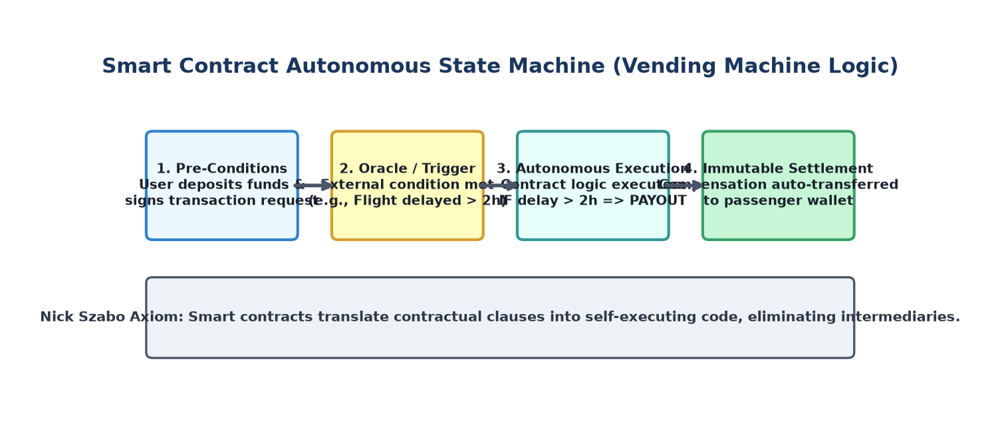
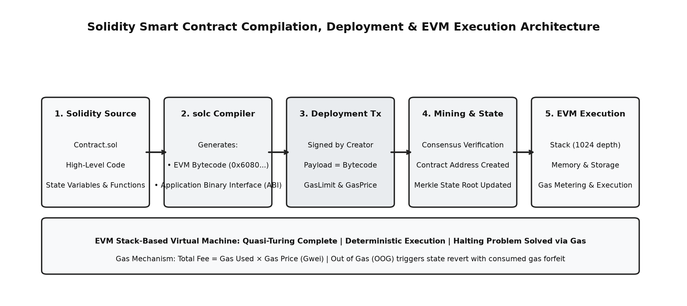
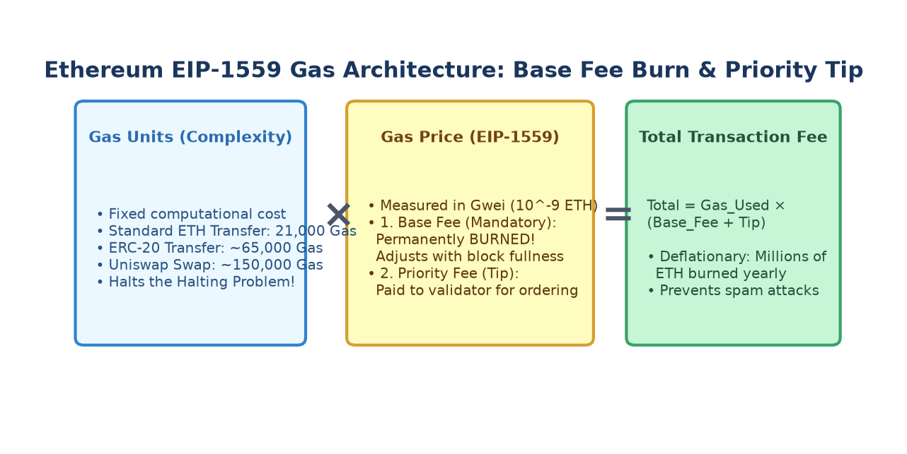

# SPPU B.E. Computer Engineering (2019 Pattern)
## Blockchain Technology — Unit 3: Smart Contracts, EVM & Ethereum
### Complete Examination Solutions Guide (Engineered for Full 8/8 Marks)

---

## Q1. What is Ethereum? Discuss what it is, state its components, and explain how it differs from traditional cryptocurrencies. (Frequency: 5) [8 Marks]

### Introduction & Core Intuition

**Ethereum** is an open-source, globally decentralized computing platform and operating **system** featuring **smart contract** execution capabilities. Proposed in late 2013 by programmer **Vitalik Buterin** and launched in July 2015, Ethereum extends blockchain technology beyond simple peer-to-peer monetary transfers into a programmable, general-purpose World Computer. It allows developers to build and deploy permanent, **immutable** decentralized applications (DApps) that execute exactly as.

### **The Conceptual Architecture of the World Computer**

While early blockchain **systems** like **Bitcoin** function primarily as distributed digital payment ledgers, **Ethereum** was engineered as a decentralized Turing-complete **state** machine. In traditional cloud computing, software applications run on centralized servers owned by corporations like Amazon AWS or **Google Cloud**. In Ethereum, computation is replicated across thousands of independent validator **nodes** worldwide. Every participant executes.

### **Core Architectural Components of Ethereum**

The **Ethereum** platform is comprised of four interdependent architectural **layers** that work in synchronized harmony. First, the **Account Model Layer** categorizes participants into Externally Owned Accounts (EOAs controlled by human users via private **keys**) and Contract Accounts (autonomous autonomous code entities governed by internal logic). Second, the **Ethereum Virtual Machine** (**EVM**) serves as the sandboxed runtime.

### **The Account-Based State Transition Model**

**Ethereum** maintains a persistent global **ledger** state known as the **World State**, which maps 20-byte addresses to account objects containing four specific fields: a **transaction** nonce, the Ether balance in Wei, a storage root hash pointing to a Merkle Patricia Trie, and the code hash of the deployed bytecode. Unlike **Bitcoin**'s Unspent Transaction Output (UTXO) model,.

### **Key Distinctions from Traditional Cryptocurrencies**

Traditional cryptocurrencies, typified by **Bitcoin**, are strictly optimized for value preservation and peer-to-peer settlement using a deliberately constrained, non-Turing-complete scripting language (Script). This design prevents complex **execution** loops to prioritize financial **security**. In sharp contrast, **Ethereum** provides a rich, Turing-complete execution environment that can evaluate arbitrary **algorithms**, maintain complex persistent **state** variables, and execute automated multi-party.

### Architectural Flow & System Diagram


*Figure 3.1: Architectural Flow and Conceptual System Diagram for What is Ethereum?  what it is, state its components, and explain how it differs from traditional cryptocurrencies*

### Mathematical Formulation & Algorithmic Mechanics

**Ethereum Global State Transition Function & Account State Structure:**

```text
Global State Transition Invariant: sigma_t+1 = APPLY( sigma_t, Transaction )
Where sigma represents the global state trie and APPLY represents the deterministic EVM execution function.
Account State Tuple: Account_State = ( Nonce, Balance, StorageRoot, CodeHash )
Where Nonce is the transaction counter, Balance is measured in Wei (1 ETH = 10^18 Wei),
```

The mathematical formulation and algorithmic **parameters** defined above govern the runtime behavior of the system. Each parameter serves an exact role: primary terms scale throughput, penalty terms enforce **regularization** constraints, and **optimization** objectives drive steady **convergence** toward the **global minimum**.

### Worked Example & Practical Simulation

**Practical Comparison** of Value Transfer vs Programmatic Logic Execution: • Traditional **Bitcoin** Transfer: Alice sends 0.5 BTC to Bob. The Bitcoin network verifies Alice's **digital signature** and checks whether her unspent **transaction** outputs (UTXOs) have sufficient funds. If valid, the UTXO is consumed and a new UTXO is created for Bob's address. No complex computation or internal state variables are updated. • **Ethereum** DeFi Interaction: Alice deposits 100 USDC into an Aave decentralized lending pool.

### Key Comparative Evaluation

| Architectural Feature | Ethereum (Programmable Platform) | Bitcoin (Traditional Cryptocurrency) |
| :--- | :--- | :--- |
| Primary Architectural Purpose | General-purpose decentralized World Computer & DApps | Decentralized peer-to-peer electronic cash & digital gold |
| Execution Engine & Scripting | Turing-complete Ethereum Virtual Machine (EVM) | Non-Turing-complete Forth-like stack script (no loops) |
| State Ledger Accounting Model | Account-based model (EOAs and Contract Accounts) | Unspent Transaction Output (UTXO) graph model |
| Consensus Mechanism | Proof of Stake (PoS) with validator capital staking | Proof of Work (PoW) with computational ASIC mining |

### Concluding Exam Takeaway

**Ethereum** revolutionized distributed **systems** by **proving** that **blockchain** networks can execute complex, decentralized software applications rather than merely functioning as static **ledgers** of financial balances. For optimal SPPU examination scoring, answers must present this complete structure: rigorous theoretical definitions with bold keywords, an accurate architectural flow diagram, clear mathematical formulation, and a structured worked simulation to secure the full 8/**8 marks**.

**Textbook Reference:** Subramanian, C., George, A. A., Ranade, A., & Vasudevan, S. K. (Universities Press), Chapter 4: 'Ethereum and Smart Contract Ecosystem', pp. 95-122.

---

## Q2. Enlist and explain the types of Ethereum networks (Mainnet, Testnet, Private Networks) and state their purposes. (Frequency: 5) [8 Marks]

### Introduction & Core Intuition

An **Ethereum** Network is any distributed **peer-to-peer network** of computing nodes communicating via the Ethereum wire protocol to maintain a shared state **ledger**. Because developing and deploying smart contracts involves financial expenditure and **immutable** code deployment, Ethereum provides multiple distinct network environments categorized into three core types: **Ethereum Mainnet**, Public Testnets, and Private or Consortium Networks. Each serves a specific.

### **Ethereum Mainnet: The Production Settlement Layer**

The **Ethereum** Mainnet is the **primary** **public** **production** **blockchain** network (Chain ID: 1). It is the live, globally distributed economic environment where real economic **transactions** take place and real native cryptocurrency (ETH) possesses monetary value..

### **Public Testnets: Staging Environments for Developers**

**Public Testnets** are open networks that replicate the exact **execution** environment, **consensus** rules, and **EVM** opcodes of Mainnet, but operate with worthless **test** currency distributed freely through web faucets. The two active official **Ethereum** testnets.

### **Local and Sandbox Networks for Fast Prototyping**

Before **deploying** to **public** **testnets**, **developers** run **Local Development Networks** directly on their personal workstations using developer tools such as Hardhat Network, Anvil (Foundry), or Ganache. These lightweight virtual environments execute locally in **memory**, support.

### **Private and Consortium Networks for Enterprise**

**Private** and **Consortium Networks** are **completely** isolated **Ethereum** blockchains operated by authorized enterprises or industry groups using enterprise-grade **node** clients such as Hyperledger Besu or GoQuorum. Unlike public networks where anyone can inspect **data** and.

### Architectural Flow & System Diagram


*Figure 3.2: Architectural Flow and Conceptual System Diagram for Enlist and explain the types of Ethereum networks (Mainnet, Testnet, Private Networks) and state their purposes*

### Mathematical Formulation & Algorithmic Mechanics

**EIP-155 Network Replay Protection Formula & Standard Chain Identifiers:**

```text
EIP-155 Digital Signature Recovery Identifier: v = 2 * Chain_ID + 35  (or  v = 2 * Chain_ID + 36)
Where Chain_ID ensures transactions signed for one network cannot be replayed on another.
Official Chain Identifiers: Mainnet = 1 | Sepolia = 11155111 | Holesky = 17000 | Hardhat_Local = 31337
Testnet Economic Value Invariant: Value(Testnet_ETH) = 0 USD (Distributed via Faucets)
```

The mathematical formulation and algorithmic **parameters** defined above govern the runtime behavior of the system. Each parameter serves an exact role: primary terms scale throughput, penalty terms enforce **regularization** constraints, and **optimization** objectives drive steady **convergence** toward the **global minimum**.

### Worked Example & Practical Simulation

**Practical Developer Workflow Across Network Environments**: • **Phase** 1 (**Local** Hardhat Sandbox): A developer builds a decentralized automated market maker (AMM). They write 50 automated **tests** in Foundry. Tests execute in **3.4 seconds** locally, catching a logic bug in fee calculation without spending any money. • Phase 2 (Sepolia Testnet): The **contract** is deployed to Sepolia at address 0x4B... The frontend web application is connected to MetaMask. Team members test token swaps across different mobile.

### Key Comparative Evaluation

| Network Characteristic | Ethereum Mainnet | Public Testnet (Sepolia) | Private / Consortium Network |
| :--- | :--- | :--- | :--- |
| Primary Operational Purpose | Live commercial production and real asset settlement | Pre-deployment staging, DApp integration, testing | Internal enterprise workflows and supply chain privacy |
| Cryptocurrency & Gas Value | Real financial value (Real ETH traded on exchanges) | Zero economic value (Free test ETH from faucets) | Zero gas fees or artificial internal accounting tokens |
| Node Participation & Access | Completely permissionless; anyone can run a node | Permissionless reading; authorized validator nodes | Strictly permissioned; approved organizations only |
| Data Transparency & Privacy | 100% public and transparent on block explorers | 100% public on testnet block explorers | Configurable private states with confidential channels |

### Concluding Exam Takeaway

**Selecting** the appropriate **Ethereum** network **environment** ensures that decentralized applications achieve thorough testing and **validation** before committing valuable digital assets to the **immutable** Mainnet. For optimal SPPU examination scoring, answers must present this complete structure: rigorous theoretical definitions with bold keywords, an accurate architectural flow diagram, clear mathematical formulation, and a structured worked simulation to secure the full 8/**8 marks**.

**Textbook Reference:** Subramanian, C., George, A. A., Ranade, A., & Vasudevan, S. K. (Universities Press), Chapter 4: 'Ethereum and Smart Contract Ecosystem', pp. 123-145.

---

## Q3. Explain the Ethereum Virtual Machine (EVM) in detail and discuss its significance. (Frequency: 3) [8 Marks]

### Introduction & Core Intuition

The **Ethereum Virtual Machine** (**EVM**) is the decentralized, quasi-Turing-complete, sandboxed runtime execution engine that serves as the heart of the **Ethereum** blockchain. It executes **smart contract** machine instructions across thousands of validator nodes worldwide, guaranteeing that every node processes identical **transactions** and arrives at the exact same cryptographic system state. The EVM is completely isolated from the host computer's operating.

### **The Internal Architecture of the EVM**

The **EVM** operates as a stack-based virtual machine with a 256-bit word size, specifically chosen to optimize 256-bit cryptographic hashing **functions** (Keccak-256) and **elliptic curve** arithmetic. Internally, the EVM **execution** environment manages four distinct **memory** regions: the Execution.

### **Volatile Memory vs Persistent Contract Storage**

The **EVM** maintains a critical boundary between temporary and permanent **data** storage. **Volatile Memory** is a byte-addressable linear array that expands dynamically during **transaction** execution to hold temporary variables, strings, and calculation **buffers**. Its contents are completely discarded.

### **Calldata and Immutable Program Execution**

Calldata is a read-only, non-modifiable byte-addressable **memory** buffer where the input **parameters** and **execution** payloads of incoming **transactions** are stored. When an external account calls a **smart contract** function, the first four bytes of calldata contain the Keccak-256.

### **Deterministic Execution and the Gas Metering Engine**

A **fundamental** **challenge** in **distributed** computing is preventing malicious or erroneous programs from locking up the entire network in infinite loops (the classical **Halting Problem**). The **EVM** solves this problem deterministically using a **Gas** Meter. Every low-level opcode.

### Architectural Flow & System Diagram


*Figure 3.3: Architectural Flow and Conceptual System Diagram for the Ethereum Virtual Machine (EVM) in detail and discuss its significance*

### Mathematical Formulation & Algorithmic Mechanics

**EVM Machine State Tuple & Deterministic Execution Formulation:**

```text
EVM Computation State Tuple: mu = ( Program_Counter, Stack, Memory, Active_Storage, Gas_Remaining )
Stack Depth Boundary: Size(Stack) <= 1024 elements  (Each element = 256 bits = 32 bytes)
Storage Mutation Cost Rule: Gas(SSTORE_New) = 20,000 Gas  |  Gas(SSTORE_Update) = 5,000 Gas
Memory Expansion Cost Function: C_mem(a) = 3 * a + floor( a^2 / 512 )
```

The mathematical formulation and algorithmic **parameters** defined above govern the runtime behavior of the system. Each parameter serves an exact role: primary terms scale throughput, penalty terms enforce **regularization** constraints, and **optimization** objectives drive steady **convergence** toward the **global minimum**.

### Worked Example & Practical Simulation

Step-by-**Step Low**-Level **EVM** Opcode **Execution** Trace: • **Contract** Objective: Add two numbers (5 and 3) and store the result in contract storage slot 0. • Step 1: PUSH1 0x05 -> Pushes constant 5 onto stack. Stack: [5]. **Gas** deducted: 3. • Step 2: PUSH1 0x03 -> Pushes constant 3 onto stack. Stack: [3, 5]. Gas deducted: 3. • Step 3: ADD -> Pops top two values, computes 3 + 5 = 8, pushes 8 onto.

### Key Comparative Evaluation

| EVM Memory Component | Persistence | Read / Write Access | Relative Gas Cost | Primary Data Role |
| :--- | :--- | :--- | :--- | :--- |
| Execution Stack | Volatile (Transaction duration) | LIFO Read & Write (Top 16 items) | Extremely Low (3 Gas per push/pop) | Holds immediate operands and arithmetic pointers |
| Linear Volatile Memory | Volatile (Transaction duration) | Random Byte Read & Write | Low to Quadratic with expansion | Temporary calculation buffers, array slicing, strings |
| Calldata Buffer | Volatile (Transaction duration) | Read-Only (Immutable payload) | Very Low (Cheaper than memory) | Stores incoming function parameters and signature hash |
| Contract Storage | Permanent (Lives forever on disk) | Key-Value Read & Write (256-bit) | Extremely High (Up to 20,000 Gas) | Preserves state variables, account balances, ownership lists |

### Concluding Exam Takeaway

The **Ethereum Virtual Machine** delivers a **secure**, **isolated**, and **deterministic** runtime environment that allows untrusted global participants to agree on complex **state** transitions without central authority. For optimal SPPU examination scoring, answers must present this complete structure: rigorous theoretical definitions with bold keywords, an accurate architectural flow diagram, clear mathematical formulation, and a structured worked simulation to secure the full 8/**8 marks**.

**Textbook Reference:** Subramanian, C., George, A. A., Ranade, A., & Vasudevan, S. K. (Universities Press), Chapter 4: 'Ethereum and Smart Contract Ecosystem', pp. 146-170.

---

## Q4. What is a smart contract? Define its purpose, types, and discuss a real-world scenario example. (Frequency: 7) [8 Marks]

### Introduction & Core Intuition

A **Smart Contract** is a self-executing software program stored immutably on a blockchain network that autonomously enforces, validates, and executes contractual terms when predefined cryptographic **conditions** are met. First conceptualized in 1994 by legal scholar and cryptographer **Nick Szabo**—long before the invention of blockchain—smart **contracts** translate business agreements and legal clauses into **deterministic** computer code. Once deployed to a decentralized.

### **The Foundational Purpose of Smart Contracts**

The **primary** **purpose** of a **smart contract** is to establish **Trustless Automation** between **mutually** untrusted parties. In traditional commercial commerce, entering into an agreement requires trusting counterparties to honor their obligations, or paying high legal and administrative fees to enforcement institutions. Smart **contracts** remove counterparty default risk by holding assets in escrow and automatically releasing them.

### **Core Architectural Characteristics**

Smart **contracts** possess four **foundational** **properties** that govern their operation. First is Immutability: once deployed to the blockchain, the contract's code cannot be secretly altered or deleted by anyone, including the original author. Second is **Deterministic** Execution: given the same **state** and inputs, every **node** will execute the contract and reach the exact same output. Third.

### **Primary Types of Smart Contracts**

**Modern** smart **contracts** can be **categorized** into four **distinct** functional types based on their application domain. First, Token and **Asset Contracts** (ERC-20, ERC-721, ERC-1155) represent fungible tokens, digital art, or tokenized physical real estate with automated ownership transfers. Second, Decentralized Finance (DeFi) **Protocols** govern complex automated market making (Uniswap), algorithmic lending (Compound, Aave), and decentralized stablecoin.

### **Integration with Blockchain Oracles**

Because **blockchains** are **isolated**, self-contained networks, the **EVM** cannot natively make HTTP requests to query external web APIs for real-world information. To overcome this limitation, smart **contracts** utilize **Blockchain Oracles** (such as Chainlink). Oracles gather external real-world **data**—such as weather reports, stock prices, or flight delay statuses—cryptographically sign the data feeds, and inject them into smart.

### Architectural Flow & System Diagram



*Figure 3.4: Architectural Flow and Conceptual System Diagram for What is a smart contract? Define its purpose, types, and discuss a real-world scenario example*

### Mathematical Formulation & Algorithmic Mechanics

**Autonomous Smart Contract Execution State Logic & Payout Rule:**

```text
Autonomous Contract Execution Rule: State_t+1 = IF ( Condition_Met == True ) THEN Execute_Payout() ELSE Revert()
Nick Szabo Vending Machine Formalism: Vending_Machine( Coin_Inserted, Code_Selected ) -> Item_Dispensed
Parametric Insurance Payout Invariant:
Payout_Decision = ( Flight_Status == DELAYED ) AND ( Delay_Duration >= Threshold_Hours )
```

The mathematical formulation and algorithmic **parameters** defined above govern the runtime behavior of the system. Each parameter serves an exact role: primary terms scale throughput, penalty terms enforce **regularization** constraints, and **optimization** objectives drive steady **convergence** toward the **global minimum**.

### Worked Example & Practical Simulation

Real-**World Scenario Example**: Automated Parametric Flight Delay Insurance: • Context: Alice purchases an automated flight insurance **smart contract** for 20 USD when booking a flight from Mumbai to London. • **Contract** Terms: If Flight AI-131 is delayed by more than **2 hours**, the contract will automatically transfer 200 USD compensation directly to Alice's wallet. • Autonomous **Execution**: On flight day, weather issues delay the departure by 3 hours. The Chainlink Oracle network monitors FAA and.

### Key Comparative Evaluation

| Comparison Dimension | Blockchain Smart Contract | Traditional Legal Contract |
| :--- | :--- | :--- |
| Contractual Form | Executable computer code (Solidity, Vyper bytecode) | Written legal natural language (English, legalese) |
| Execution Enforcement | Autonomous mathematical enforcement by EVM nodes | Enforced through court systems, bailiffs, and litigation |
| Intermediary Requirement | Zero; direct peer-to-peer trustless execution | High; relies on attorneys, banks, notaries, and judges |
| Execution Speed | Seconds to minutes (block confirmation speed) | Weeks to months or years (manual processing and courts) |

### Concluding Exam Takeaway

Smart **contracts** transform **passive** **agreements** into **dynamic**, self-**enforcing** digital covenants that eliminate counterparty risk and pioneer autonomous global commerce. For optimal SPPU examination scoring, answers must present this complete structure: rigorous theoretical definitions with bold keywords, an accurate architectural flow diagram, clear mathematical formulation, and a structured worked simulation to secure the full 8/**8 marks**.

**Textbook Reference:** Subramanian, C., George, A. A., Ranade, A., & Vasudevan, S. K. (Universities Press), Chapter 4: 'Ethereum and Smart Contract Ecosystem', pp. 171-198.

---

## Q5. Describe the basic steps involved in deploying a smart contract on the Ethereum blockchain. (Frequency: 1) [8 Marks]

### Introduction & Core Intuition

Deploying a **smart contract** on the **Ethereum** blockchain is the rigorous engineering **process** of translating human-readable high-level source code into low-level **EVM bytecode** and publishing it permanently to the **distributed ledger**. Once deployed, the **contract** is assigned a unique cryptographic address, becomes globally accessible to all network participants, and cannot be deleted or overwritten. Successful deployment follows six disciplined, sequential.

### **Step 1: Authoring and Unit Testing the Solidity Source Code**

The deployment lifecycle begins by authoring the **smart contract** in a high-level programming language such as **Solidity** (.sol) or Vyper. During this initial stage, engineers define **state** variables, public and private **functions**, events, and **security** modifiers (such as ReentrancyGuard and Ownable). Rigorous automated **unit testing** must be performed locally using testing frameworks like Foundry or Hardhat.

### **Step 2: Compilation and Generation of ABI and Bytecode**

Once the code passes local unit tests, it is passed through the **Solidity** compiler (solc). The compiler performs two vital operations: first, it compiles the human-readable instructions into hexadecimal **EVM Bytecode** that the **execution** engine can **process**; second, it generates the **Application Binary Interface** (ABI). The ABI is a structured JSON representation that defines every **function**.

### **Step 3: Staging Deployment on Public Testnets**

Before **risking** real **financial** assets on Mainnet, the compiled bytecode must be deployed and validated on public staging testnets (such as Sepolia). Deploying to a testnet simulates real-world network **latency**, variable **gas price** conditions, and asynchronous block **mining** without requiring real financial expenditure. Developers interact with the deployed testnet **contract** using web applications to confirm that.

### **Step 4: Construction of the Deployment Transaction**

To deploy a **contract** onto **Ethereum**, the developer constructs a specialized **transaction** with specific **parameter** fields: the 'to' address is set to null (0x0) or left empty, indicating a contract creation request; the '**data**' field is populated with the compiled creation bytecode; and the 'value' field is optionally loaded with Ether if the constructor is payable..

### Architectural Flow & System Diagram


*Figure 3.5: Architectural Flow and Conceptual System Diagram for Describe the basic steps involved in deploying a smart contract on the Ethereum blockchain*

### Mathematical Formulation & Algorithmic Mechanics

**Deterministic Contract Address Computation Formula & Deployment Invariant:**

```text
Contract Address Derivation Formula:
Contract_Address = Rightmost_160_Bits( Keccak256( RLP_Encode( Sender_Address, Sender_Nonce ) ) )
Where RLP_Encode is Recursive Length Prefix serialization, and Sender_Nonce is the deployer's transaction count.
CREATE2 Alternative Address Formula (EIP-1014):
```

The mathematical formulation and algorithmic **parameters** defined above govern the runtime behavior of the system. Each parameter serves an exact role: primary terms scale throughput, penalty terms enforce **regularization** constraints, and **optimization** objectives drive steady **convergence** toward the **global minimum**.

### Worked Example & Practical Simulation

**Deterministic** Address Computation Example: • Deployer Account: 0x95A1E2B... (Deployer's EOA address) • Deployer **Nonce**: 12 (This is the 13th **transaction** sent by this account) • Address Computation: The **node** serializes (0x95A1E2B..., 12) using RLP, computes the 256-bit Keccak hash, and takes the last **20 bytes** (160 bits). • Resulting Contract Address: 0x7a250d5630B4cF539739dF2C5dAcb4c659F2488D. • Significance: The contract address is known mathematically even before the **transaction** is broadcast, enabling pre-configured multi-contract deployments.

### Key Comparative Evaluation

| Deployment Lifecycle Phase | Key Input Artifacts | Primary Operational Tool | Output Generated |
| :--- | :--- | :--- | :--- |
| Phase 1: Source Authoring | Specification & Business Logic | VS Code, Remix IDE, Foundry | Solid source file (.sol) with unit tests |
| Phase 2: Compiler Generation | Solidity Source Code (.sol) | Solc Compiler, Hardhat Compile | ABI JSON schema and Hex EVM Bytecode |
| Phase 3: Testnet Staging | Bytecode & Testnet ETH | Sepolia Faucet, MetaMask | Verified testnet deployment & test logs |
| Phase 4: Transaction Signing | Bytecode, Gas Limit, Nonce | Hardware Wallet, Private Key | Cryptographically signed raw transaction |

### Concluding Exam Takeaway

**Following** a **structured**, **multi**-stage deployment pipeline ensures that smart **contracts** are rigorously compiled, verified, and secured before managing valuable digital assets on the **immutable** blockchain. For optimal SPPU examination scoring, answers must present this complete structure: rigorous theoretical definitions with bold keywords, an accurate architectural flow diagram, clear mathematical formulation, and a structured worked simulation to secure the full 8/**8 marks**.

**Textbook Reference:** Subramanian, C., George, A. A., Ranade, A., & Vasudevan, S. K. (Universities Press), Chapter 4: 'Ethereum and Smart Contract Ecosystem', pp. 199-224.

---

## Q6. Explain Solidity in detail and discuss how smart contracts are implemented using it. (Frequency: 2) [8 Marks]

### Introduction & Core Intuition

**Solidity** is a high-level, statically-typed, contract-oriented programming language designed specifically for developing smart contracts that run on the **Ethereum Virtual Machine** (**EVM**). Syntactically influenced by C++, Python, and JavaScript, Solidity was originally proposed by **Gavin Wood** in 2014 and actively maintained by the **Ethereum** Foundation. It allows developers to author self-executing business logic, enforce strict cryptographic access controls, define complex.

### **Language Foundations and the Contract-Oriented Paradigm**

**Solidity** is contract-oriented, meaning that the fundamental building **block** is the contract construct, which closely resembles a class in classical object-oriented programming. A Solidity contract encapsulates **state** variables (**data** preserved permanently in blockchain storage), **functions** (executable code that can read or mutate state), function modifiers (reusable guards for **access control**), and events (searchable logs emitted to.

### **Comprehensive Type System and Data Locations**

**Solidity** provides an explicit type **system** divided into **Value Types** and Reference Types. Value types include booleans, integers (int8 to int256, uint8 to uint256), fixed-size byte arrays, and addresses. Reference types include dynamically-sized arrays, structs, and mappings (hash **tables** mapping **keys** to values). Crucially, Solidity requires developers to explicitly designate the **data** location for reference types:.

### **Function Modifiers and Cryptographic Access Control**

In **smart contract** engineering, restricting access to administrative **functions** is vital. **Solidity** accomplishes this through **Function Modifiers**, which wrap around functions to enforce preconditions before executing function bodies. For example, the standard onlyOwner modifier checks whether the **transaction** sender (msg.sender) matches the **contract** administrator address before proceeding. If the check fails, the require statement triggers a.

### **Events and the EVM Logging Mechanism**

Blockchains cannot directly push notifications to external web frontends. **Solidity** solves this through Events, which leverage **EVM** log opcodes (LOG0 through LOG4) to write structured **data** into **transaction** receipts. When a **contract** emits an event, up to three **parameters** can be designated as indexed topics. External client applications (such as decentralized exchange web interfaces) can listen.

### Architectural Flow & System Diagram



*Figure 3.6: Architectural Flow and Conceptual System Diagram for Solidity in detail and discuss how smart contracts are implemented using it*

### Mathematical Formulation & Algorithmic Mechanics

**Solidity Function Selector Derivation & Checks-Effects-Interactions Sequence:**

```text
Function Selector Hash Derivation Formula:
Selector( Signature ) = First_4_Bytes( Keccak256( 'transfer(address,uint256)' ) )
Where 'transfer(address,uint256)' yields Keccak hash 0xa9059cbb... -> Selector: 0xa9059cbb.
Checks-Effects-Interactions State Invariant:
```

The mathematical formulation and algorithmic **parameters** defined above govern the runtime behavior of the system. Each parameter serves an exact role: primary terms scale throughput, penalty terms enforce **regularization** constraints, and **optimization** objectives drive steady **convergence** toward the **global minimum**.

### Worked Example & Practical Simulation

**Practical Implementation** of a **Token** Transfer **Function** in **Solidity**: • **Contract** Definition: **contract** StandardToken { mapping(address => uint256) public balances; event Transfer(address indexed from, address indexed to, uint256 val); } • Step 1 (Checks): require(msg.sender != address(0), 'Invalid sender'); require(balances[msg.sender] >= amount, 'Balance too low'); • Step 2 (Effects): balances[msg.sender] -= amount; balances[recipient] += amount; • Step 3 (Event Logging): emit Transfer(msg.sender, recipient, amount); return true; • Operational Flow: When Alice calls transfer(Bob, 50), the.

### Key Comparative Evaluation

| Language Feature | Solidity (Smart Contract Language) | Java / C++ (Traditional OOP) | Python (Scripting) |
| :--- | :--- | :--- | :--- |
| Primary Target Runtime | Ethereum Virtual Machine (EVM Bytecode) | JVM / Native Machine CPU Instructions | Python Interpreter / CPython Bytecode |
| State Variable Persistence | Permanent on distributed blockchain ledger | Volatile in RAM; requires external SQL/NoSQL DB | Volatile in RAM; requires external DB/file storage |
| Execution Cost Model | Every instruction consumes Gas paid by caller | Free execution on host CPU resources | Free execution on host CPU resources |
| Code Mutability Post-Deploy | Strictly Immutable (cannot be edited or patched) | Easily patched via server restarts or updates | Easily patched via server scripts and redeployments |

### Concluding Exam Takeaway

**Solidity** bridges **human**-readable **software** engineering and low-level cryptographic **state** machines, providing the expressiveness and **security** needed to program global decentralized infrastructure. For optimal SPPU examination scoring, answers must present this complete structure: rigorous theoretical definitions with bold keywords, an accurate architectural flow diagram, clear mathematical formulation, and a structured worked simulation to secure the full 8/**8 marks**.

**Textbook Reference:** Subramanian, C., George, A. A., Ranade, A., & Vasudevan, S. K. (Universities Press), Chapter 4: 'Ethereum and Smart Contract Ecosystem', pp. 225-252.

---

## Q7. Explain the role of gas in the Ethereum network and discuss its significance in smart contract execution. (Frequency: 1) [8 Marks]

### Introduction & Core Intuition

In the **Ethereum** network, **Gas** is the fundamental computational metering unit that measures the exact amount of **computational effort** and physical storage resources required to execute a **transaction** or **smart contract** operation on the **Ethereum Virtual Machine** (**EVM**). Because Ethereum is a decentralized, shared world computer where thousands of independent validator nodes must execute every single instruction, gas functions both.

### **The Resource Metering Engine of the World Computer**

**Unlike** **traditional** **cloud** servers where users pay a flat monthly hosting fee, the **Ethereum** network operates on pay-per-instruction resource consumption. Every low-level opcode supported by the **EVM** has a strictly defined **gas** cost that reflects its physical computational burden on validator hardware. For instance, basic arithmetic operations like ADD or SUB consume 3 gas units, whereas.

### **Resolving the Halting Problem and Preventing DoS Attacks**

In **theoretical** **computer** science, **Alan Turing** proved the Halting Problem: it is mathematically impossible for a program to determine in advance whether an arbitrary computer program will finish running or loop infinitely. Without **gas**, a malicious attacker could deploy a **smart contract** containing an infinite while(true) loop, broadcasting a single **transaction** that would permanently freeze every.

### **EIP-1559 Dynamic Fee Mechanism: Base Fee and Priority Tip**

Introduced in the London **Hard Fork**, the EIP-1559 Protocol completely redesigned **Ethereum**'s **gas** fee economics. Under EIP-1559, every **transaction** fee consists of two distinct components: the **Base Fee** and the Priority Fee (Tip). The Base Fee is dynamically calculated by the network protocol based on block congestion; if blocks are more than 50% full, the base.

### **Gas Limit vs Gas Used vs Gas Price Dynamics**

Understanding **gas** requires distinguishing between three vital variables: **Gas Limit**, Gas Used, and **Gas Price**. The Gas Limit is the maximum ceiling of gas units the sender authorizes for the **transaction** (e.g., 21,000 for standard transfers; 200,000 for complex DeFi swaps). Gas Used is the actual computational units consumed by the **EVM** during execution. Any unused.

### Architectural Flow & System Diagram



*Figure 3.7: Architectural Flow and Conceptual System Diagram for the role of gas in the Ethereum network and discuss its significance in smart contract execution*

### Mathematical Formulation & Algorithmic Mechanics

**EIP-1559 Dynamic Transaction Fee Formula & Gas Refund Equation:**

```text
Total Transaction Fee Formula (EIP-1559):
Total_Fee = Gas_Used * ( Base_Fee + Priority_Fee )
Where Base_Fee is permanently burned and Priority_Fee is transferred to the block validator.
Dynamic Base Fee Adjustment Rule:
```

The mathematical formulation and algorithmic **parameters** defined above govern the runtime behavior of the system. Each parameter serves an exact role: primary terms scale throughput, penalty terms enforce **regularization** constraints, and **optimization** objectives drive steady **convergence** toward the **global minimum**.

### Worked Example & Practical Simulation

Worked Numerical Example of **Transaction** Fee and Burn Under EIP-1559: • Transaction Type: ERC-20 Token Transfer on **Ethereum** Mainnet. • User **Parameters**: **Gas Limit** = 80,000 units; Max Base Fee = 40 Gwei; Priority Tip = 2 Gwei. • Network State: Current Block Base Fee = 35 Gwei. • **EVM** Execution: The contract executes and consumes exactly 52,000 **Gas** Units. • Fee Breakdown Calculation: - Effective **Gas Price** = Base Fee (35 Gwei) + Tip.

### Key Comparative Evaluation

| EVM Instruction / Operation | Gas Cost (Units) | Physical Hardware Resource | Engineering Rationale |
| :--- | :--- | :--- | :--- |
| Basic Arithmetic (ADD, SUB, MUL) | 3 to 5 Gas | CPU register manipulation | Extremely fast micro-operation on CPU |
| Cryptographic Hash (SHA3 / Keccak256) | 30 Gas + 6/word | CPU intensive cryptographic logic | Measures variable data hashing workload |
| Volatile Memory Expansion (MSTORE) | 3 Gas + quad expansion | RAM allocation and cache lines | Discourages excessive RAM bloating in transactions |
| Storage Read (SLOAD - Cold) | 2,100 Gas | Disk I/O from LevelDB/PebbleDB | Disk reads are physically slow on node hardware |

### Concluding Exam Takeaway

**Gas** is the **indispensable** **economic** **engine** that **balances** computing resource consumption, eliminates spam attacks, and provides sustainable compensation for decentralized blockchain validators. For optimal SPPU examination scoring, answers must present this complete structure: rigorous theoretical definitions with bold keywords, an accurate architectural flow diagram, clear mathematical formulation, and a structured worked simulation to secure the full 8/**8 marks**.

**Textbook Reference:** Subramanian, C., George, A. A., Ranade, A., & Vasudevan, S. K. (Universities Press), Chapter 4: 'Ethereum and Smart Contract Ecosystem', pp. 253-278.

---

## Q8. Discuss Whisper (Decentralized Messaging Platform) and explain its purpose. (Frequency: 5) [8 Marks]

### Introduction & Core Intuition

**Whisper** is a **decentralized**, peer-to-peer communication and messaging **protocol** conceived by **Gavin Wood** as one of the three foundational pillars of the original Web3 vision, alongside **Ethereum** (decentralized computation) and Swarm (decentralized storage). Whisper was specifically designed to enable secure, ephemeral, dark, and metadata-free messaging between decentralized applications (DApps) and autonomous agents without relying on centralized telecommunication servers, cloud providers, or IP routing **tables**.

### **The Foundational Role of Whisper in Web3 Architecture**

When the **Ethereum** ecosystem was **originally** **formulated**, the **founders** recognized that a fully decentralized Web3 could not rely on traditional centralized communication backbones such as Amazon AWS, **Google Cloud**, or centralized messaging APIs. While Ethereum handles **consensus**-driven transactional settlements, running simple chat messages or real-world peer notifications directly on the blockchain is prohibitively expensive and permanently.

### **The Dark Communication Paradigm and Complete Anonymity**

**Whisper** is **architected** **around** the **concept** of **Dark Communication**. In traditional encrypted messaging platforms (such as Signal or WhatsApp), while the **payload** text may be encrypted, centralized servers still log critical metadata: who sent the message, who received it, the time of transmission, and the IP addresses of both parties. Whisper is designed to guarantee zero.

### **Topic-Based Routing and Asymmetric Cryptography**

Messages in Whisper are categorized into 4-byte Topics, which are derived from cryptographic **hashes** of interest channels. Every **node** in the network listens to incoming **packets**, attempts to decrypt them using its private **keys**, and forwards the packets to neighboring peers. If a node does not possess the correct **private key**, the packet appears as completely.

### **Proof-of-Work (PoW) Anti-Spam and Time-to-Live (TTL)**

**Because Whisper** operates without **gas** fees or monetary **transaction** charges, malicious **nodes** could theoretically flood the network with millions of spam messages, causing network congestion. To solve this, Whisper implements an algorithmic Proof-of-Work (PoW) anti-spam **requirement** coupled with a strict Time-to-Live (TTL) expiration **parameter**. Before a sender can broadcast a message, their workstation CPU must solve.

### Architectural Flow & System Diagram


*Figure 3.8: Architectural Flow and Conceptual System Diagram for Whisper (Decentralized Messaging Platform) and explain its purpose*

### Mathematical Formulation & Algorithmic Mechanics

**Whisper Proof-of-Work Formulation & Payload Decryption Invariant:**

```text
Whisper Proof-of-Work Anti-Spam Equation:
PoW = ( Size_In_Bytes( Envelope ) * TTL ) / ( Hash_Attempts * Elapsed_Seconds )
Where higher PoW thresholds force senders to expend significant CPU work before nodes accept envelopes.
Message Envelope Tuple: Envelope = ( Expiry_Time, TTL, Topic_4Bytes, Data_Payload, Nonce )
```

The mathematical formulation and algorithmic **parameters** defined above govern the runtime behavior of the system. Each parameter serves an exact role: primary terms scale throughput, penalty terms enforce **regularization** constraints, and **optimization** objectives drive steady **convergence** toward the **global minimum**.

### Worked Example & Practical Simulation

**Decentralized Peer**-to-Peer **Transaction** Negotiation via **Whisper**: • **Scenario**: Alice wants to negotiate an over-the-counter (OTC) token trade with Bob without alerting centralized surveillance or front-running bots. • Step 1: Alice creates an encrypted Whisper envelope addressed to Bob's **public key** with a 60-second TTL and topic 'OTC_ETH_DAI'. • Step 2: Alice's client solves a 1-second CPU Proof-of-Work puzzle to satisfy the network relay threshold. • Step 3: The envelope floods through 25 intermediate **Ethereum** nodes..

### Key Comparative Evaluation

| Communication Feature | Whisper / Waku (Decentralized) | Traditional Apps (Signal / WhatsApp) | On-Chain Ethereum Events |
| :--- | :--- | :--- | :--- |
| Underlying Network Topology | Peer-to-peer distributed gossip network | Centralized server infrastructure | Decentralized global blockchain consensus |
| Metadata Privacy & Anonymity | Zero metadata leakage; dark routing | Servers log IP addresses, phone numbers, timestamps | Zero privacy; 100% public on block explorers |
| Operational Cost Model | Free; gated by client CPU Proof-of-Work | Free or subscription; subsidized by central host | Expensive; requires paying gas fees in ETH |
| Data Persistence & Lifetime | Ephemeral (Self-destructs after TTL expires) | Stored on centralized cloud servers or local backup | Permanent; stored forever on blockchain disk |

### Concluding Exam Takeaway

**Whisper** **pioneered** **metadata**-free, **censorship**-resistant communication for Web3, establishing the architectural blueprints for modern private decentralized messaging **protocols** like Waku. For optimal SPPU examination scoring, answers must present this complete structure: rigorous theoretical definitions with bold keywords, an accurate architectural flow diagram, clear mathematical formulation, and a structured worked simulation to secure the full 8/**8 marks**.

**Textbook Reference:** Subramanian, C., George, A. A., Ranade, A., & Vasudevan, S. K. (Universities Press), Chapter 4: 'Ethereum and Smart Contract Ecosystem', pp. 279-301.

---

## Q9. Discuss Swarm (Decentralized Storage Platform) and its contribution to decentralized storage. (Frequency: 5) [8 Marks]

### Introduction & Core Intuition

Swarm is a decentralized, peer-to-peer distributed storage and content distribution network designed as the native storage **layer** of the **Ethereum** Web3 technology stack. Initiated by the **Ethereum Foundation** and led by Viktor Tron, Swarm provides serverless, censorship-resistant, and economically self-sustaining storage for **decentralized application** (DApp) frontends, **smart contract** data archives, and large media files. By providing a decentralized alternative to.

### **The Economic Necessity of Decentralized Storage in Web3**

Storing **data** directly inside smart **contracts** on the **Ethereum** blockchain is intentionally expensive; storing a mere 1 Megabyte of data on-chain can cost thousands of dollars in **gas** fees because every byte must be stored permanently by thousands of full validator **nodes** forever. Consequently, blockchains are strictly optimized for small cryptographic commitments and **state** balances. Swarm.

### **Content-Addressed Storage and Chunking Architecture**

In **traditional** web **hosting**, **files** are located by their physical address (**Uniform Resource Locators** - URLs like domain.com/**image**.png), meaning if the server goes offline, the **data** becomes unavailable. In Swarm, data is stored using Content Addressing. When a file is uploaded to Swarm, it is automatically sliced into uniform 4-Kilobyte cryptographic Chunks. Each chunk is hashed.

### **The Kademlia Distributed Hash Table (DHT) Topology**

**Swarm** **coordinates** participating **nodes** across the **globe** using a modified **Kademlia Distributed Hash Table** (DHT) network topology. Every node in Swarm is assigned an address in a 256-bit coordinate space. When a chunk is published, it is routed and stored on nodes whose cryptographic node addresses are geographically closest (using XOR distance **metrics**) to the chunk's.

### **The Swarm Accounting Protocol (SWAP) and BZZ Incentives**

A major failure mode of early peer-to-peer **systems** was the 'free-rider problem,' where users downloaded **data** without contributing **bandwidth** or storage. Swarm solves this through the **Swarm Accounting Protocol** (SWAP) powered by the native BZZ utility token. **Nodes** track bandwidth and storage credits bilaterally with neighboring peers using micro-payment channels. Nodes that store data chunks and.

### Architectural Flow & System Diagram


*Figure 3.9: Architectural Flow and Conceptual System Diagram for Swarm (Decentralized Storage Platform) and its contribution to decentralized storage*

### Mathematical Formulation & Algorithmic Mechanics

**Swarm Chunk Hashing Function & Kademlia Distance Metric:**

```text
Chunk Hashing Formulation: Chunk_Hash_i = Keccak256( Chunk_Data_i )  (Where Size(Chunk_Data) = 4096 Bytes)
Merkle Root Swarm Reference: BZZ_Reference = Merkle_Tree_Root( Chunk_Hash_1, Chunk_Hash_2, ..., Chunk_Hash_N )
Kademlia XOR Metric Distance: Distance( Node_Address, Chunk_Hash ) = Node_Address ⊕ Chunk_Hash
Retrieval Routing Latency Bound: Max_Hops = O( log_2( Total_Network_Nodes ) )
```

The mathematical formulation and algorithmic **parameters** defined above govern the runtime behavior of the system. Each parameter serves an exact role: primary terms scale throughput, penalty terms enforce **regularization** constraints, and **optimization** objectives drive steady **convergence** toward the **global minimum**.

### Worked Example & Practical Simulation

**Deploying** and **Accessing** a Censorship-Resistant Web3 Application on Swarm: • Step 1: A developer authors a decentralized exchange frontend comprising HTML, CSS, JavaScript, and WebAssembly bundles (Total size = 16 Megabytes). • Step 2: The developer uploads the directory to a local Swarm **node**. Swarm splits the **16 MB** bundle into 4,000 discrete 4 KB chunks, builds a **Merkle Tree**, and outputs the root reference **hash**: bzz://d2e8...7a9f. • Step 3: Swarm nodes nearest to the.

### Key Comparative Evaluation

| Storage System Feature | Swarm (Ethereum Web3 Native) | IPFS / Filecoin | Centralized Cloud (Amazon AWS S3) |
| :--- | :--- | :--- | :--- |
| Storage Architecture Model | Content-addressed 4 KB chunking with Kademlia | Content-addressed IPFS DAGs with Filecoin | Location-addressed centralized object storage |
| Blockchain Integration | Deep native Ethereum integration (BZZ token) | Independent network; bridged to Ethereum | Zero native blockchain integration |
| Incentive Mechanism | Swarm Accounting Protocol (SWAP & BZZ) | Filecoin storage deals & proof-of-spacetime | Monthly credit card billing to cloud provider |
| Data Censorship Resistance | Extremely High (Sharded across global nodes) | Extremely High (Distributed peer-to-peer) | Zero (Subject to corporate bans and government subpoenas) |

### Concluding Exam Takeaway

**Swarm** **completes** the Web3 **trinity** by **providing** a **serverless**, censorship-resistant distributed storage substrate that empowers decentralized applications to achieve true independence from centralized cloud giants. For optimal SPPU examination scoring, answers must present this complete structure: rigorous theoretical definitions with bold keywords, an accurate architectural flow diagram, clear mathematical formulation, and a structured worked simulation to secure the full 8/**8 marks**.

**Textbook Reference:** Subramanian, C., George, A. A., Ranade, A., & Vasudevan, S. K. (Universities Press), Chapter 4: 'Ethereum and Smart Contract Ecosystem', pp. 302-328.

---
