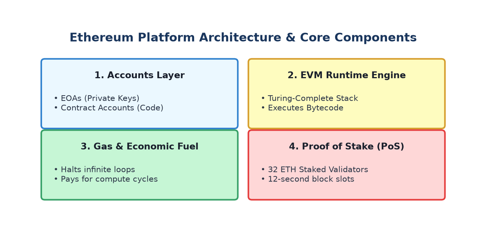
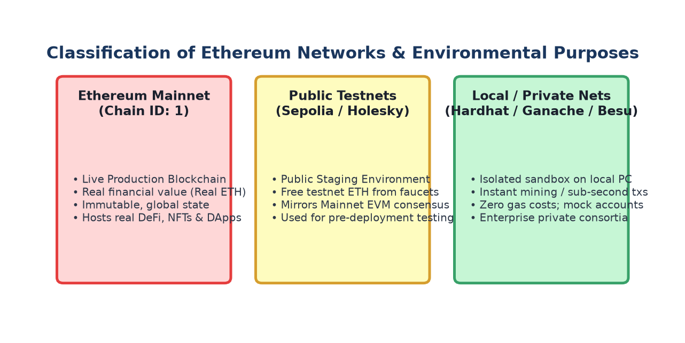
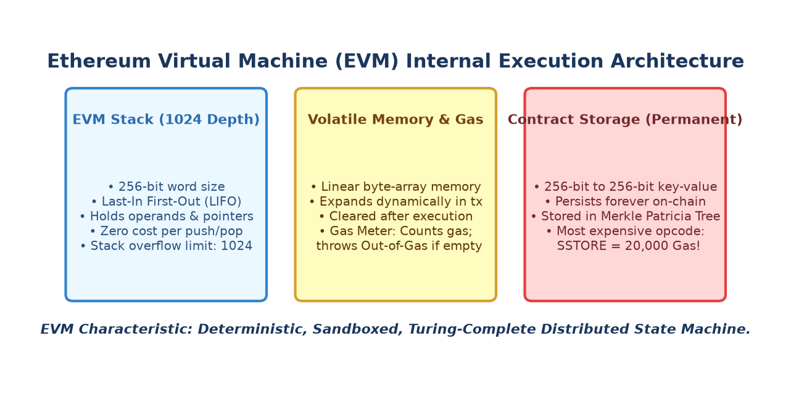
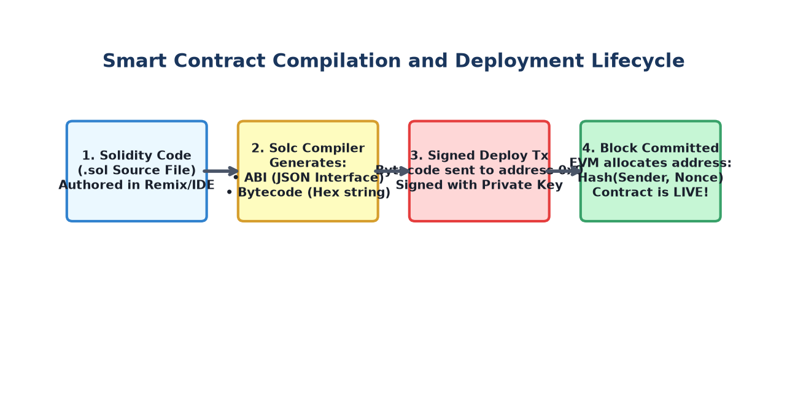
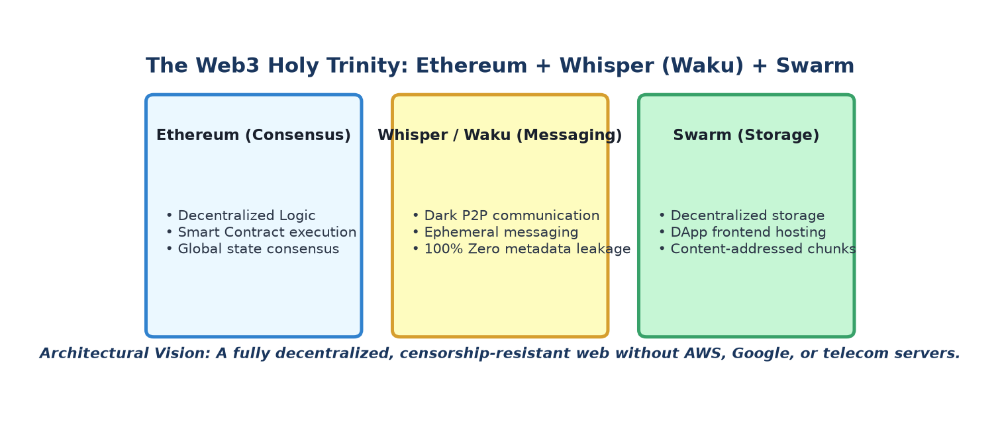
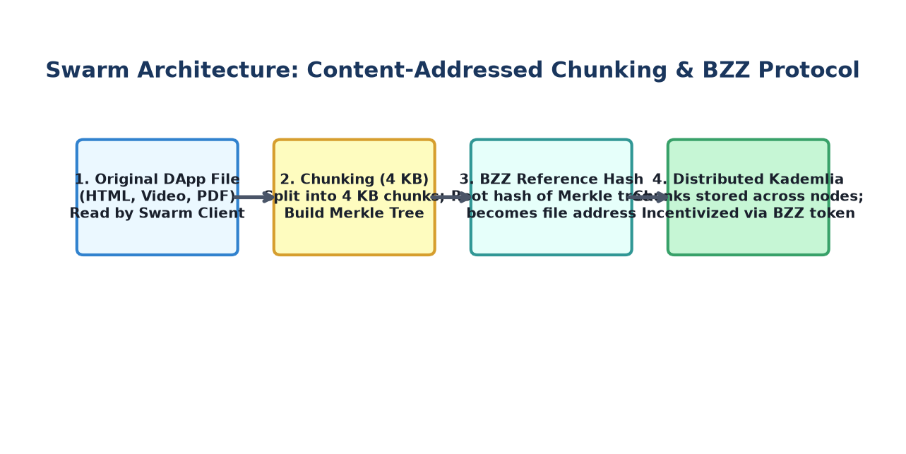

# SPPU B.E. Computer Engineering (2019 Pattern)
## Blockchain Technology — Unit 3: Smart Contracts, EVM & Ethereum
### Complete Examination Solutions Guide (Engineered for Full 8/8 Marks)

---
## Q1. What is Ethereum? Discuss what it is, state its components, and explain how it differs from traditional cryptocurrencies. (Frequency: 5) [8 Marks]

### Introduction & Core Intuition

**Ethereum** is an open-source, globally decentralized computing platform and operating **system** featuring **smart contract** execution capabilities. Proposed in late 2013 by programmer **Vitalik Buterin** and launched in July 2015, Ethereum extends blockchain technology beyond simple peer-to-peer monetary transfers into a programmable, general-purpose World Computer. It allows developers to build and deploy permanent, **immutable** decentralized applications (DApps) that execute exactly as programmed without any possibility of downtime, fraud, censorship, or third-party interference.

### **The Conceptual Architecture of the World Computer**

While early blockchain **systems** like **Bitcoin** function primarily as distributed digital payment ledgers, **Ethereum** was engineered as a decentralized Turing-complete **state** machine. In traditional cloud computing, software applications run on centralized servers owned by corporations like Amazon AWS or **Google Cloud**. In Ethereum, computation is replicated across thousands of independent validator **nodes** worldwide. Every participant executes the exact same instructions and maintains an identical synchronized copy of the global cryptographic system state, establishing guaranteed computing without centralized ownership.

### **Core Architectural Components of Ethereum**

The **Ethereum** platform is comprised of four interdependent architectural **layers** that work in synchronized harmony. First, the **Account Model Layer** categorizes participants into Externally Owned Accounts (EOAs controlled by human users via private **keys**) and Contract Accounts (autonomous autonomous code entities governed by internal logic). Second, the **Ethereum Virtual Machine** (**EVM**) serves as the sandboxed runtime execution engine that processes low-level stack instructions. Third, the **Gas Economic Mechanism** meters computational execution, preventing infinite execution loops and compensating network validators for consumed physical resources. Fourth, the **Consensus Engine (Proof of Stake)** coordinates distributed validators who stake capital (ETH) to propose, validate, and finalize blocks every twelve seconds.

### **The Account-Based State Transition Model**

**Ethereum** maintains a persistent global **ledger** state known as the **World State**, which maps 20-byte addresses to account objects containing four specific fields: a **transaction** nonce, the Ether balance in Wei, a storage root hash pointing to a Merkle Patricia Trie, and the code hash of the deployed bytecode. Unlike **Bitcoin**'s Unspent Transaction Output (UTXO) model, which treats currency as discrete transferable bills, Ethereum operates identically to a traditional banking ledger where account balances are updated directly through state transition functions upon every confirmed transaction.

### **Key Distinctions from Traditional Cryptocurrencies**

Traditional cryptocurrencies, typified by **Bitcoin**, are strictly optimized for value preservation and peer-to-peer settlement using a deliberately constrained, non-Turing-complete scripting language (Script). This design prevents complex **execution** loops to prioritize financial **security**. In sharp contrast, **Ethereum** provides a rich, Turing-complete execution environment that can evaluate arbitrary **algorithms**, maintain complex persistent **state** variables, and execute automated multi-party escrow agreements. Bitcoin represents programmable money, whereas Ethereum represents a programmable decentralized economy.

### **The Decentralized Application (DApp) Ecosystem**

By combining Turing-complete computation with decentralized consensus, Ethereum established the foundational infrastructure for modern Web3 applications. These include **Decentralized Finance (DeFi)** protocols that provide automated lending and exchange without banks, Non-Fungible Tokens (NFTs) representing verifiable digital ownership, and Decentralized Autonomous Organizations (DAOs) where collective corporate governance is executed purely by smart contract voting algorithms.

### Architectural Flow & System Diagram



*Figure 3.1: Architectural Flow and Conceptual System Diagram for What is Ethereum?  what it is, state its components, and explain how it differs from traditional cryptocurrencies*

### Mathematical Formulation & Algorithmic Mechanics

**Ethereum Global State Transition Function & Account State Structure:**

```text
Global State Transition Invariant: sigma_t+1 = APPLY( sigma_t, Transaction )
Where sigma represents the global state trie and APPLY represents the deterministic EVM execution function.
Account State Tuple: Account_State = ( Nonce, Balance, StorageRoot, CodeHash )
Where Nonce is the transaction counter, Balance is measured in Wei (1 ETH = 10^18 Wei),
```

The mathematical formulations defined above define the Ethereum world state transition function and four-tuple account state structure. The global state is modeled as a modified Merkle Patricia Trie mapping 160-bit account addresses to nonces, balances, storage roots, and code hashes. Applying a transaction triggers a deterministic state transition function $\sigma_{t+1} = \Upsilon(\sigma_t, T)$, executing bytecode instructions and updating world state with absolute mathematical reproducibility.

### Worked Example & Practical Simulation

**Practical Comparison** of Value Transfer vs Programmatic Logic Execution: • Traditional **Bitcoin** Transfer: Alice sends 0.5 BTC to Bob. The Bitcoin network verifies Alice's **digital signature** and checks whether her unspent **transaction** outputs (UTXOs) have sufficient funds. If valid, the UTXO is consumed and a new UTXO is created for Bob's address. No complex computation or internal state variables are updated. • **Ethereum** DeFi Interaction: Alice deposits 100 USDC into an Aave decentralized lending pool smart contract. The EVM checks Alice's EOA balance, increments her nonce, deducts gas fees, executes the deposit() function of the Aave contract bytecode, updates the contract's internal balance sheet in storage, mints 100 interest-bearing aUSDC tokens, and transfers them to Alice's wallet—all atomically in a single block transaction.

### Key Comparative Evaluation

| Architectural Feature | Ethereum (Programmable Platform) | Bitcoin (Traditional Cryptocurrency) |
| :--- | :--- | :--- |
| Primary Architectural Purpose | General-purpose decentralized World Computer & DApps | Decentralized peer-to-peer electronic cash & digital gold |
| Execution Engine & Scripting | Turing-complete Ethereum Virtual Machine (EVM) | Non-Turing-complete Forth-like stack script (no loops) |
| State Ledger Accounting Model | Account-based model (EOAs and Contract Accounts) | Unspent Transaction Output (UTXO) graph model |
| Consensus Mechanism | Proof of Stake (PoS) with validator capital staking | Proof of Work (PoW) with computational ASIC mining |

### Concluding Exam Takeaway

**Ethereum** revolutionized distributed **systems** by **proving** that **blockchain** networks can execute complex, decentralized software applications rather than merely functioning as static **ledgers** of financial balances. For optimal SPPU examination scoring, answers must present this complete structure: rigorous theoretical definitions with bold keywords, an accurate architectural flow diagram, clear mathematical formulation, and a structured worked simulation to secure the full 8/**8 marks**.

**Textbook Reference:** Subramanian, C., George, A. A., Ranade, A., & Vasudevan, S. K. (Universities Press), Chapter 4: 'Ethereum and Smart Contract Ecosystem', pp. 95-122.

---
## Q2. Enlist and explain the types of Ethereum networks (Mainnet, Testnet, Private Networks) and state their purposes. (Frequency: 5) [8 Marks]

### Introduction & Core Intuition

An **Ethereum** Network is any distributed **peer-to-peer network** of computing nodes communicating via the Ethereum wire protocol to maintain a shared state **ledger**. Because developing and deploying smart contracts involves financial expenditure and **immutable** code deployment, Ethereum provides multiple distinct network environments categorized into three core types: **Ethereum Mainnet**, Public Testnets, and Private or Consortium Networks. Each serves a specific purpose in the engineering, testing, staging, and enterprise deployment lifecycle.

### **Ethereum Mainnet: The Production Settlement Layer**

The **Ethereum** Mainnet is the **primary** **public** **production** **blockchain** network (Chain ID: 1). It is the live, globally distributed economic environment where real economic **transactions** take place and real native cryptocurrency (ETH) possesses monetary value On Mainnet, every smart contract deployment and state update requires paying real transaction fees to network validators. The Mainnet offers maximum decentralization, high cryptographic security, and immutability, making it the final destination for verified decentralized finance applications, NFTs, and global digital asset registries.

### **Public Testnets: Staging Environments for Developers**

**Public Testnets** are open networks that replicate the exact **execution** environment, **consensus** rules, and **EVM** opcodes of Mainnet, but operate with worthless **test** currency distributed freely through web faucets. The two active official **Ethereum** testnets are **Sepolia** (optimized for smart contract application development and testing with a closed, permissioned set of validator nodes) and **Holesky** (optimized for infrastructure testing, staking validation, and protocol upgrades with a large public validator pool). Historically popular testnets like Ropsten, Rinkeby, and Goerli have been deprecated to ensure testing integrity.

### **Local and Sandbox Networks for Fast Prototyping**

Before **deploying** to **public** **testnets**, **developers** run **Local Development Networks** directly on their personal workstations using developer tools such as Hardhat Network, Anvil (Foundry), or Ganache. These lightweight virtual environments execute locally in **memory**, support instant transaction mining without waiting for block intervals, provide detailed stack traces for failing transactions, and allow developers to pre-load mock accounts with arbitrary balances without internet connectivity.

### **Private and Consortium Networks for Enterprise**

**Private** and **Consortium Networks** are **completely** isolated **Ethereum** blockchains operated by authorized enterprises or industry groups using enterprise-grade **node** clients such as Hyperledger Besu or GoQuorum. Unlike public networks where anyone can inspect **data** and submit transactions, private networks enforce strict cryptographic access control, restrict node participation, allow private transaction enclaves with encrypted payloads, and achieve high transaction throughput without incurring public gas fees.

### **Strategic Lifecycle of Smart Contract Deployment**

Professional blockchain software engineering demands a disciplined progression across these network tiers. An engineering team first authors and unit-tests contracts locally on Hardhat or Anvil. Once unit tests pass, contracts are deployed to the Sepolia testnet to undergo integration testing with real wallets and external web applications. Finally, after independent security audits and bug-bounty testing, the contract is permanently deployed to the Ethereum Mainnet.

### Architectural Flow & System Diagram



*Figure 3.2: Architectural Flow and Conceptual System Diagram for Enlist and explain the types of Ethereum networks (Mainnet, Testnet, Private Networks) and state their purposes*

### Mathematical Formulation & Algorithmic Mechanics

**EIP-155 Network Replay Protection Formula & Standard Chain Identifiers:**

```text
EIP-155 Digital Signature Recovery Identifier: v = 2 * Chain_ID + 35  (or  v = 2 * Chain_ID + 36)
Where Chain_ID ensures transactions signed for one network cannot be replayed on another.
Official Chain Identifiers: Mainnet = 1 | Sepolia = 11155111 | Holesky = 17000 | Hardhat_Local = 31337
Testnet Economic Value Invariant: Value(Testnet_ETH) = 0 USD (Distributed via Faucets)
```

The mathematical expressions defined above formalize the EIP-155 replay protection standard across EVM blockchain networks. By incorporating the unique chain identifier directly into the digital signature recovery byte ($v = 2 \times \text{Chain\_ID} + 35$), transactions cryptographically bound to one network (such as Ethereum Mainnet) fail signature recovery on other chains (such as BSC or Polygon), completely eliminating cross-chain replay vulnerabilities.

### Worked Example & Practical Simulation

**Practical Developer Workflow Across Network Environments**: • **Phase** 1 (**Local** Hardhat Sandbox): A developer builds a decentralized automated market maker (AMM). They write 50 automated **tests** in Foundry. Tests execute in **3.4 seconds** locally, catching a logic bug in fee calculation without spending any money. • Phase 2 (Sepolia Testnet): The **contract** is deployed to Sepolia at address 0x4B... The frontend web application is connected to MetaMask. Team members test token swaps across different mobile browsers using free Sepolia faucet ETH, observing block confirmations across 12-second slots. • Phase 3 (Production Mainnet): After passing a formal security audit, the verified contract is compiled and broadcast to Ethereum Mainnet with 2,500,000 gas, going live for thousands of global users.

### Key Comparative Evaluation

| Network Characteristic | Ethereum Mainnet | Public Testnet (Sepolia) | Private / Consortium Network |
| :--- | :--- | :--- | :--- |
| Primary Operational Purpose | Live commercial production and real asset settlement | Pre-deployment staging, DApp integration, testing | Internal enterprise workflows and supply chain privacy |
| Cryptocurrency & Gas Value | Real financial value (Real ETH traded on exchanges) | Zero economic value (Free test ETH from faucets) | Zero gas fees or artificial internal accounting tokens |
| Node Participation & Access | Completely permissionless; anyone can run a node | Permissionless reading; authorized validator nodes | Strictly permissioned; approved organizations only |
| Data Transparency & Privacy | 100% public and transparent on block explorers | 100% public on testnet block explorers | Configurable private states with confidential channels |

### Concluding Exam Takeaway

**Selecting** the appropriate **Ethereum** network **environment** ensures that decentralized applications achieve thorough testing and **validation** before committing valuable digital assets to the **immutable** Mainnet. For optimal SPPU examination scoring, answers must present this complete structure: rigorous theoretical definitions with bold keywords, an accurate architectural flow diagram, clear mathematical formulation, and a structured worked simulation to secure the full 8/**8 marks**.

**Textbook Reference:** Subramanian, C., George, A. A., Ranade, A., & Vasudevan, S. K. (Universities Press), Chapter 4: 'Ethereum and Smart Contract Ecosystem', pp. 123-145.

---
## Q3. Explain the Ethereum Virtual Machine (EVM) in detail and discuss its significance. (Frequency: 3) [8 Marks]

### Introduction & Core Intuition

The **Ethereum Virtual Machine** (**EVM**) is the decentralized, quasi-Turing-complete, sandboxed runtime execution engine that serves as the heart of the **Ethereum** blockchain. It executes **smart contract** machine instructions across thousands of validator nodes worldwide, guaranteeing that every node processes identical **transactions** and arrives at the exact same cryptographic system state. The EVM is completely isolated from the host computer's operating system, file system, and hardware processes, ensuring deterministic and secure execution.

### **The Internal Architecture of the EVM**

The **EVM** operates as a stack-based virtual machine with a 256-bit word size, specifically chosen to optimize 256-bit cryptographic hashing **functions** (Keccak-256) and **elliptic curve** arithmetic. Internally, the EVM **execution** environment manages four distinct **memory** regions: the Execution Stack**, **Volatile Memory**, **Calldata**, and **Persistent Storage**. The stack maintains a maximum depth of 1024 elements and holds operands for arithmetic and logic opcodes. If a computation attempts to push an item when the stack contains 1024 elements, a stack overflow exception is triggered immediately.

### **Volatile Memory vs Persistent Contract Storage**

The **EVM** maintains a critical boundary between temporary and permanent **data** storage. **Volatile Memory** is a byte-addressable linear array that expands dynamically during **transaction** execution to hold temporary variables, strings, and calculation **buffers**. Its contents are completely discarded as soon as the transaction finishes. In contrast, **Contract Storage** is a persistent, 256-bit to 256-bit key-value store associated with the contract account on the blockchain disk. Because storage permanently alters the global state trie and must be preserved by all future nodes forever, writing to storage (the SSTORE opcode) is the most expensive operation in the EVM, consuming up to 20,000 gas.

### **Calldata and Immutable Program Execution**

Calldata is a read-only, non-modifiable byte-addressable **memory** buffer where the input **parameters** and **execution** payloads of incoming **transactions** are stored. When an external account calls a **smart contract** function, the first four bytes of calldata contain the Keccak-256 function selector, followed by 32-byte chunks encoding the passed arguments. Because calldata is immutable and cannot be overwritten by the executing contract, reading from calldata is significantly cheaper than accessing volatile memory or persistent storage.

### **Deterministic Execution and the Gas Metering Engine**

A **fundamental** **challenge** in **distributed** computing is preventing malicious or erroneous programs from locking up the entire network in infinite loops (the classical **Halting Problem**). The **EVM** solves this problem deterministically using a **Gas** Meter. Every low-level opcode has a fixed, protocol-defined gas cost based on its computational intensity. When a transaction is submitted, the caller specifies an upfront gas limit and allocates funding. The EVM decrements the gas counter with every executed opcode. If the gas reaches zero before execution completes, the EVM halts immediately, reverts all state changes, and forfeits the consumed gas to the validator.

### **Significance and Industry Standardization of the EVM**

The EVM has emerged as the universal de facto standard runtime environment across the entire blockchain industry. Because of its massive developer adoption, dozens of competing Layer-1 blockchains (such as Avalanche, BNB Chain, Polygon, and Fantom) and Layer-2 rollups (such as Arbitrum, Optimism, Base, and zkSync) have adopted **EVM Compatibility**. This enables developers to reuse existing Solidity code, developer tools, and wallet infrastructure across diverse networks without modifying their underlying smart contracts.

### Architectural Flow & System Diagram



*Figure 3.3: Architectural Flow and Conceptual System Diagram for the Ethereum Virtual Machine (EVM) in detail and discuss its significance*

### Mathematical Formulation & Algorithmic Mechanics

**EVM Machine State Tuple & Deterministic Execution Formulation:**

```text
EVM Computation State Tuple: mu = ( Program_Counter, Stack, Memory, Active_Storage, Gas_Remaining )
Stack Depth Boundary: Size(Stack) <= 1024 elements  (Each element = 256 bits = 32 bytes)
Storage Mutation Cost Rule: Gas(SSTORE_New) = 20,000 Gas  |  Gas(SSTORE_Update) = 5,000 Gas
Memory Expansion Cost Function: C_mem(a) = 3 * a + floor( a^2 / 512 )
```

The mathematical tuple defined above formalizes the deterministic runtime machine state of the Ethereum Virtual Machine (EVM). At each execution step, the EVM evaluates current program counter, operand stack, transient memory, and persistent storage. Each opcode consumes a deterministic quantity of gas; if execution exhausts allocated gas, the EVM immediately halts, reverts all state modifications, and preserves network stability against infinite execution loops.

### Worked Example & Practical Simulation

Step-by-**Step Low**-Level **EVM** Opcode **Execution** Trace: • **Contract** Objective: Add two numbers (5 and 3) and store the result in contract storage slot 0. • Step 1: PUSH1 0x05 -> Pushes constant 5 onto stack. Stack: [5]. **Gas** deducted: 3. • Step 2: PUSH1 0x03 -> Pushes constant 3 onto stack. Stack: [3, 5]. Gas deducted: 3. • Step 3: ADD -> Pops top two values, computes 3 + 5 = 8, pushes 8 onto stack. Stack: [8]. Gas deducted: 3. • Step 4: PUSH1 0x00 -> Pushes target storage slot key 0 onto stack. Stack: [0, 8]. Gas deducted: 3. • Step 5: SSTORE -> Pops slot key (0) and value (8), permanently writing 8 to Storage[0]. Gas deducted: 20,000. • Result: Total gas consumed = 20,012 units. Execution completes with exit status SUCCESS.

### Key Comparative Evaluation

| EVM Memory Component | Persistence | Read / Write Access | Relative Gas Cost | Primary Data Role |
| :--- | :--- | :--- | :--- | :--- |
| Execution Stack | Volatile (Transaction duration) | LIFO Read & Write (Top 16 items) | Extremely Low (3 Gas per push/pop) | Holds immediate operands and arithmetic pointers |
| Linear Volatile Memory | Volatile (Transaction duration) | Random Byte Read & Write | Low to Quadratic with expansion | Temporary calculation buffers, array slicing, strings |
| Calldata Buffer | Volatile (Transaction duration) | Read-Only (Immutable payload) | Very Low (Cheaper than memory) | Stores incoming function parameters and signature hash |
| Contract Storage | Permanent (Lives forever on disk) | Key-Value Read & Write (256-bit) | Extremely High (Up to 20,000 Gas) | Preserves state variables, account balances, ownership lists |

### Concluding Exam Takeaway

The **Ethereum Virtual Machine** delivers a **secure**, **isolated**, and **deterministic** runtime environment that allows untrusted global participants to agree on complex **state** transitions without central authority. For optimal SPPU examination scoring, answers must present this complete structure: rigorous theoretical definitions with bold keywords, an accurate architectural flow diagram, clear mathematical formulation, and a structured worked simulation to secure the full 8/**8 marks**.

**Textbook Reference:** Subramanian, C., George, A. A., Ranade, A., & Vasudevan, S. K. (Universities Press), Chapter 4: 'Ethereum and Smart Contract Ecosystem', pp. 146-170.

---
## Q4. What is a smart contract? Define its purpose, types, and discuss a real-world scenario example. (Frequency: 7) [8 Marks]

### Introduction & Core Intuition

A **Smart Contract** is a self-executing software program stored immutably on a blockchain network that autonomously enforces, validates, and executes contractual terms when predefined cryptographic **conditions** are met. First conceptualized in 1994 by legal scholar and cryptographer **Nick Szabo**—long before the invention of blockchain—smart **contracts** translate business agreements and legal clauses into **deterministic** computer code. Once deployed to a decentralized ledger, smart contracts operate without human intervention, eliminating reliance on intermediaries such as escrow agents, banks, and notaries.

### **The Foundational Purpose of Smart Contracts**

The **primary** **purpose** of a **smart contract** is to establish **Trustless Automation** between **mutually** untrusted parties. In traditional commercial commerce, entering into an agreement requires trusting counterparties to honor their obligations, or paying high legal and administrative fees to enforcement institutions. Smart **contracts** remove counterparty default risk by holding assets in escrow and automatically releasing them only upon mathematical proof that obligations have been satisfied, drastically lowering transaction costs and eliminating human bias.

### **Core Architectural Characteristics**

Smart **contracts** possess four **foundational** **properties** that govern their operation. First is Immutability: once deployed to the blockchain, the contract's code cannot be secretly altered or deleted by anyone, including the original author. Second is **Deterministic** Execution: given the same **state** and inputs, every **node** will execute the contract and reach the exact same output. Third is **Autonomous Operation**: execution is triggered automatically by transaction calls without manual approval. Fourth is **Public Transparency**: all bytecode, state variables, and transaction logs are openly verifiable on the public ledger.

### **Primary Types of Smart Contracts**

**Modern** smart **contracts** can be **categorized** into four **distinct** functional types based on their application domain. First, Token and **Asset Contracts** (ERC-20, ERC-721, ERC-1155) represent fungible tokens, digital art, or tokenized physical real estate with automated ownership transfers. Second, Decentralized Finance (DeFi) **Protocols** govern complex automated market making (Uniswap), algorithmic lending (Compound, Aave), and decentralized stablecoin minting. Third, **Decentralized Autonomous Organizations (DAOs)** execute collective corporate governance by enforcing democratic voting thresholds. Fourth, **Parametric Insurance and Escrow Contracts** automate multi-party payments based on external cryptographic triggers.

### **Integration with Blockchain Oracles**

Because **blockchains** are **isolated**, self-contained networks, the **EVM** cannot natively make HTTP requests to query external web APIs for real-world information. To overcome this limitation, smart **contracts** utilize **Blockchain Oracles** (such as Chainlink). Oracles gather external real-world **data**—such as weather reports, stock prices, or flight delay statuses—cryptographically sign the data feeds, and inject them into smart contract transactions, allowing contracts to react deterministically to real-world events.

### **Operational Challenges and Formal Verification**

Because smart contract code is immutable, any logical vulnerability or bug present in the code cannot be easily patched once deployed. Infamous security breaches (such as The DAO hack or bridge exploits) have resulted in hundreds of millions of dollars in stolen assets. Consequently, modern smart contract engineering requires rigorous **Static Code Analysis**, unit testing with high code coverage, automated fuzz testing, and formal mathematical verification before deployment to production networks.

### Architectural Flow & System Diagram


*Figure 3.4: Architectural Flow and Conceptual System Diagram for What is a smart contract? Define its purpose, types, and discuss a real-world scenario example*

### Mathematical Formulation & Algorithmic Mechanics

**Autonomous Smart Contract Execution State Logic & Payout Rule:**

```text
Autonomous Contract Execution Rule: State_t+1 = IF ( Condition_Met == True ) THEN Execute_Payout() ELSE Revert()
Nick Szabo Vending Machine Formalism: Vending_Machine( Coin_Inserted, Code_Selected ) -> Item_Dispensed
Parametric Insurance Payout Invariant:
Payout_Decision = ( Flight_Status == DELAYED ) AND ( Delay_Duration >= Threshold_Hours )
```

The mathematical formulations defined above model the autonomous conditional state logic and deterministic payout invariants of smart contracts. The contract acts as an immutable finite state machine whose state transitions occur strictly when verified cryptographic conditions or certified oracle data feeds are satisfied. The execution rule guarantees that insurance settlements or financial escrow transfers disburse funds automatically without reliance on discretionary human intermediaries.

### Worked Example & Practical Simulation

Real-**World Scenario Example**: Automated Parametric Flight Delay Insurance: • Context: Alice purchases an automated flight insurance **smart contract** for 20 USD when booking a flight from Mumbai to London. • **Contract** Terms: If Flight AI-131 is delayed by more than **2 hours**, the contract will automatically transfer 200 USD compensation directly to Alice's wallet. • Autonomous **Execution**: On flight day, weather issues delay the departure by 3 hours. The Chainlink Oracle network monitors FAA and airport flight status APIs, aggregates the data across five independent nodes, signs the data payload, and posts a transaction to the smart contract. • Outcome: The smart contract evaluates the oracle payload. Condition (3 hours >= 2 hours) evaluates to TRUE. The contract immediately releases 200 USD from its liquidity pool into Alice's wallet before her plane even leaves the ground—requiring zero paperwork, zero insurance claim agents, and zero delays.

### Key Comparative Evaluation

| Comparison Dimension | Blockchain Smart Contract | Traditional Legal Contract |
| :--- | :--- | :--- |
| Contractual Form | Executable computer code (Solidity, Vyper bytecode) | Written legal natural language (English, legalese) |
| Execution Enforcement | Autonomous mathematical enforcement by EVM nodes | Enforced through court systems, bailiffs, and litigation |
| Intermediary Requirement | Zero; direct peer-to-peer trustless execution | High; relies on attorneys, banks, notaries, and judges |
| Execution Speed | Seconds to minutes (block confirmation speed) | Weeks to months or years (manual processing and courts) |

### Concluding Exam Takeaway

Smart **contracts** transform **passive** **agreements** into **dynamic**, self-**enforcing** digital covenants that eliminate counterparty risk and pioneer autonomous global commerce. For optimal SPPU examination scoring, answers must present this complete structure: rigorous theoretical definitions with bold keywords, an accurate architectural flow diagram, clear mathematical formulation, and a structured worked simulation to secure the full 8/**8 marks**.

**Textbook Reference:** Subramanian, C., George, A. A., Ranade, A., & Vasudevan, S. K. (Universities Press), Chapter 4: 'Ethereum and Smart Contract Ecosystem', pp. 171-198.

---
## Q5. Describe the basic steps involved in deploying a smart contract on the Ethereum blockchain. (Frequency: 1) [8 Marks]

### Introduction & Core Intuition

Deploying a **smart contract** on the **Ethereum** blockchain is the rigorous engineering **process** of translating human-readable high-level source code into low-level **EVM bytecode** and publishing it permanently to the **distributed ledger**. Once deployed, the **contract** is assigned a unique cryptographic address, becomes globally accessible to all network participants, and cannot be deleted or overwritten. Successful deployment follows six disciplined, sequential phases from code authoring to on-chain verification.

### **Step 1: Authoring and Unit Testing the Solidity Source Code**

The deployment lifecycle begins by authoring the **smart contract** in a high-level programming language such as **Solidity** (.sol) or Vyper. During this initial stage, engineers define **state** variables, public and private **functions**, events, and **security** modifiers (such as ReentrancyGuard and Ownable). Rigorous automated **unit testing** must be performed locally using testing frameworks like Foundry or Hardhat to verify that business logic behaves correctly across normal operations and anticipated failure conditions.

### **Step 2: Compilation and Generation of ABI and Bytecode**

Once the code passes local unit tests, it is passed through the **Solidity** compiler (solc). The compiler performs two vital operations: first, it compiles the human-readable instructions into hexadecimal **EVM Bytecode** that the **execution** engine can **process**; second, it generates the **Application Binary Interface** (ABI). The ABI is a structured JSON representation that defines every **function** signature, argument type, and event in the contract, enabling external frontends and wallets to encode transaction calls correctly.

### **Step 3: Staging Deployment on Public Testnets**

Before **risking** real **financial** assets on Mainnet, the compiled bytecode must be deployed and validated on public staging testnets (such as Sepolia). Deploying to a testnet simulates real-world network **latency**, variable **gas price** conditions, and asynchronous block **mining** without requiring real financial expenditure. Developers interact with the deployed testnet **contract** using web applications to confirm that all functions execute as intended in a live peer-to-peer network.

### **Step 4: Construction of the Deployment Transaction**

To deploy a **contract** onto **Ethereum**, the developer constructs a specialized **transaction** with specific **parameter** fields: the 'to' address is set to null (0x0) or left empty, indicating a contract creation request; the '**data**' field is populated with the compiled creation bytecode; and the 'value' field is optionally loaded with Ether if the constructor is payable The developer must also set an appropriate **Gas Limit** that covers the creation costs.

### **Step 5: Cryptographic Signing and Network Broadcast**

The deployment transaction must be cryptographically signed using the developer's private key via an external wallet (such as MetaMask or a hardware ledger) or a secure deployment script. Once signed, the transaction payload is broadcast to Ethereum nodes via the JSON-RPC interface (using providers such as Infura or Alchemy). The transaction enters the public **Mempool** where validator nodes pick it up for inclusion in an upcoming block.

### **Step 6: Block Mining and Deterministic Address Computation**

A validator node selects the transaction from the mempool, executes the contract creation bytecode in the EVM, initializes state variables, and allocates a new 20-byte **Contract Address** computed deterministically from the deployer's address and account nonce. Once the block is finalized, the contract is live, immutable, and permanently callable by any entity worldwide.

### Architectural Flow & System Diagram



*Figure 3.5: Architectural Flow and Conceptual System Diagram for Describe the basic steps involved in deploying a smart contract on the Ethereum blockchain*

### Mathematical Formulation & Algorithmic Mechanics

**Deterministic Contract Address Computation Formula & Deployment Invariant:**

```text
Contract Address Derivation Formula:
Contract_Address = Rightmost_160_Bits( Keccak256( RLP_Encode( Sender_Address, Sender_Nonce ) ) )
Where RLP_Encode is Recursive Length Prefix serialization, and Sender_Nonce is the deployer's transaction count.
CREATE2 Alternative Address Formula (EIP-1014):
```

The mathematical formula defined above governs deterministic smart contract address computation during deployment on Ethereum. Contract addresses are not randomly generated; they are deterministically derived by hashing the deployer's 160-bit account address and account nonce using Keccak-256, taking the rightmost 160 bits. This mathematical determinism allows developers and decentralized protocols to calculate target deployment addresses before transactions are submitted.

### Worked Example & Practical Simulation

**Deterministic** Address Computation Example: • Deployer Account: 0x95A1E2B... (Deployer's EOA address) • Deployer **Nonce**: 12 (This is the 13th **transaction** sent by this account) • Address Computation: The **node** serializes (0x95A1E2B..., 12) using RLP, computes the 256-bit Keccak hash, and takes the last **20 bytes** (160 bits). • Resulting Contract Address: 0x7a250d5630B4cF539739dF2C5dAcb4c659F2488D. • Significance: The contract address is known mathematically even before the **transaction** is broadcast, enabling pre-configured multi-contract deployments.

### Key Comparative Evaluation

| Deployment Lifecycle Phase | Key Input Artifacts | Primary Operational Tool | Output Generated |
| :--- | :--- | :--- | :--- |
| Phase 1: Source Authoring | Specification & Business Logic | VS Code, Remix IDE, Foundry | Solid source file (.sol) with unit tests |
| Phase 2: Compiler Generation | Solidity Source Code (.sol) | Solc Compiler, Hardhat Compile | ABI JSON schema and Hex EVM Bytecode |
| Phase 3: Testnet Staging | Bytecode & Testnet ETH | Sepolia Faucet, MetaMask | Verified testnet deployment & test logs |
| Phase 4: Transaction Signing | Bytecode, Gas Limit, Nonce | Hardware Wallet, Private Key | Cryptographically signed raw transaction |

### Concluding Exam Takeaway

**Following** a **structured**, **multi**-stage deployment pipeline ensures that smart **contracts** are rigorously compiled, verified, and secured before managing valuable digital assets on the **immutable** blockchain. For optimal SPPU examination scoring, answers must present this complete structure: rigorous theoretical definitions with bold keywords, an accurate architectural flow diagram, clear mathematical formulation, and a structured worked simulation to secure the full 8/**8 marks**.

**Textbook Reference:** Subramanian, C., George, A. A., Ranade, A., & Vasudevan, S. K. (Universities Press), Chapter 4: 'Ethereum and Smart Contract Ecosystem', pp. 199-224.

---
## Q6. Explain Solidity in detail and discuss how smart contracts are implemented using it. (Frequency: 2) [8 Marks]

### Introduction & Core Intuition

**Solidity** is a high-level, statically-typed, contract-oriented programming language designed specifically for developing smart contracts that run on the **Ethereum Virtual Machine** (**EVM**). Syntactically influenced by C++, Python, and JavaScript, Solidity was originally proposed by **Gavin Wood** in 2014 and actively maintained by the **Ethereum** Foundation. It allows developers to author self-executing business logic, enforce strict cryptographic access controls, define complex financial state machines, and manage billions of dollars worth of digital assets with mathematical precision.

### **Language Foundations and the Contract-Oriented Paradigm**

**Solidity** is contract-oriented, meaning that the fundamental building **block** is the contract construct, which closely resembles a class in classical object-oriented programming. A Solidity contract encapsulates **state** variables (**data** preserved permanently in blockchain storage), **functions** (executable code that can read or mutate state), function modifiers (reusable guards for **access control**), and events (searchable logs emitted to the transaction receipt). Because Solidity targets the 256-bit EVM, it natively supports cryptographic primitive types such as 20-byte addresses, 256-bit unsigned integers (uint256), and cryptographic hashes (bytes32).

### **Comprehensive Type System and Data Locations**

**Solidity** provides an explicit type **system** divided into **Value Types** and Reference Types. Value types include booleans, integers (int8 to int256, uint8 to uint256), fixed-size byte arrays, and addresses. Reference types include dynamically-sized arrays, structs, and mappings (hash **tables** mapping **keys** to values). Crucially, Solidity requires developers to explicitly designate the **data** location for reference types: **storage** (persists permanently on the blockchain disk), **memory** (temporary, mutable buffer allocated during transaction execution), or **calldata** (read-only, non-modifiable input buffer).

### **Function Modifiers and Cryptographic Access Control**

In **smart contract** engineering, restricting access to administrative **functions** is vital. **Solidity** accomplishes this through **Function Modifiers**, which wrap around functions to enforce preconditions before executing function bodies. For example, the standard onlyOwner modifier checks whether the **transaction** sender (msg.sender) matches the **contract** administrator address before proceeding. If the check fails, the require statement triggers a transaction revert, aborting all state mutations and refunding remaining gas to the caller.

### **Events and the EVM Logging Mechanism**

Blockchains cannot directly push notifications to external web frontends. **Solidity** solves this through Events, which leverage **EVM** log opcodes (LOG0 through LOG4) to write structured **data** into **transaction** receipts. When a **contract** emits an event, up to three **parameters** can be designated as indexed topics. External client applications (such as decentralized exchange web interfaces) can listen to these indexed topics in real time using WebSockets or query historical event logs without paying expensive storage read costs.

### **Secure Implementation: The Checks-Effects-Interactions Pattern**

Because deployed smart contracts are publicly accessible and immutable, developers must implement contracts following strict security design patterns. The most famous is the **Checks-Effects-Interactions Pattern**, designed to prevent catastrophic reentrancy attacks. In this pattern, a function must first validate all input parameters and permissions (Checks), next update all internal state variables and balances (Effects), and only then execute external calls or transfer Ether to outside addresses (Interactions). Adhering to this sequence ensures that an external malicious contract cannot hijack the execution flow before internal state updates are finalized.

### Architectural Flow & System Diagram


*Figure 3.6: Architectural Flow and Conceptual System Diagram for Solidity in detail and discuss how smart contracts are implemented using it*

### Mathematical Formulation & Algorithmic Mechanics

**Solidity Function Selector Derivation & Checks-Effects-Interactions Sequence:**

```text
Function Selector Hash Derivation Formula:
Selector( Signature ) = First_4_Bytes( Keccak256( 'transfer(address,uint256)' ) )
Where 'transfer(address,uint256)' yields Keccak hash 0xa9059cbb... -> Selector: 0xa9059cbb.
Checks-Effects-Interactions State Invariant:
```

The mathematical expressions defined above detail Solidity 4-byte function selector derivation and the Checks-Effects-Interactions security pattern. The EVM routes contract calls by matching the first 4 bytes of call data against the Keccak-256 hash of the target function signature. The security pattern enforces that internal state balances are decremented before external ether transfers occur, mathematically neutralizing reentrancy attack vectors.

### Worked Example & Practical Simulation

**Practical Implementation** of a **Token** Transfer **Function** in **Solidity**: • **Contract** Definition: **contract** StandardToken { mapping(address => uint256) public balances; event Transfer(address indexed from, address indexed to, uint256 val); } • Step 1 (Checks): require(msg.sender != address(0), 'Invalid sender'); require(balances[msg.sender] >= amount, 'Balance too low'); • Step 2 (Effects): balances[msg.sender] -= amount; balances[recipient] += amount; • Step 3 (Event Logging): emit Transfer(msg.sender, recipient, amount); return true; • Operational Flow: When Alice calls transfer(Bob, 50), the EVM inspects the 4-byte selector, confirms Alice holds >= 50 tokens, updates storage slots for Alice and Bob, emits the Transfer event log, and terminates cleanly.

### Key Comparative Evaluation

| Language Feature | Solidity (Smart Contract Language) | Java / C++ (Traditional OOP) | Python (Scripting) |
| :--- | :--- | :--- | :--- |
| Primary Target Runtime | Ethereum Virtual Machine (EVM Bytecode) | JVM / Native Machine CPU Instructions | Python Interpreter / CPython Bytecode |
| State Variable Persistence | Permanent on distributed blockchain ledger | Volatile in RAM; requires external SQL/NoSQL DB | Volatile in RAM; requires external DB/file storage |
| Execution Cost Model | Every instruction consumes Gas paid by caller | Free execution on host CPU resources | Free execution on host CPU resources |
| Code Mutability Post-Deploy | Strictly Immutable (cannot be edited or patched) | Easily patched via server restarts or updates | Easily patched via server scripts and redeployments |

### Concluding Exam Takeaway

**Solidity** bridges **human**-readable **software** engineering and low-level cryptographic **state** machines, providing the expressiveness and **security** needed to program global decentralized infrastructure. For optimal SPPU examination scoring, answers must present this complete structure: rigorous theoretical definitions with bold keywords, an accurate architectural flow diagram, clear mathematical formulation, and a structured worked simulation to secure the full 8/**8 marks**.

**Textbook Reference:** Subramanian, C., George, A. A., Ranade, A., & Vasudevan, S. K. (Universities Press), Chapter 4: 'Ethereum and Smart Contract Ecosystem', pp. 225-252.

---
## Q7. Explain the role of gas in the Ethereum network and discuss its significance in smart contract execution. (Frequency: 1) [8 Marks]

### Introduction & Core Intuition

In the **Ethereum** network, **Gas** is the fundamental computational metering unit that measures the exact amount of **computational effort** and physical storage resources required to execute a **transaction** or **smart contract** operation on the **Ethereum Virtual Machine** (**EVM**). Because Ethereum is a decentralized, shared world computer where thousands of independent validator nodes must execute every single instruction, gas functions both as an essential **resource allocation mechanism** and as an insurmountable **economic defense barrier** against denial-of-service (DoS) attacks.

### **The Resource Metering Engine of the World Computer**

**Unlike** **traditional** **cloud** servers where users pay a flat monthly hosting fee, the **Ethereum** network operates on pay-per-instruction resource consumption. Every low-level opcode supported by the **EVM** has a strictly defined **gas** cost that reflects its physical computational burden on validator hardware. For instance, basic arithmetic operations like ADD or SUB consume 3 gas units, whereas reading from permanent disk storage (SLOAD) costs 2,100 gas, and creating a new 32-byte storage variable (SSTORE) costs 20,000 gas. This precise pricing ensures that computationally heavy operations are compensated proportionally.

### **Resolving the Halting Problem and Preventing DoS Attacks**

In **theoretical** **computer** science, **Alan Turing** proved the Halting Problem: it is mathematically impossible for a program to determine in advance whether an arbitrary computer program will finish running or loop infinitely. Without **gas**, a malicious attacker could deploy a **smart contract** containing an infinite while(true) loop, broadcasting a single **transaction** that would permanently freeze every validator node on Earth. Gas solves the Halting Problem economically: every transaction specifies a Gas Limit. As instructions execute, gas is continuously deducted. If the transaction runs out of gas, execution terminates immediately, state changes revert, and the sender forfeits all consumed funds.

### **EIP-1559 Dynamic Fee Mechanism: Base Fee and Priority Tip**

Introduced in the London **Hard Fork**, the EIP-1559 Protocol completely redesigned **Ethereum**'s **gas** fee economics. Under EIP-1559, every **transaction** fee consists of two distinct components: the **Base Fee** and the Priority Fee (Tip). The Base Fee is dynamically calculated by the network protocol based on block congestion; if blocks are more than 50% full, the base fee increases automatically by up to 12.5% per block. Crucially, the Base Fee is completely **burned (destroyed permanently)**, making ETH economically deflationary. The Priority Fee is an optional incentive paid directly to validators to prioritize transaction ordering.

### **Gas Limit vs Gas Used vs Gas Price Dynamics**

Understanding **gas** requires distinguishing between three vital variables: **Gas Limit**, Gas Used, and **Gas Price**. The Gas Limit is the maximum ceiling of gas units the sender authorizes for the **transaction** (e.g., 21,000 for standard transfers; 200,000 for complex DeFi swaps). Gas Used is the actual computational units consumed by the **EVM** during execution. Any unused gas (Gas Limit minus Gas Used) is automatically refunded to the sender's account. Gas Price, measured in **Gwei** (where 1 Gwei equals 10^-9 ETH), represents the price per gas unit the sender is willing to pay.

### **Gas Optimization in Smart Contract Development**

Because users must pay real monetary fees for gas, efficient gas optimization is a cornerstone of professional smart contract engineering. Developers employ specialized techniques to minimize gas consumption: packing multiple state variables into single 32-byte storage slots (variable packing), replacing expensive storage writes with memory buffers or calldata parameters, using custom errors instead of verbose revert strings, and caching array lengths in local variables rather than re-evaluating storage on every loop iteration.

### Architectural Flow & System Diagram


*Figure 3.7: Architectural Flow and Conceptual System Diagram for the role of gas in the Ethereum network and discuss its significance in smart contract execution*

### Mathematical Formulation & Algorithmic Mechanics

**EIP-1559 Dynamic Transaction Fee Formula & Gas Refund Equation:**

```text
Total Transaction Fee Formula (EIP-1559):
Total_Fee = Gas_Used * ( Base_Fee + Priority_Fee )
Where Base_Fee is permanently burned and Priority_Fee is transferred to the block validator.
Dynamic Base Fee Adjustment Rule:
```

The mathematical equations defined above formalize the dynamic transaction fee mechanism introduced in Ethereum's EIP-1559 upgrade. Total transaction fees are computed from gas consumed multiplied by the sum of the base fee and priority tip. The protocol algorithmically adjusts the base fee each block to target 50% block capacity, burning the base fee to introduce deflationary pressure while allocating the tip to validators for transaction inclusion.

### Worked Example & Practical Simulation

Worked Numerical Example of **Transaction** Fee and Burn Under EIP-1559: • Transaction Type: ERC-20 Token Transfer on **Ethereum** Mainnet. • User **Parameters**: **Gas Limit** = 80,000 units; Max Base Fee = 40 Gwei; Priority Tip = 2 Gwei. • Network State: Current Block Base Fee = 35 Gwei. • **EVM** Execution: The contract executes and consumes exactly 52,000 **Gas** Units. • Fee Breakdown Calculation: - Effective **Gas Price** = Base Fee (35 Gwei) + Tip (2 Gwei) = 37 Gwei = 0.000000037 ETH per unit. - Total Fee Paid = 52,000 * 37 Gwei = 1,924,000 Gwei = 0.001924 ETH (approx 6.73 USD at 3,500 USD/ETH). - Value Burned = 52,000 * 35 Gwei = 1,820,000 Gwei = 0.00182 ETH burned from total supply permanently. - Validator Reward = 52,000 * 2 Gwei = 104,000 Gwei = 0.000104 ETH paid to validator. - User Refund = (80,000 - 52,000) * 37 Gwei = 28,000 * 37 Gwei = 0.001036 ETH refunded to sender wallet.

### Key Comparative Evaluation

| EVM Instruction / Operation | Gas Cost (Units) | Physical Hardware Resource | Engineering Rationale |
| :--- | :--- | :--- | :--- |
| Basic Arithmetic (ADD, SUB, MUL) | 3 to 5 Gas | CPU register manipulation | Extremely fast micro-operation on CPU |
| Cryptographic Hash (SHA3 / Keccak256) | 30 Gas + 6/word | CPU intensive cryptographic logic | Measures variable data hashing workload |
| Volatile Memory Expansion (MSTORE) | 3 Gas + quad expansion | RAM allocation and cache lines | Discourages excessive RAM bloating in transactions |
| Storage Read (SLOAD - Cold) | 2,100 Gas | Disk I/O from LevelDB/PebbleDB | Disk reads are physically slow on node hardware |

### Concluding Exam Takeaway

**Gas** is the **indispensable** **economic** **engine** that **balances** computing resource consumption, eliminates spam attacks, and provides sustainable compensation for decentralized blockchain validators. For optimal SPPU examination scoring, answers must present this complete structure: rigorous theoretical definitions with bold keywords, an accurate architectural flow diagram, clear mathematical formulation, and a structured worked simulation to secure the full 8/**8 marks**.

**Textbook Reference:** Subramanian, C., George, A. A., Ranade, A., & Vasudevan, S. K. (Universities Press), Chapter 4: 'Ethereum and Smart Contract Ecosystem', pp. 253-278.

---
## Q8. Discuss Whisper (Decentralized Messaging Platform) and explain its purpose. (Frequency: 5) [8 Marks]

### Introduction & Core Intuition

**Whisper** is a **decentralized**, peer-to-peer communication and messaging **protocol** conceived by **Gavin Wood** as one of the three foundational pillars of the original Web3 vision, alongside **Ethereum** (decentralized computation) and Swarm (decentralized storage). Whisper was specifically designed to enable secure, ephemeral, dark, and metadata-free messaging between decentralized applications (DApps) and autonomous agents without relying on centralized telecommunication servers, cloud providers, or IP routing **tables**.

### **The Foundational Role of Whisper in Web3 Architecture**

When the **Ethereum** ecosystem was **originally** **formulated**, the **founders** recognized that a fully decentralized Web3 could not rely on traditional centralized communication backbones such as Amazon AWS, **Google Cloud**, or centralized messaging APIs. While Ethereum handles **consensus**-driven transactional settlements, running simple chat messages or real-world peer notifications directly on the blockchain is prohibitively expensive and permanently public. Whisper was created to provide a complimentary off-chain, peer-to-peer communication channel that operates completely free of on-chain gas costs.

### **The Dark Communication Paradigm and Complete Anonymity**

**Whisper** is **architected** **around** the **concept** of **Dark Communication**. In traditional encrypted messaging platforms (such as Signal or WhatsApp), while the **payload** text may be encrypted, centralized servers still log critical metadata: who sent the message, who received it, the time of transmission, and the IP addresses of both parties. Whisper is designed to guarantee zero metadata leakage. Messages are broadcast indiscriminately across the entire network using a gossip flooding protocol; external eavesdroppers cannot determine whether a node created a message, forwarded it, or is the intended recipient.

### **Topic-Based Routing and Asymmetric Cryptography**

Messages in Whisper are categorized into 4-byte Topics, which are derived from cryptographic **hashes** of interest channels. Every **node** in the network listens to incoming **packets**, attempts to decrypt them using its private **keys**, and forwards the packets to neighboring peers. If a node does not possess the correct **private key**, the packet appears as completely random cryptographic noise. This design guarantees plausible deniability, as every participating node forwards messages for others without knowing their contents or intended destinations.

### **Proof-of-Work (PoW) Anti-Spam and Time-to-Live (TTL)**

**Because Whisper** operates without **gas** fees or monetary **transaction** charges, malicious **nodes** could theoretically flood the network with millions of spam messages, causing network congestion. To solve this, Whisper implements an algorithmic Proof-of-Work (PoW) anti-spam **requirement** coupled with a strict Time-to-Live (TTL) expiration **parameter**. Before a sender can broadcast a message, their workstation CPU must solve a small cryptographic puzzle. Furthermore, messages self-destruct and are deleted from node memory once their TTL expires, ensuring zero permanent ledger bloat.

### **Limitations and the Evolution into Modern Waku**

Despite its visionary privacy design, the original Whisper protocol suffered from severe scalability bottlenecks: broadcast flooding consumed massive network bandwidth and drained smartphone batteries, making mobile DApp integration impractical. Consequently, the Ethereum research community deprecated Whisper and developed **Waku** (developed by Status.im). Waku preserves Whisper's privacy, peer-to-peer routing, and metadata protection while introducing bandwidth-efficient gossipsub protocols, making it practical for modern decentralized mobile communication.

### Architectural Flow & System Diagram



*Figure 3.8: Architectural Flow and Conceptual System Diagram for Whisper (Decentralized Messaging Platform) and explain its purpose*

### Mathematical Formulation & Algorithmic Mechanics

**Whisper Proof-of-Work Formulation & Payload Decryption Invariant:**

```text
Whisper Proof-of-Work Anti-Spam Equation:
PoW = ( Size_In_Bytes( Envelope ) * TTL ) / ( Hash_Attempts * Elapsed_Seconds )
Where higher PoW thresholds force senders to expend significant CPU work before nodes accept envelopes.
Message Envelope Tuple: Envelope = ( Expiry_Time, TTL, Topic_4Bytes, Data_Payload, Nonce )
```

The mathematical models defined above detail the anti-spam Proof-of-Work threshold and probabilistic topic routing mechanisms in the Whisper messaging protocol. Messages are encapsulated in encrypted envelopes whose required PoW difficulty scales linearly with payload size and time-to-live. Nodes evaluate envelope topics against probabilistic Bloom filter bit vectors, routing messages without revealing sender, recipient, or communication content.

### Worked Example & Practical Simulation

**Decentralized Peer**-to-Peer **Transaction** Negotiation via **Whisper**: • **Scenario**: Alice wants to negotiate an over-the-counter (OTC) token trade with Bob without alerting centralized surveillance or front-running bots. • Step 1: Alice creates an encrypted Whisper envelope addressed to Bob's **public key** with a 60-second TTL and topic 'OTC_ETH_DAI'. • Step 2: Alice's client solves a 1-second CPU Proof-of-Work puzzle to satisfy the network relay threshold. • Step 3: The envelope floods through 25 intermediate **Ethereum** nodes Intermediate nodes examine the envelope, forward it to their peers, but cannot decrypt the ciphertext. • Step 4: Bob's node receives the envelope, matches topic 'OTC_ETH_DAI', successfully decrypts the payload with his private key, and reads Alice's trade proposal. • Outcome: Zero metadata was leaked to any server, zero gas was paid, and the message automatically vanished from all nodes after 60 seconds.

### Key Comparative Evaluation

| Communication Feature | Whisper / Waku (Decentralized) | Traditional Apps (Signal / WhatsApp) | On-Chain Ethereum Events |
| :--- | :--- | :--- | :--- |
| Underlying Network Topology | Peer-to-peer distributed gossip network | Centralized server infrastructure | Decentralized global blockchain consensus |
| Metadata Privacy & Anonymity | Zero metadata leakage; dark routing | Servers log IP addresses, phone numbers, timestamps | Zero privacy; 100% public on block explorers |
| Operational Cost Model | Free; gated by client CPU Proof-of-Work | Free or subscription; subsidized by central host | Expensive; requires paying gas fees in ETH |
| Data Persistence & Lifetime | Ephemeral (Self-destructs after TTL expires) | Stored on centralized cloud servers or local backup | Permanent; stored forever on blockchain disk |

### Concluding Exam Takeaway

**Whisper** **pioneered** **metadata**-free, **censorship**-resistant communication for Web3, establishing the architectural blueprints for modern private decentralized messaging **protocols** like Waku. For optimal SPPU examination scoring, answers must present this complete structure: rigorous theoretical definitions with bold keywords, an accurate architectural flow diagram, clear mathematical formulation, and a structured worked simulation to secure the full 8/**8 marks**.

**Textbook Reference:** Subramanian, C., George, A. A., Ranade, A., & Vasudevan, S. K. (Universities Press), Chapter 4: 'Ethereum and Smart Contract Ecosystem', pp. 279-301.

---
## Q9. Discuss Swarm (Decentralized Storage Platform) and its contribution to decentralized storage. (Frequency: 5) [8 Marks]

### Introduction & Core Intuition

Swarm is a decentralized, peer-to-peer distributed storage and content distribution network designed as the native storage **layer** of the **Ethereum** Web3 technology stack. Initiated by the **Ethereum Foundation** and led by Viktor Tron, Swarm provides serverless, censorship-resistant, and economically self-sustaining storage for **decentralized application** (DApp) frontends, **smart contract** data archives, and large media files. By providing a decentralized alternative to corporate cloud providers like Amazon AWS S3, Swarm ensures that Web3 applications cannot be shut down or censored by hosting providers.

### **The Economic Necessity of Decentralized Storage in Web3**

Storing **data** directly inside smart **contracts** on the **Ethereum** blockchain is intentionally expensive; storing a mere 1 Megabyte of data on-chain can cost thousands of dollars in **gas** fees because every byte must be stored permanently by thousands of full validator **nodes** forever. Consequently, blockchains are strictly optimized for small cryptographic commitments and **state** balances. Swarm solves this fundamental limitation by providing a massive, low-cost decentralized data lake where large files are stored off-chain while remaining cryptographically bound to the Ethereum blockchain.

### **Content-Addressed Storage and Chunking Architecture**

In **traditional** web **hosting**, **files** are located by their physical address (**Uniform Resource Locators** - URLs like domain.com/**image**.png), meaning if the server goes offline, the **data** becomes unavailable. In Swarm, data is stored using Content Addressing. When a file is uploaded to Swarm, it is automatically sliced into uniform 4-Kilobyte cryptographic Chunks. Each chunk is hashed using Keccak-256. A balanced Merkle Tree is constructed from these chunk hashes, and the single 32-byte Merkle root hash—known as the **Swarm BZZ Reference**—becomes the permanent, unalterable identifier of the entire file.

### **The Kademlia Distributed Hash Table (DHT) Topology**

**Swarm** **coordinates** participating **nodes** across the **globe** using a modified **Kademlia Distributed Hash Table** (DHT) network topology. Every node in Swarm is assigned an address in a 256-bit coordinate space. When a chunk is published, it is routed and stored on nodes whose cryptographic node addresses are geographically closest (using XOR distance **metrics**) to the chunk's content hash. This ensures that data is redundantly distributed across independent machines, eliminating any single point of failure.

### **The Swarm Accounting Protocol (SWAP) and BZZ Incentives**

A major failure mode of early peer-to-peer **systems** was the 'free-rider problem,' where users downloaded **data** without contributing **bandwidth** or storage. Swarm solves this through the **Swarm Accounting Protocol** (SWAP) powered by the native BZZ utility token. **Nodes** track bandwidth and storage credits bilaterally with neighboring peers using micro-payment channels. Nodes that store data chunks and serve download requests earn BZZ tokens, creating a sustainable, decentralized market economy for global data storage.

### **Transformative Contributions to Web3 Resilience**

Swarm delivers immense architectural contributions to decentralized computing. First, it enables truly decentralized DApps: while a DApp's smart contracts may live on Ethereum, hosting its HTML/JavaScript frontend on Swarm ensures the interface cannot be de-platformed by web hosts. Second, it integrates natively with the **Ethereum Name Service (ENS)**, allowing users to visit decentralized websites (such as myapp.eth) directly through Swarm gateways without relying on centralized DNS servers or SSL certificate authorities.

### Architectural Flow & System Diagram



*Figure 3.9: Architectural Flow and Conceptual System Diagram for Swarm (Decentralized Storage Platform) and its contribution to decentralized storage*

### Mathematical Formulation & Algorithmic Mechanics

**Swarm Chunk Hashing Function & Kademlia Distance Metric:**

```text
Chunk Hashing Formulation: Chunk_Hash_i = Keccak256( Chunk_Data_i )  (Where Size(Chunk_Data) = 4096 Bytes)
Merkle Root Swarm Reference: BZZ_Reference = Merkle_Tree_Root( Chunk_Hash_1, Chunk_Hash_2, ..., Chunk_Hash_N )
Kademlia XOR Metric Distance: Distance( Node_Address, Chunk_Hash ) = Node_Address ⊕ Chunk_Hash
Retrieval Routing Latency Bound: Max_Hops = O( log_2( Total_Network_Nodes ) )
```

The mathematical formulations defined above formalize content-addressed chunk storage and Kademlia distributed hash table routing in the Swarm decentralized network. Files are split into deterministic 4 KB chunks, each addressed by its Keccak-256 hash. Network routing calculates the XOR distance between chunk hashes and node overlay identifiers, guaranteeing decentralized data persistence, fault tolerance, and censorship resistance without central storage servers.

### Worked Example & Practical Simulation

**Deploying** and **Accessing** a Censorship-Resistant Web3 Application on Swarm: • Step 1: A developer authors a decentralized exchange frontend comprising HTML, CSS, JavaScript, and WebAssembly bundles (Total size = 16 Megabytes). • Step 2: The developer uploads the directory to a local Swarm **node**. Swarm splits the **16 MB** bundle into 4,000 discrete 4 KB chunks, builds a **Merkle Tree**, and outputs the root reference **hash**: bzz://d2e8...7a9f. • Step 3: Swarm nodes nearest to the chunk hashes store redundant copies, receiving BZZ micro-incentive payments via SWAP. • Step 4: The developer links the BZZ hash to their Ethereum Name Service domain (uniswap.eth) via a single on-chain transaction. • Outcome: Users worldwide can access the exchange by typing uniswap.eth in their Web3 browser. Even if AWS, Cloudflare, and national telecom providers block the application, Swarm serves the site peer-to-peer with 100% uptime.

### Key Comparative Evaluation

| Storage System Feature | Swarm (Ethereum Web3 Native) | IPFS / Filecoin | Centralized Cloud (Amazon AWS S3) |
| :--- | :--- | :--- | :--- |
| Storage Architecture Model | Content-addressed 4 KB chunking with Kademlia | Content-addressed IPFS DAGs with Filecoin | Location-addressed centralized object storage |
| Blockchain Integration | Deep native Ethereum integration (BZZ token) | Independent network; bridged to Ethereum | Zero native blockchain integration |
| Incentive Mechanism | Swarm Accounting Protocol (SWAP & BZZ) | Filecoin storage deals & proof-of-spacetime | Monthly credit card billing to cloud provider |
| Data Censorship Resistance | Extremely High (Sharded across global nodes) | Extremely High (Distributed peer-to-peer) | Zero (Subject to corporate bans and government subpoenas) |

### Concluding Exam Takeaway

**Swarm** **completes** the Web3 **trinity** by **providing** a **serverless**, censorship-resistant distributed storage substrate that empowers decentralized applications to achieve true independence from centralized cloud giants. For optimal SPPU examination scoring, answers must present this complete structure: rigorous theoretical definitions with bold keywords, an accurate architectural flow diagram, clear mathematical formulation, and a structured worked simulation to secure the full 8/**8 marks**.

**Textbook Reference:** Subramanian, C., George, A. A., Ranade, A., & Vasudevan, S. K. (Universities Press), Chapter 4: 'Ethereum and Smart Contract Ecosystem', pp. 302-328.

---
