# SPPU B.E. Computer Engineering (2019 Pattern)
## Blockchain Technology — Unit 4: Enterprise Blockchains, Hyperledger & Security
### Complete Examination Solutions Guide (Engineered for Full 8/8 Marks)

---

## Q1. Explain the use, benefits, and applications of blockchain in the government sector. (Frequency: 7) [8 Marks]

### Introduction & Core Intuition

In the **public** sector, **Blockchain Technology** represents an **unprecedented** **opportunity** to modernize E-Governance infrastructure by replacing opaque, paper-based bureaucratic workflows with transparent, decentralized, and **tamper-proof** cryptographic **ledgers**. Governments serve as the authoritative custodians of vital civic records—ranging from citizenship identity and land titles to corporate registries and public expenditure. Deploying permissioned and consortium blockchains allows sovereign agencies to eliminate corruption,.

### **The Vision of Transparent and Corruption-Free E-Governance**

**Traditional** **government** **administrative** **workflows** are **historically** characterized by severe information silos, excessive bureaucratic delays, **vulnerability** to paper-record tampering, and systemic opportunities for bribery. When civic records are stored on centralized departmental databases, malicious insiders or corrupt intermediaries can manipulate land ownership records, alter tax filings, or extract kickbacks during government procurement. Blockchain establishes a single, distributed.

### **Land Titling and Real Estate Registry Systems**

Land **ownership** **disputes** account for an estimated 60% of all civil litigation in developing economies due to forged property deeds, fraudulent duplicate registrations, and the **loss** or destruction of physical municipal records. By migrating land registries to an **immutable** blockchain **ledger**, each property parcel is assigned a unique cryptographic identifier (**Digital Parcel** ID) linked to its.

### **Public Procurement and Transparent Tender Management**

**Government** **procurement** and **infrastructure** contracting represent hundreds of billions of dollars globally and are historically susceptible to cartel collusion, secret bid-tampering, and kickbacks. Blockchain-enabled tender management **systems** enforce **Blind Cryptographic Bidding**. Bidders submit their proposals as cryptographic **hashes** (commitments) during the open tender window. Once the deadline passes, bids are revealed simultaneously and evaluated autonomously by.

### **Direct Benefit Transfers (DBT) and Welfare Distribution**

**Public** **welfare** **programs** often suffer from severe leakages caused by administrative graft, inflated logistical **overhead**, and 'ghost beneficiaries' who unlawfully siphon **state** funds. Governments can utilize programmable central bank digital currencies (CBDCs) and blockchain tokens to distribute targeted subsidies directly into citizens' biometric digital wallets. These programmable tokens can be restricted via smart **contracts** to be.

### Architectural Flow & System Diagram

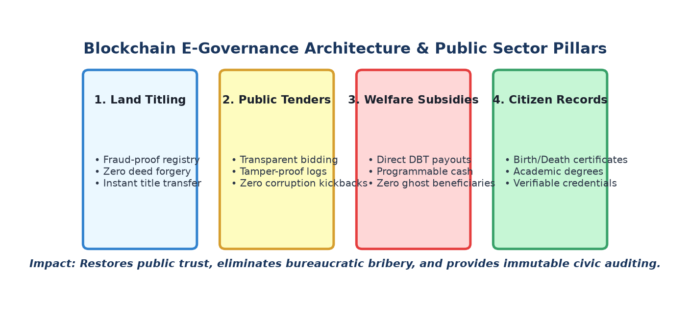

*Figure 4.1: Architectural Flow and Conceptual System Diagram for the use, benefits, and applications of blockchain in the government sector*

### Mathematical Formulation & Algorithmic Mechanics

**Cryptographic Governance Ledger Hash & Land Parcel State Formulation:**

```text
Block Hash Invariant for Public Auditability:
Block_Hash_n = SHA256( Block_Hash_n-1 || Merkle_Root_Civic_Records || Timestamp || Authority_Signature )
Where tampering with any historical municipal record invalidates all subsequent block hashes across all government nodes.
Land Parcel State Object: Parcel_Record = ( Parcel_UID, Geographic_Polygon_Hash, Owner_DID, Encumbrance_Status )
```

The mathematical formulation and algorithmic **parameters** defined above govern the runtime behavior of the system. Each parameter serves an exact role: primary terms scale throughput, penalty terms enforce **regularization** constraints, and **optimization** objectives drive steady **convergence** toward the **global minimum**.

### Worked Example & Practical Simulation

**Practical Implementation Scenario**: Blockchain Land **Registry** in **Andhra** Pradesh & Sweden (Chromaway): • Traditional Manual Registry: Citizen Alice purchases a 2-acre plot from Bob. The **transaction** requires 6 separate physical visits to the sub-registrar office, 14 paper document verifications, manual physical boundary **inspections**, and takes 45 business days. A corrupt clerk demands a 500 USD cash bribe to expedite deed stamp processing. • Blockchain E-Governance Solution: Both Alice and Bob log into the **state** land.

### Key Comparative Evaluation

| Governance Dimension | Traditional Paper / Centralized E-Governance | Blockchain-Enabled Decentralized E-Governance |
| :--- | :--- | :--- |
| Record Authenticity & Trust | Vulnerable to forged paper seals and database hacks | Cryptographically immutable; zero unauthorized tampering |
| Inter-Departmental Data Sharing | Siloed legacy databases; manual inter-agency memos | Shared distributed ledger accessible across all ministries |
| Public Tender Transparency | Closed bid boxes vulnerable to manipulation and leaks | Cryptographically sealed commitments opened deterministically |
| Welfare Leakage & Corruption | Substantial leakage via ghost beneficiaries and middlemen | Zero leakage; direct programmable subsidy transfers to wallets |

### Concluding Exam Takeaway

**Blockchain** **converts** **public** **administration** into a **transparent**, mathematically verifiable civic framework that eliminates bureaucratic corruption and restores citizen trust. For optimal SPPU examination scoring, answers must present this complete structure: rigorous theoretical definitions with bold keywords, an accurate architectural flow diagram, clear mathematical formulation, and a structured worked simulation to secure the full 8/**8 marks**.

**Textbook Reference:** Subramanian, C., George, A. A., Ranade, A., & Vasudevan, S. K. (Universities Press), Chapter 5: 'Blockchain Real-World Applications and Enterprise Solutions', pp. 330-355.

---

## Q2. Describe the role of blockchain in financial services, banking services, and its significance for adoption. (Frequency: 6) [8 Marks]

### Introduction & Core Intuition

In the **banking** and **financial** **services** **industry** (BFSI), **Blockchain Technology** is driving a monumental shift from fragmented, decades-old correspondent networks to real-time, shared distributed financial **ledgers**. Global banking currently relies on an intricate web of correspondent intermediaries, clearinghouses, and messaging networks (such as SWIFT) that introduce operational friction, multi-day settlement delays, counterparty credit risks, and billions of dollars in trapped.

### **Modernizing Core Banking Rails and Real-Time Settlement**

**Traditional** **retail** and **commercial** banking is anchored to batch-processing **systems** originally designed in the 1970s. When money moves between two different commercial banks, the **transaction** must pass through domestic automated clearing houses (ACH) or central bank gross settlement systems (RTGS). Settlement is not immediate; instead, banks accumulate batches of **transactions** and settle net obligations hours or.

### **Frictionless Cross-Border Remittances and Liquidity Optimization**

**International** **payments** **represent** the most **inefficient** sector of modern banking. A cross-border wire transfer from **New York** to Mumbai passes through multiple intermediary correspondent banks, each taking a processing fee and holding funds to mitigate currency volatility. This **process** takes 3 to 5 business days and imposes steep foreign exchange fees. Blockchain financial networks—such as RippleNet,.

### **Trade Finance Modernization: Digital Letters of Credit**

**International** **trade** **finance** has **historically** **relied** on physical paper documents—including Letters of Credit (LoC), Bills of Lading, and customs insurance certificates—sent via courier between shipping companies, ports, and banks. A single maritime shipment can generate over 30 physical documents, requiring up to 20 days of manual **verification** before payment is released. Blockchain trade finance platforms (such.

### **Automated Regulatory Compliance and Anti-Money Laundering (AML)**

**Commercial** **banks** **spend** immense financial resources on Know-Your-Customer (KYC) onboarding, **transaction** monitoring, and Anti-**Money Laundering** (AML) reporting. Under existing procedures, each bank must independently collect and verify identity documents for the same corporate client, resulting in duplicate administrative labor. Blockchain enables Shared Federated KYC: once an authorized bank verifies a customer's credentials, an encrypted cryptographic **verification**.

### Architectural Flow & System Diagram

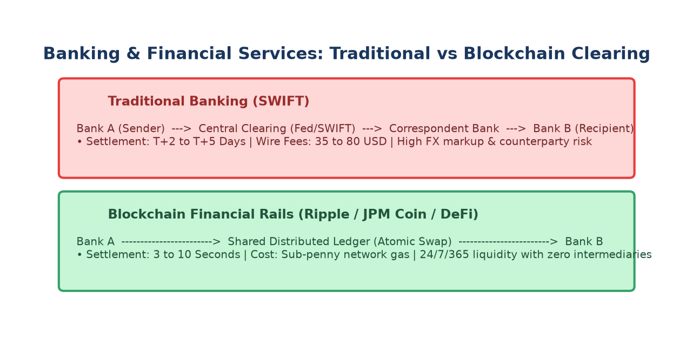

*Figure 4.2: Architectural Flow and Conceptual System Diagram for Describe the role of blockchain in financial services, banking services, and its significance for adoption*

### Mathematical Formulation & Algorithmic Mechanics

**Delivery-versus-Payment (DvP) Atomic Settlement Invariant & Cost Reduction Equation:**

```text
Atomic Delivery-versus-Payment (DvP) Settlement Condition:
DvP_Status = ( Transfer( Asset, Seller -> Buyer ) == TRUE ) ∧ ( Transfer( Cash, Buyer -> Seller ) == TRUE )
Where both state mutations execute simultaneously or the entire transaction reverts, eliminating counterparty risk.
Settlement Latency Comparison:
```

The mathematical formulation and algorithmic **parameters** defined above govern the runtime behavior of the system. Each parameter serves an exact role: primary terms scale throughput, penalty terms enforce **regularization** constraints, and **optimization** objectives drive steady **convergence** toward the **global minimum**.

### Worked Example & Practical Simulation

Real-**World Commercial Banking Scenario**: Cross-Border **Corporate** **Settlement** via J.P. **Morgan** Kinexys (JPM Coin): • Traditional Wire Transfer: Siemens in Germany transfers 20,000,000 USD to a supplier in Singapore on Friday evening. Because correspondent banking windows are closed over the weekend, funds sit in transit for **72 hours**; Siemens incurs 450 USD in correspondent fees and loses 3 days of interest yield. • Blockchain Settlement: Siemens initiates the transfer on J.P. Morgan's private blockchain **ledger**. The.

### Key Comparative Evaluation

| Banking Operational Aspect | Traditional Correspondent Banking (SWIFT) | Blockchain Distributed Financial Rails |
| :--- | :--- | :--- |
| Settlement Timeframe | T+2 to T+5 business days (delayed batch settlement) | Instantaneous atomic settlement (3 to 10 seconds) |
| Operating Schedule | Restricted to banking business hours (closed weekends) | 24/7/365 continuous real-time ledger operation |
| Foreign Account Capital | Requires billions in pre-funded foreign nostro accounts | On-demand liquidity pools with zero trapped foreign reserves |
| Counterparty Settlement Risk | Significant risk during multi-day settlement float | Zero risk; delivery and payment occur simultaneously |

### Concluding Exam Takeaway

**Blockchain** **replaces** **archaic** **correspondent** **banking** rails with an interconnected, real-time settlement substrate that frees trapped global capital and automates financial compliance. For optimal SPPU examination scoring, answers must present this complete structure: rigorous theoretical definitions with bold keywords, an accurate architectural flow diagram, clear mathematical formulation, and a structured worked simulation to secure the full 8/**8 marks**.

**Textbook Reference:** Subramanian, C., George, A. A., Ranade, A., & Vasudevan, S. K. (Universities Press), Chapter 5: 'Blockchain Real-World Applications and Enterprise Solutions', pp. 356-382.

---

## Q3. Explain the role and use of blockchain in healthcare. (Frequency: 5) [8 Marks]

### Introduction & Core Intuition

In **modern** healthcare **systems**, **Blockchain Technology** addresses **critical** structural **vulnerabilities** surrounding medical record fragmentation, patient **data** privacy, pharmaceutical supply chain counterfeiting, and clinical trial manipulation. Traditional healthcare is plagued by isolated hospital databases (silos) that prevent emergency doctors from accessing life-saving medical histories, while centralized electronic health record (EHR) servers represent lucrative 'honey-pot' targets for ransomware cyber attacks. Blockchain establishes.

### **Overcoming Healthcare Data Silos and Interoperability Hurdles**

**Modern** **patients** consult numerous medical practitioners throughout their lifetimes—including general physicians, specialty cardiologists, diagnostic radiology labs, and surgical centers. Each institution maintains separate medical software **systems** that cannot easily share records due to differing **data** formats and institutional liability concerns. Blockchain provides a standardized, vendor-neutral identity and indexing **layer**. Rather than storing bulky medical **images** directly.

### **Patient-Centric Consent Management via Smart Contracts**

A core principle of healthcare regulations (such as HIPAA in the **United States** and GDPR in Europe) is that patient medical **data** cannot be shared without explicit patient consent. Blockchain operationalizes this legal **requirement** through Consent Management Smart **Contracts**. A patient uses a secure mobile health wallet to grant customized, time-**bound** access permissions to specific clinical.

### **Pharmaceutical Supply Chain Integrity and Counterfeit Drug Elimination**

**The World Health Organization** (WHO) **estimates** that up to 10% of all **medicines** **distributed** **globally**—and over 30% in **parts** of the developing world—are counterfeit or degraded due to improper cold-chain storage. Counterfeit medications cause hundreds of thousands of avoidable deaths each year. Blockchain transforms pharmaceutical logistics by assigning every manufactured medication box a unique serialized 2D.

### **Securing Clinical Trials and Medical Research Collaboration**

In **clinical** **research** and pharmaceutical drug trials, researchers often face accusations of '**data** p-hacking' or outcome manipulation—selectively omitting adverse patient side-effects to ensure regulatory drug approval. By recording clinical trial **protocols**, patient enrollment criteria, and raw daily trial observations onto an **immutable** blockchain **ledger**, researchers establish an unalterable audit trail. Regulatory agencies (such as the FDA.

### Architectural Flow & System Diagram

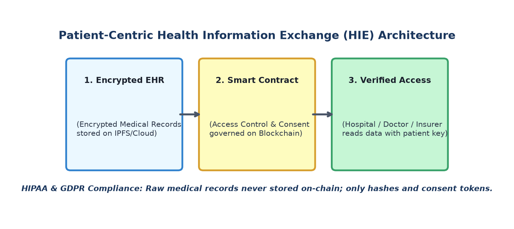

*Figure 4.3: Architectural Flow and Conceptual System Diagram for the role and use of blockchain in healthcare*

### Mathematical Formulation & Algorithmic Mechanics

**Decentralized Healthcare Consent Invariant & Off-Chain Storage Pointer Formulation:**

```text
Off-Chain Encrypted Medical Record Architecture:
OnChain_Pointer = IPFS_CID( AES256_GCM_Encrypt_Patient_Key( Electronic_Health_Record ) )
Where raw private medical data never touches the public blockchain, satisfying HIPAA & GDPR mandates.
Granular Patient Consent Access Rule:
```

The mathematical formulation and algorithmic **parameters** defined above govern the runtime behavior of the system. Each parameter serves an exact role: primary terms scale throughput, penalty terms enforce **regularization** constraints, and **optimization** objectives drive steady **convergence** toward the **global minimum**.

### Worked Example & Practical Simulation

**Emergency Medical Access** & **Pharmaceutical** **Tracking** **Scenario**: • Emergency Room Trauma **Case**: Patient John is brought unconscious into a hospital in Bangalore after an accident. The hospital has zero historical records for John. The trauma doctor scans John's emergency QR card. The **smart contract** verifies the trauma hospital's medical license credentials and grants temporary 2-hour read-only access to John's emergency medical summary. • Immediate Life-Saving Finding: John has a severe fatal allergy to Penicillin and.

### Key Comparative Evaluation

| Healthcare Domain | Traditional Centralized Healthcare Silos | Blockchain Patient-Centric Healthcare Network |
| :--- | :--- | :--- |
| Medical Record Ownership | Institutions own and control proprietary patient databases | Patient owns sovereign cryptographic access to their records |
| Clinical Data Interoperability | Extremely poor; fragmented records across incompatible EHRs | Seamless interoperability via universal blockchain pointers |
| Patient Consent Management | Static paper consent forms filed away in hospital archives | Dynamic, programmable smart contract consent with expiry |
| Counterfeit Drug Detection | Difficult; paper shipping invoices easily forged or swapped | End-to-end serialized cryptographic tracking on ledger |

### Concluding Exam Takeaway

**Blockchain** **bridges** **fragmented** **medical** software **systems** into a secure, patient-empowered network that protects privacy, secures drug supply chains, and accelerates scientific discovery. For optimal SPPU examination scoring, answers must present this complete structure: rigorous theoretical definitions with bold keywords, an accurate architectural flow diagram, clear mathematical formulation, and a structured worked simulation to secure the full 8/**8 marks**.

**Textbook Reference:** Subramanian, C., George, A. A., Ranade, A., & Vasudevan, S. K. (Universities Press), Chapter 5: 'Blockchain Real-World Applications and Enterprise Solutions', pp. 383-408.

---

## Q4. Explain Blockchain applications in retail services. (Frequency: 2) [8 Marks]

### Introduction & Core Intuition

In the **global** **retail** and **consumer** **commerce** sector, **Blockchain Technology** is fundamentally transforming consumer trust, brand protection, supply chain transparency, and omni-channel customer loyalty programs. As modern consumers demand verifiable proof of ethical sourcing, product authenticity, and fair-trade practices, legacy retail **systems** struggle with widespread luxury counterfeiting, fragmented reward points that expire unused, and high payment processing fees. Blockchain provides.

### **Combating Luxury Counterfeiting with Digital Twin NFTs**

**Counterfeiting** **costs** the **global** **luxury** **goods**, footwear, and consumer electronics industries over 500 billion USD annually, eroding brand equity and defrauding consumers. Retailers solve this problem by pairing physical high-value goods with a blockchain-based **Digital Twin** (ERC-721 or ERC-1155 NFT). High-end merchandise is manufactured with an embedded, tamper-evident cryptographic NFC chip or encrypted QR code. When.

### **Universal and Interoperable Customer Loyalty Programs**

**Traditional** **retail** **loyalty** **programs** **suffer** from severe consumer apathy: consumers accumulate loyalty points across dozens of separate retailers, airlines, and coffee shops, but over 45% of these points are abandoned because they cannot be combined or transferred across brands. Blockchain enables **Tokenized Loyalty Ecosystems** where loyalty points are minted as fungible tokens on a shared consortium.

### **Transparent Ethical Sourcing and Sustainability Proofs**

**Modern** **consumers** **increasingly** **prefer** **ethically** manufactured products—such as conflict-free diamonds, fair-trade coffee beans, and organic cotton clothing. However, greenwashing and fraudulent marketing claims have eroded consumer confidence. Blockchain retail platforms allow brands to provide mathematical proof of origin. For example, **De Beers** utilizes the Tracr blockchain platform to trace diamonds from the exact mine of extraction.

### **Automating Supplier Settlement and Inventory Escrow**

**Traditional** **retail** **supply** **chains** involve protracted billing cycles where suppliers wait 60 to 90 days (Net-60 / Net-90 terms) to receive payment from major retail conglomerates. Invoicing **errors** and manual inventory audits frequently result in payment disputes. By integrating IoT warehouse scanners with blockchain smart **contracts**, inventory deliveries are verified autonomously. The moment automated warehouse sensors.

### Architectural Flow & System Diagram

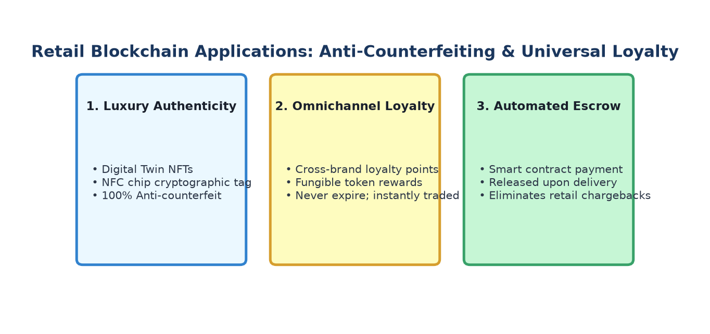

*Figure 4.4: Architectural Flow and Conceptual System Diagram for Blockchain applications in retail services*

### Mathematical Formulation & Algorithmic Mechanics

**Retail Authenticity Verification & Dynamic Loyalty Token Exchange Formulation:**

```text
Physical-to-Digital Authenticity Verification Function:
Verify_Product = ( NFC_UID == Decrypt_Brand_PubKey( Token_Digital_Signature ) ) ∧ ( Token_Owner == Seller_Address )
Where authenticity is mathematically guaranteed by the luxury manufacturer's root public key.
Cross-Brand Loyalty Token Conversion Invariant:
```

The mathematical formulation and algorithmic **parameters** defined above govern the runtime behavior of the system. Each parameter serves an exact role: primary terms scale throughput, penalty terms enforce **regularization** constraints, and **optimization** objectives drive steady **convergence** toward the **global minimum**.

### Worked Example & Practical Simulation

Authenticity **Verification** and **Loyalty Redemption Scenario** (LVMH Aura **Blockchain**): • **Luxury** **Watch** Purchase: A customer purchases a luxury Hublot watch at a retail boutique. The watch has a micro-embedded NFC chip behind the bezel. • Digital Ownership Handover: The sales associate taps the watch against a tablet. The **smart contract** on the Aura Blockchain transfers the unique Digital Twin NFT to the customer's mobile wallet. The NFT contains the watch's exact manufacturing date, master watchmaker.

### Key Comparative Evaluation

| Retail Business Aspect | Conventional Retail Systems | Blockchain-Enabled Retail Ecosystem |
| :--- | :--- | :--- |
| Counterfeit Prevention | Paper authenticity certificates; easily forged by counterfeiters | Tamper-proof NFC tags linked to immutable Digital Twin NFTs |
| Customer Loyalty Value | Siloed, non-transferable reward points that expire unused | Universal, liquid tokenized points exchangeable across brands |
| Product Provenance Tracking | Self-declared brand marketing claims vulnerable to greenwashing | Cryptographically verified supply chain journey from source to shelf |
| Supplier Payment Settlement | Net-60 to Net-90 day delays with manual invoice reconciliation | Automated smart contract escrow release upon warehouse scan |

### Concluding Exam Takeaway

**Blockchain** **empowers** **retailers** to **bridge** **physical** products with cryptographic digital twins, creating an authenticated, frictionless commerce ecosystem that delights modern consumers. For optimal SPPU examination scoring, answers must present this complete structure: rigorous theoretical definitions with bold keywords, an accurate architectural flow diagram, clear mathematical formulation, and a structured worked simulation to secure the full 8/**8 marks**.

**Textbook Reference:** Subramanian, C., George, A. A., Ranade, A., & Vasudevan, S. K. (Universities Press), Chapter 5: 'Blockchain Real-World Applications and Enterprise Solutions', pp. 409-432.

---

## Q5. Explain the role of blockchain in IoT and how they can work together. (Frequency: 4) [8 Marks]

### Introduction & Core Intuition

The technological **convergence** of the **Internet** of **Things** (IoT) and **Blockchain Technology** represents one of the most transformative architectural synergies in modern computing. With tens of billions of connected smart devices deployed globally—including industrial sensors, smart electricity meters, autonomous vehicles, and healthcare monitors—traditional centralized cloud-IoT architectures suffer from severe single-point-of-failure **vulnerabilities**, communication bottlenecks, and inadequate security **protocols**. Blockchain provides IoT.

### **Overcoming the Centralized Architectural Crisis of IoT**

Traditional IoT ecosystems connect edge sensors directly to centralized cloud service brokers (such as AWS IoT Core or **Microsoft Azure** IoT). While manageable for small deployments, scaling to billions of devices creates severe architectural flaws: massive **bandwidth** costs for streaming telemetry to central **data** centers, **latency** delays that endanger time-critical industrial **processes**, and single points of.

### **Cryptographic Device Identity and Tamper-Proof Authentication**

A major **vulnerability** in **conventional** IoT is the ease with which **hackers** can **hijack** connected devices using default passwords or spoofed IP addresses (as seen in massive Mirai botnet attacks that launched historic distributed denial-of-service disruptions). Blockchain solves this by granting every IoT device a unique **Decentralized Identifier** (DID) backed by an asymmetric public-**private key** pair.

### **Autonomous Machine-to-Machine (M2M) Micro-Transactions**

The true **economic** **promise** of IoT is **autonomous** machine cooperation without human intervention. In legacy banking, machines cannot open bank accounts or execute micro-payments due to minimum account balance **rules** and prohibitive **transaction** fees. Blockchain provides IoT devices with native digital wallets and programmable **smart contract** accounts. An autonomous drone can land on a third-party charging.

### **Tamper-Proof Sensor Telemetry for Trusted Smart Contract Oracles**

Smart **contracts** deployed on **blockchains** **require** **accurate** real-world **data** to trigger automated business logic—such as releasing insurance claims upon hurricane wind gusts or paying farmers when rainfall drops below critical levels. IoT sensors serve as the physical 'eyes and ears' of the blockchain, functioning as decentralized **Hardware Oracles**. By collecting sensor telemetry at the edge, signing.

### Architectural Flow & System Diagram

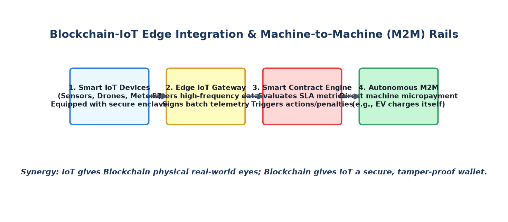

*Figure 4.5: Architectural Flow and Conceptual System Diagram for the role of blockchain in IoT and how they can work together*

### Mathematical Formulation & Algorithmic Mechanics

**Cryptographic IoT Telemetry Packet Signing & Autonomous M2M Settlement Formulation:**

```text
Signed IoT Telemetry Packet Formulation:
IoT_Packet = { Device_DID, Timestamp, Telemetry_Data, Signature_Device_PrivKey( Hash( Data || Timestamp ) ) 
Where edge gateways verify Signature_Device_PubKey before accepting telemetry into the state machine.
Autonomous M2M Smart Contract Power Settlement Rule:
```

The mathematical formulation and algorithmic **parameters** defined above govern the runtime behavior of the system. Each parameter serves an exact role: primary terms scale throughput, penalty terms enforce **regularization** constraints, and **optimization** objectives drive steady **convergence** toward the **global minimum**.

### Worked Example & Practical Simulation

**Autonomous Electric Vehicle** (EV) Smart Charging & Micropayment Scenario: • Machine Actors: An autonomous Tesla robotaxi and a solar-powered roadside inductive charging pad. • Step 1 (Mutual **Authentication**): The robotaxi positions itself over the pad. The car and charging station exchange cryptographic handshakes using their respective blockchain DIDs, establishing an encrypted communication **session**. • Step 2 (**Smart Contract** Escrow): The car deposits 5 USD worth of digital stablecoins into a microgrid charging smart **contract**. •.

### Key Comparative Evaluation

| Architectural Feature | Traditional Centralized IoT Architecture | Blockchain-Integrated Decentralized IoT Network |
| :--- | :--- | :--- |
| Network Architecture | Centralized client-server cloud broker (AWS/Azure IoT) | Decentralized peer-to-peer edge and gateway topology |
| Device Authentication | Vulnerable pre-shared API keys and hardcoded passwords | Asymmetric public-key cryptography with hardware DIDs |
| Machine-to-Machine Payments | Impossible; legacy banking cannot process micro-cents | Native automated micro-payments via smart contract wallets |
| Data Integrity & Tampering | Vulnerable to database manipulation and insider theft | Cryptographically signed telemetry permanently immutable |

### Concluding Exam Takeaway

**Blockchain** **gives** IoT **devices** an **immutable** identity and autonomous financial agency, while IoT provides blockchain with reliable, real-world **data** eyes to automate global commerce. For optimal SPPU examination scoring, answers must present this complete structure: rigorous theoretical definitions with bold keywords, an accurate architectural flow diagram, clear mathematical formulation, and a structured worked simulation to secure the full 8/**8 marks**.

**Textbook Reference:** Subramanian, C., George, A. A., Ranade, A., & Vasudevan, S. K. (Universities Press), Chapter 5: 'Blockchain Real-World Applications and Enterprise Solutions', pp. 433-458.

---

## Q6. Explain how blockchain can be used for any supply chain application with a neat diagram. (Frequency: 1) [8 Marks]

### Introduction & Core Intuition

In **global** **logistics** and **supply** chain management, **Blockchain Technology** resolves chronic operational **vulnerabilities** surrounding opaque product origins, shipping delays, counterfeit goods, and paper-based invoice disputes. Traditional multi-tier supply chains span dozens of independent entities—including raw material extractors, manufacturing factories, maritime shipping lines, customs **inspection** authorities, distribution warehouses, and local retailers—each operating isolated Enterprise Resource Planning (ERP) databases. Blockchain provides a.

### **The Global Supply Chain Transparency Crisis**

**Modern** **industrial** and **pharmaceutical** **supply** **chains** are profoundly complex and historically lack real-time visibility. When goods move across international borders, critical documentation (such as bills of lading, certificates of origin, and safety **inspection** stamps) is frequently delayed, lost, or fraudulently altered. In the pharmaceutical sector, improper handling during transit—such as temperature fluctuations that spoil delicate biologics.

### **Multi-Tier Provenance from Factory to Consumer**

In a **blockchain**-enabled **supply** **chain**, **physical** **assets** are **digitized** into cryptographic tokens at the point of origin. When a pharmaceutical manufacturer produces a batch of medication, the batch is assigned a unique serialized 2D cryptographic barcode (or digital twin token) containing manufacturing timestamps, active ingredient purity records, and regulatory licenses. As the batch is loaded onto.

### **IoT-Enabled Cold-Chain Environmental Monitoring**

**Temperature**-sensitive **pharmaceuticals**, **fresh** **seafood**, and **biological** vaccines require strict cold-chain compliance (e.g., maintaining temperatures between -20 deg C and -80 deg C). Blockchain integrates natively with edge IoT environmental sensors embedded inside shipping containers. These sensors continuously monitor temperature, humidity, and GPS coordinates, periodically broadcasting cryptographically signed telemetry **packets** to the blockchain. If a refrigeration compressor.

### **Automated Milestone Settlements and Invoice Factoring**

**Traditional** **cross**-border **supply** **chains** suffer from protracted payment cycles; suppliers and freight carriers often wait 60 to 90 days after delivery to reconcile paper invoices and receive payment. Blockchain automates trade finance through **Escrow Smart Contracts**. Buyer funds are deposited into an automated **smart contract** at the start of the shipment. The moment port customs sensors.

### Architectural Flow & System Diagram

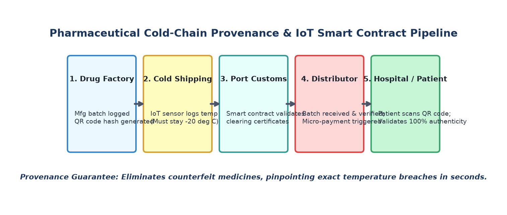

*Figure 4.6: Architectural Flow and Conceptual System Diagram for how blockchain can be used for any supply chain application with a neat diagram*

### Mathematical Formulation & Algorithmic Mechanics

**Cold-Chain Provenance State Transition & Temperature Threshold Formulation:**

```text
Supply Chain Custody State Transition Function:
State_t+1 = Transfer( State_t, Custodian_A -> Custodian_B, GPS, IoT_Hash ) -> Require( Sign_Custodian_A ∧ Sign_Custodian_B )
Cold-Chain Environmental Safety Invariant:
Batch_Quality = IF ( Max( Recorded_Temp_Series ) <= Temp_Threshold_Max ) THEN PASS ELSE QUARANTINE
```

The mathematical formulation and algorithmic **parameters** defined above govern the runtime behavior of the system. Each parameter serves an exact role: primary terms scale throughput, penalty terms enforce **regularization** constraints, and **optimization** objectives drive steady **convergence** toward the **global minimum**.

### Worked Example & Practical Simulation

**Pharmaceutical Cold**-Chain COVID-19 mRNA **Vaccine** **Tracking** Scenario: • Origin: Pfizer-BioNTech manufacturing plant in Puurs, Belgium, packs 100,000 mRNA vaccine vials into an insulated container fitted with an IoT temperature-logging GPS beacon. • **Ledger** Commitment: The batch is minted on a **Hyperledger Fabric** supply chain **ledger** at address 0xVax991... with a mandatory temperature ceiling of -70 deg C. • In-Transit Exception Handling: During maritime transit, an auxiliary power generator fails, causing container temperature to climb to.

### Key Comparative Evaluation

| Supply Chain Capability | Traditional Paper / ERP Logistics | Blockchain-IoT Integrated Supply Chain |
| :--- | :--- | :--- |
| Data Transparency & Visibility | Opaque; siloed inside disparate corporate databases | Synchronized single source of truth across all partners |
| Custody Transfer Tracking | Paper bills of lading prone to loss, delays, and forgery | Cryptographically signed digital handshakes on shared ledger |
| Cold-Chain Quality Control | Manual temperature loggers inspected days after delivery | Continuous IoT sensor streaming with real-time breach alerts |
| Supplier Payment Speed | 60 to 90 days delay requiring manual invoice audits | Sub-second smart contract escrow release upon delivery |

### Concluding Exam Takeaway

**Integrating** **blockchain** with IoT **sensors** **establishes** an **unalterable** supply chain tracking infrastructure that eliminates counterfeit products and automates multi-party trade finance. For optimal SPPU examination scoring, answers must present this complete structure: rigorous theoretical definitions with bold keywords, an accurate architectural flow diagram, clear mathematical formulation, and a structured worked simulation to secure the full 8/**8 marks**.

**Textbook Reference:** Subramanian, C., George, A. A., Ranade, A., & Vasudevan, S. K. (Universities Press), Chapter 5: 'Blockchain Real-World Applications and Enterprise Solutions', pp. 459-484.

---

## Q7. Discuss potential challenges and benefits of implementing blockchain in a Voting system. (Frequency: 2) [8 Marks]

### Introduction & Core Intuition

**Democratic** **elections** **represent** the fundamental bedrock of sovereign governance, yet traditional voting **systems**—whether paper ballots or standalone **Electronic Voting Machines** (EVMs)—face intense public skepticism surrounding vote tampering, lack of independent auditability, physical voter intimidation, and logistical inefficiency. Blockchain-Based E-Voting offers a revolutionary cryptographic framework capable of conducting secure, remote, and **tamper-proof** democratic elections. However, implementing blockchain in public voting introduces.

### **The Foundational Benefits of Blockchain Voting**

**Deploying** voting **systems** on distributed **ledgers** provides **powerful** democratic advantages: First, Immutability and Tamper-Resistance: once a citizen casts a ballot, the vote is cryptographically sealed into a **block**; no corrupt election official, hacker, or political authority can alter, swap, or delete cast ballots. Second, End-to-**End Verifiability** (E2E-V): every citizen receives a cryptographic receipt allowing them to.

### **The Voting Trilemma: Privacy vs Auditability vs Coercion Resistance**

The **greatest** **technological** **challenge** in **blockchain** **voting** is solving the classical **Voting Trilemma**. A valid election must simultaneously guarantee three conflicting properties: (1) Voter Privacy: no one (including the government) must ever discover how an individual voted; (2) Public Auditability: anyone must be able to verify that the total vote count is mathematically exact and contains.

### **Advanced Cryptographic Solutions: Zero-Knowledge Proofs (ZKP)**

**Modern** **blockchain** voting overcomes the privacy dilemma using cutting-edge cryptographic primitives: Zero-Knowledge SNARKs (**zk-SNARKs**), **Blind Signatures**, and Homomorphic **Encryption**. Under this architecture, the election authority issues an eligible voter a blind cryptographic token. When voting, the citizen uses a mobile application to generate a zk-SNARK proof. The proof mathematically demonstrates to the **smart contract** that: (a).

### **Critical Technological Challenges: The Digital Divide and Endpoint Vulnerabilities**

**Despite** its **cryptographic** **elegance**, **blockchain** voting faces formidable practical implementation hurdles. First is the **Digital Divide**: elderly, impoverished, or rural citizens may lack smartphones, high-speed internet, or digital literacy, risking disenfranchisement if elections migrate entirely online. Second is Client Endpoint **Security**: while the blockchain itself is mathematically unhackable, the voter's smartphone or personal laptop may be.

### Architectural Flow & System Diagram

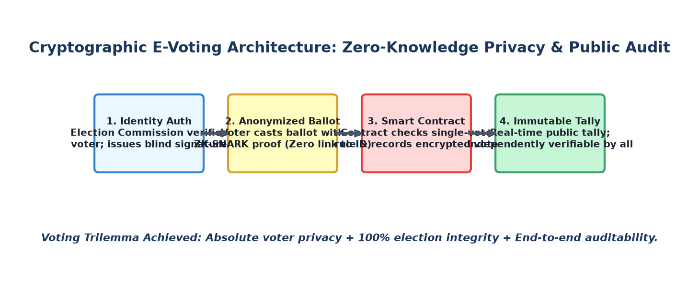

*Figure 4.7: Architectural Flow and Conceptual System Diagram for potential challenges and benefits of implementing blockchain in a Voting system*

### Mathematical Formulation & Algorithmic Mechanics

**Additive Homomorphic Vote Tallying & Zero-Knowledge Verification Formulation:**

```text
Additive Homomorphic Encryption Tally Formulation:
Encrypted_Tally = Product_i=1^N( Enc_Election_PubKey( Vote_i ) ) = Enc_Election_PubKey( ∑_i=1^N( Vote_i ) )
Where the final tally is decrypted using the threshold multi-signature keys of all political parties,
without ever decrypting or exposing any individual citizen's vote.
```

The mathematical formulation and algorithmic **parameters** defined above govern the runtime behavior of the system. Each parameter serves an exact role: primary terms scale throughput, penalty terms enforce **regularization** constraints, and **optimization** objectives drive steady **convergence** toward the **global minimum**.

### Worked Example & Practical Simulation

**Decentralized University Student Council Election Scenario**: • **Scale**: 25,000 **university** students voting across 4 campus departments. • Voter Registration: University issues every student a cryptographic voting credential tied to their student ID via blind **signature**. • Ballot Submission: Student Alice logs into the university voting app from her smartphone. She selects Candidate B. The app generates a zk-SNARK proof and encrypts the vote with the election **public key**, transmitting the **payload** to the Sepolia testnet.

### Key Comparative Evaluation

| Electoral Parameter | Traditional Paper / Electronic Voting Machines (EVM) | Blockchain-Enabled Zero-Knowledge E-Voting |
| :--- | :--- | :--- |
| Tallying Integrity & Fraud | Vulnerable to booth capturing, ballot stuffing, and tampering | Cryptographically immutable; zero vote manipulation possible |
| End-to-End Voter Verifiability | Zero; voter cannot verify if their ballot was altered later | 100% verifiable; cryptographic receipts allow public ledger audit |
| Voter Location Flexibility | Requires physical travel to designated polling booths | Remote voting from authenticated smartphones anywhere globally |
| Tally Calculation Speed | Hours to days of manual counting and physical transport | Instantaneous automated computation upon election close |

### Concluding Exam Takeaway

**Blockchain** **voting** **resolves** the **historical** trade-off between ballot secrecy and public auditability, delivering a transparent democratic framework once endpoint **security** is solved. For optimal SPPU examination scoring, answers must present this complete structure: rigorous theoretical definitions with bold keywords, an accurate architectural flow diagram, clear mathematical formulation, and a structured worked simulation to secure the full 8/**8 marks**.

**Textbook Reference:** Subramanian, C., George, A. A., Ranade, A., & Vasudevan, S. K. (Universities Press), Chapter 5: 'Blockchain Real-World Applications and Enterprise Solutions', pp. 485-508.

---

## Q8. Explain the use of Blockchain in Energy and utilities. (Frequency: 1) [8 Marks]

### Introduction & Core Intuition

The **global** **energy** and **electrical** **utility** **sector** is **undergoing** a profound structural transformation characterized by the rapid rise of decentralized renewable energy resources (such as residential rooftop solar panels, wind microturbines, and battery energy storage). Traditional electrical grids were engineered as centralized, one-way distribution networks where monopolistic utility corporations generated power at mega-plants and billed passive consumers. Today, millions of.

### **The Shift from Centralized Grids to Decentralized Microgrids**

**Traditional** **electrical** utility **models** face **severe** **challenges** in **integrating** intermittent renewable power. When thousands of rooftop solar arrays feed excess power back into the grid simultaneously during peak sunshine hours, centralized distribution transformers experience reverse power flows and voltage instability. Furthermore, monopoly utility companies pay prosumers low wholesale feed-in tariffs (e.g., 3 cents per kWh) while.

### **Peer-to-Peer (P2P) Transactive Energy Trading Architecture**

In a **blockchain**-powered P2P **microgrid**, **participating** **homes** are **equipped** with bidirectional **Smart Meters** and IoT energy gateways. These smart meters record power generation, consumption, and storage levels in real time. When Prosumer Alice's solar array generates an excess of 10 kilowatt-hours (kWh) of electricity, her IoT gateway automatically places a cryptographic sell order on the microgrid.

### **Automated Grid Balancing and Demand-Response Smart Contracts**

**Maintaining** **power** grid **stability** **requires** instantaneous equilibrium between total electrical generation and total electrical load (frequency regulation at 50 Hz or 60 Hz). Utility operators can utilize blockchain Demand-**Response Smart Contracts** to maintain stability during peak stress events (such as intense heatwaves). The utility broadcasts an automated demand-reduction request offering financial micro-incentives. Smart **contracts** installed in.

### **Renewable Energy Certificates (RECs) and Carbon Tracking**

**Corporate** **enterprises** and **governments** are **legally** mandated to offset carbon emissions by purchasing **Renewable Energy Certificates** (RECs). However, legacy REC accounting relies on fragmented registries plagued by double-counting—where the same megawatt-hour of solar power is fraudulently sold to multiple corporate buyers. Blockchain ensures the **integrity** of green energy accounting by minting non-fungible or semi-fungible digital tokens.

### Architectural Flow & System Diagram

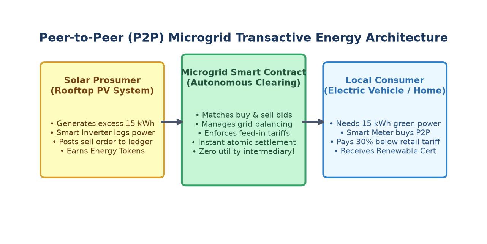

*Figure 4.8: Architectural Flow and Conceptual System Diagram for the use of Blockchain in Energy and utilities*

### Mathematical Formulation & Algorithmic Mechanics

**P2P Energy Double-Auction Clearing Rule & Renewable Certificate Formulation:**

```text
Microgrid Double-Auction Market Clearing Price:
Price_cleared = ( Bid_Consumer + Ask_Prosumer ) / 2  (Subject to: Bid_Consumer >= Ask_Prosumer)
Where energy is traded if the buyer's bid meets or exceeds the seller's ask price.
Renewable Energy Certificate (REC) Minting Rule:
```

The mathematical formulation and algorithmic **parameters** defined above govern the runtime behavior of the system. Each parameter serves an exact role: primary terms scale throughput, penalty terms enforce **regularization** constraints, and **optimization** objectives drive steady **convergence** toward the **global minimum**.

### Worked Example & Practical Simulation

P2P **Solar Energy Trading Scenario** (Brooklyn **Microgrid** / LO3 **Energy**): • **Participants**: **Alice** (owns a 6 kW rooftop solar **system**) and Bob (Alice's neighbor who owns an electric car). • Grid Situation: It is 1:00 PM on a sunny day. Alice's home consumes 2 kW, leaving 4 kW (4 kWh/hour) of surplus green electricity. The local utility offers a feed-in credit of only 0.04 USD/kWh, while charging Bob 0.18 USD/kWh. • P2P Matching: Alice's smart.

### Key Comparative Evaluation

| Energy Market Dimension | Traditional Centralized Utility Monopoly | Blockchain P2P Transactive Microgrid |
| :--- | :--- | :--- |
| Power Flow & Distribution | Unidirectional; mega-plants distribute power down to users | Bidirectional; distributed prosumers trade locally |
| Energy Pricing Mechanism | Fixed, regulated retail tariffs set by utility commission | Dynamic real-time market clearing based on local supply/demand |
| Renewable Certificate Auditing | Manual paper accounting prone to double-counting fraud | Automated smart meter minting with permanent token burn |
| Grid Resilience to Outages | Low; storm damage to major transmission lines blacks out cities | High; decentralized microgrids island and operate autonomously |

### Concluding Exam Takeaway

**Blockchain** **transforms** **energy** **grids** from **rigid** monopolies into flexible, citizen-owned transactive microgrids that accelerate global renewable energy adoption. For optimal SPPU examination scoring, answers must present this complete structure: rigorous theoretical definitions with bold keywords, an accurate architectural flow diagram, clear mathematical formulation, and a structured worked simulation to secure the full 8/**8 marks**.

**Textbook Reference:** Subramanian, C., George, A. A., Ranade, A., & Vasudevan, S. K. (Universities Press), Chapter 5: 'Blockchain Real-World Applications and Enterprise Solutions', pp. 509-532.

---

## Q9. List and explain prominent blockchain applications and detail any one with its architecture. (Frequency: 3) [8 Marks]

### Introduction & Core Intuition

**Blockchain Technology** has **matured** from a **niche** **digital** **currency** experiment into a foundational, general-purpose enterprise infrastructure that is revolutionizing dozens of industries. Today, prominent blockchain applications span six primary sectors: Decentralized Finance (DeFi), Cross-Border Supply Chain Management, Decentralized Identity (Self-Sovereign Identity), Healthcare Information **Systems**, Intellectual Property and NFTs, and Tokenized Real Estate. Detail-level analysis of enterprise blockchain solutions requires understanding.

### **Comprehensive Survey of Prominent Blockchain Applications**

**Across** the **global** **enterprise** **landscape**, six prominent blockchain application categories dominate industrial deployment: (1) **Decentralized Finance** (DeFi): Autonomous financial **protocols** that recreate lending, borrowing, and asset trading without traditional commercial banks (e.g., Uniswap, Aave); (2) Supply Chain and Provenance Tracking: Multi-tier traceability solutions that combat counterfeit goods and verify environmental standards (e.g., TradeLens, Walmart Food Trust);.

### **Detailed Architectural Deep Dive: Decentralized Finance (DeFi) Protocols**

Among all prominent blockchain applications, **Decentralized Finance** (DeFi) represents the most economically significant implementation. DeFi replaces human banking intermediaries—such as loan officers, clearinghouses, and brokers—with open-source, **deterministic** smart contracts deployed on **Ethereum**. A representative DeFi architecture is structured across four synchronized layers: the Settlement Layer (Ethereum Layer-1 and Layer-2 rollups maintaining the **immutable** state **ledger**), the.

### **Automated Market Makers (AMM) and Constant Product Algorithms**

In **traditional** **financial** brokerages, trading relies on centralized **Order Books** where market makers match buy and sell orders. DeFi **protocols** like Uniswap revolutionized trading through Automated Market Makers (AMMs). An AMM eliminates order books by pooling liquidity into **deterministic** smart **contracts** containing reserves of two tokens (e.g., ETH and USDC). Token pricing is governed purely by.

### **Decentralized Lending and Algorithmic Collateralization**

DeFi lending **protocols** (such as Aave and **Compound**) **enable** peer-to-peer **capital** **borrowing** without credit checks or banking approval. Borrowers deposit cryptocurrency into a **smart contract** liquidity pool as collateral and can immediately borrow up to a predetermined Loan-to-Value (LTV) Ratio (e.g., 75% of collateral value). If the market price of the deposited collateral drops below a.

### Architectural Flow & System Diagram

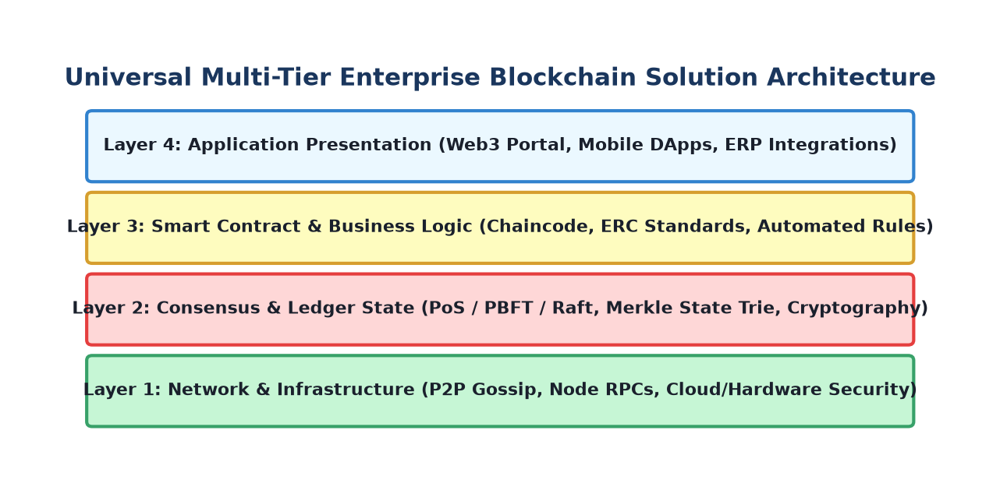

*Figure 4.9: Architectural Flow and Conceptual System Diagram for List and explain prominent blockchain applications and detail any one with its architecture*

### Mathematical Formulation & Algorithmic Mechanics

**Uniswap Constant Product AMM Invariant & Algorithmic Price Equation:**

```text
Constant Product Market Maker Invariant:
x * y = k
Where x is the reserve of Token A, y is the reserve of Token B, and k is the constant liquidity product.
Trader Swap Output Equation (Receiving Token B for Delta_x of Token A):
```

The mathematical formulation and algorithmic **parameters** defined above govern the runtime behavior of the system. Each parameter serves an exact role: primary terms scale throughput, penalty terms enforce **regularization** constraints, and **optimization** objectives drive steady **convergence** toward the **global minimum**.

### Worked Example & Practical Simulation

**Automated Market Maker** (Uniswap) **Token** Swap **Calculation**: • **Initial** Liquidity Pool **State**: Uniswap pool holds x = 100 ETH and y = 300,000 USDC. Product constant k = 100 * 300,000 = 30,000,000. • Spot Price: 1 ETH = 300,000 / 100 = 3,000 USDC. • User Action: Trader Alice wants to swap 10 ETH for USDC (Assume 0% fee for simplicity). • Mathematical **Execution**: New ETH reserve in pool: x' = 100 + 10.

### Key Comparative Evaluation

| Industry Domain | Prominent Blockchain Platform | Core Architecture Mechanism | Disruptive Value Delivered |
| :--- | :--- | :--- | :--- |
| Decentralized Finance (DeFi) | Uniswap, Aave, MakerDAO | Automated Market Maker (x*y=k) & Over-collateralized Lending | 24/7/365 permissionless banking with zero broker middlemen |
| Supply Chain Provenance | Hyperledger Fabric, VeChain | IoT sensor integration & serialized digital twin tokens | 100% counterfeit eradication & real-time cold-chain tracking |
| Digital Identity (SSI) | Sovrin, Microsoft Entra Verified ID | W3C DIDs & Zero-Knowledge Verifiable Credentials | Eliminates centralized login honey-pots & identity theft |
| Healthcare Information | Medicalchain, BurstIQ | Off-chain IPFS storage with smart contract consent tokens | Seamless medical interoperability with full HIPAA/GDPR privacy |

### Concluding Exam Takeaway

**Prominent** **blockchain** **applications** **demonstrate** that distributed cryptographic **ledgers** provide a universal coordination substrate capable of disintermediating complex global industries. For optimal SPPU examination scoring, answers must present this complete structure: rigorous theoretical definitions with bold keywords, an accurate architectural flow diagram, clear mathematical formulation, and a structured worked simulation to secure the full 8/**8 marks**.

**Textbook Reference:** Subramanian, C., George, A. A., Ranade, A., & Vasudevan, S. K. (Universities Press), Chapter 5: 'Blockchain Real-World Applications and Enterprise Solutions', pp. 533-560.

---

## Q10. Discuss the integration of blockchain with other domains like cloud. (Frequency: 2) [8 Marks]

### Introduction & Core Intuition

The technological **convergence** of Blockchain with complementary computing paradigms—most notably **Cloud Computing**, Artificial Intelligence (AI), and Big **Data** Analytics—represents the frontier of modern enterprise architecture. While cloud computing delivers virtually infinite elastic compute power, high-**performance** database storage, and low-**latency** global hosting, it suffers from centralized ownership, vendor lock-in, and **vulnerabilities** to privileged insider tampering. Integrating blockchain into cloud environments gives.

### **Architectural Synergies Between Cloud and Blockchain**

**Cloud** **computing** and **blockchain** are fundamentally complementary rather than adversarial technologies. Cloud platforms (such as **Amazon Web Services**, Microsoft Azure, and Google Cloud Platform) excel at high-**throughput** processing, hosting massive petabyte-scale databases, and executing compute-heavy workloads. In contrast, blockchain is deliberately slow and constrained because every **transaction** must be redundantly processed and validated across thousands of.

### **Blockchain-as-a-Service (BaaS) Enterprise Platforms**

Operating enterprise blockchain **nodes** requires complex infrastructure management: maintaining synchronized **ledgers**, managing cryptographic hardware security **modules** (HSM), executing **protocol** hard forks, and configuring secure JSON-RPC interfaces. Cloud providers bridge this **complexity** through Blockchain-as-a-Service (BaaS) offerings (such as AWS **Managed Blockchain**, Azure Blockchain Workbench, and Oracle Blockchain Cloud). BaaS enables enterprises to deploy, configure, and scale private.

### **Off-Chain Cloud Storage and Cryptographic Commitments**

Storing **data** directly inside smart **contracts** on a **blockchain** is **prohibitively** expensive and violates privacy laws (such as GDPR's 'Right to be Forgotten') because data on a blockchain is permanent and **immutable**. In hybrid cloud-blockchain **systems**, sensitive raw business data (such as high-resolution medical imaging, corporate PDF invoices, or video files) is stored in encrypted cloud.

### **Mitigating Cloud Vendor Lock-In and Insider Breaches**

A **major** risk for **modern** **enterprises** is **extreme** dependence on single cloud providers. If an enterprise stores all corporate records and business logic inside proprietary cloud database **systems**, the cloud provider holds unilateral control and can alter service terms or comply with secret government **data** seizures. By utilizing a decentralized consortium blockchain as the authoritative master.

### Architectural Flow & System Diagram

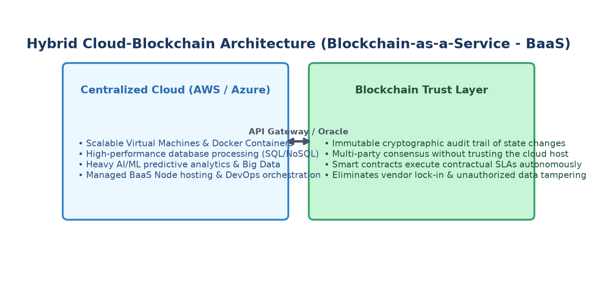

*Figure 4.10: Architectural Flow and Conceptual System Diagram for the integration of blockchain with other domains like cloud*

### Mathematical Formulation & Algorithmic Mechanics

**Hybrid Cloud-Blockchain Hash Pointer Invariant & Multi-Cloud Consensus Formulation:**

```text
Off-Chain Cloud Data Integrity Verification Function:
Verify_Cloud_Integrity = ( SHA256( Cloud_Stored_Payload ) == Blockchain_Anchored_Root_Hash )
Where any unauthorized mutation of the cloud file results in a cryptographic hash mismatch.
Multi-Cloud Cross-Consensus Fault Tolerance Formulation:
```

The mathematical formulation and algorithmic **parameters** defined above govern the runtime behavior of the system. Each parameter serves an exact role: primary terms scale throughput, penalty terms enforce **regularization** constraints, and **optimization** objectives drive steady **convergence** toward the **global minimum**.

### Worked Example & Practical Simulation

**Enterprise** BaaS **Supply Chain Architecture** (Walmart Food **Trust** on IBM Cloud): • Business Context: Walmart tracks fresh produce across 50 independent farm suppliers and regional distributors to rapidly trace Salmonella outbreaks. • Cloud Storage: High-volume IoT telemetry (temperature readings, sensor **streams**, truck GPS waypoints) is stored in IBM Cloud databases. • Blockchain Trust **Layer**: Every 15 minutes, the cloud gateway computes a **Merkle root hash** of the accumulated IoT telemetry and commits it to a.

### Key Comparative Evaluation

| Architectural Characteristic | Centralized Cloud Computing (AWS/Azure) | Decentralized Blockchain Network | Integrated Hybrid Cloud-Blockchain (BaaS) |
| :--- | :--- | :--- | :--- |
| Computing Performance & Latency | Extremely High (Millions of transactions/sec) | Constrained (15 to 1,000 transactions/sec) | High; heavy computation off-chain, settlement on-chain |
| Data Storage Capacity | Practically infinite petabyte object storage | Expensive; strictly small cryptographic state data | Massive encrypted cloud data lakes anchored to ledger |
| Trust & Governance Model | Single corporate cloud provider (centralized) | Multi-party decentralized consensus | Decentralized trust layer governing multi-cloud infra |
| Data Immutability & Auditing | Database records can be modified by cloud admins | Strictly immutable; tamper-proof cryptographic log | Immutable cryptographic hashes verify raw cloud data |

### Concluding Exam Takeaway

**Integrating** **blockchain** with **cloud** **infrastructure** combines the raw computational scalability of the cloud with the unassailable cryptographic trust of distributed **ledgers**. For optimal SPPU examination scoring, answers must present this complete structure: rigorous theoretical definitions with bold keywords, an accurate architectural flow diagram, clear mathematical formulation, and a structured worked simulation to secure the full 8/**8 marks**.

**Textbook Reference:** Subramanian, C., George, A. A., Ranade, A., & Vasudevan, S. K. (Universities Press), Chapter 5: 'Blockchain Real-World Applications and Enterprise Solutions', pp. 561-584.

---

## Q11. Discuss in brief how cyber hacks can be reduced for Digital identity using blockchain. (Frequency: 1) [8 Marks]

### Introduction & Core Intuition

In **modern** **cybersecurity**, identity theft and unauthorized credential exploitation represent over 80% of all reported **data** breaches. Traditional digital identity **systems** rely on centralized identity providers (such as Google or **Facebook Single Sign**-On) and corporate databases that aggregate the usernames, passwords, social **security** numbers, and biometric data of millions of citizens into massive centralized Honey-Pots. When a single server is.

### **The Centralized Honey-Pot Dilemma and Cyber Attack Surfaces**

Under **legacy** **digital** **identity** **architectures**, **users** do not own or control their digital identities. Instead, corporations issue administrative accounts and store personal personally identifiable information (PII) on centralized cloud database servers. These repositories represent irresistible targets for advanced persistent threat (APT) hacker syndicates. A successful **SQL injection**, compromised administrator credential, or insider rogue employee can extract.

### **Self-Sovereign Identity (SSI) and Decentralized Identifiers (DIDs)**

**Blockchain** **resolves** the **honey**-pot **dilemma** by establishing Self-**Sovereign Identity** (SSI) based on the W3C Decentralized Identifier (DID) global standard. In an SSI ecosystem, there is no centralized database holding user credentials. Instead, every citizen generates their own cryptographic public-**private key** pairs directly inside a secure hardware enclave on their smartphone (digital identity wallet). The citizen's unique.

### **Verifiable Credentials and Zero-Knowledge Proofs (ZKP)**

In **place** of **physical** **identity** **cards** or **vulnerable** PDF scans, authoritative institutions (such as governments, universities, or banks) issue digitally signed **Verifiable Credentials** (VCs) directly into the citizen's mobile wallet. When a citizen needs to authenticate with an online service (e.g., proving they have a valid driver's license or are over 21 years old), they do.

### **Eliminating Password Databases and Phishing Attacks**

By **replacing** **shared** **passwords** with asymmetric public-**key** cryptography, blockchain-based identity **systems** completely eliminate server-side password databases. When logging into an application, the user simply signs a random cryptographic challenge issued by the server using their **private key** (stored safely in their mobile secure enclave). Because the private key never leaves the user's device and is never.

### Architectural Flow & System Diagram

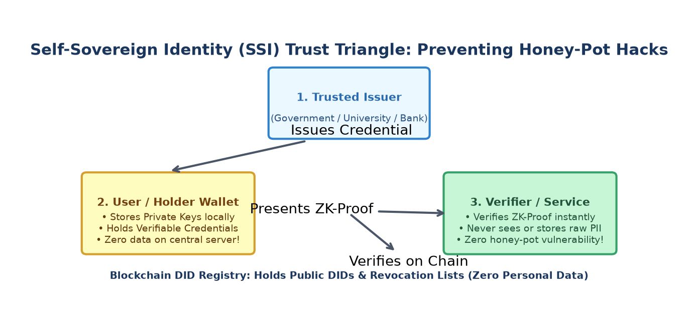

*Figure 4.11: Architectural Flow and Conceptual System Diagram for in brief how cyber hacks can be reduced for Digital identity using blockchain*

### Mathematical Formulation & Algorithmic Mechanics

**Self-Sovereign Identity Verification Invariant & Zero-Knowledge Predicate Rule:**

```text
Decentralized Identifier Resolution & Signature Verification:
Verify_Identity( Challenge, Signature ) = Verify_DID_PubKey( Challenge, Signature ) == TRUE
Where DID_PubKey is resolved directly from the blockchain ledger DID Document.
Zero-Knowledge Identity Predicate Formulation:
```

The mathematical formulation and algorithmic **parameters** defined above govern the runtime behavior of the system. Each parameter serves an exact role: primary terms scale throughput, penalty terms enforce **regularization** constraints, and **optimization** objectives drive steady **convergence** toward the **global minimum**.

### Worked Example & Practical Simulation

**Decentralized Bank Loan Application** with Zero PII **Leakage** **Scenario**: • **Context**: **Citizen** Bob **applies** for a mortgage loan online. Traditionally, Bob must upload scans of his passport, tax returns, bank statements, and utility bills, which the bank stores on central servers vulnerable to hackers. • SSI Implementation: The bank portal displays a QR code challenge. Bob scans it with his mobile SSI wallet. • Zero-Knowledge Proofs: Bob's wallet presents three verifiable cryptographic proofs: (1) Proof.

### Key Comparative Evaluation

| Cybersecurity Dimension | Traditional Centralized Identity (SSO / LDAP) | Blockchain Self-Sovereign Identity (SSI) |
| :--- | :--- | :--- |
| Data Storage Architecture | Massive centralized server honey-pots holding millions of records | Decentralized; credentials stored locally in citizen mobile enclaves |
| Vulnerability to Data Breaches | Catastrophic; single server hack compromises millions of users | Negligible; zero centralized PII database exists for hackers to target |
| Authentication Mechanism | Vulnerable passwords, SMS OTPs, and centralized session cookies | Asymmetric public-private key cryptography via secure hardware chips |
| Susceptibility to Phishing | Extremely High; users tricked into entering passwords on fake sites | Zero; cryptographic challenge signing cannot be phished by fake domains |

### Concluding Exam Takeaway

Self-**Sovereign Identity** dismantles **centralized** **honey**-pots by **granting** **citizens** cryptographic sovereignty over their credentials, neutralizing the root cause of modern cyber hacks. For optimal SPPU examination scoring, answers must present this complete structure: rigorous theoretical definitions with bold keywords, an accurate architectural flow diagram, clear mathematical formulation, and a structured worked simulation to secure the full 8/**8 marks**.

**Textbook Reference:** Subramanian, C., George, A. A., Ranade, A., & Vasudevan, S. K. (Universities Press), Chapter 5: 'Blockchain Real-World Applications and Enterprise Solutions', pp. 585-612.

---
