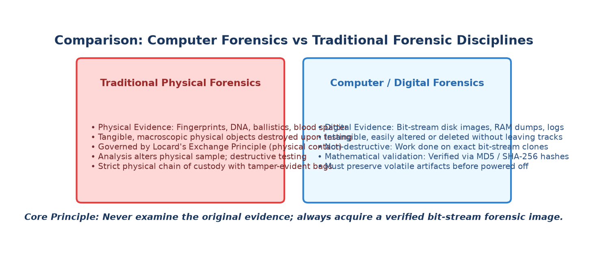
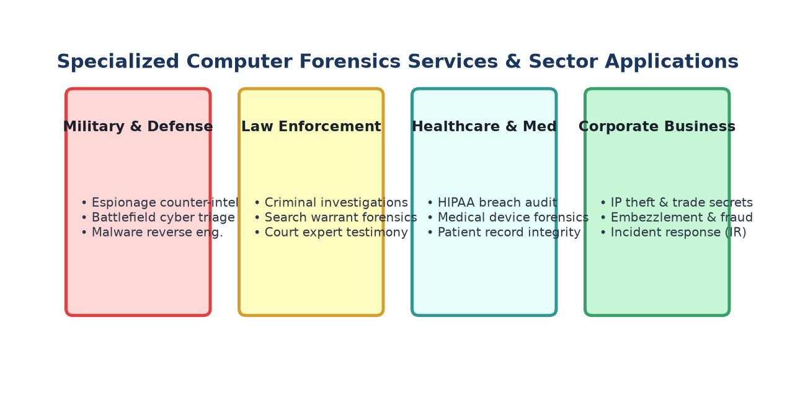
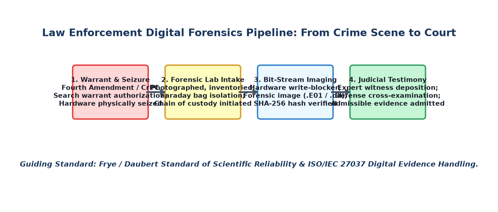
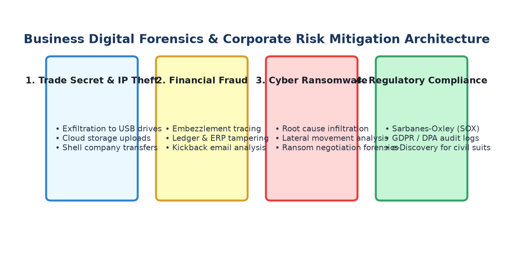
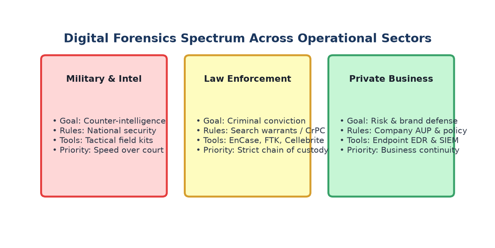
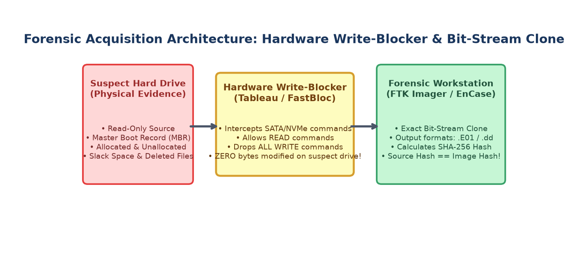
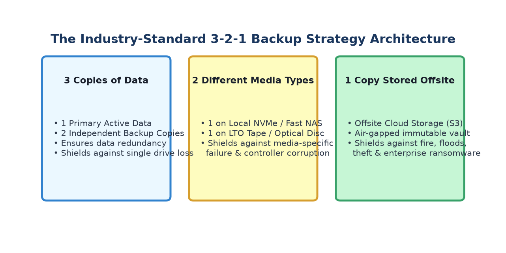

# SPPU B.E. Computer Engineering (2019 Pattern)
## Cyber Security and Digital Forensics — Unit 1: Security Fundamentals, CIA Triad & Threat Modeling
### Complete Examination Solutions Guide (Engineered for Full 8/8 Marks)

---

## Q1. What is computer forensics? What is its primary purpose, and how does it differ from other forensic disciplines? (Frequency: 2) [8 Marks]

### Introduction & Core Intuition

**Computer Forensics** (also formally designated as **Digital Forensics**) is the scientific, systematic, and legally defensible discipline of identifying, acquiring, preserving, analyzing, and presenting **digital evidence** from computing devices, digital media, and network infrastructures in a manner that ensures strict admissibility in a court of law. It applies rigorous scientific methodologies to examine digital **artifacts**—such as hard **disk** drives, solid-**state** storage,.

### **Formal Definition and the Investigative Mandate**

**Digital forensics** bridges the **intersection** of **computer** science, **information security**, and criminal jurisprudence. Unlike routine **data** recovery or IT troubleshooting, which focus merely on restoring corrupted files to operational status, **computer forensics** is fundamentally concerned with provenance, evidentiary authenticity, and legal defensibility. The primary objective is to determine what occurred, when it occurred, how it was.

### **Primary Purpose: Reconstructing the Digital Crime Scene**

The core **purpose** of **computer forensics** is to **construct** an **objective**, **mathematically** verifiable reconstruction of events that transpired on an electronic **system**. Investigators seek to answer critical factual inquiries: Did an unauthorized user access proprietary corporate blueprints? Was a deleted extortion letter authored on this workstation? Did a suspect communicate with accomplices using encrypted messaging applications?.

### **Fundamental Distinctions from Traditional Forensic Disciplines**

Traditional **forensic** sciences—such as **forensic** **toxicology**, **latent** fingerprint identification, forensic ballistics, and forensic serology (DNA analysis)—operate upon physical, macroscopic, and biological matter. Physical **evidence** is tangible, subject to physical wear, and governed by environmental decay. In sharp contrast, **digital evidence** consists of intangible sequences of magnetic or electrical charges representing binary bits (zeros and ones). Physical.

### **Locard's Exchange Principle in the Digital Domain**

In classical **forensic** science, **Locard's Exchange Principle** posits that 'every contact leaves a trace'—a criminal inevitably brings something to the crime scene and leaves with something from it (such as carpet fibers or latent skin cells). In **computer forensics**, this principle manifests digitally: whenever a user interacts with an operating **system**, hundreds of silent **artifacts** are.

### Architectural Flow & System Diagram



*Figure 1.1: Architectural Flow and Conceptual System Diagram for What is computer forensics? What is its primary pu*

### Mathematical Formulation & Algorithmic Mechanics

**Cryptographic Evidence Integrity Invariant & Bit-Stream Hash Verification:**

```text
Forensic Bit-Stream Integrity Invariant:
Hash_Algorithm( Original_Physical_Media ) == Hash_Algorithm( Forensic_Image_Copy )
Where Hash represents a cryptographic one-way digest (MD5, SHA-1, or SHA-256).
SHA-256 Mathematical Collision Resistance Bound:
```

The mathematical formulation and algorithmic **parameters** defined above govern the runtime behavior of the system. Each parameter serves an exact role: primary terms scale throughput, penalty terms enforce **regularization** constraints, and **optimization** objectives drive steady **convergence** toward the **global minimum**.

### Worked Example & Practical Simulation

**Practical Case Demonstration**: Criminal Extortion Investigation: • Physical Scene: Police seize a suspect's laptop allegedly used to send anonymous extortion emails. If an inexperienced officer simply boots up the laptop to look at files, the operating system instantly modifies hundreds of registry keys, access timestamps, and swap files, destroying evidentiary **integrity**. • **Forensic** Procedure: A **digital forensics** specialist removes the internal NVMe SSD, connects it to a Tableau **hardware write-blocker**, and acquires a forensic bit-stream.

### Key Comparative Evaluation

| Forensic Dimension | Traditional Forensic Disciplines (DNA, Ballistics) | Computer / Digital Forensics |
| :--- | :--- | :--- |
| Nature of Evidence | Physical, tangible matter (blood, fingerprints, firearms) | Intangible binary data (bits, registry hives, network packets) |
| Evidence Vulnerability | Degrades slowly due to environmental temperature and humidity | Extremely volatile; can be wiped or modified in milliseconds |
| Examination Method | Often destructive; consumes chemical samples in laboratory | Non-destructive; conducted on bit-stream forensic duplicates |
| Verification Technique | Microscopic visual matching and statistical DNA profiling | Mathematical verification via 128-bit MD5 or 256-bit SHA-256 hashes |

### Concluding Exam Takeaway

**Computer forensics** elevates **digital** **investigation** into an exact science by combining non-destructive bit-**stream** imaging with mathematical **hash verification** to ensure undeniable legal proof. For optimal SPPU examination scoring, answers must present this complete structure: rigorous theoretical definitions with bold keywords, an accurate architectural flow diagram, clear mathematical formulation, and a structured worked simulation to secure the full 8/**8 marks**.

**Textbook Reference:** Nelson, B., Phillips, A., & Steuart, C. K., Guide to Computer Forensics and Investigations (7th Ed.), Cengage Learning, Chapter 1: 'Understanding the Digital Forensics Profession and Investigations', pp. 2-28.

---

## Q2. What are different computer forensics schemes/services? Explain in detail the typical services offered by professionals, and write applications of digital forensics in the military/healthcare. (Frequency: 5) [8 Marks]

### Introduction & Core Intuition

Professional **Computer Forensics** Schemes and **Services** **encompass** the specialized technical capabilities, **forensic** methodologies, and investigative offerings provided by digital forensic specialists to law enforcement agencies, corporate enterprises, military intelligence bodies, and healthcare organizations. Because digital devices pervade every aspect of modern society, forensic professionals provide structured service schemes ranging from rapid **Incident Response** Triage and **Forensic Data Acquisition** to deep.

### **Core Forensic Schemes: Public vs Private vs Military Investigations**

Digital **forensic** services are **structured** **across** **three** **primary** organizational schemes: First, Law Enforcement **Forensics**, which is governed by strict criminal procedure codes (such as the Fourth Amendment, CrPC, and.

### **Typical Services Offered by Professional Forensic Specialists**

Digital **forensic** service **providers** **deliver** a **comprehensive** suite of specialized technical solutions: (1) **Forensic Acquisition** and Write-Blocked Imaging: Safely acquiring sector-by-sector bit-**stream** copies of hard drives, mobile phones (iOS/Android),.

### **Digital Forensics Applications in Military and Defense Operations**

In **military** and **intelligence** domains, **digital forensics** is **weaponized** for tactical advantage and national defense. Known as Document and **Media Exploitation** (DOMEX), military **forensic** specialists deploy ruggedized field kits.

### **Digital Forensics Applications in the Healthcare Sector**

In **modern** healthcare, **digital forensics** plays a life-**critical** role centered on **data** privacy compliance and clinical device **integrity**. Healthcare providers manage massive repositories of **Protected Health Information** (PHI) governed.

### Architectural Flow & System Diagram



*Figure 1.2: Architectural Flow and Conceptual System Diagram for What are different computer forensics schemes/services?  in detail the typical services offered by professionals, and write applications of digital forensics in the military/healthcare*

### Mathematical Formulation & Algorithmic Mechanics

**Legal Evidence Admissibility (Daubert Standard) & Forensic Integrity Metric:**

```text
Daubert Standard Judicial Admissibility Formula:
Admissibility = ( Peer_Reviewed_Methodology ∧ Known_Error_Rate ∧ Standardized_Controls ∧ Scientific_Acceptance )
Where all four criteria must be satisfied for a forensic service technique to be admitted in court.
Forensic Soundness Metric: Delta_Evidence = Sum( Abs( Byte_Original - Byte_Acquired ) ) == 0
```

The mathematical formulation and algorithmic **parameters** defined above govern the runtime behavior of the system. Each parameter serves an exact role: primary terms scale throughput, penalty terms enforce **regularization** constraints, and **optimization** objectives drive steady **convergence** toward the **global minimum**.

### Worked Example & Practical Simulation

**Hospital Ransomware** & HIPAA Compliance **Forensic** Service Scenario: • Incident: City General Hospital is hit by LockBit ransomware; 10,000 patient surgical databases are encrypted, and emergency surgeries are halted. • Service Deployed: A professional **digital forensics** incident response firm is contracted under urgent **triage**. • Forensic **Execution**: Investigators dump volatile RAM from the active domain controller, extracting the ransomware binary and finding an unencrypted **memory** key. Concurrently, network packet forensic analysis of perimeter firewalls proves.

### Key Comparative Evaluation

| Forensics Service Domain | Target Technical Artifacts | Primary Investigation Methodology | Strategic Real-World Outcome |
| :--- | :--- | :--- | :--- |
| Criminal Law Enforcement | Smartphones, laptops, deleted chats, browser history | Physical seizure under warrant; bit-stream imaging | Secures legally defensible proof for criminal trial conviction |
| Corporate Civil Litigation | Exchange email archives, USB logs, cloud file syncs | e-Discovery collection; keyword searching; timeline build | Protects trade secrets and defends corporate breach of contract |
| Military Defense (DOMEX) | Adversary drones, tactical radios, captured field drives | Battlefield triage; firmware extraction; exploit analysis | Uncovers imminent combat threats and enemy network command hierarchies |
| Healthcare (HIPAA Audit) | EMR databases, PACS medical imaging, infusion pumps | SIEM log correlation; medical device firmware auditing | Determines PHI breach scope and eliminates clinical device vulnerabilities |

### Concluding Exam Takeaway

Professional **computer forensics** services **provide** **specialized** **technical**, analytical, and legal capabilities that protect corporate assets, secure healthcare **systems**, and defend national sovereignty. For optimal SPPU examination scoring, answers must present this complete structure: rigorous theoretical definitions with bold keywords, an accurate architectural flow diagram, clear mathematical formulation, and a structured worked simulation to secure the full 8/**8 marks**.

**Textbook Reference:** Nelson, B., Phillips, A., & Steuart, C. K., Guide to Computer Forensics and Investigations (7th Ed.), Cengage Learning, Chapter 1: 'Understanding the Digital Forensics Profession and Investigations', pp. 29-56.

---

## Q3. Computer forensics specialists' steps: What are the typical steps/methodology followed by computer forensics specialists in an investigation? (Explain in detail/any 2). (Frequency: 4) [8 Marks]

### Introduction & Core Intuition

To **ensure** that **digital evidence** is **preserved** without **contamination** and remains admissible under rigorous judicial scrutiny, **digital forensics** specialists must adhere to standardized, systematic investigative methodologies. As formalized by the NIST SP 800-86 Guide and the ISO/IEC 27037 Standard, a professional digital **forensics** investigation progresses through five sequential, interdependent phases: Preparation, Acquisition, Examination, Analysis, and Reporting. Any procedural deviation during.

### **The Methodological Imperative of Forensic Rigor**

**Digital evidence** is **inherently** **fragile**, **easily** altered by normal operating **system** operations, and highly susceptible to defense spoliation challenges in court. If an **investigator** powers on a computer without proper write-blocking hardware, thousands of.

### **Phase 1: Investigative Preparation and Legal Authorization**

Before **touching** any **computing** **hardware**, **investigators** must establish legal authority and operational readiness. In law enforcement, this requires securing a specific **search** warrant signed by a judicial magistrate specifying the hardware and digital **artifacts**.

### **Detailed Deep Dive 1: Phase 2 - Forensic Acquisition and Preservation**

**The Acquisition Phase** is the **critical** **bridge** where live **digital evidence** is safely transferred into the **forensic** laboratory. If the target **system** is actively running upon arrival, the specialist adheres to the Order of.

### **Phase 3: Technical Examination and Evidence Processing**

During the **Examination Phase**, the specialist **processes** the acquired **forensic** image **using** **forensic** platforms (such as EnCase, FTK, or Autopsy). The specialist extracts **system** metadata, indexes every word on the drive for keyword searching,.

### Architectural Flow & System Diagram


*Figure 1.3: Architectural Flow and Conceptual System Diagram for Computer forensics specialists' steps: What are the typical steps/methodology followed by computer forensics specialists in an investigation? ( in detail/any 2)*

### Mathematical Formulation & Algorithmic Mechanics

**Order of Volatility Hierarchy & Digital Timeline Correlation Formulation:**

```text
RFC 3227 Standard Order of Volatility (High to Low Priority):
Volatility_Rank: RAM > CPU_Registers/Cache > Routing_Tables/ARP > Temp_Files > Hard_Disk > Optical_Media
Where data at the top of the hierarchy is permanently destroyed first if power is interrupted.
Unified Forensic Event Timeline Correlation Formula:
```

The mathematical formulation and algorithmic **parameters** defined above govern the runtime behavior of the system. Each parameter serves an exact role: primary terms scale throughput, penalty terms enforce **regularization** constraints, and **optimization** objectives drive steady **convergence** toward the **global minimum**.

### Worked Example & Practical Simulation

**Comprehensive Execution** of Phase 2 (Acquisition) & Phase 4 (Analysis) in an Corporate Espionage Case: • Case Context: A chief chemical engineer resigns abruptly to join a direct competitor; company suspects theft of patented battery formulas. • Phase 2 **Execution** (Acquisition): **Forensic** specialist isolates the engineer's workstation. Connects laptop drive to Tableau T8u USB-3 write-blocker; acquires 1 Terabyte SSD into an Expert Witness (.E01) **image** split into **2 GB** chunks. Computes **SHA-256** hash (9f83a...); writes.

### Key Comparative Evaluation

| Investigation Phase | Primary Technical Objective | Standard Forensic Tools Utilized | Key Deliverable / Output Artifact |
| :--- | :--- | :--- | :--- |
| 1. Preparation | Establish legal authority, calibrate kits, sanitize drives | DoD 5220.22-M disk wipers, evidence intake logs | Search warrant, sanitized media, evidence log sheets |
| 2. Acquisition | Capture volatile RAM and sector-by-sector disk clones | Hardware write-blockers, FTK Imager, WinPmem, dd | Bit-stream forensic image (.E01/.raw) with SHA-256 hashes |
| 3. Examination | Index text, parse file systems, carve deleted artifacts | Autopsy, EnCase, FTK, PhotoRec, Volatility | Extracted file trees, carved deleted files, registry hives |
| 4. Analysis | Correlate artifacts, construct timeline, establish attribution | Plaso (log2timeline), Registry Explorer, Wireshark | Reconstructed chronological super-timeline & attribution link |

### Concluding Exam Takeaway

**Following** a **disciplined** five-**phase** investigation lifecycle guarantees that **digital evidence** is preserved with mathematical **integrity** and presented with unshakeable legal credibility. For optimal SPPU examination scoring, answers must present this complete structure: rigorous theoretical definitions with bold keywords, an accurate architectural flow diagram, clear mathematical formulation, and a structured worked simulation to secure the full 8/**8 marks**.

**Textbook Reference:** Nelson, B., Phillips, A., & Steuart, C. K., Guide to Computer Forensics and Investigations (7th Ed.), Cengage Learning, Chapter 1: 'Understanding the Digital Forensics Profession and Investigations', pp. 57-84.

---

## Q4. Law Enforcement: What is the use/role of Computer Forensics in Law Enforcement? How does it help/aid in criminal investigations? (Frequency: 4) [8 Marks]

### Introduction & Core Intuition

In **modern** **criminal** justice, **Computer Forensics** has evolved from a specialized support **function** into an indispensable cornerstone of contemporary law enforcement. Because virtually every modern criminal enterprise—ranging from homicide, violent narcotics syndicates, and financial embezzlement to child exploitation and international cyber-terrorism—relies on smartphones, GPS navigation, and digital communications, law enforcement agencies maintain dedicated **digital forensics** units (DFUs). Computer **forensics** empowers.

### **The Pervasive Digital Footprint in Modern Crime**

**Traditional** **policing** relied almost exclusively on physical **evidence**: eyewitness statements, latent fingerprints, tire tracks, and murder weapons. Today, criminals carry high-powered tracking devices in their pockets in the form of smartphones. A suspect's smartphone continuously logs cell tower **connections**, Wi-Fi access points, GPS coordinates, web **searches**, credit card tap **transactions**, and encrypted instant messaging chats. Computer.

### **Search Warrant Execution and Constitutional Safeguards**

In **constitutional** **criminal** **jurisprudence**, law enforcement officers cannot arbitrarily seize and **search** personal computers. Under the **Fourth Amendment** (in the US) and the Code of Criminal Procedure (CrPC) and Information Technology Act (in India), officers must establish Probable Cause to secure a specific search warrant signed by a judicial magistrate. **Computer forensics** specialists play a vital.

### **Uncovering Deleted, Hidden, and Obfuscated Evidence**

Perpetrators routinely attempt to destroy **digital evidence** prior to apprehension by deleting files, emptying the **Recycle Bin**, formatting hard drives, or running **anti-forensics** privacy cleaners. Law enforcement **forensic** specialists utilize advanced techniques to recover this hidden evidence. By conducting **Unallocated Space** Carving, examining Volume Shadow Copies, recovering temporary print spool files, and parsing file system journals.

### **Establishing Attribution, Motive, and Premeditation**

**Proving** that a **physical** **crime** occurred is insufficient for a criminal conviction; prosecutors must prove Motive, Premeditation, and specific **Human Attribution** (proving beyond reasonable doubt that the accused individual was the person sitting at the keyboard). **Computer forensics** delivers this proof: web **search** history often reveals premeditation (e.g., searching for 'how to make untraceable poison' or.

### Architectural Flow & System Diagram



*Figure 1.4: Architectural Flow and Conceptual System Diagram for Law Enforcement: What is the use/role of Computer*

### Mathematical Formulation & Algorithmic Mechanics

**Criminal Evidence Attribution Tuple & Probable Cause Threshold Formulation:**

```text
Criminal Attribution Multi-Factor Mathematical Proof:
Attribution_Proof = ( Account_Auth ∧ Biometric_Lock ∧ Physical_Presence_GPS ∧ Active_Keystrokes )
Where all factors must align chronologically to eliminate reasonable doubt.
Search Warrant Legal Parameter Boundary:
```

The mathematical formulation and algorithmic **parameters** defined above govern the runtime behavior of the system. Each parameter serves an exact role: primary terms scale throughput, penalty terms enforce **regularization** constraints, and **optimization** objectives drive steady **convergence** toward the **global minimum**.

### Worked Example & Practical Simulation

Real-**World Law Enforcement Homicide Investigation Scenario**: • The Crime: A victim goes missing in a suburban jurisdiction. Police identify a prime suspect, but the suspect claims an ironclad alibi, asserting he was sleeping at home 50 kilometers away during the murder window. • **Forensic** Execution: Police execute a **search** warrant and seize the suspect's iPhone and laptop. The **digital forensics** unit bypasses the smartphone passcode using hardware physical extraction tools. • Incriminating **Artifacts** Uncovered: -.

### Key Comparative Evaluation

| Investigation Capability | Traditional Law Enforcement Methods | Digital Forensics-Enabled Law Enforcement |
| :--- | :--- | :--- |
| Alibi Verification | Relies on fallible human witnesses and paper alibis | Mathematical verification via GPS, Wi-Fi logs, and cell towers |
| Proof of Premeditation | Difficult to establish without personal diary or letters | Proved definitively via web searches, deleted notes, and downloads |
| Overcoming Evidence Destruction | Burned or discarded physical evidence is permanently lost | Deleted digital files carved from unallocated disk slack space |
| Suspect Identification | Vulnerable to mistaken identity in physical police lineups | Cryptographic device DIDs, MAC addresses, and account credentials |

### Concluding Exam Takeaway

**Computer forensics** provides law **enforcement** with an **unalterable** **scientific** lens that **exposes** criminal premeditation, dismantles false alibis, and delivers justice in modern courts. For optimal SPPU examination scoring, answers must present this complete structure: rigorous theoretical definitions with bold keywords, an accurate architectural flow diagram, clear mathematical formulation, and a structured worked simulation to secure the full 8/**8 marks**.

**Textbook Reference:** Nelson, B., Phillips, A., & Steuart, C. K., Guide to Computer Forensics and Investigations (7th Ed.), Cengage Learning, Chapter 1: 'Understanding the Digital Forensics Profession and Investigations', pp. 85-112.

---

## Q5. Business: In what ways can business benefit from computer forensics technology? What specific technologies are utilized in the field of business forensics? (Frequency: 3) [8 Marks]

### Introduction & Core Intuition

In **modern** **corporate** enterprise management, Business **Computer Forensics** has become an essential capability for protecting intellectual property, investigating white-collar financial fraud, mitigating insider threats, and responding to catastrophic ransomware cyber incidents. Today, over 90% of all corporate assets exist exclusively in digital form. While traditional physical **security** protects corporate buildings, computer **forensics** protects enterprise **data** repositories and digital communications. Deploying.

### **Defending Corporate Assets Against Malicious Insider Threats**

While **corporate** **firewalls** **defend** against **external** **internet** hackers, studies consistently show that the most damaging financial **losses** are inflicted by malicious internal employees. Disgruntled staff, departing executives, or compromised contractors often attempt.

### **Investigating Financial Embezzlement and Accounting Fraud**

**White**-collar **corporate** **fraud** and **financial** **embezzlement** involve sophisticated manipulations of enterprise accounting **ledgers**, ERP software (such as SAP or Oracle), and corporate banking portals. Corrupt executives create fictitious shell vendors, fabricate invoice.

### **Cyber Incident Response, Ransomware Forensics, and Business Continuity**

When an **enterprise** **suffers** a **catastrophic** **cyber** attack—such as an enterprise-wide ransomware lockout—business operations are paralyzed. Corporate **forensics** teams conduct rapid **Incident Response** Triage to answer life-or-death business questions: What was the.

### **Regulatory Compliance, Audit Trails, and Electronic Discovery (e-Discovery)**

**Corporations** **operate** under **rigorous** **statutory** compliance mandates—including the Sarbanes-**Oxley Act** (SOX), the Health Insurance Portability and Accountability Act (HIPAA), and the General **Data** Protection Regulation (GDPR). When corporations face civil lawsuits or.

### Architectural Flow & System Diagram



*Figure 1.5: Architectural Flow and Conceptual System Diagram for Business: In what ways can business benefit from c*

### Mathematical Formulation & Algorithmic Mechanics

**Insider Threat Exfiltration Score & e-Discovery Proportionality Rule:**

```text
Corporate Data Exfiltration Risk Score Formulation:
Risk_Score = ( USB_Mounted ∧ Total_Bytes_Exfiltrated > Threshold ) + ( Resignation_Notice_Active * 50 ) + ( Off_Hours_Login * 30 )
Where Risk_Score >= 100 triggers automated forensic workstation quarantine and security alert.
FRCP Rule 26(b)(1) e-Discovery Proportionality Invariant:
```

The mathematical formulation and algorithmic **parameters** defined above govern the runtime behavior of the system. Each parameter serves an exact role: primary terms scale throughput, penalty terms enforce **regularization** constraints, and **optimization** objectives drive steady **convergence** toward the **global minimum**.

### Worked Example & Practical Simulation

**Corporate Trade Secret Theft Pre**-Departure Investigation Scenario: • Scenario: A senior AI researcher at an autonomous robotics firm tenders their resignation, stating they are taking a sabbatical. The corporate **security** team initiates a routine **forensic** audit of the researcher's company MacBook. • Forensic Technologies Deployed: Investigators deploy EnCase Enterprise to acquire a remote **bit-stream image** of the APFS file **system** and parse system unified logs. • Uncovered Technological Proof: - USB Registry Logs: The USB.

### Key Comparative Evaluation

| Corporate Forensic Technology | Core Technical Capability | Enterprise Investigation Vector | Primary Business Return on Investment |
| :--- | :--- | :--- | :--- |
| Enterprise EDR Forensics (CrowdStrike, EnCase) | Remote volatile memory and live endpoint disk collection | Insider threat monitoring & rapid incident response | Enables global threat triage in minutes without disrupting employees |
| SIEM Centralized Log Aggregation (Splunk) | Real-time correlation of firewall, VPN, and AD server logs | Detecting unauthorized lateral movement & brute-force | Provides centralized audit logs that satisfy SOX and ISO 27001 mandates |
| e-Discovery Suites (Relativity, Nuix) | Deduplication, keyword search, and OCR email indexing | Civil litigation document production & antitrust probes | Reduces corporate legal review costs from millions to thousands of dollars |
| File Carving & Data Recovery (FTK, Autopsy) | Extracts deleted spreadsheets and messages from unallocated space | Investigating corporate kickbacks and embezzlement | Recovers critical proof of fraud that perpetrators attempted to delete |

### Concluding Exam Takeaway

Business **computer forensics** converts **corporate** IT **infrastructure** into a self-**defending** **enterprise** ecosystem that neutralizes insider threats, defeats cyber attacks, and safeguards corporate value. For optimal SPPU examination scoring, answers must present this complete structure: rigorous theoretical definitions with bold keywords, an accurate architectural flow diagram, clear mathematical formulation, and a structured worked simulation to secure the full 8/**8 marks**.

**Textbook Reference:** Nelson, B., Phillips, A., & Steuart, C. K., Guide to Computer Forensics and Investigations (7th Ed.), Cengage Learning, Chapter 1: 'Understanding the Digital Forensics Profession and Investigations', pp. 113-140.

---

## Q6. Sector Variation: How does computer forensics technology vary across different sectors like military, law enforcement & business? (Frequency: 1) [8 Marks]

### Introduction & Core Intuition

While the core scientific foundations of **computer forensics**—such as bit-stream imaging, cryptographic hashing, and **artifact** parsing—remain constant, the operational application of Computer **Forensics** Technology varies dramatically across different operational sectors: Military and Intelligence, **Law Enforcement**, and Private Commercial Business. Each sector operates under distinct legal mandates, environmental constraints, speed **requirements**, and strategic objectives, shaping how digital **forensic** tools are engineered and deployed.

### **Comparative Operational Mandates Across Sectors**

**In Law Enforcement**, the **overriding** **mandate** is **criminal** **justice**: identifying perpetrators, establishing guilt beyond reasonable doubt, and securing convictions that withstand intense adversarial scrutiny in public courts. In Military and Defense, the mandate is national **security** and battlefield dominance: gathering actionable intelligence,.

### **Legal Frameworks and Evidentiary Standards**

The legal **rules** governing **forensic** investigations diverge sharply across sectors. Law enforcement is strictly **bound** by constitutional protections against unreasonable **search** and seizure (such as **Fourth Amendment** warrants, the Indian Information Technology Act, and CrPC procedural codes). **Evidence** collected without a flawless.

### **Specialized Forensic Toolkits and Technical Constraints**

The **technical** **toolsets** **deployed** **reflect** **operational** environments. Law enforcement relies on standardized, court-proven **forensic** suites (such as EnCase, FTK, and Cellebrite UFED) deployed in static, climate-controlled laboratory environments. Military forensic specialists require ruggedized, portable battlefield kits (such as ADF Solutions, Talon field.

### **Speed vs Admissibility: The Strategic Priority Divergence**

A **fundamental** **divergence** **exists** between the **priority** of **Investigation Speed** and Legal Admissibility. In law enforcement, meticulous legal adherence takes precedence over speed; months may be spent verifying a **forensic** image to ensure flawless courtroom presentation. In military combat, real-time tactical intelligence.

### Architectural Flow & System Diagram



*Figure 1.6: Architectural Flow and Conceptual System Diagram for Sector Variation: How does computer forensics tech*

### Mathematical Formulation & Algorithmic Mechanics

**Sector-Specific Objective Optimization Functions & Trade-Off Bounds:**

```text
Law Enforcement Objective: Maximize( Legal_Admissibility )  Subject to: Strict_Chain_of_Custody == TRUE
Military Defense Objective: Maximize( Tactical_Triage_Speed )  Subject to: Real_Time_Threat_Neutralization
Commercial Business Objective: Maximize( Business_Continuity )  Subject to: Financial_Loss_Minimization
Admissibility vs Speed Trade-off Boundary: Priority_Police( Time ) ≪ Priority_Military( Time )
```

The mathematical formulation and algorithmic **parameters** defined above govern the runtime behavior of the system. Each parameter serves an exact role: primary terms scale throughput, penalty terms enforce **regularization** constraints, and **optimization** objectives drive steady **convergence** toward the **global minimum**.

### Worked Example & Practical Simulation

Tri-**Sector Response** to a Nation-**State** Ransomware Infiltration: • The Incident: APT29 (a foreign military intelligence hacking unit) infiltrates a major defense manufacturing conglomerate, deploying ransomware and exfiltrating missile guidance source code. • Corporate **Forensics** Action: The company's **incident response** team uses CrowdStrike EDR to isolate infected endpoints, analyzes **memory** dumps to identify the C2 beacon IP, restores operations from offline backups, and calculates business interruption insurance claims in **12 hours**. • Law Enforcement Action: The.

### Key Comparative Evaluation

| Operational Dimension | Military & Intelligence (DOMEX) | Law Enforcement (Police / FBI) | Private Enterprise (Corporate Forensics) |
| :--- | :--- | :--- | :--- |
| Primary Investigation Goal | Battlefield tactical intelligence & counter-espionage | Criminal prosecution and conviction beyond reasonable doubt | Asset protection, business continuity, and risk mitigation |
| Governing Legal Standard | Law of Armed Conflict (LOAC) & National Security Acts | Criminal Procedure Codes (CrPC, Fourth Amendment) | Corporate Acceptable Use Policy (AUP) & civil employment law |
| Typical Physical Environment | Combat theaters, ruggedized forward operating bases | Certified static crime laboratories (ASCLD/LAB accredited) | Corporate data centers and remote global employee endpoints |
| Dominant Software Toolkits | Talon field units, ADF Solutions, custom IDA Pro scripts | EnCase Forensic, FTK, Cellebrite UFED, Magnet AXIOM | CrowdStrike Falcon, Splunk SIEM, Relativity e-Discovery |

### Concluding Exam Takeaway

**Understanding** **sector**-specific **variations** **ensures** that digital **forensic** methodologies are precisely calibrated to satisfy operational mandates—whether winning battles, winning trials, or saving businesses. For optimal SPPU examination scoring, answers must present this complete structure: rigorous theoretical definitions with bold keywords, an accurate architectural flow diagram, clear mathematical formulation, and a structured worked simulation to secure the full 8/**8 marks**.

**Textbook Reference:** Nelson, B., Phillips, A., & Steuart, C. K., Guide to Computer Forensics and Investigations (7th Ed.), Cengage Learning, Chapter 1: 'Understanding the Digital Forensics Profession and Investigations', pp. 141-168.

---

## Q7. Human Resources: Explain in detail Computer Forensics Assistance to Human Resources. (Frequency: 1) [8 Marks]

### Introduction & Core Intuition

In **modern** **corporate** governance, **Computer Forensics** Assistance to **Human Resources** (HR) represents a critical alliance between digital technology and employment administration. As workplace communications, **performance** evaluations, employee grievances, and corporate **policy** enforcement have migrated entirely to digital platforms—such as corporate email, Slack, Microsoft Teams, and cloud repositories—HR departments routinely face complex employee misconduct allegations that cannot be resolved through verbal.

### **The Critical Nexus of Digital Forensics and Human Resources**

**Human Resources** departments are **tasked** with **maintaining** a safe, **productive**, and **legally** **compliant** workplace. When employee misconduct occurs, HR managers face severe legal liabilities: wrongful termination lawsuits from dismissed employees, or hostile workplace civil liability from victims if harassment is.

### **Investigating Workplace Harassment and Hostile Work Environments**

**Workplace** **sexual** **harassment**, **racial** **discrimination**, and bullying frequently occur through electronic communication channels. Harassers often attempt to conceal their actions by deleting hostile emails, clearing browser histories, or utilizing ephemeral messaging applications. Digital **forensic** specialists assist HR by recovering deleted.

### **Detecting Employee Moonlighting, Time Theft, and Conflicts of Interest**

With the **widespread** **adoption** of **remote** and hybrid work **models**, HR departments face rising instances of **Employee Moonlighting** (working a second unauthorized full-time job during corporate hours) and Time Theft (falsifying remote billable hours). **Forensics** assists HR by analyzing background.

### **Pre-Departure Audits and Preventing Intellectual Property Exfiltration**

A **standard** HR **responsibility** is **managing** **employee** resignations and terminations. When high-performing executives, sales leaders, or software developers resign to join a direct competitor, HR requests a **Forensic** Pre-**Departure Audit**. Forensic specialists examine the employee's corporate laptop prior to reassignment,.

### Architectural Flow & System Diagram


*Figure 1.7: Architectural Flow and Conceptual System Diagram for Human Resources:  in detail Computer Forensics Assistance to Human Resources*

### Mathematical Formulation & Algorithmic Mechanics

**HR Policy Violation Metric & Corporate Defensibility Formulation:**

```text
Acceptable Use Policy (AUP) Violation Metric Formulation:
AUP_Violation_Score = ( Policy_Prohibited_Keywords_Found * 10 ) + ( Mass_USB_Exfiltration_Flag * 50 ) + ( Tampering_Attempt * 40 )
Where Score >= 50 provides legally defensible cause for immediate employee termination.
HR Legal Defensibility Invariant:
```

The mathematical formulation and algorithmic **parameters** defined above govern the runtime behavior of the system. Each parameter serves an exact role: primary terms scale throughput, penalty terms enforce **regularization** constraints, and **optimization** objectives drive steady **convergence** toward the **global minimum**.

### Worked Example & Practical Simulation

**Workplace Sexual Harassment** & **Wrongful** **Dismissal** **Defense** Scenario: • The Incident: Employee Sarah files a formal HR grievance alleging that her direct manager, John, has been sending her graphic, inappropriate personal messages and threatening to deny her promotion if she refuses his advances. When interviewed, John vehemently denies the accusations, claiming Sarah fabricated the claims after receiving a poor **performance** review; John presents a clean corporate laptop with zero inappropriate emails. • **Forensic** Specialist Investigation:.

### Key Comparative Evaluation

| HR Investigation Vector | Suspected Employee Violation | Target Digital Artifacts | HR Strategic Benefit Delivered |
| :--- | :--- | :--- | :--- |
| Workplace Harassment | Hostile emails, slurs, sexually graphic chats | Deleted Teams/Slack SQLite DBs, carved PST archives | Protects victims and eliminates corporate hostile-workplace liability |
| Trade Secret Exfiltration | Departing staff stealing client lists & blueprints | Windows Registry USBSTOR, LNK files, Shellbags | Enables immediate judicial injunctions preventing IP theft to rivals |
| Time Theft / Moonlighting | Working secondary job or billing fake remote hours | Mouse-jiggler execution, secondary VPNs, active times | Terminates fraudulent payroll drains and enforces remote compliance |
| Unauthorized Content Access | Viewing illicit or contraband media on work PCs | Browser cache, WebCacheV01.dat, carved image thumbs | Enforces corporate Acceptable Use Policy and workplace safety |

### Concluding Exam Takeaway

**Computer forensics** transforms HR **investigations** from **subjective** he-said-she-said **disputes** into an objective, scientifically verifiable administrative **process** that protects both employees and the enterprise. For optimal SPPU examination scoring, answers must present this complete structure: rigorous theoretical definitions with bold keywords, an accurate architectural flow diagram, clear mathematical formulation, and a structured worked simulation to secure the full 8/**8 marks**.

**Textbook Reference:** Nelson, B., Phillips, A., & Steuart, C. K., Guide to Computer Forensics and Investigations (7th Ed.), Cengage Learning, Chapter 1: 'Understanding the Digital Forensics Profession and Investigations', pp. 169-194.

---

## Q8. Technologies Used: What are some examples of technologies used in computer forensic investigations? (Explain any two). (Frequency: 1) [8 Marks]

### Introduction & Core Intuition

Modern **digital forensics** relies on a sophisticated ecosystem of specialized hardware and software technologies engineered to acquire, process, and analyze **digital evidence** without altering its underlying contents. Key technologies span Hardware Write-Blockers, Bit-Stream **Forensic Imaging** Suites, **Volatile Memory** Capture Tools, Mobile Device Physical Extractors, and Automated **Forensic** Analysis Frameworks. A deep understanding of these technologies—specifically Hardware Write-Blockers and Bit-Stream Forensic.

### **The Technological Foundation of Forensic Soundness**

In **digital** **investigations**, the most critical engineering **requirement** is **Forensic** Soundness: the guarantee that the act of acquiring and examining **evidence** does not alter, contaminate, or destroy a single bit of the original media. Modern operating **systems**.

### **Detailed Technology 1: Hardware Write-Blockers (Forensic Bridges)**

A **Hardware Write-Blocker** (such as the **Tableau** T8u, WiebeTech **Forensic** UltraDock, or **Atola Insight**) is a **specialized** **physical** bridge device positioned between the suspect storage drive and the forensic analysis workstation. The write-blocker contains dedicated internal microcontrollers.

### **Detailed Technology 2: Bit-Stream Forensic Imaging Suites (FTK Imager, EnCase)**

A Bit-Stream **Forensic Imaging** Suite (such as **AccessData** FTK **Imager**, **OpenText** **EnCase**, or the open-**source** dc3dd tool) is software engineered to generate an exact, sector-by-sector physical clone of a digital storage medium. Unlike conventional file copying (which.

### **Volatile Memory (RAM) Extraction Technologies**

As **modern** **cyber** **attackers** increasingly deploy 'fileless malware' and **memory**-resident exploits that never touch the hard **disk** drive, **Volatile Memory** Extraction Technologies have become vital. Tools such as WinPmem, LiME (Linux Memory Extractor), and Belkasoft RAM Capturer.

### Architectural Flow & System Diagram



*Figure 1.8: Architectural Flow and Conceptual System Diagram for Technologies Used: What are some examples of technologies used in computer forensic investigations? ( any two)*

### Mathematical Formulation & Algorithmic Mechanics

**Write-Blocker Command Filtering Invariant & Sector-by-Sector Copy Formulation:**

```text
Hardware Write-Blocker Interception Logic Rule:
Command_Action = IF ( Command ∈ { READ_SECTOR, IDENTIFY, GEOMETRY  ) THEN PASS ELSE DROP_AND_ALERT()
Where drop action occurs in hardware firmware within nanoseconds, preventing any disk write.
Bit-Stream Physical Forensic Image Invariant:
```

The mathematical formulation and algorithmic **parameters** defined above govern the runtime behavior of the system. Each parameter serves an exact role: primary terms scale throughput, penalty terms enforce **regularization** constraints, and **optimization** objectives drive steady **convergence** toward the **global minimum**.

### Worked Example & Practical Simulation

Executing a Write-**Blocked Bit**-Stream Acquisition of a Suspect SSD: • Suspect Media: A **512 GB** NVMe M.2 SSD seized from an embezzlement suspect's desktop computer. • Technology 1 Execution (**Hardware Write-Blocker**): The **investigator** seats the NVMe SSD into a Tableau T7u PCIe/NVMe Write-Blocker. The write-blocker connects to the **forensic** workstation via USB-3.1 Gen 2. The write-blocker's hardware LED illuminates GREEN, verifying that write-blocking firmware is active. • Technology 2 Execution (FTK Imager): The specialist launches.

### Key Comparative Evaluation

| Forensic Technology Category | Primary Hardware / Software Products | Core Architectural Mechanism | Forensic Investigation Role |
| :--- | :--- | :--- | :--- |
| Hardware Write-Blockers | Tableau T8u, WiebeTech UltraDock, Atola | Hardware firmware command filtering (drops write/erase opcodes) | Guarantees physical media integrity during connection to workstation |
| Bit-Stream Imaging Suites | FTK Imager, EnCase Forensic, dc3dd, Guymager | Physical sector-by-sector cloning with embedded hash verification | Creates exact forensic duplicates (.E01/.raw) containing unallocated space |
| Volatile Memory Extractors | WinPmem, DumpIt, LiME, Belkasoft RAM | Kernel driver memory dumping of live physical RAM | Captures running malware, unencrypted memory keys, active network sockets |
| Memory Analysis Frameworks | Volatility Framework 3, Rekall | Symbolic parsing of OS kernel data structures and process lists | Identifies code injection, hidden processes, and hooked API functions |

### Concluding Exam Takeaway

**Hardware** **write**-blockers and bit-**stream** imaging **suites** form the indispensable technological foundation of **digital forensics**, ensuring that digital truth is extracted with mathematical certainty and absolute legal defensibility. For optimal SPPU examination scoring, answers must present this complete structure: rigorous theoretical definitions with bold keywords, an accurate architectural flow diagram, clear mathematical formulation, and a structured worked simulation to secure the full 8/**8 marks**.

**Textbook Reference:** Nelson, B., Phillips, A., & Steuart, C. K., Guide to Computer Forensics and Investigations (7th Ed.), Cengage Learning, Chapter 1: 'Understanding the Digital Forensics Profession and Investigations', pp. 195-222.

---

## Q9. Significance of Data Recovery & Backup: Why is data backup & recovery important in computer forensics? Describe its significance. (Frequency: 4) [8 Marks]

### Introduction & Core Intuition

In **computer forensics**, **Data Recovery** and **Data** Backup represent two indispensable, deeply interwoven technical pillars. While commercial data recovery focuses simply on rescuing accessible files from damaged media, computer **forensics** relies on data recovery techniques as a vital prerequisite to extract **evidence** from intentionally wiped, corrupted, or physically damaged storage hardware. Concurrently, enterprise Data Backups provide **forensic** investigators with pristine,.

### **The Interdependence of Data Recovery and Computer Forensics**

Digital **forensic** investigators **frequently** encounter **evidence** media that cannot be **accessed** through **standard** operating **system** interfaces. Criminals routinely drop laptops into water, burn storage drives, smash circuit boards, or execute software wiping utilities to destroy evidence..

### **Recovering Evidence from Unallocated Space and Slack Space**

When a user **deletes** a file on **modern** operating **systems** (such as **Windows**, Linux, or macOS), the operating system does not physically erase the binary **data** from the **disk** surface. Instead, the OS simply marks the.

### **The Evidentiary Significance of Historical Enterprise Backups**

Enterprise **data** backups are of **monumental** **importance** during digital **forensic** investigations. **Advanced** **persistent** threat (APT) actors and ransomware groups often operate inside corporate networks for an average dwell time of 30 to 200 days before detonating.

### **Defeating Anti-Forensics and Intentional Wiping Attacks**

**Perpetrators** **increasingly** deploy sophisticated **anti-forensics** tools (such as CCleaner, SDelete, or Darik's Boot and Nuke - DBAN) to overwrite **evidence** sectors with zeros or pseudorandom patterns. While overwriting sectors destroys **data** on the active **disk**, perpetrators.

### Architectural Flow & System Diagram


*Figure 1.9: Architectural Flow and Conceptual System Diagram for Significance of Data Recovery & Backup: Why is data backup & recovery important in computer forensics? Describe its significance*

### Mathematical Formulation & Algorithmic Mechanics

**Differential Forensic Analysis Delta & Sector Carving Invariant:**

```text
Differential Forensic Baseline Comparison Formula:
Delta_Intrusion = Current_Compromised_State ∖ Historical_Prone_Backup_Snapshot
Where subtracting the pristine backup from the current state isolates malware binaries and altered logs.
File Slack Space Recovery Formulation:
```

The mathematical formulation and algorithmic **parameters** defined above govern the runtime behavior of the system. Each parameter serves an exact role: primary terms scale throughput, penalty terms enforce **regularization** constraints, and **optimization** objectives drive steady **convergence** toward the **global minimum**.

### Worked Example & Practical Simulation

**Rogue Insider Sabotage** & **Backup** **Differential** Analysis Scenario: • The Incident: A fired **systems** administrator logs in remotely on their final night, runs a script that deletes 500,000 corporate customer database records, and formats the database server using a multi-pass wipe utility. • The Investigation Dilemma: The active database server is completely blank, with zero local logs indicating what script was executed or who logged in. • **Forensic** Backup Solution: Specialists retrieve the **immutable**, air-gapped.

### Key Comparative Evaluation

| Investigative Dimension | Commercial Data Recovery | Computer Forensics Data Recovery | Enterprise Data Backup |
| :--- | :--- | :--- | :--- |
| Primary Operational Focus | Restoring active user files for business productivity | Recovering deleted/hidden evidence for judicial proof | Ensuring business continuity and disaster recovery |
| Evidentiary Chain of Custody | Ignored; technicians freely manipulate and inspect files | Mandatory; strict tracking of physical custody and seals | Automated system logging of backup creation times |
| Write-Blocking Discipline | Not required; tools often write repair data to drive | Strictly enforced; zero write commands reach suspect drive | Read-only snapshots; immutable WORM storage |
| Handling of Slack / Unallocated | Generally ignored; focuses on visible directory trees | Primary treasure trove; carved for deleted evidentiary fragments | Full image backups capture all sectors; file backups skip slack |

### Concluding Exam Takeaway

**Data** recovery **resurrects** **hidden** and damaged **evidence** from physical media, while data backups provide the indispensable historical **baseline** required to expose cyber crime. For optimal SPPU examination scoring, answers must present this complete structure: rigorous theoretical definitions with bold keywords, an accurate architectural flow diagram, clear mathematical formulation, and a structured worked simulation to secure the full 8/**8 marks**.

**Textbook Reference:** Nelson, B., Phillips, A., & Steuart, C. K., Guide to Computer Forensics and Investigations (7th Ed.), Cengage Learning, Chapter 1: 'Understanding the Digital Forensics Profession and Investigations', pp. 223-250.

---

## Q10. Data Recovery Solutions: What are the key components of a data recovery solution? Explain various data recovery solutions. (Frequency: 3) [8 Marks]

### Introduction & Core Intuition

A comprehensive **Data Recovery Solution** is an integrated, multi-tiered framework comprising specialized hardware, software, cleanroom facilities, and engineering methodologies designed to restore inaccessible, corrupted, or physically damaged digital media to a readable **state**. In **computer forensics** and enterprise continuity, **data** loss stems from diverse failure modes—ranging from physical mechanical crashes and firmware corruption to logical file **system** destruction and accidental.

### **Core Architectural Components of a Data Recovery Solution**

A professional **data** recovery **infrastructure** **consists** of four interdependent engineering pillars: (1) **Physical Cleanroom Laboratory**: Certified **Class** 100 / ISO 5 clean environments required for safely opening hermetically sealed hard **disk** enclosures; (2) Diagnostic Hardware.

### **Physical Mechanical Hardware Recovery (Cleanroom Engineering)**

**Mechanical** hard **disk** drives (HDDs) **operate** with read/**write** **heads** **flying** nanometers above magnetic platters spinning at 7,200 RPM. When a drive experiences a 'head crash' or motor spindle seizure, operating the drive outside a cleanroom.

### **Firmware Service Area (SA) and PCB Board Repairs**

**Modern** hard **drives** and solid-**state** drives (SSDs) **store** **internal** operating microcode in a hidden reserved sector zone known as the **Service Area** (SA) on platters or dedicated EEPROM chips on the Printed Circuit Board (PCB)..

### **Logical File System Reconstruction Solutions**

Logical **data** loss **occurs** when **physical** hardware is perfectly healthy, but the file **system** structure has been corrupted—such as by accidental reformatting, ransomware **encryption**, or partition **table** deletion (MBR/GPT damage). Logical recovery solutions analyze raw.

### Architectural Flow & System Diagram


*Figure 1.10: Architectural Flow and Conceptual System Diagram for Data Recovery Solutions: What are the key components of a data recovery solution?  various data recovery solutions*

### Mathematical Formulation & Algorithmic Mechanics

**File Carving Extraction Invariant & Cleanroom Air Quality Standard:**

```text
Signature-Based File Carving Extraction Rule:
Carved_File = Byte_Stream[ Offset_Header : Offset_Footer + Length_Footer ]
Where Offset_Header matches Magic_Number (e.g., 0x25504446 for PDF) and Offset_Footer matches 0x2525454F46.
ISO 14644-1 Class 5 (Class 100) Cleanroom Air Purity Bound:
```

The mathematical formulation and algorithmic **parameters** defined above govern the runtime behavior of the system. Each parameter serves an exact role: primary terms scale throughput, penalty terms enforce **regularization** constraints, and **optimization** objectives drive steady **convergence** toward the **global minimum**.

### Worked Example & Practical Simulation

**Physical Cleanroom Recovery** of **Dropped** **Laptop** **Drive** in an **Arson** Investigation: • The Incident: Police recover a fire-damaged external hard drive from an arson scene; the drive does not spin and emits clicking sounds when powered. • Cleanroom Disassembly: Specialist enters an ISO 5 cleanroom bench. Inspects platters under a high-powered microscope; platters are unburned but the head assembly is mangled. • Mechanical Transplantation: Specialist locates a donor drive with identical **model**, firmware version, and.

### Key Comparative Evaluation

| Data Recovery Level | Underlying Failure Cause | Required Engineering Tools & Facilities | Primary Technical Procedure Executed |
| :--- | :--- | :--- | :--- |
| 1. Logical File System | Accidental formatting, deleted partition, MBR corruption | TestDisk, R-Studio, Autopsy, EnCase | Parses MFT records and rebuilds partition tables from backup |
| 2. Raw File Carving | Wiped file systems, missing metadata, unallocated space | PhotoRec, Scalpel, FTK Imager Carving Engine | Searches magic byte headers/footers to carve unfragmented files |
| 3. Firmware / PCB Repair | Corrupt Service Area (SA), blown PCB diodes, corrupt translator | PC-3000 Hardware, EEPROM programmers, multimeters | Reprograms ROM chips, repairs SA modules, recalculates translator |
| 4. Mechanical Head Replacement | Clicking drive, head crash, weak pre-amplifier chip | ISO 5 Cleanroom, precision head combs, donor drives | Transplants identical donor head assembly onto evidence platters |

### Concluding Exam Takeaway

**Data** recovery **solutions** **combine** physical micro-mechanical engineering with low-level binary **data carving**, providing the technical lifeline required to extract critical **digital evidence** from catastrophic storage failures. For optimal SPPU examination scoring, answers must present this complete structure: rigorous theoretical definitions with bold keywords, an accurate architectural flow diagram, clear mathematical formulation, and a structured worked simulation to secure the full 8/**8 marks**.

**Textbook Reference:** Nelson, B., Phillips, A., & Steuart, C. K., Guide to Computer Forensics and Investigations (7th Ed.), Cengage Learning, Chapter 1: 'Understanding the Digital Forensics Profession and Investigations', pp. 251-278.

---

## Q11. Backup Strategies: What strategies can individuals & organizations use to ensure effective data backup for recovery purposes? (Describe any two in detail). (Frequency: 1) [8 Marks]

### Introduction & Core Intuition

A robust **Data Backup Strategy** is an **organization**'s most **critical** defensive shield against catastrophic **data** loss caused by hardware mechanical failures, natural disasters, human deletion **errors**, and advanced ransomware extortion attacks. While basic data backups simply copy files to an external drive, effective enterprise-grade backup architectures are engineered around mathematical recovery **metrics**: Recovery Time Objective (RTO) and Recovery Point Objective.

### **Core Principles and Metrics of Effective Backup Architectures**

**Designing** an **effective** **backup** **strategy** requires defining two vital operational **parameters**: **Recovery Point Objective** (RPO)—the maximum acceptable age of files that must be recovered from backup storage.

### **Detailed Strategy 1: The Golden 3-2-1 Backup Strategy**

The 3-2-1 **Backup Strategy** is the **universal** best-**practice** **framework** endorsed by the United **States** Cybersecurity and Infrastructure **Security** Agency (CISA) and enterprise backup architects worldwide. The strategy.

### **Detailed Strategy 2: Grandfather-Father-Son (GFS) Rotation Scheme**

**The Grandfather**-Father-Son (GFS) **Scheme** is the most **widely** **adopted** **hierarchical** **media** rotation strategy for enterprise archival and compliance retention. GFS establishes a tiered backup schedule: Son Backups.

### **Backup Architecture Varieties: Full vs Incremental vs Differential**

**Organizations** **deploy** **different** **backup** architectures to balance storage consumption with recovery speed. A **Full Backup** copies every single file across the entire **system**; it provides the fastest.

### Architectural Flow & System Diagram



*Figure 1.11: Architectural Flow and Conceptual System Diagram for Backup Strategies: What strategies can individuals & organizations use to ensure effective data backup for recovery purposes? (Describe any two in detail)*

### Mathematical Formulation & Algorithmic Mechanics

**RTO/RPO Operational Bounds & Incremental Backup Storage Formulation:**

```text
RTO and RPO Business Continuity Invariants:
Actual_Downtime <= Recovery_Time_Objective (RTO)
Data_Loss_Duration <= Recovery_Point_Objective (RPO)
Incremental Backup Storage Consumption Formula:
```

The mathematical formulation and algorithmic **parameters** defined above govern the runtime behavior of the system. Each parameter serves an exact role: primary terms scale throughput, penalty terms enforce **regularization** constraints, and **optimization** objectives drive steady **convergence** toward the **global minimum**.

### Worked Example & Practical Simulation

**Enterprise Hospital** 3-2-1 **Backup** & **Ransomware** **Disaster** Recovery Scenario: • The Organization: A regional medical network managing 45 Terabytes of Electronic Health Records (EHR) with strict RPO < 15 minutes and RTO < **4 hours**. • 3-2-1 Architecture Deployed: - Copy 1: Primary active production database on high-speed NVMe SAN arrays in the hospital **data** center. - Copy 2: Local 15-minute continuous incremental backups written to an on-premises Synology NAS storage array. - Copy 3:.

### Key Comparative Evaluation

| Backup Strategy / Architecture | Storage Overhead Required | Backup Window Duration | Restore Speed (RTO) | Ransomware Resilience |
| :--- | :--- | :--- | :--- | :--- |
| 3-2-1 Golden Strategy | Moderate to High (3 independent data copies) | Optimized across local NAS and offsite cloud | Fast local restore; reliable remote offsite fallback | Extremely High (Offsite copy survives local destruction) |
| GFS Rotation Scheme | Optimized (Recycles daily/weekly media tapes) | Short daily incremental; longer weekly full | Fast restore to any specific day/week/month in history | High when combined with offline magnetic tape rotation |
| Full Backup Strategy | Extremely High (Redundant full copies daily) | Longest; strains network bandwidth and disk I/O | Fastest; single backup image contains complete system | Moderate; vulnerable if repository is connected to network |
| Differential Backup Strategy | Moderate (Grows daily until next full backup) | Moderate; only backs up changes since last full | Fast; requires only 1 full backup + 1 differential image | Moderate; single corrupt differential can impede restore |

### Concluding Exam Takeaway

**Implementing** a **disciplined** 3-2-1 **backup** strategy with **immutable** air-gapped retention transforms organizational **data** into an unassailable asset that survives catastrophic hardware crashes and cyber attacks. For optimal SPPU examination scoring, answers must present this complete structure: rigorous theoretical definitions with bold keywords, an accurate architectural flow diagram, clear mathematical formulation, and a structured worked simulation to secure the full 8/**8 marks**.

**Textbook Reference:** Nelson, B., Phillips, A., & Steuart, C. K., Guide to Computer Forensics and Investigations (7th Ed.), Cengage Learning, Chapter 1: 'Understanding the Digital Forensics Profession and Investigations', pp. 279-306.

---
