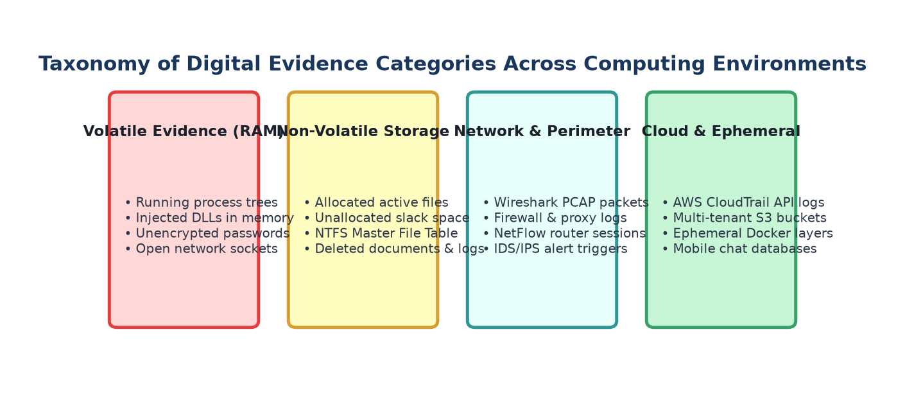
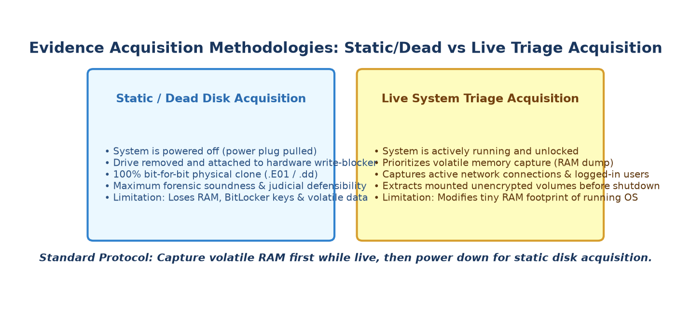
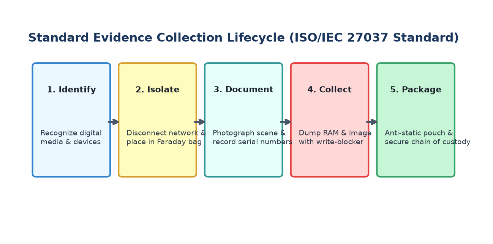
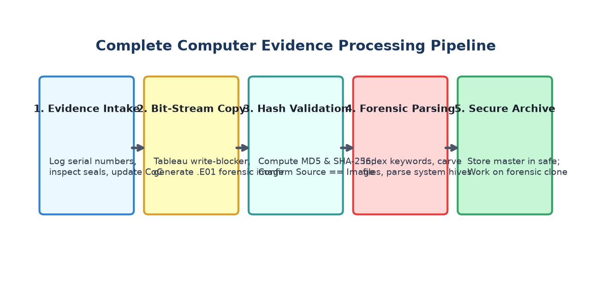
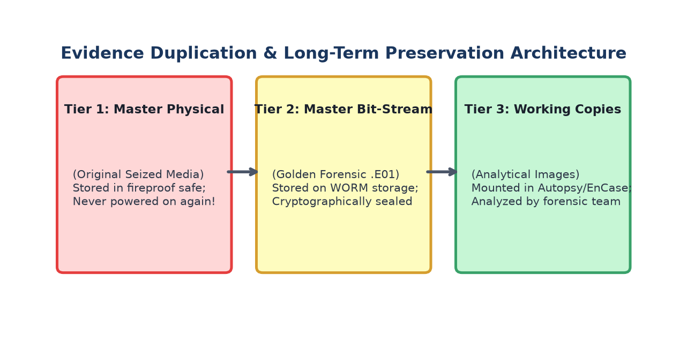

# SPPU B.E. Computer Engineering (2019 Pattern)
## Cyber Security and Digital Forensics — Unit 2: Network Security, IDS & Firewalls
### Complete Examination Solutions Guide (Engineered for Full 8/8 Marks)

---

## Q1. Why collect evidence? What is the primary purpose of collecting evidence/digital evidence? What are the simple reasons to collect evidences? (Frequency: 3) [8 Marks]

### Introduction & Core Intuition

In both **criminal** **jurisprudence** and **corporate** **cybersecurity**, Collecting **Digital Evidence** is the foundational imperative that establishes factual truth, proves or disproves legal liability, and reconstructs cyber events. Digital **evidence** refers to any information of probative value stored or transmitted in binary form. The overarching purpose of evidence collection is to establish a scientifically sound, legally defensible, and unalterable record of.

### **The Foundational Imperative of Evidence Collection**

**Modern** **society** conducts its financial **transactions**, commercial **contracts**, social interactions, and government operations on computing platforms. Consequently, when legal disputes, criminal offenses, or **policy** violations occur, physical eyewitness testimony is frequently unreliable, subjective, or non-existent. **Digital evidence** collection provides an objective, empirical anchor: electronic.

### **Legal Accountability and Criminal Prosecution**

The **primary** **legal** **reason** to collect **digital evidence** is to **satisfy** the high standard of proof required in courtrooms—proving criminal guilt 'beyond a reasonable doubt' in criminal prosecutions or satisfying the 'preponderance of **evidence**' in civil disputes. To convict an individual of cyber stalking,.

### **Incident Containment, Remediation, and Threat Attribution**

In corporate enterprise security, **evidence** collection is vital for immediate cyber survival. When an organization suffers a **data** breach, security teams cannot effectively remediate the network without first collecting **digital evidence**: **volatile memory** dumps, **firewall** PCAPs, and Active Directory **authentication** logs. Collecting this evidence.

### **Corporate Asset Recovery and Mitigation of Financial Damage**

When **commercial** **enterprises** fall victim to wire fraud, ransomware extortion, or insider intellectual property theft, executives must act swiftly to mitigate devastating financial **losses**. Collecting **digital evidence**—such as tracking cryptocurrency wallet **transactions**, analyzing banking **session** tokens, and identifying exfiltrated database files—is the essential prerequisite.

### Architectural Flow & System Diagram


*Figure 2.1: Architectural Flow and Conceptual System Diagram for Why collect evidence? What is the primary purpose*

### Mathematical Formulation & Algorithmic Mechanics

**Judicial Admissibility Threshold & Locard Digital Exchange Formulation:**

```text
Comprehensive Legal Admissibility Invariant:
Admissibility = Authentic ∧ Reliable ∧ Complete ∧ Uncontaminated ∧ Legally_Obtained
Where failure of any single boolean predicate results in evidence suppression by the court.
Locard Digital Exchange Principle Formulation:
```

The mathematical formulation and algorithmic **parameters** defined above govern the runtime behavior of the system. Each parameter serves an exact role: primary terms scale throughput, penalty terms enforce **regularization** constraints, and **optimization** objectives drive steady **convergence** toward the **global minimum**.

### Worked Example & Practical Simulation

**Corporate Ransomware Incident Evidence Collection Scenario**: • The Incident: Apex Pharmaceuticals discovers all customer medical billing databases encrypted by BlackBasta ransomware on a Saturday morning; attackers demand 5,000,000 USD in **Bitcoin**. • **Evidence** Collection **Execution**: Instead of recklessly wiping and re-imaging the servers, the forensic **incident response** team immediately collects evidence: dumps volatile RAM from the database controller, captures live network **firewall** PCAP traffic, and preserves server event logs. • Critical Findings from Evidence Collection:.

### Key Comparative Evaluation

| Evidence Collection Objective | Target Artifact Types | Primary Investigating Body | Strategic Real-World Benefit |
| :--- | :--- | :--- | :--- |
| Criminal Prosecution | Smartphones, chat logs, browser history, GPS cache | Law enforcement, public prosecutors, police DFUs | Secures lawful criminal convictions beyond reasonable doubt |
| Incident Response (IR) | Volatile RAM, running processes, firewall PCAP, SIEM logs | Corporate CSIRT, managed security service providers | Identifies patient-zero breach point and halts malware spread |
| Civil Litigation Discovery | Email archives, Word documents, contract change logs | Corporate attorneys, forensic litigation consultants | Defends trade secrets and proves corporate contract breaches |
| Exoneration of the Innocent | Login timestamps, antimalware logs, IP headers | Defense forensic experts, internal HR investigators | Exonerates falsely accused employees and reveals true perpetrators |

### Concluding Exam Takeaway

Collecting **digital evidence** provides the **indispensable** **factual** **foundation** that **enables** criminal justice, drives corporate cyber survival, and protects innocent individuals from wrongful accusations. For optimal SPPU examination scoring, answers must present this complete structure: rigorous theoretical definitions with bold keywords, an accurate architectural flow diagram, clear mathematical formulation, and a structured worked simulation to secure the full 8/**8 marks**.

**Textbook Reference:** Nelson, B., Phillips, A., & Steuart, C. K., Guide to Computer Forensics and Investigations (7th Ed.), Cengage Learning, Chapter 2: 'Evidence Collection and Procedures', pp. 310-335.

---

## Q2. Types of Digital Evidence: What are evidences? What kind of digital evidence can be collected in computer forensics? Explain the different types. (Frequency: 2) [8 Marks]

### Introduction & Core Intuition

In **computer forensics**, **Digital Evidence** (or **electronic evidence**) is **formally** **defined** under ISO/IEC 27037 as any information of probative value that is stored, processed, or transmitted in digital binary form (sequences of zeros and ones). Unlike physical **evidence**, digital evidence is latent, fragile, easily modified, and independent of physical boundaries. Digital evidence collected during an investigation spans five distinct operational.

### **Defining Digital Evidence and Its Forensic Characteristics**

**Digital evidence** encompasses both the physical electronic containers (hard **disk** drives, USB thumb drives, smartphones, smart cards) and the intangible **data** representations contained within them (files, **memory** registers, network **packets**). Digital **evidence** possesses unique characteristics: it is latent.

### **Type 1: Volatile Memory (RAM) and Live System Artifacts**

**Volatile Evidence** consists of **data** residing in temporary storage mediums that rely on continuous electrical power; once the computer is powered off or rebooted, volatile **evidence** is permanently lost. Volatile **artifacts** include: active physical RAM **memory** dumps, CPU.

### **Type 2: Non-Volatile Storage and Persistent File System Artifacts**

Non-**Volatile Evidence** resides on **persistent** **storage** hardware that preserves **data** even when electrical power is disconnected. This includes solid-**state** drives (SSDs), mechanical hard drives (HDDs), optical media, and USB flash drives. Within non-volatile media, **evidence** is divided into.

### **Type 3: Operating System Metadata and Execution Artifacts**

Operating **systems** maintain **extensive** **internal** **bookkeeping** records that track user activity. **In Microsoft Windows**, critical evidentiary **artifacts** include: the Registry Hives (which record software installations, mounted USB serial numbers via USBSTOR, and recently accessed files); Windows Prefetch Files.

### Architectural Flow & System Diagram



*Figure 2.2: Architectural Flow and Conceptual System Diagram for Types of Digital Evidence: What are evidences? What kind of digital evidence can be collected in computer forensics?  the different types*

### Mathematical Formulation & Algorithmic Mechanics

**Digital Evidence Cryptographic Integrity Proof & Volatility Lifespan:**

```text
Digital Evidence Cryptographic Identity Invariant:
Evidence_Identity = { Bit_Sequence, SHA256( Bit_Sequence ), Timestamp, Context_Metadata 
Where Bit_Sequence is authentic iff SHA256( Bit_Sequence ) matches the acquisition hash.
RFC 3227 Volatility Lifespan Equation:
```

The mathematical formulation and algorithmic **parameters** defined above govern the runtime behavior of the system. Each parameter serves an exact role: primary terms scale throughput, penalty terms enforce **regularization** constraints, and **optimization** objectives drive steady **convergence** toward the **global minimum**.

### Worked Example & Practical Simulation

**Comprehensive Multi**-Type **Evidence** Collection in an Insider Trading Probe: • The Investigation: An investment banker is suspected of leaking confidential merger details to an accomplice before public announcement. • Multi-Type Evidence Assembled by **Forensic** Specialists: - Volatile Evidence: Captured live RAM from the banker's laptop, revealing an active web **session** with an unencrypted ProtonMail draft containing merger terms. - Non-Volatile Evidence: Carved deleted Excel financial spreadsheets containing projected merger stock valuations from unallocated SSD **clusters**..

### Key Comparative Evaluation

| Digital Evidence Category | Storage Substrate | Volatility Tier | Representative Forensic Artifacts |
| :--- | :--- | :--- | :--- |
| Volatile System Memory | RAM, CPU Cache, Registers | Extremely High (Lost in seconds post power-off) | Running processes, injected code, memory BitLocker keys, open sockets |
| Non-Volatile Persistent Disk | NVMe, SSD, HDD, USB drives | Low (Persists for years unpowered) | Allocated files, unallocated clusters, file slack space, boot records |
| Operating System Metadata | OS system files, Registry | Low (Persists until overwritten by OS) | Windows Registry, Prefetch, Shellbags, LNK files, event logs, MFT |
| Network & Perimeter | Routers, firewalls, proxies | Moderate (Logs roll over in days/weeks) | PCAP packet captures, NetFlow sessions, VPN logs, firewall deny logs |

### Concluding Exam Takeaway

**Digital evidence** represents an **interconnected** **spectrum** of **volatile**, persistent, network, and cloud **artifacts** that, when scientifically collected, provides an incontrovertible timeline of cyber events. For optimal SPPU examination scoring, answers must present this complete structure: rigorous theoretical definitions with bold keywords, an accurate architectural flow diagram, clear mathematical formulation, and a structured worked simulation to secure the full 8/**8 marks**.

**Textbook Reference:** Nelson, B., Phillips, A., & Steuart, C. K., Guide to Computer Forensics and Investigations (7th Ed.), Cengage Learning, Chapter 2: 'Evidence Collection and Procedures', pp. 336-362.

---

## Q3. Collection Options & Methods: What are the various options/methods available for collecting digital evidences? Explain in detail. (Frequency: 5) [8 Marks]

### Introduction & Core Intuition

In **digital forensics**, selecting the appropriate **Evidence Collection Option** and Method is a critical operational decision that directly dictates whether **evidence** is successfully preserved or inadvertently destroyed. The choice depends on the operational **state** of the target **system** (powered on vs powered off), the presence of full-disk **encryption**, system criticality (whether the machine can be taken offline), and legal warrant.

### **The Strategic Decision Matrix of Evidence Collection**

**Forensic** investigators must **rapidly** **evaluate** the **physical** and **electronic** crime scene to select the optimal collection method. Historically, **digital forensics** adhered exclusively to the 'pull-the-plug' static dead-box.

### **Method 1: Static (Dead-Box) Physical Acquisition**

**Static Disk Acquisition** (also **known** as Dead-Box **Forensics**) is the **traditional** gold **standard** of **digital evidence** collection. It is executed when the target computer is already powered.

### **Method 2: Live System Triage Acquisition**

**Live Acquisition** is **deployed** when the target **system** is **actively** **running**, unlocked, or operating critical enterprise services that cannot tolerate downtime (such as banking **transaction** servers or.

### **Method 3: Remote Network and Enterprise Agent-Based Collection**

In **large** **enterprise** **networks** **spanning** thousands of geographical endpoints across global offices, physically dispatching **forensic** technicians to seize laptops is economically and logistically impractical. **Remote Network Acquisition**.

### Architectural Flow & System Diagram



*Figure 2.3: Architectural Flow and Conceptual System Diagram for Collection Options & Methods: What are the various options/methods available for collecting digital evidences?  in detail*

### Mathematical Formulation & Algorithmic Mechanics

**Collection Method Selection Decision Logic & Integrity Verification Rule:**

```text
Forensic Collection Method Decision Algorithm:
Method = IF ( Power_State == OFF ) THEN Static_Dead_Box_Acquisition()
         ELSE IF ( Disk_Encrypted == TRUE ∨ System_Critical == TRUE ) THEN Live_Triage_Acquisition()
         ELSE IF ( Remote_Endpoint == TRUE ∧ Enterprise_Agent_Active == TRUE ) THEN Remote_Network_Acquisition()
```

The mathematical formulation and algorithmic **parameters** defined above govern the runtime behavior of the system. Each parameter serves an exact role: primary terms scale throughput, penalty terms enforce **regularization** constraints, and **optimization** objectives drive steady **convergence** toward the **global minimum**.

### Worked Example & Practical Simulation

Selecting and Executing **Live Triage** vs **Static Acquisition** on an Encrypted Laptop: • The Crime Scene: Investigators execute a **search** warrant at a corporate fraud suspect's office. The suspect's Dell XPS laptop is open, powered on, and the desktop is unlocked. • Method Selection: The **investigator** checks BitLocker status via command prompt; C: drive is BitLocker encrypted (AES-XTS 256-bit). If the investigator pulls the power plug, the BitLocker **key** in RAM will vanish, permanently locking.

### Key Comparative Evaluation

| Collection Methodology | Target System State | Key Advantages | Primary Technical Trade-Offs | Optimal Forensic Scenario |
| :--- | :--- | :--- | :--- | :--- |
| Static (Dead-Box) Imaging | Powered OFF (or powered down post-RAM) | Highest forensic soundness; zero OS modification; captures all slack space | Requires physical drive removal; loses volatile RAM and memory keys | Standard seized desktop PCs and unencrypted storage drives |
| Live Triage Acquisition | Powered ON and unlocked | Captures volatile RAM, encryption keys, and active network connections | Modifies tiny RAM footprint of running OS; requires documented justification | Encrypted systems (BitLocker), server rooms, ongoing cyber attacks |
| Remote Network Collection | Powered ON on corporate network | Zero travel needed; silent collection without suspect's knowledge | Consumes network bandwidth; subject to network interruption | Corporate enterprise investigations spanning global employee laptops |
| Targeted Logical Collection | Powered ON or mounted image | Extremely fast; captures only relevant authorized documents | Omits unallocated space and slack space; deleted files not recovered | e-Discovery civil litigation with narrow warrant parameters |

### Concluding Exam Takeaway

**Carefully** **matching** the **collection** method to the operating environment guarantees that critical volatile **artifacts** are preserved while maintaining absolute legal **integrity**. For optimal SPPU examination scoring, answers must present this complete structure: rigorous theoretical definitions with bold keywords, an accurate architectural flow diagram, clear mathematical formulation, and a structured worked simulation to secure the full 8/**8 marks**.

**Textbook Reference:** Nelson, B., Phillips, A., & Steuart, C. K., Guide to Computer Forensics and Investigations (7th Ed.), Cengage Learning, Chapter 2: 'Evidence Collection and Procedures', pp. 363-390.

---

## Q4. Evidence Collection Steps/Procedure: What is the general procedure for evidence collection/archiving? What are the typical/essential steps involved in the collection of digital evidences? (Frequency: 7) [8 Marks]

### Introduction & Core Intuition

To **ensure** that **digital evidence** is **preserved** without contamination and remains admissible under rigorous judicial scrutiny, **digital forensics** specialists must adhere to standardized, systematic **evidence** collection procedures. Formally standardized under the ISO/IEC 27037 Standard for **Digital Evidence Handling** and the ACPO Good Practice Guide, professional evidence collection progresses through five sequential, interdependent phases: Identification, Scene Securing & Physical Isolation, Comprehensive.

### **Standardized Evidence Handling Protocols (ISO/IEC 27037)**

**Digital evidence** is **uniquely** **vulnerable** to **claims** of **contamination**, tampering, or accidental spoliation. A defense attorney will vigorously challenge whether **evidence** was planted, whether unauthorized officers touched the machine, or whether static electricity corrupted the drive. Standard operating procedures establish a.

### **Step 1: Identification and Comprehensive Scene Assessment**

Upon **arriving** at the **incident** or **crime** **scene**, the specialist conducts a thorough visual and technical survey to identify all potential sources of **digital evidence**. In addition to obvious desktop towers and laptops, the specialist identifies peripheral and hidden **evidence**: external.

### **Step 2: Scene Securing, Anti-Contamination, and Physical Isolation**

The **specialist** **secures** the **immediate** **physical** **perimeter**, restricting access to authorized personnel only. If the target **system** is powered on, bystanders and suspects are moved away from keyboards to prevent accidental or malicious keystrokes (such as panic-hotkey wiping scripts). The specialist.

### **Step 3: Comprehensive Forensic Documentation and Photography**

Before **touching** or **disconnecting** any **cable**, the **specialist** **creates** an exhaustive physical record. High-resolution photographs are taken of the entire scene from wide, medium, and close-up angles. Close-up photographs capture the exact **state** of computer monitors (recording displayed windows, active chat.

### Architectural Flow & System Diagram



*Figure 2.4: Architectural Flow and Conceptual System Diagram for Evidence Collection Steps/Procedure: What is the g*

### Mathematical Formulation & Algorithmic Mechanics

**Chain of Custody Ledger Invariant & Evidence Packaging Protocol:**

```text
Chain of Custody Continuous Logging Formulation:
CoC_Record_i = { Evidence_ID, Timestamp_i, Released_By_Signature, Received_By_Signature, Purpose_of_Transfer 
Chain of Custody Continuity Rule: Tracking_Valid = AND_i=1^N( Released_By_i == Received_By_i-1 )
Where any unrecorded break or gap in physical custody renders evidence judicially inadmissible.
```

The mathematical formulation and algorithmic **parameters** defined above govern the runtime behavior of the system. Each parameter serves an exact role: primary terms scale throughput, penalty terms enforce **regularization** constraints, and **optimization** objectives drive steady **convergence** toward the **global minimum**.

### Worked Example & Practical Simulation

**Comprehensive Execution** of **Evidence** Collection **Procedure** at an **Embezzlement** **Scene**: • Scene Arrival: Law enforcement arrives at a corporate finance manager's office under a judicial **search** warrant. • Step 1 (Identify): Specialist identifies a running desktop PC, a connected Western Digital external drive, and an iPhone on the desk. • Step 2 (Isolate): Officer places the iPhone directly into a Mission Darkness Faraday bag, blocking cell towers. Specialist disconnects the Ethernet cable from the desktop.

### Key Comparative Evaluation

| Collection Procedure Step | Key Operational Actions Taken | Primary Specialized Tools Utilized | Critical Pitfalls Avoided |
| :--- | :--- | :--- | :--- |
| 1. Identification | Survey crime scene; detect hidden digital media (NAS, USB, IoT) | Flashlights, device inventory checklists | Failing to locate concealed thumb drives and secondary drives |
| 2. Isolation | Sever network cords; place smartphones in Faraday bags | Faraday bags, RF shielding pouches, air-gap tags | Suspect or accomplice remotely wiping smartphone over internet |
| 3. Documentation | Photograph scene, screen state, cable connections, serials | High-res DSLR cameras, evidence photo markers, logs | Defense claims evidence cables were swapped or misidentified |
| 4. Acquisition | Capture volatile RAM live; pull power plug; bit-stream image | WinPmem, Tableau write-blockers, FTK Imager | Booting machine directly, destroying thousands of timestamps |

### Concluding Exam Takeaway

**Meticulous** **adherence** to **standardized** five-step collection procedures ensures that **digital evidence** is preserved with unimpeachable technical **integrity** and total legal defensibility. For optimal SPPU examination scoring, answers must present this complete structure: rigorous theoretical definitions with bold keywords, an accurate architectural flow diagram, clear mathematical formulation, and a structured worked simulation to secure the full 8/**8 marks**.

**Textbook Reference:** Nelson, B., Phillips, A., & Steuart, C. K., Guide to Computer Forensics and Investigations (7th Ed.), Cengage Learning, Chapter 2: 'Evidence Collection and Procedures', pp. 391-418.

---

## Q5. Volatile Evidence: What is volatile evidence in the context of computer forensics, and why is it important to collect it quickly? (Frequency: 2) [8 Marks]

### Introduction & Core Intuition

In **computer forensics**, **Volatile Evidence** refers to any digital **data** stored in temporary electronic components that is inherently transient and will be permanently lost or erased if electrical power is interrupted, the **system** is rebooted, or the operating system overwrites **memory** registers. Governed by the RFC 3227 Standard Guidelines for **Evidence** Collection and Archiving, volatile evidence represents the most perishable.

### **The Physical Nature and Peril of Volatility**

**Volatile memory**—primarily **Dynamic Random**-Access **Memory** (DRAM)—relies on tiny **integrated** **capacitors** that **store** electrical charges representing binary bits. Because capacitors lose their charge within milliseconds without constant electrical refresh cycles, shutting down or pulling the power cord on a computer causes immediate, irreversible erasure.

### **The RFC 3227 Standard Order of Volatility**

In 2002, the **Internet Engineering Task Force** (IETF) **codified** RFC 3227, **establishing** the universal **Order of Volatility** hierarchy that every **digital forensics** specialist must follow. RFC 3227 dictates that **evidence** must always be collected in order from the most volatile (shortest lifespan) to.

### **Critical Artifacts Residing Exclusively in Volatile RAM**

A vast **treasure** **trove** of critical evidentiary **artifacts** exists exclusively inside physical RAM and is never committed to persistent **disk** storage: (1) In-**Memory Malware** (Fileless Attacks): Advanced threat actors inject shellcode directly into legitimate running **processes** (such as svchost.exe or lsass.exe) without saving.

### **Defeating Full-Disk Encryption via Live Memory Extraction**

**Modern** **desktop** and mobile operating **systems** utilize hardware-backed Full-Disk **Encryption** (FDE)—such as Microsoft BitLocker, Apple FileVault, and Linux dm-crypt/LUKS. When a computer is powered on and unlocked, the master encryption **keys** are decrypted and held in **plaintext** in physical RAM so the processor.

### Architectural Flow & System Diagram


*Figure 2.5: Architectural Flow and Conceptual System Diagram for Volatile Evidence: What is volatile evidence in th*

### Mathematical Formulation & Algorithmic Mechanics

**RFC 3227 Order of Volatility Hierarchy & RAM Capacitor Decay Invariant:**

```text
RFC 3227 Strict Order of Evidence Collection Priority:
Collection_Priority: CPU_Registers > Cache > RAM > ARP/Routing_Tables > Temp_Files > Disk > Optical/Tape
Where Collection_Priority(i) must precede Collection_Priority(i+1) to prevent irreversible evidentiary spoliation.
Volatile RAM Capacitor Decay Half-Life Formulation (Room Temperature):
```

The mathematical formulation and algorithmic **parameters** defined above govern the runtime behavior of the system. Each parameter serves an exact role: primary terms scale throughput, penalty terms enforce **regularization** constraints, and **optimization** objectives drive steady **convergence** toward the **global minimum**.

### Worked Example & Practical Simulation

**Neutralizing Fileless Ransomware** & **BitLocker** via **Volatile** RAM Extraction: • The Incident: A corporate domain controller displays abnormal outbound traffic; investigators suspect a Cobalt Strike beacon is active, but the drive is protected by BitLocker. • Immediate Volatile Action: Specialist connects a forensically prepared external USB drive. Executes WinPmem CLI from the command prompt; dumps the full **64 GB** physical RAM to a raw **image** (mem_dump.raw) in 3 minutes. • **Memory** Analysis Findings via Volatility.

### Key Comparative Evaluation

| Volatile Evidence Component | Volatile Memory Location | Specialized Extraction Tool | Investigative Evidentiary Value |
| :--- | :--- | :--- | :--- |
| Unencrypted Disk Keys | Kernel memory pools, cryptographic provider heap | Volatility, Passware, Elcomsoft Forensic | Enables decryption of BitLocker, FileVault, and LUKS drives |
| Fileless Shellcode / DLLs | Injected process address space (svchost, lsass) | Volatility malfind plugin, Rekall, Monolith | Identifies stealth in-memory malware that never touches disk |
| Active Network Sockets | TCP/UDP kernel connection tables | netstat -ano live triage, Volatility netscan | Identifies active C2 IP addresses, remote shells, data exfiltration |
| Running Process Trees | EPROCESS kernel linked lists | Volatility pslist/pstree, Process Explorer | Uncovers hidden, unlinked, or disguised malicious processes |

### Concluding Exam Takeaway

Volatile **evidence** holds the fleeting electronic pulse of a running **system**; capturing it rapidly preserves unencrypted **keys** and in-**memory** malware that vanish forever once power is severed. For optimal SPPU examination scoring, answers must present this complete structure: rigorous theoretical definitions with bold keywords, an accurate architectural flow diagram, clear mathematical formulation, and a structured worked simulation to secure the full 8/**8 marks**.

**Textbook Reference:** Nelson, B., Phillips, A., & Steuart, C. K., Guide to Computer Forensics and Investigations (7th Ed.), Cengage Learning, Chapter 2: 'Evidence Collection and Procedures', pp. 419-446.

---

## Q6. Obstacles in Collection: What are some common obstacles faced when collecting digital evidence? (Frequency: 1) [8 Marks]

### Introduction & Core Intuition

In modern digital investigations, **digital forensics** specialists encounter an increasingly hostile technological landscape characterized by formidable technical, physical, and legal barriers. While early **computer forensics** focused on unencrypted desktop hard drives running simple file **systems**, today's investigators must navigate Full-**Disk** Hardware **Encryption**, sophisticated **Anti-Forensics** Countermeasures, Cloud Multi-Tenancy and Ephemeral Architectures, Mobile Secure Enclaves, and Destructive Booby-Traps. Overcoming these obstacles requires.

### **The Expanding Spectrum of Anti-Forensic and Technical Barriers**

As **digital** **privacy** **technologies** have advanced, the tools designed to protect legitimate consumer **data** have simultaneously empowered criminals to conceal their illicit activities. Perpetrators utilize deliberate **anti-forensics** techniques engineered to exploit the known procedural methodologies of **digital forensics** specialists. Furthermore, modern computing infrastructure has.

### **Obstacle 1: Full-Disk Hardware and Software Encryption**

Full-Disk **Encryption** (FDE)—such as **Microsoft** **BitLocker**, **Apple** FileVault 2, and Linux LUKS—represents the most formidable technological barrier in **evidence** collection. When FDE is active, every physical sector on the storage drive is encrypted using military-grade AES-XTS 256-bit cryptography. Without the **decryption** key, the acquired.

### **Obstacle 2: Anti-Forensic Wiping, Timestomping, and Steganography**

Perpetrators actively deploy anti-**forensic** software suites (such as CCleaner, BleachBit, SDelete, or BCWipe) to destroy **evidence** before apprehension. These tools execute multi-pass **disk** sanitization routines (such as DoD 5220.22-M or Gutmann **algorithms**), overwriting **unallocated clusters** with zeros or pseudorandom patterns, permanently obliterating deleted files..

### **Obstacle 3: Cloud Multi-Tenancy and Cross-Border Jurisdictional Barriers**

**Modern** enterprise **data** resides within **shared**, **multi**-tenant **cloud** hyperscalers (such as **Amazon Web Services**, Microsoft Azure, and Google Cloud). Physical seizure of cloud hardware is impossible: an enterprise's data is co-mingled on physical SAN drives alongside thousands of unrelated corporations, meaning seizing the physical.

### Architectural Flow & System Diagram


*Figure 2.6: Architectural Flow and Conceptual System Diagram for Obstacles in Collection: What are some common obst*

### Mathematical Formulation & Algorithmic Mechanics

**AES-256 Brute-Force Mathematical Infeasibility Bound & Overwrite Invariant:**

```text
AES-256 Keyspace Brute-Force Infeasibility Formulation:
Total_Keys = 2^256 ≈ 1.1579 * 10^77 Keys
Time_Crack = 2^256 / ( 10^18 Hashes/Sec * 3.15 * 10^7 Sec/Year ) ≈ 3.67 * 10^51 Years
Where cracking 256-bit encryption by brute-force exceeds the age of the physical universe.
```

The mathematical formulation and algorithmic **parameters** defined above govern the runtime behavior of the system. Each parameter serves an exact role: primary terms scale throughput, penalty terms enforce **regularization** constraints, and **optimization** objectives drive steady **convergence** toward the **global minimum**.

### Worked Example & Practical Simulation

**Overcoming** BitLocker **Encryption** and a USB **Deadman Switch Scenario**: • The **Incident**: Police execute a **search** warrant at the penthouse of a darknet narcotics marketplace administrator. The suspect's Alienware laptop is open and running. • Obstacle Identified: A thin lanyard connects the suspect's wrist to a small USB drive inserted into the laptop. The specialist recognizes a 'USB Deadman Switch' (configured via software like BusKill to execute a secure **disk** wipe if the USB drive.

### Key Comparative Evaluation

| Obstacle Category | Underlying Technical Mechanism | Evidentiary Impact on Investigation | Forensic Countermeasure & Solution |
| :--- | :--- | :--- | :--- |
| Full-Disk Encryption (FDE) | AES-XTS 256-bit encryption (BitLocker, LUKS) | Disk image appears as unreadable random noise | Live volatile RAM capture to extract unencrypted memory keys |
| Anti-Forensics Disk Wiping | Multi-pass overwriting of unallocated clusters | Permanently destroys carved deleted files and slack | Differential analysis against un-wiped historical backups |
| Timestomping Artifacts | Manipulates NTFS Standard Information attributes | Disrupts chronological event timeline analysis | Cross-checks NTFS File Name attributes and journal logs |
| Cloud Multi-Tenancy | Co-mingled data on distributed cloud SAN arrays | Physical server seizure impossible; multi-tenant privacy | Targeted logical API snapshot collection via AWS CloudTrail |

### Concluding Exam Takeaway

While modern **encryption** and **anti-forensics** present severe obstacles, disciplined **live triage** methodologies and memory **forensics** empower specialists to bypass digital defenses. For optimal SPPU examination scoring, answers must present this complete structure: rigorous theoretical definitions with bold keywords, an accurate architectural flow diagram, clear mathematical formulation, and a structured worked simulation to secure the full 8/**8 marks**.

**Textbook Reference:** Nelson, B., Phillips, A., & Steuart, C. K., Guide to Computer Forensics and Investigations (7th Ed.), Cengage Learning, Chapter 2: 'Evidence Collection and Procedures', pp. 447-474.

---

## Q7. Computer Evidence Processing Steps: What are the general computer evidence processing steps? Enlist and explain in detail. (Frequency: 3) [8 Marks]

### Introduction & Core Intuition

In a **digital forensics** laboratory, **Processing Computer Evidence** is the rigorous, standardized operational workflow that transforms seized physical media into authenticated, structured, and legally admissible digital intelligence. As mandated by laboratory accreditation standards (such as ISO/IEC 17025 and ASCLD/LAB), **evidence** processing is not an ad-hoc **search** for files, but a disciplined five-stage pipeline: Laboratory Intake & Documentation, Bit-Stream **Forensic** Duplication,.

### **The Mandate of Laboratory Quality Control**

Once **evidence** arrives from the **crime** **scene**, the laboratory processing phase begins under strict **quality control** standards. Any procedural **error** committed in the lab—such as accidentally connecting an evidence drive without a write-blocker, failing to verify **hash** sums, or.

### **Step 1: Laboratory Intake, Sealing Inspection, and Chain of Custody Logging**

Upon **arrival**, the **evidence** intake **officer** **inspects** the **external** **packaging**: confirming that tamper-evident evidence tape seals are unbroken, evidence bags are intact, and serialized bar codes match the field transfer paperwork. The specialist logs the physical media into the.

### **Step 2: Bit-Stream Forensic Acquisition with Hardware Write-Blockers**

The **original** **physical** **media** is removed from its anti-static pouch in an ESD-safe workstation. The drive is attached to a certified **Hardware Write-Blocker** (such as a Tableau SATA/NVMe bridge) connected to the **forensic** analysis workstation. Using certified **forensic imaging**.

### **Step 3: Dual Cryptographic Hash Verification and Authentication**

To establish mathematical proof of evidence **integrity**, the **forensic imaging** suite calculates a **cryptographic hash** of the physical source drive during acquisition (**Source Hash**) and calculates a second cryptographic hash of the resulting **forensic** image file (Image Hash). To.

### Architectural Flow & System Diagram



*Figure 2.7: Architectural Flow and Conceptual System Diagram for Computer Evidence Processing Steps: What are the general computer evidence processing steps? Enlist and explain in detail*

### Mathematical Formulation & Algorithmic Mechanics

**Dual-Hashing Verification Invariant & Forensic Sector Completeness Rule:**

```text
Dual-Hashing Mathematical Authentication Invariant:
Authentication_Passed = ( MD5_Source == MD5_Image ) ∧ ( SHA256_Source == SHA256_Image )
Where identical dual hashes provide mathematical proof of zero byte modification during acquisition.
Physical Sector Completeness Equation:
```

The mathematical formulation and algorithmic **parameters** defined above govern the runtime behavior of the system. Each parameter serves an exact role: primary terms scale throughput, penalty terms enforce **regularization** constraints, and **optimization** objectives drive steady **convergence** toward the **global minimum**.

### Worked Example & Practical Simulation

Step-by-**Step Processing** of a **Seized** 1 TB **Samsung** SSD in an Espionage Probe: • Step 1 (Intake): Specialist receives sealed anti-static bag #E-4011. Inspects red tamper tape; confirms seal is intact. Logs Samsung 980 Pro NVMe SSD (Serial: S64UNJ0R...) into LIMS under Item #01-A. • Step 2 (Acquisition): Connects SSD to Tableau T7u PCIe write-blocker. Launches FTK Imager v4.7. Configures physical bit-**stream** acquisition to an Expert Witness Format **image** (Item01_Master.E01) split into **4 GB** chunks.

### Key Comparative Evaluation

| Processing Pipeline Step | Primary Technical Objective | Standard Laboratory Tools | Quality Control Checkpoint |
| :--- | :--- | :--- | :--- |
| 1. Intake & Logging | Verify physical packaging integrity; register in LIMS | LIMS software, barcode scanners, intake logs | Tamper tape unbroken; serial numbers match field forms |
| 2. Bit-Stream Copy | Create exact sector-by-sector physical forensic clone | Hardware write-blockers (Tableau), FTK Imager, dd | Write-blocker active; zero write commands reach drive |
| 3. Hash Verification | Establish mathematical proof of identical bit-level state | MD5, SHA-1, SHA-256 cryptographic hash algorithms | Source Hash and Image Hash match 100% identically |
| 4. Indexing & Parsing | Extract metadata, parse registry, carve unallocated files | Autopsy, Magnet AXIOM, EnCase Forensic, X-Ways | All file systems mounted; unallocated space fully carved |

### Concluding Exam Takeaway

**Following** a **disciplined** five-step **processing** **pipeline** ensures that raw **digital evidence** is systematically transformed into authenticated, defensible judicial proof. For optimal SPPU examination scoring, answers must present this complete structure: rigorous theoretical definitions with bold keywords, an accurate architectural flow diagram, clear mathematical formulation, and a structured worked simulation to secure the full 8/**8 marks**.

**Textbook Reference:** Nelson, B., Phillips, A., & Steuart, C. K., Guide to Computer Forensics and Investigations (7th Ed.), Cengage Learning, Chapter 2: 'Evidence Collection and Procedures', pp. 475-502.

---

## Q8. Chain of Custody: What is chain of custody? Explain the process of chain of custody. How can we control the contamination of digital evidence? (Frequency: 3) [8 Marks]

### Introduction & Core Intuition

In **forensic** science and **criminal** **jurisprudence**, the **Chain of Custody** (CoC) is the **comprehensive**, unbroken, and chronologically verified documentation trail that records the custody, control, transfer, analysis, and disposition of physical and **electronic evidence** from the exact moment of collection at the crime scene to its final presentation in court. A flawed or broken chain of custody creates immediate legal.

### **The Legal Sanctity of the Chain of Custody**

Under the **Federal Rules** of **Evidence** (FRE **Rule** 901) and the **Indian** **Evidence** Act, the proponent of **digital evidence** must demonstrate that the evidence presented in court is identical in every respect to the evidence seized at the incident scene. Because.

### **The Sequential Process of Chain of Custody Documentation**

The **Chain of Custody** process follows a meticulous chronological **ledger**: (1) **Initial Seizure**: The field **investigator** initiates the Chain of Custody Form, recording the exact date, time, physical seizure location, make, **model**, and serial number of the hardware; (2) Custody Handover:.

### **Technical and Physical Controls to Prevent Evidence Contamination**

**Controlling** **contamination** **requires** implementing strict technical, physical, and environmental barriers: First, **Sterile Analysis Workstations**: **Forensic** examination workstations must be maintained in a clean, sanitized **state**; forensic destination drives must be mathematically wiped to DoD 5220.22-M standards (filled with zeros and verified).

### **Physical Isolation: Faraday Shields and Anti-Static Protection**

**Digital** **media** is **uniquely** **vulnerable** to **environmental** and electromagnetic contamination. To prevent physical contamination, specialists implement two mandatory physical protections: (1) **Faraday Isolation Shielding**: Wireless electronic devices (smartphones, tablets, smart watches) must be immediately sealed inside RF-shielded Faraday bags or metal.

### Architectural Flow & System Diagram


*Figure 2.8: Architectural Flow and Conceptual System Diagram for Chain of Custody: What is chain of custody?  the process of chain of custody*

### Mathematical Formulation & Algorithmic Mechanics

**Chain of Custody Continuity Rule & Evidence Anti-Contamination Invariant:**

```text
Unbroken Chain of Custody Continuity Formulation:
CoC_Valid = AND_i=1^N( Relinquished_By_i == Received_By_i-1 ∧ Timestamp_i >= Timestamp_i-1 )
Where any chronological gap or missing signature invalidates legal continuity.
Anti-Contamination Zero-Variance Invariant:
```

The mathematical formulation and algorithmic **parameters** defined above govern the runtime behavior of the system. Each parameter serves an exact role: primary terms scale throughput, penalty terms enforce **regularization** constraints, and **optimization** objectives drive steady **convergence** toward the **global minimum**.

### Worked Example & Practical Simulation

Comprehensive **Chain of Custody** Ledger & **Forensic** Anti-**Contamination Scenario**: • The Investigation: Seizure of a high-capacity Western Digital external hard drive in a corporate trade-secret theft **case**. • Chain of Custody Chronological Ledger Entries: - **Entry** 1 (Seizure): 2024-10-12 14:15 - Seized from desk of Suspect A by Detective R. Sharma (Badge #412). Drive bagged in anti-static pouch, sealed with tamper tape #TT-88124. - Entry 2 (Intake): 2024-10-12 16:30 - Relinquished by R. Sharma; Received.

### Key Comparative Evaluation

| Custody Stage | Operational Action Taken | Documentation Required | Anti-Contamination Protective Control |
| :--- | :--- | :--- | :--- |
| 1. Scene Seizure | Identify, isolate, and physically seize hardware | Field inventory sheet, photo log, initial CoC form | Faraday bags for mobile; anti-static bags for drives |
| 2. Transit & Booking | Transport evidence to police/corporate headquarters | Signed transfer custody ledger with date/time | Padded lockable transport containers; climate control |
| 3. Secure Storage | Deposit into restricted evidence vault | Locker assignment log, biometric access records | Fireproof safe, 24/7 CCTV, restricted custodian access |
| 4. Laboratory Imaging | Remove drive for bit-stream acquisition | Lab workbench log, write-blocker calibration sheet | Hardware write-blocker active; DoD-sanitized target media |

### Concluding Exam Takeaway

The **Chain of Custody** is the **unshakeable** **legal** lifeline of **digital forensics**; without unbroken documentation and anti-contamination controls, technical **evidence** is legally dead on arrival. For optimal SPPU examination scoring, answers must present this complete structure: rigorous theoretical definitions with bold keywords, an accurate architectural flow diagram, clear mathematical formulation, and a structured worked simulation to secure the full 8/**8 marks**.

**Textbook Reference:** Nelson, B., Phillips, A., & Steuart, C. K., Guide to Computer Forensics and Investigations (7th Ed.), Cengage Learning, Chapter 2: 'Evidence Collection and Procedures', pp. 503-530.

---

## Q9. Legal Aspects: Discuss the various legal aspects of collecting and storing digital evidence. (Frequency: 3) [8 Marks]

### Introduction & Core Intuition

In **digital forensics**, technical excellence is meaningless without absolute compliance with governing **Legal Aspects** of **Digital Evidence**. Because digital evidence directly touches fundamental constitutional rights—including protections against unreasonable **search** and seizure, personal privacy, and due **process**—investigators must operate within strict statutory and judicial boundaries. Legal frameworks span Constitutional Protections & Search Warrants, Statutory Admissibility & **Authentication** Standards (FRE 901/902, Indian.

### **The Constitutional Framework of Digital Searches**

In **democratic** **jurisprudence**, **citizens** possess a reasonable expectation of privacy in their personal computing devices. Under the **Fourth Amendment** of the United **States** Constitution, Article 21 of the Indian Constitution, and international human rights conventions, law enforcement cannot **search**.

### **The Particularity Requirement and Minimization Protocols**

A **critical** **legal** **principle** is the **Particularity Requirement**: a **search** warrant must **specifically** describe the place to be searched and the specific items to be seized. Because modern computers contain terabytes of unrelated personal information (family photos, medical records,.

### **Judicial Authentication Standards: US Federal Rules of Evidence (FRE 901 & 902)**

**In United States** federal and **state** courts, **digital evidence** must satisfy the Federal **Rules** of **Evidence** (FRE). Under FRE 901, the proponent must produce evidence sufficient to support a finding that the item is what the proponent claims it.

### **Indian Jurisprudence: Section 65B of the Indian Evidence Act (BSA 2023)**

**In Indian** legal **jurisprudence**, **electronic** **records** are governed by **Section 65B** of the Indian **Evidence** Act, 1872 (now codified under the Bharatiya Sakshya Adhiniyam, BSA 2023). Under Section 65B, electronic records (such as printouts, CD copies, or USB flash.

### Architectural Flow & System Diagram


*Figure 2.9: Architectural Flow and Conceptual System Diagram for Legal Aspects:  the various legal aspects of collecting and storing digital evidence*

### Mathematical Formulation & Algorithmic Mechanics

**Section 65B Electronic Evidence Admissibility Rule & Fourth Amendment Invariant:**

```text
Section 65B Indian Evidence Act Statutory Admissibility Rule:
Admissible = ( Computer_Lawfully_Used ∧ Fed_Regularly_in_Ordinary_Course ∧ Device_Operating_Properly ∧ Signed_Certificate_Attached )
Where Arjun Panditrao Supreme Court precedent mandates certificate as absolute condition precedent.
Fourth Amendment Particularity Boundary: Search_Scope = Physical_Container ∩ Warrant_Authorized_Artifacts
```

The mathematical formulation and algorithmic **parameters** defined above govern the runtime behavior of the system. Each parameter serves an exact role: primary terms scale throughput, penalty terms enforce **regularization** constraints, and **optimization** objectives drive steady **convergence** toward the **global minimum**.

### Worked Example & Practical Simulation

**Admitting Encrypted** WhatsApp Chat **Evidence** in an **Indian** **Criminal** Trial: • The Legal Context: Prosecutors in a financial extortion trial seek to admit 150 pages of incriminating WhatsApp chat transcripts extracted from a suspect's smartphone. • Defense Objection: Defense counsel objects under **Section 65B**, asserting that digital printouts are easily fabricated in Photoshop and cannot be trusted. • Prosecution Compliance: The prosecution **forensic** examiner submits a formal Section 65B Certificate accompanied by a forensic report:.

### Key Comparative Evaluation

| Legal Statute / Standard | Governing Jurisdiction | Core Legal Mandate Enforced | Judicial Impact on Investigation |
| :--- | :--- | :--- | :--- |
| Fourth Amendment Warrant | United States (Constitutional) | Requires Probable Cause and Particularity for search | Evidence seized without warrant is suppressed under Exclusionary Rule |
| FRE Rule 901 / 902 | United States (Federal Courts) | Authentication & self-authenticating digital records via hash | Allows authenticated forensic images into evidence without technician in court |
| Section 65B Evidence Act | India (Supreme Court Precedent) | Mandatory electronic certificate of system authenticity | Electronic evidence completely inadmissible without signed certificate |
| Plain View Doctrine | US & International Common Law | Allows seizure of unlisted contraband seen in plain view | Strictly limited in digital searches; opening unrelated folders is prohibited |

### Concluding Exam Takeaway

Technical **forensic** skill is **powerless** without **strict** **legal** compliance; adhering to statutory **authentication** rules transforms electronic bits into unshakeable judicial truth. For optimal SPPU examination scoring, answers must present this complete structure: rigorous theoretical definitions with bold keywords, an accurate architectural flow diagram, clear mathematical formulation, and a structured worked simulation to secure the full 8/**8 marks**.

**Textbook Reference:** Nelson, B., Phillips, A., & Steuart, C. K., Guide to Computer Forensics and Investigations (7th Ed.), Cengage Learning, Chapter 2: 'Evidence Collection and Procedures', pp. 531-558.

---

## Q10. Image Verification & Authentication: What methods & techniques are commonly used to verify & authenticate computer images? (Frequency: 2) [8 Marks]

### Introduction & Core Intuition

In **digital forensics**, **Forensic** Image **Verification** and **Authentication** is the scientific **process** of mathematically proving that a forensic image file (such as an .E01, .raw, or .AFF file) is an exact, pristine, bit-for-bit duplicate of the original physical storage media, and that zero bits have been modified, inserted, or corrupted since the time of acquisition. In modern litigation, defense attorneys.

### **The Mathematical Imperative of Cryptographic Verification**

Digital storage devices store billions of binary bits. Human eyes cannot look at a 1 Terabyte storage drive and verify that it matches an **image** file. Cryptographic hashing provides the mathematical bridge. A **cryptographic hash function** is a **deterministic**, one-way mathematical **algorithm** that ingests an arbitrary **block** of binary **data** and computes a unique, fixed-length alphanumeric.

### **Method 1: Cryptographic One-Way Hashing (MD5, SHA-1, SHA-256)**

The **foundation** of image **authentication** relies on **three** industry-standard hash **algorithms**: (1) MD5 (**Message Digest** 5): Produces a 128-bit hash digest represented as a 32-character hexadecimal string; (2) SHA-1 (Secure Hash Algorithm 1): Produces a 160-bit digest represented as a 40-character string; and (3) **SHA-256** (Secure Hash Algorithm 256-bit): Produces a 256-bit digest represented as a.

### **Method 2: The Dual-Hashing Authentication Protocol**

To eliminate defense courtroom objections regarding potential mathematical hash collisions in legacy **algorithms**, modern **forensic** standards enforce the Dual-**Hashing Protocol**. **Forensic imaging** tools (such as FTK Imager, EnCase, or dc3dd) calculate both an MD5 hash and a **SHA-256** hash simultaneously across the physical source media during acquisition. The likelihood of an attacker crafting a corrupted **image**.

### **Method 3: Container-Embedded Verification Blocks (Expert Witness Format .E01)**

Unlike raw .dd files (which store only raw bitstreams without metadata), modern **forensic** container formats—such as the **Expert Witness Format** (.E01) and the Advanced Forensic Format (.AFF)—integrate container-level **authentication** blocks. An .E01 **image** encapsulates the raw **disk** sectors alongside a tamper-evident header containing **case** metadata, examiner identity, hardware serial numbers, and acquisition timestamps. Crucially, the .E01.

### Architectural Flow & System Diagram


*Figure 2.10: Architectural Flow and Conceptual System Diagram for Image Verification & Authentication: What methods*

### Mathematical Formulation & Algorithmic Mechanics

**Cryptographic Avalanche Effect Formulation & Dual-Hashing Authentication Rule:**

```text
Cryptographic Avalanche Effect Probability Formulation:
P( Bit_Flip_in_Hash | Single_Input_Bit_Change ) ≈ 0.50 (Strict Hamming Distance Metric)
Dual-Hashing Simultaneous Collision Impossibility Bound:
P( Collision_MD5 ∧ Collision_SHA256 ) < 2^-(128 + 256) = 2^-384 ≈ 2.54 * 10^-116 (Zero Practical Probability)
```

The mathematical formulation and algorithmic **parameters** defined above govern the runtime behavior of the system. Each parameter serves an exact role: primary terms scale throughput, penalty terms enforce **regularization** constraints, and **optimization** objectives drive steady **convergence** toward the **global minimum**.

### Worked Example & Practical Simulation

**Courtroom Defense Challenge Defeated** via **Cryptographic Hash** Authentication: • The **Defense** **Challenge**: In a high-profile corporate espionage trial, defense counsel files an **evidence** suppression motion, alleging that the **forensic** examiner accidentally altered or planted stolen trade secret files on the suspect's hard drive during laboratory analysis. • The Forensic Evidence Presented in Court: - The examiner produces the original Acquisition Certificate generated by FTK Imager on October 12, 2024: * Source Physical Drive MD5: 4a2b9f10c8e31a09d6f83b271e54019a.

### Key Comparative Evaluation

| Verification Method / Standard | Mathematical Digest Mechanism | Collision Resistance Level | Forensic Container Application |
| :--- | :--- | :--- | :--- |
| MD5 Cryptographic Hashing | 128-bit hash digest (32 hex characters) | Moderate (Theoretical collisions exist in lab) | Standard secondary hash; fast initial integrity screening |
| SHA-1 Hashing | 160-bit hash digest (40 hex characters) | Moderate (SHAttered collision demonstrated) | Historical legacy standard; being phased out for SHA-256 |
| SHA-256 Cryptographic Hashing | 256-bit hash digest (64 hex characters) | Maximum; zero collisions in human history | Universal gold standard for forensic image authentication |
| Dual-Hashing (MD5 + SHA-256) | Simultaneous evaluation of 128-bit + 256-bit | Absolute (P < 2^-384); unassailable in court | Mandatory standard for ASCLD/LAB accredited laboratories |

### Concluding Exam Takeaway

**Cryptographic** dual-**hashing** and container **verification** transform **forensic** images into **mathematically** unassailable duplicates that guarantee absolute authenticity in the eyes of the law. For optimal SPPU examination scoring, answers must present this complete structure: rigorous theoretical definitions with bold keywords, an accurate architectural flow diagram, clear mathematical formulation, and a structured worked simulation to secure the full 8/**8 marks**.

**Textbook Reference:** Nelson, B., Phillips, A., & Steuart, C. K., Guide to Computer Forensics and Investigations (7th Ed.), Cengage Learning, Chapter 2: 'Evidence Collection and Procedures', pp. 559-586.

---

## Q11. Duplication & Preservation: Explain duplication & preservation of digital evidence. (Frequency: 1) [8 Marks]

### Introduction & Core Intuition

In **digital forensics**, Duplication and Preservation of **Digital Evidence** constitutes the fundamental cardinal rule governing all scientific investigations: <i>Never conduct **forensic** analysis directly on original physical **evidence** media</i>. Because digital media is inherently fragile and can be altered by simply booting an operating **system** or opening a file, forensic specialists must duplicate the evidence into verified bit-**stream** clones before initiating.

### **The Cardinal Rule of Digital Forensics: Work Only on Duplicates**

The primary objective of **forensic** duplication is to insulate original physical **evidence** from accidental alteration, operational contamination, or hardware wear-and-tear. If an **investigator** analyzes an original drive directly, running analysis software can corrupt file **system** access timestamps, write temporary swap **data** to **unallocated clusters**, or.

### **Bit-Stream Forensic Duplication vs Standard Logical File Copying**

It is **vital** to **understand** the profound technical difference between standard logical copying and **forensic** duplication. A standard operating **system** file copy (e.g., using **Windows Explorer** or copy commands) copies only visible, active files; it completely ignores the Master Boot Record (MBR), partition **tables**, unallocated.

### **The Multi-Tier Evidence Preservation Architecture**

Professional **digital forensics** laboratories **enforce** a rigorous Three-**Tier Evidence Architecture**: (1) Tier 1: **Master** **Physical** Media (the original seized hard drive or smartphone, sealed in anti-static packaging and locked inside an **evidence** vault, never to be powered on again unless ordered by a judge); (2).

### **Long-Term Physical and Environmental Preservation Controls**

**Physical** **digital** **storage** media degrades over time if subjected to hostile environmental **conditions**. **Forensic** laboratories maintain climate-controlled **Evidence Vaults** with strict environmental controls: temperature maintained at 18 deg C to 22 deg C, relative humidity regulated between 30% and 40% (preventing mold growth and moisture.

### Architectural Flow & System Diagram



*Figure 2.11: Architectural Flow and Conceptual System Diagram for Duplication & Preservation:  duplication & preservation of digital evidence*

### Mathematical Formulation & Algorithmic Mechanics

**Multi-Tier Preservation Invariant & Digital Bit-Rot Detection Formulation:**

```text
Three-Tier Forensic Evidence Hierarchy Invariant:
Tier_1: Original_Media( Writes = 0 )  [Permanently Vaulted in Evidence Safe]
Tier_2: Master_Image = Bit_Stream_Clone( Tier_1 )  [Stored on Immutable WORM Storage]
Tier_3: Working_Copy = Clone( Master_Image )  [Used for Laboratory Analysis & Carving]
```

The mathematical formulation and algorithmic **parameters** defined above govern the runtime behavior of the system. Each parameter serves an exact role: primary terms scale throughput, penalty terms enforce **regularization** constraints, and **optimization** objectives drive steady **convergence** toward the **global minimum**.

### Worked Example & Practical Simulation

**Comprehensive Multi**-Tier Duplication and Preservation **Protocol** in an Espionage **Case**: • The Incident: Police seize a 2 TB Western Digital hard drive containing alleged military defense espionage blueprints. • Tier 1 Preservation: Examiner connects the drive to a Tableau write-blocker; acquires a **bit-stream image** (case_01.E01) with **SHA-256** hash 9f83a... Examiner disconnects the drive, seals it in an anti-static pouch with serialized tamper tape #WD-991, and vaults it in the master safe. • Tier 2 Preservation:.

### Key Comparative Evaluation

| Preservation Tier | Storage Medium Substrate | Access & Modification Permissions | Primary Forensic Investigation Role |
| :--- | :--- | :--- | :--- |
| Tier 1: Master Physical Media | Original seized hard drive, SSD, phone | Strictly Read-Only (0 writes); Vaulted in safe | Preserved pristine in evidence locker for judicial inspection |
| Tier 2: Master Forensic Image | Bit-stream .E01 image on WORM storage | Cryptographically sealed; Immutable (Read-Only) | Legal baseline archive; never directly examined or queried |
| Tier 3: Analytical Working Copy | High-speed NVMe scratch disks in lab | Mounted read-only in forensic software suites | Active investigator analysis: keyword indexing, file carving, timeline |
| Environmental Vault Controls | Climate-controlled, RF-shielded safe | Restricted access; dual-custodian biometric entry | Prevents temperature decay, humidity mold, and ESD damage |

### Concluding Exam Takeaway

Duplicating **evidence** into verified bit-**stream** clones and **enforcing** **multi**-tier preservation safeguards digital truth from physical degradation, human **error**, and legal challenges. For optimal SPPU examination scoring, answers must present this complete structure: rigorous theoretical definitions with bold keywords, an accurate architectural flow diagram, clear mathematical formulation, and a structured worked simulation to secure the full 8/**8 marks**.

**Textbook Reference:** Nelson, B., Phillips, A., & Steuart, C. K., Guide to Computer Forensics and Investigations (7th Ed.), Cengage Learning, Chapter 2: 'Evidence Collection and Procedures', pp. 587-614.

---
