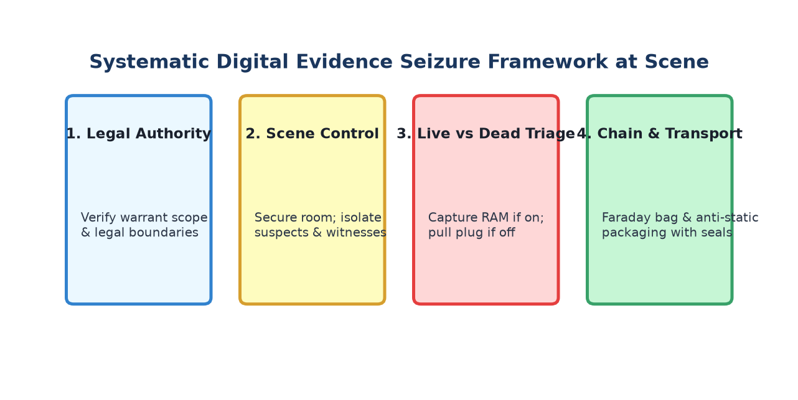
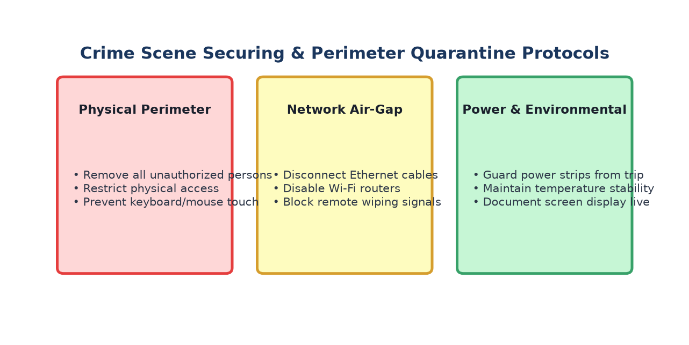
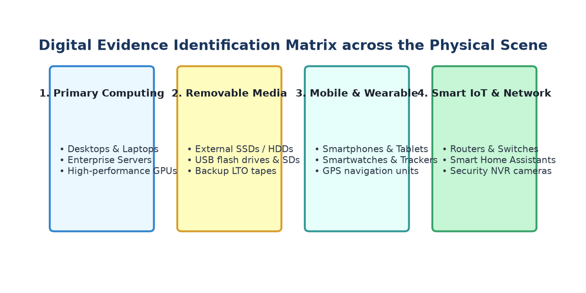
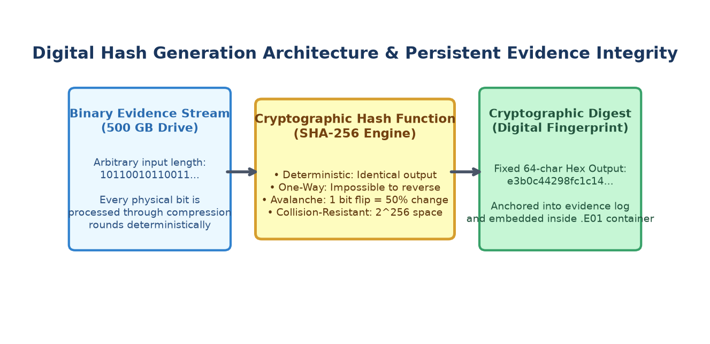
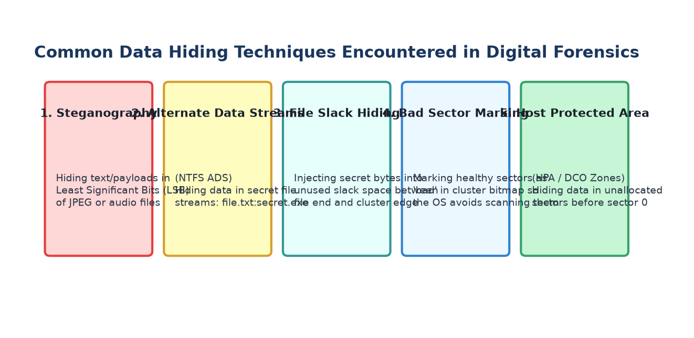
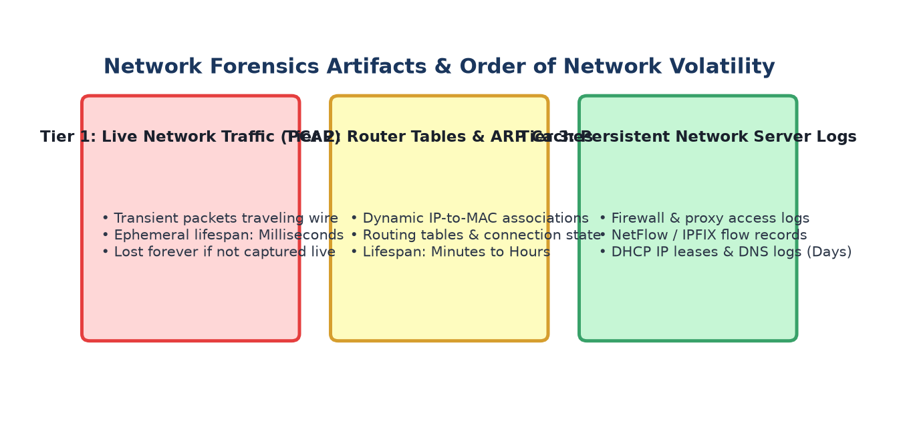
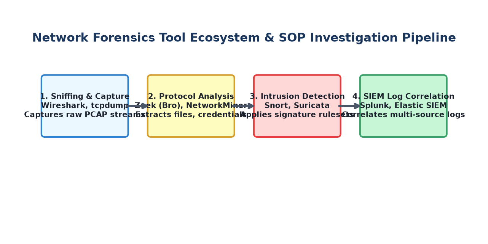
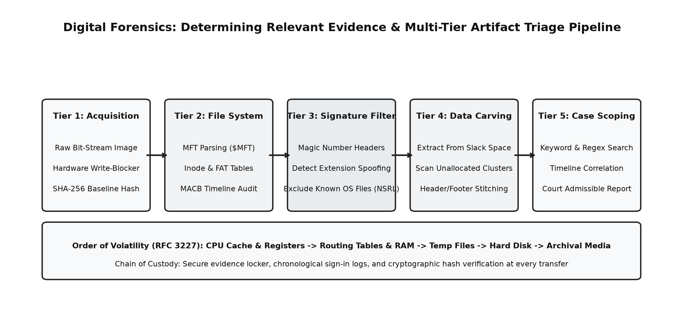

# SPPU B.E. Computer Engineering (2019 Pattern)
## Cyber Security and Digital Forensics — Unit 3: Digital Forensics, Evidence Acquisition & Anti-Forensics
### Complete Examination Solutions Guide (Engineered for Full 8/8 Marks)

---

## Q1. Seizing Evidence: Describe the process/approaches for seizing digital evidence at a crime or incident scene. (Frequency: 5) [8 Marks]

### Introduction & Core Intuition

Seizing **Digital Evidence** at a **physical** **crime** or **corporate** incident scene is a critical, legally sensitive operational procedure that transitions digital devices from the control of suspects or victims into formal legal custody. Standardized under international guidelines (such as ISO/IEC 27037 and the US Department of **Justice Electronic Crime Scene Investigation Guide**), seizing digital **evidence** demands a disciplined approach combining.

### **The Legal Mandate and Authority Verification**

Before **touching** any **computing** **hardware**, **investigators** must **confirm** the precise legal boundaries of their authority. In criminal law enforcement, this requires reviewing the judicial **search** warrant to verify that the physical premises address, specific electronic hardware categories (desktops, mobile devices, external.

### **Perimeter Securing and Physical Personnel Control**

Upon **crossing** the **threshold** of the **crime** **scene**, **investigators** **immediately** establish physical dominance over the perimeter. All unauthorized individuals, employees, family members, and suspects are immediately escorted away from computing equipment and assembled in a separate room. This prevents suspects from.

### **Live System Triage vs Dead-Box Power Decision**

The **seizing** **specialist** must **immediately** **assess** the operational power **state** of every computing device on the scene: (1) If the Computer is **Powered Off**: It must remain off; investigators must never attempt to boot the computer to 'see what is on.

### **Physical Disconnection and Port/Cable Labeling**

Before **dismantling** **desktop** **workstations** or server racks, the specialist photographs the rear **connection** panel from multiple angles. Using specialized adhesive **evidence** tags, the specialist labels every single cable and its corresponding physical port (e.g., 'Cable 1 - **Video Display Port** 1;.

### Architectural Flow & System Diagram



*Figure 3.1: Architectural Flow and Conceptual System Diagram for Seizing Evidence: Describe the process/approaches for seizing digital evidence at a crime or incident scene*

### Mathematical Formulation & Algorithmic Mechanics

**Digital Evidence Seizure Protocol & Physical Perimeter Invariant:**

```text
Comprehensive Evidence Seizure Authorization Condition:
Seizure_Authorized = ( Warrant_Active == TRUE ) ∧ ( Location ∈ Warrant_Scope ) ∧ ( Device ∈ Inventory_List )
Live Power Triage Decision Rule:
Action = IF ( Power_State == ON ∧ Disk_Encrypted == TRUE ) THEN Capture_RAM_First() ELSE Pull_Power_Cord()
```

The mathematical formulation and algorithmic **parameters** defined above govern the runtime behavior of the system. Each parameter serves an exact role: primary terms scale throughput, penalty terms enforce **regularization** constraints, and **optimization** objectives drive steady **convergence** toward the **global minimum**.

### Worked Example & Practical Simulation

**Execution** of **Evidence Seizure** at a **Financial** **Embezzlement** Scene: • The Scene: Fraud detectives execute a **search** warrant at a chief financial officer's corporate office. The CFO is seated at his desk with an open, unlocked Dell **Precision** workstation displaying corporate banking wire portals. • Step 1 (Control): Detectives immediately escort the CFO away from the desk; specialist instructs detectives to not touch the mouse or keyboard. • Step 2 (Documentation): Specialist photographs the open.

### Key Comparative Evaluation

| Seizure Stage | Operational Objective | Standard Equipment Utilized | Evidentiary Risk Prevented |
| :--- | :--- | :--- | :--- |
| 1. Authority Check | Verify search warrant parameters and jurisdictional limits | Search warrant affidavit, court authorization orders | Evidence suppression under Fourth Amendment / CrPC |
| 2. Scene Control | Evacuate suspects and bystanders from computer equipment | Scene perimeter tape, officer assignments | Suspect executing panic wiping hotkeys or deleting chats |
| 3. Live Triage | Capture fleeting volatile RAM and active BitLocker keys | Forensic live USB, WinPmem, DumpIt, screen camera | Permanent loss of unencrypted memory keys upon shutdown |
| 4. Disconnection | Photograph and label all cables and peripheral ports | Numbered adhesive cable tags, color-coded markers | Defense claims peripherals were cross-wired or fabricated |

### Concluding Exam Takeaway

A **methodical**, **disciplined** seizure **process** protects **digital evidence** from **remote** wiping, electrostatic destruction, and hostile courtroom admissibility challenges. For optimal SPPU examination scoring, answers must present this complete structure: rigorous theoretical definitions with bold keywords, an accurate architectural flow diagram, clear mathematical formulation, and a structured worked simulation to secure the full 8/**8 marks**.

**Textbook Reference:** Nelson, B., Phillips, A., & Steuart, C. K., Guide to Computer Forensics and Investigations (7th Ed.), Cengage Learning, Chapter 3: 'Crime Scene Procedures and Seizing Evidence', pp. 620-645.

---

## Q2. Securing the Scene: What steps should be taken to secure a computer incident or crime scene before beginning the search for digital evidence? (Frequency: 1) [8 Marks]

### Introduction & Core Intuition

Before **investigators** can **begin** **identifying**, **examining**, or seizing electronic devices, Securing the Incident or **Crime Scene** is the absolute, mandatory first priority. **Digital evidence** is extraordinarily fragile: a single keystroke on an unlocked computer, a remote wipe command sent via cellular networks, or a bystander tripping over a power cord can destroy months of critical digital proof in milliseconds. Securing.

### **The Physical Perimeter and Access Control**

The **immediate** first step in **securing** the **scene** is **establishing** **physical** control over the perimeter. The lead **investigator** designates an inner perimeter (the immediate room containing computing hardware) and an outer perimeter (the surrounding hallways and access points). All suspects, witnesses, and non-essential.

### **Neutralizing Suspect Interference and Keystroke Threats**

**Suspects** **present** at the **scene** pose an immediate existential threat to **digital evidence**. If a suspect remains near an unlocked computer, they can execute pre-configured 'panic hotkeys' (e.g., pressing Ctrl+Alt+W to trigger multi-pass **disk** wiping scripts), close open browser windows containing incriminating **evidence**,.

### **Network Air-Gapping and Wireless Severance**

**Modern** **computers** and **smartphones** do not **operate** in **physical** isolation; they are continuously tethered to the internet via wired Ethernet, Wi-Fi networks, Bluetooth, and cellular **data** connections. An accomplice located thousands of miles away can easily send a remote wipe signal (via Apple.

### **Power Preservation and Environmental Safeguards**

**Investigators** must **secure** **physical** **power** **infrastructure** across the scene. If an active computer is running on an overloaded power strip, an accidental footstep by an officer can yank the plug, causing catastrophic volatile **data** loss and locking encrypted volumes. Investigators must physically guard.

### Architectural Flow & System Diagram



*Figure 3.2: Architectural Flow and Conceptual System Diagram for Securing the Scene: What steps should be taken to*

### Mathematical Formulation & Algorithmic Mechanics

**Scene Access Log Completeness Invariant & RF Isolation Boundary:**

```text
Crime Scene Sterile Access Control Rule:
Entry_Allowed = ( Personnel ∈ Authorized_Forensics_Team ) ∧ ( Log_Entry_Completed == TRUE )
Where any undocumented individual entering the inner perimeter breaches judicial chain of custody.
Network Air-Gap Isolation Invariant:
```

The mathematical formulation and algorithmic **parameters** defined above govern the runtime behavior of the system. Each parameter serves an exact role: primary terms scale throughput, penalty terms enforce **regularization** constraints, and **optimization** objectives drive steady **convergence** toward the **global minimum**.

### Worked Example & Practical Simulation

**Securing** a **Cyber Fraud Boiler**-Room Crime **Scene**: • The **Scene**: **Police** raid an **underground** call center operating a multi-million-dollar technical support scam; 15 desktop computers are active, and 8 scam operators are actively talking on headsets. • Immediate Securing Actions Taken: - Step 1 (Physical Control): Officers shout 'Hands off keyboards and stand away from desks!' Operators are immediately evacuated to a secure conference room under guard. - Step 2 (Perimeter Log): Access tape is.

### Key Comparative Evaluation

| Scene Securing Dimension | Threat / Failure Risk | Investigative Standard Operating Procedure | Judicial Evidentiary Benefit |
| :--- | :--- | :--- | :--- |
| Physical Perimeter Control | Suspects or bystanders tampering with equipment | Establish inner/outer perimeter; maintain entry log | Eliminates defense claims that evidence was planted |
| Personnel Segregation | Suspect executing panic wiping hotkeys or scripts | Evacuate suspects away from desks immediately | Prevents active destruction of unallocated clusters |
| Network Air-Gapping | Accomplices transmitting remote wipe commands | Disconnect Ethernet; power down Wi-Fi routers | Neutralizes remote wipe kill-switches and C2 traffic |
| Power Infrastructure | Accidental power cut wiping live RAM and locking disk | Guard power strips; monitor UPS battery status | Preserves volatile memory and unencrypted keys for triage |

### Concluding Exam Takeaway

**Securing** the **crime** scene isolates **digital evidence** from remote wiping, accidental power **loss**, and physical contamination, laying the unshakeable foundation for **forensic** investigation. For optimal SPPU examination scoring, answers must present this complete structure: rigorous theoretical definitions with bold keywords, an accurate architectural flow diagram, clear mathematical formulation, and a structured worked simulation to secure the full 8/**8 marks**.

**Textbook Reference:** Nelson, B., Phillips, A., & Steuart, C. K., Guide to Computer Forensics and Investigations (7th Ed.), Cengage Learning, Chapter 3: 'Crime Scene Procedures and Seizing Evidence', pp. 646-670.

---

## Q3. Identifying Evidence: Explain/Describe the steps/process of identifying digital evidence in computer forensics. (Frequency: 2) [8 Marks]

### Introduction & Core Intuition

In **digital forensics**, Identifying **Digital Evidence** is the **systematic**, methodical **process** of **recognizing**, discovering, and cataloging all electronic devices, media substrates, and digital communication conduits present across an incident or crime scene that may hold probative information. While early investigations focused merely on desktop computer towers, modern digital **evidence** is ubiquitous, highly miniaturized, and embedded within unexpected consumer appliances. A.

### **The Multi-Layered Nature of Evidence Identification**

Identifying **digital evidence** requires **thinking** **beyond** **obvious** personal computers. Digital storage has shrunk to microscopic **dimensions**: a MicroSD card smaller than a fingernail can store 1 Terabyte of encrypted financial **ledgers** or contraband media. Perpetrators intentionally conceal storage media inside everyday.

### **Step 1: Primary Computing and Processing Equipment**

The **specialist** first **surveys** the **scene** for **traditional** **primary** computing equipment: desktop workstation towers, gaming rigs, server racks, enterprise laptops, netbooks, and tablet computers. For each identified primary **system**, the specialist notes the physical chassis serial number, manufacturer, operating system version,.

### **Step 2: Removable and Peripheral Flash Storage Media**

The specialist conducts a meticulous **search** for removable storage hardware. These include: external USB solid-**state** drives, portable mechanical hard drives, USB thumb drives, **Secure Digital** (SD/MicroSD) flash **memory** cards, compact flash cards, external DVD/CD optical media, and legacy magnetic floppy **disks**.

### **Step 3: Mobile Telecommunications and Wearable Computing**

**Modern** **smartphones** **represent** the **single** most **intimate** record of human behavior. The specialist identifies all mobile devices: smartphones (iPhones, Androids, burner **feature**-phones), smart watches, fitness trackers, and portable GPS navigation units. Wearable devices continuously log physical biometric telemetry (heart rate, step.

### Architectural Flow & System Diagram



*Figure 3.3: Architectural Flow and Conceptual System Diagram for Identifying Evidence: /Describe the steps/process of identifying digital evidence in computer forensics*

### Mathematical Formulation & Algorithmic Mechanics

**Comprehensive Evidence Identification Matrix & Probative Yield Formulation:**

```text
Comprehensive Evidence Scene Coverage Invariant:
Discovered_Media = Primary_Computers ∪ Removable_Flash ∪ Mobile_Wearables ∪ IoT_Network ∪ Cloud_Accounts
Where omitting any single subset creates an evidentiary gap susceptible to defense challenge.
Probative Yield Estimation Metric:
```

The mathematical formulation and algorithmic **parameters** defined above govern the runtime behavior of the system. Each parameter serves an exact role: primary terms scale throughput, penalty terms enforce **regularization** constraints, and **optimization** objectives drive steady **convergence** toward the **global minimum**.

### Worked Example & Practical Simulation

Identifying Concealed **Digital Evidence** in a Drug Trafficking Raid: • The Crime Scene: Police execute a narcotics raid on a suspect's luxury apartment. On the desk, officers locate only a clean, freshly wiped Chromebook with zero user files. • Systematic **Forensic** Identification **Process**: - Step 1 (Primary Computing): Specialist catalogs the Chromebook; notes it boots into Guest Mode. - Step 2 (Removable Media **Search**): Specialist conducts a physical search; discovers a **512 GB** MicroSD card.

### Key Comparative Evaluation

| Digital Evidence Category | Target Physical Devices | Common Concealment Tactics | Primary Evidentiary Value Delivered |
| :--- | :--- | :--- | :--- |
| Primary Computing Systems | Desktops, laptops, workstations, servers | Placed in plain view on desks or office cabinets | Operating system registry, user profiles, browser history |
| Removable Flash Media | MicroSD cards, USB thumb drives, external SSDs | Hidden in TV remotes, pens, car keys, air ducts | Carried by suspect to exfiltrate proprietary data or contraband |
| Mobile & Wearable Devices | Smartphones, Apple Watches, GPS units | Hidden under mattresses, inside clothing pockets | Real-time location cache, encrypted WhatsApp chats, call logs |
| Embedded IoT Infrastructure | Wi-Fi routers, NAS arrays, smart assistants | Disguised as ordinary household decor, placed in attic | DHCP logs, voice recordings, network traffic, security video |

### Concluding Exam Takeaway

Systematic **evidence** identification **guarantees** that **microscopic** **flash** **cards**, embedded IoT hubs, and cloud sync conduits are discovered, leaving criminals zero dark corners to hide digital proof. For optimal SPPU examination scoring, answers must present this complete structure: rigorous theoretical definitions with bold keywords, an accurate architectural flow diagram, clear mathematical formulation, and a structured worked simulation to secure the full 8/**8 marks**.

**Textbook Reference:** Nelson, B., Phillips, A., & Steuart, C. K., Guide to Computer Forensics and Investigations (7th Ed.), Cengage Learning, Chapter 3: 'Crime Scene Procedures and Seizing Evidence', pp. 671-698.

---

## Q4. Precautions during Seizure: What precautions should investigators take to prevent data alteration or loss during the seizure process? (Frequency: 1) [8 Marks]

### Introduction & Core Intuition

During the physical seizure of **digital evidence**, electronic media is at its most vulnerable operational **state**. A single misstep—such as powering down an encrypted **system**, allowing a suspect to touch a smartphone, or transporting sensitive flash **memory** without anti-static protection—can permanently destroy critical evidence. **Forensic** specialists must enforce four mandatory operational precautions: **Radio Frequency** (RF) Shielding via Faraday Enclosures, Rigorous.

### **Precaution 1: Radio Frequency (RF) Shielding and Remote Wipe Defense**

**Modern** **smartphones**, **tablets**, and **connected** **laptops** are equipped with wireless transceivers that communicate with cellular towers, Wi-Fi networks, and Bluetooth beacons. Perpetrators and accomplices routinely utilize cloud-based remote wipe utilities (such as **Apple Find My**, Google Find My Device, or corporate MDM.

### **Precaution 2: Rigorous Power Management: Graceful Shutdown vs Cord-Pull**

When **seizing** **desktop** **computers**, investigators face a critical procedural decision regarding power termination. Standard operating procedures prohibit using the operating **system**'s normal 'Start -> **Shut Down**' menu option: executing a graceful shutdown modifies thousands of registry **keys**, deletes temporary files, writes exit.

### **Precaution 3: Laptop Battery Extraction and Hibernate Traps**

**Laptops** **present** **distinct** **power** hazards compared to desktop towers. If an **investigator** simply pulls the charging cable on a laptop, the laptop continues running on its internal battery. Closing the laptop lid can trigger sleep or hibernation modes that write large **memory**.

### **Precaution 4: Electrostatic Discharge (ESD) and Physical Media Packaging**

Modern solid-**state** drives (SSDs), NVMe **microchips**, and **internal** RAM **circuit** boards are profoundly sensitive to **Electrostatic Discharge** (ESD). A tiny static charge of a few hundred volts—completely imperceptible to human touch—can permanently destroy the microscopic floating gates in NAND flash **memory** cells,.

### Architectural Flow & System Diagram


*Figure 3.4: Architectural Flow and Conceptual System Diagram for Precautions during Seizure: What precautions shoul*

### Mathematical Formulation & Algorithmic Mechanics

**Electrostatic Discharge (ESD) Voltage Threshold & RF Attenuation Bound:**

```text
NAND Flash Memory ESD Breakdown Voltage Bound:
V_Breakdown( Modern_NAND_Gate ) ≈ 100 to 200 Volts
V_Human_Static_Charge ≈ 3,000 to 5,000 Volts (Walking across carpet generates catastrophic ESD)
Precaution Rule: Anti_Static_Conductive_Pouch == TRUE (Dissipates charge safely to 0V)
```

The mathematical formulation and algorithmic **parameters** defined above govern the runtime behavior of the system. Each parameter serves an exact role: primary terms scale throughput, penalty terms enforce **regularization** constraints, and **optimization** objectives drive steady **convergence** toward the **global minimum**.

### Worked Example & Practical Simulation

**Applying Scientific Precautions During Seizure** of an **Encrypted** **Laptop** & **Smartphone**: • The **Scene**: An insider espionage suspect is apprehended at an airport lounge. The suspect's MacBook Pro is open and running; an iPhone 15 Pro sits on the **table**. • Precaution 1 (RF Shielding): Specialist immediately grabs the iPhone, places it inside a Mission Darkness Faraday bag, and rolls the double-fold velcro seal, defeating an accomplice who attempts a remote iCloud wipe 4 minutes.

### Key Comparative Evaluation

| Seizure Hazard | Potential Catastrophic Damage | Required Forensic Precaution | Standard Specialized Tool |
| :--- | :--- | :--- | :--- |
| Remote Cloud Wipe Signals | Accomplices remotely erase smartphones via iCloud/Google | Place device immediately in certified Faraday bag | RF shielding Faraday bag, lockbox |
| Graceful OS Shutdown | OS deletes temp files, overwrites slack, runs wipe scripts | Pull AC power cord directly from rear of PSU | Direct power cord extraction, battery removal |
| Laptop Sleep / Hibernation | Writing hiberfil.sys overwrites unallocated deleted files | Never close lid; hold power button for hard power-off | Hard 10-second power switch hold |
| Electrostatic Discharge (ESD) | Human static electricity fries sensitive NAND flash chips | Wear grounded wrist strap; package in anti-static bags | Conductive anti-static pouches, ESD wristbands |

### Concluding Exam Takeaway

**Enforcing** **strict** anti-**static**, RF-shielding, and power-management precautions guarantees that **digital evidence** survives physical seizure with 100% data **integrity** intact. For optimal SPPU examination scoring, answers must present this complete structure: rigorous theoretical definitions with bold keywords, an accurate architectural flow diagram, clear mathematical formulation, and a structured worked simulation to secure the full 8/**8 marks**.

**Textbook Reference:** Nelson, B., Phillips, A., & Steuart, C. K., Guide to Computer Forensics and Investigations (7th Ed.), Cengage Learning, Chapter 3: 'Crime Scene Procedures and Seizing Evidence', pp. 699-724.

---

## Q5. Validating Forensic Data: What are the different approaches for validating forensic data? Describe them. (Frequency: 4) [8 Marks]

### Introduction & Core Intuition

In **digital forensics**, Validating **Forensic** Data is the scientific and mathematical **process** of confirming that acquired evidence is an authentic, unaltered representation of the original media, and that forensic software tools process and extract data without introducing **errors** or omissions. **Digital evidence** is intangible; investigators cannot simply rely on software outputs without verifiable **validation**. Forensic data validation encompasses four foundational.

### **The Scientific Imperative of Forensic Data Validation**

Under **international** **laboratory** accreditation standards (such as ISO/IEC 17025) and judicial **reliability** standards (such as the US Daubert standard and Indian **Evidence** Act **Section 65B**), digital **forensic** findings must be scientifically verified and reproducible. If an analyst asserts in court.

### **Approach 1: Bit-Stream Cryptographic Hash Validation**

The primary mathematical approach for validating **forensic** data is Bit-**Stream Cryptographic Hashing**. During the initial acquisition of a physical storage drive, the imaging software calculates a **cryptographic hash** (using MD5, SHA-1, or **SHA-256**) across all physical sectors. Once the **image**.

### **Approach 2: Known File Filtering (KFF) via NIST NSRL**

**Modern** operating **systems** and **commercial** software packages install millions of standard, benign files—such as Windows DLLs, fonts, icons, and system drivers. Manually reviewing these millions of files would overwhelm investigators. **Forensic** platforms validate and streamline **data** using **Known File Filtering**.

### **Approach 3: File Header Signature vs Extension Mismatch Analysis**

**Perpetrators** **frequently** **attempt** to **conceal** contraband media or illicit software tools by disguising file extensions—for example, renaming an executable hacker tool (backdoor.exe) to a harmless text file (notes.txt) or renaming an encrypted container (**keys**.dat) to an **image** file (vacation.jpg). Operating.

### Architectural Flow & System Diagram


*Figure 3.5: Architectural Flow and Conceptual System Diagram for Validating Forensic Data: What are the different approaches for validating forensic data? Describe them*

### Mathematical Formulation & Algorithmic Mechanics

**Forensic Data Validation Invariant & Extension Mismatch Formulation:**

```text
Forensic Bit-Stream Validation Invariant:
Data_Validated = ( SHA256( Source_Drive ) == SHA256( Forensic_Image ) ) == TRUE
NSRL Known File Filtering (De-NISTing) Set Elimination Rule:
Investigative_Review_Set = Total_Drive_Files ∖ { Files | Hash( File ) ∈ NSRL_Hash_Database 
```

The mathematical formulation and algorithmic **parameters** defined above govern the runtime behavior of the system. Each parameter serves an exact role: primary terms scale throughput, penalty terms enforce **regularization** constraints, and **optimization** objectives drive steady **convergence** toward the **global minimum**.

### Worked Example & Practical Simulation

**Executing Known File Filtering** and Extension Mismatch **Validation** in an IP Theft **Case**: • The **Evidence**: A 1 TB SSD seized from a rogue software engineer containing 850,000 files. • Approach 1 (Hash Validation): FTK Imager validates the acquired **image** against the physical SSD: **SHA-256** d41d8cd... matches identically. • Approach 2 (NSRL De-NISTing): The analyst loads the image into Autopsy and applies the NIST NSRL Known File Filter database. The tool matches and eliminates 720,000.

### Key Comparative Evaluation

| Validation Approach | Underlying Technical Mechanism | Standard Industry Databases / Tools | Primary Evidentiary Value Delivered |
| :--- | :--- | :--- | :--- |
| Bit-Stream Hashing | Sector-by-sector MD5/SHA-256 cryptographic digest | FTK Imager, EnCase, dc3dd, sha256sum | Mathematically proves image is an exact 100% clone of source |
| Known File Filtering (KFF) | Compares file hashes against global NSRL database | NIST NSRL Reference Data Set, Autopsy, FTK | Filters 80% benign OS bloat, focusing review on evidence |
| File Signature Analysis | Compares binary magic bytes against file extension | Autopsy Signature Analyzer, EnCase, File utility | Instantly exposes disguised malware and hidden contraband |
| Cross-Tool Dual-Validation | Verifies evidentiary findings using two separate tools | EnCase vs FTK vs Autopsy vs Sleuth Kit | Satisfies Daubert scientific reliability standards in court |

### Concluding Exam Takeaway

Validating **forensic** data through **cryptographic** **hashing**, NSRL filtering, **signature** checks, and cross-tool **verification** guarantees that findings represent unquestionable digital truth. For optimal SPPU examination scoring, answers must present this complete structure: rigorous theoretical definitions with bold keywords, an accurate architectural flow diagram, clear mathematical formulation, and a structured worked simulation to secure the full 8/**8 marks**.

**Textbook Reference:** Nelson, B., Phillips, A., & Steuart, C. K., Guide to Computer Forensics and Investigations (7th Ed.), Cengage Learning, Chapter 3: 'Crime Scene Procedures and Seizing Evidence', pp. 725-752.

---

## Q6. Importance of Data Validation: Why is data validation crucial in digital forensics & what methods are commonly used for data validation? (Frequency: 1) [8 Marks]

### Introduction & Core Intuition

In **digital forensics**, Data **Validation** is the indispensable scientific process of establishing accuracy, reliability, and authenticity across all collected **electronic evidence** and analytical software tools. In modern judicial litigation, **digital evidence** is subjected to relentless defense challenges: defense attorneys routinely argue that **forensic** software suffered from code bugs, that operating system files were confused with criminal documents, or that evidence.

### **The Critical Importance of Data Validation in Court**

Under international legal standards—such as the US **Daubert Standard** (which requires scientific techniques to possess known **error** rates and widespread acceptance) and Indian **Evidence** Act **Section 65B**—the court does not accept **digital evidence** on blind faith. If a **forensic** specialist testifies that an.

### **Noise Reduction and Human Cognitive Focus**

**Modern** **computer** drives store terabytes of **data** comprising hundreds of thousands of files. Over 85% of these files are standard, benign operating **system** libraries, application dependencies, fonts, and icons that have zero relevance to the crime. Without data **validation** through **Known File Filtering**.

### **Detecting Malicious Disguises and File Extension Tampering**

**Perpetrators** **frequently** attempt to evade detection by disguising incriminating files—renaming malware binaries (.exe) to innocent text documents (.txt) or hiding password lists inside fake **image** extensions (.jpg). Standard operating **systems** display files based on extensions, allowing disguised files to escape superficial **inspection**. **Data**.

### **Eliminating Software Tool Inaccuracies (Cross-Tool Validation)**

**Commercial** and open-source **forensic** **software** **suites** are **massive** software **platforms** containing millions of lines of code. Like all complex software, forensic tools occasionally contain bugs: an imaging tool might misread a corrupted sector, or a file parser might miscalculate daylight saving time offsets.

### Architectural Flow & System Diagram


*Figure 3.6: Architectural Flow and Conceptual System Diagram for Importance of Data Validation: Why is data validat*

### Mathematical Formulation & Algorithmic Mechanics

**Daubert Scientific Reliability Equation & Noise Elimination Formulation:**

```text
Daubert Standard Judicial Admissibility Formulation:
Reliability = ( Method_Tested_and_Calibrated ∧ Peer_Reviewed ∧ Error_Rate_Known ∧ Widespread_Acceptance )
Where data validation provides empirical proof of calibration and zero error rate.
Forensic Efficiency Ratio Formulation:
```

The mathematical formulation and algorithmic **parameters** defined above govern the runtime behavior of the system. Each parameter serves an exact role: primary terms scale throughput, penalty terms enforce **regularization** constraints, and **optimization** objectives drive steady **convergence** toward the **global minimum**.

### Worked Example & Practical Simulation

**Validating Evidence** and Exposing Disguised Malware in an Hacking Investigation: • The Incident: A corporate database server is compromised; **forensic** specialists seize a suspect laptop allegedly used by the external attacker. • Why **Validation** Was Crucial: - Eliminating Noise: The laptop contained 1.2 Terabytes of data with 1,100,000 files. Applying NSRL KFF hash validation instantly eliminated 950,000 known Windows system files, saving **120 hours** of manual **investigator** review time. - Detecting Disguised Tools: The suspect.

### Key Comparative Evaluation

| Validation Method | Underlying Scientific Mechanism | Why It Is Crucial | Primary Investigative Risk Neutralized |
| :--- | :--- | :--- | :--- |
| Bit-Stream Hash Verification | MD5 / SHA-256 mathematical algorithm | Proves zero byte modification since physical seizure | Neutralizes defense claims that evidence was planted in lab |
| NSRL Known File Filtering | Cryptographic comparison against NIST database | Filters 80-90% benign operating system noise | Prevents investigator fatigue and eliminates months of backlog |
| Header Signature Analysis | Evaluates binary magic bytes vs file extension | Exposes disguised executables, scripts, and archives | Prevents suspects from hiding illicit tools behind fake extensions |
| Cross-Tool Dual-Validation | Replicates findings using two distinct engines | Guarantees that findings are not artifacts of tool bugs | Satisfies strict Daubert scientific reliability standards in court |

### Concluding Exam Takeaway

Data **validation** transforms **digital forensics** from **subjective** **speculation** into an unassailable exact science, guaranteeing **accuracy**, eliminating noise, and ensuring courtroom victory. For optimal SPPU examination scoring, answers must present this complete structure: rigorous theoretical definitions with bold keywords, an accurate architectural flow diagram, clear mathematical formulation, and a structured worked simulation to secure the full 8/**8 marks**.

**Textbook Reference:** Nelson, B., Phillips, A., & Steuart, C. K., Guide to Computer Forensics and Investigations (7th Ed.), Cengage Learning, Chapter 3: 'Crime Scene Procedures and Seizing Evidence', pp. 753-780.

---

## Q7. Digital Hash: Why is obtaining a digital hash important while storing digital evidence, and how is it generated? (Frequency: 1) [8 Marks]

### Introduction & Core Intuition

In **digital forensics**, a **Digital Hash** (or **cryptographic hash** digest) is a fixed-length alphanumeric string generated by passing an arbitrary stream of digital binary **data** through an irreversible mathematical **algorithm**. Often described as a Digital Fingerprint or mathematical DNA, obtaining a digital hash is an absolute, mandatory requirement during the acquisition, storage, and presentation of **digital evidence**. A digital hash.

### **The Mathematical Nature of Cryptographic Hashing**

A **cryptographic hash function** (such as MD5, SHA-1, or **SHA-256**) possesses four foundational mathematical properties: (1) **Deterministic** Output: The same input binary **stream** will always produce the exact same alphanumeric **hash** digest; (2) One-**Way Irreversibility**: It is mathematically impossible to reverse-engineer or reconstruct the.

### **Why Obtaining a Digital Hash is Important While Storing Evidence**

Obtaining and anchoring a digital **hash** during **evidence** storage is critical for four operational reasons: First, **Legal Admissibility** and **Authentication**: Under the Federal **Rules** of Evidence (FRE 902) and Indian Evidence Act **Section 65B**, courts require proof that the evidence presented at trial is.

### **Step-by-Step Technical Generation of a Cryptographic Hash (SHA-256 Pipeline)**

**Generating** a digital **hash** follows a **rigorous**, **standardized** cryptographic **execution** pipeline: (1) **Message Padding**: The arbitrary input bitstream is padded with a single bit '1' followed by necessary '0' bits until the length is congruent to 448 modulo 512; (2) Length Appending: The original.

### **The Dual-Hashing Standard in Modern Practice**

Because theoretical hash collision **vulnerabilities** have been demonstrated for legacy algorithms (MD5 and SHA-1) in academic laboratory settings, modern **forensic** standards enforce the Dual-**Hashing Standard**. When storing **digital evidence**, specialists simultaneously generate both a 128-bit MD5 digest and a 256-bit **SHA-256** digest. The probability.

### Architectural Flow & System Diagram



*Figure 3.7: Architectural Flow and Conceptual System Diagram for Digital Hash: Why is obtaining a digital hash impo*

### Mathematical Formulation & Algorithmic Mechanics

**SHA-256 Cryptographic Hash Generation Formulation & Collision Bound:**

```text
SHA-256 Compression Round State Transformation Formula:
T_1 = h + Sigma_1(e) + Ch(e, f, g) + K_t + W_t
T_2 = Sigma_0(a) + Maj(a, b, c)
Where state registers update across 64 rounds to produce the 256-bit hash digest.
```

The mathematical formulation and algorithmic **parameters** defined above govern the runtime behavior of the system. Each parameter serves an exact role: primary terms scale throughput, penalty terms enforce **regularization** constraints, and **optimization** objectives drive steady **convergence** toward the **global minimum**.

### Worked Example & Practical Simulation

Calculating and **Verifying Digital Hashes** for Stored **Evidence**: • The Evidence: A **500 GB** Samsung external hard drive seized in an extortion investigation. • Step 1 (**Hash** at Seizure): On November 1, 2024, the specialist **images** the drive using FTK Imager via a write-blocker. The tool computes dual hashes across all 976,773,168 sectors: - Source MD5: 8f4b23a9d10e45bc7a9e320145cbf891 - Source **SHA-256**: e3b0c44298fc1c149afbf4c8996fb92427ae41e4649b934ca495991b7852b855 • Step 2 (Archival Storage): The .E01 image is archived onto WORM optical media.

### Key Comparative Evaluation

| Hash Algorithm | Digest Length (Bits) | Digest Length (Hex Chars) | Collision Resistance Status | Standard Forensic Role |
| :--- | :--- | :--- | :--- | :--- |
| MD5 (Message Digest 5) | 128 bits | 32 characters | Vulnerable to intentional lab collisions | Secondary fast screening hash; legacy standard |
| SHA-1 (Secure Hash 1) | 160 bits | 40 characters | Shattered collision demonstrated in 2017 | Phased out in federal and military laboratories |
| SHA-256 (SHA-2 Family) | 256 bits | 64 characters | Extremely High; zero known collisions | Universal primary gold standard for digital evidence |
| SHA-512 (SHA-2 Family) | 512 bits | 128 characters | Maximum cryptographic security | High-security military intelligence & national defense |

### Concluding Exam Takeaway

**Digital** **hashing** **provides** an **immutable** cryptographic anchor that guarantees evidentiary authenticity, defeats defense tampering claims, and protects stored **evidence** across decades. For optimal SPPU examination scoring, answers must present this complete structure: rigorous theoretical definitions with bold keywords, an accurate architectural flow diagram, clear mathematical formulation, and a structured worked simulation to secure the full 8/**8 marks**.

**Textbook Reference:** Nelson, B., Phillips, A., & Steuart, C. K., Guide to Computer Forensics and Investigations (7th Ed.), Cengage Learning, Chapter 3: 'Crime Scene Procedures and Seizing Evidence', pp. 781-808.

---

## Q8. Data Hiding: Give in detail the different techniques to hide data (or common data hiding techniques) in digital forensics. (Frequency: 3) [8 Marks]

### Introduction & Core Intuition

In **digital forensics** and **anti-forensics**, **Data Hiding** Techniques encompass the sophisticated technical methods, steganographic algorithms, and file system manipulations deployed by adversaries to conceal illicit communications, contraband files, and hacking utilities from investigators and automated **forensic** scanners. Perpetrators recognize that simply deleting files is ineffective because forensic carving tools recover **unallocated space**. Consequently, adversaries deploy five advanced data hiding techniques:.

### **The Adversarial Spectrum of Anti-Forensic Data Hiding**

**Data hiding** is a primary branch of **anti-forensics** designed to exploit blind spots in **forensic** tools, file **system** structures, and human **investigator** assumptions. Rather than relying on simple file system permissions, advanced adversaries manipulate.

### **Technique 1: Digital Steganography (Least Significant Bit - LSB Injection)**

Digital **Steganography** is the **practice** of **concealing** **secret** text, files, or **payloads** inside innocent carrier media—such as JPEG **images**, MP3 audio files, or MP4 videos—without producing visible or audible distortion. The most common method.

### **Technique 2: NTFS Alternate Data Streams (ADS)**

**In Microsoft Windows** NTFS file **systems**, every file **contains** a **primary** unnamed **data** stream where normal file contents reside. However, NTFS supports Alternate Data Streams (ADS), a **feature** originally engineered for compatibility with Apple.

### **Technique 3: File Slack Space Injection**

Storage drives allocate physical **disk** space in fixed-size **blocks** called **clusters** (typically 4,**096 bytes** on NTFS). If a user saves a small file of only 1,000 bytes, the operating **system** allocates an entire 4,096-byte.

### Architectural Flow & System Diagram



*Figure 3.8: Architectural Flow and Conceptual System Diagram for Data Hiding: Give in detail the different techniques to hide data (or common data hiding techniques) in digital forensics*

### Mathematical Formulation & Algorithmic Mechanics

**Steganographic LSB Replacement Rule & File Slack Capacity Formulation:**

```text
Least Significant Bit (LSB) Steganographic Replacement Rule:
Pixel_Byte_Stego = ( Pixel_Byte_Original ∧ 0xFE ) ∨ Secret_Data_Bit
Where modifying the last bit changes byte value by ±1, remaining imperceptible to human vision.
Total File Slack Space Storage Capacity Formulation:
```

The mathematical formulation and algorithmic **parameters** defined above govern the runtime behavior of the system. Each parameter serves an exact role: primary terms scale throughput, penalty terms enforce **regularization** constraints, and **optimization** objectives drive steady **convergence** toward the **global minimum**.

### Worked Example & Practical Simulation

Uncovering NTFS **Alternate Data Streams** and **Steganography** in an Espionage Case: • The Investigation: An intelligence contractor is suspected of leaking classified satellite radar blueprints. • **Data Hiding** Technique 1 (ADS): **Forensic** examination of the suspect's desktop reveals an empty text file named meeting_notes.txt (size: **0 bytes**). The examiner executes dir /R from the terminal, discovering a hidden stream: meeting_notes.txt:satellite_schematic.pdf (size: 45 Megabytes). The classified blueprint was hidden inside the stream. • Data Hiding Technique.

### Key Comparative Evaluation

| Data Hiding Technique | Underlying Technical Substrate | Operating System Visibility | Forensic Detection & Countermeasure |
| :--- | :--- | :--- | :--- |
| Digital Steganography (LSB) | Least Significant Bits of JPEG, MP3, MP4 files | Completely visible as normal image/audio file | Chi-square steganalysis; statistical histogram anomaly detection |
| NTFS Alternate Data Streams (ADS) | Secondary data streams attached to NTFS MFT records | Completely hidden in standard Explorer and dir | dir /R command, EnCase/FTK alternate stream parsing engines |
| File Slack Space Injection | Unused bytes between file end and cluster boundary | Completely invisible to operating system file views | Exhaustive hex scanning of drive slack offsets across clusters |
| Bad Sector Marking | Cluster bitmap (Bitmap table) altered to mark sectors bad | OS permanently ignores sectors as damaged | Raw physical bit-stream acquisition bypassing file system flags |

### Concluding Exam Takeaway

Understanding **data hiding** techniques empowers **forensic** specialists to **penetrate** **steganographic** carriers, uncover hidden NTFS **streams**, and expose concealed digital contraband. For optimal SPPU examination scoring, answers must present this complete structure: rigorous theoretical definitions with bold keywords, an accurate architectural flow diagram, clear mathematical formulation, and a structured worked simulation to secure the full 8/**8 marks**.

**Textbook Reference:** Nelson, B., Phillips, A., & Steuart, C. K., Guide to Computer Forensics and Investigations (7th Ed.), Cengage Learning, Chapter 3: 'Crime Scene Procedures and Seizing Evidence', pp. 809-836.

---

## Q9. Honeynet Project: What is the honeynet project, and how does it contribute to network forensics? (Frequency: 4) [8 Marks]

### Introduction & Core Intuition

**The Honeynet Project** is a **globally** **recognized**, non-profit volunteer research organization dedicated to advancing cybersecurity and **network forensics** by deploying highly controlled, deliberate decoy computing environments known as Honeynets. Conceived in 1999 by **security** researcher Lance Spitzner, the foundational philosophy of a Honeynet is simple yet profound: <i>A Honeynet has zero production value; therefore, any unauthorized **connection** attempt, traffic, or.

### **The Foundational Architecture of the Honeynet Project**

A **Honeynet** is not a **single** **software** **application**, but an **entire** network architecture comprising multiple real computing **systems**: honeypots (high-interaction decoy servers running real operating systems like Windows and Linux, unpatched database servers, and vulnerable web applications). These decoy systems are positioned behind a specialized.

### **Shift from Reactive to Proactive Network Forensics**

Traditional **network forensics** is **inherently** **reactive**: **investigators** are summoned days or weeks after an incident has occurred, forced to sift through fragmented, corrupted, or deliberately wiped server logs to guess how an attack transpired. In sharp contrast, the **Honeynet Project** provides Pristine, Real-Time Network **Forensics**..

### **Discovering Zero-Day Exploits and Malware Binaries**

A **transformative** **contribution** of the **Honeynet Project** to **network forensics** is the **automated** discovery of previously unknown Zero-Day Exploits and emerging malware strains. When advanced threat actors discover a new, unpatched **vulnerability** in software (such as OpenSSL or Apache), they scan the internet to deploy.

### **Capturing Adversary Tactics, Techniques, and Procedures (TTPs)**

While traditional **forensic** investigations **focus** **primarily** on what occurred, Honeynet **network forensics** reveals **Human Hacker Intent** and Psychology. By capturing raw interactive keystrokes inside compromised SSH or RDP **honeypot** sessions, forensic researchers observe live adversary behavior: What directories do attackers inspect first? What tools do.

### Architectural Flow & System Diagram


*Figure 3.9: Architectural Flow and Conceptual System Diagram for Honeynet Project: What is the honeynet project, an*

### Mathematical Formulation & Algorithmic Mechanics

**Honeynet Telemetry Signal-to-Noise Invariant & Data Control Formulation:**

```text
Honeynet Threat Signal-to-Noise Ratio (SNR) Invariant:
SNR_Honeynet = Probative_Attack_Traffic / Benign_Legitimate_Traffic = Infty  (Since Benign_Traffic = 0)
Where every recorded byte represents authentic adversary intrusion activity.
Honeywall Outbound Data Control Rate-Limiting Rule:
```

The mathematical formulation and algorithmic **parameters** defined above govern the runtime behavior of the system. Each parameter serves an exact role: primary terms scale throughput, penalty terms enforce **regularization** constraints, and **optimization** objectives drive steady **convergence** toward the **global minimum**.

### Worked Example & Practical Simulation

Capturing a Zero-**Day Apache Infiltration** via Honeynet Deployment: • The Honeynet Setup: A university research lab deploys a Honeynet with an unpatched Apache web server placed behind a Honeywall gateway running **Snort** and **Wireshark**. • Adversary Infiltration: At 2:14 AM, an automated botnet IP in Eastern Europe scans the server, detects Apache, and transmits an unknown zero-day **buffer overflow** payload, gaining a root bash shell. • **Forensic** Data Capture Execution: - Network Capture: The Honeywall.

### Key Comparative Evaluation

| Honeynet Component / Layer | Underlying Technical Architecture | Forensic Data Captured | Primary Value to Network Forensics |
| :--- | :--- | :--- | :--- |
| Honeywall Gateway | In-line bridge firewall and packet sniffer | Full PCAP packets, outbound flow rate logs | Enforces data control while capturing 100% network telemetry |
| High-Interaction Honeypots | Real, unpatched Windows and Linux virtual servers | Memory dumps, file system changes, registry edits | Captures complex multi-stage attacks and zero-day exploits |
| Low-Interaction Honeypots | Emulated network services (Dionaea, Cowrie) | Exploit payloads, automated botnet probes | Rapid, lightweight scanning of global malicious traffic patterns |
| Kernel Keystroke Sniffers | Ring 0 kernel drivers (Sebek) hooking read() calls | Attacker keystrokes, decrypted terminal commands | Reveals human hacker intent, command sequences, and passwords |

### Concluding Exam Takeaway

**The Honeynet Project** transformed **network forensics** from post-**incident** **cleanup** into proactive intelligence, providing the pristine **data** needed to study adversary behavior and defend the internet. For optimal SPPU examination scoring, answers must present this complete structure: rigorous theoretical definitions with bold keywords, an accurate architectural flow diagram, clear mathematical formulation, and a structured worked simulation to secure the full 8/**8 marks**.

**Textbook Reference:** Nelson, B., Phillips, A., & Steuart, C. K., Guide to Computer Forensics and Investigations (7th Ed.), Cengage Learning, Chapter 3: 'Crime Scene Procedures and Seizing Evidence', pp. 837-864.

---

## Q10. Network Forensics & Order of Volatility: Explain Network forensics and the order of volatility for computer systems. (Frequency: 1) [8 Marks]

### Introduction & Core Intuition

**Network Forensics** is the scientific discipline of capturing, recording, and analyzing network audit trails, **packet** transmissions, and perimeter **security** events to discover the source of security attacks, determine the scope of **data** exfiltration, and reconstruct cyber incidents. Because network communications travel as ephemeral electrical pulses and radio waves across routers and switches, network **evidence** is profoundly volatile. Governed by RFC.

### **Defining Network Forensics and Its Core Mandate**

Unlike traditional static host-based **forensics** (which analyzes fixed hard **disk** drives after an incident), **network forensics** investigates **Data** in Transit across local and wide area networks. Network **forensics** answers critical investigative inquiries: Which IP address originated the intrusion? What files were.

### **The Ephemeral Nature of Network Evidence**

Network **evidence** represents the most **transient** tier of **digital forensics**. When **data** packets **travel** **across** an Ethernet cable or Wi-Fi channel, they exist only for nanoseconds. Once a packet reaches its destination, it vanishes unless specifically captured by an in-line network.

### **The RFC 3227 Order of Volatility for Computer Systems**

RFC 3227 establishes the mandatory hierarchy governing which **evidence** must be collected first. The strict **order of volatility** from most volatile (shortest lifespan) to least volatile (longest lifespan) is: (1) CPU **Registers**, **Cache**, and **Hardware Pipeline** (lifespan: nanoseconds); (2) Physical **System**.

### **Network-Specific Order of Volatility Hierarchy**

When **applying** the **Order of Volatility** specifically to **network** infrastructure, specialists enforce a parallel network hierarchy: (1) **Live Network Packet Transmissions** (Raw PCAP): Microseconds lifespan; vanishes instantly unless recorded; (2) Volatile Network **Tables**: Router ARP **caches**, dynamic MAC translation tables, active.

### Architectural Flow & System Diagram



*Figure 3.10: Architectural Flow and Conceptual System Diagram for Network Forensics & Order of Volatility:  Network forensics and the order of volatility for computer systems*

### Mathematical Formulation & Algorithmic Mechanics

**RFC 3227 Volatility Invariant & Network Flow Packet Conservation Rule:**

```text
Comprehensive Order of Volatility Hierarchy (RFC 3227):
Volatility_Rank: Registers > RAM > ARP/Routing_Tables > Temp_Files > Disks > NetFlow_Logs > Optical_Tapes
Where Collection_Priority(i) must precede Collection_Priority(i+1) to prevent irreversible data loss.
Network Flow Conservation Invariant:
```

The mathematical formulation and algorithmic **parameters** defined above govern the runtime behavior of the system. Each parameter serves an exact role: primary terms scale throughput, penalty terms enforce **regularization** constraints, and **optimization** objectives drive steady **convergence** toward the **global minimum**.

### Worked Example & Practical Simulation

**Correlating Host** RAM and Network Volatility During an APT Infiltration: • The Incident: **Security** alerts flag abnormal midnight traffic from a finance server to an external foreign IP. • Applying the **Order of Volatility**: - Step 1 (Network Level 1 - Live Traffic): Specialist immediately initiates an emergency tcpdump capture on the perimeter switch port, capturing **500 MB** of live PCAP traffic before the **connection** closes. - Step 2 (Host Level 2 - RAM Capture):.

### Key Comparative Evaluation

| Volatility Tier | System / Network Component | Expected Data Lifespan | Representative Forensic Artifacts |
| :--- | :--- | :--- | :--- |
| Tier 1: Registers & Cache | CPU micro-architecture | Nanoseconds to microseconds | CPU register values, L1/L2/L3 cache lines, execution flags |
| Tier 2: Volatile RAM & PCAP | System RAM & Live Network Wire | Nanoseconds to minutes | Raw PCAP packets, unencrypted BitLocker keys, injected DLLs |
| Tier 3: Network Routing Tables | Routers, switches, firewalls | Minutes to hours | ARP caches, routing tables, active NAT session states, DHCP leases |
| Tier 4: Temp Files & Pagefiles | Host OS virtual memory swap | Hours to days | Pagefile.sys, hiberfil.sys, temporary browser cache, spool files |

### Concluding Exam Takeaway

**Adhering** to the **Order of Volatility** across host **systems** and **network** conduits ensures that the most fragile, transient **digital evidence** is safely captured before it evaporates forever. For optimal SPPU examination scoring, answers must present this complete structure: rigorous theoretical definitions with bold keywords, an accurate architectural flow diagram, clear mathematical formulation, and a structured worked simulation to secure the full 8/**8 marks**.

**Textbook Reference:** Nelson, B., Phillips, A., & Steuart, C. K., Guide to Computer Forensics and Investigations (7th Ed.), Cengage Learning, Chapter 3: 'Crime Scene Procedures and Seizing Evidence', pp. 865-892.

---

## Q11. Network Forensics Tools: What are some common network tools used in network forensics? Explain the process of developing standard procedures using them. (Frequency: 3) [8 Marks]

### Introduction & Core Intuition

In modern cybersecurity, **Network Forensics** Tools provide investigators with the specialized technical capabilities required to capture, parse, filter, and reconstruct **data** traffic traveling across computer networks. Because modern enterprise networks **process** billions of packets daily, investigators cannot rely on ad-hoc scripts; they deploy standardized **forensic** toolkits comprising **Packet Sniffers**, Protocol Analyzers, Network Intrusion Detection **Systems** (NIDS), and Centralized SIEM Log.

### **The Multi-Tiered Network Forensics Tool Ecosystem**

Network **forensic** tools are structured across four specialized technical tiers: (1) Raw **Packet Capture** Sniffers (**Wireshark**, tcpdump); (2) **Network Security Monitoring** and Protocol Analyzers (Zeek / Bro, NetworkMiner); (3) Signature and Anomaly-Based NIDS (**Snort**, Suricata); and (4) Enterprise SIEM Log Correlation.

### **Iconic Network Forensic Tools and Capabilities**

A professional **investigator** must master **key** tools: (1) **Wireshark**: The industry-standard GUI **protocol** analyzer, allowing deep **inspection** of hundreds of network protocols, reconstructing TCP streams, and decoding encrypted TLS sessions when private keys are provided; (2) tcpdump: High-**performance** command-line packet sniffer.

### **Developing Standard Operating Procedures (SOPs) for Network Forensics**

To **ensure** that network **forensic** evidence is **admissible** under **rigorous** judicial scrutiny (such as the Daubert standard and **Section 65B**), organizations must establish formal **Standard Operating Procedures** (SOPs). An effective SOP pipeline progresses through four disciplined phases: (1) Tool Calibration and.

### **Quality Control, Peer Review, and Error Rate Validation**

A **cornerstone** of **developing** **professional** SOPs is establishing **Quality Control** Checkpoints. Every network tool deployed in an accredited laboratory must undergo formal **validation** testing against known **baseline** PCAP reference datasets (such as DARPA or DEFCON capture datasets). The SOP must mandate.

### Architectural Flow & System Diagram



*Figure 3.11: Architectural Flow and Conceptual System Diagram for Network Forensics Tools: What are some common network tools used in network forensics?  the process of developing standard procedures using them*

### Mathematical Formulation & Algorithmic Mechanics

**Network Packet Filter Formulation & Packet Loss Validation Invariant:**

```text
Berkeley Packet Filter (BPF) Scoping Formulation:
BPF_Syntax: 'host Suspect_IP and (port 80 or port 443) and not net Local_Subnet'
Where BPF filters packets in kernel space, eliminating storage bloat and privacy violations.
Zero Packet Drop Quality Control Invariant:
```

The mathematical formulation and algorithmic **parameters** defined above govern the runtime behavior of the system. Each parameter serves an exact role: primary terms scale throughput, penalty terms enforce **regularization** constraints, and **optimization** objectives drive steady **convergence** toward the **global minimum**.

### Worked Example & Practical Simulation

Developing and Executing a **Network Forensics** SOP During a **Data Exfiltration Probe**: • The Investigation: An alert indicates that a database server is transmitting gigabytes of data to an untrusted external IP address. • SOP Phase 1 (Capture): Specialist connects an active hardware **network TAP** between the server and switch. Executes tcpdump -i eth1 -s 0 -w exfil_incident.pcap -C 100, capturing raw traffic without packet loss. • SOP Phase 2 (**Hash Verification**): Immediately computes **SHA-256**.

### Key Comparative Evaluation

| Network Forensic Tool | Primary Tool Function | Supported Operating Systems | Standard Investigative Application |
| :--- | :--- | :--- | :--- |
| Wireshark | Interactive GUI packet protocol analyzer | Windows, Linux, macOS | Deep packet inspection, protocol decoding, TCP stream reconstruction |
| tcpdump | High-speed command-line packet sniffer | Linux, Unix, BSD | Headless server packet capture; high-bandwidth packet logging via BPF |
| Zeek (formerly Bro) | Behavioral network security monitoring framework | Linux, macOS | Generates structured transaction logs (http.log, dns.log, conn.log) |
| NetworkMiner | Passive Network Forensic Analysis Tool (NFAT) | Windows, Linux | Automatically carves files, images, digital certs, and credentials from PCAPs |

### Concluding Exam Takeaway

**Standard Operating Procedures** ensure that network **forensic** tools transform massive **packet** streams into authenticated, scientifically reliable **evidence** that unmasks cyber intrusions. For optimal SPPU examination scoring, answers must present this complete structure: rigorous theoretical definitions with bold keywords, an accurate architectural flow diagram, clear mathematical formulation, and a structured worked simulation to secure the full 8/**8 marks**.

**Textbook Reference:** Nelson, B., Phillips, A., & Steuart, C. K., Guide to Computer Forensics and Investigations (7th Ed.), Cengage Learning, Chapter 3: 'Crime Scene Procedures and Seizing Evidence', pp. 893-920.

---

## Q12. Remote & Live Acquisitions: Explain how to perform remote and live acquisitions with an appropriate example. What are the challenges and best practices associated with performing remote acquisitions? (Frequency: 2) [8 Marks]

### Introduction & Core Intuition

In **modern** enterprise **digital forensics**, Remote and **Live Acquisitions** represent **essential** technical capabilities required to capture **digital evidence** from active, geographically dispersed computing endpoints. As corporate enterprises deploy thousands of remote laptops across global offices and critical cloud servers cannot tolerate operational downtime, traditional physical 'pull-the-plug' dead-box imaging is often impossible. Performing live acquisitions on running **systems** and remote acquisitions.

### **The Operational Necessity of Remote and Live Acquisitions**

Traditional **forensic** procedures **required** **dispatching** **physical** **technicians** to seize hardware and transport it to a laboratory. In modern global enterprises, an employee suspected of corporate espionage in London cannot be easily reached by an investigative team in **New York**.

### **How to Perform a Live Forensic Acquisition**

**Performing** a **Live Acquisition** on an **actively** running **system** follows a strict, non-destructive sequence: (1) **Volatile Memory** Triage: The specialist connects a forensically sanitized external drive containing pre-compiled, trusted command-line tools. The specialist executes a lightweight **memory** imager (such.

### **How to Perform a Remote Network Acquisition**

**Performing** a **Remote Acquisition** over **corporate** **enterprise** **networks** utilizes specialized enterprise **forensic** suites (such as EnCase Enterprise, CrowdStrike Falcon, or Magnet AXIOM Cyber): (1) Agent Deployment: The centralized forensic server connects to the remote endpoint over an encrypted TLS.

### **Technical Challenges in Remote Acquisitions**

**Remote** **acquisitions** face formidable technical hurdles: (1) WAN **Latency** and **Network Disconnects**: Streaming a **512 GB** drive over an unstable internet **connection** can take hours; if the remote laptop disconnects from Wi-Fi or closes the lid, standard transfers fail.

### Architectural Flow & System Diagram


*Figure 3.12: Architectural Flow and Conceptual System Diagram for Remote & Live Acquisitions:  how to perform remote and live acquisitions with an appropriate example*

### Mathematical Formulation & Algorithmic Mechanics

**Remote Acquisition Streaming Time Formulation & Bandwidth Bound:**

```text
Remote Acquisition Transmission Time Equation:
Time_Acquisition = ( Total_Drive_Capacity_Bytes * Compression_Ratio ) / ( Effective_WAN_Bandwidth * ( 1 - Packet_Loss ) )
Where a 512 GB SSD at 30 Mbps WAN speed requires approximately 38 hours without compression.
Remote Chunk Hash Verification Invariant:
```

The mathematical formulation and algorithmic **parameters** defined above govern the runtime behavior of the system. Each parameter serves an exact role: primary terms scale throughput, penalty terms enforce **regularization** constraints, and **optimization** objectives drive steady **convergence** toward the **global minimum**.

### Worked Example & Practical Simulation

**Executing** a **Silent Remote Acquisition** of an **Executive** **Laptop** in a **Cross**-Border IP Probe: • The Scenario: A multinational pharmaceutical firm in Boston suspects a regional director in Zurich is leaking patent-pending cancer drug formulas. The director travels frequently with an encrypted corporate ThinkPad. • Remote **Execution** via Magnet AXIOM Cyber: - Step 1 (Silent Deployment): At 2:00 AM Zurich time while the director is asleep, the Boston server connects via corporate VPN, silently pushing.

### Key Comparative Evaluation

| Acquisition Characteristic | Live Local Triage Acquisition | Remote Enterprise Network Acquisition | Static Dead-Box Acquisition |
| :--- | :--- | :--- | :--- |
| Physical Proximity Required | Physically present at crime scene | Zero physical presence; executed over WAN/VPN | Physically present at crime scene |
| Target System State | Powered ON and unlocked | Powered ON and connected to network | Powered OFF (power plug pulled) |
| Volatile RAM Capture | Captures 100% live physical RAM | Captures 100% live physical RAM remotely | Zero RAM captured; permanently lost upon power-off |
| Impact on System Footprint | Tiny RAM footprint of running CLI tool | Small RAM footprint of background agent | Zero footprint alteration (Hardware write-blocker) |

### Concluding Exam Takeaway

**Remote** and live **acquisitions** **bridge** **physical** distances and operational constraints, empowering **forensic** specialists to secure volatile truth across modern global networks. For optimal SPPU examination scoring, answers must present this complete structure: rigorous theoretical definitions with bold keywords, an accurate architectural flow diagram, clear mathematical formulation, and a structured worked simulation to secure the full 8/**8 marks**.

**Textbook Reference:** Nelson, B., Phillips, A., & Steuart, C. K., Guide to Computer Forensics and Investigations (7th Ed.), Cengage Learning, Chapter 3: 'Crime Scene Procedures and Seizing Evidence', pp. 921-948.

---

## Q13. Determining Relevant Data: How do investigators determine which data is relevant to collect & analyze in a digital forensics investigation? (Frequency: 1) [8 Marks]

### Introduction & Core Intuition

In **digital forensics**, **Determining Relevant Data** is the critical analytical and legal methodology of scoping, filtering, and identifying the specific digital **artifacts** that possess probative value to a case while systematically excluding irrelevant, privileged, or non-probative **system** bloat. In modern investigations, **forensic** specialists routinely seize storage media containing terabytes or petabytes of **data**—encompassing millions of files. Manually inspecting every file.

### **The Legal and Technical Mandate of Data Relevancy**

The **process** of determining relevant **data** is governed by strict legal boundaries. Under constitutional protections (such as the **Fourth Amendment Particularity Requirement** and Indian **Evidence** Act mandates), **search** warrants are not general hunting licenses: an **investigator** authorized to search for financial embezzlement.

### **Step 1: Scoping via Legal Authorization and Case Objectives**

The **relevancy** **determination** **begins** by **carefully** analyzing the legal warrant, court subpoena, or corporate investigation mandate. The specialist extracts four core scoping **parameters**: (1) **Authorized File Types** (e.g., spreadsheets, email archives, database exports); (2) Named Entities and Target Custodians (specific employee user.

### **Step 2: De-NISTing and Noise Elimination (Known File Filtering)**

Once an **image** is acquired, the specialist applies automated cryptographic filtering to eliminate operating **system** noise. Using the NIST **National Software Reference Library** (NSRL) containing hundreds of millions of known benign software **hashes**, the **forensic** suite automatically identifies and flags standard Windows.

### **Step 3: Temporal Scoping and Timeline Proximity Filtering**

**Crimes** **occur** within **specific** **historical** timeframes. By analyzing file **system** MACB (Modified, Accessed, Created, Born) timestamps, **Windows Event Logs**, and browser history logs, the specialist constructs an integrated timeline and applies Temporal Window Filtering. If an unauthorized wire transfer occurred between 2:00.

### Architectural Flow & System Diagram



*Figure 3.13: Architectural Flow and Conceptual System Diagram for Determining Relevant Data: How do investigators de*

### Mathematical Formulation & Algorithmic Mechanics

**Data Relevancy Funnel Invariant & Temporal Scoping Formulation:**

```text
Comprehensive Data Relevancy Funnel Formulation:
Relevant_Evidence = ( Total_Media ∖ NSRL_Benign_Files ) ∩ Temporal_Window ∩ Keyword_Regex_Matches ∖ Privileged_Taint_Set
Where every successive filtering intersection narrows petabytes of raw data down to probative proof.
Temporal Proximity Window Invariant:
```

The mathematical formulation and algorithmic **parameters** defined above govern the runtime behavior of the system. Each parameter serves an exact role: primary terms scale throughput, penalty terms enforce **regularization** constraints, and **optimization** objectives drive steady **convergence** toward the **global minimum**.

### Worked Example & Practical Simulation

**Executing Data Relevancy Filtering** in a **Multi**-Million-Dollar **Embezzlement** Probe: • The Seized Media: 4 Terabytes of **data** seized from a corporate accounting director's workstation comprising 2,800,000 files. • Relevancy Filtering **Execution**: - Step 1 (De-NISTing): The specialist runs NIST NSRL Known File Filtering in Magnet AXIOM, eliminating 2,350,000 known Windows **system** files, reducing the review set to 450,000 files. - Step 2 (Temporal Scoping): Audit records show fraudulent invoices were billed between January 1, 2024,.

### Key Comparative Evaluation

| Relevancy Filtering Stage | Technical Method / Tool Utilized | Data Population Reduction | Primary Evidentiary / Legal Objective |
| :--- | :--- | :--- | :--- |
| 1. Legal Warrant Scoping | Court order review, particularity parameter extraction | Defines strict legal boundary | Prevents Fourth Amendment illegal exploratory searches |
| 2. De-NISTing / KFF | NIST NSRL cryptographic hash database matching | Eliminates 80-90% benign OS files | Removes system noise and prevents investigator fatigue |
| 3. Temporal Scoping | File system MACB timestamps, event log correlation | Narrows data to incident timeframe | Isolates file activity chronologically linked to the crime |
| 4. Extension / Signature | Magic byte header analysis vs extension matching | Eliminates non-relevant formats | Focuses review on relevant documents, emails, and databases |

### Concluding Exam Takeaway

The **data** relevancy **funnel** **bridges** vast data **hyperspaces** and judicial **precision**, ensuring that investigations uncover decisive digital proof while strictly respecting legal privacy boundaries. For optimal SPPU examination scoring, answers must present this complete structure: rigorous theoretical definitions with bold keywords, an accurate architectural flow diagram, clear mathematical formulation, and a structured worked simulation to secure the full 8/**8 marks**.

**Textbook Reference:** Nelson, B., Phillips, A., & Steuart, C. K., Guide to Computer Forensics and Investigations (7th Ed.), Cengage Learning, Chapter 3: 'Crime Scene Procedures and Seizing Evidence', pp. 949-976.

---
