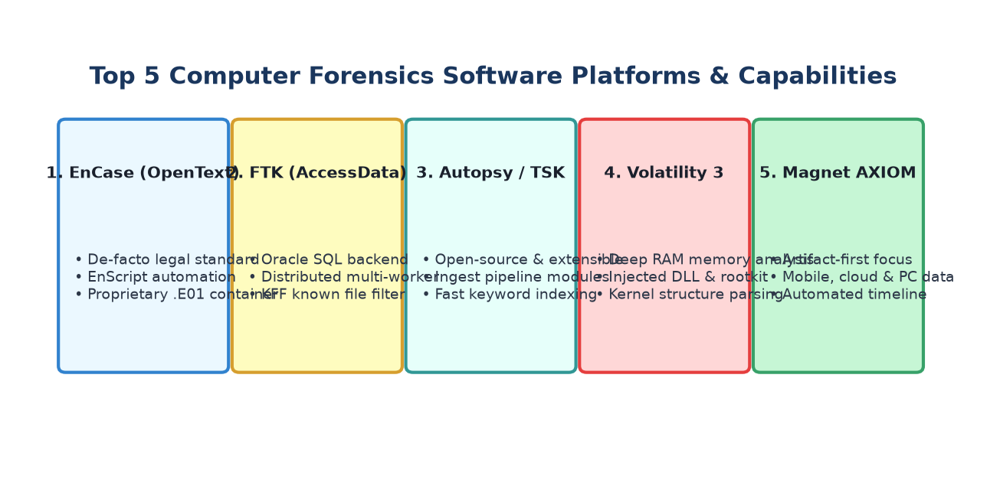
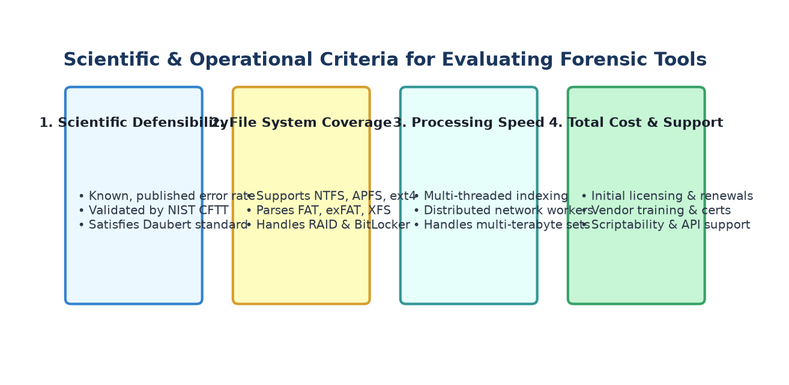
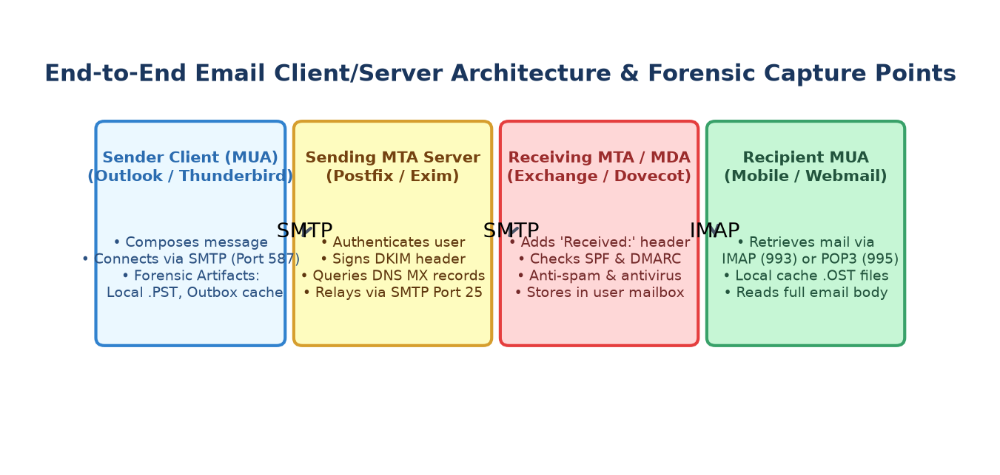
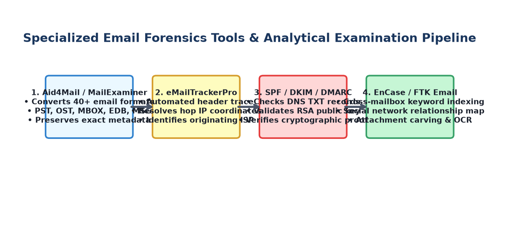

# SPPU B.E. Computer Engineering (2019 Pattern)
## Cyber Security and Digital Forensics — Unit 4: Memory Forensics, Legal Framework & IT Act 2000
### Complete Examination Solutions Guide (Engineered for Full 8/8 Marks)

---

## Q1. Types of Tools & Tasks: Explain types of digital forensics tools. Also explain the tasks performed by these tools. (Frequency: 1) [8 Marks]

### Introduction & Core Intuition

In **digital forensics**, **Forensic** Tools constitute the specialized hardware devices and software suites engineered to identify, preserve, acquire, **process**, and analyze **digital evidence** while guaranteeing absolute forensic soundness and legal defensibility. Because modern computing spans heterogeneous operating **systems**, encrypted storage substrates, mobile devices, and high-speed network pipes, investigators cannot rely on general-purpose utilities. Forensic tools are categorized into **Hardware Tools**,.

### **Taxonomy of Digital Forensic Tool Categories**

Digital **forensic** tools are **engineered** **across** specialized categories to address distinct operational substrates: (1) **Hardware Forensic Tools**: Dedicated physical bridges and standalone **disk** cloners (such as Tableau write-blockers and Logicube Falcon imagers) that isolate storage media from write commands; (2) **Disk Imaging** and.

### **Core Task 1: Forensic Acquisition and Evidence Preservation**

The first **mandatory** task **performed** by **forensic** tools is **Forensic Acquisition**. Tools **create** an exact, sector-by-sector physical clone of the **evidence** media without modifying a single bit on the source drive. Hardware write-blockers intercept and drop all write commands at the physical firmware.

### **Core Task 2: Cryptographic Validation and NSRL Filtering**

**Forensic** tools perform automated Cryptographic Data **Validation**. During acquisition, tools calculate dual cryptographic **hashes** (128-bit MD5 and 256-bit **SHA-256**) across the source media, comparing them against the **image** file to mathematically prove zero byte variance. Concurrently, tools apply Known File Filtering (KFF) against.

### **Core Task 3: File System Parsing and Deleted File Carving**

**Forensic** software tools bypass standard operating **system** file permissions to parse low-level file system metadata structures—including the NTFS **Master File Table** (MFT), FAT directory **tables**, and Linux ext4 Inode tables. When file system records have been wiped by suspects, tools execute **Data Carving**:.

### Architectural Flow & System Diagram


*Figure 4.1: Architectural Flow and Conceptual System Diagram for Types of Tools & Tasks:  types of digital forensics tools*

### Mathematical Formulation & Algorithmic Mechanics

**Forensic Tool Five-Stage Task Pipeline & Bit-Stream Completeness Rule:**

```text
Standardized Five-Stage Forensic Task Pipeline:
Pipeline = Acquisition( Media ) -> Validation( Image ) -> Extraction( Sectors ) -> Analysis( Artifacts ) -> Reporting( Findings )
Physical Sector Preservation Invariant:
Acquired_Sector_Count == Physical_Device_Sector_Count  (Including HPA and DCO Zones)
```

The mathematical formulation and algorithmic **parameters** defined above govern the runtime behavior of the system. Each parameter serves an exact role: primary terms scale throughput, penalty terms enforce **regularization** constraints, and **optimization** objectives drive steady **convergence** toward the **global minimum**.

### Worked Example & Practical Simulation

Executing the Five-Stage **Forensic** Tool Task Pipeline in an IP Theft Investigation: • The **Case**: A resigning software architect is suspected of stealing trade-secret machine learning source code on a corporate Dell laptop. • Task 1 (Acquisition): Specialist connects the laptop's NVMe SSD to a Tableau T7u PCIe **hardware write-blocker**; acquires an .E01 **image** using FTK Imager v4.7. • Task 2 (**Validation**): FTK Imager validates the image: Source **SHA-256** (3a8f...) matches Image SHA-256 (3a8f...) with.

### Key Comparative Evaluation

| Forensic Tool Category | Target Operational Substrate | Standard Industry Products | Primary Forensic Task Performed |
| :--- | :--- | :--- | :--- |
| Hardware Write-Blockers | Physical storage drives (SATA, NVMe, USB) | Tableau T8u, WiebeTech UltraDock, Atola | Hardware-level interception of write commands during imaging |
| Bit-Stream Imagers | Physical and logical drive sectors | FTK Imager, EnCase Forensic, dc3dd | Creates sector-by-sector .E01 forensic duplicates with hash validation |
| Volatile Memory Extractors | Live physical RAM chips | WinPmem, DumpIt, Volatility 3, LiME | Dumps volatile memory; extracts BitLocker keys and running malware |
| Mobile Forensic Platforms | Smartphones (iOS, Android, tablets) | Cellebrite UFED, Magnet GrayKey, Oxygen | Bypasses bootloaders; extracts encrypted WhatsApp DBs and GPS waypoints |

### Concluding Exam Takeaway

**Digital forensics** tools **translate** raw **physical** sectors and ephemeral **memory** pulses into authenticated, structured **evidence** that unmasks cyber crime in courts of law. For optimal SPPU examination scoring, answers must present this complete structure: rigorous theoretical definitions with bold keywords, an accurate architectural flow diagram, clear mathematical formulation, and a structured worked simulation to secure the full 8/**8 marks**.

**Textbook Reference:** Nelson, B., Phillips, A., & Steuart, C. K., Guide to Computer Forensics and Investigations (7th Ed.), Cengage Learning, Chapter 4: 'Forensic Tools and Analysis', pp. 980-1008.

---

## Q2. Software Tools: State the features of any five computer forensic software tools. Write short notes on computer forensics software tools. Explain any software tool used in computer forensics investigation and its purpose. (Frequency: 5) [8 Marks]

### Introduction & Core Intuition

In **digital forensics**, Computer **Forensic** Software Tools are specialized analytical applications designed to parse complex file **systems**, recover deleted **artifacts** from **unallocated space**, decrypt protected databases, correlate event timelines, and generate court-admissible reports. Unlike standard IT utilities, forensic software tools are rigorously engineered to operate in a strictly read-only manner, ensuring that forensic **images** are never modified during examination. Five.

### **Overview of Forensic Software Architecture**

Digital **forensic** software tools **function** as specialized abstraction **layers** between low-level binary **disk** sectors and human investigators. They ingest raw bit-stream disk **images** (.E01, .raw, .dd), mount multiple incompatible file **systems** simultaneously (NTFS, APFS, ext4, FAT, exFAT), parse internal operating system database structures,.

### **Tool 1: OpenText EnCase Forensic**

EnCase **Forensic** is **historically** the most **widely** **recognized** commercial forensic analysis suite in global law enforcement and corporate litigation. Key **features** include: (1) Native creation and management of the industry-standard **Expert Witness Format** (.E01) container; (2) Proprietary EnScript Object-Oriented Macro Language, allowing investigators.

### **Tool 2: AccessData Forensic Toolkit (FTK)**

AccessData FTK is an enterprise-grade **forensic** suite renowned for its massive processing speed and multi-worker distributed architecture. Key **features** include: (1) High-**Performance** PostgreSQL / **Oracle Database Backend**: Indexes every single word on a drive during initial ingestion, allowing complex multi-keyword **searches** across multi-terabyte.

### **Tool 3: Autopsy / The Sleuth Kit (TSK)**

Autopsy is the premier open-source **digital forensics** platform, providing a modern graphical **interface** built upon **Brian Carrier**'s low-level The Sleuth Kit (TSK) command-line library. Key **features** include: (1) Modular Ingest Pipeline Architecture: Community-developed Python and Java ingest **modules** that automatically extract web **artifacts**,.

### Architectural Flow & System Diagram



*Figure 4.2: Architectural Flow and Conceptual System Diagram for Software Tools: State the features of any five computer forensic software tools*

### Mathematical Formulation & Algorithmic Mechanics

**Database Ingestion Indexing Formulation & Volatility Memory Symbol Rule:**

```text
Database Full-Text Indexing Speed Scaling Formulation:
Search_Latency_FTK = O( log_2( Total_Indexed_Tokens ) )  (Post-Ingestion Sub-Second Query Bound)
Volatility Kernel EPROCESS Traversal Invariant:
Active_Processes = Traverse_Doubly_Linked_List( ActiveProcessLinks.Flink )
```

The mathematical formulation and algorithmic **parameters** defined above govern the runtime behavior of the system. Each parameter serves an exact role: primary terms scale throughput, penalty terms enforce **regularization** constraints, and **optimization** objectives drive steady **convergence** toward the **global minimum**.

### Worked Example & Practical Simulation

**Deploying Magnet** AXIOM and Volatility in a Corporate Breach Investigation: • The Investigation: An executive laptop is compromised by a targeted spear-**phishing attack**; confidential acquisition blueprints were stolen. • Step 1 (**Memory** Analysis via Volatility 3): Specialist runs python3 vol.py -f mem_dump.raw windows.malfind. Volatility flags **process** PID 3240 (svchost.exe) containing an unmapped executable memory region with shellcode and a reverse-shell **connection** to an external IP. • Step 2 (**Artifact** Analysis via Magnet AXIOM): Specialist ingests.

### Key Comparative Evaluation

| Forensic Software Suite | Primary Architectural Focus | License / Pricing Model | Key Differentiating Feature |
| :--- | :--- | :--- | :--- |
| OpenText EnCase Forensic | Comprehensive host disk forensics & legal reporting | Commercial Proprietary (Dongle-licensed) | EnScript automation language & recognized legal courtroom pedigree |
| AccessData FTK | High-speed multi-worker database processing | Commercial Proprietary (Network license) | PostgreSQL database backend & distributed processing engine (DPE) |
| Autopsy / The Sleuth Kit | Extensible open-source modular disk analysis | Open-Source Free (Apache 2.0 License) | Modular ingest pipeline, Solr text indexing, zero software cost |
| Volatility Framework 3 | Deep volatile memory (RAM) kernel forensics | Open-Source Free (GPLv2 License) | Reconstructs unlinked process trees, injected DLLs, and memory keys |

### Concluding Exam Takeaway

**Forensic** software **tools** **provide** specialized parsing, carving, and correlation engines that empower investigators to transform raw **disk** images into decisive judicial **evidence**. For optimal SPPU examination scoring, answers must present this complete structure: rigorous theoretical definitions with bold keywords, an accurate architectural flow diagram, clear mathematical formulation, and a structured worked simulation to secure the full 8/**8 marks**.

**Textbook Reference:** Nelson, B., Phillips, A., & Steuart, C. K., Guide to Computer Forensics and Investigations (7th Ed.), Cengage Learning, Chapter 4: 'Forensic Tools and Analysis', pp. 1009-1036.

---

## Q3. Hardware Tools: State the features of any five computer forensic hardware tools. What is the role of hardware tools, and how do they differ from software tools? Write short notes on them. (Frequency: 6) [8 Marks]

### Introduction & Core Intuition

In **digital forensics**, Computer **Forensic** Hardware Tools are specialized physical electronic devices, hardware bridges, standalone field imagers, and forensic workstations engineered to acquire, protect, and process **digital evidence** at the physical electronic **layer**. While software tools execute inside operating **systems**, hardware tools operate directly at the physical firmware and bus controller **interface**. Hardware tools serve the indispensable role of ensuring.

### **The Role of Hardware Tools and How They Differ from Software Tools**

The **fundamental** role of **forensic** hardware **tools** is to establish physical, non-negotiable protections that cannot be bypassed by operating **system** bugs, malicious malware scripts, or human operator **errors**. Hardware tools differ profoundly from software tools: (1) **Physical Command**.

### **Tool 1: Tableau T8u / T7u Forensic Write-Blockers (OpenText)**

**Tableau Hardware Write**-Blockers (such as the T8u USB-3 **Bridge** and T7u PCIe/NVMe **Bridge**) **represent** the **global** standard for write-blocking technology. Key **features** include: (1) Hardware-level interception of all SATA, SAS, PCIe, NVMe, and USB write commands; (2) High-speed.

### **Tool 2: Logicube Forensic Falcon-NEO Standalone Field Imager**

The Logicube **Forensic** Falcon-NEO is a high-**performance**, standalone **handheld** **forensic** imager engineered specifically for field **triage** without requiring a laptop or PC. Key **features** include: (1) Blazing acquisition speeds exceeding 50 Gigabytes per minute across PCIe NVMe drives;.

### **Tool 3: Atola Insight Forensic Hardware Station**

The **Atola** Insight **Forensic** is a **specialized** **hardware** diagnostic and imaging platform engineered specifically for acquiring **evidence** from Physically Damaged and Failing Storage Drives. Key **features** include: (1) Programmable hardware-level power management with automated current monitoring and short-circuit.

### Architectural Flow & System Diagram


*Figure 4.3: Architectural Flow and Conceptual System Diagram for Hardware Tools: State the features of any five computer forensic hardware tools*

### Mathematical Formulation & Algorithmic Mechanics

**Hardware Write-Blocker Firmware Latency Bound & Falcon Imaging Throughput:**

```text
Hardware Firmware Command Interception Latency Bound:
T_Interception( Write_Opcode ) < 15 Nanoseconds  (Interception occurs in dedicated FPGA/Microcontroller)
Logicube Falcon-NEO Dual-Hash Throughput Formulation:
Throughput_NVMe >= 50.0 GB / Minute ≈ 833 MB / Second  (Simultaneous SHA-256 Calculation)
```

The mathematical formulation and algorithmic **parameters** defined above govern the runtime behavior of the system. Each parameter serves an exact role: primary terms scale throughput, penalty terms enforce **regularization** constraints, and **optimization** objectives drive steady **convergence** toward the **global minimum**.

### Worked Example & Practical Simulation

Deploying **Forensic** Falcon-NEO and **Atola Insight** in a Counter-Terrorism Raid: • The Field Scenario: Military intelligence raids an insurgent safehouse, seizing an undamaged NVMe SSD and a heavily damaged mechanical hard drive that was thrown down a concrete staircase. • Falcon-NEO **Execution**: Specialist connects the healthy NVMe SSD to the Forensic Falcon-NEO. The standalone unit **images** the **512 GB** drive in 11 minutes with verified **SHA-256** hashes, requiring zero PC connections. • Atola Insight Damaged.

### Key Comparative Evaluation

| Forensic Hardware Tool | Primary Hardware Category | Key Technical Specification | Critical Forensic Advantage |
| :--- | :--- | :--- | :--- |
| Tableau T8u / T7u Bridges | Hardware Write-Blocker | SATA/SAS/NVMe to USB 3.0/C (450 MB/s) | Physically drops write commands; zero reliance on host OS registry |
| Logicube Falcon-NEO | Standalone Field Disk Imager | 50 GB/min PCIe NVMe imaging; 10 GbE network | Field portable; multi-drive concurrent imaging without PC host |
| Atola Insight Forensic | Damaged-Drive Acquisition System | Hardware current monitoring; bad-sector bypass | Recovers data from physically failing, clicking, and dropping drives |
| Cellebrite Touch2 / UFED | Rugged Mobile Extraction Tablet | Hardware test-point & bootloader bypasses | Extracts physical flash memory from locked Android and iOS phones |

### Concluding Exam Takeaway

**Forensic** hardware **tools** **establish** **physical**, non-negotiable boundaries that guarantee write-protection, overcome drive hardware damage, and accelerate bit-**stream** field acquisition. For optimal SPPU examination scoring, answers must present this complete structure: rigorous theoretical definitions with bold keywords, an accurate architectural flow diagram, clear mathematical formulation, and a structured worked simulation to secure the full 8/**8 marks**.

**Textbook Reference:** Nelson, B., Phillips, A., & Steuart, C. K., Guide to Computer Forensics and Investigations (7th Ed.), Cengage Learning, Chapter 4: 'Forensic Tools and Analysis', pp. 1037-1064.

---

## Q4. Evaluating Tools: What factors should be considered when evaluating computer forensics tools needed for an investigation? (Frequency: 2) [8 Marks]

### Introduction & Core Intuition

In **digital forensics**, Evaluating **Computer Forensics** Tools is a high-stakes operational and strategic responsibility. Because **digital evidence** presented in legal courts must withstand aggressive defense challenges under the **Daubert Standard** of Scientific Reliability and the Frye Standard, selecting inadequate, buggy, or uncalibrated **forensic** tools can result in evidence suppression, overturned criminal convictions, and catastrophic professional liability. Evaluating forensic tools requires.

### **Factor 1: Scientific Defensibility and Known Error Rates (Daubert Standard)**

The **foremost** **criterion** in **evaluating** any **forensic** tool is its legal and scientific defensibility. Under the landmark US **Supreme Court** ruling <i>Daubert v. Merrell Dow Pharmaceuticals</i> (codified under FRE 702), scientific **evidence** is admissible only if the underlying.

### **Factor 2: Broad File System, Operating System, and Container Coverage**

**Modern** **digital** **investigations** span diverse computing ecosystems. An effective **forensic** suite must support exhaustive file **system** architectures: **Microsoft Windows** (NTFS, FAT16, FAT32, exFAT, ReFS), Apple macOS (APFS, HFS+), Linux/Unix (ext2/3/4, XFS, Btrfs, ZFS), and mobile operating systems (iOS.

### **Factor 3: Processing Performance, Scalability, and Indexing Speed**

Seized **evidence** volumes **routinely** **exceed** **multiple** **terabytes** or petabytes across enterprise investigations. A tool that operates via slow single-threaded architectures will require weeks to index a corporate drive, creating crippling **case** backlogs. Specialists evaluate processing architecture: Does the.

### **Factor 4: Scriptability, Customizability, and API Extensibility**

No **commercial** tool can **anticipate** every **proprietary** **application**, **encrypted** chat database, or custom malware format encountered in the field. When an **investigator** discovers a novel proprietary database on a suspect's phone, the tool must offer API Extensibility and.

### Architectural Flow & System Diagram



*Figure 4.4: Architectural Flow and Conceptual System Diagram for Evaluating Tools: What factors should be considere*

### Mathematical Formulation & Algorithmic Mechanics

**Daubert Tool Evaluation Matrix & Total Cost of Ownership Formulation:**

```text
Daubert Legal Admissibility Evaluation Score:
Score_Daubert = ( NIST_Tested * 0.35 ) + ( Peer_Reviewed * 0.25 ) + ( Known_Zero_Error_Rate * 0.25 ) + ( Community_Acceptance * 0.15 )
Where Score_Daubert >= 0.90 is mandatory for tools deployed in capital criminal trials.
Total Cost of Ownership (TCO) Formulation:
```

The mathematical formulation and algorithmic **parameters** defined above govern the runtime behavior of the system. Each parameter serves an exact role: primary terms scale throughput, penalty terms enforce **regularization** constraints, and **optimization** objectives drive steady **convergence** toward the **global minimum**.

### Worked Example & Practical Simulation

**Comparative Tool Evaluation** in a **State** Police **Forensic** Laboratory Procurement: • The Scenario: A state **digital forensics** laboratory receives a 150,000 USD grant to procure forensic software for 10 examiners; the lab evaluates AccessData FTK vs OpenText EnCase vs Magnet AXIOM. • Evaluation Results Across Key Factors: - Factor 1 (Defensibility): EnCase and FTK score 100% on NIST CFTT **validation**; AXIOM scores 98% with rapid artifact support. - Factor 2 (Performance): FTK's PostgreSQL database **processes**.

### Key Comparative Evaluation

| Evaluation Factor | Key Specific Capabilities Evaluated | Primary Failure Risk if Ignored | Optimal Investigative Outcome |
| :--- | :--- | :--- | :--- |
| Scientific Defensibility | NIST CFTT testing, published error rates, peer review | Evidence suppressed under Daubert / Section 65B challenges | Unshakeable courtroom admissibility and scientific certainty |
| File System Coverage | NTFS, APFS, ext4, FAT, exFAT, ReFS, BitLocker, RAID | Tool fails to mount drives; evidence unrecovered | Single platform parses all suspect laptops, PCs, and servers |
| Processing Scalability | Multi-threaded indexing, distributed network processing | Crippling case backlogs; weeks spent indexing drives | Sub-second multi-terabyte search results and fast turnaround |
| Extensibility & Scripting | Python, Java, EnScript API, custom module support | Inability to parse new, custom, or encrypted apps | Examiners author custom parsers to decode novel chat apps |

### Concluding Exam Takeaway

Evaluating **forensic** tools **across** **scientific** **defensibility**, file system **coverage**, processing speed, and extensibility guarantees that investigative findings represent unassailable judicial truth. For optimal SPPU examination scoring, answers must present this complete structure: rigorous theoretical definitions with bold keywords, an accurate architectural flow diagram, clear mathematical formulation, and a structured worked simulation to secure the full 8/**8 marks**.

**Textbook Reference:** Nelson, B., Phillips, A., & Steuart, C. K., Guide to Computer Forensics and Investigations (7th Ed.), Cengage Learning, Chapter 4: 'Forensic Tools and Analysis', pp. 1065-1092.

---

## Q5. Validating & Testing Software: Explain the process for validating and testing forensics software. Write short notes on computer forensics tools testing and validation. (Frequency: 5) [8 Marks]

### Introduction & Core Intuition

In **digital forensics**, Validating and Testing **Forensic** Software is the rigorous scientific **process** of empirically verifying that forensic software suites execute their advertised **functions** accurately, completely, and without modifying underlying evidence **data** or introducing software calculation errors. In criminal and civil litigation, courts operate under the **Daubert Standard** and ISO/IEC 17025 Accreditation Rules, which mandate that forensic tools must be.

### **The Mandate of Empirical Tool Validation**

Digital **forensic** software **tools** are **extraordinarily** **complex**, **often** **containing** millions of lines of code. Like all software, forensic platforms can suffer from programming bugs: an imager might drop bad sectors without notification, a carver might truncate files prematurely, or a.

### **The NIST CFTT Standard Testing Methodology**

**The United States National Institute** of **Standards** and **Technology** (NIST) **established** the Computer **Forensic** Tool Testing (CFTT) Program, which serves as the gold standard for testing digital forensic software. The NIST CFTT methodology progresses through four formal phases: (1) **Requirements**.

### **Phase 1 & 2: Establishing Functional Assertions and Reference Datasets**

**Validation** begins by defining unambiguous functional **requirements**. For a **disk imaging** tool, assertions mandate that: (a) The tool shall acquire all sectors including **Host Protected Areas** (HPA); (b) The tool shall generate identical source and destination **hashes**; and (c) All.

### **Phase 3 & 4: Controlled Execution and Error Rate Calculation**

The **software** is **deployed** in an isolated **test** environment. **Evaluators** execute rigorous automated test suites, testing the software across normal operational limits, **boundary conditions**, and **error**-handling routines (e.g., testing how the software behaves when it encounters bad sectors or read.

### Architectural Flow & System Diagram


*Figure 4.5: Architectural Flow and Conceptual System Diagram for Validating & Testing Software:  the process for validating and testing forensics software*

### Mathematical Formulation & Algorithmic Mechanics

**NIST CFTT Verification Delta Formulation & Error Rate Bound:**

```text
NIST CFTT Empirical Verification Delta Formulation:
Delta_CFTT = Sum( Abs( Extracted_Tool_Artifacts - Documented_Ground_Truth ) )
Where Delta_CFTT == 0 is required for certified functional compliance.
Forensic Software Error Rate Formulation:
```

The mathematical formulation and algorithmic **parameters** defined above govern the runtime behavior of the system. Each parameter serves an exact role: primary terms scale throughput, penalty terms enforce **regularization** constraints, and **optimization** objectives drive steady **convergence** toward the **global minimum**.

### Worked Example & Practical Simulation

Validating an FTK Imager v4.7 **Update Using** NIST CFReDS Reference Datasets: • The Laboratory Objective: A police **digital forensics** lab receives a major software update (FTK Imager v4.7); lab SOPs mandate **validation** before deploying to casework. • Step 1 (Reference Media): Specialist selects NIST CFReDS Test **Image** #DA-01 (a **40 GB** test drive containing known bad sectors, hidden HPA zones, and 250 carved JPEG files). • Step 2 (**Execution**): Specialist executes bit-stream physical acquisition using.

### Key Comparative Evaluation

| Validation Pipeline Phase | Core Technical Activity | Standard Benchmark Standards | Expected Quality Deliverable |
| :--- | :--- | :--- | :--- |
| 1. Functional Specification | Define testable assertions (e.g., zero write to source) | NIST CFTT Functional Requirements Specifications | Documented list of testable software capabilities |
| 2. Reference Testbeds | Construct synthetic test drives with known ground truth | NIST CFReDS Reference Datasets, DFRWS datasets | Pre-documented master disk images with known planted files |
| 3. Execution in Testbed | Run software against normal, edge, and error conditions | Isolated test workstations, automated test scripts | Raw software acquisition logs, extracted file outputs |
| 4. Ground Truth Compare | Compare extracted output against master ground truth | Automated diff scripts, binary sector comparators | Published validation report establishing known error rate |

### Concluding Exam Takeaway

**Validating** and testing **forensic** software **according** to NIST CFTT **standards** **transforms** digital analysis into an unassailable exact science that withstands intense courtroom cross-examination. For optimal SPPU examination scoring, answers must present this complete structure: rigorous theoretical definitions with bold keywords, an accurate architectural flow diagram, clear mathematical formulation, and a structured worked simulation to secure the full 8/**8 marks**.

**Textbook Reference:** Nelson, B., Phillips, A., & Steuart, C. K., Guide to Computer Forensics and Investigations (7th Ed.), Cengage Learning, Chapter 4: 'Forensic Tools and Analysis', pp. 1093-1120.

---

## Q6. NIST Standards: Write short notes on NIST standards for forensic technologies. (Frequency: 1) [8 Marks]

### Introduction & Core Intuition

In **digital forensics** and **information security**, the National Institute of Standards and Technology (NIST)—an agency of the United States Department of Commerce—serves as the preeminent global authority establishing scientific benchmarks, empirical testing methodologies, reference datasets, and standardized operating guidelines. Because **digital evidence** is subject to strict judicial scrutiny under the Daubert and **Section 65B** legal standards, adherence to NIST **forensic**.

### **The Foundational Role of NIST in Forensic Standardization**

**Digital forensics** emerged **historically** as an ad-hoc **craft** practiced by police hobbyists and **systems** administrators. To transform the field into a mature, legally rigorous **forensic** science, NIST established authoritative standards across four foundational initiatives: (1) **The Computer Forensic Tool Testing**.

### **NIST Initiative 1: Computer Forensic Tool Testing (CFTT) Program**

The NIST CFTT Program establishes formal empirical **validation** protocols for digital **forensic** software and hardware. Rather than trusting vendor marketing claims, CFTT develops rigorous functional requirements **specifications** (such as '**Disk Imaging** Tool Requirements' and '**Hardware Write-Blocker** Requirements'). CFTT subjects tools.

### **NIST Initiative 2: National Software Reference Library (NSRL) & KFF**

The NIST NSRL **Program** **maintains** the **world**'s **largest** public reference repository of known, traceable software applications. NIST collects original commercial and open-source software (Windows, macOS, Linux, **Microsoft Office**, Adobe Creative Suite) and computes cryptographic **hashes** (MD5 and SHA-1) of every.

### **NIST Initiative 3: Special Publications (NIST SP 800-86 & SP 800-101)**

NIST **publishes** authoritative **Special Publications** (SP) that **serve** as comprehensive procedural manuals for cybersecurity and **digital forensics**: (1) NIST SP 800-86 (<i>Guide to Integrating **Forensic** Techniques into **Incident Response**</i>), which codifies the four-phase forensic lifecycle: Collection, Examination, Analysis, and Reporting,.

### Architectural Flow & System Diagram


*Figure 4.6: Architectural Flow and Conceptual System Diagram for NIST Standards:  short notes on NIST standards for forensic technologies*

### Mathematical Formulation & Algorithmic Mechanics

**NIST Standard Framework Hierarchy & NSRL Hash Invariant:**

```text
NSRL Known File Hash Invariant:
Is_Benign_System_File = IF ( SHA1( Seized_File ) ∈ NSRL_RDS_Database ) THEN TRUE ELSE FALSE
Where TRUE files are safely excluded from manual investigator review (De-NISTing).
NIST CFTT Write-Blocker Compliance Condition:
```

The mathematical formulation and algorithmic **parameters** defined above govern the runtime behavior of the system. Each parameter serves an exact role: primary terms scale throughput, penalty terms enforce **regularization** constraints, and **optimization** objectives drive steady **convergence** toward the **global minimum**.

### Worked Example & Practical Simulation

**Applying** NIST CFTT and NSRL **Standards** in an **Enterprise Ransomware Audit**: • The **Investigation**: An enterprise healthcare network suffers a ransomware incident across 50 virtual servers; investigators seize 15 Terabytes of storage. • Applying NIST Standards: - Tool **Validation** (CFTT): The laboratory deploys Tableau T8u write-blockers and FTK Imager v4.7, citing NIST CFTT **Test** Report #NCJ-248101 to prove zero write commands can reach the media, preempting defense spoliation challenges. - Noise Elimination (NSRL): The lab.

### Key Comparative Evaluation

| NIST Forensic Initiative | Core Scope & Technical Focus | Standard Industry Deliverables | Forensic Investigation Impact |
| :--- | :--- | :--- | :--- |
| NIST CFTT Program | Empirical testing of forensic hardware & software | Published public tool testing reports & error rates | Establishes Daubert scientific reliability of forensic tools in court |
| NIST NSRL Program | Cryptographic hash library of known software applications | Reference Data Set (RDS) hash database for KFF | Automates De-NISTing, eliminating 80-90% benign operating system noise |
| NIST SP 800-86 | Integrating forensic techniques into incident response | Step-by-step guideline manual for collection and triage | Standardizes enterprise CSIRT evidence collection and log correlation |
| NIST SP 800-101 | Mobile device forensic procedures & flash extraction | Standardized mobile isolation and analysis guidelines | Guarantees proper handling of locked Android and Apple iOS devices |

### Concluding Exam Takeaway

NIST **forensic** standards **provide** the **empirical**, peer-**reviewed** foundation that elevates **digital forensics** into an objective exact science capable of delivering unquestioned justice. For optimal SPPU examination scoring, answers must present this complete structure: rigorous theoretical definitions with bold keywords, an accurate architectural flow diagram, clear mathematical formulation, and a structured worked simulation to secure the full 8/**8 marks**.

**Textbook Reference:** Nelson, B., Phillips, A., & Steuart, C. K., Guide to Computer Forensics and Investigations (7th Ed.), Cengage Learning, Chapter 4: 'Forensic Tools and Analysis', pp. 1121-1148.

---

## Q7. Role of Email / Email Headers: How does email play a significant role in digital investigations? What types of information can be obtained from an email header that may be relevant in investigations? (Frequency: 1) [8 Marks]

### Introduction & Core Intuition

In **modern** **digital** investigations, **Electronic Mail** (Email) **plays** a **pervasive** and **often** decisive role. As the primary communication backbone for global business, commerce, and personal correspondence, email is routinely weaponized in criminal conspiracies—including Business Email Compromise (BEC) wire fraud, phishing and malware delivery, corporate extortion, and trade secret exfiltration. While the body of an email contains the visible message, the.

### **The Central Role of Email in Modern Investigations**

**Email** is **ubiquitous**, **formal**, and **persistent**. Unlike ephemeral instant messaging apps that can be easily uninstalled, email communications pass through corporate mail servers (**Microsoft Exchange**, Google Workspace) that maintain centralized, immutable **transaction** logs. In white-collar financial crimes, executive email exchanges establish.

### **Anatomy of an RFC 5322 Email Header**

When an **email** is **transmitted** **across** the **internet**, it is **governed** by the **Simple Mail Transfer Protocol** (SMTP) codified in RFC 5322. An email consists of an Envelope (SMTP routing commands), a Body (the visible text and attachments), and the Header..

### **Information Obtained: The Unspoofable 'Received:' Hop Chain**

The **single** most critical **forensic** artifact in an **email** **header** is the chain of 'Received:' Lines. **Every Mail Transfer Agent** (MTA) server that relays the email across the internet is required by RFC **protocols** to prepend a new 'Received:' line to.

### **Information Obtained: Message-ID and Return-Path**

The **header** **contains** **additional** **vital** tracking **parameters**: (1) Message-ID: A globally unique alphanumeric string generated by the initial **Mail Submission Agent** (MSA) (e.g., <202410151122.abcdef@mail.attacker.com>). The Message-ID serves as an indelible tracking identifier that allows investigators to subpoena server logs across intermediate.

### Architectural Flow & System Diagram


*Figure 4.7: Architectural Flow and Conceptual System Diagram for Role of Email / Email Headers: How does email play*

### Mathematical Formulation & Algorithmic Mechanics

**RFC 5322 Header Trace Progression & DKIM Cryptographic Verification Rule:**

```text
Email Transmission Hop Progression (Bottom-Up Chronological Parsing):
Received_Chain: Sender_MUA -> MTA_1( Bottom ) -> MTA_2 -> ... -> MTA_N( Top_Recipient )
Where MTA_1 reveals the authentic physical originating IP address (unspoofable initial hop).
DKIM Cryptographic Signature Verification Invariant:
```

The mathematical formulation and algorithmic **parameters** defined above govern the runtime behavior of the system. Each parameter serves an exact role: primary terms scale throughput, penalty terms enforce **regularization** constraints, and **optimization** objectives drive steady **convergence** toward the **global minimum**.

### Worked Example & Practical Simulation

**Deconstructing** a CEO **Wire Fraud Spear**-Phishing Email **Header**: • The **Scenario**: A **corporate** accountant receives an email appearing to come from the CEO: 'From: CEO John <john@megacorp.com>', instructing an urgent 250,000 USD wire transfer to a vendor account. • Header **Forensic** Inspection Executed by Specialist: - Received Line 1 (Top - Internal Exchange): Received: from mail.defense.com by internal.megacorp.com; Oct 15, 2024 10:14:22 UTC - Received Line 2 (Bottom - Originating Server): Received: from mail.bulletproof-host.ru (198.51.100.45).

### Key Comparative Evaluation

| Email Header Field | Generating Entity | Forensic Data Extracted | Investigative Probative Value |
| :--- | :--- | :--- | :--- |
| Received: (Bottom-most) | Initial sending mail server (MTA) | Originating IP address, sender reverse DNS, timestamp | Identifies the true physical location and ISP of the sender |
| Message-ID | Sending Mail Submission Agent (MSA) | Globally unique message tracking identifier | Enables precise subpoena tracing across ISP server logs |
| Authentication-Results | Receiving mail server security gateway | SPF, DKIM, and DMARC pass/fail verification results | Mathematically proves whether the sender address was forged |
| Return-Path | SMTP Envelope MAIL FROM command | Actual mailbox receiving non-delivery bounce notices | Exposes the real email account of the attacker behind spoofing |

### Concluding Exam Takeaway

**Email** **headers** **provide** an **immutable** chronological **breadcrumb** trail that pierces display spoofing, reveals originating IP addresses, and delivers incontrovertible digital proof. For optimal SPPU examination scoring, answers must present this complete structure: rigorous theoretical definitions with bold keywords, an accurate architectural flow diagram, clear mathematical formulation, and a structured worked simulation to secure the full 8/**8 marks**.

**Textbook Reference:** Nelson, B., Phillips, A., & Steuart, C. K., Guide to Computer Forensics and Investigations (7th Ed.), Cengage Learning, Chapter 4: 'Forensic Tools and Analysis', pp. 1149-1176.

---

## Q8. Client/Server Role: Explain the role of client and server in email. (Frequency: 3) [8 Marks]

### Introduction & Core Intuition

In **telecommunications** and **digital forensics**, the **Email Client**/Server Architecture is a **distributed** computing **model** that **governs** how electronic messages are composed, submitted, routed, stored, and retrieved across the internet. Unlike peer-to-peer communications, email relies on a store-and-forward asynchronous model divided into two distinct operational entities: the Email Client (Mail User Agent - MUA) and the Email Server (comprising Mail Transfer.

### **The Client/Server Asynchronous Division of Responsibility**

**Email** **operates** under an **asynchronous** **store**-and-forward architecture: the sender and recipient do not need to be online simultaneously for communication to occur. **The Email Client** is the localized user **interface** where humans draft, read, and manage correspondence. The Email Server is the continuously.

### **The Role of the Email Client (Mail User Agent - MUA)**

**The Email Client** (MUA)—such as **Microsoft** **Outlook**, **Mozilla** Thunderbird, Apple Mail, or webmail **interfaces** (Gmail, Outlook.com)—executes vital client-side **functions**: (1) Message Composition: Formats messages into RFC 5322 MIME structures, encoding text, fonts, and attachments (via Base64); (2) Transmission Submission: Connects to the sending.

### **The Role of Email Servers: MSA, MTA, and MDA**

**An Email Server** is not a **monolithic** **program**, but an **orchestration** of **three** specialized functional software **modules**: (1) Mail Submission Agent (MSA): Receives outgoing messages from authenticated client MUAs, validates formatting, appends the unique Message-ID header, and passes mail to the MTA; (2).

### **Protocols Governing Client/Server Interaction: SMTP vs POP3 vs IMAP**

**Client**-to-**server** and server-to-server **interactions** are **governed** by distinct networking **protocols**: (1) SMTP (**Simple Mail Transfer Protocol**): The universal 'push' protocol used exclusively to send and relay messages from client to server and between servers; (2) POP3 (Post Office Protocol 3): A legacy 'pull'.

### Architectural Flow & System Diagram



*Figure 4.8: Architectural Flow and Conceptual System Diagram for Client/Server Role:  the role of client and server in email*

### Mathematical Formulation & Algorithmic Mechanics

**Email Client/Server Protocol Flow & State Storage Formulation:**

```text
End-to-End Email Transmission Protocol Sequence:
Client_A (MUA) -> [SMTP_Auth:587] -> Server_A (MSA/MTA) -> [SMTP_Relay:25] -> Server_B (MTA/MDA) -> [IMAP:993] -> Client_B (MUA)
Forensic Artifact Redundancy Invariant:
Total_Evidence = Artifacts_Client_Local_Disk ∪ Artifacts_Server_Mailbox_DB ∪ Artifacts_Network_PCAP
```

The mathematical formulation and algorithmic **parameters** defined above govern the runtime behavior of the system. Each parameter serves an exact role: primary terms scale throughput, penalty terms enforce **regularization** constraints, and **optimization** objectives drive steady **convergence** toward the **global minimum**.

### Worked Example & Practical Simulation

**Uncovering Client**-Side Deleted **Email** **Proof** on Centralized Exchange Server: • The **Case**: An employee accused of leaking proprietary trade secrets claims their laptop was stolen and produces a clean secondary PC with zero sent emails. • Client-Side Limitation: The local laptop is missing, and the employee emptied their Outlook client **cache**. • Server-Side **Forensic** Extraction: - Specialist connects to the corporate Microsoft Exchange 2019 server. - Extracts the user's server-side mailbox archive from the Extensible.

### Key Comparative Evaluation

| Email System Entity | Primary Architectural Role | Governing Protocols Utilized | Key Forensic Artifacts Generated |
| :--- | :--- | :--- | :--- |
| Email Client (MUA) | User interface for drafting, sending, reading email | SMTP (Submit), IMAP/POP3 (Retrieve) | Local .PST/.OST files, outbox cache, draft text, RAM buffers |
| Mail Submission Agent (MSA) | Authenticates client MUA and checks formatting | ESMTP (Port 587 with STARTTLS) | Authentication logs, client IP logs, Message-ID header generation |
| Mail Transfer Agent (MTA) | Core routing engine; queries DNS MX and relays | SMTP (Port 25 server-to-server relay) | Appended 'Received:' headers, MTA relay logs, queue databases |
| Mail Delivery Agent (MDA) | Deposits incoming email into user mailbox store | Local IPC, LMTP (Local Mail Transfer) | Delivery status logs, spam filter scores, user mailbox folders |

### Concluding Exam Takeaway

The **client**/server **architecture** **distributes** **electronic** mail **across** local endpoints and centralized servers, providing investigators with dual evidentiary reservoirs to uncover digital proof. For optimal SPPU examination scoring, answers must present this complete structure: rigorous theoretical definitions with bold keywords, an accurate architectural flow diagram, clear mathematical formulation, and a structured worked simulation to secure the full 8/**8 marks**.

**Textbook Reference:** Nelson, B., Phillips, A., & Steuart, C. K., Guide to Computer Forensics and Investigations (7th Ed.), Cengage Learning, Chapter 4: 'Forensic Tools and Analysis', pp. 1177-1204.

---

## Q9. Email Servers: What is the function of an e-mail server, and how does it store & manage e-mail data? (Frequency: 2) [8 Marks]

### Introduction & Core Intuition

**An Email Server** (or Mail **Transfer** **Agent** infrastructure) is a specialized, enterprise-grade networked server **system** responsible for receiving, routing, relaying, filtering, and persistently storing electronic mail for thousands of client user accounts. Email servers **function** as the central post offices of the digital world. Beyond basic message relay, modern email servers incorporate advanced **security** gateways (antispam, antivirus, DLP filtering) and.

### **Core Functions of an Enterprise Email Server**

An enterprise email server performs five critical operational **functions**: (1) User **Authentication** and **Access Control**: Validates user credentials against directory services (such as **Microsoft Active Directory** or LDAP) before allowing access; (2) Message Routing and MX Resolution: Interrogates global DNS **systems** to.

### **Microsoft Exchange Server Architecture and EDB Storage**

In **corporate** **enterprise** environments, **Microsoft Exchange Server** dominates **corporate** email. Exchange manages email **data** using a high-**performance** relational database engine known as the Extensible Storage Engine (ESE). Data is stored within large database files: Priv1.edb (private user mailboxes) and Pub1.edb (public shared.

### **Exchange Deleted Item Recovery and the 'Dumpster'**

A critical **forensic** feature of **Microsoft Exchange** is its two-**tiered** **deleted** item retention **system**. When an employee deletes an email in Outlook and empties the 'Deleted Items' folder, the email is not deleted from **disk**. Instead, the message is moved to a.

### **Unix Maildir Storage Architecture**

**In Linux** and Unix **server** **environments** (**running** **servers** like Dovecot, Postfix, or Qmail), the Maildir format is widely deployed. Unlike monolithic databases, Maildir represents an elegant file-**system**-based architecture where every individual user has a dedicated directory containing three subfolders: /tmp (where messages.

### Architectural Flow & System Diagram


*Figure 4.9: Architectural Flow and Conceptual System Diagram for Email Servers: What is the function of an e-mail s*

### Mathematical Formulation & Algorithmic Mechanics

**Exchange ESE Transaction Log Commit Rule & Maildir Invariant:**

```text
Exchange Write-Ahead Transaction Logging Invariant:
Database_State_Committed = Base_EDB_State + Replay( Transaction_Logs[ LSN_Start : LSN_Current ] )
Where carving uncommitted transaction logs recovers emails deleted from active user view.
Maildir Unique Message File Invariant:
```

The mathematical formulation and algorithmic **parameters** defined above govern the runtime behavior of the system. Each parameter serves an exact role: primary terms scale throughput, penalty terms enforce **regularization** constraints, and **optimization** objectives drive steady **convergence** toward the **global minimum**.

### Worked Example & Practical Simulation

**Forensic** Recovery of **Deleted Invoices** from an **Exchange** **Server** **Dumpster**: • The **Case**: An internal audit suspects a purchasing manager deleted fraudulent vendor invoices from his corporate email. • Examiner Investigation on Microsoft Exchange 2019: - Specialist mounts an offline forensic copy of the Exchange database MailboxDatabase01.edb using FTK / EnCase. - Navigates to the suspect's mailbox container; inspects the hidden Recoverable Items -> Deletions and Purges subfolders. - Recovers 42 deleted PDF invoices totaling.

### Key Comparative Evaluation

| Email Server Storage Architecture | Physical File Organization | Deleted Message Retention Mechanism | Forensic Extraction Methodology |
| :--- | :--- | :--- | :--- |
| Microsoft Exchange (EDB) | Relational Extensible Storage Engine (Priv1.edb) | Retained in hidden 'Recoverable Items' dumpster | Mount EDB in EnCase/FTK; parse transaction logs and dumpster |
| Unix Maildir Architecture | Directory per user; each email is an individual file | Moved to Trash folder or unallocated disk space | Direct file system carving; grep text queries on individual files |
| Unix Mbox Flat File | Monolithic flat text file; emails concatenated | Marked deleted; purged upon mailbox compression | Regular expression splitting on 'From ' delimiter lines |
| Microsoft 365 / Cloud | Distributed cloud database hyperscaler | Preserved in Compliance Center via e-Discovery Hold | Microsoft Purview Compliance export; PowerShell search-mailbox |

### Concluding Exam Takeaway

**Email** **servers** **maintain** **structured**, transactionally resilient message repositories that preserve critical **digital evidence** long after suspects believe it has been permanently deleted. For optimal SPPU examination scoring, answers must present this complete structure: rigorous theoretical definitions with bold keywords, an accurate architectural flow diagram, clear mathematical formulation, and a structured worked simulation to secure the full 8/**8 marks**.

**Textbook Reference:** Nelson, B., Phillips, A., & Steuart, C. K., Guide to Computer Forensics and Investigations (7th Ed.), Cengage Learning, Chapter 4: 'Forensic Tools and Analysis', pp. 1205-1232.

---

## Q10. Email Crimes & Investigations: Write short notes on investigating email crimes and investigations. What are the common examples of email crimes & violations that may necessitate investigation? (Frequency: 5) [8 Marks]

### Introduction & Core Intuition

In **modern** **cybersecurity** and **criminal** jurisprudence, **Email Crimes** and Investigations represent a pervasive operational domain. Because email was architected in the 1980s without native **authentication** or cryptographic identity **verification**, it is profoundly vulnerable to exploitation. Attackers leverage email as a primary delivery vehicle for global cyber crime, financial fraud, and corporate extortion. Investigating email crimes requires a rigorous methodology combining.

### **The Technical Vulnerability of Legacy Email Protocols**

The foundational **protocol** governing email—**Simple Mail Transfer Protocol** (SMTP)—lacks **native** **cryptographic** sender **authentication**. An **attacker** connecting to an open SMTP server can manually type 'MAIL FROM: president@whitehouse.gov' and the server will accept and transmit the message. While modern defensive overlays (SPF, DKIM,.

### **Category 1: Phishing, Spear-Phishing, and Credential Harvesting**

**Phishing** is the mass **distribution** of **deceptive** **emails** engineered to trick recipients into disclosing confidential credentials (passwords, banking OTPs) or downloading malware. **In Spear**-Phishing, attackers conduct extensive intelligence gathering to author highly customized, convincing emails targeting specific executives or military personnel. **Forensic**.

### **Category 2: Business Email Compromise (BEC) and Wire Fraud**

**Business Email Compromise** (BEC) **represents** the **single** **costliest** **cyber** crime category globally, accounting for billions of dollars in annual **losses** according to the FBI Internet Crime Complaint Center (IC3). In a typical BEC attack, attackers compromise a legitimate corporate executive's email account.

### **Category 3: Malware Delivery and Ransomware Droppers**

Over 90% of all **enterprise** **ransomware** **outbreaks** **originate** through email attachments. Attackers distribute weaponized documents: macro-enabled **Microsoft Word** files (.docm), password-protected ZIP archives containing executable scripts (.js, .vbs, .hta), or malicious PDF exploits. **Forensic** specialists investigate these attacks in isolated sandbox environments.

### Architectural Flow & System Diagram


*Figure 4.10: Architectural Flow and Conceptual System Diagram for Email Crimes & Investigations:  short notes on investigating email crimes and investigations*

### Mathematical Formulation & Algorithmic Mechanics

**Email Crime Attribution Rule & Homograph Domain Detection Invariant:**

```text
Criminal Email Originating Attribution Invariant:
Originating_Actor = Subpoena_ISP( IP_Bottom_Received_Hop, Timestamp_UTC )
Where the bottom-most 'Received:' line identifies the physical subscriber connection.
Homograph Domain Spoofing Detection Function:
```

The mathematical formulation and algorithmic **parameters** defined above govern the runtime behavior of the system. Each parameter serves an exact role: primary terms scale throughput, penalty terms enforce **regularization** constraints, and **optimization** objectives drive steady **convergence** toward the **global minimum**.

### Worked Example & Practical Simulation

**Investigating** a 450,000 USD **Business Email Compromise** (BEC) Wire **Fraud**: • The **Incident**: A **construction** firm transfers 450,000 USD to a supplier after receiving an email from the CFO stating: 'Please wire invoice funds to our new escrow bank account.' The real CFO never sent the email. • **Forensic** Header Deconstruction Executed by Specialist: - Specialist examines the raw .eml file. Notes the display name is 'John Smith <john.smith@construct-co.com>'. - Homograph Analysis: Specialist inspects the.

### Key Comparative Evaluation

| Email Crime Category | Typical Adversary Methodology | Target Evidentiary Artifacts | Forensic Investigation Technique |
| :--- | :--- | :--- | :--- |
| Phishing & Credential Theft | Deceptive emails linking to fake login portals | Obfuscated URLs, HTML source code, DNS records | Hyperlink redirection tracing, domain WHOIS analysis |
| Business Email Compromise (BEC) | Lookalike homograph domains & forged invoices | RFC 5322 headers, Punycode domains, bank wires | Header deconstruction, mailbox forwarding rule audit |
| Malware & Ransomware Delivery | Macro-enabled Word docs, weaponized ZIPs | Base64 attachments, VBA macros, hash signatures | Isolated Cuckoo Sandbox detonation, C2 beacon tracing |
| Email Address Spoofing | Forging display headers using open SMTP relays | Authentication-Results header, SPF/DKIM logs | Validates SPF DNS records and verifies DKIM RSA keys |

### Concluding Exam Takeaway

**Investigating** **email** **crimes** **bridges** **technical** header deconstruction with legal ISP subpoenas, stripping away digital anonymity to hold cyber criminals accountable. For optimal SPPU examination scoring, answers must present this complete structure: rigorous theoretical definitions with bold keywords, an accurate architectural flow diagram, clear mathematical formulation, and a structured worked simulation to secure the full 8/**8 marks**.

**Textbook Reference:** Nelson, B., Phillips, A., & Steuart, C. K., Guide to Computer Forensics and Investigations (7th Ed.), Cengage Learning, Chapter 4: 'Forensic Tools and Analysis', pp. 1233-1260.

---

## Q11. Email Forensics Tools: Write short notes on / explain tools for email forensics, or specialized email crimes & investigations tools. (Frequency: 4) [8 Marks]

### Introduction & Core Intuition

In **digital forensics**, Email **Forensics** Tools are **specialized** **software** suites and analytical utilities engineered to ingest, parse, deconstruct, index, and carve electronic mail archives across diverse, incompatible file formats. Because modern corporate enterprises manage millions of messages stored in proprietary database architectures (such as **Microsoft Exchange** EDB, Outlook PST/OST, Lotus Notes NSF, and Unix Mbox), general **search** utilities cannot effectively.

### **The Operational Necessity of Specialized Email Forensics Tools**

**Email** **investigations** **present** **formidable** **technical** challenges: proprietary database containers (such as **50 GB** Outlook PST files) frequently crash standard text editors; suspects intentionally delete messages or compress archives into password-protected containers; and multi-party corporate conspiracies span thousands of overlapping email threads. Specialized email.

### **Tool 1: Aid4Mail (Fookes Software)**

Aid4Mail is the **global** **industry** **standard** for email recovery, conversion, and **forensic** e-Discovery. Key **features** include: (1) Seamless conversion across over 40 distinct email formats (including Outlook PST, OST, MSG, Exchange EDB, **Mozilla Thunderbird Mbox**, Apple Mail EMLX, and generic RFC 5322 EML);.

### **Tool 2: eMailTrackerPro**

**eMailTrackerPro** is a **specialized** **investigative** **utility** engineered specifically for **Automated Email Header Deconstruction** and Origin Tracing. Key **features** include: (1) Automated parsing of complex 'Received:' header hop chains from bottom to top; (2) Integrated IP Geolocation: Resolves the physical geographic coordinates (city, country,.

### **Tool 3: MailExaminer (SysTools)**

**MailExaminer** is an **advanced**, all-in-one **forensic** platform **dedicated** entirely to email crime investigations. Key **features** include: (1) Deep forensic ingestion of over 20 email file formats without requiring host email clients (e.g., opens Exchange EDB files without installing **Microsoft Exchange**); (2) Deleted Email.

### Architectural Flow & System Diagram



*Figure 4.11: Architectural Flow and Conceptual System Diagram for Email Forensics Tools:  short notes on / explain tools for email forensics, or specialized email crimes & investigations tools*

### Mathematical Formulation & Algorithmic Mechanics

**Email Conversion Invariant & Automated Header Trace Geolocation Formulation:**

```text
Forensic Email Conversion Integrity Invariant:
SHA256( Extracted_Message_RFC5322 ) == SHA256( Source_PST_Message_Payload )
Where Aid4Mail conversion preserves 100% of internal headers, MIME boundaries, and attachments.
Automated Header Hop Geolocation Function:
```

The mathematical formulation and algorithmic **parameters** defined above govern the runtime behavior of the system. Each parameter serves an exact role: primary terms scale throughput, penalty terms enforce **regularization** constraints, and **optimization** objectives drive steady **convergence** toward the **global minimum**.

### Worked Example & Practical Simulation

Multi-**Tool Email Crime Investigation** in a Wire **Fraud** **Conspiracy**: • The **Investigation**: An **accountant** **transfers** 350,000 USD after receiving a spoofed email from the managing director. • Step 1 (Header Tracing via eMailTrackerPro): Specialist feeds the raw .eml file into eMailTrackerPro. The software traces 4 intermediate hops, identifying the bottom-most originating IP as 198.51.100.22, geolocated to a bulletproof hosting provider in St. Petersburg, Russia. • Step 2 (Database Carving via MailExaminer): Specialist seizes the accountant's.

### Key Comparative Evaluation

| Email Forensics Tool | Primary Forensic Capability | Supported Mailbox Formats | Key Operational Investigative Advantage |
| :--- | :--- | :--- | :--- |
| Aid4Mail (Fookes) | Forensic conversion, filtering, and migration | 40+ formats (PST, OST, EDB, Mbox, EML) | Preserves exact header metadata; zero timestamp corruption |
| eMailTrackerPro | Automated header deconstruction & IP trace | RFC 5322 raw email headers (.eml, .msg) | Instantly geolocates originating IP; checks DNS blacklists |
| MailExaminer (SysTools) | All-in-one email carving and link analysis | EDB, PST, OST, NSF, Mbox, EMLX | Carves deleted emails from database slack; integrated OCR engine |
| FTK / EnCase Email Module | Cross-mailbox search & social link analysis | PST, OST, Exchange EDB, Domino NSF | Visual social network diagrams; enterprise multi-worker indexing |

### Concluding Exam Takeaway

**Specialized** email **forensics** tools **penetrate** **complex** database architectures, trace originating IP addresses, and extract decisive **evidence** to unmask cyber fraud. For optimal SPPU examination scoring, answers must present this complete structure: rigorous theoretical definitions with bold keywords, an accurate architectural flow diagram, clear mathematical formulation, and a structured worked simulation to secure the full 8/**8 marks**.

**Textbook Reference:** Nelson, B., Phillips, A., & Steuart, C. K., Guide to Computer Forensics and Investigations (7th Ed.), Cengage Learning, Chapter 4: 'Forensic Tools and Analysis', pp. 1261-1288.

---
