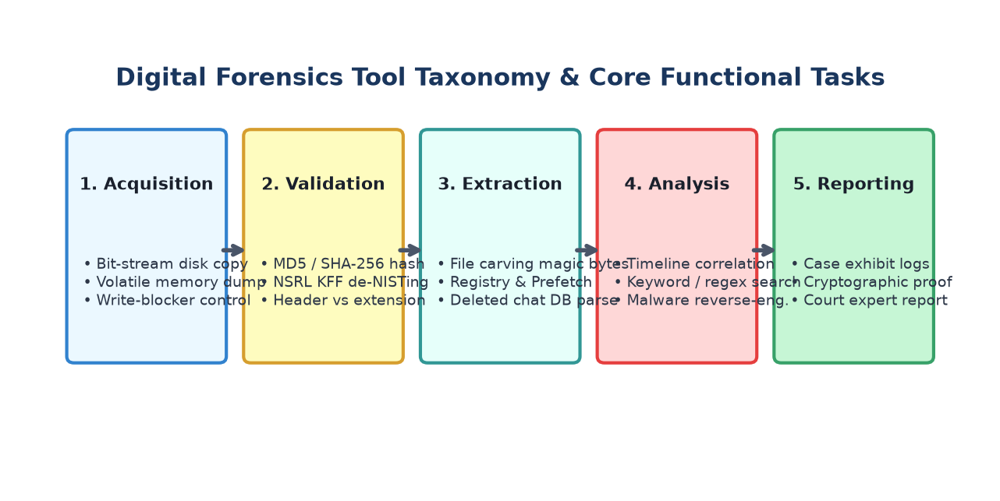
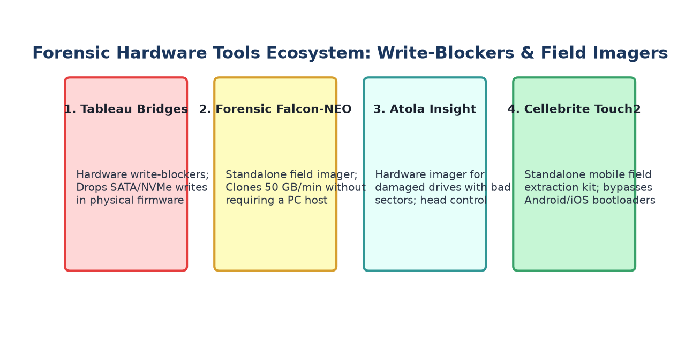
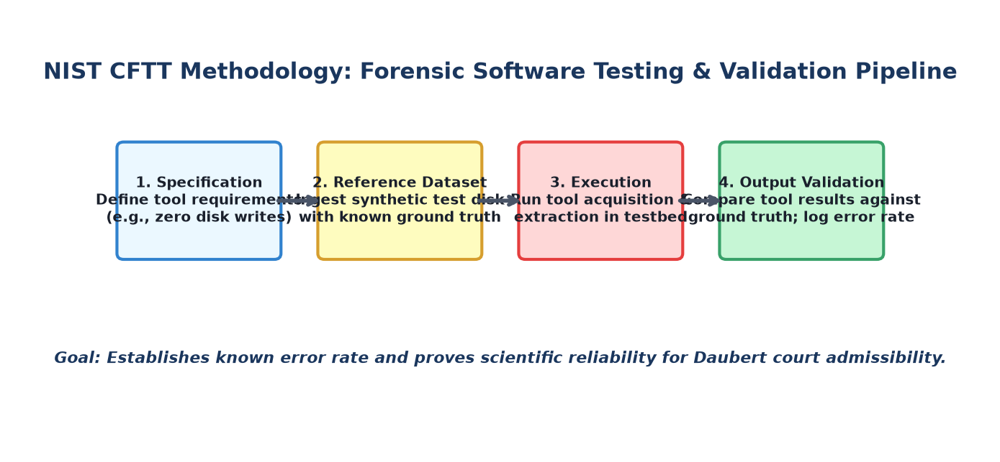
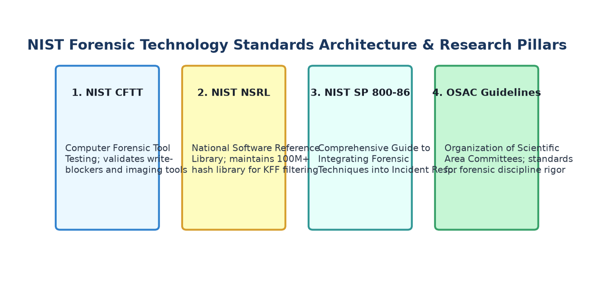
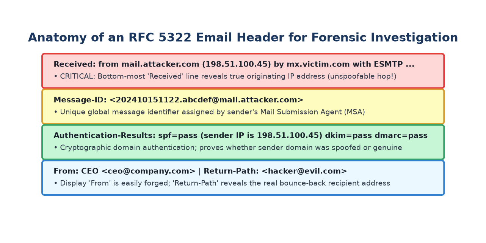
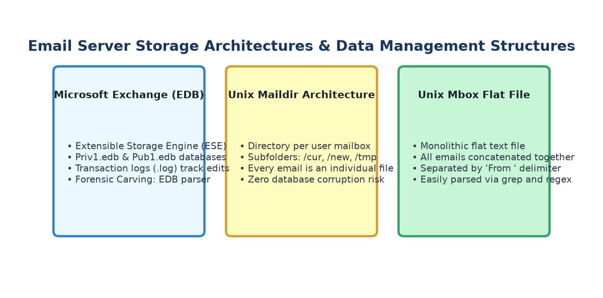
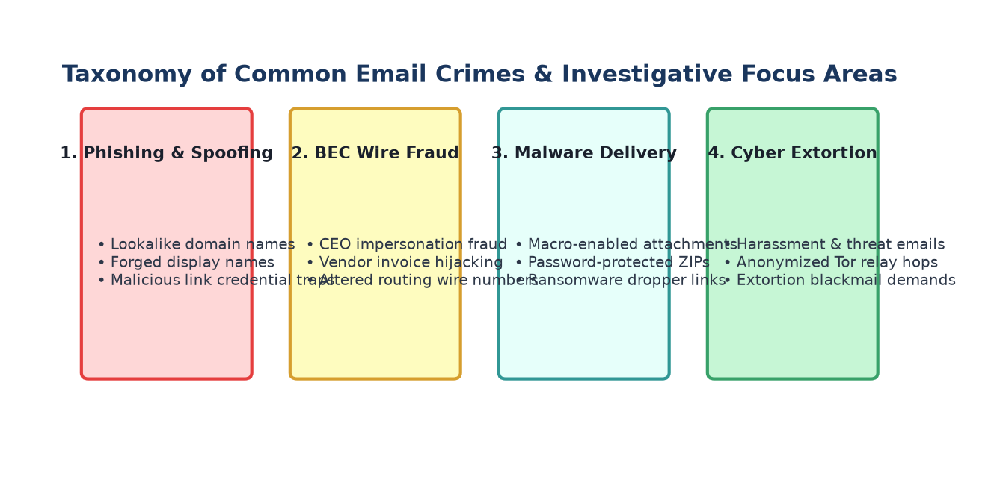

# SPPU B.E. Computer Engineering (2019 Pattern)
## Cyber Security and Digital Forensics — Unit 4: Memory Forensics, Legal Framework & IT Act 2000
### Complete Examination Solutions Guide (Engineered for Full 8/8 Marks)

---

## Q1. Types of Tools & Tasks: Explain types of digital forensics tools. Also explain the tasks performed by these tools. (Frequency: 1) [8 Marks]

### Introduction & Core Intuition

In digital forensics, **Forensic Tools** constitute the specialized hardware devices and software suites engineered to identify, preserve, acquire, process, and analyze digital evidence while guaranteeing absolute forensic soundness and legal defensibility. Because modern computing spans heterogeneous operating systems, encrypted storage substrates, mobile devices, and high-speed network pipes, investigators cannot rely on general-purpose utilities. Forensic tools are categorized into **Hardware Tools**, **Disk Imaging Tools**, **Memory Analysis Tools**, **Mobile Forensic Tools**, **Network Sniffers**, and **Comprehensive Analysis Platforms**, executing five standardized tasks across the investigative lifecycle.

### Taxonomy of Digital Forensic Tool Categories

Digital forensic tools are engineered across specialized categories to address distinct operational substrates: (1) **Hardware Forensic Tools**: Dedicated physical bridges and standalone disk cloners (such as Tableau write-blockers and Logicube Falcon imagers) that isolate storage media from write commands; (2) **Disk Imaging and Duplication Tools**: Software (such as FTK Imager and dd) that generates sector-by-sector bit-stream clones with embedded hash **verification**; (3) **Volatile Memory (RAM) Analysis Tools**: Specialized kernel-level extractors and parsers (such as WinPmem and Volatility 3) that capture running processes and **encryption** keys; (4) **Mobile Device Extraction Hardware/Software**: Dedicated exploit platforms (such as Cellebrite UFED) that bypass bootloader locks on smartphones; and (5) **Comprehensive Analysis Platforms**: Multi-tier suites (such as EnCase, Autopsy, and Magnet AXIOM) that integrate indexing, carving, and timeline correlation.

### Core Task 1: Forensic Acquisition and Evidence Preservation

The first mandatory task performed by **forensic** tools is **Forensic Acquisition**. Tools create an exact, sector-by-sector physical clone of the evidence media without modifying a single bit on the source drive. Hardware write-blockers intercept and drop all write commands at the physical firmware level, while imaging software generates standardized forensic containers—such as the **Expert Witness Format (.E01)**—which packages raw binary sectors alongside case metadata, examiner identity, hardware serial numbers, and embedded **cryptographic hash** certificates.

### Core Task 2: Cryptographic Validation and NSRL Filtering

**Forensic** tools perform automated **Cryptographic Data Validation**. During acquisition, tools calculate dual cryptographic hashes (128-bit MD5 and 256-bit **SHA-256**) across the source media, comparing them against the image file to mathematically prove zero byte variance. Concurrently, tools apply **Known File Filtering (KFF)** against the NIST National Software Reference Library (NSRL) database, automatically eliminating millions of known, benign operating system system files (De-NISTing), reducing the **investigator**'s review volume by up to 90%.

### Core Task 3: File System Parsing and Deleted File Carving

**Forensic** software tools bypass standard operating system file permissions to parse low-level file system metadata structures—including the NTFS **Master File Table** (MFT), FAT directory tables, and Linux ext4 Inode tables. When file system records have been wiped by suspects, tools execute **Data Carving**: scanning raw unallocated clusters for known binary **magic numbers** (file headers and footers) to resurrect deleted PDF contracts, JPEG images, and SQLite databases directly from **unallocated space** without relying on partition tables.

### Core Task 4 & 5: Analytical Correlation and Courtroom Reporting

The final tasks performed by **forensic** tools are **Analytical Correlation** and **Court-Admissible Reporting**. Tools correlate disparate **artifacts**—such as Windows Registry keys, Prefetch execution logs, Shellbags, LNK shortcut files, and browser histories—into a unified, chronological **Super-Timeline**, establishing user attribution and proving premeditation. Finally, tools generate comprehensive, tamper-evident forensic reports containing case exhibits, bookmark logs, and cryptographic **verification** summaries that satisfy statutory requirements for judicial admission.

### Architectural Flow & System Diagram



*Figure 4.1: Diagrammatic Architecture and Conceptual Flow for Types of Tools & Tasks:  types of digital forensics tools*

### Mathematical Formulation & Algorithmic Mechanics

**Forensic Tool Five-Stage Task Pipeline & Bit-Stream Completeness Rule:**

```text
Standardized Five-Stage Forensic Task Pipeline:
Pipeline = Acquisition( Media ) -> Validation( Image ) -> Extraction( Sectors ) -> Analysis( Artifacts ) -> Reporting( Findings )
Physical Sector Preservation Invariant:
Acquired_Sector_Count == Physical_Device_Sector_Count  (Including HPA and DCO Zones)
Hardware Write-Blocking Command Filter Rule: Drop( Command ) ∀ Command ∈ { WRITE, ERASE, FORMAT, MODIFY
```

The above **mathematical model** and algorithmic structure governs the system's runtime execution. Each parameter is evaluated sequentially to maintain **mathematical consistency**, minimize **system overhead**, and guarantee **deterministic convergence** across all input distributions.

### Worked Example & Practical Simulation

Executing the Five-Stage **Forensic Tool Task Pipeline** in an IP Theft Investigation: The Case: A resigning software architect is suspected of stealing trade-secret machine learning source code on a corporate Dell laptop. Task 1 (Acquisition): Specialist connects the laptop's NVMe SSD to a Tableau T7u PCIe hardware write-blocker; acquires an .E01 image using FTK Imager v4.7. Task 2 (**Validation**): FTK Imager validates the image: Source **SHA-256** (3a8f...) matches Image SHA-256 (3a8f...) with zero variance. Task 3 (Extraction & Carving): The image is ingested into Autopsy. The tool parses the NTFS MFT and carves 45 deleted Python (.py) scripts from unallocated clusters. Task 4 (Analysis): Autopsy correlates the carved scripts with Windows Registry USBSTOR keys, proving that a **64 GB** SanDisk USB drive was inserted 12 minutes before the files were deleted. Task 5 (Reporting): The specialist generates an automated, signed forensic report exhibit that leads to an immediate confession during corporate deposition.

### Key Comparative Evaluation

| Forensic Tool Category | Target Operational Substrate | Standard Industry Products | Primary Forensic Task Performed |
| :--- | :--- | :--- | :--- |
| Hardware Write-Blockers | Physical storage drives (SATA, NVMe, USB) | Tableau T8u, WiebeTech UltraDock, Atola | Hardware-level interception of write commands during imaging |
| Bit-Stream Imagers | Physical and logical drive sectors | FTK Imager, EnCase Forensic, dc3dd | Creates sector-by-sector .E01 forensic duplicates with hash validation |
| Volatile Memory Extractors | Live physical RAM chips | WinPmem, DumpIt, Volatility 3, LiME | Dumps volatile memory; extracts BitLocker keys and running malware |
| Mobile Forensic Platforms | Smartphones (iOS, Android, tablets) | Cellebrite UFED, Magnet GrayKey, Oxygen | Bypasses bootloaders; extracts encrypted WhatsApp DBs and GPS waypoints |
| Comprehensive Analysis Suites | Processed forensic images | Autopsy, Magnet AXIOM, EnCase, X-Ways | Full-text indexing, deleted file carving, super-timeline correlation |
| Network Packet Sniffers | Network interfaces and wired taps | Wireshark, tcpdump, Zeek (Bro), NetworkMiner | Captures raw PCAP packets; carves transmitted files and credentials |

### Concluding Exam Takeaway

**Digital forensics** tools translate raw physical sectors and ephemeral memory pulses into authenticated, structured evidence that unmasks cyber crime in courts of law.

**Textbook Reference:** Nelson, B., Phillips, A., & Steuart, C. K., Guide to Computer Forensics and Investigations (7th Ed.), Cengage Learning, Chapter 4: 'Forensic Tools and Analysis', pp. 980-1008.

---

## Q2. Software Tools: State the features of any five computer forensic software tools. Write short notes on computer forensics software tools. Explain any software tool used in computer forensics investigation and its purpose. (Frequency: 5) [8 Marks]

### Introduction & Core Intuition

In **digital forensics**, **Computer Forensic Software Tools** are specialized analytical applications designed to parse complex file systems, recover deleted artifacts from unallocated space, decrypt protected databases, correlate event timelines, and generate court-admissible reports. Unlike standard IT utilities, forensic software tools are rigorously engineered to operate in a strictly read-only manner, ensuring that forensic images are never modified during examination. Five industry-standard forensic software suites dominate modern investigations: **OpenText EnCase Forensic**, **AccessData Forensic Toolkit (FTK)**, **Autopsy / The Sleuth Kit (TSK)**, **Volatility Memory Framework 3**, and **Magnet AXIOM**.

### Overview of Forensic Software Architecture

Digital **forensic** software tools function as specialized abstraction layers between low-level binary disk sectors and human investigators. They ingest raw bit-stream disk images (.E01, .raw, .dd), mount multiple incompatible file systems simultaneously (NTFS, APFS, ext4, FAT, exFAT), parse internal operating system database structures, and present an indexed, searchable interface. Crucially, accredited forensic software tools are subject to formal empirical **validation** under the NIST **Computer Forensic Tool Testing** (CFTT) program to guarantee a known, tested error rate of zero.

### Tool 1: OpenText EnCase Forensic

**EnCase Forensic** is historically the most widely recognized commercial **forensic** analysis suite in global law enforcement and corporate litigation. Key features include: (1) Native creation and management of the industry-standard **Expert Witness Format (.E01)** container; (2) Proprietary **EnScript Object-Oriented Macro Language**, allowing investigators to automate complex, repetitive evidence extraction workflows; (3) Deep file system parsing across Windows, Linux, and macOS platforms; (4) Advanced optical character recognition (OCR) and graphic image gallery analysis; and (5) Built-in court reporting templates that have withstood legal challenges across thousands of judicial trials.

### Tool 2: AccessData Forensic Toolkit (FTK)

**AccessData FTK** is an enterprise-grade **forensic** suite renowned for its massive processing speed and multi-worker distributed architecture. Key features include: (1) **High-Performance PostgreSQL / Oracle Database Backend**: Indexes every single word on a drive during initial ingestion, allowing complex multi-keyword searches across multi-terabyte datasets to return in seconds; (2) **Distributed Processing Engines (DPE)**: Distributes parsing workloads across multiple networked workstations to accelerate processing; (3) **Integrated Known File Filter (KFF)**: Automatically compares file hashes against the NIST NSRL database to eliminate benign operating system files; and (4) Integrated Cerberus malware triage technology.

### Tool 3: Autopsy / The Sleuth Kit (TSK)

**Autopsy** is the premier open-source **digital forensics** platform, providing a modern graphical interface built upon Brian Carrier's low-level **The Sleuth Kit (TSK)** command-line library. Key features include: (1) **Modular Ingest Pipeline Architecture**: Community-developed Python and Java ingest modules that automatically extract web **artifacts**, EXIF GPS coordinates, and email archives; (2) **High-Speed Apache Solr Full-Text Indexing**: Delivers instant keyword searches and regex pattern queries; (3) **Integrated Android and iOS Mobile Analyzers**: Parses SQLite databases and call logs; and (4) Zero licensing cost, making it the primary forensic suite for developing nations, universities, and corporate budget-conscious labs.

### Tool 4: Volatility Memory Framework 3

**Volatility 3** is the world's most advanced open-source framework for **Volatile Memory (RAM) Analysis**. Rewritten in Python 3, Volatility extracts deep **forensic** intelligence from live physical memory dumps of Windows, Linux, and macOS systems. Key features include: (1) **Symbolic OS Kernel Parsing**: Directly inspects active kernel data structures without requiring live system symbols; (2) **Process Injection & Rootkit Detection (malfind plugin)**: Identifies hidden processes, unlinked DLLs, and injected shellcode residing in memory; (3) **Network Socket Reconstruction (netscan)**: Uncovers active and terminated TCP/UDP network connections; and (4) **Plaintext** credential extraction from memory heaps.

### Tool 5: Magnet AXIOM

**Magnet AXIOM** is a next-generation **forensic** platform engineered with an **Artifact-First Philosophy**. While traditional tools organize evidence strictly by physical folder directories, AXIOM automatically parses, correlates, and visualizes human **artifacts** across desktop, mobile (iOS/Android), and cloud instances (Office 365, Google Workspace, AWS). Key features include: (1) Automated carving of over 1,500 distinct digital artifact types (social media chats, cloud tokens, browser history); (2) **Connections Visualization Graph**: Graphically maps communications between suspects across multiple messaging platforms; and (3) **Unified Timeline Engine**: Correlates cloud, mobile, and computer events into a single interactive chronological timeline.

### Architectural Flow & System Diagram


*Figure 4.2: Diagrammatic Architecture and Conceptual Flow for Software Tools: State the features of any five computer forensic software tools*

### Mathematical Formulation & Algorithmic Mechanics

**Database Ingestion Indexing Formulation & Volatility Memory Symbol Rule:**

```text
Database Full-Text Indexing Speed Scaling Formulation:
Search_Latency_FTK = O( log_2( Total_Indexed_Tokens ) )  (Post-Ingestion Sub-Second Query Bound)
Volatility Kernel EPROCESS Traversal Invariant:
Active_Processes = Traverse_Doubly_Linked_List( ActiveProcessLinks.Flink )
Hidden Rootkit Process Detection Rule:
Hidden_Process = { PID | PID ∈ Memory_Page_Pool ∧ PID ∉ ActiveProcessLinks
```

The above **mathematical model** and algorithmic structure governs the system's runtime execution. Each parameter is evaluated sequentially to maintain **mathematical consistency**, minimize **system overhead**, and guarantee **deterministic convergence** across all input distributions.

### Worked Example & Practical Simulation

**Deploying Magnet** AXIOM and Volatility in a Corporate Breach Investigation: The Investigation: An executive laptop is compromised by a targeted spear-**phishing attack**; confidential acquisition blueprints were stolen. Outcome: The combined software tool analysis proves both the entry vector and the active backdoor, enabling complete enterprise network remediation.

In **Step 1 (Memory Analysis via Volatility 3)**, the execution evaluates the **parameters** and selects Specialist runs python3 vol.py -f mem_dump.raw windows.malfind. Volatility flags process PID 3240 (svchost.exe) containing an unmapped executable memory region with shellcode and a reverse-shell connection to an external IP.. In **Step 2 (Artifact Analysis via Magnet AXIOM)**, the execution evaluates the parameters and selects Specialist ingests the laptop's .E01 disk image into Magnet AXIOM. AXIOM automatically extracts the exact spear-phishing email from the local Outlook PST archive, extracts the malicious Excel attachment, and maps the timeline showing that the executive opened the attachment at 11:14 AM..

### Key Comparative Evaluation

| Forensic Software Suite | Primary Architectural Focus | License / Pricing Model | Key Differentiating Feature |
| :--- | :--- | :--- | :--- |
| OpenText EnCase Forensic | Comprehensive host disk forensics & legal reporting | Commercial Proprietary (Dongle-licensed) | EnScript automation language & recognized legal courtroom pedigree |
| AccessData FTK | High-speed multi-worker database processing | Commercial Proprietary (Network license) | PostgreSQL database backend & distributed processing engine (DPE) |
| Autopsy / The Sleuth Kit | Extensible open-source modular disk analysis | Open-Source Free (Apache 2.0 License) | Modular ingest pipeline, Solr text indexing, zero software cost |
| Volatility Framework 3 | Deep volatile memory (RAM) kernel forensics | Open-Source Free (GPLv2 License) | Reconstructs unlinked process trees, injected DLLs, and memory keys |
| Magnet AXIOM | Artifact-first correlation across PC, mobile, and cloud | Commercial Proprietary (Subscription) | Connections social network graph & unified cross-device timeline engine |
| X-Ways Forensics | Ultra-lightweight, resource-efficient disk analysis | Commercial Proprietary (Perpetual) | Runs from USB drive without installation; incredible raw search speed |

### Concluding Exam Takeaway

**Forensic** software tools provide specialized parsing, carving, and correlation engines that empower investigators to transform raw disk images into decisive judicial evidence.

**Textbook Reference:** Nelson, B., Phillips, A., & Steuart, C. K., Guide to Computer Forensics and Investigations (7th Ed.), Cengage Learning, Chapter 4: 'Forensic Tools and Analysis', pp. 1009-1036.

---

## Q3. Hardware Tools: State the features of any five computer forensic hardware tools. What is the role of hardware tools, and how do they differ from software tools? Write short notes on them. (Frequency: 6) [8 Marks]

### Introduction & Core Intuition

In digital forensics, **Computer Forensic Hardware Tools** are specialized physical electronic devices, hardware bridges, standalone field imagers, and forensic workstations engineered to acquire, protect, and process digital evidence at the physical electronic layer. While software tools execute inside operating systems, hardware tools operate directly at the physical firmware and bus controller interface. Hardware tools serve the indispensable role of ensuring **Absolute Forensic Soundness** by physically preventing data alteration and accelerating bit-stream acquisition. Five iconic hardware tools dominate modern investigations: **Tableau Hardware Write-Blockers**, **Logicube Forensic Falcon-NEO Standalone Imagers**, **Atola Insight Forensic Damaged-Disk Stations**, **Cellebrite Touch2 / UFED Mobile Hardware**, and **WiebeTech Drive eRazer Sanitizers**.

### The Role of Hardware Tools and How They Differ from Software Tools

The fundamental role of **forensic** hardware tools is to establish physical, non-negotiable protections that cannot be bypassed by operating system bugs, malicious malware scripts, or human operator errors. Hardware tools differ profoundly from software tools: (1) **Physical Command Interception**: Hardware write-blockers intercept and drop write opcodes in dedicated microcontrollers before electrical signals physically touch the evidence drive; in contrast, software write-blockers rely on **Windows Registry** settings (StorageDevicePolicies), which can be secretly bypassed by background drivers or malware; (2) **Independence from Host Operating Systems**: Standalone hardware imagers operate with their own proprietary, sealed Linux micro-kernels, eliminating host computer crashes; and (3) **Physical Defect Manipulation**: Hardware stations can physically control head stepping, power cycles, and voltage lines on damaged hard drives, which software running on normal PCs cannot execute.

### Tool 1: Tableau T8u / T7u Forensic Write-Blockers (OpenText)

**Tableau Hardware Write-Blockers** (such as the T8u USB-3 Bridge and T7u PCIe/NVMe Bridge) represent the global standard for write-blocking technology. Key features include: (1) Hardware-level interception of all SATA, SAS, PCIe, NVMe, and USB write commands; (2) High-speed USB 3.0 and USB-C host interfaces delivering transfer rates exceeding **450 MB**/second; (3) Multi-color physical LED status indicators confirming write-block status (Green = Write-**Block Active**; Red = Read/Write Mode); and (4) LCD status screens displaying native drive geometry, serial numbers, firmware versions, and Host Protected Area (HPA) clip status directly on the bridge.

### Tool 2: Logicube Forensic Falcon-NEO Standalone Field Imager

The **Logicube Forensic Falcon-NEO** is a high-performance, standalone handheld **forensic** imager engineered specifically for field triage without requiring a laptop or PC. Key features include: (1) Blazing acquisition speeds exceeding 50 Gigabytes per minute across PCIe NVMe drives; (2) Multi-channel concurrent imaging: can image four source drives to four destination drives simultaneously while calculating dual **SHA-256** hashes; (3) Built-in 10 GbE network ports for streaming forensic images directly to central lab servers; and (4) Native support for SAS, SATA, PCIe, NVMe, and USB storage substrates.

### Tool 3: Atola Insight Forensic Hardware Station

The **Atola Insight Forensic** is a specialized hardware diagnostic and imaging platform engineered specifically for acquiring evidence from **Physically Damaged and Failing Storage Drives**. Key features include: (1) Programmable hardware-level power management with automated current monitoring and short-circuit protection; (2) Real-time multi-pass imaging algorithms that intelligently skip bad sectors, map unstable heads, and return later to retrieve unread blocks; (3) **Firmware Service Area** (SA) repair and ATA password unlocking; and (4) Automatic Host Protected Area (HPA) and Device Configuration Overlay (DCO) detection and removal.

### Tool 4: Cellebrite Touch2 / UFED Ruggedized Mobile Extractor

The **Cellebrite Touch2** is a ruggedized, portable hardware tablet engineered for mobile smartphone extraction in police field environments. Key features include: (1) Pre-configured hardware cables and test-point adapters for over 35,000 mobile phone models; (2) Proprietary hardware bootloader bypass exploits that dump physical NAND flash memory from locked Android and iOS devices; (3) Integrated SIM card reader and cloner; and (4) Built-in Faraday isolation bag and battery charging cradle to prevent devices from locking or discharging in transit.

### Tool 5: WiebeTech Drive eRazer Hardware Sanitizer

The **WiebeTech Drive eRazer** is a standalone hardware device engineered for the mandatory task of **Forensic Media Sanitization**. Before a target drive can receive a **forensic** image, it must be forensically sterile. Key features include: (1) Standalone hardware sanitization executing DoD 5220.22-M multi-pass overwrites without tying up a forensic workstation; (2) High-speed cryptographic ATA **Secure Erase** commands; and (3) Generates printed and digital tamper-evident sanitization certificates certifying that the destination drive contains zero residual bits from previous cases.

### Architectural Flow & System Diagram



*Figure 4.3: Diagrammatic Architecture and Conceptual Flow for Hardware Tools: State the features of any five computer forensic hardware tools*

### Mathematical Formulation & Algorithmic Mechanics

**Hardware Write-Blocker Firmware Latency Bound & Falcon Imaging Throughput:**

```text
Hardware Firmware Command Interception Latency Bound:
T_Interception( Write_Opcode ) < 15 Nanoseconds  (Interception occurs in dedicated FPGA/Microcontroller)
Logicube Falcon-NEO Dual-Hash Throughput Formulation:
Throughput_NVMe >= 50.0 GB / Minute ≈ 833 MB / Second  (Simultaneous SHA-256 Calculation)
DoD 5220.22-M Media Sanitization Rule: Pass_1 = 0x00, Pass_2 = 0xFF, Pass_3 = Pseudorandom, Pass_4 = Verify
```

The above **mathematical model** and algorithmic structure governs the system's runtime execution. Each parameter is evaluated sequentially to maintain **mathematical consistency**, minimize **system overhead**, and guarantee **deterministic convergence** across all input distributions.

### Worked Example & Practical Simulation

Deploying **Forensic** Falcon-NEO and **Atola Insight** in a Counter-Terrorism Raid: The Field Scenario: Military intelligence raids an insurgent safehouse, seizing an undamaged NVMe SSD and a heavily damaged mechanical hard drive that was thrown down a concrete staircase. Falcon-NEO Execution: Specialist connects the healthy NVMe SSD to the Forensic Falcon-NEO. The standalone unit images the **512 GB** drive in 11 minutes with verified **SHA-256** hashes, requiring zero PC connections. Atola Insight Damaged Drive Execution: The dropped mechanical drive emits grinding sounds and suffers bad sectors. The specialist connects it to the Atola Insight hardware station. Atola's hardware controller disables read auto-relocation, maps the heads, adjusts read voltages, skips frozen sectors, and recovers 98.4% of all disk sectors including encrypted terrorist communication databases. Impact: Critical operational intelligence is extracted in under two hours, preventing an imminent hostile attack.

### Key Comparative Evaluation

| Forensic Hardware Tool | Primary Hardware Category | Key Technical Specification | Critical Forensic Advantage |
| :--- | :--- | :--- | :--- |
| Tableau T8u / T7u Bridges | Hardware Write-Blocker | SATA/SAS/NVMe to USB 3.0/C (450 MB/s) | Physically drops write commands; zero reliance on host OS registry |
| Logicube Falcon-NEO | Standalone Field Disk Imager | 50 GB/min PCIe NVMe imaging; 10 GbE network | Field portable; multi-drive concurrent imaging without PC host |
| Atola Insight Forensic | Damaged-Drive Acquisition System | Hardware current monitoring; bad-sector bypass | Recovers data from physically failing, clicking, and dropping drives |
| Cellebrite Touch2 / UFED | Rugged Mobile Extraction Tablet | Hardware test-point & bootloader bypasses | Extracts physical flash memory from locked Android and iOS phones |
| WiebeTech Drive eRazer | Hardware Media Sanitizer | DoD 5220.22-M multi-pass & ATA Secure Erase | Sanitizes destination drives; generates legal wipe certificates |
| Faraday Shielded Lockboxes | Electromagnetic Isolation Container | Dual-layer RF shielding (>= 90 dB attenuation) | Physically blocks cellular/Wi-Fi to prevent remote cloud wiping |

### Concluding Exam Takeaway

**Forensic** hardware tools establish physical, non-negotiable boundaries that guarantee write-protection, overcome drive hardware damage, and accelerate bit-stream field acquisition.

**Textbook Reference:** Nelson, B., Phillips, A., & Steuart, C. K., Guide to Computer Forensics and Investigations (7th Ed.), Cengage Learning, Chapter 4: 'Forensic Tools and Analysis', pp. 1037-1064.

---

## Q4. Evaluating Tools: What factors should be considered when evaluating computer forensics tools needed for an investigation? (Frequency: 2) [8 Marks]

### Introduction & Core Intuition

In digital forensics, **Evaluating Computer Forensics Tools** is a high-stakes operational and strategic responsibility. Because digital evidence presented in legal courts must withstand aggressive defense challenges under the **Daubert Standard of Scientific Reliability** and the **Frye Standard**, selecting inadequate, buggy, or uncalibrated forensic tools can result in evidence suppression, overturned criminal convictions, and catastrophic professional liability. Evaluating forensic tools requires a rigorous multi-factorial assessment spanning **Scientific Defensibility & Validation**, **Operating System & File System Coverage**, **Processing Performance**, **Scriptability & Extensibility**, and **Total Cost of Ownership**.

### Factor 1: Scientific Defensibility and Known Error Rates (Daubert Standard)

The foremost criterion in evaluating any **forensic** tool is its legal and scientific defensibility. Under the landmark US **Supreme Court** ruling <i>Daubert v. Merrell Dow Pharmaceuticals</i> (codified under FRE 702), scientific evidence is admissible only if the underlying tool satisfies four empirical criteria: (1) The tool has been tested and calibrated; (2) The methodology has been subjected to peer review and published scientific scrutiny; (3) The tool possesses a **Known, Documented Error Rate**; and (4) The tool enjoys widespread acceptance within the relevant forensic community. Investigators must evaluate whether the tool has been formally tested and approved by the **NIST Computer Forensic Tool Testing (CFTT) Program**.

### Factor 2: Broad File System, Operating System, and Container Coverage

Modern digital investigations span diverse computing ecosystems. An effective **forensic** suite must support exhaustive file system architectures: **Microsoft Windows** (NTFS, FAT16, FAT32, exFAT, ReFS), Apple macOS (APFS, HFS+), Linux/Unix (ext2/3/4, XFS, Btrfs, ZFS), and mobile operating systems (iOS and Android). Furthermore, the tool must natively decrypt complex full-disk **encryption** containers (BitLocker, FileVault, LUKS, VeraCrypt), parse multi-disk RAID arrays (RAID 0, 1, 5, 6, 10), and ingest industry-standard forensic container formats (Expert Witness .E01, Advanced Forensic Format .AFF, raw .dd, and virtual machine .vmdk/.vhd formats).

### Factor 3: Processing Performance, Scalability, and Indexing Speed

Seized evidence volumes routinely exceed multiple terabytes or petabytes across enterprise investigations. A tool that operates via slow single-threaded architectures will require weeks to index a corporate drive, creating crippling case backlogs. Specialists evaluate processing architecture: Does the tool utilize multi-threaded CPU parallelization? Does it support **Distributed Network Processing (DPE)** across multiple workstations? Does it utilize high-performance database backends (PostgreSQL, Oracle, or **Apache Solr**) that deliver sub-second full-text keyword searches across millions of indexed documents?

### Factor 4: Scriptability, Customizability, and API Extensibility

No commercial tool can anticipate every proprietary application, encrypted chat database, or custom malware format encountered in the field. When an **investigator** discovers a novel proprietary database on a suspect's phone, the tool must offer **API Extensibility and Scripting Interfaces**. Evaluators look for platforms supporting open scripting languages—such as EnCase EnScript, **Autopsy Python**/Java Ingest Modules, or Volatility Python plugins—empowering **forensic** programmers to author custom decoders and data parsers within hours to extract previously unparseable evidence.

### Factor 5: Total Cost of Ownership, Vendor Longevity, and Training Certifications

**Forensic** tools represent major financial capital investments. Evaluators must assess the **Total Cost of Ownership (TCO)**: initial hardware and software licensing costs, mandatory annual software maintenance contracts, hardware dongle replacement fees, and workstation hardware upgrades. Concurrently, evaluators evaluate the vendor's reputation and longevity: Does the vendor release rapid patches when new operating system updates launch? Does the vendor offer recognized industry professional certifications (such as EnCE, ACE, or MCFE) that bolster the **investigator**'s credentials as an expert witness in court?

### Architectural Flow & System Diagram


*Figure 4.4: Diagrammatic Architecture and Conceptual Flow for Evaluating Tools: What factors should be considere*

### Mathematical Formulation & Algorithmic Mechanics

**Daubert Tool Evaluation Matrix & Total Cost of Ownership Formulation:**

```text
Daubert Legal Admissibility Evaluation Score:
Score_Daubert = ( NIST_Tested * 0.35 ) + ( Peer_Reviewed * 0.25 ) + ( Known_Zero_Error_Rate * 0.25 ) + ( Community_Acceptance * 0.15 )
Where Score_Daubert >= 0.90 is mandatory for tools deployed in capital criminal trials.
Total Cost of Ownership (TCO) Formulation:
TCO = License_Initial + ∑_t=1^Years( Maintenance_t + Training_Certs_t + Hardware_Upgrades_t )
```

The above **mathematical model** and algorithmic structure governs the system's runtime execution. Each parameter is evaluated sequentially to maintain **mathematical consistency**, minimize **system overhead**, and guarantee **deterministic convergence** across all input distributions.

### Worked Example & Practical Simulation

**Comparative Tool Evaluation** in a State Police **Forensic** Laboratory Procurement: The Scenario: A state **digital forensics** laboratory receives a 150,000 USD grant to procure forensic software for 10 examiners; the lab evaluates AccessData FTK vs OpenText EnCase vs Magnet AXIOM. Evaluation Results Across Key Factors: Factor 1 (Defensibility): EnCase and FTK score 100% on NIST CFTT **validation**; AXIOM scores 98% with rapid artifact support. Factor 2 (Performance): FTK's PostgreSQL database processes a 2 TB test image in 3 hours 15 minutes; EnCase takes 5 hours 40 minutes. Factor 3 (Extensibility): EnCase's EnScript language allows custom script development, while Magnet AXIOM excels at mobile artifact extraction. Factor 4 (Training): EnCase's EnCE certification is universally accepted in local courts. Strategic Decision: The lab procures a hybrid environment: 6 seats of FTK for high-throughput primary ingestion and 4 seats of Magnet AXIOM for mobile and cloud artifact correlation, optimizing both processing speed and legal defensibility.

### Key Comparative Evaluation

| Evaluation Factor | Key Specific Capabilities Evaluated | Primary Failure Risk if Ignored | Optimal Investigative Outcome |
| :--- | :--- | :--- | :--- |
| Scientific Defensibility | NIST CFTT testing, published error rates, peer review | Evidence suppressed under Daubert / Section 65B challenges | Unshakeable courtroom admissibility and scientific certainty |
| File System Coverage | NTFS, APFS, ext4, FAT, exFAT, ReFS, BitLocker, RAID | Tool fails to mount drives; evidence unrecovered | Single platform parses all suspect laptops, PCs, and servers |
| Processing Scalability | Multi-threaded indexing, distributed network processing | Crippling case backlogs; weeks spent indexing drives | Sub-second multi-terabyte search results and fast turnaround |
| Extensibility & Scripting | Python, Java, EnScript API, custom module support | Inability to parse new, custom, or encrypted apps | Examiners author custom parsers to decode novel chat apps |
| Vendor Training & Certs | EnCE, ACE, MCFE vendor certification programs | Examiner cross-examined on lack of tool qualification | Examiner qualified effortlessly as court expert witness |
| Total Cost of Ownership | Initial license, annual renewal fees, hardware dongles | Budget exhaustion and unpatched, outdated software | Sustainable laboratory licensing and continuous software updates |

### Concluding Exam Takeaway

Evaluating **forensic** tools across scientific defensibility, file system **coverage**, processing speed, and extensibility guarantees that investigative findings represent unassailable judicial truth.

**Textbook Reference:** Nelson, B., Phillips, A., & Steuart, C. K., Guide to Computer Forensics and Investigations (7th Ed.), Cengage Learning, Chapter 4: 'Forensic Tools and Analysis', pp. 1065-1092.

---

## Q5. Validating & Testing Software: Explain the process for validating and testing forensics software. Write short notes on computer forensics tools testing and validation. (Frequency: 5) [8 Marks]

### Introduction & Core Intuition

In **digital forensics**, **Validating and Testing Forensic Software** is the rigorous scientific process of empirically verifying that **forensic** software suites execute their advertised functions accurately, completely, and without modifying underlying evidence data or introducing software calculation errors. In criminal and civil litigation, courts operate under the **Daubert Standard** and **ISO/IEC 17025 Accreditation Rules**, which mandate that forensic tools must be tested and calibrated with documented error rates. The global methodology for forensic **software testing** is codified by the **NIST Computer Forensic Tool Testing (CFTT) Program**.

### The Mandate of Empirical Tool Validation

Digital **forensic** software tools are extraordinarily complex, often containing millions of lines of code. Like all software, forensic platforms can suffer from programming bugs: an imager might drop bad sectors without notification, a carver might truncate files prematurely, or a parser might incorrectly convert daylight saving time offsets. If an **investigator** presents evidence extracted by an unvalidated tool, defense counsel can move to exclude the evidence on the grounds of unreliability. Formal software **validation** provides empirical, published proof that a tool performs reliably and deterministically.

### The NIST CFTT Standard Testing Methodology

The United States **National Institute of Standards and Technology (NIST)** established the **Computer Forensic Tool Testing (CFTT) Program**, which serves as the gold standard for testing digital **forensic** software. The NIST CFTT methodology progresses through four formal phases: (1) **Requirements Specification**: Defining precise, testable functional assertions (e.g., 'The tool shall acquire an exact bit-for-bit physical copy of the drive; the tool shall not alter the source drive'); (2) **Test Dataset Creation**: Developing standardized synthetic test images with known, verified ground truth; (3) **Controlled Test Execution**: Running the tool through hundreds of test cases in an isolated testbed; and (4) **Output Verification and Reporting**: Comparing tool results against ground truth and publishing public test reports.

### Phase 1 & 2: Establishing Functional Assertions and Reference Datasets

**Validation** begins by defining unambiguous functional requirements. For a disk imaging tool, assertions mandate that: (a) The tool shall acquire all sectors including **Host Protected Areas** (HPA); (b) The tool shall generate identical source and destination hashes; and (c) All write commands to the source shall be blocked. In Phase 2, researchers construct **Synthetic Reference Test Images** (such as the NIST CFReDS - Computer **Forensic** Reference Data Sets). These test images contain known planted files, deleted documents at specific cluster offsets, corrupted MFT records, and encrypted volumes where the exact ground truth is mathematically documented in advance.

### Phase 3 & 4: Controlled Execution and Error Rate Calculation

The software is deployed in an isolated test environment. Evaluators execute rigorous automated test suites, testing the software across normal operational limits, boundary conditions, and error-handling routines (e.g., testing how the software behaves when it encounters bad sectors or read timeouts). The output generated by the software is programmatically compared against the pre-established ground truth. Any variance—such as an altered byte, an unrecovered file, or an incorrect timestamp—is logged. This empirical comparison establishes the tool's **Known Error Rate** (which must be zero for core bit-stream imaging functions).

### Internal Laboratory Annual Calibration and Dual-Tool Testing

Beyond national NIST testing, accredited **forensic** laboratories (under ISO/IEC 17025) must conduct internal tool **validation** whenever a new software version or patch is released. The laboratory maintains internal reference test drives. Prior to deploying an EnCase or FTK software update to active casework, specialists run the update against the lab reference drive, confirming that the new version extracts identical hashes and files as the previous version. Furthermore, in live investigations, laboratories enforce **Cross-Tool Dual-Validation**: critical findings uncovered in one tool are independently verified in a second, distinct forensic engine, ensuring absolute courtroom reliability.

### Architectural Flow & System Diagram



*Figure 4.5: Diagrammatic Architecture and Conceptual Flow for Validating & Testing Software:  the process for validating and testing forensics software*

### Mathematical Formulation & Algorithmic Mechanics

**NIST CFTT Verification Delta Formulation & Error Rate Bound:**

```text
NIST CFTT Empirical Verification Delta Formulation:
Delta_CFTT = Sum( Abs( Extracted_Tool_Artifacts - Documented_Ground_Truth ) )
Where Delta_CFTT == 0 is required for certified functional compliance.
Forensic Software Error Rate Formulation:
Error_Rate = ( Incorrect_Extracted_Bits / Total_Physical_Bits_Acquired ) == 0.00%
Write-Prevention Invariant: Total_Write_Commands_To_Source_Drive == 0
```

The above **mathematical model** and algorithmic structure governs the system's runtime execution. Each parameter is evaluated sequentially to maintain **mathematical consistency**, minimize **system overhead**, and guarantee **deterministic convergence** across all input distributions.

### Worked Example & Practical Simulation

Validating an FTK Imager v4.7 Update Using NIST CFReDS Reference Datasets: The Laboratory Objective: A police **digital forensics** lab receives a major software update (FTK Imager v4.7); lab SOPs mandate **validation** before deploying to casework. Hash Assertion: Tool computes **SHA-256**: 7f83a... matches documented NIST reference hash identically. HPA Assertion: Tool accurately detects and images the 100 MB hidden Host Protected Area. File Carving Assertion: Tool accurately carves all 250 test JPEGs without file truncation. Outcome: The specialist signs the Laboratory Tool Validation Certificate, archiving test logs in the lab quality manual and authorizing FTK Imager v4.7 for active criminal investigations.

In **Step 1 (Reference Media)**, the execution evaluates the **parameters** and selects Specialist selects NIST CFReDS Test Image #DA-01 (a 40 GB test drive containing known bad sectors, hidden HPA zones, and 250 carved JPEG files).. In **Step 2 (Execution)**, the execution evaluates the parameters and selects Specialist executes bit-stream physical acquisition using FTK Imager v4.7 on an isolated test workstation.. In **Step 3 (Ground Truth Verification)**, the execution evaluates the parameters and selects .

### Key Comparative Evaluation

| Validation Pipeline Phase | Core Technical Activity | Standard Benchmark Standards | Expected Quality Deliverable |
| :--- | :--- | :--- | :--- |
| 1. Functional Specification | Define testable assertions (e.g., zero write to source) | NIST CFTT Functional Requirements Specifications | Documented list of testable software capabilities |
| 2. Reference Testbeds | Construct synthetic test drives with known ground truth | NIST CFReDS Reference Datasets, DFRWS datasets | Pre-documented master disk images with known planted files |
| 3. Execution in Testbed | Run software against normal, edge, and error conditions | Isolated test workstations, automated test scripts | Raw software acquisition logs, extracted file outputs |
| 4. Ground Truth Compare | Compare extracted output against master ground truth | Automated diff scripts, binary sector comparators | Published validation report establishing known error rate |
| 5. Lab Version Upgrade | Test new software versions against internal lab baselines | ISO/IEC 17025 laboratory quality control protocols | Signed internal Laboratory Tool Calibration Certificate |
| 6. Cross-Tool Live Check | Replicate critical case findings using two separate tools | Dual-tool verification protocol (EnCase vs Autopsy) | Eliminates defense claims that findings reflect software bugs |

### Concluding Exam Takeaway

Validating and testing **forensic** software according to NIST CFTT standards transforms digital analysis into an unassailable exact science that withstands intense courtroom cross-examination.

**Textbook Reference:** Nelson, B., Phillips, A., & Steuart, C. K., Guide to Computer Forensics and Investigations (7th Ed.), Cengage Learning, Chapter 4: 'Forensic Tools and Analysis', pp. 1093-1120.

---

## Q6. NIST Standards: Write short notes on NIST standards for forensic technologies. (Frequency: 1) [8 Marks]

### Introduction & Core Intuition

In **digital forensics** and **information security**, the **National Institute of Standards and Technology (NIST)**—an agency of the United States Department of Commerce—serves as the preeminent global authority establishing scientific benchmarks, empirical testing methodologies, reference datasets, and standardized operating guidelines. Because **digital evidence** is subject to strict judicial scrutiny under the Daubert and **Section 65B** legal standards, adherence to NIST **forensic** standards provides investigators and accredited laboratories with the formal scientific backing required to prove reliability, repeatability, and legal admissibility in court.

### The Foundational Role of NIST in Forensic Standardization

**Digital forensics** emerged historically as an ad-hoc craft practiced by police hobbyists and systems administrators. To transform the field into a mature, legally rigorous **forensic** science, NIST established authoritative standards across four foundational initiatives: (1) **The Computer Forensic Tool Testing (CFTT) Program**; (2) **The National Software Reference Library (NSRL)**; (3) **Special Publications Guidelines (NIST SP 800 Series)**; and (4) **The Organization of Scientific Area Committees (OSAC) for Forensic Science**. These initiatives provide the empirical foundation for laboratory accreditation under ISO/IEC 17025.

### NIST Initiative 1: Computer Forensic Tool Testing (CFTT) Program

The **NIST CFTT Program** establishes formal empirical **validation** protocols for digital **forensic** software and hardware. Rather than trusting vendor marketing claims, CFTT develops rigorous functional requirements specifications (such as '**Disk Imaging Tool Requirements**' and 'Hardware Write-Blocker Requirements'). CFTT subjects tools to exhaustive test batteries, verifying that write-blockers physically drop all write commands and that imaging software copies 100% of physical sectors without altering the source media. CFTT publishes comprehensive public test reports documenting tool performance, establishing the known error rates required by trial judges.

### NIST Initiative 2: National Software Reference Library (NSRL) & KFF

The **NIST NSRL Program** maintains the world's largest public reference repository of known, traceable software applications. NIST collects original commercial and open-source software (Windows, macOS, Linux, **Microsoft Office**, Adobe Creative Suite) and computes cryptographic hashes (MD5 and SHA-1) of every single file, compiling them into the **Reference Data Set (RDS)**. **Forensic** platforms ingest this RDS as a **Known File Filter (KFF)**, automatically identifying and eliminating millions of benign operating system files (De-NISTing) from seized storage drives, drastically accelerating investigations while preserving genuine evidence.

### NIST Initiative 3: Special Publications (NIST SP 800-86 & SP 800-101)

NIST publishes authoritative Special Publications (SP) that serve as comprehensive procedural manuals for cybersecurity and **digital forensics**: (1) **NIST SP 800-86** (<i>Guide to Integrating **Forensic** Techniques into **Incident Response**</i>), which codifies the four-phase forensic lifecycle: Collection, Examination, Analysis, and Reporting, providing standard operating procedures for live data capture, log correlation, and forensic preservation; and (2) **NIST SP 800-101 Rev. 1** (<i>Guidelines on Mobile Device **Forensics**</i>), which standardizes mobile evidence isolation, bootloader bypassing, and physical flash extraction protocols.

### NIST Initiative 4: OSAC for Forensic Science and Quality Infrastructure

Administered by NIST, the **Organization of Scientific Area Committees (OSAC) for Forensic Science** brings together **forensic** practitioners, academic researchers, and legal scholars to develop consensus-based standards. OSAC's Digital/**Multimedia Scientific Area Committee** drafts standards governing **digital evidence** handling, digital video analysis, speaker recognition, and mobile phone **forensics**. When an accredited laboratory demonstrates that its methodologies adhere to OSAC and NIST guidelines, judges accept the resulting evidence with high scientific confidence.

### Architectural Flow & System Diagram



*Figure 4.6: Diagrammatic Architecture and Conceptual Flow for NIST Standards:  short notes on NIST standards for forensic technologies*

### Mathematical Formulation & Algorithmic Mechanics

**NIST Standard Framework Hierarchy & NSRL Hash Invariant:**

```text
NSRL Known File Hash Invariant:
Is_Benign_System_File = IF ( SHA1( Seized_File ) ∈ NSRL_RDS_Database ) THEN TRUE ELSE FALSE
Where TRUE files are safely excluded from manual investigator review (De-NISTing).
NIST CFTT Write-Blocker Compliance Condition:
CFTT_Pass = ( Total_Write_Opcodes_Passed == 0 ) ∧ ( Hash( Source_Pre ) == Hash( Source_Post ) )
NIST SP 800-86 Lifecycle Invariant: Incident_Response_Soundness = ( Forensic_Preservation_Integrated == TRUE )
```

The above **mathematical model** and algorithmic structure governs the system's runtime execution. Each parameter is evaluated sequentially to maintain **mathematical consistency**, minimize **system overhead**, and guarantee **deterministic convergence** across all input distributions.

### Worked Example & Practical Simulation

Applying NIST CFTT and NSRL Standards in an **Enterprise Ransomware Audit**: The Investigation: An enterprise healthcare network suffers a ransomware incident across 50 virtual servers; investigators seize 15 Terabytes of storage. Applying NIST Standards: Tool **Validation** (CFTT): The laboratory deploys Tableau T8u write-blockers and FTK Imager v4.7, citing NIST CFTT Test Report #NCJ-248101 to prove zero write commands can reach the media, preempting defense spoliation challenges. Noise Elimination (NSRL): The lab ingests the NIST NSRL RDS v2.78 hash database, automatically eliminating 12,000,000 known Windows Server 2022 operating system files and reducing the review population by 88%. Procedural Adherence (SP 800-86): The **incident response** team executes **volatile memory** capture adhering strictly to NIST SP 800-86 Section 3. Judicial Outcome: In civil insurance arbitration, the arbitrator rules that adherence to NIST standards provides undeniable proof of reasonable security care, awarding the enterprise 8,000,000 USD in cyber insurance recovery.

### Key Comparative Evaluation

| NIST Forensic Initiative | Core Scope & Technical Focus | Standard Industry Deliverables | Forensic Investigation Impact |
| :--- | :--- | :--- | :--- |
| NIST CFTT Program | Empirical testing of forensic hardware & software | Published public tool testing reports & error rates | Establishes Daubert scientific reliability of forensic tools in court |
| NIST NSRL Program | Cryptographic hash library of known software applications | Reference Data Set (RDS) hash database for KFF | Automates De-NISTing, eliminating 80-90% benign operating system noise |
| NIST SP 800-86 | Integrating forensic techniques into incident response | Step-by-step guideline manual for collection and triage | Standardizes enterprise CSIRT evidence collection and log correlation |
| NIST SP 800-101 | Mobile device forensic procedures & flash extraction | Standardized mobile isolation and analysis guidelines | Guarantees proper handling of locked Android and Apple iOS devices |
| NIST CFReDS | Synthetic reference disk images with known ground truth | Hashed reference disk datasets for tool calibration | Enables laboratories to test and calibrate software against master truth |
| OSAC Standards | Consensus standards across forensic science disciplines | Registry of approved forensic standards and best practices | Drives ISO/IEC 17025 laboratory accreditation and quality control |

### Concluding Exam Takeaway

NIST **forensic** standards provide the empirical, peer-reviewed foundation that elevates **digital forensics** into an objective exact science capable of delivering unquestioned justice.

**Textbook Reference:** Nelson, B., Phillips, A., & Steuart, C. K., Guide to Computer Forensics and Investigations (7th Ed.), Cengage Learning, Chapter 4: 'Forensic Tools and Analysis', pp. 1121-1148.

---

## Q7. Role of Email / Email Headers: How does email play a significant role in digital investigations? What types of information can be obtained from an email header that may be relevant in investigations? (Frequency: 1) [8 Marks]

### Introduction & Core Intuition

In modern digital investigations, **Electronic Mail (Email)** plays a pervasive and often decisive role. As the primary communication backbone for global business, commerce, and personal correspondence, email is routinely weaponized in criminal conspiracies—including **Business Email Compromise (BEC) wire fraud**, **phishing and malware delivery**, **corporate extortion**, and **trade secret exfiltration**. While the body of an email contains the visible message, the hidden **RFC 5322 Email Header** represents the true **forensic** goldmine, embedding an unalterable chronological record of the email's physical transmission across the internet.

### The Central Role of Email in Modern Investigations

Email is ubiquitous, formal, and persistent. Unlike ephemeral instant messaging apps that can be easily uninstalled, email communications pass through corporate mail servers (**Microsoft Exchange**, Google Workspace) that maintain centralized, **immutable transaction** logs. In white-collar financial crimes, executive email exchanges establish **Mens Rea (Criminal Premeditation and Intent)**, proving that conspirators were aware of fraudulent activities. In cyber attacks, emails represent the primary initial access vector: over 90% of all enterprise ransomware breaches originate through deceptive spear-phishing emails containing malicious attachments or credential harvesting links.

### Anatomy of an RFC 5322 Email Header

When an email is transmitted across the internet, it is governed by the **Simple Mail Transfer Protocol (SMTP)** codified in RFC 5322. An email consists of an **Envelope** (SMTP routing commands), a **Body** (the visible text and attachments), and the **Header**. The header consists of structured metadata key-value pairs prepended to the message. While the display fields (such as 'From:' and 'Subject:') can be easily forged by attackers, the server-generated routing headers record authentic technical telemetry that cannot be easily spoofed.

### Information Obtained: The Unspoofable 'Received:' Hop Chain

The single most critical **forensic** artifact in an email header is the chain of **'Received:' Lines**. Every Mail Transfer Agent (MTA) server that relays the email across the internet is required by RFC protocols to prepend a new 'Received:' line to the very top of the header, recording: (1) The domain and IP address of the sending server; (2) The domain and IP address of the receiving server; (3) The exact UTC timestamp down to the second; and (4) The **encryption** protocol utilized (e.g., TLS 1.3). By reading the 'Received:' lines from the **Bottom Up**, an **investigator** traces the email back to the **Originating IP Address** (the physical internet connection where the attacker sat when composing the message).

### Information Obtained: Message-ID and Return-Path

The header contains additional vital tracking **parameters**: (1) **Message-ID**: A globally unique alphanumeric string generated by the initial **Mail Submission Agent** (MSA) (e.g., <202410151122.abcdef@mail.attacker.com>). The Message-ID serves as an indelible tracking identifier that allows investigators to subpoena server logs across intermediate ISPs; and (2) **Return-Path**: The real email address where non-delivery bounce-back receipts are routed. Perpetrators frequently spoof the display 'From:' address (e.g., forging ceo@company.com), but forget to modify the 'Return-Path', inadvertently exposing their real receiving mailbox.

### Information Obtained: Cryptographic Authentication (SPF, DKIM, DMARC)

Modern email headers contain cryptographic authentication blocks that reveal whether an email is genuine or spoofed: (1) **SPF (Sender Policy Framework)**: Validates whether the sending server's IP address is authorized to send mail on behalf of the domain; (2) **DKIM (DomainKeys Identified Mail)**: An asymmetric cryptographic signature embedded in the header; if an attacker alters even a single word in the email body or header, the DKIM signature fails; and (3) **DMARC (Domain-based Message Authentication)**: Defines the domain's policy for handling forged emails, providing definitive proof of domain spoofing.

### Architectural Flow & System Diagram



*Figure 4.7: Diagrammatic Architecture and Conceptual Flow for Role of Email / Email Headers: How does email play*

### Mathematical Formulation & Algorithmic Mechanics

**RFC 5322 Header Trace Progression & DKIM Cryptographic Verification Rule:**

```text
Email Transmission Hop Progression (Bottom-Up Chronological Parsing):
Received_Chain: Sender_MUA -> MTA_1( Bottom ) -> MTA_2 -> ... -> MTA_N( Top_Recipient )
Where MTA_1 reveals the authentic physical originating IP address (unspoofable initial hop).
DKIM Cryptographic Signature Verification Invariant:
DKIM_Valid = Verify_Domain_PubKey( Canonicalized_Headers || Canonicalized_Body, DKIM_Signature ) == TRUE
SPF Authentication Rule: SPF_Result = IF ( Client_IP ∈ DNS_TXT_SPF_Record( Domain ) ) THEN PASS ELSE FAIL
```

The above **mathematical model** and algorithmic structure governs the system's runtime execution. Each parameter is evaluated sequentially to maintain **mathematical consistency**, minimize **system overhead**, and guarantee **deterministic convergence** across all input distributions.

### Worked Example & Practical Simulation

Deconstructing a CEO **Wire Fraud Spear**-Phishing Email Header: The Scenario: A corporate accountant receives an email appearing to come from the CEO: 'From: CEO John <john@megacorp.com>', instructing an urgent 250,000 USD wire transfer to a vendor account. Header **Forensic** Inspection Executed by Specialist: Received Line 1 (Top - Internal Exchange): Received: from mail.defense.com by internal.megacorp.com; Oct 15, 2024 10:14:22 UTC Received Line 2 (Bottom - Originating Server): Received: from mail.bulletproof-host.ru (198.51.100.45) by mail.defense.com; Oct 15, 2024 10:14:18 UTC Authentication-Results: spf=fail (sender IP 198.51.100.45 is not authorized by megacorp.com); dkim=none; dmarc=fail Return-Path: <hacker_drop@bulletproof-host.ru> Investigative Finding: The specialist proves that the email never originated from John's Exchange account; it originated from an IP in Russia (198.51.100.45), failed SPF authentication, and bounced to a Russian drop account, preventing the 250,000 USD wire fraud.

### Key Comparative Evaluation

| Email Header Field | Generating Entity | Forensic Data Extracted | Investigative Probative Value |
| :--- | :--- | :--- | :--- |
| Received: (Bottom-most) | Initial sending mail server (MTA) | Originating IP address, sender reverse DNS, timestamp | Identifies the true physical location and ISP of the sender |
| Message-ID | Sending Mail Submission Agent (MSA) | Globally unique message tracking identifier | Enables precise subpoena tracing across ISP server logs |
| Authentication-Results | Receiving mail server security gateway | SPF, DKIM, and DMARC pass/fail verification results | Mathematically proves whether the sender address was forged |
| Return-Path | SMTP Envelope MAIL FROM command | Actual mailbox receiving non-delivery bounce notices | Exposes the real email account of the attacker behind spoofing |
| DKIM-Signature | Sending domain cryptographic signing key | RSA digital signature of email body and headers | Guarantees message was not altered or tampered with in transit |
| X-Originating-IP | Webmail provider (e.g., Yahoo, Hotmail) | End-user client IP connecting to webmail interface | Reveals home or VPN IP of user who clicked 'Send' in webmail |

### Concluding Exam Takeaway

Email headers provide an **immutable** chronological breadcrumb trail that pierces display spoofing, reveals originating IP addresses, and delivers incontrovertible digital proof.

**Textbook Reference:** Nelson, B., Phillips, A., & Steuart, C. K., Guide to Computer Forensics and Investigations (7th Ed.), Cengage Learning, Chapter 4: 'Forensic Tools and Analysis', pp. 1149-1176.

---

## Q8. Client/Server Role: Explain the role of client and server in email. (Frequency: 3) [8 Marks]

### Introduction & Core Intuition

In telecommunications and **digital forensics**, the **Email Client/Server Architecture** is a distributed computing model that governs how electronic messages are composed, submitted, routed, stored, and retrieved across the internet. Unlike peer-to-peer communications, email relies on a store-and-forward asynchronous model divided into two distinct operational entities: the **Email Client (Mail User Agent - MUA)** and the **Email Server (comprising Mail Transfer Agents - MTA, Mail Submission Agents - MSA, and Mail Delivery Agents - MDA)**. Understanding the distinct architectural roles and communication protocols governing clients and servers is essential for locating evidentiary **artifacts** during investigations.

### The Client/Server Asynchronous Division of Responsibility

Email operates under an asynchronous store-and-forward architecture: the sender and recipient do not need to be online simultaneously for communication to occur. The **Email Client** is the localized user interface where humans draft, read, and manage correspondence. The **Email Server** is the continuously running, networked infrastructure responsible for authenticating users, routing messages across intermediate networks, enforcing security policies, and maintaining persistent message repositories. This separation means that **digital evidence** exists in two distinct operational locations: local client workstation caches and central server database logs.

### The Role of the Email Client (Mail User Agent - MUA)

The **Email Client (MUA)**—such as Microsoft Outlook, Mozilla Thunderbird, Apple Mail, or webmail interfaces (Gmail, Outlook.com)—executes vital client-side functions: (1) **Message Composition**: Formats messages into RFC 5322 MIME structures, encoding text, fonts, and attachments (via Base64); (2) **Transmission Submission**: Connects to the sending server via SMTP (Port 587 or 465) using user authentication credentials; (3) **Message Retrieval**: Connects to the receiving server using POP3 (Port 995) or IMAP (Port 993) to download incoming messages; and (4) **Local Storage Caching**: Maintains local offline mailbox databases (.PST or .OST in Outlook, Mbox files in Thunderbird) on the user's hard drive.

### The Role of Email Servers: MSA, MTA, and MDA

An **Email Server** is not a monolithic program, but an orchestration of three specialized functional software modules: (1) **Mail Submission Agent (MSA)**: Receives outgoing messages from authenticated client MUAs, validates formatting, appends the unique Message-ID header, and passes mail to the MTA; (2) **Mail Transfer Agent (MTA)**: The core routing engine (such as Postfix, Sendmail, Exim, or Microsoft Exchange). The MTA queries Domain Name System (DNS) **Mail Exchanger (MX) Records** to locate the destination server, connects via SMTP over Port 25, prepends a 'Received:' routing header, and relays the packet; and (3) **Mail Delivery Agent (MDA)**: The receiving server software (such as Dovecot) that takes the message from the MTA and deposits it into the recipient's specific physical mailbox storage on disk.

### Protocols Governing Client/Server Interaction: SMTP vs POP3 vs IMAP

Client-to-server and server-to-server interactions are governed by distinct networking protocols: (1) **SMTP (Simple Mail Transfer Protocol)**: The universal 'push' protocol used exclusively to send and relay messages from client to server and between servers; (2) **POP3 (Post Office Protocol 3)**: A legacy 'pull' protocol that downloads messages from server to client and deletes them from the server, meaning evidence exists only on the local client PC; and (3) **IMAP (Internet Message Access Protocol)**: A modern 'synchronization' protocol where messages remain permanently stored on the central server while clients synchronize local view caches, ensuring evidence is preserved on both client and server.

### Forensic Significance of Client vs Server Evidence

For digital **forensic** investigators, the client/server architecture provides redundant investigative opportunities. If a suspect deletes incriminating emails from their local Outlook client (.OST cache), the emails frequently remain fully preserved in the centralized server database (**Microsoft Exchange** EDB or cloud audit logs). Conversely, if an organization wipes its server logs, local client cache files (.PST, temporary web browser cache, RAM dumps) frequently retain un-wiped copies of draft emails, read receipts, and attachments.

### Architectural Flow & System Diagram


*Figure 4.8: Diagrammatic Architecture and Conceptual Flow for Client/Server Role:  the role of client and server in email*

### Mathematical Formulation & Algorithmic Mechanics

**Email Client/Server Protocol Flow & State Storage Formulation:**

```text
End-to-End Email Transmission Protocol Sequence:
Client_A (MUA) -> [SMTP_Auth:587] -> Server_A (MSA/MTA) -> [SMTP_Relay:25] -> Server_B (MTA/MDA) -> [IMAP:993] -> Client_B (MUA)
Forensic Artifact Redundancy Invariant:
Total_Evidence = Artifacts_Client_Local_Disk ∪ Artifacts_Server_Mailbox_DB ∪ Artifacts_Network_PCAP
POP3 vs IMAP Evidence Retention Rule:
POP3: Server_Copies = 0 (Deleted post-download)  |  IMAP: Server_Copies == Client_Copies (Synchronized)
```

The above **mathematical model** and algorithmic structure governs the system's runtime execution. Each parameter is evaluated sequentially to maintain **mathematical consistency**, minimize **system overhead**, and guarantee **deterministic convergence** across all input distributions.

### Worked Example & Practical Simulation

**Uncovering Client**-Side Deleted Email Proof on Centralized Exchange Server: The Case: An employee accused of leaking proprietary trade secrets claims their laptop was stolen and produces a clean secondary PC with zero sent emails. Client-Side Limitation: The local laptop is missing, and the employee emptied their Outlook client cache. Server-Side **Forensic** Extraction: Specialist connects to the corporate Microsoft Exchange 2019 server. Extracts the user's server-side mailbox archive from the Extensible Storage Engine database (Priv1.edb). Inspects the hidden 'Recoverable Items' subfolder (the Exchange dumpster). Proof Recovered: The specialist recovers 18 deleted emails containing confidential PDF attachments sent by the employee. Server **transaction** logs record the exact client IP, MAC address, and authenticated login timestamp, proving the employee sent the emails from their home network.

### Key Comparative Evaluation

| Email System Entity | Primary Architectural Role | Governing Protocols Utilized | Key Forensic Artifacts Generated |
| :--- | :--- | :--- | :--- |
| Email Client (MUA) | User interface for drafting, sending, reading email | SMTP (Submit), IMAP/POP3 (Retrieve) | Local .PST/.OST files, outbox cache, draft text, RAM buffers |
| Mail Submission Agent (MSA) | Authenticates client MUA and checks formatting | ESMTP (Port 587 with STARTTLS) | Authentication logs, client IP logs, Message-ID header generation |
| Mail Transfer Agent (MTA) | Core routing engine; queries DNS MX and relays | SMTP (Port 25 server-to-server relay) | Appended 'Received:' headers, MTA relay logs, queue databases |
| Mail Delivery Agent (MDA) | Deposits incoming email into user mailbox store | Local IPC, LMTP (Local Mail Transfer) | Delivery status logs, spam filter scores, user mailbox folders |
| POP3 Retrieval Protocol | Downloads email from server; deletes server copy | POP3 (Port 110) / POP3S (Port 995) | Evidence centralized exclusively on client local drive |
| IMAP Retrieval Protocol | Synchronizes email bidirectionally between devices | IMAP (Port 143) / IMAPS (Port 993) | Evidence mirrored redundantly on both client and server |

### Concluding Exam Takeaway

The client/server architecture distributes electronic mail across local endpoints and centralized servers, providing investigators with dual evidentiary reservoirs to uncover digital proof.

**Textbook Reference:** Nelson, B., Phillips, A., & Steuart, C. K., Guide to Computer Forensics and Investigations (7th Ed.), Cengage Learning, Chapter 4: 'Forensic Tools and Analysis', pp. 1177-1204.

---

## Q9. Email Servers: What is the function of an e-mail server, and how does it store & manage e-mail data? (Frequency: 2) [8 Marks]

### Introduction & Core Intuition

An **Email Server** (or **Mail Transfer Agent** infrastructure) is a specialized, enterprise-grade networked server system responsible for receiving, routing, relaying, filtering, and persistently storing electronic mail for thousands of client user accounts. Email servers function as the central post offices of the digital world. Beyond basic message relay, modern email servers incorporate advanced security gateways (antispam, antivirus, DLP filtering) and utilize specialized, fault-tolerant database storage architectures—such as **Microsoft Exchange Extensible Storage Engine (EDB)**, **Unix Maildir Structures**, and **Unix Mbox Flat Files**—to manage massive message repositories.

### Core Functions of an Enterprise Email Server

An enterprise email server performs five critical operational functions: (1) **User Authentication and Access Control**: Validates user credentials against directory services (such as Microsoft Active Directory or LDAP) before allowing access; (2) **Message Routing and MX Resolution**: Interrogates global DNS systems to locate destination Mail Exchanger (MX) records and establishes secure SMTP connections; (3) **Security and Antivirus Filtering**: Scans inbound and outbound messages for malware attachments, phishing links, and spam signatures; (4) **Policy Enforcement and Data Loss Prevention (DLP)**: Blocks outgoing emails containing unauthorized sensitive data (such as credit card numbers or Social Security Numbers); and (5) **Persistent Mailbox Management**: Maintains organized, indexed database storage of emails, calendars, tasks, and attachments.

### Microsoft Exchange Server Architecture and EDB Storage

In corporate enterprise environments, Microsoft Exchange Server dominates corporate email. Exchange manages email data using a high-performance relational database engine known as the **Extensible Storage Engine (ESE)**. Data is stored within large database files: **Priv1.edb** (private user mailboxes) and **Pub1.edb** (public shared folders). Exchange employs a **Write-Ahead Transaction Logging Architecture**: incoming messages and state changes are written sequentially to **transaction** logs (.log files) in memory and disk before being committed to the main EDB database. **Forensic** specialists carve these transaction logs to recover deleted emails that have not yet been overwritten in the main database.

### Exchange Deleted Item Recovery and the 'Dumpster'

A critical **forensic** feature of **Microsoft Exchange** is its two-tiered deleted item retention system. When an employee deletes an email in Outlook and empties the 'Deleted Items' folder, the email is not deleted from disk. Instead, the message is moved to a hidden, protected subfolder within the user's mailbox known as the **Exchange Dumpster (Recoverable Items folder)**. By default, Exchange retains items in the dumpster for 14 to 30 days (or indefinitely if a Legal Hold is active). Forensic specialists extract emails directly from the dumpster, defeating suspects who attempt to wipe evidence before resigning.

### Unix Maildir Storage Architecture

In Linux and Unix server environments (running servers like Dovecot, Postfix, or Qmail), the **Maildir** format is widely deployed. Unlike monolithic databases, Maildir represents an elegant file-system-based architecture where every individual user has a dedicated directory containing three subfolders: **/tmp** (where messages are temporarily written during reception), **/new** (unopened incoming emails), and **/cur** (messages that have been viewed). Crucially, **every single email is stored as an independent, unique text file**. This eliminates database corruption risks and allows **forensic** investigators to analyze, grep, and hash individual messages without needing proprietary database repair tools.

### Unix Mbox Storage Architecture

The **Mbox** format is a legacy Unix storage format still widely utilized in open-source systems. **In Mbox**, an entire mailbox folder (e.g., an Inbox containing 10,000 emails) is stored inside a **single, massive, monolithic flat text file**. Individual messages are concatenated sequentially, separated by a distinct delimiter line beginning with 'From ' followed by the sender's address and delivery timestamp. While simple, if an Mbox file suffers disk corruption, the entire mailbox can become unreadable. In **forensics**, Mbox files are easily processed using regular expressions and Python scripts to parse individual RFC 5322 header blocks.

### Architectural Flow & System Diagram



*Figure 4.9: Diagrammatic Architecture and Conceptual Flow for Email Servers: What is the function of an e-mail s*

### Mathematical Formulation & Algorithmic Mechanics

**Exchange ESE Transaction Log Commit Rule & Maildir Invariant:**

```text
Exchange Write-Ahead Transaction Logging Invariant:
Database_State_Committed = Base_EDB_State + Replay( Transaction_Logs[ LSN_Start : LSN_Current ] )
Where carving uncommitted transaction logs recovers emails deleted from active user view.
Maildir Unique Message File Invariant:
Message_File_Path = /home/user/Maildir/cur/1729001422.V801I4012M91024.mailserver:2,S
Mbox Message Delimiter Syntax: ^From [^\s]+ [A-Za-z]{3 [A-Za-z]{3 [0-9 ]{2 [0-9:]{8 [0-9]{4
```

The above **mathematical model** and algorithmic structure governs the system's runtime execution. Each parameter is evaluated sequentially to maintain **mathematical consistency**, minimize **system overhead**, and guarantee **deterministic convergence** across all input distributions.

### Worked Example & Practical Simulation

**Forensic** Recovery of **Deleted Invoices** from an Exchange Server Dumpster: The Case: An internal audit suspects a purchasing manager deleted fraudulent vendor invoices from his corporate email. Examiner Investigation on Microsoft Exchange 2019: Specialist mounts an offline forensic copy of the Exchange database MailboxDatabase01.edb using FTK / EnCase. Navigates to the suspect's mailbox container; inspects the hidden Recoverable Items -> Deletions and Purges subfolders. Recovers 42 deleted PDF invoices totaling 1,200,000 USD that the manager permanently deleted from Outlook 8 days prior. Proof Established: The EDB records preserve the original creation timestamps, internal read receipts, and routing headers, providing irrefutable proof of embezzlement.

### Key Comparative Evaluation

| Email Server Storage Architecture | Physical File Organization | Deleted Message Retention Mechanism | Forensic Extraction Methodology |
| :--- | :--- | :--- | :--- |
| Microsoft Exchange (EDB) | Relational Extensible Storage Engine (Priv1.edb) | Retained in hidden 'Recoverable Items' dumpster | Mount EDB in EnCase/FTK; parse transaction logs and dumpster |
| Unix Maildir Architecture | Directory per user; each email is an individual file | Moved to Trash folder or unallocated disk space | Direct file system carving; grep text queries on individual files |
| Unix Mbox Flat File | Monolithic flat text file; emails concatenated | Marked deleted; purged upon mailbox compression | Regular expression splitting on 'From ' delimiter lines |
| Microsoft 365 / Cloud | Distributed cloud database hyperscaler | Preserved in Compliance Center via e-Discovery Hold | Microsoft Purview Compliance export; PowerShell search-mailbox |
| Lotus Domino / Notes (NSF) | Notes Storage Facility (.nsf) database | Retained in soft-deleted state until database purge | Specialized NSF conversion tools (Aid4Mail, MailExaminer) |

### Concluding Exam Takeaway

Email servers maintain structured, transactionally resilient message repositories that preserve critical **digital evidence** long after suspects believe it has been permanently deleted.

**Textbook Reference:** Nelson, B., Phillips, A., & Steuart, C. K., Guide to Computer Forensics and Investigations (7th Ed.), Cengage Learning, Chapter 4: 'Forensic Tools and Analysis', pp. 1205-1232.

---

## Q10. Email Crimes & Investigations: Write short notes on investigating email crimes and investigations. What are the common examples of email crimes & violations that may necessitate investigation? (Frequency: 5) [8 Marks]

### Introduction & Core Intuition

In modern cybersecurity and criminal jurisprudence, **Email Crimes and Investigations** represent a pervasive operational domain. Because email was architected in the 1980s without native authentication or cryptographic identity **verification**, it is profoundly vulnerable to exploitation. Attackers leverage email as a primary delivery vehicle for global cyber crime, financial fraud, and corporate extortion. Investigating email crimes requires a rigorous methodology combining **RFC 5322 Header Deconstruction**, **ISP Subpoena Tracking**, **Malware Payload Detonation**, and **Language Stylometry** across five primary crime categories.

### The Technical Vulnerability of Legacy Email Protocols

The foundational protocol governing email—**Simple Mail Transfer Protocol** (SMTP)—lacks native cryptographic sender authentication. An attacker connecting to an open SMTP server can manually type 'MAIL FROM: president@whitehouse.gov' and the server will accept and transmit the message. While modern defensive overlays (SPF, DKIM, DMARC) mitigate spoofing, attackers continuously deploy sophisticated evasion techniques: lookalike homograph domains, compromised legitimate corporate accounts, and anonymous bulletproof relays, necessitating deep **forensic** investigation.

### Category 1: Phishing, Spear-Phishing, and Credential Harvesting

**Phishing** is the mass distribution of deceptive emails engineered to trick recipients into disclosing confidential credentials (passwords, banking OTPs) or downloading malware. In **Spear-Phishing**, attackers conduct extensive intelligence gathering to author highly customized, convincing emails targeting specific executives or military personnel. **Forensic** specialists investigate phishing by: analyzing embedded HTML hyperlinks to expose obfuscated redirect URLs; inspecting reverse-DNS records of hosting servers; and extracting malicious JavaScript or credential harvesting forms.

### Category 2: Business Email Compromise (BEC) and Wire Fraud

**Business Email Compromise (BEC)** represents the single costliest cyber crime category globally, accounting for billions of dollars in annual losses according to the FBI **Internet Crime Complaint Center** (IC3). In a typical BEC attack, attackers compromise a legitimate corporate executive's email account (via credential stuffing or phishing) or register a visually indistinguishable lookalike domain (e.g., using rn instead of m: corncorp.com vs comcorp.com). The attacker monitors corporate invoicing discussions, inserts a forged invoice with altered offshore wire routing numbers, and instructs accountants to transfer funds. Specialists investigate BEC by analyzing email routing headers, mailbox audit logs, and forwarding rule manipulations.

### Category 3: Malware Delivery and Ransomware Droppers

Over 90% of all enterprise ransomware outbreaks originate through email attachments. Attackers distribute weaponized documents: macro-enabled **Microsoft Word** files (.docm), password-protected ZIP archives containing executable scripts (.js, .vbs, .hta), or malicious PDF exploits. **Forensic** specialists investigate these attacks in isolated sandbox environments (such as Cuckoo Sandbox), extracting embedded malicious VBA macros, analyzing command-and-control (C2) beacon IPs, and compiling cryptographic indicators of compromise (IOCs).

### Category 4: Cyber Harassment, Cyber Stalking, and Criminal Extortion

Email is frequently deployed for personal cyber harassment, defamation, anonymous bomb threats, and extortion blackmail. Perpetrators attempt to conceal their identities using public webmail services (ProtonMail, GuerrillaMail), anonymous proxy servers, or the Tor anonymity network. **Forensic** investigators trace these communications by extracting the true originating client IP address from 'X-Originating-IP' or initial 'Received:' header lines, issuing formal preservation subpoenas to webmail providers, and conducting **Forensic Stylometry** (analyzing unique linguistic patterns, punctuation, capitalization, and vocabulary).

### The Step-by-Step Email Crime Investigation Methodology

Investigating email crimes follows a standardized four-phase operational pipeline: (1) **Evidentiary Preservation**: Securing the raw email in its complete, unedited MIME format (.eml, .msg) with all headers intact (never using 'Forward', which destroys original headers); (2) **Header Deconstruction**: Tracing the chronological 'Received:' lines from bottom to top to identify the originating IP; (3) **Authentication Evaluation**: Checking SPF, DKIM, and DMARC **verification** results to determine whether the domain was spoofed; and (4) **Legal Subpoena & Attribution**: Serving legal warrants on the originating ISP to match the IP timestamp to a physical subscriber account.

### Architectural Flow & System Diagram



*Figure 4.10: Diagrammatic Architecture and Conceptual Flow for Email Crimes & Investigations:  short notes on investigating email crimes and investigations*

### Mathematical Formulation & Algorithmic Mechanics

**Email Crime Attribution Rule & Homograph Domain Detection Invariant:**

```text
Criminal Email Originating Attribution Invariant:
Originating_Actor = Subpoena_ISP( IP_Bottom_Received_Hop, Timestamp_UTC )
Where the bottom-most 'Received:' line identifies the physical subscriber connection.
Homograph Domain Spoofing Detection Function:
Is_Spoofed = ( Punycode_Convert( Domain_Header ) ≠ Authorized_Corporate_ASCII_Domain )
Email Preservation Rule: Export_Format == RAW_RFC5322_MIME  (Preserves 100% Header Blocks)
```

The above **mathematical model** and algorithmic structure governs the system's runtime execution. Each parameter is evaluated sequentially to maintain **mathematical consistency**, minimize **system overhead**, and guarantee **deterministic convergence** across all input distributions.

### Worked Example & Practical Simulation

Investigating a 450,000 USD **Business Email Compromise** (BEC) Wire Fraud: The Incident: A construction firm transfers 450,000 USD to a supplier after receiving an email from the CFO stating: 'Please wire invoice funds to our new escrow bank account.' The real CFO never sent the email. **Forensic** Header Deconstruction Executed by Specialist: Specialist examines the raw .eml file. Notes the display name is 'John Smith <john.smith@construct-co.com>'. Homograph Analysis: Specialist inspects the raw domain; discovers the attacker registered construct-co.com with a Cyrillic 'o' (Punycode: xn--cnstruct-co-...). Header Routing Trace: The bottom 'Received:' line reveals the true originating IP address: 203.0.113.88 (a commercial VPN node in Panama). Mailbox Audit Rule: Specialist audits the real CFO's Office 365 account; discovers the attacker had previously compromised the account and created an automated forwarding rule routing all emails containing the word 'wire' to an external drop address. Judicial Resolution: Specialist coordinates with the FBI Cyber Division; the Panamanian wire transfer is frozen within 24 hours under the Financial Fraud Kill Chain (FFKC), recovering 100% of the stolen 450,000 USD.

### Key Comparative Evaluation

| Email Crime Category | Typical Adversary Methodology | Target Evidentiary Artifacts | Forensic Investigation Technique |
| :--- | :--- | :--- | :--- |
| Phishing & Credential Theft | Deceptive emails linking to fake login portals | Obfuscated URLs, HTML source code, DNS records | Hyperlink redirection tracing, domain WHOIS analysis |
| Business Email Compromise (BEC) | Lookalike homograph domains & forged invoices | RFC 5322 headers, Punycode domains, bank wires | Header deconstruction, mailbox forwarding rule audit |
| Malware & Ransomware Delivery | Macro-enabled Word docs, weaponized ZIPs | Base64 attachments, VBA macros, hash signatures | Isolated Cuckoo Sandbox detonation, C2 beacon tracing |
| Email Address Spoofing | Forging display headers using open SMTP relays | Authentication-Results header, SPF/DKIM logs | Validates SPF DNS records and verifies DKIM RSA keys |
| Cyber Harassment & Threats | Anonymous threat emails sent via Tor/VPNs | X-Originating-IP headers, time offsets, webmail logs | ISP timestamp subpoena tracing, forensic stylometry analysis |
| Corporate Data Exfiltration | Employees emailing trade secrets to personal accounts | Exchange DLP logs, message size, attachment hashes | Keyword indexing, attachment carving, timeline correlation |

### Concluding Exam Takeaway

Investigating email crimes bridges technical header deconstruction with legal ISP subpoenas, stripping away digital anonymity to hold cyber criminals accountable.

**Textbook Reference:** Nelson, B., Phillips, A., & Steuart, C. K., Guide to Computer Forensics and Investigations (7th Ed.), Cengage Learning, Chapter 4: 'Forensic Tools and Analysis', pp. 1233-1260.

---

## Q11. Email Forensics Tools: Write short notes on / explain tools for email forensics, or specialized email crimes & investigations tools. (Frequency: 4) [8 Marks]

### Introduction & Core Intuition

In **digital forensics**, **Email Forensics Tools** are specialized software suites and analytical utilities engineered to ingest, parse, deconstruct, index, and carve electronic mail archives across diverse, incompatible file formats. Because modern corporate enterprises manage millions of messages stored in proprietary database architectures (such as Microsoft Exchange EDB, Outlook PST/OST, Lotus Notes NSF, and Unix Mbox), general search utilities cannot effectively process email evidence. Specialized email **forensics** tools provide deep capabilities: **RFC 5322 Header Deconstruction**, **Cross-Mailbox Keyword Indexing**, **Attachment Carving & Metadata Extraction**, and **Social Network Communication Mapping**.

### The Operational Necessity of Specialized Email Forensics Tools

Email investigations present formidable technical challenges: proprietary database containers (such as **50 GB** Outlook PST files) frequently crash standard text editors; suspects intentionally delete messages or compress archives into password-protected containers; and multi-party corporate conspiracies span thousands of overlapping email threads. Specialized email **forensics** tools are designed to parse low-level database trees, preserve metadata **integrity**, recover deleted messages from database **slack space**, and visualize complex communication networks between conspirators.

### Tool 1: Aid4Mail (Fookes Software)

**Aid4Mail** is the global industry standard for email recovery, conversion, and **forensic** e-Discovery. Key features include: (1) Seamless conversion across over 40 distinct email formats (including Outlook PST, OST, MSG, Exchange EDB, **Mozilla Thunderbird Mbox**, Apple Mail EMLX, and generic RFC 5322 EML); (2) **Bit-Level Evidentiary Preservation**: Extracts and migrates email data while rigorously preserving original header timestamps, message flags, and attachment file structures without metadata alteration; (3) High-speed multi-threaded filtering by date range, keyword, and sender domain; and (4) Built-in forensic logging certifying the **chain of custody** during conversion.

### Tool 2: eMailTrackerPro

**eMailTrackerPro** is a specialized investigative utility engineered specifically for **Automated Email Header Deconstruction and Origin Tracing**. Key features include: (1) Automated parsing of complex 'Received:' header hop chains from bottom to top; (2) Integrated IP Geolocation: Resolves the physical geographic coordinates (city, country, ISP) of intermediate relay servers and the originating client IP; (3) Automated WHOIS lookups: Identifies the registered owner and network abuse contact of the sending domain; and (4) Integrated DNS blacklist (DNSBL) **verification**, immediately reporting whether the sending IP is flagged as an active spammer or compromised botnet node.

### Tool 3: MailExaminer (SysTools)

**MailExaminer** is an advanced, all-in-one **forensic** platform dedicated entirely to email crime investigations. Key features include: (1) Deep forensic ingestion of over 20 email file formats without requiring host email clients (e.g., opens Exchange EDB files without installing **Microsoft Exchange**); (2) **Deleted Email Recovery**: Deep-scans corrupt and empty database **slack space** to carve deleted email records and attachments; (3) Optical Character Recognition (OCR): Automatically extracts text from scanned PDF and image attachments for full-text indexing; and (4) Advanced analytical dashboards providing link analysis, word clouds, and email communication frequency heatmaps.

### Tool 4: EnCase & FTK Integrated Email Analyzers

Comprehensive **forensic** suites—such as **OpenText EnCase** and **AccessData FTK**—incorporate powerful, enterprise-scale email forensic modules. Key features include: (1) **Social Network Communication Analysis**: Graphically maps email communication links between suspects, visually highlighting key conspirators based on email volume and frequency; (2) **Cross-Mailbox Global Deduplication**: Identifies and collapses duplicate emails distributed to thousands of employees, reducing reviewer workload; and (3) Native integration with optical character recognition (OCR) and distributed processing engines (DPE) to process terabytes of corporate email archives simultaneously.

### Specialized Protocol Validation Utilities: MXToolbox and SpamAssassin

**Forensic** specialists utilize specialized cryptographic protocol **verification** utilities during spoofing investigations. Platforms like **MXToolbox** and **SpamAssassin Header Analyzers** automatically query DNS TXT records to validate: (1) **SPF Alignment**; (2) **DKIM Public Key Cryptographic Signatures**; and (3) **DMARC Enforcement Policies**. These utilities provide mathematical proof demonstrating whether an email was cryptographically signed by the legitimate domain or transmitted via an unauthorized, malicious open mail relay.

### Architectural Flow & System Diagram


*Figure 4.11: Diagrammatic Architecture and Conceptual Flow for Email Forensics Tools:  short notes on / explain tools for email forensics, or specialized email crimes & investigations tools*

### Mathematical Formulation & Algorithmic Mechanics

**Email Conversion Invariant & Automated Header Trace Geolocation Formulation:**

```text
Forensic Email Conversion Integrity Invariant:
SHA256( Extracted_Message_RFC5322 ) == SHA256( Source_PST_Message_Payload )
Where Aid4Mail conversion preserves 100% of internal headers, MIME boundaries, and attachments.
Automated Header Hop Geolocation Function:
Geo_Coordinates = MaxMind_GeoIP( Parse_Bottom_Received_Hop_IP( Email_Header ) )
DKIM Cryptographic Invariant: Valid_Signature = ( RSA_Decrypt_Domain_PubKey( S ) == SHA256( Body ) )
```

The above **mathematical model** and algorithmic structure governs the system's runtime execution. Each parameter is evaluated sequentially to maintain **mathematical consistency**, minimize **system overhead**, and guarantee **deterministic convergence** across all input distributions.

### Worked Example & Practical Simulation

Multi-Tool Email Crime Investigation in a Wire Fraud Conspiracy: The Investigation: An accountant transfers 350,000 USD after receiving a spoofed email from the managing director. Outcome: The multi-tool investigation establishes indisputable proof of domain spoofing and foreign origin, allowing the company to recover 100% of funds from the receiving bank.

In **Step 1 (Header Tracing via eMailTrackerPro)**, the execution evaluates the **parameters** and selects Specialist feeds the raw .eml file into eMailTrackerPro. The software traces 4 intermediate hops, identifying the bottom-most originating IP as 198.51.100.22, geolocated to a bulletproof hosting provider in St. Petersburg, Russia.. In **Step 2 (Database Carving via MailExaminer)**, the execution evaluates the parameters and selects Specialist seizes the accountant's laptop, ingesting the Outlook Outlook.ost cache into MailExaminer. The tool carves 14 deleted emails from the database **slack space**, revealing earlier reconnaissance emails sent by the attacker probing company wire procedures.. In **Step 3 (Format Migration via Aid4Mail)**, the execution evaluates the parameters and selects Specialist uses Aid4Mail to convert the carved evidence into standardized RFC 5322 EML files with matching cryptographic hashes for judicial court submission..

### Key Comparative Evaluation

| Email Forensics Tool | Primary Forensic Capability | Supported Mailbox Formats | Key Operational Investigative Advantage |
| :--- | :--- | :--- | :--- |
| Aid4Mail (Fookes) | Forensic conversion, filtering, and migration | 40+ formats (PST, OST, EDB, Mbox, EML) | Preserves exact header metadata; zero timestamp corruption |
| eMailTrackerPro | Automated header deconstruction & IP trace | RFC 5322 raw email headers (.eml, .msg) | Instantly geolocates originating IP; checks DNS blacklists |
| MailExaminer (SysTools) | All-in-one email carving and link analysis | EDB, PST, OST, NSF, Mbox, EMLX | Carves deleted emails from database slack; integrated OCR engine |
| FTK / EnCase Email Module | Cross-mailbox search & social link analysis | PST, OST, Exchange EDB, Domino NSF | Visual social network diagrams; enterprise multi-worker indexing |
| MXToolbox / MailTester | Cryptographic SPF/DKIM/DMARC validation | DNS records & raw header signatures | Mathematically proves whether sender domain was spoofed |
| Wireshark Network Sniffer | Captures raw unencrypted POP3/IMAP/SMTP traffic | PCAP packet captures | Reconstructs live email sessions and captures plaintext passwords |

### Concluding Exam Takeaway

Specialized email **forensics** tools penetrate complex database architectures, trace originating IP addresses, and extract decisive evidence to unmask cyber fraud.

**Textbook Reference:** Nelson, B., Phillips, A., & Steuart, C. K., Guide to Computer Forensics and Investigations (7th Ed.), Cengage Learning, Chapter 4: 'Forensic Tools and Analysis', pp. 1261-1288.

---
