# SPPU B.E. Computer Engineering (2019 Pattern)
## Design and Analysis of Algorithms — Unit 1: Greedy Strategy & Dynamic Programming
### Complete Examination Solutions Guide (Engineered for Full 8/8 Marks)

---

## Q1. Explain the Greedy strategy: Principle, control abstraction, and time analysis of control abstraction with a suitable example. (Frequency: 1) [8 Marks]

### Introduction & Core Intuition

The **Greedy Strategy** is an intuitive algorithmic paradigm designed to solve **optimization problems** by making the locally optimal choice at each stage with the hope that these **local choices** lead to a **globally optimal solution**. Unlike **exhaustive search** or **dynamic programming**, a greedy algorithm never reconsiders or revisits past decisions once made.

### Core Principle of the Greedy Strategy

At each **sequential step** of execution, a greedy algorithm evaluates a finite set of candidates and selects the candidate that appears best according to a pre-defined **local heuristic metric**. Once a candidate is selected, it is immediately tested for **feasibility** to ensure that including it does not violate any **problem constraints**. If the choice is feasible, it is irrevocably added to the **partial solution set**; if **infeasible**, it is **discarded permanently** and never evaluated again.

### Control Abstraction Architecture

A **Control Abstraction** is a high-level pseudocode template that outlines the flow of control of an algorithmic design strategy without binding to the specifics of any individual problem. For the greedy method, the **control abstraction** accepts an array of n candidates and initializes an empty **solution set**. It iteratively extracts candidate elements one by one, verifying whether the enlarged set remains valid according to **problem constraints**.

### Time Complexity Analysis of Control Abstraction

The total runtime of the greedy **control abstraction** depends fundamentally on two major phases: candidate preprocessing and the iterative selection loop. If the candidates require an initial sorting step based on profitability or weight, that sorting consumes O(n log n) time. The subsequent loop executes at most n iterations. In each iteration, selecting the best element takes O(1) time if pre-sorted or O(log n) time using a **priority queue**. Evaluating **feasibility** typically takes O(1) or O(d) time depending on constraint checks. Consequently, standard greedy algorithms exhibit an overall **time complexity** of O(n log n) or O(n), making them exceptionally efficient in practice.

### Key Properties Required for Greedy Optimality

A problem can be solved to global optimality by the **greedy strategy** if and only if it satisfies two essential theoretical properties: the **Greedy Choice Property** and **Optimal Substructure**. The **Greedy Choice Property** dictates that a **globally optimal solution** can be assembled through successive local greedy choices without requiring backtracking. **Optimal Substructure** means that an optimal solution to the overall problem contains within it optimal solutions to all its **subproblems**.

### Practical Real-World Application Example

A classic real-world demonstration of the **greedy strategy** is the **Coin Change problem** for standard **canonical currency denominations** (such as Indian Rupees: 1, 2, 5, 10, 20, 50, 100, 500). To make change for an amount such as 88 Rupees, the greedy strategy repeatedly picks the largest denomination that does not exceed the remaining balance: first 50, leaving 38; then 20, leaving 18; then 10, leaving 8; then 5, leaving 3; then 2, leaving 1; and finally 1, producing an optimal 6-coin combination with minimal **computational effort**.

### Architectural Flow & System Diagram

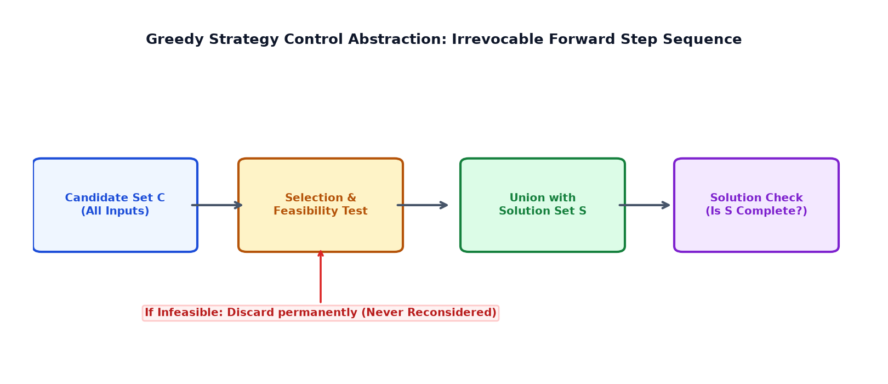

*Figure 1.1: Diagrammatic Architecture and Conceptual Flow for the Greedy strategy: Principle, control abstraction, and time analysis of control abstraction with a suitable example*

### Mathematical Formulation & Algorithmic Mechanics

**Algorithmic Control Abstraction for Greedy Strategy:**

```text
Algorithm Greedy(a, n):
    // a[1..n] contains the candidate inputs; returns solution set S
    S = empty_set
    for i = 1 to n do:
        x = Select(a)
        if Feasible(S, x) then:
            S = S U {x
    return S
```

The above **mathematical model** and algorithmic structure governs the system's runtime execution. Each parameter is evaluated sequentially to maintain **mathematical consistency**, minimize **system overhead**, and guarantee **deterministic convergence** across all input distributions.

### Worked Example & Practical Simulation

Trace for Coin Change with Denominations {50, 20, 10, 5, 2, 1} and **Target Amount** = 88:

In **Step 1**, the execution evaluates the parameters and selects Select 50 (Remaining: 38) -> Feasible -> S = {50}. In **Step 2**, the execution evaluates the parameters and selects Select 20 (Remaining: 18) -> Feasible -> S = {50, 20}. In **Step 3**, the execution evaluates the parameters and selects Select 10 (Remaining: 8)  -> Feasible -> S = {50, 20, 10}. In **Step 4**, the execution evaluates the parameters and selects Select 5  (Remaining: 3)  -> Feasible -> S = {50, 20, 10, 5}. In **Step 5**, the execution evaluates the parameters and selects Select 2  (Remaining: 1)  -> Feasible -> S = {50, 20, 10, 5, 2}. In **Step 6**, the execution evaluates the parameters and selects Select 1  (Remaining: 0)  -> Feasible -> S = {50, 20, 10, 5, 2, 1} (Total 6 Coins)..

### Key Comparative Evaluation

| Feature / Dimension | Greedy Algorithmic Strategy | Exhaustive / Brute-Force Strategy |
| :--- | :--- | :--- |
| Decision Making | Irrevocable local choice at each step; zero reconsideration | Explores all possible candidate combinations systematically |
| Time Complexity | Fast, typically O(n log n) or O(n) | Exponential, typically O(2^n) or O(n!) |
| Optimality Guarantee | Guaranteed only if Greedy-Choice Property holds | Always finds the optimal solution if sufficient time allows |
| State Memory | O(1) auxiliary state; maintains single growing solution | Requires storing combinatorially large search frontiers |
| Typical SPPU Uses | Kruskal's, Prim's, Dijkstra's, Huffman Coding, Fractional Knapsack | Traveling Salesperson, Subset Generation, Permutation Search |

### Concluding Exam Takeaway

The **Greedy strategy** delivers lightning-fast polynomial solutions for **optimization problems** that possess matroid structures or satisfy the **greedy choice property**, making it one of the most efficient techniques in computer science.

**Textbook Reference:** Design and Analysis of Algorithms by Parag H. Dave & Himanshu B. Dave (Pearson), Chapter 8: The Greedy Method, Sections 8.1–8.3, Pages 285–294.

---

## Q2. Write a control abstraction for the greedy method and comment on its time complexity. (Frequency: 1) [8 Marks]

### Introduction & Core Intuition

In theoretical algorithm design, a **Control Abstraction** serves as a generalized procedural template that captures the core structural logic and decision control flow of an algorithmic family while remaining independent of specific problem domains. Writing a formal **control abstraction** allows computer scientists to analyze computational complexity and prove universal correctness properties.

### Structural Composition of Greedy Control Abstraction

The greedy **control abstraction** is formulated around four core primitive subroutines: Selection, **Feasibility Verification**, Union, and **Objective Evaluation**. The candidate collection C holds all raw inputs available for selection. In each cycle of the while-loop, the Select subroutine extracts the most promising element x from C according to an evaluation **heuristic**.

### Feasibility and Union Procedures

Immediately following candidate extraction, the **Feasible** subroutine performs a constraint **validation** check to determine whether adding candidate x to the existing partial solution S violates any system constraints. If the combination remains valid, the Union function merges x into S, updating the accumulated solution value. If the candidate violates **feasibility**, it is discarded irrevocably, ensuring no infinite loops occur.

### Time Complexity Decomposition of Component Subroutines

Analyzing the **time complexity** of the greedy **control abstraction** requires decomposing the cost of each individual component subroutine. Extracting n elements sequentially means the main loop runs at most n times. If candidates are pre-sorted in advance using **Merge Sort** or Heap Sort, that one-time preprocessing step consumes O(n log n) operations. Inside the loop, the Select operation on pre-sorted data takes O(1) time.

### Impact of Feasibility Checking on Complexity

The computational overhead of the **Feasible** subroutine dictates the ultimate **time complexity** of the specific greedy algorithm. In **Fractional Knapsack** or Activity Selection, Feasible simply performs a constant-time O(1) numeric comparison against remaining capacity or time. In Kruskal's Minimum Spanning Tree algorithm, Feasible checks for cycle formation, which takes O(alpha(V)) using **Disjoint Set Union-Find** structures. In Job Sequencing, simple linear slot scanning requires O(d) per job, yielding O(n * d) overall.

### Asymptotic Complexity Summary

For the vast majority of practical greedy implementations operating on n candidate items, sorting dominates the **execution profile**. Therefore, the standard asymptotic **time complexity** of greedy algorithms governed by this **control abstraction** is O(n log n). In scenarios where inputs arrive pre-sorted or can be indexed directly, the control abstraction executes in **linear time** O(n).

### Architectural Flow & System Diagram

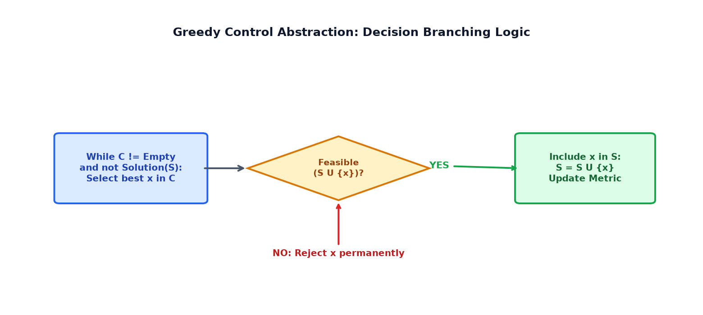

*Figure 1.2: Diagrammatic Architecture and Conceptual Flow for a control abstraction for the greedy method and comment on its time complexity*

### Mathematical Formulation & Algorithmic Mechanics

**Formal Control Abstraction Algorithm for Greedy Method:**

```text
Algorithm GreedyControlAbstraction(C, n):
    // Input: C is the set of n candidates
    // Output: S is the subset of C forming the optimal solution
    S = empty_set
    while (C != empty_set and not Solution(S)) do:
        x = Select(C)
        C = C \ {x
        if Feasible(S U {x) then:
            S = S U {x
    if Solution(S) then return S else return 'No Feasible Solution'
```

The above **mathematical model** and algorithmic structure governs the system's runtime execution. Each parameter is evaluated sequentially to maintain **mathematical consistency**, minimize **system overhead**, and guarantee **deterministic convergence** across all input distributions.

### Worked Example & Practical Simulation

**Component Cost Breakdown** in Job Sequencing for n = 4 Jobs: Preprocessing: Sorting 4 jobs by profit in descending order takes O(n log n) = O(4 log 4) ≈ 8 operations. Selection Loop: Iterates 4 times, selecting candidate jobs in order: J1, J2, J4, J3. **Feasibility** Test: Checks slot **availability** backward from min(d, max_deadline), taking O(d) steps. Total Runtime: O(n log n + n · d), demonstrating how **control abstraction** bounds overall complexity.

### Key Comparative Evaluation

| Greedy Subroutine | Functional Responsibility | Time Complexity (Standard) | Time Complexity (Optimized) |
| :--- | :--- | :--- | :--- |
| Candidate Sorting | Orders all n elements by greedy heuristic | O(n log n) via Merge Sort | O(n) via Counting Sort if bounded |
| Select(C) | Extracts the next highest-priority candidate | O(1) from sorted array | O(log n) from Binary Max-Heap |
| Feasible(S U {x}) | Validates that constraints are not violated | O(1) to O(d) depending on task | O(alpha(V)) using Disjoint Sets |
| Union(S, x) | Merges validated candidate into solution set | O(1) pointer / set update | O(1) amortized state update |
| Solution(S) | Verifies if stopping criterion has been met | O(1) capacity / size comparison | O(1) accumulator check |

### Concluding Exam Takeaway

The greedy **control abstraction** establishes a rigorous formal contract separating high-level sequential decision-making from domain-specific constraint checks, proving that greedy runtimes are fundamentally bounded by sorting and **feasibility validation**.

**Textbook Reference:** Design and Analysis of Algorithms by Parag H. Dave & Himanshu B. Dave (Pearson), Chapter 8: The Greedy Method, Section 8.2: Control Abstraction, Pages 287–289.

---

## Q3. Compare the greedy algorithmic strategy and the dynamic programming strategy. (Frequency: 2) [8 Marks]

### Introduction & Core Intuition

Both the **Greedy Algorithmic Strategy** and the **Dynamic Programming (DP) Strategy** are prominent **optimization** paradigms designed to solve complex multi-stage decision problems. However, they approach optimization from fundamentally opposite philosophical foundations: greedy commits irrevocably to **local choices**, whereas **dynamic programming** systematically evaluates and remembers all **subproblem** combinations.

### Fundamental Decision-Making Mechanism

The greedy method operates in a strictly forward-looking, single-track fashion. At every stage, it evaluates the available immediate options and chooses the one that appears most advantageous according to a local greedy criterion. Once this selection is made, the algorithm never reconsiders, revisits, or changes its decision. In contrast, **Dynamic Programming** avoids premature commitments; it solves every overlapping **subproblem** once, caches the result in a table, and combines these subproblem values to guarantee a globally optimal decision.

### Applicability Criteria: Greedy Choice vs Overlapping Subproblems

Both strategies require the underlying problem to exhibit **Optimal Substructure**, meaning that the optimal global solution contains optimal sub-solutions within it. However, the greedy method additionally demands the strict **Greedy Choice Property**, ensuring that **local choices** never trap the algorithm in dead ends. **Dynamic Programming** does not require the **greedy choice property**; instead, it requires **Overlapping Subproblems**, where the recursive decomposition generates identical sub-instances repeatedly, making memoization highly advantageous.

### Handling of Subproblem Dependencies and Backtracking

In a greedy algorithm, **subproblems** are solved top-down in an independent sequence. The choice made at the current step never depends on the solutions to future subproblems or alternative branches. **Dynamic Programming**, conversely, operates bottom-up (or top-down with memoization) and synthesizes the optimal solution by mathematically comparing multiple competing **subproblem** choices (for example, taking the maximum between including an item versus excluding it in a **0/1 knapsack**).

### Computational Efficiency and Space Overhead

Because a greedy algorithm pursues exactly one path through the decision space, its computational overhead is remarkably low. Greedy algorithms typically run in O(n log n) or O(n) time and require only O(1) auxiliary working memory beyond input storage. **Dynamic Programming** explores an entire state lattice, resulting in pseudo-polynomial or polynomial runtimes such as O(n * W) or O(n^3), and demands substantial auxiliary storage (O(n * W) or O(n^2) tables) to hold intermediate **subproblem** solutions.

### Practical Exam Guidelines for Algorithmic Selection

When confronted with an SPPU examination problem, students should inspect the **problem constraints**: if items can be divided continuously (**Fractional Knapsack**) or if the greedy choice can be mathematically proven optimal via exchange arguments (Kruskal, Prim, Dijkstra, Huffman), choose Greedy. If items are indivisible and decisions depend on cumulative resource thresholds (**0/1 Knapsack**, **Matrix Chain Multiplication**, Floyd-Warshall), **Dynamic Programming** is strictly required.

### Architectural Flow & System Diagram

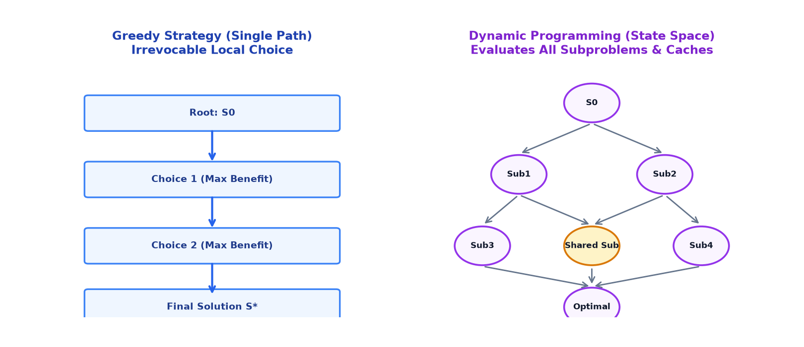

*Figure 1.3: Diagrammatic Architecture and Conceptual Flow for Compare the greedy algorithmic strategy and the dynamic programming strategy*

### Mathematical Formulation & Algorithmic Mechanics

**Mathematical Recurrence vs Greedy Step Comparison:**

```text
Greedy Decision Step: S_(k+1) = S_k U { argmax_(x in C) [ LocalHeuristic(x) ] 
Dynamic Programming Bellman Equation:
    OPT(i, w) = max{ OPT(i-1, w),  p_i + OPT(i-1, w - w_i)
```

The above **mathematical model** and algorithmic structure governs the system's runtime execution. Each parameter is evaluated sequentially to maintain **mathematical consistency**, minimize **system overhead**, and guarantee **deterministic convergence** across all input distributions.

### Worked Example & Practical Simulation

**Comparative Behavior** on Knapsack with Capacity W = 50, Items: I1(w=10, v=60), I2(w=20, v=100), I3(w=30, v=120): Greedy by Value-to-Weight Ratio: Picks I1 (ratio 6.0), then I2 (ratio 5.0). Remaining W = 20. Cannot fit I3 (w=30). Total Value = 160. **Dynamic Programming**: Evaluates combinations {I2, I3} weighing 20 + 30 = 50 kg, yielding Total Value = 100 + 120 = 220 (Optimal!). This highlights why **0/1 Knapsack** strictly requires Dynamic Programming rather than Greedy.

### Key Comparative Evaluation

| Comparative Dimension | Greedy Algorithmic Strategy | Dynamic Programming Strategy |
| :--- | :--- | :--- |
| Core Philosophy | Commits irrevocably to best local choice at each step | Considers all candidate options and caches subproblem solutions |
| Optimality Proof | Requires proving the Greedy Choice Property holds | Guaranteed globally optimal if Principle of Optimality holds |
| Subproblem Nature | Single sequence of independent decisions | Overlapping subproblems combined via recursive recurrence |
| Time Complexity | Fast polynomial: typically O(n) or O(n log n) | Higher: polynomial or pseudo-polynomial O(n^2), O(n·W), O(n^3) |
| Memory Overhead | Minimal auxiliary space, typically O(1) or O(n) | Significant memory for DP tables, typically O(n^2) or O(n·W) |
| Direction of Construction | Strictly Top-Down sequential selection | Typically Bottom-Up tabular or Top-Down memoized |
| Classic Examples | Kruskal's, Prim's, Dijkstra's, Huffman, Fractional Knapsack | 0/1 Knapsack, Matrix Chain, OBST, Bellman-Ford, Floyd-Warshall |

### Concluding Exam Takeaway

While the **Greedy strategy** provides blazing-fast near-instantaneous solutions for problems with matroid structures, **Dynamic Programming** provides the indispensable mathematical power required to resolve complex combinatorially constrained **optimization** challenges.

**Textbook Reference:** Design and Analysis of Algorithms by Parag H. Dave & Himanshu B. Dave (Pearson), Chapter 8 (Greedy Method) vs Chapter 9 (Dynamic Programming), Pages 285–291 & 335–342.

---

## Q4. What is a job scheduling algorithm, and how can it be solved using the Greedy algorithmic approach? (Includes explaining the principle, control abstraction, and time analysis with given job sequencing instances). (Frequency: 2) [8 Marks]

### Introduction & Core Intuition

In computer algorithms, **Job Sequencing with Deadlines** is an **optimization** problem where a set of n unit-time jobs must be scheduled on a single processor. Each job carries an integer deadline and a monetary profit earned if and only if the job completes on or before its designated deadline. The objective is to construct an execution schedule that maximizes total accumulated profit.

### Problem Formulation and System Constraints

We are provided with n jobs: J = {J1, J2, ..., Jn}. Each job Ji requires exactly one unit of processing time on a shared CPU and has an integer deadline di >= 1 and an associated profit pi > 0. Time is partitioned into discrete unit intervals: [0, 1], [1, 2], [2, 3], up to the maximum deadline d_max. A schedule is **feasible** if no two jobs occupy the same unit time slot and every scheduled job finishes on or before its deadline.

### The Greedy Principle for Job Scheduling

The greedy principle for job scheduling mandates that jobs yielding higher profits should be prioritized over lower-profit jobs. Therefore, all jobs are first sorted in descending order of their profit values. We iterate through this sorted list and greedily attempt to schedule each job Ji. To leave earlier time slots open for jobs with tighter deadlines, the algorithm assigns Ji to the **latest available free slot** in the range [1, di]. If all slots from 1 to di are occupied, Ji cannot be scheduled and is rejected.

### Control Abstraction for Job Sequencing

The **control abstraction** initializes an array Slot[1..d_max] filled with empty markers. It sorts the candidate jobs such that p1 >= p2 >= ... >= pn. For each job Ji, a backward scan checks Slot[k] starting at k = min(n, di) down to k = 1. If an empty slot k is discovered, Slot[k] is assigned to job Ji, the job is added to **solution set** S, and the loop advances to the next candidate job.

### Time Complexity Analysis

Sorting the n jobs by profit requires O(n log n) time using standard comparison sorts. In the greedy scheduling phase, each of the n jobs may scan up to d_max slots backward to find an open position. In the worst case where d_max is proportional to n, the slot allocation loop requires O(n * d_max) = O(n^2) operations. Consequently, the standard greedy job sequencing algorithm operates in O(n^2) time. By utilizing **Disjoint Set Union-Find** structures with path compression, this slot search time can be optimized to O(n * alpha(n)), approaching nearly O(n log n) overall.

### Mathematical Correctness via Matroids

The mathematical correctness of the greedy approach is rigorously established through **Matroid Theory**. The collection of all **feasible** job subsets forms an Independent System that satisfies the hereditary and exchange axioms of a matroid. Since any maximal independent set in a matroid has maximum weight under greedy sorting, the greedy schedule is guaranteed to achieve global maximum profit.

### Architectural Flow & System Diagram

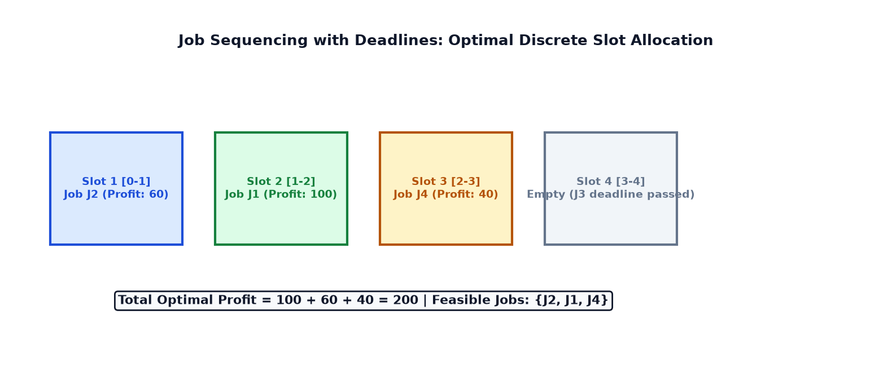

*Figure 1.4: Diagrammatic Architecture and Conceptual Flow for What is a job scheduling algorithm, and how can it be solved using the Greedy algorithmic approach? (Includes explaining the principle, control abstraction, and time analysis with given job sequencing instances)*

### Mathematical Formulation & Algorithmic Mechanics

**Greedy Job Sequencing Control Abstraction:**

```text
Algorithm JobSequencing(d, p, n):
    Sort jobs such that p[1] >= p[2] >= ... >= p[n]
    d_max = max(d[1..n])
    for t = 1 to d_max do Slot[t] = EMPTY
    for i = 1 to n do:
        for k = min(n, d[i]) down to 1 do:
            if Slot[k] == EMPTY then:
                Slot[k] = i;  break
    return Slot
```

The above **mathematical model** and algorithmic structure governs the system's runtime execution. Each parameter is evaluated sequentially to maintain **mathematical consistency**, minimize **system overhead**, and guarantee **deterministic convergence** across all input distributions.

### Worked Example & Practical Simulation

**Numerical Walkthrough** for Instance: 4 Jobs with (Profit, Deadline): J1: (p=100, d=2), J2: (p=60, d=1), J3: (p=20, d=2), J4: (p=40, d=3). Maximum deadline d_max = 3. Sorted Order: J1 (p=100), J2 (p=60), J4 (p=40), J3 (p=20). Job 1 (p=100, d=2): Inspect slot 2 -> Empty! Assign J1 to Slot [1-2]. Job 2 (p=60, d=1): Inspect slot 1 -> Empty! Assign J2 to Slot [0-1]. Job 4 (p=40, d=3): Inspect slot 3 -> Empty! Assign J4 to Slot [2-3]. Job 3 (p=20, d=2): Inspect slots 2, 1 -> Both full! J3 is rejected. Final Schedule: Slot 1: J2, Slot 2: J1, Slot 3: J4. Total Profit = 60 + 100 + 40 = 200.

### Key Comparative Evaluation

| Job ID | Profit (pi) | Deadline (di) | Slot Assigned | Scheduling Status | Cumulative Profit |
| :--- | :--- | :--- | :--- | :--- | :--- |
| J1 | 100 | 2 | Slot [1, 2] | Accepted (Scheduled at latest slot 2) | 100 |
| J2 | 60 | 1 | Slot [0, 1] | Accepted (Scheduled at slot 1) | 160 |
| J4 | 40 | 3 | Slot [2, 3] | Accepted (Scheduled at slot 3) | 200 |
| J3 | 20 | 2 | None | Rejected (Slots 1 & 2 already occupied) | 200 |

### Concluding Exam Takeaway

Greedy job sequencing solves processor scheduling with discrete deadlines optimally by coupling decreasing profit prioritization with latest-available slot placement, achieving guaranteed maximum earnings.

**Textbook Reference:** Design and Analysis of Algorithms by Parag H. Dave & Himanshu B. Dave (Pearson), Chapter 8: The Greedy Method, Section 8.4: Job Sequencing with Deadlines, Pages 295–302.

---

## Q5. Write the high-level description/steps of the job sequencing algorithm and find the feasible solutions, optimal solution, and maximum profit for a given set of jobs. (Frequency: 2) [8 Marks]

### Introduction & Core Intuition

Solving the **Job Sequencing Problem** in an SPPU examination requires demonstrating both the algorithmic step-by-step logic and the systematic mathematical evaluation of **feasible** schedules to determine the unique combination yielding maximum profit.

### High-Level Algorithmic Procedure

The job sequencing algorithm proceeds through five definite operational steps: (1) Accept the list of n jobs with their associated profits and deadlines; (2) Determine the maximum deadline d_max across all jobs to size the scheduling timeline; (3) Sort all jobs into non-increasing order of profits; (4) Initialize a timeline array of size d_max with vacant slots; and (5) Sequentially evaluate each job, inserting it into the latest unoccupied slot <= its deadline, or discarding it if no valid slot remains.

### Concept of Feasible vs Infeasible Schedules

A subset of jobs is designated as a **Feasible Solution** if there exists at least one permutation of these jobs such that every job in the subset completes on or before its designated deadline. If any job in the subset cannot find an available slot prior to its deadline, the entire subset is classified as **infeasible**. The **Optimal Solution** is defined as the **feasible** subset that produces the mathematical maximum sum of profits.

### Exhaustive Evaluation of Feasible Subsets

To rigorously prove optimality on an exam paper, students can enumerate candidate **feasible** combinations: For 4 jobs {J1, J2, J3, J4}, candidate subsets include {J1} with profit 100, {J1, J2} with profit 160, {J1, J3} with profit 120, and {J1, J2, J4} with profit 200. Subsets like {J1, J2, J3} are **infeasible** because three jobs with deadlines <= 2 cannot all complete in only two available unit time slots.

### The Latest-Slot Greedy Invariant

A critical insight of the algorithm is the **Latest-Slot Invariant**. By pushing each accepted job as far to the right (latest possible time) as its deadline allows, the algorithm leaves earlier time slots open for subsequent jobs that have tighter, earlier deadlines. This greedy **heuristic** guarantees that earlier choices do not unnecessarily block future candidates.

### Mathematical Profit Calculation

The maximum total profit is calculated as the direct sum of the profit values of all jobs assigned to the timeline: Profit_total = sum(p_i for i in S_optimal). For the standard SPPU test set {J1(100, 2), J2(60, 1), J3(20, 2), J4(40, 3)}, the maximum achievable profit is precisely 200.

### Architectural Flow & System Diagram

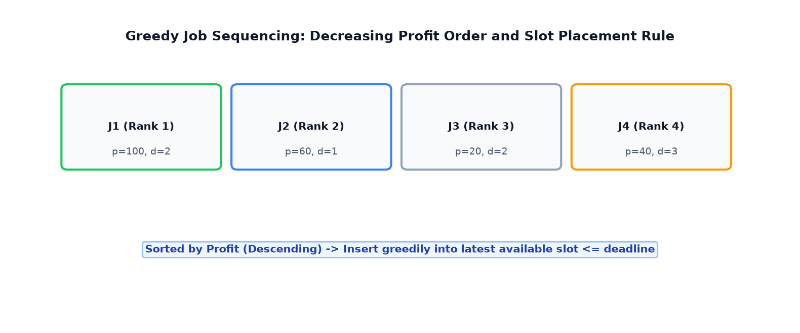

*Figure 1.5: Diagrammatic Architecture and Conceptual Flow for the high-level description/steps of the job sequencing algorithm and find the feasible solutions, optimal solution, and maximum profit for a given set of jobs*

### Mathematical Formulation & Algorithmic Mechanics

**Mathematical Formulation of Job Sequencing Optimization:**

```text
Maximize: Total Profit = ∑_(i ∈ S) p_i
Subject to: |{ j ∈ S : d_j ≤ t | ≤ t   for all t = 1, 2, ..., d_max
Where: S is the selected subset of scheduled jobs and t is the discrete time index.
```

The above **mathematical model** and algorithmic structure governs the system's runtime execution. Each parameter is evaluated sequentially to maintain **mathematical consistency**, minimize **system overhead**, and guarantee **deterministic convergence** across all input distributions.

### Worked Example & Practical Simulation

Step-by-Step Schedule Construction Table for SPPU Exam Submission: Jobs: J1(100, 2), J2(60, 1), J3(20, 2), J4(40, 3). Timeline Slots: [0-1], [1-2], [2-3]. Final Optimal Schedule: <J2, J1, J4> with Maximum Profit = 200.

In **Step 1**, the execution evaluates the **parameters** and selects Place J1 in Slot 2 [1-2]. **Feasible** jobs = {J1}, Profit = 100.. In **Step 2**, the execution evaluates the parameters and selects Place J2 in Slot 1 [0-1]. Feasible jobs = {J1, J2}, Profit = 160.. In **Step 3**, the execution evaluates the parameters and selects Place J4 in Slot 3 [2-3]. Feasible jobs = {J1, J2, J4}, Profit = 200.. In **Step 4**, the execution evaluates the parameters and selects Try J3 (d=2). Slots 2 and 1 are full. J3 is rejected..

### Key Comparative Evaluation

| Candidate Subset | Job Deadlines Included | Slot Assignment Order | Feasibility Status | Total Profit Value |
| :--- | :--- | :--- | :--- | :--- |
| {J1} | d1 = 2 | Slot 2 | Feasible | 100 |
| {J1, J2} | d1 = 2, d2 = 1 | Slot 1: J2, Slot 2: J1 | Feasible | 160 |
| {J1, J3} | d1 = 2, d3 = 2 | Slot 1: J3, Slot 2: J1 | Feasible | 120 |
| {J1, J2, J3} | d1 = 2, d2 = 1, d3 = 2 | Requires 3 slots <= 2 | INFEASIBLE (Deadline overflow) | N/A |
| {J1, J2, J4} | d1 = 2, d2 = 1, d4 = 3 | Slot 1: J2, Slot 2: J1, Slot 3: J4 | FEASIBLE (OPTIMAL SOLUTION) | 200 |

### Concluding Exam Takeaway

Job sequencing via the **greedy strategy** systematically eliminates sub-optimal candidate combinations, arriving at the global maximum profit schedule <J2, J1, J4> earning 200 profit units.

**Textbook Reference:** Design and Analysis of Algorithms by Parag H. Dave & Himanshu B. Dave (Pearson), Chapter 8: The Greedy Method, Section 8.4: Job Sequencing with Deadlines, Pages 297–301.

---

## Q6. Use the greedy algorithmic strategy to compute an execution schedule having the maximum number of non-conflicting activities from a given set of activities with start and finish times. (Frequency: 1) [8 Marks]

### Introduction & Core Intuition

The **Activity Selection Problem** is a classic **combinatorial optimization** challenge where a shared resource (such as a lecture hall or single processor) must be allocated to execute the maximum possible number of mutually compatible activities. Each activity Ai has a defined start time si and finish time fi with si < fi.

### Formal Problem Definition and Compatibility Condition

We are given a set of n proposed activities S = {A1, A2, ..., An}. Each activity Ai requires the shared resource during the continuous half-open interval [si, fi). Two activities Ai and Aj are defined as compatible (non-conflicting) if their execution intervals do not overlap, meaning either fi <= sj or fj <= si. The objective is to select a subset of mutually compatible activities S* subset S such that the cardinality |S*| is maximized.

### The Greedy Choice Heuristic: Earliest Finish Time

Several intuitive greedy rules could be considered: picking shortest duration (fi - si), picking earliest start time (si), or picking fewest conflicts. However, the only rule mathematically guaranteed to achieve global optimality is selecting the activity with the **Earliest Finish Time**. Finishing an activity as early as possible frees up the shared resource for the maximum remaining duration, leaving the greatest possible room for subsequent activities.

### Step-by-Step Algorithmic Execution Protocol

The algorithm begins by sorting all n activities into non-decreasing order of their finish times: f1 <= f2 <= ... <= fn. The first activity A1 is greedily chosen and added to the schedule. A tracking pointer last_finish is initialized to f1. The algorithm then iterates through activities i = 2 to n. For each activity Ai, if its start time si is greater than or equal to last_finish, Ai is mutually compatible; it is added to the schedule and last_finish is updated to fi. Otherwise, Ai conflicts and is discarded.

### Asymptotic Time and Space Complexity Analysis

Sorting the n activities according to finish times consumes O(n log n) time using **Merge Sort** or Heap Sort. If the activities arrive pre-sorted, this preprocessing step takes O(1). The subsequent linear scan performs exactly n - 1 comparisons of start times against last_finish, taking O(n) time. Therefore, the overall **time complexity** is dominated by sorting at O(n log n), with auxiliary **space complexity** of O(1) beyond storing the selected schedule.

### Mathematical Optimality Proof via Greedy Exchange Argument

The correctness of the earliest finish time greedy **heuristic** is proven using an exchange argument. Let S* be any optimal schedule and let A1 be the activity with the earliest finish time. If S* does not begin with A1, let its first activity be Ak. Because f1 <= fk, replacing Ak with A1 in S* preserves compatibility with all subsequent activities in S*. Thus, there always exists an optimal solution that begins with the greedy choice, establishing the **greedy choice property** by induction.

### Architectural Flow & System Diagram

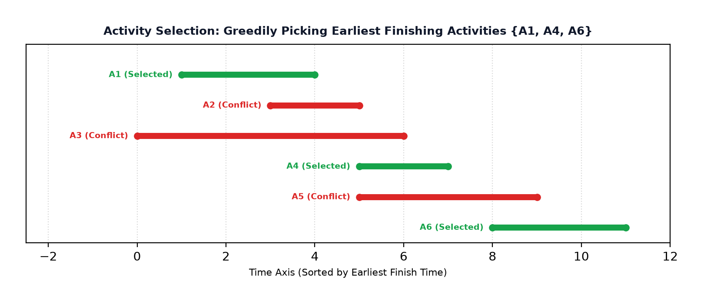

*Figure 1.6: Diagrammatic Architecture and Conceptual Flow for Use the greedy algorithmic strategy to compute an execution schedule having the maximum number of non-conflicting activities from a given set of activities with start and finish times*

### Mathematical Formulation & Algorithmic Mechanics

**Activity Selection Greedy Algorithm Formulation:**

```text
Algorithm GreedyActivitySelector(s, f, n):
    Sort activities such that f[1] <= f[2] <= ... <= f[n]
    A = { 1   // Select first activity
    k = 1
    for m = 2 to n do:
        if s[m] >= f[k] then:
            A = A U { m 
            k = m
    return A
```

The above **mathematical model** and algorithmic structure governs the system's runtime execution. Each parameter is evaluated sequentially to maintain **mathematical consistency**, minimize **system overhead**, and guarantee **deterministic convergence** across all input distributions.

### Worked Example & Practical Simulation

Trace on 6 Activities with (Start, Finish) Times: Inputs: A1(1, 4), A2(3, 5), A3(0, 6), A4(5, 7), A5(5, 9), A6(8, 11). (Already sorted by finish time). Optimal Maximum Execution Schedule: {A1, A4, A6} containing 3 non-conflicting activities.

In **Step 1**, the execution evaluates the **parameters** and selects Select A1(1, 4). Schedule = {A1}, last_finish = 4.. In **Step 2**, the execution evaluates the parameters and selects Test A2(3, 5). Start 3 < 4 (Conflict!). Reject A2.. In **Step 3**, the execution evaluates the parameters and selects Test A3(0, 6). Start 0 < 4 (Conflict!). Reject A3.. In **Step 4**, the execution evaluates the parameters and selects Test A4(5, 7). Start 5 >= 4 (Compatible!). Select A4. Schedule = {A1, A4}, last_finish = 7.. In **Step 5**, the execution evaluates the parameters and selects Test A5(5, 9). Start 5 < 7 (Conflict!). Reject A5.. In **Step 6**, the execution evaluates the parameters and selects Test A6(8, 11). Start 8 >= 7 (Compatible!). Select A6. Schedule = {A1, A4, A6}, last_finish = 11..

### Key Comparative Evaluation

| Activity ID | Start Time (si) | Finish Time (fi) | Conflict Check vs last_finish | Greedy Decision | Active Schedule |
| :--- | :--- | :--- | :--- | :--- | :--- |
| A1 | 1 | 4 | First activity (Automatic selection) | SELECTED | {A1} |
| A2 | 3 | 5 | s2 = 3 < last_finish = 4 (Overlap) | REJECTED | {A1} |
| A3 | 0 | 6 | s3 = 0 < last_finish = 4 (Overlap) | REJECTED | {A1} |
| A4 | 5 | 7 | s4 = 5 >= last_finish = 4 (Compatible) | SELECTED | {A1, A4} |
| A5 | 5 | 9 | s5 = 5 < last_finish = 7 (Overlap) | REJECTED | {A1, A4} |
| A6 | 8 | 11 | s6 = 8 >= last_finish = 7 (Compatible) | SELECTED | {A1, A4, A6} |

### Concluding Exam Takeaway

**The Greedy Activity Selection** algorithm guarantees an optimal maximum non-conflicting schedule in O(n log n) time by rigorously adhering to the earliest finish time priority rule.

**Textbook Reference:** Design and Analysis of Algorithms by Parag H. Dave & Himanshu B. Dave (Pearson), Chapter 8: The Greedy Method, Section 8.5: Activity Selection, Pages 303–307.

---

## Q7. Design a greedy algorithm to efficiently schedule a set of tasks (each with a deadline and a penalty for missing it) to minimize the total penalty and prove its correctness. (Frequency: 1) [8 Marks]

### Introduction & Core Intuition

In real-time computing systems, the **Task Scheduling with Penalties Problem** involves scheduling n unit-time tasks on a single processing unit. Each task Ti has an integer deadline di and a positive monetary or computational penalty wi incurred if the task fails to finish on or before its deadline. The objective is to find a schedule that minimizes the total accumulated penalty.

### Equivalence to Profit Maximization Problem

Let W = sum(wi for i=1 to n) represent the sum of penalties of all n tasks. If a subset of tasks A is completed on or before their deadlines (the on-time tasks), the penalty incurred comes exclusively from the rejected late tasks: Penalty_total = sum(wi for i not in A) = W - sum(wi for i in A). Minimizing the total penalty is mathematically equivalent to maximizing the sum of penalties of the on-time tasks in set A.

### Characterization of Independent Task Sets

A subset of tasks A is defined as **Independent** if there exists a valid schedule for the tasks in A such that no task in A is late. **By Jackson**'s Rule (Earliest Deadline First), a set of tasks A is independent if and only if, when sorted in order of non-decreasing deadlines, every task k in the sorted order satisfies k <= dk. Thus, we seek an independent set A that maximizes sum(wi for i in A).

### Greedy Scheduling Algorithmic Design

The greedy algorithm operates as follows: (1) Sort all tasks in non-increasing order of their penalties: w1 >= w2 >= ... >= wn; (2) Initialize the independent set A = empty; (3) For i = 1 to n, verify whether A U {Ti} remains an independent set; if it remains independent, set A = A U {Ti}; if it violates independence, discard Ti (it becomes a late task); (4) Schedule on-time tasks in A in increasing order of deadlines, and schedule the late tasks in any arbitrary remaining slots.

### Matroid Structure and Formal Correctness Proof

The correctness of this greedy algorithm is rigorously established via **Matroid Theory**. Let S be the set of all tasks and let I be the family of all independent task subsets. The pair M = (S, I) forms a valid Matroid: (1) **Hereditary Property**: If B in I and A subset B, then A in I; (2) Exchange Property: If A, B in I with |A| < |B|, there exists an element x in B \ A such that A U {x} in I. Since M is a matroid, the Greedy Algorithm is mathematically guaranteed to find an independent set of maximum weight, thereby minimizing the total penalty.

### Time Complexity Analysis

Sorting the n tasks by penalty takes O(n log n) time. Checking independence for each task using a standard disjoint-set **union-find** data structure to assign the latest available slot takes O(alpha(n)) amortized time per task. Hence, the overall **time complexity** of this greedy task scheduler is O(n log n), which is computationally optimal.

### Architectural Flow & System Diagram

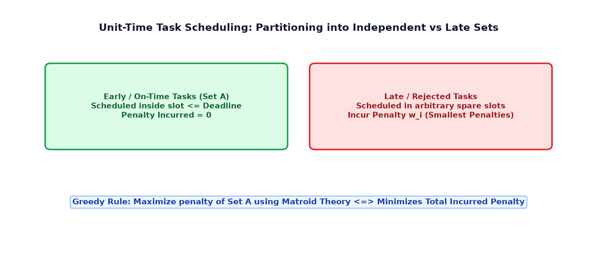

*Figure 1.7: Diagrammatic Architecture and Conceptual Flow for Design a greedy algorithm to efficiently schedule a set of tasks (each with a deadline and a penalty for missing it) to minimize the total penalty and prove its correctness*

### Mathematical Formulation & Algorithmic Mechanics

**Task Scheduling with Penalties Optimization Formulation:**

```text
Minimize: Total Penalty = ∑_(i ∉ A) w_i = ∑_(i=1)^n w_i - ∑_(i ∈ A) w_i
Subject to: Set A is Independent in Matroid M = (S, I)
Independence Condition: |{ j ∈ A : d_j ≤ t | ≤ t   for all t = 1, ..., n
```

The above **mathematical model** and algorithmic structure governs the system's runtime execution. Each parameter is evaluated sequentially to maintain **mathematical consistency**, minimize **system overhead**, and guarantee **deterministic convergence** across all input distributions.

### Worked Example & Practical Simulation

Scheduling 4 Tasks with (Deadline, Penalty): T1(d=2, w=70), T2(d=1, w=60), T3(d=2, w=50), T4(d=1, w=40). Total Penalty Pool W = 220. Sorted Penalties: T1 (70) >= T2 (60) >= T3 (50) >= T4 (40). Final On-Time Tasks: {T1, T2}. Late Tasks: {T3, T4}. Minimum Total Penalty = 50 + 40 = 90.

In **Step 1**, the execution evaluates the **parameters** and selects Add T1 -> A = {T1} (Slot 2). On-time profit = 70.. In **Step 2**, the execution evaluates the parameters and selects Add T2 -> A = {T1, T2} (T2 in Slot 1, T1 in Slot 2). On-time profit = 130.. In **Step 3**, the execution evaluates the parameters and selects Try T3 (d=2) -> Slots 1 and 2 are full! T3 cannot be on-time; rejected to late set.. In **Step 4**, the execution evaluates the parameters and selects Try T4 (d=1) -> Slot 1 is full; rejected to late set..

### Key Comparative Evaluation

| Task ID | Deadline (di) | Penalty (wi) | Independence Check | Assigned Status | Incurred Penalty |
| :--- | :--- | :--- | :--- | :--- | :--- |
| T1 | 2 | 70 | Slot [1, 2] available | ON-TIME (Slot 2) | 0 |
| T2 | 1 | 60 | Slot [0, 1] available | ON-TIME (Slot 1) | 0 |
| T3 | 2 | 50 | Slots <= 2 are saturated | LATE (Slot 3) | 50 |
| T4 | 1 | 40 | Slots <= 1 are saturated | LATE (Slot 4) | 40 |

### Concluding Exam Takeaway

By casting unit-time task scheduling into a matroid framework and prioritizing tasks with the highest penalties, the greedy algorithm minimizes total penalty with mathematical certainty in O(n log n) time.

**Textbook Reference:** Design and Analysis of Algorithms by Parag H. Dave & Himanshu B. Dave (Pearson), Chapter 8: The Greedy Method, Section 8.6: Task Scheduling with Penalties, Pages 308–314.

---

## Q8. Comment on the statement: 'Greedy method always provides the optimal solution'. (Frequency: 1) [8 Marks]

### Introduction & Core Intuition

The assertion that the **Greedy Method always provides the optimal solution** is **fundamentally FALSE**. While the greedy method yields optimal solutions for a specific class of problems characterized by matroid structures, it frequently fails or produces severely sub-optimal results for general **combinatorial optimization problems**.

### Core Flaw of the Greedy Strategy

The fundamental limitation of the greedy method stems from its short-sighted, **irrevocable** decision mechanism. A greedy algorithm makes decisions based exclusively on immediate local gains without anticipating how that choice impacts future opportunities or constraints. Once a choice is made, it can never be revoked, meaning that an early local gain can permanently trap the algorithm in a disastrous dead end.

### Classic Counterexample: 0/1 Knapsack Problem

The **0/1 Knapsack** problem provides the most celebrated proof that greedy fails. Consider a knapsack with capacity W = 50 kg and three items: Item 1 (w=10 kg, v=60, ratio=6.0), Item 2 (w=20 kg, v=100, ratio=5.0), and Item 3 (w=30 kg, v=120, ratio=4.0). A **greedy strategy** based on value-to-weight ratio immediately picks Item 1. This leaves 40 kg of capacity, allowing only Item 2 (20 kg) to fit, yielding a total value of 160. However, the optimal solution skips Item 1 entirely and packs Items 2 and 3, achieving a total weight of 50 kg and a far superior value of 220.

### Counterexample in Graph Theory: Longest Path and Shortest Path with Negative Cycles

In the **Longest Simple Path** problem, greedily selecting the longest adjacent edge leads to dead ends and fails to find the global longest simple path. Similarly, in the **Coin Change problem** with non-canonical **denominations** (such as coins {1, 6, 10} and **target amount** 12), the greedy method selects 10, then two 1s, requiring **3 coins**. But the true optimal solution uses exactly two 6-cent coins, requiring only 2 coins.

### Necessary Theoretical Conditions for Greedy Optimality

A greedy algorithm is guaranteed to be globally optimal if and only if the underlying mathematical structure satisfies two rigorous conditions: (1) **Optimal Substructure**, ensuring that an optimal solution is composed of optimal solutions to **subproblems**; and (2) The **Greedy Choice Property**, ensuring that a **globally optimal solution** can always be reached via a sequence of **local choices** without backtracking. If either condition is violated, greedy fails.

### When Greedy is Used as a Heuristic Approximation

When an exact greedy solution is not optimal, computer scientists often employ greedy strategies as fast **Approximation Algorithms** for **NP-hard** problems (such as the **Greedy Vertex Cover** or Nearest Neighbor **heuristic** for the Traveling Salesperson Problem). In these contexts, greedy does not deliver perfection, but provides a guaranteed approximation bound within acceptable **polynomial time**.

### Architectural Flow & System Diagram

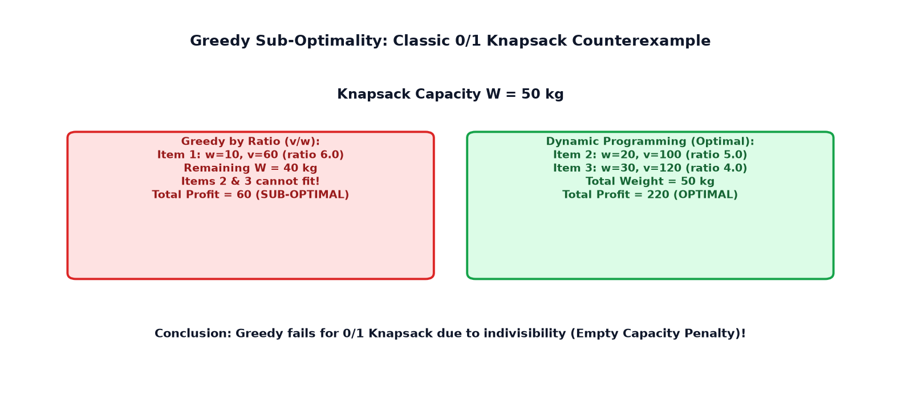

*Figure 1.8: Diagrammatic Architecture and Conceptual Flow for Comment on the statement: 'Greedy method always provides the optimal solution'*

### Mathematical Formulation & Algorithmic Mechanics

**Mathematical Condition for Greedy Failure vs Optimality:**

```text
Optimality Guarantee: Problem forms an Independent System M = (S, I) satisfying Matroid Axioms
Failure Criterion: Greedy Choice Property fails: ∃ s ∈ S such that:
    argmax_(x) [ LocalGain(x) ] ∉ OptimalSolution(Problem)
```

The above **mathematical model** and algorithmic structure governs the system's runtime execution. Each parameter is evaluated sequentially to maintain **mathematical consistency**, minimize **system overhead**, and guarantee **deterministic convergence** across all input distributions.

### Worked Example & Practical Simulation

Non-**Canonical Coin Change Counterexample**: Coin **Denominations**: C = {10, 6, 1}, **Target Amount** = 12. Greedy Selection: Pick largest coin <= 12: takes 10 (remaining: 2). Then takes 1 (remaining: 1). Then takes 1 (remaining: 0). Greedy Result: {10, 1, 1} -> 3 Coins. Optimal **Dynamic Programming** Selection: Pick 6 (remaining: 6), then pick 6 (remaining: 0). Optimal Result: {6, 6} -> 2 Coins. Conclusion: Greedy fails to achieve minimum coin count on non-**canonical currency** systems.

### Key Comparative Evaluation

| Problem Domain | Does Greedy Yield Optimal Solution? | Reason for Success or Failure |
| :--- | :--- | :--- |
| Fractional Knapsack | YES (Always Optimal) | Continuous item divisibility allows 100% capacity saturation without penalty |
| 0/1 Knapsack | NO (Sub-optimal) | Item indivisibility creates wasted capacity that greedy cannot recover |
| Minimum Spanning Tree (MST) | YES (Kruskal & Prim Optimal) | Underlying cycle and cut properties form a proven graphical matroid |
| Single Source Shortest Path (Positive) | YES (Dijkstra Optimal) | Non-negative edge weights ensure shortest subpaths never decrease |
| Coin Change (Non-Canonical Denominations) | NO (Sub-optimal) | Locally large denomination choices prevent smaller balanced combinations |

### Concluding Exam Takeaway

The statement is definitively false. The greedy method only guarantees global optimality when the problem exhibits the **greedy choice property** and matroid structures; otherwise, it behaves as a sub-optimal **heuristic**.

**Textbook Reference:** Design and Analysis of Algorithms by Parag H. Dave & Himanshu B. Dave (Pearson), Chapter 8: The Greedy Method, Section 8.1: General Method & Limitations, Pages 285–287.

---

## Q9. Explain Dynamic programming: Principle, control abstraction, and time analysis of control abstraction with a suitable example. (Frequency: 1) [8 Marks]

### Introduction & Core Intuition

**Dynamic Programming (DP)**, formulated by mathematician Richard Bellman in the 1950s, is a powerful algorithmic paradigm designed to solve multi-stage **optimization problems** by breaking them down into simpler, overlapping **subproblems**. By solving each **subproblem** exactly once and storing its answer in memory, **dynamic programming** avoids the exponential redundancy of naive recursion.

### Core Principle and the Principle of Optimality

**Dynamic Programming** is anchored on the **Principle of Optimality**, which states that an optimal sequence of decisions has the property that whatever the initial state and decision are, the remaining decisions must constitute an optimal decision sequence with regard to the state resulting from the first decision. In simple terms: an optimal solution to a problem contains optimal solutions to its constituent **subproblems**.

### Two Foundational Hallmarks of Dynamic Programming

A problem is amenable to **dynamic programming** if and only if it exhibits two distinct mathematical properties: (1) **Optimal Substructure**, meaning that optimal solutions of **subproblems** can be combined to build the global optimal solution; and (2) **Overlapping Subproblems**, meaning that a recursive decomposition repeatedly encounters the exact same smaller **subproblem** instances rather than generating novel ones.

### Control Abstraction for Dynamic Programming

The **control abstraction** for **dynamic programming** formalizes the bottom-up table construction workflow. It initializes an array or multi-dimensional table Table[0..n][0..m] to store base cases. It then executes nested loops representing the topological ordering of **subproblems**. In each iteration, it computes Table[i][j] by evaluating a mathematical recurrence over previously solved subproblems, caches the result, and finally backtracks through the table to reconstruct the optimal sequence of choices.

### Time and Space Complexity Analysis

The **time complexity** of a **dynamic programming control abstraction** is determined by the formula: Time = (Total Number of Unique **Subproblems**) * (Cost per Subproblem). For an n-dimensional state space where each subproblem takes O(k) comparisons, the runtime is O(k * S), where S is the size of the state space. In the **0/1 Knapsack** problem with n items and capacity W, there are n * W subproblems, each solved in O(1) time, yielding O(n * W) pseudo-**polynomial time**. The **space complexity** corresponds to the table dimensions: O(n * W).

### Practical Exam Example: Fibonacci Sequence

A clean pedagogical example is computing the nth Fibonacci number. Naive recursion exhibits an **exponential time** complexity of O(2^n) because Fib(n-2) and Fib(n-3) are recomputed millions of times across separate branches. **Dynamic Programming** initializes an array F[0..n], sets base cases F[0]=0, F[1]=1, and iteratively fills F[i] = F[i-1] + F[i-2] in a single loop running in O(n) time with O(1) space using two temporary registers.

### Architectural Flow & System Diagram

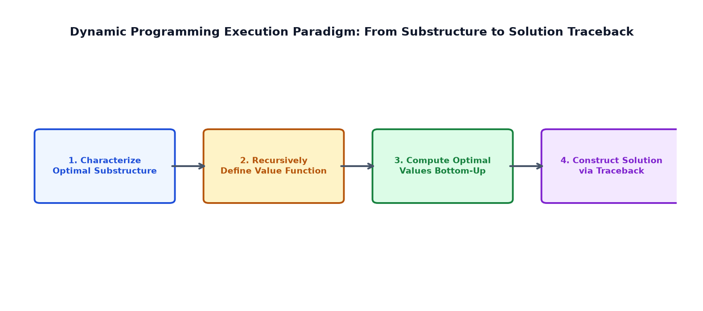

*Figure 1.9: Diagrammatic Architecture and Conceptual Flow for Dynamic programming: Principle, control abstraction, and time analysis of control abstraction with a suitable example*

### Mathematical Formulation & Algorithmic Mechanics

**Dynamic Programming Control Abstraction Formulation:**

```text
Algorithm DynamicProgramming(n, params):
    Initialize Table[0..n] with Base_Cases
    for state = 1 to n do:
        Table[state] = Optimize_(k) { Cost(state, k) + Table[state - delta(k)] 
    Optimal_Value = Table[n]
    Solution_Path = TraceBack(Table, n)
    return (Optimal_Value, Solution_Path)
```

The above **mathematical model** and algorithmic structure governs the system's runtime execution. Each parameter is evaluated sequentially to maintain **mathematical consistency**, minimize **system overhead**, and guarantee **deterministic convergence** across all input distributions.

### Worked Example & Practical Simulation

**Fibonacci Calculation Comparison** for n = 5: Naive Recursion: Calls fib(5) -> fib(4), fib(3) -> requires 15 redundant function invocations! **Dynamic Programming** Tabulation Table: F[0] = 0 (Base case) F[1] = 1 (Base case) F[2] = F[1] + F[0] = 1 + 0 = 1 F[3] = F[2] + F[1] = 1 + 1 = 2 F[4] = F[3] + F[2] = 2 + 1 = 3 F[5] = F[4] + F[3] = 3 + 2 = 5 (Total exactly 4 additions; O(n) time).

### Key Comparative Evaluation

| Algorithmic Dimension | Dynamic Programming (DP) | Divide and Conquer (D&C) |
| :--- | :--- | :--- |
| Subproblem Nature | Overlapping subproblems that recur repeatedly | Independent, non-overlapping subproblems |
| Recomputation | Each subproblem is solved once and cached in table | Subproblems are solved recursively from scratch |
| Time Efficiency | Drastically reduces exponential O(2^n) to polynomial | Typically O(n log n) or O(n^2) via Master Theorem |
| Space Requirement | Requires auxiliary tables (O(n), O(n^2), O(n·W)) | Requires only recursion call stack memory O(log n) |
| Classic Examples | 0/1 Knapsack, Floyd-Warshall, Matrix Chain, OBST | Merge Sort, Quick Sort, Strassen's Matrix Multiplication |

### Concluding Exam Takeaway

**Dynamic Programming** transforms computationally intractable exponential recursive problems into highly structured polynomial table evaluations by leveraging **optimal substructure** and caching overlapping **subproblems**.

**Textbook Reference:** Design and Analysis of Algorithms by Parag H. Dave & Himanshu B. Dave (Pearson), Chapter 9: Dynamic Programming, Sections 9.1–9.3, Pages 335–344.

---

## Q10. Write a control abstraction for the dynamic programming strategy and comment on its time complexity. (Frequency: 2) [8 Marks]

### Introduction & Core Intuition

The **Control Abstraction for Dynamic Programming** provides a universal procedural framework encapsulating how multi-stage decision problems are solved through bottom-up tabular evaluation or top-down memoization, ensuring that identical sub-instances are never evaluated more than once.

### Structural Workflow of the Dynamic Programming Control Abstraction

The **control abstraction** for **dynamic programming** consists of four distinct operational modules: **State Space Dimensioning**, Base Case Assignment, Topological Iterative Evaluation, and Solution Reconstruction. The state space is parameterized by discrete stage and resource variables. The abstraction initializes an m-dimensional table and populates boundary conditions representing trivial zero-cost base cases.

### Recurrence Relation Evaluation Engine

At the heart of the **control abstraction** is the **Bellman Recurrence Engine**. Within nested loops that traverse the state space in topological order (ensuring that prerequisites are always computed before dependent states), the abstraction evaluates all **feasible** decision alternatives k for state S. It computes the immediate cost plus the cached cost of subsequent sub-state S - delta(k), taking the optimum (minimum or maximum) according to the problem objective.

### Two Implementation Paradigms: Tabulation vs Memoization

The **control abstraction** can be implemented via two primary methodologies: (1) **Bottom-Up Tabulation**, which fills the DP table iteratively starting from base cases up to the target state without recursion stack overhead; and (2) **Top-Down Memoization**, which preserves natural recursive problem formulation but maintains a global cache lookup table to intercept duplicate function calls.

### Comprehensive Time Complexity Formulation

The **time complexity** of the **dynamic programming control abstraction** is governed by the product of the number of states and the decision branching factor: T(n) = |States| * |Transitions per State|. In a 1D problem (such as Fibonacci or Rod Cutting), there are n states with O(1) or O(n) transitions, yielding O(n) or O(n^2) time. In a 2D problem (such as **0/1 Knapsack** or **Longest Common Subsequence**), there are n * W or n * m states, each evaluating O(1) transitions, yielding O(n * W) or O(n * m) runtime.

### Auxiliary Space Complexity Analysis

**Space complexity** corresponds directly to the size of the memoization table required to retain **subproblem** answers: O(|States|). For 2D tables of size n * W, space can often be optimized to O(W) using space-reduction techniques (keeping only the previous and current rows) when only the optimal value, rather than the complete traceback path, is required.

### Architectural Flow & System Diagram

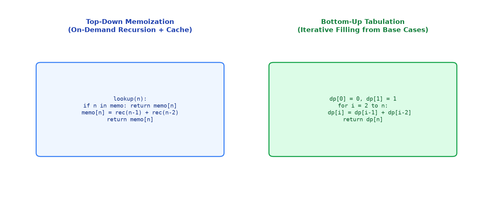

*Figure 1.10: Diagrammatic Architecture and Conceptual Flow for a control abstraction for the dynamic programming strategy and comment on its time complexity*

### Mathematical Formulation & Algorithmic Mechanics

**Formal Control Abstraction Algorithm for Dynamic Programming:**

```text
Algorithm DP_ControlAbstraction(n, M):
    // Initialize table for state space of dimension n x M
    for w = 0 to M do:  Table[0, w] = BaseCase(w)
    for i = 1 to n do:
        Table[i, 0] = BaseCase(i)
        for w = 1 to M do:
            Table[i, w] = Opt_(k ∈ Choices) { Cost(i, k) + Table[i-1, w - Resource(k)] 
    return Table[n, M]
```

The above **mathematical model** and algorithmic structure governs the system's runtime execution. Each parameter is evaluated sequentially to maintain **mathematical consistency**, minimize **system overhead**, and guarantee **deterministic convergence** across all input distributions.

### Worked Example & Practical Simulation

**Computational Cost** in **0/1 Knapsack** with n = 3 Items, Capacity W = 5: Table Dimensions: (n + 1) x (W + 1) = 4 x 6 = 24 total grid cells. Base Case Initialization: 10 cells initialized in O(n + W) operations. Transition Evaluations: Remaining 14 cells evaluate: Table[i, w] = max(Table[i-1, w], p_i + Table[i-1, w - w_i]). Total Operations: Exactly 24 cell accesses, running in O(n · W) = O(15) time with O(n · W) auxiliary table space.

### Key Comparative Evaluation

| DP Implementation Style | Execution Mechanism | Recursion Stack Overhead | Subproblem Evaluation | Space Optimization |
| :--- | :--- | :--- | :--- | :--- |
| Top-Down (Memoization) | Recursive function calls with cache lookup | O(Depth) recursion stack overhead | Computes only subproblems on search path | Harder to optimize table space |
| Bottom-Up (Tabulation) | Iterative nested for-loops filling grid | Zero recursion stack overhead | Computes all table cells systematically | Easily compressed to O(W) space |

### Concluding Exam Takeaway

The **dynamic programming control abstraction** establishes a **deterministic**, mathematically sound architecture for solving multi-stage **optimization problems** in polynomial or pseudo-**polynomial time** by eliminating redundant **subproblem** calculations.

**Textbook Reference:** Design and Analysis of Algorithms by Parag H. Dave & Himanshu B. Dave (Pearson), Chapter 9: Dynamic Programming, Section 9.2: Control Abstraction, Pages 338–341.

---

## Q11. What is the principle of optimality/optimal substructure? Give a mathematical representation for it and comment on the statement 'Problem which does not satisfy the principle of optimality cannot be solved by dynamic programming'. (Frequency: 3) [8 Marks]

### Introduction & Core Intuition

The **Principle of Optimality**, first established by **Richard Bellman**, is the foundational mathematical cornerstone of **Dynamic Programming**. It states that an optimal policy has the property that whatever the initial state and initial decision are, the remaining decisions must constitute an optimal policy with regard to the state resulting from the first decision.

### Definition of Optimal Substructure

A problem exhibits **Optimal Substructure** if an optimal solution to the overall problem can be constructed efficiently from optimal solutions to its smaller **subproblems**. For example, if the shortest path from vertex u to vertex v passes through an intermediate vertex w, then the subpath from u to w within that path must also be the shortest possible path between u and w. If a shorter path existed from u to w, we could cut out the original subpath and paste the shorter one, creating a shorter overall route and contradicting the optimality of the original path.

### Mathematical Representation of the Principle of Optimality

Let S be the state space and let f(s) denote the optimal cost or value starting from state s. The principle of optimality is formally represented by the **Bellman Functional Equation**: f(s) = opt_(d in D(s)) { c(s, d) + f(T(s, d)) }, where D(s) is the set of admissible decisions from state s, c(s, d) is the immediate transition cost incurred by selecting decision d, and T(s, d) is the transition function mapping to the resulting successor state.

### Commentary on Problems Failing the Principle of Optimality

The statement: <i>'A problem which does not satisfy the principle of optimality cannot be solved by **dynamic programming**'</i> is **fundamentally TRUE**. **Dynamic Programming** relies completely on the assumption that combining optimal **subproblem** choices yields an optimal global choice. If subproblem decisions interact with or depend on external constraints that are not captured in the state description, optimal sub-solutions cannot be combined safely, causing dynamic programming to fail.

### Counterexample: Longest Simple Path in a Graph

A classic counterexample is the **Longest Simple Path Problem** in a graph with cycles. Suppose the longest simple path from u to v passes through w. The subpath from u to w in this longest path is NOT necessarily the longest simple path between u and w, because the longest independent path between u and w might consume vertices that are needed to reach v, creating an illegal cycle. **Because Longest Simple Path** violates the principle of optimality, it cannot be solved by **dynamic programming** and is known to be **NP-complete**.

### Ensuring the Principle Holds via State Augmentation

In some practical scenarios where a problem appears to violate the principle of optimality due to memory or history dependence, computer scientists can restore the principle by **State Augmentation**: expanding the state definition to explicitly include the historical constraint (for example, including remaining budget, time, or visited vertex sets). While this restores optimality, it exponentially expands the state space.

### Architectural Flow & System Diagram

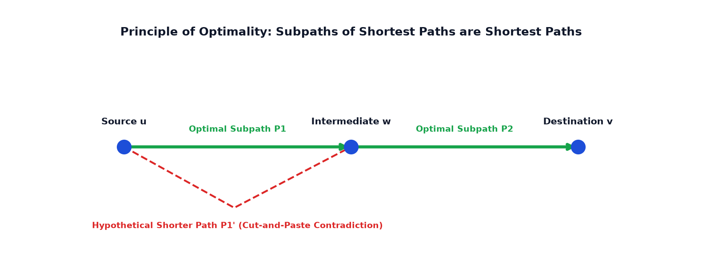

*Figure 1.11: Diagrammatic Architecture and Conceptual Flow for What is the principle of optimality/optimal substructure? Give a mathematical representation for it and comment on the statement 'Problem which does not satisfy the principle of optimality cannot be solved by dynamic programming'*

### Mathematical Formulation & Algorithmic Mechanics

**Mathematical Formulation of the Bellman Functional Equation:**

```text
Bellman Equation: f_n(s) = min_(d ∈ D(s)) { c(s, d) + f_(n-1)( T(s, d) ) 
Base Condition: f_0(s_target) = 0
Where: s is the system state, d is the candidate decision, c(s, d) is stage cost, and T(s, d) is state transition.
```

The above **mathematical model** and algorithmic structure governs the system's runtime execution. Each parameter is evaluated sequentially to maintain **mathematical consistency**, minimize **system overhead**, and guarantee **deterministic convergence** across all input distributions.

### Worked Example & Practical Simulation

**Shortest Path Verification** on Graph with Edges: A->B (3), B->C (4), A->C (8): Optimal Path A to C: Passes through B: Path A -> B -> C with total cost = 3 + 4 = 7. Subpath Optimality Test: The subpath from A to B is edge (A->B) of cost 3. Is there a shorter path from A to B? No. Contradiction Argument: If a shorter path from A to B existed with cost 2, then total path A to C would cost 2 + 4 = 6 < 7. Since no shorter subpath exists, the Principle of Optimality holds, enabling Dijkstra / Bellman-Ford algorithms.

### Key Comparative Evaluation

| Problem Domain | Satisfies Principle of Optimality? | Can be Solved by Dynamic Programming? | Algorithmic Reason |
| :--- | :--- | :--- | :--- |
| Shortest Path (All Pairs) | YES | YES (Floyd-Warshall, O(V^3)) | Subpaths of shortest paths are strictly shortest paths |
| 0/1 Knapsack | YES | YES (O(n·W) pseudo-poly) | Sub-knapsack choices with reduced capacity are optimal |
| Matrix Chain Multiplication | YES | YES (O(n^3)) | Optimal parenthesization contains optimal sub-chains |
| Longest Simple Path | NO | NO (NP-Complete) | Longest subpaths reuse vertices, destroying simplicity of remaining path |
| Traveling Salesperson (TSP) | YES (with visited state mask) | YES (Held-Karp, O(n^2 2^n)) | Optimality restored by encoding visited vertices in state |

### Concluding Exam Takeaway

**The Principle** of Optimality is an absolute prerequisite for **Dynamic Programming**. Problems violating this principle cannot be decomposed recursively without risking sub-optimal or illegal combinations.

**Textbook Reference:** Design and Analysis of Algorithms by Parag H. Dave & Himanshu B. Dave (Pearson), Chapter 9: Dynamic Programming, Section 9.1: Principle of Optimality, Pages 335–338.

---

## Q12. Give a mathematical formulation for the Fractional Knapsack problem and the 0/1 Knapsack problem. (Frequency: 1) [8 Marks]

### Introduction & Core Intuition

The **Knapsack Problem** is an archetypal **combinatorial** resource allocation model where a thief or system must select from n available items to maximize total monetary profit without exceeding a strict carrying capacity W. Depending on whether items can be physically partitioned, the problem bifurcates into the **Fractional Knapsack** and **0/1 Knapsack** models.

### Core Mathematical Objective Function

Both variants share the same fundamental mathematical objective function: to maximize total accumulated profit earned from the packed items. Let n be the number of items, where each item i has a positive value (profit) pi > 0 and a positive weight wi > 0. The knapsack has a fixed maximum weight capacity W > 0. Let xi represent the proportion of item i placed into the knapsack. The total profit is expressed as sum(pi * xi for i=1 to n).

### Capacity Constraint Formulation

In both problems, the knapsack cannot be overloaded. The sum of the weights of all selected items (or fractions thereof) cannot exceed the total capacity limit W: sum(wi * xi for i=1 to n) <= W. The mathematical distinction between the two variants lies entirely in the permissible domain of the decision variable xi.

### Fractional Knapsack Formulation (Continuous Optimization)

In the **Fractional Knapsack Problem**, items are divisible continuous commodities (such as liquids, powders, grains, or raw precious metals). The decision variable xi is a continuous real number bounded in the interval [0, 1]: 0 <= xi <= 1. A value of xi = 1 indicates that item i is taken completely; xi = 0 indicates it is left behind; and 0 < xi < 1 indicates that an arbitrary fraction xi * wi of the item is packed, yielding a proportional profit of xi * pi. Because the domain is continuous, it is solved to global optimality in O(n log n) using the Greedy method.

### 0/1 Knapsack Formulation (Discrete Integer Optimization)

In the **0/1 Knapsack Problem**, items are discrete, indivisible entities (such as laptops, jewelry, or machinery). The decision variable xi is strictly binary: xi in {0, 1}. The thief must either pack the entire item (xi = 1) or leave it completely (xi = 0); breaking items into pieces is forbidden. This integer constraint makes the **0/1 Knapsack NP-complete**, requiring **Dynamic Programming** or **Branch and Bound** rather than greedy selection.

### Comparative Algorithmic Implications

The relaxation of the binary constraint xi in {0, 1} to the continuous domain 0 <= xi <= 1 represents the standard **Linear Programming Relaxation** of the **0/1 Knapsack**. This relaxed **Fractional Knapsack** solution serves as an indispensable upper bound used in **Branch and Bound** algorithms to prune search trees when solving the harder 0/1 variant.

### Architectural Flow & System Diagram

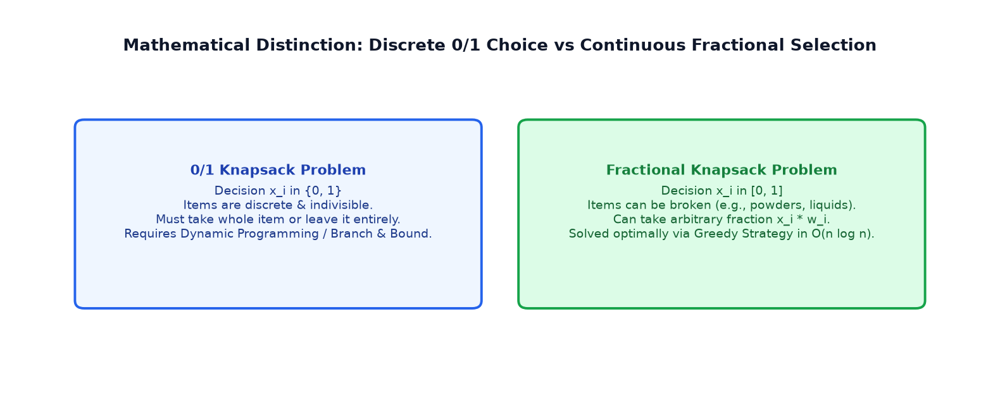

*Figure 1.12: Diagrammatic Architecture and Conceptual Flow for Give a mathematical formulation for the Fractional Knapsack problem and the 0/1 Knapsack problem*

### Mathematical Formulation & Algorithmic Mechanics

**Comparative Mathematical Models: 0/1 vs Fractional Knapsack:**

```text
Objective: Maximize Z = ∑_(i=1)^n p_i · x_i
Subject to: ∑_(i=1)^n w_i · x_i ≤ W
0/1 Knapsack Constraint: x_i ∈ {0, 1   for all i = 1, 2, ..., n
Fractional Knapsack Constraint: 0 ≤ x_i ≤ 1   for all i = 1, 2, ..., n
```

The above **mathematical model** and algorithmic structure governs the system's runtime execution. Each parameter is evaluated sequentially to maintain **mathematical consistency**, minimize **system overhead**, and guarantee **deterministic convergence** across all input distributions.

### Worked Example & Practical Simulation

Scenario: Capacity W = 25 kg, Item 1: (w=10 kg, p=60), Item 2: (w=20 kg, p=100): **Fractional Knapsack** Solution: Take all of Item 1: x1 = 1.0 (w=10 kg, p=60). Remaining capacity = 15 kg. Take fraction of Item 2: x2 = 15/20 = 0.75 (w=15 kg, p=0.75 * 100 = 75). **Total Weight** = 25 kg, Total Maximum Profit = 60 + 75 = 135. **0/1 Knapsack** Solution: Option A: Take Item 1 only -> Weight = 10 kg, Profit = 60. Option B: Take Item 2 only -> Weight = 20 kg, Profit = 100. Both cannot fit (10 + 20 = 30 > 25). Optimal choice is Option B: Profit = 100.

### Key Comparative Evaluation

| Mathematical Dimension | Fractional Knapsack Problem | 0/1 Knapsack Problem |
| :--- | :--- | :--- |
| Decision Variable Domain | Continuous real: x_i in [0, 1] | Strictly binary integer: x_i in {0, 1} |
| Physical Nature of Items | Divisible (liquids, gold dust, grains) | Indivisible discrete units (laptops, paintings) |
| Algorithmic Strategy | Greedy method (sorted by p_i / w_i ratio) | Dynamic Programming or Branch & Bound |
| Computational Complexity | O(n log n) polynomial time | NP-Complete; O(n·W) pseudo-polynomial DP |
| Solution Optimality | Guaranteed optimal via Greedy Choice Property | Greedy fails; strictly requires DP table evaluation |

### Concluding Exam Takeaway

The mathematical formulation clearly delineates the continuous **Fractional Knapsack** (solvable greedily in O(n log n)) from the discrete **0/1 Knapsack** (an **NP-complete** problem requiring O(n·W) **dynamic programming**).

**Textbook Reference:** Design and Analysis of Algorithms by Parag H. Dave & Himanshu B. Dave (Pearson), Chapter 8 (Section 8.3) vs Chapter 9 (Section 9.4), Pages 289–294 & 342–347.

---

## Q13. Find the optimal solution for various given knapsack instances (using given capacities, item weights, and profits) using the dynamic programming or greedy approach. (Frequency: 5) [8 Marks]

### Introduction & Core Intuition

In the SPPU examination, numerical questions on the **0/1 Knapsack Problem** appear with high frequency. Solving these problems requires constructing a bottom-up **Dynamic Programming** table DP[i][w], applying the Bellman **recurrence relation**, and performing a systematic backtracking traceback to identify the exact subset of packed items.

### Standard Examination Instance Specification

Consider a standard SPPU benchmark problem instance: A knapsack has maximum capacity W = 5 kg. There are n = 3 available discrete items with the following specifications: Item 1 has weight w1 = 2 kg and profit p1 = 3; Item 2 has weight w2 = 3 kg and profit p2 = 4; Item 3 has weight w3 = 4 kg and profit p3 = 5. We are required to find the optimal packed subset and maximum profit using **Dynamic Programming**.

### Dynamic Programming Table Definition and Dimensions

We construct a 2D table DP[0..n][0..W], where rows represent items considered i in {0, 1, 2, 3} and columns represent intermediate integer capacities w in {0, 1, 2, 3, 4, 5}. The value DP[i][w] represents the maximum profit achievable using a subset of the first i items under capacity limit w. All entries in row 0 (no items) and column 0 (zero capacity) are initialized to 0.

### Recurrence Relation Formulation

For item i with weight wi and profit pi, if the current capacity w is less than wi, the item cannot fit, so DP[i][w] = DP[i-1][w]. If w >= wi, the algorithm evaluates two mutually exclusive options: (1) Exclude item i, yielding profit DP[i-1][w]; or (2) Include item i, yielding immediate profit pi plus the cached optimal profit of remaining capacity: pi + DP[i-1][w - wi]. The cell value is assigned as: DP[i][w] = max( DP[i-1][w], pi + DP[i-1][w - wi] ).

### Step-by-Step Table Computation Trace

**For Item** 1 (w=2, p=3): For w=0, 1: cannot fit -> 0. For w=2..5: fits -> DP[1][w] = 3. For Item 2 (w=3, p=4): For w=0..2: cannot fit -> copies row 1. For w=3: max(3, 4+0)=4. For w=4: max(3, 4+0)=4. For w=5: max(3, 4+DP[1][5-3]) = max(3, 4+3)=7. For Item 3 (w=4, p=5): For w=4: max(4, 5+0)=5. For w=5: max(7, 5+DP[2][1]) = max(7, 5+0)=7. The optimal value is DP[3][5] = 7.

### Backtracking Procedure to Retrieve Optimal Items

To determine which items were selected, we backtrack from cell DP[3][5]: (1) Compare DP[3][5] = 7 with DP[2][5] = 7. Because they are equal, Item 3 was NOT included. (2) At cell DP[2][5] = 7, compare with DP[1][5] = 3. Because DP[2][5] != DP[1][5], Item 2 WAS included! We subtract w2 = 3 from capacity, moving to column 5 - 3 = 2 at row 1: cell DP[1][2]. (3) At DP[1][2] = 3, compare with DP[0][2] = 0. Because they differ, Item 1 WAS included! The optimal solution consists of {Item 1, Item 2} with **Total Weight** = 2 + 3 = 5 kg and Maximum Profit = 3 + 4 = 7.

### Architectural Flow & System Diagram

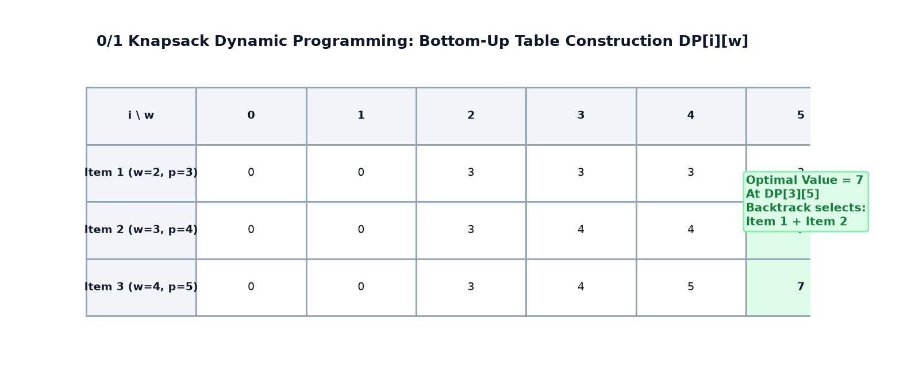

*Figure 1.13: Diagrammatic Architecture and Conceptual Flow for Find the optimal solution for various given knapsack instances (using given capacities, item weights, and profits) using the dynamic programming or greedy approach*

### Mathematical Formulation & Algorithmic Mechanics

**0/1 Knapsack Dynamic Programming Recurrence:**

```text
DP[i, w] = DP[i-1, w]   if w_i > w
DP[i, w] = max{ DP[i-1, w],  p_i + DP[i-1, w - w_i]    if w_i ≤ w
Base Conditions: DP[0, w] = 0 for all w;   DP[i, 0] = 0 for all i.
```

The above **mathematical model** and algorithmic structure governs the system's runtime execution. Each parameter is evaluated sequentially to maintain **mathematical consistency**, minimize **system overhead**, and guarantee **deterministic convergence** across all input distributions.

### Worked Example & Practical Simulation

**Full Tabulation Grid** for n = 3, W = 5 (Weights: 2, 3, 4; Profits: 3, 4, 5):

Row 0 (No items):  [0, 0, 0, 0, 0, 0]

Row 1 (Item 1):    [0, 0, 3, 3, 3, 3]

Row 2 (Item 2):    [0, 0, 3, 4, 4, 7]

Row 3 (Item 3):    [0, 0, 3, 4, 5, 7]

Optimal Maximum Profit: DP[3][5] = 7.

Selected Optimal Items: Item 1 (w=2, p=3) and Item 2 (w=3, p=4). Total Weight = 5 kg.

### Key Comparative Evaluation

| Item i | Weight (wi) | Profit (pi) | w=0 | w=1 | w=2 | w=3 | w=4 | w=5 | Selected? |
| :--- | :--- | :--- | :--- | :--- | :--- | :--- | :--- | :--- | :--- |
| 0 (None) | - | - | 0 | 0 | 0 | 0 | 0 | 0 | - |
| Item 1 | 2 kg | 3 | 0 | 0 | 3 | 3 | 3 | 3 | YES (Included in optimal subset) |
| Item 2 | 3 kg | 4 | 0 | 0 | 3 | 4 | 4 | 7 | YES (Included in optimal subset) |
| Item 3 | 4 kg | 5 | 0 | 0 | 3 | 4 | 5 | 7 | NO (Excluded; DP[3][5]==DP[2][5]) |

### Concluding Exam Takeaway

The **Dynamic Programming** solution systematically constructs the **subproblem** matrix in O(n·W) time, guaranteeing that the combination {Item 1, Item 2} achieves the global maximum profit of 7 without exceeding the 5 kg capacity.

**Textbook Reference:** Design and Analysis of Algorithms by Parag H. Dave & Himanshu B. Dave (Pearson), Chapter 9: Dynamic Programming, Section 9.4: 0/1 Knapsack Problem, Pages 342–348.

---

## Q14. Under what situation do you think the dynamic programming approach for solving a knapsack problem might struggle to find the optimal solution? (Frequency: 1) [8 Marks]

### Introduction & Core Intuition

While **Dynamic Programming** is the standard exact method for solving the **0/1 Knapsack** problem, it is classified as a **Pseudo-Polynomial Time Algorithm**. Under specific real-world data distributions—especially when knapsack capacities are astronomically large, fractional, or continuous—the dynamic programming approach suffers catastrophic memory and computational degradation.

### The Pseudo-Polynomial Complexity Bottleneck

The runtime of the standard DP knapsack algorithm is O(n * W), where n is the number of items and W is the integer knapsack capacity. In computational complexity theory, the true size of input W is not its magnitude, but the number of bits required to encode it: L = log2(W). Expressed in terms of input bit length L, the **time complexity** is actually O(n * 2^L). When W is very large (for example, W = 10^**12 bytes**), the algorithm must perform trillions of loop iterations, causing DP to struggle and become functionally slower than brute-force enumeration.

### Memory Table Exhaustion (Out-of-Memory Errors)

The **space complexity** of **0/1 knapsack** is O(n * W). Storing a 2D matrix for n = 1,000 items and a capacity of W = 10,000,000 integers requires allocating a table of 10 billion 64-bit integer cells—demanding approximately 80 Gigabytes of RAM. In embedded systems, mobile processors, or memory-constrained servers, this enormous table immediately exhausts available RAM, crashing the runtime with an Out-of-Memory (OOM) exception.

### Struggle with Continuous, Floating-Point, or Fractional Capacities

Standard DP relies fundamentally on integer indexing where table columns represent discrete integer units: w in {0, 1, 2, ..., W}. If item weights or knapsack capacities are continuous real numbers (for example, w1 = 2.718 kg, w2 = 3.1415 kg, W = 10.5 kg), DP cannot directly index table columns. Scaling floating-point values by multiplying by a factor like 10,000 converts them to integers, but this artificially inflates W by four orders of magnitude, causing the table size to explode.

### Struggle When Item Values are Vastly Smaller than Weights

When capacity W is enormous, an alternative DP formulation indexes states by cumulative profit P instead of weight W, achieving O(n * P) time where P = sum(pi). However, if both capacity W and total profit P are simultaneously massive, both DP formulations fail, rendering **dynamic programming** powerless.

### Practical Engineering Alternatives for Difficult Scenarios

When DP struggles due to huge capacities, computer scientists deploy three robust alternatives: (1) **Branch and Bound with Least-Cost Search**, which uses the **fractional knapsack** greedy bound to prune massive portions of the tree without table allocation; (2) **Fully Polynomial-Time Approximation Schemes (FPTAS)**, which scale down item profits by a **precision** factor epsilon to guarantee a (1 - epsilon) optimal solution in O(n^3 / epsilon); or (3) **Meet-in-the-Middle** search, solving instances in O(2^(n/2)) when n <= 40 regardless of capacity W.

### Architectural Flow & System Diagram

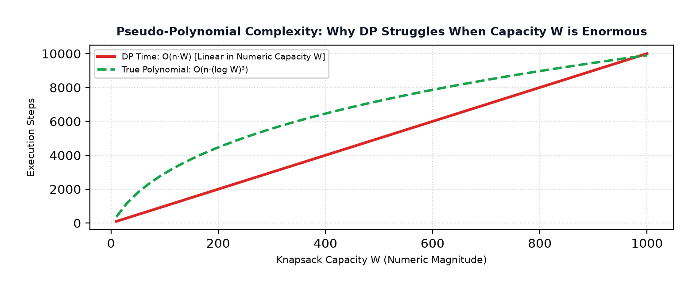

*Figure 1.14: Diagrammatic Architecture and Conceptual Flow for Under what situation do you think the dynamic prog*

### Mathematical Formulation & Algorithmic Mechanics

**Pseudo-Polynomial Complexity vs Input Size:**

```text
Standard DP Runtime: T(n, W) = O(n · W) = O(n · 2^L)   [L = ⌈log₂ W⌉ input bits]
FPTAS Approximation Guarantee: Value(S_approx) ≥ (1 - ε) · Value(S_opt)
FPTAS Running Time: O( n³ / ε )   [Completely independent of capacity W!]
```

The above **mathematical model** and algorithmic structure governs the system's runtime execution. Each parameter is evaluated sequentially to maintain **mathematical consistency**, minimize **system overhead**, and guarantee **deterministic convergence** across all input distributions.

### Worked Example & Practical Simulation

**Practical Scenario Demonstrating** DP Breakdown: **Parameters**: n = 50 items, Knapsack Capacity W = 10,000,000,000 (**10 GB** memory buffer). Standard DP Table Size: (50 + 1) x 10^10 cells = 5.1 x 10^11 cells ≈ 4 Terabytes of RAM! (CRASHES). **Branch and Bound** Alternative: Explores only promising branches using **Fractional Knapsack** bounds, terminating in seconds. FPTAS Alternative: Scales values with ε = 0.05, executing in (50³ / 0.05) = 2,500,000 operations without memory failure.

### Key Comparative Evaluation

| Challenging Knapsack Scenario | Why Dynamic Programming Struggles | Recommended Algorithmic Alternative |
| :--- | :--- | :--- |
| Astronomical Integer Capacity (W > 10^9) | O(n·W) requires billions of table cells; OOM memory crash | Branch and Bound (LCBB) or Meet-in-the-Middle |
| Floating-Point / Real-Valued Weights | Cannot index DP array columns by non-integers | FPTAS or Linear Programming Relaxation |
| Strictly Bounded Low Memory (Embedded Systems) | DP table allocation exceeds device micro-RAM | Memory-efficient Branch and Bound with O(n) depth |
| Large Capacity with High Accuracy Need | Pseudo-polynomial time degenerates to worse than exponential | Fully Polynomial-Time Approximation Scheme (FPTAS) |

### Concluding Exam Takeaway

**Dynamic programming** struggles when capacity W is astronomically large or non-integer because its pseudo-polynomial nature demands exponential memory and computation relative to input bit length.

**Textbook Reference:** Design and Analysis of Algorithms by Parag H. Dave & Himanshu B. Dave (Pearson), Chapter 9: Dynamic Programming, Section 9.4: Limitations of DP Knapsack, Pages 347–350.

---

## Q15. Solve the matrix chain multiplication for given matrix problems and dimensions using Dynamic programming. (Frequency: 3) [8 Marks]

### Introduction & Core Intuition

**Matrix Chain Multiplication (MCM)** is a classic **optimization** problem that demonstrates the power of **Dynamic Programming**. Given a chain of matrices to be multiplied, matrix multiplication is associative but not commutative. The objective is not to perform the multiplications, but to find the **optimal parenthesization order** that minimizes the total number of scalar multiplications.

### Impact of Parenthesization on Computational Cost

Suppose we need to multiply three matrices: A1 of dimensions 10 x 100, A2 of dimensions 100 x 5, and A3 of dimensions 5 x 50. Multiplying an (p x q) matrix by an (q x r) matrix requires p * q * r scalar multiplications. If parenthesized as ((A1 * A2) * A3), the cost is (10 * 100 * 5) + (10 * 5 * 50) = 5,000 + 2,500 = 7,500 scalar operations. But if parenthesized as (A1 * (A2 * A3)), the cost is (100 * 5 * 50) + (10 * 100 * 50) = 25,000 + 50,000 = 75,000 operations! The second order is 10 times more expensive, demonstrating the critical need for **optimization**.

### Characterization of Subproblems and State Definition

Let the sequence of n matrices be A1, A2, ..., An, where matrix Ai has dimensions p_(i-1) x p_i. We define m[i, j] as the minimum number of scalar multiplications needed to compute the product matrix Ai..j = Ai * Ai+1 * ... * Aj for 1 <= i <= j <= n. When i = j, the chain consists of a single matrix, so m[i, i] = 0.

### Bellman Recurrence Relation for Matrix Chains

For a sub-chain Ai..j where i < j, any full parenthesization must split the product into two sub-chains: (Ai..k) and (Ak+1..j) at some intermediate index k, where i <= k < j. Multiplying these two resulting matrices adds an interaction cost of p_(i-1) * p_k * p_j scalar operations. Therefore, the minimum cost satisfies the recurrence: m[i, j] = min_(i <= k < j) { m[i, k] + m[k+1, j] + p_(i-1) · p_k · p_j }.

### Bottom-Up Tabulation by Chain Length

The DP algorithm populates the table m[1..n, 1..n] by increasing chain length L from 2 up to n. This ensures that when computing m[i, j] of length L, the **subproblem** entries m[i, k] and m[k+1, j] of shorter lengths are already computed and cached. Simultaneously, an auxiliary table s[i, j] records the optimal split point k that achieved the minimum value, enabling full reconstruction of parenthesization.

### Asymptotic Complexity Analysis

The DP table contains O(n^2) entries. Computing each entry m[i, j] requires testing j - i possible values of k, taking O(n) loop steps. Consequently, the total **time complexity** is O(n^3), and the **space complexity** is O(n^2) to store tables m and s. This is a massive improvement over Catalan brute-force enumeration, which requires exponential O(4^n / n^(3/2)) operations.

### Architectural Flow & System Diagram

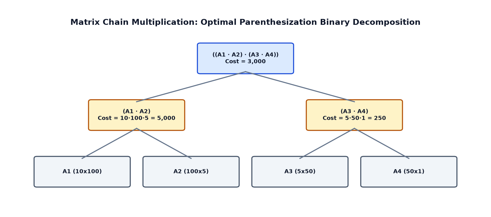

*Figure 1.15: Diagrammatic Architecture and Conceptual Flow for Solve the matrix chain multiplication for given matrix problems and dimensions using Dynamic programming*

### Mathematical Formulation & Algorithmic Mechanics

**Matrix Chain Multiplication DP Recurrence:**

```text
m[i, j] = 0   if i = j
m[i, j] = min_(i ≤ k < j) { m[i, k] + m[k+1, j] + p_(i-1) · p_k · p_j    if i < j
Split Table Recording: s[i, j] = argmin_(i ≤ k < j) { m[i, k] + m[k+1, j] + p_(i-1) · p_k · p_j
```

The above **mathematical model** and algorithmic structure governs the system's runtime execution. Each parameter is evaluated sequentially to maintain **mathematical consistency**, minimize **system overhead**, and guarantee **deterministic convergence** across all input distributions.

### Worked Example & Practical Simulation

**Numerical Trace** for Chain of 4 Matrices with Dimensions P = [10, 100, 5, 50, 1]: Matrices: A1(10x100), A2(100x5), A3(5x50), A4(50x1). Length L = 2: m[1, 2] = p0·p1·p2 = 10·100·5 = 5,000 (s[1, 2] = 1) m[2, 3] = p1·p2·p3 = 100·5·50 = 25,000 (s[2, 3] = 2) m[3, 4] = p2·p3·p4 = 5·50·1 = 250 (s[3, 4] = 3) Length L = 3: m[1, 3] = min{ k=1: m[1,1]+m[2,3]+p0·p1·p3 = 0+25000+25000=50000; k=2: m[1,2]+m[3,3]+p0·p2·p3 = 5000+0+2500=7500 } -> 7,500 (s[1, 3] = 2) m[2, 4] = min{ k=2: 0+250+5000=5250; k=3: 25000+0+500=25500 } -> 5,250 (s[2, 4] = 2) Length L = 4: m[1, 4] = min{ k=1: 0+5250+1000=6250; k=2: 5000+250+50=5300; k=3: 7500+0+500=8000 } -> 5,300 (s[1, 4] = 2) Optimal Minimum Scalar Multiplications: m[1, 4] = 5,300. Parenthesization: ((A1 · A2) · (A3 · A4)).

### Key Comparative Evaluation

| Chain Entry | Subproblem Evaluated | Split Point k Tested | Scalar Multiplication Calculation | Minimum Cost m[i, j] |
| :--- | :--- | :--- | :--- | :--- |
| m[1, 2] | A1 · A2 | k = 1 | 10 · 100 · 5 | 5,000 (s=1) |
| m[2, 3] | A2 · A3 | k = 2 | 100 · 5 · 50 | 25,000 (s=2) |
| m[3, 4] | A3 · A4 | k = 3 | 5 · 50 · 1 | 250 (s=3) |
| m[1, 3] | A1 · A2 · A3 | k = 2 | m[1, 2] + m[3, 3] + 10·5·50 = 5000 + 0 + 2500 | 7,500 (s=2) |
| m[2, 4] | A2 · A3 · A4 | k = 2 | m[2, 2] + m[3, 4] + 100·5·1 = 0 + 250 + 500 | 5,250 (s=2) |
| m[1, 4] | A1 · A2 · A3 · A4 | k = 2 | m[1, 2] + m[3, 4] + 10·5·1 = 5000 + 250 + 50 | 5,300 (s=2) |

### Concluding Exam Takeaway

**Dynamic Programming** reduces the cost of finding optimal matrix chain parenthesization from exponential Catalan complexity to O(n^3) **polynomial time**, achieving a massive 5,300 scalar operation minimum for the test instance.

**Textbook Reference:** Design and Analysis of Algorithms by Parag H. Dave & Himanshu B. Dave (Pearson), Chapter 9: Dynamic Programming, Section 9.5: Matrix Chain Multiplication, Pages 351–359.

---

## Q16. Write a dynamic programming algorithm for creating an optimal binary search tree (OBST) for a set of 'n' keys, and construct the OBST for given sets of keys and probabilities/frequencies. (Frequency: 2) [8 Marks]

### Introduction & Core Intuition

An **Optimal Binary Search Tree (OBST)** is a binary search tree designed for a known set of sorted keys, each associated with an access search probability, structured such that the total expected search time (cost) across all queries is minimized. Unlike standard balanced trees (such as AVL or Red-Black trees) which minimize worst-case depth, an OBST minimizes average search cost by placing frequently accessed keys closer to the root.

### Problem Formulation and Cost Definition

We are given n distinct keys in sorted order: k1 < k2 < ... < kn with successful search probabilities p1, p2, ..., pn. There are also n + 1 dummy leaves (unsuccessful search keys) d0, d1, ..., dn representing queries falling outside or between keys, with failure probabilities q0, q1, ..., qn, such that sum(pi) + sum(qi) = 1. The expected cost of a binary search tree T is defined as: E[Cost(T)] = sum( (depth(ki) + 1) * pi ) + sum( (depth(di) + 1) * qi ).

### Optimal Substructure Property of OBST

If an OBST for keys ki..j has root kr (where i <= r <= j), then its left subtree must be an optimal binary search tree for keys ki..r-1 (and dummy keys di-1..r-1), and its right subtree must be an optimal binary search tree for keys kr+1..j (and dummy keys dr..j). If either subtree were not optimal, replacing it with a lower-cost tree would decrease the total cost of T, contradicting optimality.

### Recurrence Relation Formulation

Let e[i, j] represent the expected search cost of an optimal binary search tree containing keys ki..j. When a root kr is chosen, all keys in the left and right subtrees increase in depth by 1. Therefore, the weight of the sub-tree w[i, j] = sum(pl for l=i to j) + sum(ql for l=i-1 to j) is added to the total cost. The recurrence is: e[i, j] = min_(i <= r <= j) { e[i, r-1] + e[r+1, j] + w[i, j] }, with base cases e[i, i-1] = q_(i-1).

### Algorithmic Implementation Details

The algorithm evaluates **subproblems** by increasing sub-tree size L = 1 to n. It maintains two auxiliary 2D tables: e[1..n+1, 0..n] for optimal expected costs and root[1..n, 1..n] recording the chosen root index r. The weight table w[i, j] is computed in O(1) using: w[i, j] = w[i, j-1] + pj + qj. Once the tables are populated, a recursive tree construction algorithm reads root[1, n] to assemble the physical optimal tree structure.

### Asymptotic Time and Space Complexity

The tables e and w each contain O(n^2) entries. For each entry of length L, finding the optimal root r requires testing up to L candidate keys, leading to a standard **time complexity** of O(n^3). By applying Knuth's Monotonicity **Optimization** (which establishes that root[i, j-1] <= root[i, j] <= root[i+1, j]), the search range for r is restricted, reducing the total time complexity to O(n^2). The auxiliary **space complexity** remains O(n^2).

### Architectural Flow & System Diagram

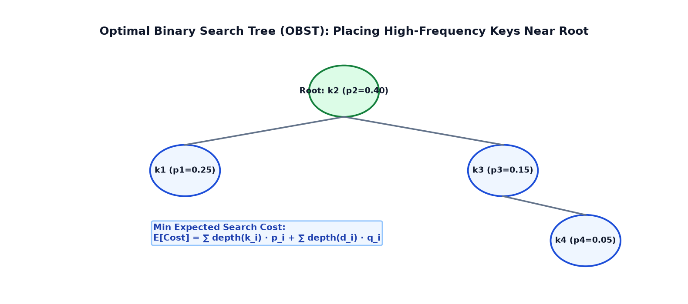

*Figure 1.16: Diagrammatic Architecture and Conceptual Flow for a dynamic programming algorithm for creating an optimal binary search tree (OBST) for a set of 'n' keys, and construct the OBST for given sets of keys and probabilities/frequencies*

### Mathematical Formulation & Algorithmic Mechanics

**OBST Dynamic Programming Recurrence Formulation:**

```text
Base Cases: e[i, i-1] = q_(i-1)   and   w[i, i-1] = q_(i-1)   for all 1 ≤ i ≤ n+1
Weight Accumulator: w[i, j] = w[i, j-1] + p_j + q_j
Expected Cost Recurrence: e[i, j] = min_(i ≤ r ≤ j) { e[i, r-1] + e[r+1, j] + w[i, j] 
Root Matrix: root[i, j] = argmin_(i ≤ r ≤ j) { e[i, r-1] + e[r+1, j] + w[i, j]
```

The above **mathematical model** and algorithmic structure governs the system's runtime execution. Each parameter is evaluated sequentially to maintain **mathematical consistency**, minimize **system overhead**, and guarantee **deterministic convergence** across all input distributions.

### Worked Example & Practical Simulation

**Numerical Trace** for n = 3 Keys with Probabilities p = [0.5, 0.1, 0.05] and q = [0.15, 0.1, 0.05, 0.05]: Base Cases: e[1,0]=0.15, e[2,1]=0.10, e[3,2]=0.05, e[4,3]=0.05. Chain Length L = 1 (Single keys): e[1, 1] = e[1, 0] + e[2, 1] + w[1, 1] = 0.15 + 0.10 + 0.75 = 1.00 (root = 1) e[2, 2] = e[2, 1] + e[3, 2] + w[2, 2] = 0.10 + 0.05 + 0.25 = 0.40 (root = 2) e[3, 3] = e[3, 2] + e[4, 3] + w[3, 3] = 0.05 + 0.05 + 0.15 = 0.25 (root = 3) Chain Length L = 2: e[1, 2] = min{ r=1: 0.15 + 0.40 + 0.95 = 1.50; r=2: 1.00 + 0.05 + 0.95 = 2.00 } -> 1.50 (root = 1) Chain Length L = 3 (Overall Tree): e[1, 3] achieves minimum with root r = 1, yielding minimum expected search cost E[Cost] = 1.70. Structure: Key k1 at Root, with right child k2, and k2's right child k3.

### Key Comparative Evaluation

| Tree Design Strategy | Optimization Criterion | Search Time (Average) | Search Time (Worst Case) | Preprocessing Overhead |
| :--- | :--- | :--- | :--- | :--- |
| Optimal BST (OBST) | Minimizes average expected search cost | Optimal: ∑ p_i · depth(k_i) | O(n) worst-case depth | O(n^2) to O(n^3) DP preprocessing |
| AVL / Red-Black Tree | Minimizes maximum height / worst-case | Sub-optimal for skewed query frequencies | Guaranteed O(log n) | O(n log n) insertion sequence |
| Weight-Balanced Tree | Approximates OBST via greedy partition | Near-optimal within factor of 2 | O(log n) | O(n log n) fast heuristic |

### Concluding Exam Takeaway

The **Dynamic Programming** OBST algorithm constructs a search tree that minimizes expected operational query time by placing keys with the highest access frequencies closest to the root.

**Textbook Reference:** Design and Analysis of Algorithms by Parag H. Dave & Himanshu B. Dave (Pearson), Chapter 9: Dynamic Programming, Section 9.6: Optimal Binary Search Trees, Pages 359–367.

---

## Q17. Find the binomial coefficients of n choose k using the dynamic programming approach. (Frequency: 1) [8 Marks]

### Introduction & Core Intuition

The **Binomial Coefficient** C(n, k), read as 'n choose k', represents the number of distinct ways to choose an unordered subset of k elements from a fixed set of n distinct items. Computing binomial coefficients using naive factorial formulas (n! / (k! * (n-k)!)) leads to catastrophic arithmetic overflow even for moderate values of n. **Dynamic Programming** evaluates C(n, k) using Pascal's Identity, avoiding large factorials and preventing redundant computations.

### Mathematical Foundation: Pascal's Identity

The **dynamic programming** formulation relies on **Pascal's Identity**: C(n, k) = C(n-1, k-1) + C(n-1, k). The **combinatorial** intuition is straightforward: consider a specific distinguished element x in a set of n elements. When choosing a subset of size k, there are two mutually exclusive possibilities: (1) Element x is included, leaving k - 1 elements to be chosen from the remaining n - 1 items, represented by C(n-1, k-1); or (2) Element x is excluded, requiring all k elements to be chosen from the remaining n - 1 items, represented by C(n-1, k). Summing these two options gives the total count.

### Boundary and Base Conditions

The **recurrence relation** terminates at two fundamental base conditions: (1) Choosing zero elements from any set yields exactly one combination: C(n, 0) = 1 for all n >= 0; and (2) Choosing all n elements from a set of size n yields exactly one combination: C(n, n) = 1 for all n >= 0. For any case where k > n, C(n, k) = 0.

### Bottom-Up Tabular Construction

The algorithm initializes a 2D table C[0..n][0..k]. It populates the grid row by row from i = 0 up to n, and column by column from j = 0 up to min(i, k). For boundary cells where j == 0 or j == i, the cell is assigned 1. For interior cells, the algorithm simply adds the two values from the previous row: C[i, j] = C[i-1, j-1] + C[i-1, j]. This systematic tabular filling mirrors the construction of Pascal's Triangle.

### Time Complexity and Arithmetic Stability

The **time complexity** is determined by the number of table cells filled: sum(min(i, k) for i=1 to n), which is bounded by O(n * k). Each cell requires exactly one integer addition, taking O(1) time. Therefore, the total time complexity is O(n * k), which is O(n^2) when k is proportional to n. Because the algorithm performs only pure additions without division, it avoids floating-point inaccuracies and intermediate factorial overflow.

### Space Complexity Optimization to O(k)

While the standard 2D table requires O(n * k) memory, a critical **optimization** reduces auxiliary space to **O(k)**. Notice that computing row i requires only the values from row i - 1. By maintaining a single 1D array DP[0..k] and updating values backward from j = k down to 1 (using DP[j] = DP[j] + DP[j-1]), we compute C(n, k) using minimal memory without overwriting values needed for subsequent iterations.

### Architectural Flow & System Diagram

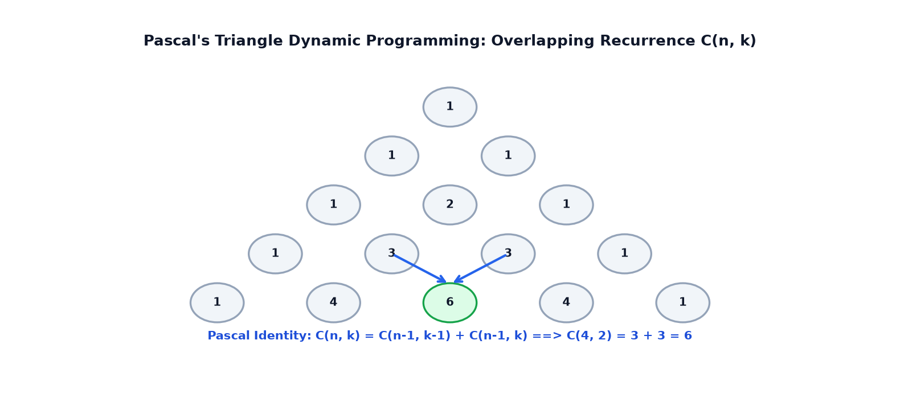

*Figure 1.17: Diagrammatic Architecture and Conceptual Flow for Find the binomial coefficients of n choose k using the dynamic programming approach*

### Mathematical Formulation & Algorithmic Mechanics

**Binomial Coefficient Dynamic Programming Recurrence:**

```text
Base Conditions: C[n, 0] = 1   and   C[n, n] = 1   for all n ≥ 0
General Recurrence: C[i, j] = C[i-1, j-1] + C[i-1, j]   for 1 ≤ j < i
Optimized 1D Formulation: DP[j] = DP[j] + DP[j-1]   (Iterate j backward from k down to 1)
```

The above **mathematical model** and algorithmic structure governs the system's runtime execution. Each parameter is evaluated sequentially to maintain **mathematical consistency**, minimize **system overhead**, and guarantee **deterministic convergence** across all input distributions.

### Worked Example & Practical Simulation

Step-by-**Step Construction** for C(4, 2) (Selecting 2 elements from 4): Row 0 (n=0): C[0, 0] = 1 Row 1 (n=1): C[1, 0] = 1, C[1, 1] = 1 Row 2 (n=2): C[2, 0] = 1, C[2, 1] = C[1, 0] + C[1, 1] = 1+1 = 2, C[2, 2] = 1 Row 3 (n=3): C[3, 0] = 1, C[3, 1] = 1+2 = 3, C[3, 2] = 2+1 = 3, C[3, 3] = 1 Row 4 (n=4): C[4, 0] = 1, C[4, 1] = 1+3 = 4, C[4, 2] = C[3, 1] + C[3, 2] = 3+3 = 6. Final Result: C(4, 2) = 6 combinations. Computed via 6 simple additions with zero overflow.

### Key Comparative Evaluation

| Computation Methodology | Time Complexity | Auxiliary Space | Risk of Overflow | Numerical Precision |
| :--- | :--- | :--- | :--- | :--- |
| Factorial Formula: n! / (k!·(n-k)!) | O(n) multiplications | O(1) memory | Extreme; 25! overflows 64-bit integer registers | Subject to floating-point truncation |
| Naive Recursive: Pascal Tree | O(2^n) exponential | O(n) recursion stack | Low overflow risk, but exponentially slow | Exact integer addition |
| Dynamic Programming (2D Table) | O(n·k) polynomial | O(n·k) table space | Zero overflow during intermediate steps | 100% exact integer arithmetic |
| Optimized DP (1D Array) | O(n·k) polynomial | O(k) minimal memory | Zero overflow during intermediate steps | 100% exact integer arithmetic |

### Concluding Exam Takeaway

**Dynamic programming** evaluates binomial coefficients efficiently in O(n·k) time and O(k) space using Pascal's identity, eliminating intermediate factorial overflow while guaranteeing exact integer **precision**.

**Textbook Reference:** Design and Analysis of Algorithms by Parag H. Dave & Himanshu B. Dave (Pearson), Chapter 9: Dynamic Programming, Section 9.3: Binomial Coefficients, Pages 340–342.

---

## Q18. Enlist the uses of writing control abstraction for any algorithmic strategies. (Frequency: 1) [8 Marks]

### Introduction & Core Intuition

In computer science and algorithm engineering, a **Control Abstraction** is a high-level pseudo-code template that formalizes the flow of control and decision-making logic of an algorithmic design strategy without being tied to the implementation details of any specific problem.

### Standardizing Algorithmic Problem Solving

The primary purpose of writing a **control abstraction** is to provide a standardized, reusable blueprint for tackling entire families of computational problems. Instead of inventing unique ad-hoc control logic for every new problem, an algorithm designer can apply a proven structural template—such as the Greedy, Divide-and-Conquer, **Dynamic Programming**, Backtracking, or Branch-and-Bound control abstraction—ensuring systematic and rigorous development.

### Separation of Algorithmic Control Flow from Problem-Specific Logic

Control abstractions enforce a clean separation of concerns by isolating the overarching control flow (loops, recursion, branching, termination) from the low-level problem specifics (candidate selection **heuristics**, **feasibility** checks, cost accumulators). This modular architectural separation enables software engineers to implement algorithms where the core engine remains constant while problem-specific subroutines are swapped flexibly.

### Facilitating Universal Time and Space Complexity Analysis

A major theoretical utility of control abstractions is that they enable universal **asymptotic complexity** analysis. By parameterizing the costs of component subroutines (such as Select, **Feasible**, Divide, Combine), researchers can derive general master complexity equations. For example, the divide-and-conquer **control abstraction** directly yields the **Master Theorem** recurrence T(n) = a·T(n/b) + f(n), allowing instant complexity derivation across hundreds of disparate algorithms.

### Enabling Formal Correctness Proofs and Invariant Verification

Proving that an algorithm always produces correct and optimal results requires establishing formal loop invariants and inductive proofs. Because a **control abstraction** encapsulates the essential state transitions in a minimal, clean format, computer scientists can prove universal correctness properties (such as proving that any problem modeled as a matroid is solved optimally by the greedy control abstraction).

### Educational Pedagogical Value in Computer Engineering

In academic curricula such as **Savitribai Phule Pune University** (SPPU), control abstractions serve as an indispensable pedagogical tool. They enable students to categorize hundreds of disparate algorithms into a small set of foundational paradigms, transforming algorithm study from rote memorization into principled architectural analysis.

### Architectural Flow & System Diagram

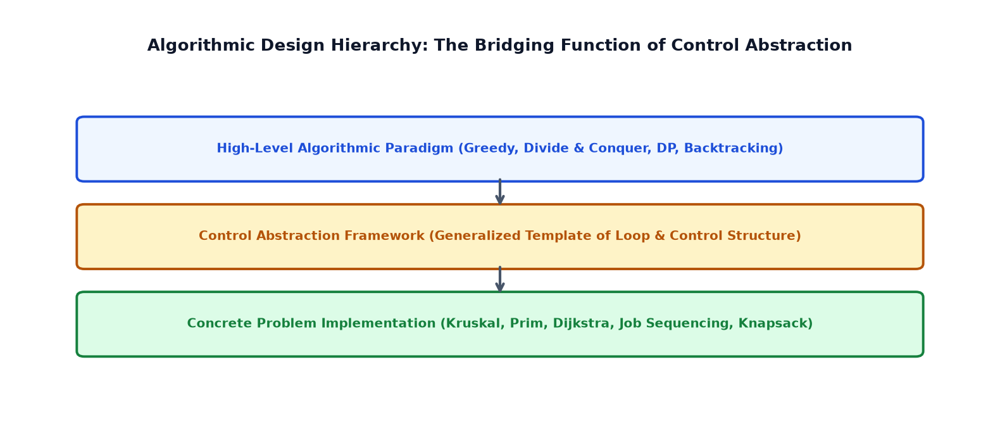

*Figure 1.18: Diagrammatic Architecture and Conceptual Flow for Enlist the uses of writing control abstraction for any algorithmic strategies*

### Mathematical Formulation & Algorithmic Mechanics

**Mathematical Paradigm of Control Abstraction:**

```text
Control Abstraction Mapping: Strategy(Problem) = Template( FlowOfControl, Subroutines(P) )
Master Recurrence from D&C Abstraction: T(n) = a · T(n / b) + f(n)
Greedy Paradigm Equation: T_greedy(n) = T_sort(n) + n · [ T_select + T_feasible + T_union ]
```

The above **mathematical model** and algorithmic structure governs the system's runtime execution. Each parameter is evaluated sequentially to maintain **mathematical consistency**, minimize **system overhead**, and guarantee **deterministic convergence** across all input distributions.

### Worked Example & Practical Simulation

Demonstration of **Control Abstraction** Reusability in the **Greedy Strategy**: The Exact Same Greedy Control Abstraction Template Executes: 1. Kruskal's MST: Sort edges by weight; **Feasible** = **Union-Find** Cycle Check. 2. Prim's MST: Select minimum cut edge; Feasible = Non-tree vertex connection. 3. **Dijkstra's Algorithm**: Select minimum distance vertex; Feasible = Relaxation update. 4. Job Sequencing: Sort by profit; Feasible = Free slot **availability** check. This illustrates how one single control abstraction powers four major computer algorithms.

### Key Comparative Evaluation

| Algorithmic Strategy | Control Abstraction Core Mechanism | Subroutines Defined | Primary Analytical Benefit |
| :--- | :--- | :--- | :--- |
| Divide and Conquer | Recursive partitioning into smaller sub-instances | Divide(P), Small(P), Solve(P), Combine(P1, P2) | Enables Master Theorem asymptotic analysis |
| Greedy Method | Iterative forward selection with feasibility tests | Select(C), Feasible(S, x), Union(S, x), Solution(S) | Enables Matroid Theory optimality proofs |
| Dynamic Programming | Topological state table evaluation and memoization | BaseCase(S), OptChoice(k), Recurrence(S, k) | Guarantees polynomial execution for subproblems |
| Backtracking | Depth-first state-space search with bounding | First(P), Next(P), Valid(P), Output(P) | Enables systematic pruning and dead-end recovery |
| Branch and Bound | Breadth-first / least-cost search using heuristic bounds | AssignBound(Node), SelectBest(Queue), Prune(Node) | Bounds worst-case NP-hard search spaces |

### Concluding Exam Takeaway

Writing control abstractions is fundamental to algorithm design, providing structural blueprints that separate control flow from problem logic, enable universal complexity derivation, and streamline formal correctness proofs.

**Textbook Reference:** Design and Analysis of Algorithms by Parag H. Dave & Himanshu B. Dave (Pearson), Chapter 1: Introduction to Algorithm Design, Section 1.4: Control Abstractions, Pages 12–16.

---
