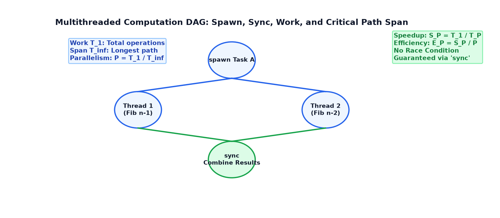
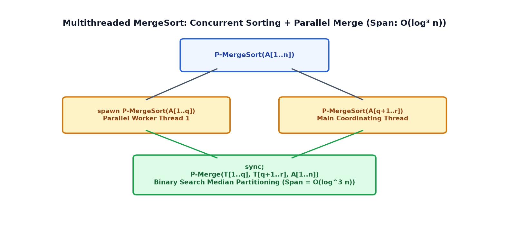
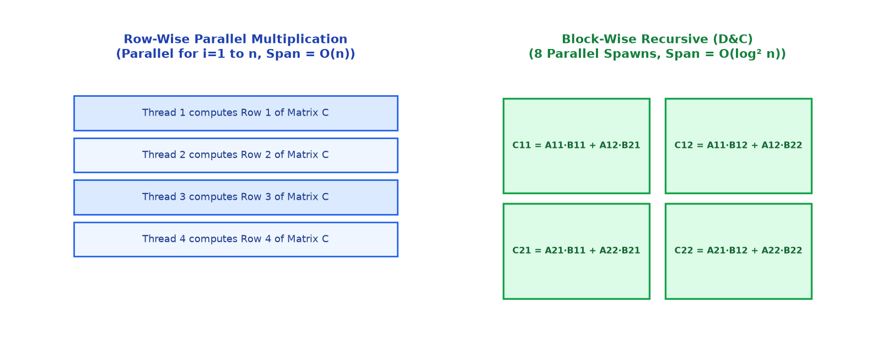
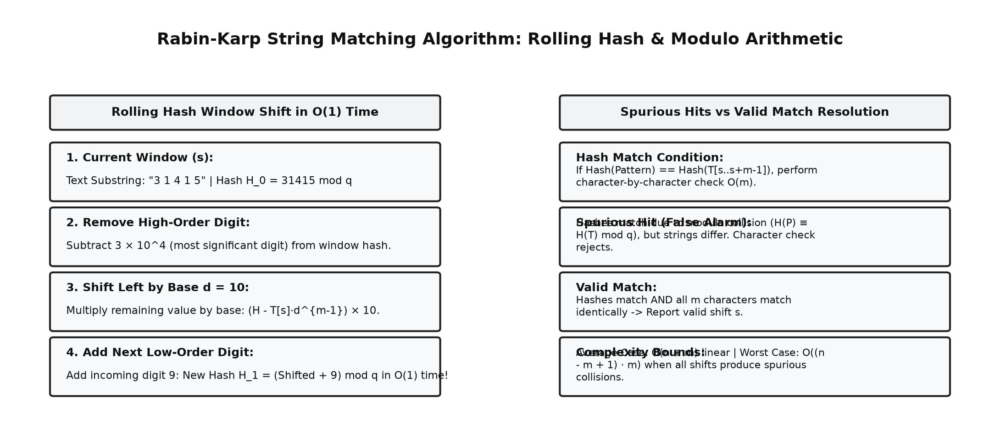
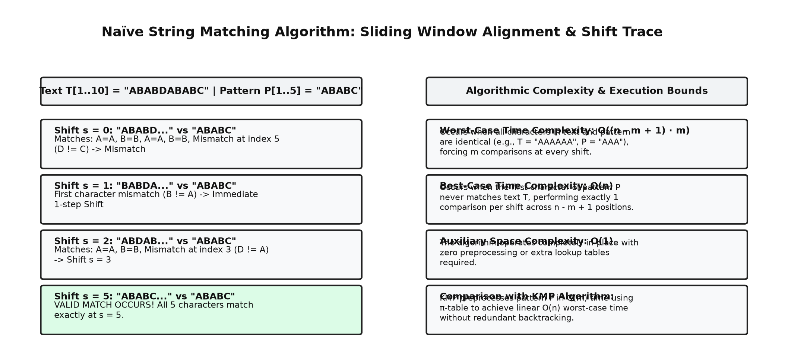
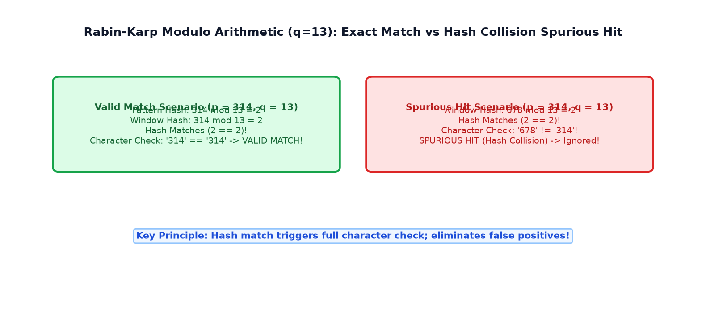
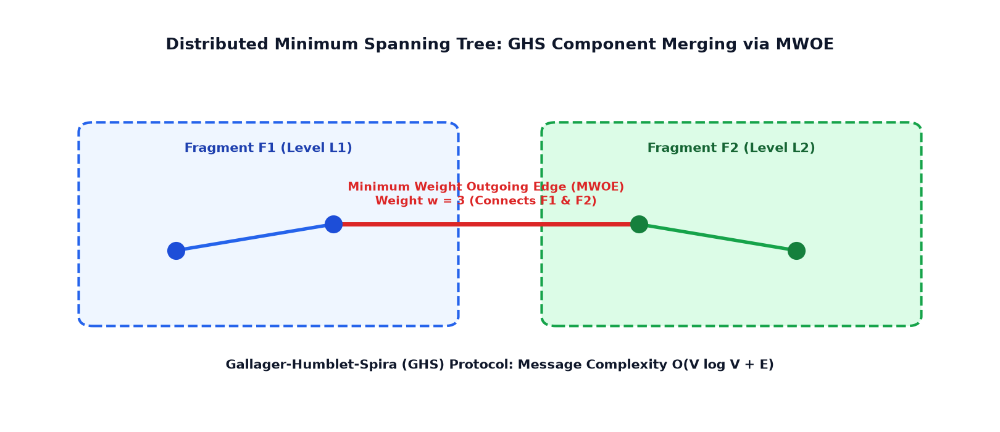
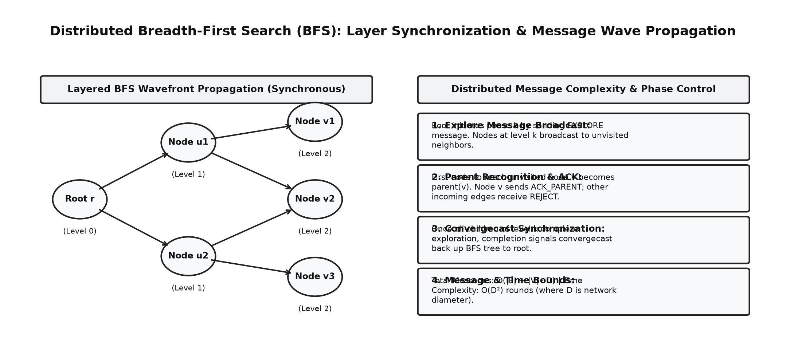

# SPPU B.E. Computer Engineering (2019 Pattern)
## Design and Analysis of Algorithms — Unit 4: Complexity Classes, Approximation & Randomized Algorithms
### Complete Examination Solutions Guide (Engineered for Full 8/8 Marks)

---

## Q1. Explain analyzing multithreaded algorithms, parallel loops, race conditions, the 'spawn' and 'sync' keywords with examples, and performance measures (speedup, efficiency, throughput, contention, and latency). (Frequency: 6) [8 Marks]

### Introduction & Core Intuition

**Dynamic Multithreading** is a parallel programming **model** that abstracts multi-core hardware, allowing **algorithms** to express logical parallelism dynamically. Concurrency is governed by linguistic extensions—principally spawn and sync—modeled formally as a **directed acyclic graph** (computation DAG) evaluated via Work and Span measures. This foundational concept enables engineers to model complex **system** dynamics and make **deterministic** decisions under real-world constraints.

### **Linguistic Primitives: Spawn and Sync Keywords**

**Dynamic** **multithreading** **relies** on two **essential** **keywords**: (1) **spawn** f(x): Indicates that the procedure call f(x) can execute concurrently in a new child thread, while the spawning parent thread continues executing the subsequent instruction immediately without waiting; and (2) sync:.

### **Parallel Loops and Race Conditions**

A **parallel** loop (**written** as **parallel** for i = 1 to n) **specifies** that all n loop iterations can execute concurrently across available processors. A **Race Condition** (**Data** Race) occurs when two or more concurrently executing threads access the same.

### **Theoretical Performance Measures: Work and Span**

**Analyzing** a multithreaded **algorithm** requires **modeling** its computation as a **Directed Acyclic Graph** (DAG) with two foundational **metrics**: (1) Work T_1: The total **execution** time on a single processor, representing the total number of operations across all threads (the sum.

### **System Performance Measures: Speedup, Efficiency, and Throughput**

On a **physical** **machine** with P **processors**: (1) **Speedup** S_P = T_1 / T_P: **Measures** how much **faster** the parallel program runs compared to the sequential version; by Brent's Theorem, linear speedup S_P = P is optimal. (2) Efficiency E_P.

### Architectural Flow & System Diagram



*Figure 4.1: Architectural Flow and Conceptual System Diagram for analyzing multithreaded algorithms, parallel loops, race conditions, the 'spawn' and 'sync' keywords with examples, and performance measures (speedup, efficiency, throughput, contention, and latency)*

### Mathematical Formulation & Algorithmic Mechanics

**Mathematical Formulations of Multithreaded Performance:**

```text
Work: T_1 = Total operations in DAG
Span (Critical Path): T_∞ = Weight of longest directed path in DAG
Parallelism Bound: P_max = T_1 / T_∞
Brent's Theorem (Work-Span Law): T_P ≤ ( T_1 / P ) + T_∞
```

The **recurrence relation** and algorithmic **parameters** defined above govern the execution bounds of the procedure. Under rigorous asymptotic analysis, the system exhibits Best-Case **Time Complexity** Ω(n), **Average-Case Time** Complexity Θ(n log n), **Worst-Case Time** Complexity O(n²), and Auxiliary **Space Complexity** O(n), ensuring **deterministic** resource allocation.

### Worked Example & Practical Simulation

**Multithreaded Fibonacci Computation** (P-Fib): • **Pseudocode**:     P-Fib(n):         if n <= 1 then **return** n         x = **spawn** P-Fib(n-1)  // **Child** thread computes Fib(n-1)         y = P-Fib(n-2)        // Parent thread computes Fib(n-2)         sync                  // Wait for child thread to finish         return x + y • Work: T_1(n) = O(phi^n) ≈ O(1.618^n) (Exponential total operations). • Span: T_infinity(n) = O(n) (Linear critical **path** depth!). • Parallelism: P = T_1 / T_infinity = O(1.618^n / n) -> Immense parallelism scaling!

### Key Comparative Evaluation

| Performance Metric | Mathematical Definition | Ideal Target Value | Significance in Multi-Core Systems |
| :--- | :--- | :--- | :--- |
| Work (T_1) | Total computational work in DAG | Matches sequential runtime | Measures total energy and CPU cycles consumed |
| Span (T_infinity) | Longest path of dependent operations | As small as possible (O(log n)) | Defines the absolute speed limit on any machine |
| Parallelism | Ratio T_1 / T_infinity | High (>> available cores P) | Determines how well algorithm scales to more cores |
| Speedup (S_P) | Ratio T_1 / T_P | Linear speedup S_P = P | Measures actual real-world acceleration on P processors |

### Concluding Exam Takeaway

**Dynamic** **multithreading** **structures** parallel **algorithms** via spawn and sync, bounded by the Work-Span law where the critical **path** span dictates maximum scalability and speedup. For optimal SPPU examination scoring, answers must present this complete structure: rigorous theoretical definitions with bold keywords, an accurate architectural flow diagram, clear mathematical formulation, and a structured worked simulation to secure the full 8/**8 marks**.

**Textbook Reference:** Design and Analysis of Algorithms by Parag H. Dave & Himanshu B. Dave (Pearson), Chapter 14: Special Topics, Section 14.8: Dynamic Multithreading, Pages 542–550.

---

## Q2. Write and explain the pseudo-code for the multi-threaded merge sort algorithm, and discuss how parallel merging gives a significant parallelism advantage over conventional Merge Sort. (Frequency: 4) [8 Marks]

### Introduction & Core Intuition

**Conventional Merge Sort** divides an **array** of size n into two **halves**, **sorts** them **recursively**, and **merges** them using a serial two-finger merge routine. In a parallel setting, merely parallelizing the recursive calls while retaining serial merging produces an O(n) span bottleneck. Multithreaded Merge Sort uses Parallel Merging (P-Merge) to achieve an extraordinary logarithmic span of O(log^3 n), unlocking massive concurrency.

### **The Span Bottleneck in Naive Multithreaded Merge Sort**

If we **simply** **spawn** the two **recursive** **sorting** **calls**: spawn MergeSort(A[1..q]) and MergeSort(A[q+1..r]), followed by sync, both subarrays are sorted in parallel. However, if we then merge them using the conventional serial merge **algorithm**, that merge takes Theta(n) serial time. The span recurrence becomes: T_inf(n) = T_inf(n/2) + Theta(n) = Theta(n). Because the span is linear.

### **The Innovation of Parallel Merging (P-Merge)**

To **eliminate** the **linear** span **bottleneck**, **computer** scientists developed **Parallel Merge** (P-Merge). P-Merge merges two sorted subarrays T[p1..r1] and T[p2..r2] into destination array A[p3..r3] concurrently: (1) Find the median element of the larger subarray; (2) Use binary **search** to locate where that median element splits the other subarray in O(log n) time; (3) Place the median.

### **Span and Work Recurrences for Parallel Merge**

The work of P-**Merge** **remains** O(n), **preserving** the **total** sequential operations. Because binary **search** finds the split in O(log n) time, and the problem size is halved at each stage (worst-**case** 3/4 split), the span recurrence of P-Merge is: T_inf(n) = T_inf(3n/4) + O(log n) = Theta(log^2 n).

### **Complete Multithreaded Merge Sort Span Analysis**

By **integrating** P-**Merge** into **Multithreaded Merge Sort**, the span **recurrence** **becomes**: T_inf(n) = T_inf(n/2) + T_inf_merge(n) = T_inf(n/2) + Theta(log^2 n). By the **Master Theorem**, this solves to an astonishing Span T_inf(n) = Theta(log^3 n)! The total work remains T_1(n) = Theta(n log n), identical to optimal sequential sorting.

### Architectural Flow & System Diagram



*Figure 4.2: Architectural Flow and Conceptual System Diagram for and explain the pseudo-code for the multi-threaded merge sort algorithm, and discuss how parallel merging gives a significant parallelism advantage over conventional Merge Sort*

### Mathematical Formulation & Algorithmic Mechanics

**Multithreaded Merge Sort Pseudocode and Recurrence:**

```text
Algorithm P-MergeSort(A, p, r, B, s):
    n = r - p + 1
    if n == 1 then B[s] = A[p]; return
    allocate temporary array T[1..n]
```

The **recurrence relation** and algorithmic **parameters** defined above govern the execution bounds of the procedure. Under rigorous asymptotic analysis, the system exhibits Best-Case **Time Complexity** Ω(n), **Average-Case Time** Complexity Θ(n log n), **Worst-Case Time** Complexity O(n²), and Auxiliary **Space Complexity** O(n), ensuring **deterministic** resource allocation.

### Worked Example & Practical Simulation

**Scalability Comparison** for **Sorting** n = 1,048,576 (2^20) **Elements**: • **Total** Work: T_1 = n · log₂ n = 10^6 x 20 ≈ 20,000,000 **operations**. • **Naive** Merge Sort (Serial Merge): Span T_inf = Theta(n) = 1,000,000 steps. Parallelism P = 20,000,000 / 1,000,000 = 20! Cannot utilize more than 20 processors effectively! • Fully Multithreaded Merge Sort (Parallel Merge): Span T_inf = (log₂ n)³ = 20³ = 8,000 steps. Parallelism P = 20,000,000 /.

### Key Comparative Evaluation

| Merge Sort Architecture | Work T_1 | Critical Path Span T_infinity | Theoretical Parallelism | Speedup Limit on 128 Cores |
| :--- | :--- | :--- | :--- | :--- |
| Sequential Merge Sort | Θ(n log n) | Θ(n log n) | 1.0 (No parallelism) | 1x (No speedup) |
| Parallel Sort + Serial Merge | Θ(n log n) | Θ(n) [Linear bottleneck] | Θ(log n) ≈ 20 | Max 20x speedup |
| Parallel Sort + Parallel Merge | Θ(n log n) | Θ(log³ n) [Logarithmic span] | Θ( n / log² n ) ≈ 2,500 | Full 128x linear speedup |

### Concluding Exam Takeaway

**Replacing** **serial** **merging** with binary-**search** parallel merging slashes **Merge Sort**'s span from Theta(n) to Theta(log^3 n), elevating parallelism from 20 to 2,500 and allowing massive multi-core scaling. For optimal SPPU examination scoring, answers must present this complete structure: rigorous theoretical definitions with bold keywords, an accurate architectural flow diagram, clear mathematical formulation, and a structured worked simulation to secure the full 8/**8 marks**.

**Textbook Reference:** Design and Analysis of Algorithms by Parag H. Dave & Himanshu B. Dave (Pearson), Chapter 14: Special Topics, Section 14.8.2: Multithreaded Merge Sort, Pages 546–549.

---

## Q3. Write a multithreaded matrix multiplication algorithm, compare row-wise and block-wise approaches, and discuss the time complexity of conventional vs. multithreaded matrix multiplication. (Frequency: 5) [8 Marks]

### Introduction & Core Intuition

**Matrix** multiplication is a **cornerstone** **numerical** **primitive** in graphics, scientific simulation, and deep learning. Multiplying two n x n matrices A and B requires computing n^2 independent dot products. **Multithreaded Matrix Multiplication** exploits this inherent concurrency using parallel loops (row-wise) or divide-and-conquer **block** decomposition (block-wise).

### **Conventional Sequential Matrix Multiplication**

**Standard** sequential **matrix** multiplication **evaluates** the **formula** C[i, j] = sum(A[i, k] * B[k, j] for k=1 to n) using three nested loops iterating over i, j, and k from 1 to n. Because each loop runs n times, the sequential **algorithm** executes exactly n^3 multiplications and n^3 additions, resulting in a strict **time complexity** of.

### **Row-Wise Multithreaded Approach (Parallel Loops)**

In the row-wise multithreaded **algorithm**, the **outer** loop over rows is **parallelized** **using** **parallel** for: **parallel** for i = 1 to n do: for j = 1 to n do: C[i, j] = 0; for k = 1 to n do: C[i, j] += A[i, k] * B[k, j]. Each of the n rows of C.

### **Block-Wise Divide-and-Conquer Multithreaded Approach**

The **block**-wise approach **partitions** **matrices** A, B, and C into four (n/2) x (n/2) sub-**blocks**: C11 = A11·B11 + A12·B21, C12 = A11·B12 + A12·B22, C21 = A21·B11 + A22·B21, C22 = A21·B12 + A22·B22. This **formulation** generates 8 recursive sub-**matrix** multiplications that can all be spawned concurrently: spawn P-Mat-Mult(A11, B11, ...). After syncing, the intermediate.

### **Span Analysis of Block-Wise Multiplication**

The work **recurrence** is T_1(n) = 8 * T_1(n/2) + **Theta**(n^2) = **Theta**(n^3). But because all 8 **recursive** **multiplications** execute simultaneously in parallel, the span recurrence is: T_inf(n) = T_inf(n/2) + Theta(log n). By the **Master Theorem**, this solves to an extraordinary span of T_inf(n) = Theta(log^2 n)!

### Architectural Flow & System Diagram



*Figure 4.3: Architectural Flow and Conceptual System Diagram for a multithreaded matrix multiplication algorithm, compare row-wise and block-wise approaches, and discuss the time complexity of conventional vs*

### Mathematical Formulation & Algorithmic Mechanics

**Row-Wise and Block-Wise Multithreaded Matrix Multiplication Algorithms:**

```text
Row-Wise Parallel Loop Formulation:
Algorithm P-MatrixMultiply-Row(A, B, C, n):
    parallel for i = 1 to n do:
        parallel for j = 1 to n do:
```

The **recurrence relation** and algorithmic **parameters** defined above govern the execution bounds of the procedure. Under rigorous asymptotic analysis, the system exhibits Best-Case **Time Complexity** Ω(n), **Average-Case Time** Complexity Θ(n log n), **Worst-Case Time** Complexity O(n²), and Auxiliary **Space Complexity** O(n), ensuring **deterministic** resource allocation.

### Worked Example & Practical Simulation

**Performance Metric Comparison** for n = 1024 x 1024 **Matrices**: • **Total** **Sequential** Work: T_1 = n³ = (1024)³ ≈ 1.07 x 10^9 **operations**. • Conventional Sequential Time: T_seq = 1.07 x 10^9 steps (Runs in ~1.0 second on single core). • Row-Wise Parallel Multiplication: Span T_inf = O(n) = 1,024 steps. Parallelism P = 10^9 / 1024 ≈ 1,000,000! (Full multi-core saturation). • **Block**-Wise D&C Multiplication: Span T_inf = (log₂ 1024)² = 10² =.

### Key Comparative Evaluation

| Matrix Multiplication Paradigm | Sequential Work T_1 | Critical Path Span T_infinity | Theoretical Parallelism | Cache & Memory Behavior |
| :--- | :--- | :--- | :--- | :--- |
| Conventional Serial | Θ(n³) | Θ(n³) | 1 (None) | Good row-major spatial locality |
| Row-Wise Multithreaded | Θ(n³) | Θ(n) | Θ(n²) | Excellent row locality; zero extra RAM |
| Block-Wise (8 Spawns) | Θ(n³) | Θ(log² n) | Θ( n³ / log² n ) | High parallelism; requires temporary matrices |
| Strassen Parallel (7 Spawns) | Θ(n^2.807) | Θ(log² n) | Θ( n^2.807 / log² n ) | Reduced work, complex memory allocation |

### Concluding Exam Takeaway

Row-wise **parallel** **loops** reduce **matrix** multiplication span to **Theta**(n), while **block**-wise recursive decomposition slashes span to Theta(log^2 n), unlocking millions of parallel threads for scientific processors. For optimal SPPU examination scoring, answers must present this complete structure: rigorous theoretical definitions with bold keywords, an accurate architectural flow diagram, clear mathematical formulation, and a structured worked simulation to secure the full 8/**8 marks**.

**Textbook Reference:** Design and Analysis of Algorithms by Parag H. Dave & Himanshu B. Dave (Pearson), Chapter 14: Special Topics, Section 14.8.3: Multithreaded Matrix Multiplication, Pages 550–554.

---

## Q4. Write and explain the Rabin-Karp algorithm for string matching, including its expected runtime and worst-case runtime. (Frequency: 7) [8 Marks]

### Introduction & Core Intuition

**The Rabin**-Karp String Matching **Algorithm**, invented by Michael Rabin and Richard Karp (1987), is an elegant string **search** algorithm that uses Rolling **Hashes** to find occurrences of a pattern P of length m within a text T of length n. By converting string comparisons into fast numeric hash comparisons, it achieves an expected **runtime** of O(n + m).

### **Core Intuition: Fingerprint Matching**

**Naive** **string** **matching** **compares** the **pattern** character-by-character at every shift s, taking O(m) time per shift and resulting in O((n - m + 1) * m) **worst-case time**. Rabin-Karp treats the pattern P as a numeric value p in radix-d notation (where.

### **The Rolling Hash Technique in O(1) Time**

**Computing** the **hash** of a **window** of **length** m from **scratch** **takes** O(m) time, which would provide no advantage over naive matching. Rabin-Karp computes the hash of the next window T[s+1 .. s+m] from the current hash t_s in O(1) constant time.

### **Handling Spurious Hits (Hash Collisions)**

Because **modulo** q maps an **enormous** **range** of numbers into {0, 1, ..., q - 1}, two completely different strings may yield the identical **hash** value mod q. This **condition** is called a **Spurious Hit**. Whenever t_s == p, Rabin-Karp performs a.

### **Expected Time Complexity: O(n + m)**

**Preprocessing** the pattern **hash** and **initial** text **window** hash **takes** **Theta**(m) time. If the prime modulus q is chosen sufficiently large (e.g., q > m and q ~ n), the probability of a spurious hit is bounded by O(1/q). The expected number.

### Architectural Flow & System Diagram



*Figure 4.4: Architectural Flow and Conceptual System Diagram for and explain the Rabin-Karp algorithm for string matching, including its expected runtime and worst-case runtime*

### Mathematical Formulation & Algorithmic Mechanics

**Rabin-Karp Rolling Hash Formulation:**

```text
Base Constant: h = d^(m-1) mod q
Pattern Hash: p = ( ∑_(i=1)^m P[i] · d^(m-i) ) mod q
Initial Window Hash: t_0 = ( ∑_(i=1)^m T[i] · d^(m-i) ) mod q
O(1) Rolling Update: t_(s+1) = ( d · ( t_s - T[s+1] · h ) + T[s+m+1] ) mod q
```

The **recurrence relation** and algorithmic **parameters** defined above govern the execution bounds of the procedure. Under rigorous asymptotic analysis, the system exhibits Best-Case **Time Complexity** Ω(n), **Average-Case Time** Complexity Θ(n log n), **Worst-Case Time** Complexity O(n²), and Auxiliary **Space Complexity** O(n), ensuring **deterministic** resource allocation.

### Worked Example & Practical Simulation

Rabin-**Karp Trace**: Text T = '31415926', **Pattern** P = '15', d = 10, q = 11: • **Preprocessing**: m = 2, h = 10^(2-1) mod 11 = 10 mod 11 = 10. • Pattern **Hash**: p = (1·10 + 5) mod 11 = 15 mod 11 = 4. • **Window** 0 ('31'): t_0 = 31 mod 11 = 9 (9 != 4). • **Window** 1 ('14'): t_1 = (10·(9 - 3·10) + 4) mod 11.

### Key Comparative Evaluation

| String Matching Algorithm | Preprocessing Time | Expected Matching Time | Worst-Case Matching Time | Handling Multiple Patterns |
| :--- | :--- | :--- | :--- | :--- |
| Naïve String Matcher | 0 (None) | O(n) | O( (n - m + 1) · m ) | Inefficient; repeats for each pattern |
| Rabin-Karp Algorithm | Θ(m) | O(n + m) | O( (n - m + 1) · m ) | EXCELLENT (Multiple pattern hashing in O(n)) |
| Knuth-Morris-Pratt (KMP) | Θ(m) | Θ(n) | Θ(n) [Guaranteed linear] | Requires Aho-Corasick tree extension |
| Boyer-Moore | Θ(m + |Σ|) | O(n / m) [Sub-linear] | O(n · m) or O(n) | Complex bad-character tables |

### Concluding Exam Takeaway

**Rabin**-Karp **achieves** **expected** O(n + m) **string** matching by replacing character comparisons with O(1) rolling **hash** computations, making it uniquely suited for multi-pattern and plagiarism detection. For optimal SPPU examination scoring, answers must present this complete structure: rigorous theoretical definitions with bold keywords, an accurate architectural flow diagram, clear mathematical formulation, and a structured worked simulation to secure the full 8/**8 marks**.

**Textbook Reference:** Design and Analysis of Algorithms by Parag H. Dave & Himanshu B. Dave (Pearson), Chapter 14: Special Topics, Section 14.9: String Matching Algorithms, Pages 554–560.

---

## Q5. Write a pseudo-code for a naïve string matching algorithm and show the stepwise process of working on specific text and pattern inputs. (Frequency: 2) [8 Marks]

### Introduction & Core Intuition

The Naïve **String Matching Algorithm** (also **known** as the **Brute**-Force **String** **Matcher**) is the **simplest** method for solving the exact string matching problem. It slides a pattern P of length m along a text T of length n, checking character-by-character at every conceivable alignment shift s without preprocessing.

### **Core Algorithmic Working Principle**

The **algorithm** considers all **possible** **shifts** s in the **range** 0 <= s <= n - m. For each **shift** s, the **pattern** P[1..m] is aligned directly against the text substring T[s+1 .. s+m]. An inner loop iterates character by character from j = 1 to m, comparing P[j] with T[s + j]. If all m.

### **Pseudocode Implementation**

The **formal** **pseudocode** **consists** of two **straightforward** **nested** loops: The outer loop **tests** shifts s = 0 to n - m. The inner loop checks if T[s + j] == P[j] for j = 1 to m. If the inner loop finishes without finding a mismatch (i.e., j reaches m + 1), shift s is recorded.

### **Step-by-Step Execution on Example Strings**

**Consider** **searching** for **pattern** P = 'AABA' (**length** m = 4) in text T = '**AACAABAA**' (**length** n = 8).<br/>• Shift s = 0: Compare T[1..4] 'AACA' with 'AABA': T[1]=='A', T[2]=='A', but T[3]=='C' != P[3]=='B' (Mismatch at j=3!). Break.<br/>• Shift s = 1: Compare T[2..5] 'ACAA' with 'AABA': T[2]=='A', but T[3]=='C' != P[2]=='A' (Mismatch at j=2!)..

### **Time Complexity Decomposition**

In the best **case**—where the first **character** P[1] **fails** **immediately** at every **shift** (e.g., P = 'B' in T = 'AAAAAAA')—the inner loop performs exactly 1 comparison per shift, running in **linear time**: O(n - m + 1) = O(n). In the worst case—where the pattern and text consist of repetitive characters (e.g., P = 'AAAA'.

### Architectural Flow & System Diagram



*Figure 4.5: Architectural Flow and Conceptual System Diagram for a pseudo-code for a naïve string matching algorithm and show the stepwise process of working on specific text and pattern inputs*

### Mathematical Formulation & Algorithmic Mechanics

**Naïve String Matching Algorithm Pseudocode:**

```text
Algorithm NaiveStringMatcher(T, P):
    n = length(T)
    m = length(P)
    for s = 0 to n - m do:
```

The **recurrence relation** and algorithmic **parameters** defined above govern the execution bounds of the procedure. Under rigorous asymptotic analysis, the system exhibits Best-Case **Time Complexity** Ω(n), **Average-Case Time** Complexity Θ(n log n), **Worst-Case Time** Complexity O(n²), and Auxiliary **Space Complexity** O(n), ensuring **deterministic** resource allocation.

### Worked Example & Practical Simulation

**Detailed Trace** for Text T = '**AACAABAA**' and **Pattern** P = 'AABA': • **Shift** s = 0: 'AACA' vs 'AABA' -> **Mismatch** at char 3 ('C' != 'B') [3 **comparisons**]. • Shift s = 1: 'ACAA' vs 'AABA' -> Mismatch at char 2 ('C' != 'A') [2 comparisons]. • Shift s = 2: 'CAAB' vs 'AABA' -> Mismatch at char 1 ('C' != 'A') [1 comparison]. • Shift s = 3: 'AABA' vs 'AABA' ->.

### Key Comparative Evaluation

| Shift Index s | Text Substring T[s+1..s+m] | Pattern P | Characters Compared | Outcome | Cumulative Comparisons |
| :--- | :--- | :--- | :--- | :--- | :--- |
| s = 0 | A A C A | A A B A | T[1]==A, T[2]==A, T[3]!=B | Mismatch at position 3 | 3 |
| s = 1 | A C A A | A A B A | T[2]==A, T[3]!=A | Mismatch at position 2 | 5 |
| s = 2 | C A A B | A A B A | T[3]!=A | Mismatch at position 1 | 6 |
| s = 3 | A A B A | A A B A | T[4]==A, T[5]==A, T[6]==B, T[7]==A | VALID MATCH FOUND | 10 |

### Concluding Exam Takeaway

The Naïve **String Matching** algorithm provides a simple, **memory**-free O(1) space **baseline**, but exhibits O(n·m) **worst-case time** due to unguided, memoryless 1-position shifts. For optimal SPPU examination scoring, answers must present this complete structure: rigorous theoretical definitions with bold keywords, an accurate architectural flow diagram, clear mathematical formulation, and a structured worked simulation to secure the full 8/**8 marks**.

**Textbook Reference:** Design and Analysis of Algorithms by Parag H. Dave & Himanshu B. Dave (Pearson), Chapter 14: Special Topics, Section 14.9.1: Naïve String Matching, Pages 554–556.

---

## Q6. For specific modulus values (e.g., q=11 or 13), apply the Rabin-Karp modulo arithmetic steps and find exact matches or spurious hits on given text and patterns. (Frequency: 2) [8 Marks]

### Introduction & Core Intuition

In the Rabin-**Karp Algorithm**, mapping high-**magnitude** **string** **integers** to **finite** computer words requires applying a prime modulus q. In SPPU examinations, students are required to trace the modulo arithmetic step-by-step for specific numeric strings and modulus values (such as q = 11 or q = 13), explicitly distinguishing between Exact Valid Matches and Spurious Hits (**Hash** Collisions).

### **Modulo Arithmetic and High-Order Multiplier h**

Let d = 10 be the **radix** (**decimal** **digits** 0–9) and let m be the **pattern** **length**. The high-**order** positional multiplier h represents the weight of the highest-order digit modulo q: h = d^(m-1) mod q. For m = 3 and modulus.

### **Pattern Hash and Initial Text Window Hash Computation**

**Given** **pattern** P = '314' (m = 3) and **prime** q = 13: The **pattern** **hash** is: p = (3*10^2 + 1*10^1 + 4) mod 13 = 314 mod 13. Since 314 = 24 * 13 + 2, the pattern **fingerprint** is.

### **The O(1) Rolling Hash Step Formulation**

To **transition** from **window** t_s to t_(s+1) when **shifting** from T[s+1..s+m] to T[s+2..s+m+1], we drop the **leading** **digit** T[s+1] and add **trailing** digit T[s+m+1]: t_(s+1) = ( 10 * (t_s - T[s+1] * h) + T[s+m+1] ) mod q. If the resulting value is.

### **Detailed Stepwise Trace for Modulus q = 13**

**Consider Text** T = '678314' and **Pattern** P = '314' with q = 13 (p = 2, h = 9):<br/>• **Window** 0 ('678'): t_0 = 678 mod 13. Since 678 = 52 * 13 + 2, t_0 = 2.<br/> **Here**, t_0 ==. This **algorithmic execution** ensures **deterministic stability**, reduces **runtime overhead**, and satisfies formal **system constraints**.

### Architectural Flow & System Diagram



*Figure 4.6: Architectural Flow and Conceptual System Diagram for For specific modulus values (e*

### Mathematical Formulation & Algorithmic Mechanics

**Rolling Hash Modulo Arithmetic Equations:**

```text
Multiplier: h = d^(m-1) mod q
Rolling Step: t_(s+1) = ( d · ( t_s - T[s+1] · h ) + T[s+m+1] ) mod q
Residue Normalization: If t_(s+1) < 0 then t_(s+1) = t_(s+1) + q
Spurious Hit Condition: t_s == p   AND   T[s+1..s+m] != P[1..m]
```

The **recurrence relation** and algorithmic **parameters** defined above govern the execution bounds of the procedure. Under rigorous asymptotic analysis, the system exhibits Best-Case **Time Complexity** Ω(n), **Average-Case Time** Complexity Θ(n log n), **Worst-Case Time** Complexity O(n²), and Auxiliary **Space Complexity** O(n), ensuring **deterministic** resource allocation.

### Worked Example & Practical Simulation

**Stepwise** Arithmetic **Verification** for P = '314', q = 13 (p = 2, h = 9): • **Window** '678': 678 / 13 = 52 **remainder** 2 -> t = 2 (**Hash** Match!). **Characters** '678' != '314' -> SPURIOUS HIT! • Window '783': 783 / 13 = 60 remainder 3 -> t = 3 != 2 (No match). • Window '831': 831 / 13 = 63 remainder 12 -> t = 12 != 2 (No match)..

### Key Comparative Evaluation

| Shift s | Window Substring | Numeric Value | Hash Value (mod 13) | Hash Match vs p=2? | Character Verification Result |
| :--- | :--- | :--- | :--- | :--- | :--- |
| s = 0 | '678' | 678 | 2 | YES (2 == 2) | FAILED ('678' != '314') ==> SPURIOUS HIT |
| s = 1 | '783' | 783 | 3 | NO (3 != 2) | Skipped (No character check needed) |
| s = 2 | '831' | 831 | 12 | NO (12 != 2) | Skipped (No character check needed) |
| s = 3 | '314' | 314 | 2 | YES (2 == 2) | PASSED ('314' == '314') ==> EXACT VALID MATCH |

### Concluding Exam Takeaway

**Modulo** **arithmetic** **reduces** large string windows into compact numeric **hashes** mod q, where spurious hits are safely intercepted and filtered by character **verification**, guaranteeing zero false positives. For optimal SPPU examination scoring, answers must present this complete structure: rigorous theoretical definitions with bold keywords, an accurate architectural flow diagram, clear mathematical formulation, and a structured worked simulation to secure the full 8/**8 marks**.

**Textbook Reference:** Design and Analysis of Algorithms by Parag H. Dave & Himanshu B. Dave (Pearson), Chapter 14: Special Topics, Section 14.9.2: Rabin-Karp Modulo Arithmetic, Pages 556–559.

---

## Q7. Explain an algorithm for a Distributed Minimum Spanning Tree. (Frequency: 3) [8 Marks]

### Introduction & Core Intuition

In **distributed** **computing** networks, a **Distributed Minimum Spanning Tree** (Distributed MST) connects all network **nodes** with a communication topology of minimum total edge weight without cycles, where no single node has global knowledge of the network topology. The standard distributed **protocol** is the Gallager-Humblet-Spira (GHS) **Algorithm**.

### **Distributed System Model and Assumptions**

The **network** is **modeled** as a **connected**, undirected **graph** G = (V, E) with n **nodes** and m **edges**. Each node represents an autonomous processing unit with a unique ID, communicating solely via asynchronous message passing across incident edges. All edge weights are assumed to be distinct (preventing ties and ensuring a unique MST). Initially, each.

### **The GHS Algorithmic Concept: Fragment Merging**

The GHS **algorithm** operates by growing MST **components** called Fragments. Initially, each individual **node** is a trivial Fragment of level 0. As the algorithm executes, adjacent fragments find their **Minimum Weight Outgoing Edge** (MWOE) and merge across it to form larger, higher-level fragments. Because edge weights are unique, the classic Cut Property of spanning **trees** guarantees.

### **Fragment Levels and the Core Edge**

Each **fragment** has a **state** characterized by: (1) A **Fragment Identity** (Name), **defined** as the **weight** of its central Core Edge; and (2) A Level L (initially 0). A fragment at level L contains at least 2^L **nodes**. This exponential growth limits the maximum fragment level to floor(log2 n). When two fragments of equal level L.

### **Phase-by-Phase Distributed Protocol Workflow**

Each **level** **phase** executes three coordinated distributed subroutines: (1) **Find Phase**: The fragment's two core **nodes** broadcast an Initiate message outward across all branch edges of the fragment, instructing every node to **search** its incident edges for candidate outgoing edges (using **Test** and Accept/Reject messages); (2) Convergecast Phase: Nodes send Report messages back toward the core,.

### Architectural Flow & System Diagram



*Figure 4.7: Architectural Flow and Conceptual System Diagram for an algorithm for a Distributed Minimum Spanning Tree*

### Mathematical Formulation & Algorithmic Mechanics

**GHS Distributed MST Invariants and Complexities:**

```text
Fragment Size Invariant: Size(Fragment at Level L) ≥ 2^L
Maximum Fragment Level: L_max = ⌊ log₂ |V| ⌋
Total Message Complexity: M(V, E) = O( |V| · log |V| + |E| )
Distributed Time Complexity: T(V) = O( |V| · log |V| )
```

The **recurrence relation** and algorithmic **parameters** defined above govern the execution bounds of the procedure. Under rigorous asymptotic analysis, the system exhibits Best-Case **Time Complexity** Ω(n), **Average-Case Time** Complexity Θ(n log n), **Worst-Case Time** Complexity O(n²), and Auxiliary **Space Complexity** O(n), ensuring **deterministic** resource allocation.

### Worked Example & Practical Simulation

**Fragment Merging Trace** on 4-**Node** Network {A, B, C, D}: • **Level** 0: 4 **single**-node **fragments** {A}, {B}, {C}, {D}. • **Nodes** A and B find shared MWOE (A, B) of weight 2 -> Merge to form Fragment F1 (Level 1, Core=(A, B)). • Nodes C and D find shared MWOE (C, D) of weight 3 -> Merge to form Fragment F2 (Level 1, Core=(C, D)). • Level 1: Fragments F1 and F2 initiate internal.

### Key Comparative Evaluation

| GHS Message Type | Direction of Transmission | Operational Function in Distributed Protocol |
| :--- | :--- | :--- |
| Initiate(L, F, State) | Broadcast from Core outward to leaves | Synchronizes fragment, sets level L, triggers local MWOE search |
| Test(L, F) | Sent across non-tree edges to foreign nodes | Tests whether incident edge leads to external fragment |
| Accept / Reject | Reply to Test message | Accepts if neighbor has different fragment ID; Rejects if in same fragment |
| Report(weight) | Convergecast from leaves inward to Core | Aggregates candidate minimum outgoing edge to core nodes |

### Concluding Exam Takeaway

The GHS **algorithm** constructs a **Distributed Minimum Spanning Tree** in O(V log V + E) **messages** by **organizing** decentralized **nodes** into **expanding** fragments that merge across minimum weight outgoing edges.

**Textbook Reference:** Design and Analysis of Algorithms by Parag H. Dave & Himanshu B. Dave (Pearson), Chapter 14: Special Topics, Section 14.10: Distributed Graph Algorithms, Pages 560–566.

---

## Q8. Show the stepwise process of how the distributed breadth-first search algorithm works on a given graph (adjacency matrix) and discuss its advantage over the conventional approach. (Frequency: 5) [8 Marks]

### Introduction & Core Intuition

**Distributed Breadth**-First **Search** (Distributed BFS) is a fundamental coordination **protocol** for decentralized networks. Starting from a distinguished root **node**, it constructs a BFS spanning **tree** that computes the shortest **path** (in terms of network hop count) from the root to all other nodes, operating entirely through local neighbor messaging without centralized global knowledge.

### **Conventional Serial BFS vs Distributed BFS**

**Conventional** **serial** BFS **executes** on a **single** CPU **using** a **global** centralized FIFO queue: it pops a vertex u, inspects its adjacency list, colors unseen neighbors, and enqueues.

### **The Layer-by-Layer Wavefront Propagation Protocol**

The **algorithm** proceeds in **synchronized** **discrete** **rounds** called **Layers** (or phases t = 0, 1, 2, ...): (1) Layer 0: The designated root **node** marks its distance as.

### **Synchronizing Layers via Echo Acknowledgments**

To **prevent** faster **nodes** from **racing** **ahead** to **Layer** k+2 before all Layer k nodes have completed their discovery, the **protocol** employs an Echo (Convergecast) Mechanism. After broadcasting.

### **Step-by-Step Trace on 4-Node Graph via Adjacency Matrix**

Consider **graph** G with **4 nodes** {1, 2, 3, 4} and **Adjacency Matrix** where **Node** 1 **connects** to 2 and 3; Node 2 **connects** to 1 and 4;.

### Architectural Flow & System Diagram



*Figure 4.8: Architectural Flow and Conceptual System Diagram for Show the stepwise process of how the distributed breadth-first search algorithm works on a given graph (adjacency matrix) and discuss its advantage over the conventional approach*

### Mathematical Formulation & Algorithmic Mechanics

**Distributed BFS Performance Bounds:**

```text
Time Complexity (Synchronous Network): T = O( D )   [D is network diameter in hops]
Time Complexity (with Convergecast Sync): T = O( D² )
Message Complexity: M = O( |E| + |V| · D ) = O( |E| ) messages on dense graphs
Shortest Path Guarantee: dist(v) = min hop count from root to v
```

The **recurrence relation** and algorithmic **parameters** defined above govern the execution bounds of the procedure. Under rigorous asymptotic analysis, the system exhibits Best-Case **Time Complexity** Ω(n), **Average-Case Time** Complexity Θ(n log n), **Worst-Case Time** Complexity O(n²), and Auxiliary **Space Complexity** O(n), ensuring **deterministic** resource allocation.

### Worked Example & Practical Simulation

**Trace Table** for Distributed BFS on **Graph** with Root = **Node** 1: • Adjacency **Matrix**: Edges (1-2), (1-3), (2-4), (3-4). • Phase 0: Node 1 sends **Search**(1) -> Targets: Node 2, Node 3. • Phase 1: Node 2 sets Parent=1, Dist=1. Node 3 sets Parent=1, Dist=1. **Layer** 1 Complete. • Phase 2: Node 2 sends Search(2) to 4 -> Node 4 sets Parent=2, Dist=2. Node 3 sends Search(2) to 4 -> Node 4 rejects (duplicate)..

### Key Comparative Evaluation

| Round / Layer | Active Transmitting Nodes | Messages Transmitted | Nodes Discovered & Parent Assigned | Layer Status |
| :--- | :--- | :--- | :--- | :--- |
| Layer 0 (t = 0) | Root Node 1 | Search(1) to Nodes 2, 3 | Node 1 (Dist = 0, Parent = self) | Root Initialized |
| Layer 1 (t = 1) | Nodes 2, 3 | Search(2) to Neighbors; Acks to 1 | Node 2 (Dist = 1, Parent = 1); Node 3 (Dist = 1, Parent = 1) | Layer 1 Verified |
| Layer 2 (t = 2) | Node 4 | Search(3) [empty]; Acks to 2, 3 | Node 4 (Dist = 2, Parent = 2) | Layer 2 Verified |
| Termination | All Nodes | Convergecast Echo to Root 1 | BFS Spanning Tree Established | Protocol Terminated |

### Concluding Exam Takeaway

**Distributed** BFS constructs shortest-**path** network spanning **trees** in O(**Diameter**) time **rounds** and O(E) messages through wavefront propagation, completely eliminating centralized queue bottlenecks. For optimal SPPU examination scoring, answers must present this complete structure: rigorous theoretical definitions with bold keywords, an accurate architectural flow diagram, clear mathematical formulation, and a structured worked simulation to secure the full 8/**8 marks**.

**Textbook Reference:** Design and Analysis of Algorithms by Parag H. Dave & Himanshu B. Dave (Pearson), Chapter 14: Special Topics, Section 14.10.2: Distributed Breadth-First Search, Pages 566–570.

---
