# SPPU B.E. Computer Engineering (2019 Pattern)
## Machine Learning — Unit 1: Fundamentals of Machine Learning & Regression
### Complete Examination Solutions Guide (Engineered for Full 8/8 Marks)

---

## Q1. Explain in brief techniques to reduce underfitting and overfitting. (Frequency: 3) [8 Marks]

### Introduction & Core Intuition

In machine learning, the main goal is to build a **model** that performs well on brand-new, **unseen data**, not just the **training data** it already saw. However, **algorithms** often run into two big stumbling blocks: **Underfitting**, where the model is far too simple and misses the real patterns, and **Overfitting**, where the model memorizes every tiny bit of noise and.

### **Increasing Model Expressive Capacity**

When a model suffers from **underfitting** (meaning it is too rigid and simple), we must give it greater **mathematical flexibility**. Instead of forcing a straight line onto curved data, we upgrade to **higher-degree polynomials** or deeper multi-layer networks. This gives the algorithm more **parameters** to capture genuine **curvature** in the **feature space**.

### **Engineering Meaningful Domain Features**

If the **algorithm** is fed **uninformative** raw **inputs**, it cannot **learn**. We can fix this by creating new derived **features**, combining inputs into interaction terms (such as multiplying length by width to give area), or calculating meaningful ratios. Adding informative signals directly helps the **model** see relationships that were previously hidden.

### **Relaxing Regularization Penalties**

Sometimes **underfitting** happens because we applied too much penalty on the weights. By reducing the **regularization** strength (lowering the penalty hyperparameter λ in **Ridge** or **Lasso regression**), we loosen the constraints on the **model** weights, allowing them to adjust freely and capture the true underlying **data** trend.

### **Gathering More Data and Applying Augmentation**

When a **model** suffers from **overfitting** (meaning it **memorized** the **training** examples like a student cramming practice questions without understanding), the best cure is feeding it more real **data**. If gathering new data is hard, we use data augmentation—such as rotating **images**, adding light audio noise, or using SMOTE for tabular records—to artificially expose the model to diverse variations.

### Architectural Flow & System Diagram

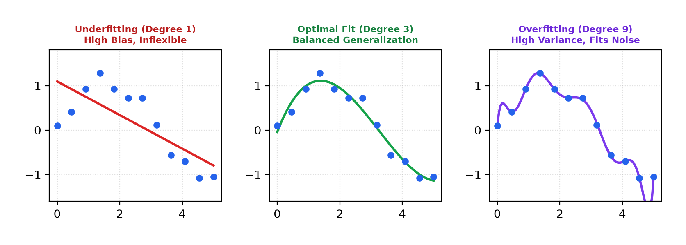

*Figure 1.1: Architectural Flow and Conceptual System Diagram for in brief techniques to reduce underfitting and overfitting*

### Mathematical Formulation & Algorithmic Mechanics

**Mathematical Formulations for Overfitting Control:**

```text
L2 Regularized Objective (Ridge): J(w) = MSE(w) + λ · ∑_(j=1)^D w_j²
L1 Regularized Objective (Lasso): J(w) = MSE(w) + λ · ∑_(j=1)^D |w_j|
Polynomial Hypothesis: y_hat = w_0 + w_1·x + w_2·x² + ... + w_M·x^M
```

The mathematical formulation and algorithmic **parameters** defined above govern the runtime behavior of the system. Each parameter serves an exact role: primary terms scale throughput, penalty terms enforce **regularization** constraints, and **optimization** objectives drive steady **convergence** toward the **global minimum**.

### Worked Example & Practical Simulation

Imagine an e-commerce website predicting whether a customer will return a clothing item. A basic linear **model** using only 'Price' gets poor results with an R² of just 0.44 because it completely ignores size, fabric, and customer reviews (**Underfitting**). Adding interactive **features** and polynomial terms boosts R² to 0.78. However, an unpruned deep **decision tree** memorizes the exact customer IDs, reaching 99.8% training **accuracy** but crashing to 52.0% on new shoppers (**Overfitting**). Applying pruning and.

### Key Comparative Evaluation

| Phenomenon | Underlying Cause | Training Error | Testing Error | Primary Remedial Techniques |
| :--- | :--- | :--- | :--- | :--- |
| Underfitting | High Bias; model is too simple to capture real trends | Consistently High | Consistently High | Increase model capacity, engineer domain features, lower λ regularization, train longer |
| Overfitting | High Variance; model memorizes sample-specific noise | Near Zero / Very Low | Very High (Diverges from train error) | Collect more data, apply L1/L2 penalties, early stopping, prune trees, add dropout |
| Optimal Fit | Balanced Bias and Variance | Low and Stable | Low (Matches train error closely) | Cross-validation tuned hyperparameters, balanced regularized complexity |

### Concluding Exam Takeaway

**Underfitting** and **overfitting** are the two primary failure modes in machine learning. Successful systems navigate between them by tuning **model** capacity, selecting **features** thoughtfully, and applying **regularization** to achieve minimum error on future **unseen data**.

**Textbook Reference:** Christopher M. Bishop, 'Pattern Recognition and Machine Learning', Springer (2006), Chapter 1: Introduction, Section 1.1: Example: Polynomial Curve Fitting, pp. 4–11.

---

## Q2. Differentiate between overfitting and underfitting with examples. (Frequency: 3) [8 Marks]

### Introduction & Core Intuition

In **everyday** life, **learning** means grasping general **rules** rather than rote memorizing or making wild assumptions. When a **model** exhibits **underfitting**, it acts like someone who jumps to conclusions without enough information—such as assuming every four-legged animal is a dog because they never learned to recognize cats or cows. On the other hand, **overfitting** is like someone who memorizes one.

### **Divergence in Training and Validation Loss Curves**

The clearest way to tell these two problems apart is by looking at their **loss** curves over time. In **underfitting**, both the training loss and **validation** loss flatten out very early at an unacceptably high **error** level; the **model** never learns. In **overfitting**, training error keeps dropping toward zero, but validation error bottoms out and then.

### **Sensitivity to Minor Data Changes**

Underfitted **models** are **excessively** **stiff**. If you drop 10% of the **training** **points** or **slightly** nudge the numbers, an underfitted straight-line model hardly moves at all. Overfitted models are hypersensitive: even a single distant outlier can drastically twist a high-degree polynomial curve, completely throwing off predictions for all nearby points.

### **Degrees of Freedom and Parameter Count**

Mathematically, **underfitting** happens when a **model** has too few learnable **parameters** relative to the complexity of the data. **Overfitting** happens when there are far too many **parameters** compared to the number of data points. When parameters outnumber informative observations, the model discovers countless accidental shortcuts that satisfy **training samples** but fail completely on new inputs.

### **Actionable Diagnostic Insights for the Exam**

Watching these metrics tells engineers exactly how to respond. If both training **error** and **test** error are stubbornly high, gathering more **data** will not fix the issue; you must upgrade the **model**'s capacity or engineer better **features**. If training error is near zero but test error is high, the model is **overfitting**, so you should add.

### Architectural Flow & System Diagram

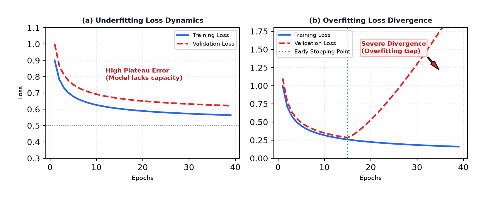

*Figure 1.2: Architectural Flow and Conceptual System Diagram for Differentiate between overfitting and underfitting with examples*

### Mathematical Formulation & Algorithmic Mechanics

**Mathematical Expressions of Underfitting vs Overfitting:**

```text
Underfitting Error Condition: TrainingError >> ε_acceptable   and   ValidationError >> ε_acceptable
Overfitting Error Condition: TrainingError ≈ 0   and   ValidationError >> TrainingError
Generalization Gap: Gap = | ValidationError - TrainingError |
```

The mathematical formulation and algorithmic **parameters** defined above govern the runtime behavior of the system. Each parameter serves an exact role: primary terms scale throughput, penalty terms enforce **regularization** constraints, and **optimization** objectives drive steady **convergence** toward the **global minimum**.

### Worked Example & Practical Simulation

**Consider** **predicting** a person's weight from height, age, and activity level: • **Underfitting** Example: A naive **model** that assumes Weight = 1.0 · Height + 0. It predicts the exact same weight for an athletic 20-year-old and an inactive 60-year-old of identical height, producing terrible **accuracy** for everyone. • **Overfitting** Example: A 15th-degree polynomial that memorizes exact weights down to the gram for 20 specific survey respondents. It weaves an erratic curve that predicts a.

### Key Comparative Evaluation

| Evaluation Dimension | Underfitting (High Bias) | Overfitting (High Variance) |
| :--- | :--- | :--- |
| Model Complexity | Overly simple, rigid, low degrees of freedom | Excessively complex, deep, high degrees of freedom |
| Training Set Error | High (fails to fit even training points) | Near zero (perfectly memorizes training samples) |
| Validation Set Error | High (comparable to training error) | High (severe divergence from training error) |
| Generalization Gap | Near zero (consistently poor across all sets) | Very large (massive gap between train and test loss) |

### Concluding Exam Takeaway

**Underfitting** and **overfitting** define the **opposing** **failure** modes of machine learning. Reliable **models** avoid both extremes by matching model capacity to sample size and validating with holdout **data** to locate the optimal generalization sweet spot.

**Textbook Reference:** Christopher M. Bishop, 'Pattern Recognition and Machine Learning', Springer (2006), Chapter 1: Introduction, Section 1.1, pp. 4–11.

---

## Q3. What is the Bias and variance trade-off for a machine learning model? Describe its relationship to underfitting and overfitting. (Frequency: 4) [8 Marks]

### Introduction & Core Intuition

In **machine** **learning** theory, the Bias-**Variance Trade**-off is the central mathematical balancing act. Whenever a supervised **model** makes predictions on **unseen data**, its total expected **error** splits into three separate parts: Bias Squared, Variance, and Irreducible Noise. Because lowering bias naturally drives up variance, building a great model requires finding the sweet spot between them.

### **Mathematical Error Decomposition Breakdown**

For any **continuous** **target** y = f(x) + ε with zero-mean noise variance σ², the expected prediction **error** of our model **y_hat** decomposes mathematically as: **Expected Error** = (Bias[y_hat])² + Var(y_hat) + σ². Here, the irreducible error σ² represents random noise built into the real world (such as sensor hum or unmeasured factors) that no **algorithm**.

### **Understanding Bias and Its Direct Link to Underfitting**

Bias measures the systematic **error** that occurs when we approximate a complicated real-world **process** with an overly simplistic **model**: Bias[**y_hat**] = E[y_hat] - f(x). A high-bias model makes rigid assumptions about the **data** and largely ignores the training examples. This leads straight to **underfitting**: the model cannot capture the true shape of the data, resulting in.

### **Understanding Variance and Its Direct Link to Overfitting**

**Variance** **measures** how much the **model**'s predictions would jump around if we trained it on a different random sample of **data**: Var(**y_hat**) = E[(y_hat - E[y_hat])²]. A high-variance model fits its specific training batch so tightly that even minor variations in training data produce completely different predictions. This leads straight to **overfitting**: the model memorizes sample.

### **Navigating the U-Shaped Trade-off Curve**

As we increase **model** complexity (like **adding** **polynomial** **powers** or deepening a neural net), bias drops steadily because the model can now bend and twist to fit complex shapes. At the same time, variance climbs upward because extra **parameters** easily latch onto random noise. If you plot total **error** against model complexity, it forms a classic.

### Architectural Flow & System Diagram

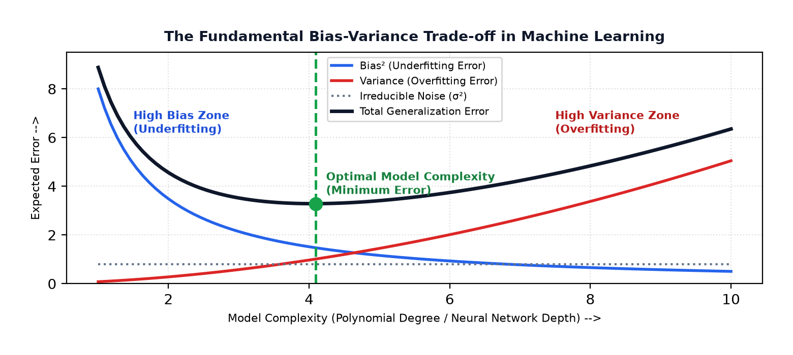

*Figure 1.3: Architectural Flow and Conceptual System Diagram for What is the Bias and variance trade-off for a machine learning model? Describe its relationship to underfitting and overfitting*

### Mathematical Formulation & Algorithmic Mechanics

**Mathematical Derivation of the Bias-Variance Decomposition:**

```text
Total Expected Error = ( Bias[y_hat] )² + Var(y_hat) + σ²
Bias[y_hat] = E[y_hat] - f(x)   [Systematic approximation error]
Var(y_hat) = E[ (y_hat - E[y_hat])² ]   [Sensitivity to training set variations]
σ² = Var(ε)   [Irreducible ambient noise variance]
```

The mathematical formulation and algorithmic **parameters** defined above govern the runtime behavior of the system. Each parameter serves an exact role: primary terms scale throughput, penalty terms enforce **regularization** constraints, and **optimization** objectives drive steady **convergence** toward the **global minimum**.

### Worked Example & Practical Simulation

Consider predicting house prices in Pune: • **High Bias** / **Low Variance** (Underfit): A flat linear equation Price = 50 · SqFt + 10. No matter which 500 houses you train on, the resulting line is almost identical (low variance), but it consistently misprices luxury flats in prime areas (high bias). • Low Bias / **High Variance** (Overfit): A 12th-degree polynomial with 50 **parameters**. It fits its specific 500 training houses with zero **error** (low.

### Key Comparative Evaluation

| Component | Mathematical Definition | Root Cause | Manifested Failure Mode | Remediation Strategy |
| :--- | :--- | :--- | :--- | :--- |
| Bias | E[y_hat] - f(x) | Overly restrictive, simple model assumptions | Underfitting (High train & test error) | Increase model complexity, add features, lower λ |
| Variance | E[(y_hat - E[y_hat])²] | Excessive model flexibility fitting noise | Overfitting (Low train, high test error) | Add training data, apply L1/L2 penalties, prune |
| Irreducible Noise | Var(ε) = σ² | Sensor inaccuracy, unmeasured variables | Fundamental performance ceiling | Cannot be reduced by any algorithmic tuning |

### Concluding Exam Takeaway

The Bias-Variance Trade-off lies at the heart of machine learning. **High bias** leads to **underfitting**, while **high variance** leads to **overfitting**. Achieving peak accuracy requires using **cross-validation** to identify the model complexity that minimizes their combined sum.

**Textbook Reference:** Christopher M. Bishop, 'Pattern Recognition and Machine Learning', Springer (2006), Chapter 3: Linear Models for Regression, Section 3.2: The Bias-Variance Decomposition, pp. 147–152.

---

## Q4. Write a short note on Training error and Generalization error in machine learning. (Frequency: 1) [8 Marks]

### Introduction & Core Intuition

In **supervised learning**, evaluating an algorithm requires understanding the difference between how well it fits past **training data** and how accurately it predicts future, **unseen data**. We quantify this using two fundamental metrics: **Training Error** (Empirical Risk) and **Generalization Error** (True Risk). The gap between them reveals whether a model has truly learned or merely memorized.

### **Training Error (Empirical Risk) Explained Simply**

**Training Error**, formally called Empirical Risk R_emp(h), measures the average mistake a **model** makes on the exact **data** samples it studied during training: R_emp(h) = (1/N) · ∑ L(h(**x_i**), y_i). Supervised **optimization** algorithms adjust weights specifically to minimize this number. However, training **error** alone is an untrustworthy score—it is like letting a student take an exam.

### **Generalization Error (True Risk) Explained Simply**

**Generalization Error**, or **True Risk** R(h), measures how well the **model** performs across all possible future **data** points generated by the true real-world distribution: R(h) = E[L(h(x), y)]. Because we can never observe all possible future data, we cannot calculate true risk directly. Instead, we estimate it using an independent holdout **test** dataset or **K-fold cross-validation**.

### **The Generalization Gap and Overfitting Detection**

The **difference** between **generalization error** and training **error** is **known** as the **Generalization Gap**: Gap = R(h) - R_emp(h). When a **model**'s capacity matches the dataset size, this gap stays small and tight. When a model has excessive capacity, its training error drops to zero while its generalization error shoots upward, creating a massive generalization gap.

### **Practical Engineering Takeaway for SPPU Exams**

Watching both metrics provides clear guidance during **system** design. If both training error and test error are high, the **model** is **underfitting**, so you need more **features** or a more expressive architecture. If training error is near zero but test error is high, the model is **overfitting**, so you must apply **regularization**, prune trees, or collect.

### Architectural Flow & System Diagram

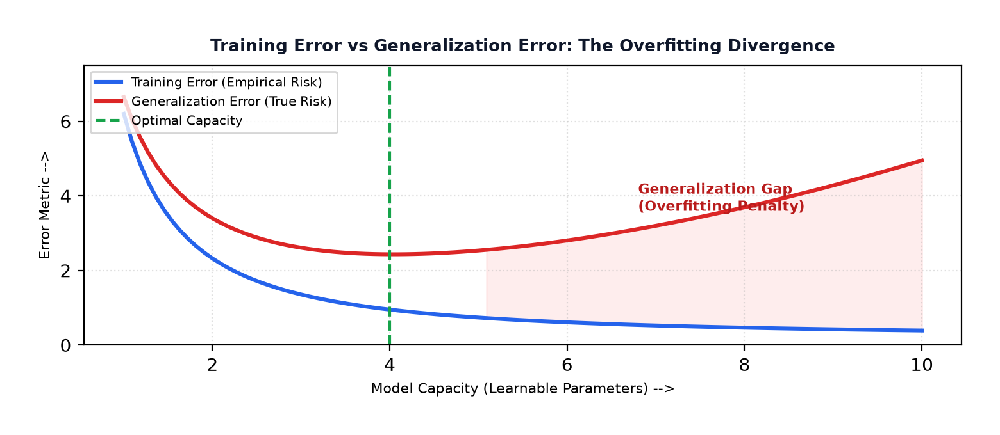

*Figure 1.4: Architectural Flow and Conceptual System Diagram for a short note on Training error and Generalization error in machine learning*

### Mathematical Formulation & Algorithmic Mechanics

**Mathematical Formulations of Empirical and True Risk:**

```text
Training Error (Empirical Risk): R_emp(h) = ( 1 / N ) · ∑_(i=1)^N L( h(x_i), y_i )
Generalization Error (True Risk): R(h) = E_((x, y) ~ P)[ L( h(x), y ) ]
Generalization Gap: Gap = R(h) - R_emp(h) ≤ O( √( VC_dim / N ) )
```

The mathematical formulation and algorithmic **parameters** defined above govern the runtime behavior of the system. Each parameter serves an exact role: primary terms scale throughput, penalty terms enforce **regularization** constraints, and **optimization** objectives drive steady **convergence** toward the **global minimum**.

### Worked Example & Practical Simulation

Consider an autonomous car vision **system** trained to detect pedestrians. On its training set of 50,000 clear, sunny daytime photos, it achieves 99.4% **accuracy** (**Training Error** = 0.6%). However, when tested on brand-new images taken in heavy rain, dense fog, and nighttime conditions, its accuracy drops to 78.2% (**Generalization Error** = 21.8%). The large generalization gap of 21.2% proves the **model** memorized sunny weather **artifacts** rather than learning true pedestrian silhouettes.

### Key Comparative Evaluation

| Metric | Mathematical Definition | Dataset Used | Optimized Directly? | Operational Purpose |
| :--- | :--- | :--- | :--- | :--- |
| Training Error | Average loss across training samples | Training Set D_train | Yes (gradient descent minimizes this directly) | Drives weight updates during optimization |
| Generalization Error | Expected loss over the unseen true distribution | Independent Test Set / Cross-validation folds | No (cannot be optimized directly; only evaluated) | Measures genuine model quality for real deployment |
| Generalization Gap | Difference: | Test Error - Train Error | | Both Train and Test sets | Minimized indirectly via regularization and pruning | Primary diagnostic tool for catching overfitting |

### Concluding Exam Takeaway

Training **error** tells us how well the **model** fits **historical** **records**, while **generalization error** tells us **whether** it will succeed in the real world. Machine learning engineering focuses on minimizing generalization error rather than blindly chasing zero training error.

**Textbook Reference:** Christopher M. Bishop, 'Pattern Recognition and Machine Learning', Springer (2006), Chapter 1: Introduction, Section 1.3: Model Selection, pp. 32–35.

---

## Q5. Define different regression models. (Frequency: 2) [8 Marks]

### Introduction & Core Intuition

In **predictive** **machine** learning, **Regression Models** are **supervised learning** techniques designed to predict a continuous numerical quantity (such as price, temperature, or speed) based on one or more input **features**. Depending on whether relationships are linear or curved, regression **models** span simple baselines, regularized models, and powerful non-linear methods.

### **Simple and Multiple Linear Regression**

**Simple Linear Regression** models the **connection** between one input **feature** x and a **continuous** **target** y **using** a straight line: y = β_1 · x + β_0 + ε. Multiple Linear Regression extends this concept to handle D input features simultaneously using a flat hyperplane: y = β_0 + β_1·x_1 + ... + β_D·x_D + ε.

### **Polynomial Regression: Capturing Curves**

When the real-**world** **relationship** **bends** and curves, **Polynomial Regression** adds **powers** of the original **features** (such as x², x³) into the equation: y = β_0 + β_1·x + β_2·x² + ... + β_M·x^M. Even though the curve looks non-linear with respect to x, the equation is still linear with respect to the weights β, meaning we.

### **Regularized Regression: Ridge, Lasso, and ElasticNet**

When **datasets** **contain** many correlated **features** or when **features** outnumber samples, standard regression overfits. **Ridge Regression** adds an L2 penalty (λ · ∑ w_j²) to shrink weights toward zero and stabilize collinear features. **Lasso Regression** adds an L1 penalty (λ · ∑ |w_j|) that forces uninformative weights to exact zero, performing automatic feature selection. ElasticNet blends.

### **Non-Linear and Tree-Based Regression Models**

Beyond linear **models**, machine learning offers non-linear approaches: **Support Vector Regression** (SVR) fits an optimal margin tube around **data** points and ignores small errors within threshold ε. **Decision Tree** and **Random Forest** Regression slice the **feature space** into rectangular regions, predicting the average value of training points inside each leaf. These models handle complex non-linear patterns.

### Architectural Flow & System Diagram

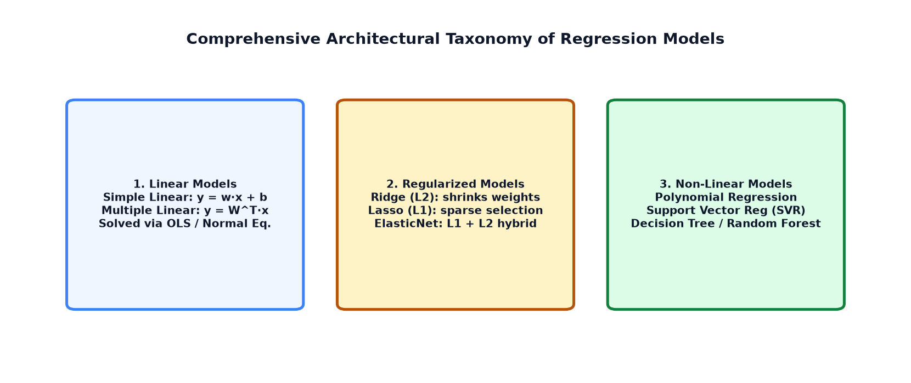

*Figure 1.5: Architectural Flow and Conceptual System Diagram for Define different regression models*

### Mathematical Formulation & Algorithmic Mechanics

**Mathematical Equations of Core Regression Models:**

```text
1. Multiple Linear: y_hat = w_0 + ∑_(j=1)^D w_j · x_j = W^T · x + b
2. Polynomial: y_hat = w_0 + w_1·x + w_2·x² + ... + w_M·x^M
3. Ridge (L2): min_w { MSE(w) + λ · ||w||_2² 
4. Lasso (L1): min_w { MSE(w) + λ · ||w||_1 
```

The mathematical formulation and algorithmic **parameters** defined above govern the runtime behavior of the system. Each parameter serves an exact role: primary terms scale throughput, penalty terms enforce **regularization** constraints, and **optimization** objectives drive steady **convergence** toward the **global minimum**.

### Worked Example & Practical Simulation

**Consider** **predicting** car fuel economy (**Miles Per Gallon** - MPG): • Simple Linear Regression predicts MPG based solely on vehicle weight: MPG = -0.007·Weight + 45. • Multiple Linear Regression includes horsepower and engine size: MPG = -0.005·Weight - 0.04·HP + 42. • **Ridge Regression** handles high correlation between engine size and cylinder count, stabilizing the weights. • **Random Forest** Regression captures non-linear aerodynamic drag effects at highway speeds without manual **feature** engineering.

### Key Comparative Evaluation

| Regression Model | Mathematical Form | Underlying Assumptions | Primary Strength | Primary Limitation |
| :--- | :--- | :--- | :--- | :--- |
| Simple Linear | y = β_1·x + β_0 | Linear, additive, constant noise | Easy to interpret; fast closed-form solution | Cannot model curved relationships |
| Multiple Linear | y = W^T·x + b | Linear relationship across all features | Scales well to multiple input features | Struggles when features are highly correlated |
| Polynomial | y = ∑ β_m·x^m | Curved relationship; linear in parameters | Fits smooth curves without changing optimizer | Prone to wild swings near boundary edges |
| Ridge (L2) | MSE + λ·||w||² | Normally distributed errors; collinearity | Stabilizes weights; prevents parameter blowup | Keeps all features (no feature selection) |

### Concluding Exam Takeaway

Regression **models** span a **spectrum** from **simple** **linear** **baselines** to non-linear regularized architectures. Selecting the right model requires weighing **feature** dimensionality, collinearity, and the balance between easy interpretability and predictive power.

**Textbook Reference:** Christopher M. Bishop, 'Pattern Recognition and Machine Learning', Springer (2006), Chapter 3: Linear Models for Regression, Sections 3.1 & 3.2, pp. 137–152.

---

## Q6. What do you mean by regression? Explain with a suitable example. (Frequency: 2) [8 Marks]

### Introduction & Core Intuition

In **machine** **learning** and **statistics**, Regression is a **supervised learning** method that **models** the relationship between one or more independent input **features** (X) and a continuous numerical target variable (y). While classification sorts things into categories (like Spam vs Not-Spam), regression predicts a continuous numerical value along an unbroken scale (such as price, temperature, or speed).

### **Core Objective of Regression Analysis**

The mathematical goal of regression is to discover a prediction **function** f(x) that maps input **features** x to predicted target values **y_hat** as accurately as possible. The true **data** generation **process** in the real world is written as y = f(x) + ε, where f(x) represents the genuine systematic trend and ε represents zero-mean random noise..

### **Residual Errors and Loss Functions**

To measure how well a regression **model** performs, we examine its Residuals: e_i = **y_i** - y_hat_i. The residual is simply the vertical distance between the actual **data** point and the model's prediction line. During training, these **errors** are aggregated into a **loss function**, most commonly **Mean Squared Error** (MSE): MSE = (1/N) · ∑ (y_i.

### **The Supervised Regression Pipeline**

Building a regression **system** follows a step-by-step workflow: First, gather **data** and clean it by filling missing values, scaling **features**, and handling outliers. Next, select an appropriate **model** family based on exploratory data analysis (linear, polynomial, or tree-based). Then, train the model by calculating the analytical **Normal Equation** or running iterative **Gradient Descent**. Finally, test the.

### **Real-World Applications Across Industries**

**Regression** **powers** **essential** real-**world** **applications** across engineering and commerce: in Finance, it forecasts stock prices and risk exposure; in **Real Estate**, it estimates property values from floor area and location; in Healthcare, it predicts patient recovery times and drug dosages; in Meteorology, it forecasts continuous rainfall volumes; and in Energy, it predicts grid power demand to optimize generator schedules.

### Architectural Flow & System Diagram

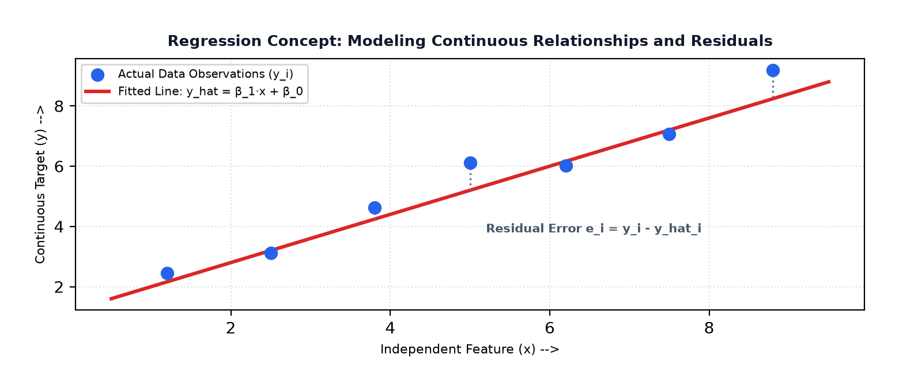

*Figure 1.6: Architectural Flow and Conceptual System Diagram for What do you mean by regression?  with a suitable example*

### Mathematical Formulation & Algorithmic Mechanics

**Mathematical Formulation of the Regression Objective:**

```text
Data Generation Process: y = f(x) + ε   where E[ε] = 0, Var(ε) = σ²
Mean Squared Error Loss: L(w) = ( 1 / N ) · ∑_(i=1)^N ( y_i - f(x_i; w) )²
Optimal Parameter Vector: w* = argmin_w { L(w) 
```

The mathematical formulation and algorithmic **parameters** defined above govern the runtime behavior of the system. Each parameter serves an exact role: primary terms scale throughput, penalty terms enforce **regularization** constraints, and **optimization** objectives drive steady **convergence** toward the **global minimum**.

### Worked Example & Practical Simulation

**Imagine** an **automotive** engineer predicting car **Braking Distance** (in meters) from Driving Speed (in km/h). Real **test** runs provide **data** points: (40 km/h, 15m), (60 km/h, 28m), (80 km/h, 45m), and (100 km/h, 68m). The engineer fits a quadratic regression equation: Distance = 0.005 · Speed² + 0.1 · Speed + 2.0. When an autonomous vehicle travels at 70 km/h, the **model** evaluates f(70) = 0.005·(4900) + 0.1·(70) + 2.0 = 24.5 + 7.0 +.

### Key Comparative Evaluation

| Aspect | Regression Analysis | Classification Analysis |
| :--- | :--- | :--- |
| Target Variable Nature | Continuous real-valued number (y ∈ ℝ) | Discrete categorical label (y ∈ {Class 1, Class 2, ...}) |
| Output Possibilities | Infinitely many continuous values | Fixed, predefined set of distinct classes |
| Evaluation Metrics | MSE, RMSE, MAE, R² score, MAPE | Accuracy, Precision, Recall, F1-Score, ROC-AUC |
| Geometric Objective | Fits a continuous line, curve, or hyperplane through data | Constructs decision boundaries separating class regions |

### Concluding Exam Takeaway

**Regression** **analysis** is the **standard** tool for predicting continuous numerical values. By fitting a functional line that minimizes residual **error**, regression **models** allow **systems** to make accurate, continuous predictions across engineering applications.

**Textbook Reference:** Christopher M. Bishop, 'Pattern Recognition and Machine Learning', Springer (2006), Chapter 3: Linear Models for Regression, Section 3.1, pp. 137–142.

---

## Q7. Explain Linear Regression in brief. (Frequency: 1) [8 Marks]

### Introduction & Core Intuition

**Linear Regression** is the foundational **supervised learning** algorithm used to **model** a continuous target variable as a weighted linear combination of input **features**. Despite its simplicity, linear regression remains a cornerstone of **data** science because it is easy to interpret, fast to compute, and deeply backed by statistical theory.

### **The Linear Hypothesis Model Explained**

**Linear** regression **models** the **relationship** between an input **vector** x = [x_1, x_2, ..., x_D]^T and **target** y using an affine linear combination: **y_hat** = w_0 + w_1·x_1 + w_2·x_2 + ... + w_D·x_D. To keep the math clean, we add a dummy bias input x_0 = 1, letting us write the equation as a simple.

### **The Classical Gauss-Markov Assumptions**

For **Ordinary Least Squares** linear **regression** to be **statistically** **optimal**, the **data** must satisfy the classic Gauss-Markov assumptions: First, the true relationship must be linear in its **parameters**. Second, the noise terms must have zero average value: E[ε | X] = 0. Third, noise variance must be constant across all observations (known as homoscedasticity). Fourth, individual.

### **Analytical Normal Equation vs Gradient Descent**

We **estimate** **weights** **using** two primary strategies: The **Normal Equation** solves for the weights in one analytical step using **matrix** algebra: W = (X^T · X)^(-1) · X^T · y. This gives exact weights instantly, but computing the matrix inverse takes O(D³) time, making it slow when **feature** count D exceeds 10,000. For large datasets with.

### **Key Strengths and Practical Limitations**

**Linear** **regression** is fast to **train**, uses very little **memory**, and provides clear coefficient values that explain exactly which **features** matter most. Its main limitation is its assumption of linearity: if the real relationship is curved, a plain linear **model** will underfit unless you manually add polynomial terms or use non-linear methods.

### Architectural Flow & System Diagram

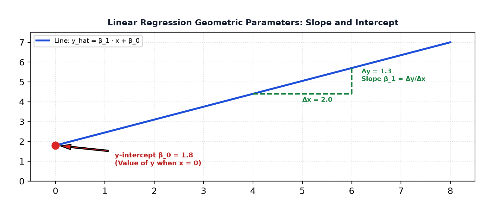

*Figure 1.7: Architectural Flow and Conceptual System Diagram for Linear Regression in brief*

### Mathematical Formulation & Algorithmic Mechanics

**Mathematical Formulation of Linear Regression:**

```text
Hypothesis Function: y_hat = W^T · x = w_0 + ∑_(j=1)^D w_j · x_j
Mean Squared Error (MSE): J(W) = ( 1 / (2N) ) · ∑_(i=1)^N ( W^T · x_i - y_i )²
The Normal Equation: W = ( X^T · X )^(-1) · X^T · y
```

The mathematical formulation and algorithmic **parameters** defined above govern the runtime behavior of the system. Each parameter serves an exact role: primary terms scale throughput, penalty terms enforce **regularization** constraints, and **optimization** objectives drive steady **convergence** toward the **global minimum**.

### Worked Example & Practical Simulation

**Suppose** a **software** **consulting** firm predicts **Project Delivery Time** (in **weeks**) based on Story Points (x_1) and Senior Engineers (x_2). The fitted equation is: Time = 1.2 · StoryPoints - 2.5 · SeniorEngineers + 4.0. The interpretation is straightforward: each story point adds 1.2 weeks, each senior engineer cuts delivery by 2.5 weeks, and a zero-point project has a **baseline** setup time of 4 weeks. For a new project with 20 story points and 3.

### Key Comparative Evaluation

| Aspect | Closed-Form Normal Equation | Iterative Gradient Descent |
| :--- | :--- | :--- |
| Computational Strategy | Direct matrix inversion: (X^T · X)^(-1) · X^T · y | Iterative parameter updates: W := W - η · ∇J(W) |
| Time Complexity | O(D³) where D is the number of features | O(I · N · D) where I is iterations, N is samples |
| Need for Learning Rate η? | No (calculates exact analytical solution) | Yes (hyperparameter η must be tuned carefully) |
| Need for Feature Scaling? | No (invariant to feature scales) | Yes (essential for spherical loss contours and fast convergence) |

### Concluding Exam Takeaway

**Linear** **regression** **remains** an **essential** benchmark in predictive modeling. Backed by Gauss-Markov theory and solvable via both closed-form equations and **gradient descent**, it provides a fast, interpretable **baseline** for continuous prediction.

**Textbook Reference:** Christopher M. Bishop, 'Pattern Recognition and Machine Learning', Springer (2006), Chapter 3: Linear Models for Regression, Section 3.1, pp. 137–147.

---

## Q8. What do you mean by the least square method? Explain it in the context of linear regression. (Frequency: 2) [8 Marks]

### Introduction & Core Intuition

**Introduced** **independently** by **Carl Friedrich Gauss** (1795) and Adrien-Marie Legendre (1805), the Least Squares Method (**Ordinary Least Squares** - OLS) is the mathematical standard for fitting linear regression **models**. OLS finds the unique straight line or hyperplane that minimizes the sum of squared differences (residuals) between actual **data** values and values predicted by the model.

### **Geometric and Mathematical Foundations of OLS**

**Consider** a **dataset** of N **points** [(x_1, y_1), ..., (x_N, y_N)]. For any candidate line y_hat_i = β_1 · **x_i** + β_0, the residual **error** is the vertical gap between the real point and the line: e_i = y_i - y_hat_i. **The Least Squares Method** squares each vertical error (e_i²) and finds the slope β_1 and.

### **Why We Square the Residuals**

**Squaring** the **residuals** **provides** **three** essential advantages: First, it eliminates sign cancellation: positive **errors** (points above the line) and negative errors (points below the line) do not cancel each other out. Second, it heavily penalizes large mistakes: an error of 4 contributes 16 to the **loss**, four times more than an error of 2, forcing the.

### **Analytical Derivation of the OLS Normal Equations**

To find the **slope** and **intercept** that **minimize** **total** squared **error** S, we take **partial** derivatives with respect to β_0 and β_1 and set both equal to zero: ∂S/∂β_0 = 0 and ∂S/∂β_1 = 0. Solving these two equations yields the classic OLS formulas: the slope is the sample covariance of X and Y divided by.

### **Matrix Generalization and Geometric Projection**

In multiple dimensions with D **features**, we represent **data** as design **matrix** X and target **vector** y. The **sum of squared errors** in matrix form is S(W) = (y - X·W)^T · (y - X·W). Setting the gradient to zero leads to the **Normal Equation**: X^T · X · W = X^T · y. Assuming X.

### Architectural Flow & System Diagram

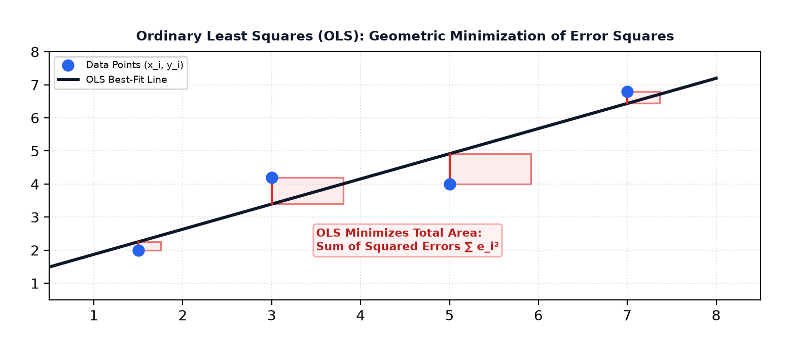

*Figure 1.8: Architectural Flow and Conceptual System Diagram for What do you mean by the least square method?  it in the context of linear regression*

### Mathematical Formulation & Algorithmic Mechanics

**Mathematical Derivation of the OLS Closed-Form Solution:**

```text
Sum of Squared Errors: S(β_0, β_1) = ∑_(i=1)^N ( y_i - (β_1 · x_i + β_0) )²
Slope: β_1 = ( ∑ (x_i - x_mean) · (y_i - y_mean) ) / ( ∑ (x_i - x_mean)² ) = Cov(X, Y) / Var(X)
Intercept: β_0 = y_mean - β_1 · x_mean
Matrix Normal Equation: W = ( X^T · X )^(-1) · X^T · y
```

The mathematical formulation and algorithmic **parameters** defined above govern the runtime behavior of the system. Each parameter serves an exact role: primary terms scale throughput, penalty terms enforce **regularization** constraints, and **optimization** objectives drive steady **convergence** toward the **global minimum**.

### Worked Example & Practical Simulation

**Suppose** a **student** tracks **Study Hours** (X) and Exam **Scores** (Y) **across** three **sessions**: (1, 2), (2, 3), and (3, 5). Mean values are x_mean = 2.0 and y_mean = 3.33. Covariance terms: (1-2)(2-3.33) + (2-2)(3-3.33) + (3-2)(5-3.33) = (-1)(-1.33) + 0 + (1)(1.67) = 1.33 + 1.67 = 3.0. Variance term: (1-2)² + (2-2)² + (3-2)² = 1 + 0 + 1 = 2.0. The least squares slope is β_1 = 3.0 / 2.0.

### Key Comparative Evaluation

| Characteristic | Ordinary Least Squares (OLS) | Least Absolute Deviations (LAD / L1) |
| :--- | :--- | :--- |
| Loss Objective | Minimizes sum of squared errors: ∑ e_i² | Minimizes sum of absolute errors: ∑ |e_i| |
| Closed-Form Solution? | Yes (exact Normal Equation solution) | No (requires iterative linear programming) |
| Sensitivity to Outliers | High (squaring magnifies large errors) | Robust (linear penalty bounds outlier influence) |
| Mathematical Property | Smooth, strictly convex, differentiable everywhere | Non-differentiable at residual e_i = 0 |

### Concluding Exam Takeaway

**The Least Squares Method** provides the **mathematical** **foundation** of **classical** **regression**. By minimizing squared residual **errors**, it yields an analytical closed-form solution with proven optimal statistical properties under the Gauss-Markov theorem.

**Textbook Reference:** Christopher M. Bishop, 'Pattern Recognition and Machine Learning', Springer (2006), Chapter 3: Linear Models for Regression, Section 3.1.1: Maximum Likelihood and Least Squares, pp. 140–143.

---

## Q9. Explain the concept of a cost function and its role in Gradient Descent. (Frequency: 1) [8 Marks]

### Introduction & Core Intuition

In machine learning, training an algorithm requires an objective mathematical measure of performance. A **Cost Function** (also called an **Objective Function** or Empirical Risk) quantifies the cumulative error between the model's predictions and actual ground-truth values across the entire dataset. In **Gradient Descent**, the cost function defines the mathematical **optimization** surface, providing the directional gradients needed to guide **parameters** toward their optimal values.

### **Definition and Purpose of the Cost Function**

While a **Loss Function** L(y_hat_i, **y_i**) measures prediction **error** on a single training sample, a **Cost Function** J(W) aggregates these losses across all N training observations: J(W) = (1/N) · ∑ L(f(x_i; W), y_i). The cost **function** transforms **model** training into an.

### **The Concept of the Optimization Landscape**

**Geometrically**, the **cost function** defines a **multi**-dimensional **surface** where coordinates represent **parameter** values (w, b) and height represents total cost J. For linear regression with squared **error**, the cost surface is guaranteed to be a strictly convex paraboloid (bowl-shaped), meaning it has.

### **The Mathematical Role of Gradients in Optimization**

**Gradient Descent** relies on the partial derivatives of the **cost function** with respect to each **parameter**. The gradient **vector** ∇J(W) points in the direction of steepest ascent on the cost surface. To minimize **error**, gradient descent moves **parameters** in the opposite direction.

### **Sensitivity to Learning Rate Hyperparameter η**

The **interaction** between the **cost function** and the **learning rate** η governs **optimization** stability: If η is set too small, **parameter** updates are tiny, **causing** training to take excessively long to converge. If η is set too large, updates will overshoot the.

### Architectural Flow & System Diagram

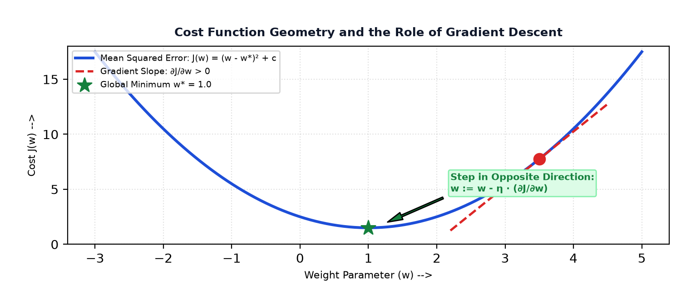

*Figure 1.9: Architectural Flow and Conceptual System Diagram for the concept of a cost function and its role in Gradient Descent*

### Mathematical Formulation & Algorithmic Mechanics

**Mathematical Formulations of Cost and Gradient Updates:**

```text
Mean Squared Error Cost Function: J(w, b) = ( 1 / (2N) ) · ∑_(i=1)^N ( (w · x_i + b) - y_i )²
Gradient with respect to weight: ∂J/∂w = ( 1 / N ) · ∑_(i=1)^N ( y_hat_i - y_i ) · x_i
Gradient with respect to bias: ∂J/∂b = ( 1 / N ) · ∑_(i=1)^N ( y_hat_i - y_i )
Parameter Update Rule: w := w - η · (∂J/∂w)   and   b := b - η · (∂J/∂b)
```

The mathematical formulation and algorithmic **parameters** defined above govern the runtime behavior of the system. Each parameter serves an exact role: primary terms scale throughput, penalty terms enforce **regularization** constraints, and **optimization** objectives drive steady **convergence** toward the **global minimum**.

### Worked Example & Practical Simulation

**Imagine** a **hiker** lost in **thick** fog on a **mountainous** slope trying to find the lowest valley floor (the minimum cost). The hiker cannot see the landscape, but can feel the slope of the ground beneath their feet. The slope corresponds to the **gradient** ∇J, the hiker's step size is the **learning rate** η, and their elevation is the cost J. By repeatedly feeling the steepest downhill slope and taking a step in that direction,.

### Key Comparative Evaluation

| Component | Mathematical Role | Physical Analogy | Impact if Misconfigured |
| :--- | :--- | :--- | :--- |
| Cost Function J(W) | Measures total prediction error across dataset | Elevation of terrain on a map | Incorrect loss formulation solves the wrong problem |
| Gradient Vector ∇J | Vector of partial derivatives pointing uphill | Compass direction of steepest slope | Vanishing or exploding gradients halt optimization |
| Learning Rate η | Scalar multiplying gradient step size | Stride length of the hiker's footsteps | Too small: slow convergence; Too large: divergence |
| Global Minimum W* | Point where gradient is zero (∇J = 0) | Lowest point on the valley floor | The target destination of the training process |

### Concluding Exam Takeaway

The **cost function** defines the mathematical objective of machine learning, while **gradient descent** provides the **optimization** engine. Together, they convert abstract learning goals into systematic **parameter** updates that minimize prediction **error**.

**Textbook Reference:** Christopher M. Bishop, 'Pattern Recognition and Machine Learning', Springer (2006), Chapter 3: Linear Models for Regression, Section 3.1.3: Sequential Learning, pp. 142–144.

---

## Q10. Explain the gradient descent algorithm with an example, and compare batch gradient descent with stochastic gradient descent (or write a short note on stochastic gradient descent algorithms). (Frequency: 3) [8 Marks]

### Introduction & Core Intuition

**Gradient Descent** is an iterative first-order **optimization** algorithm used to find the local or **global minimum** of a differentiable **cost function**. In machine learning, it serves as the primary optimization engine for training linear models, **logistic regression**, support vector machines, and deep neural networks. Depending on how much training data is evaluated per step, the algorithm operates as Batch Gradient.

### **Core Algorithmic Procedure of Gradient Descent**

**Gradient Descent** begins by initializing model **parameters** W with small random values or zeros. The **algorithm** then iterates through three steps: First, compute the model's predictions across **data** samples and evaluate the **cost function** J(W)..

### **Batch Gradient Descent (BGD): Characteristics and Bottlenecks**

**Batch Gradient Descent** computes the exact **gradient** of the **cost function** across the entire training dataset of N samples before making a single **parameter** update: ∇J_batch = (1/N) · ∑ ∇L(**x_i**, y_i). Because it evaluates.

### **Stochastic Gradient Descent (SGD): Fast and Noisy**

**Stochastic Gradient Descent** (SGD) **addresses** this **computational** **bottleneck** by updating **parameters** using only a single, randomly selected training sample (**x_i**, y_i) at each step: W := W - η · ∇L(x_i, y_i). Because each step.

### **Mini-Batch Gradient Descent (MBGD): The Industry Standard**

To **combine** the **stability** of BGD with the **computational** **speed** of SGD, modern deep learning uses **Mini-Batch Gradient Descent**. MBGD divides the **training data** into small subsets called mini-batches (typically b = 32, 64, 128,.

### Architectural Flow & System Diagram

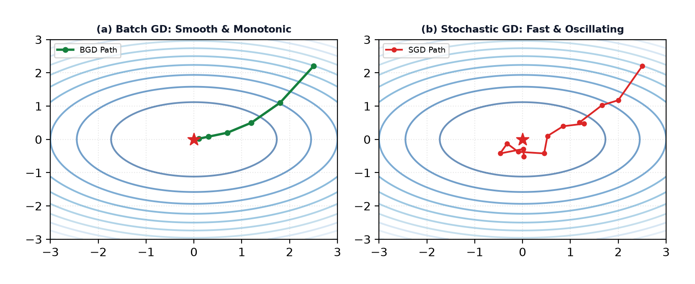

*Figure 1.10: Architectural Flow and Conceptual System Diagram for the gradient descent algorithm with an example, and compare batch gradient descent with stochastic gradient descent (or write a short note on stochastic gradient descent algorithms)*

### Mathematical Formulation & Algorithmic Mechanics

**Mathematical Contrast of Gradient Descent Variants:**

```text
1. Batch Gradient Descent: W := W - η · ( 1 / N ) · ∑_(i=1)^N ∇L( f(x_i; W), y_i )
2. Stochastic Gradient Descent: W := W - η · ∇L( f(x_i; W), y_i )   [Random sample i]
3. Mini-Batch Gradient Descent: W := W - η · ( 1 / b ) · ∑_(j=1)^b ∇L( f(x_j; W), y_j )   [Batch size b]
```

The mathematical formulation and algorithmic **parameters** defined above govern the runtime behavior of the system. Each parameter serves an exact role: primary terms scale throughput, penalty terms enforce **regularization** constraints, and **optimization** objectives drive steady **convergence** toward the **global minimum**.

### Worked Example & Practical Simulation

Suppose a dataset contains 1,000,000 **transaction** records: • Under **Batch Gradient Descent**: The algorithm processes all 1,000,000 **transactions** to take a single parameter step. Taking 1,000 steps requires computing 1,000,000,000 individual gradients, making training very slow. • Under **Stochastic Gradient Descent**: The algorithm takes 1,000,000 parameter updates in a single pass through the data, rapidly moving **parameters** toward the optimal region. • Under Mini-Batch GD (batch size = 100): The algorithm takes 10,000 stable, GPU-accelerated.

### Key Comparative Evaluation

| Dimension | Batch Gradient Descent (BGD) | Stochastic Gradient Descent (SGD) | Mini-Batch Gradient Descent (MBGD) |
| :--- | :--- | :--- | :--- |
| Samples per Step | Entire dataset (N samples) | Exactly 1 single sample | Small mini-batch (b = 32 to 256 samples) |
| Update Frequency | 1 update per epoch | N updates per epoch | N / b updates per epoch |
| Trajectory Smoothness | Smooth, deterministic, monotonic decrease | Erratic, noisy, oscillating path | Moderately smooth; controlled fluctuations |
| Computational Speed | Very slow on large datasets | Fast per step, but inefficient on vector hardware | Very fast (maximizes parallel GPU matrix throughput) |

### Concluding Exam Takeaway

**Gradient descent** variants balance computational efficiency against **gradient** stability. Batch GD provides smooth **convergence** for small datasets, SGD offers fast updates for online streaming **data**, and Mini-Batch GD serves as the standard **optimization** workhorse for modern deep learning.

**Textbook Reference:** Christopher M. Bishop, 'Pattern Recognition and Machine Learning', Springer (2006), Chapter 3: Linear Models for Regression, Section 3.1.3: Sequential Learning, pp. 142–144; Ian Goodfellow et al., 'Deep Learning', MIT Press (2016), pp. 149–154.

---

## Q11. Explain in brief, differentiate between, or write a short note on Lasso and Ridge Regression. (Frequency: 4) [8 Marks]

### Introduction & Core Intuition

In linear modeling, when datasets contain many correlated features or when features outnumber samples (D &gt; N), standard **Ordinary Least Squares** (OLS) regression overfits and produces unstable coefficient estimates. To address this, **Regularization** adds a penalty term to the **cost function**. The two primary regularized regression methods are **Ridge Regression** (**L2 Regularization**) and **Lasso Regression** (**L1 Regularization**), which differ fundamentally.

### **Ridge Regression: L2 Weight Shrinkage**

**Introduced** by **Arthur Hoerl** and **Robert** Kennard in 1970 (Tikhonov **Regularization**), **Ridge Regression** adds a penalty proportional to the sum of squared weights: Penalty = λ · ∑ w_j² = λ · ||w||_2². The **objective function** becomes: J_ridge(w) = MSE(w) + λ · ∑ w_j². The hyperparameter λ ≥ 0 controls shrinkage: when λ = 0,.

### **Lasso Regression: L1 Sparse Selection**

**Introduced** by **Robert Tibshirani** in 1996, **Lasso** (Least **Absolute** Shrinkage and Selection Operator) replaces the squared penalty with the sum of absolute weight values: Penalty = λ · ∑ |w_j| = λ · ||w||_1. The **objective function** becomes: J_lasso(w) = MSE(w) + λ · ∑ |w_j|. Unlike **Ridge**, Lasso shrinks uninformative coefficients to exact zero when.

### **Geometric Intuition: Diamond vs Circular Constraints**

The mathematical reason **Lasso** produces exact zeros while **Ridge** does not lies in their geometric constraint regions. In **parameter** space (**w_1** vs w_2), minimizing regularized **loss** is equivalent to finding where the elliptical contours of the unconstrained MSE touch the constraint boundary. **For Ridge**, the L2 constraint boundary w_1² + w_2² ≤ C forms a smooth.

### **Practical Trade-offs and the ElasticNet Alternative**

Choosing between **Ridge** and **Lasso** depends on the true **data** generation **process**: Ridge is preferred when many **features** contribute small, distributed effects, or when features are highly collinear (where Lasso arbitrarily selects one correlated feature and drops the rest). Lasso is preferred when only a small subset of features are genuinely informative. When both sparsity and.

### Architectural Flow & System Diagram

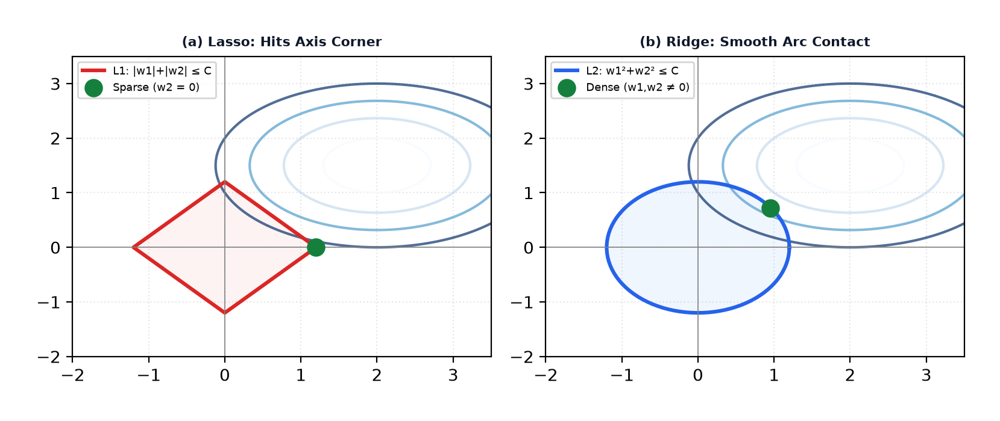

*Figure 1.11: Architectural Flow and Conceptual System Diagram for in brief, differentiate between, or write a short note on Lasso and Ridge Regression*

### Mathematical Formulation & Algorithmic Mechanics

**Mathematical Formulations of Regularized Objectives:**

```text
Ridge Regression (L2): J_ridge(w) = ( 1 / (2N) ) · ∑_(i=1)^N ( y_i - w^T·x_i )² + λ · ∑_(j=1)^D w_j²
Ridge Analytical Solution: W_ridge = ( X^T · X + λ · I )^(-1) · X^T · y
Lasso Regression (L1): J_lasso(w) = ( 1 / (2N) ) · ∑_(i=1)^N ( y_i - w^T·x_i )² + λ · ∑_(j=1)^D |w_j|
```

The mathematical formulation and algorithmic **parameters** defined above govern the runtime behavior of the system. Each parameter serves an exact role: primary terms scale throughput, penalty terms enforce **regularization** constraints, and **optimization** objectives drive steady **convergence** toward the **global minimum**.

### Worked Example & Practical Simulation

**Suppose** a **genomics** **dataset** contains 20,000 gene expression levels predicting cancer progression across 200 patients (D = 20,000 &gt;&gt; N = 200). Standard OLS cannot be computed because X^T·X is singular and non-invertible. **Ridge regression** adds λ·I to make the **matrix** invertible, shrinking all 20,000 gene weights to stable, small non-zero values. **Lasso regression** clamps 19,960 irrelevant gene weights to exact zero, selecting the 40 most informative genes for oncologists to investigate directly.

### Key Comparative Evaluation

| Characteristic | Ridge Regression (L2) | Lasso Regression (L1) |
| :--- | :--- | :--- |
| Regularization Penalty | Sum of squared weights: λ · ∑ w_j² | Sum of absolute weights: λ · ∑ |w_j| |
| Constraint Region Shape | Smooth circular / spherical hypersphere | Diamond / rhombic polytope with sharp axis corners |
| Feature Selection (Sparsity) | No (coefficients shrink toward zero but remain non-zero) | Yes (clamps uninformative weights to exact zero) |
| Analytical Solution? | Yes: W = (X^T·X + λ·I)^(-1)·X^T·y | No (solved via coordinate descent or subgradients) |

### Concluding Exam Takeaway

**Ridge** and **Lasso regression** provide complementary approaches to controlling **model** complexity. Ridge stabilizes collinear **features** through smooth L2 shrinkage, while **Lasso** produces sparse, interpretable models through L1 corner intersections.

**Textbook Reference:** Christopher M. Bishop, 'Pattern Recognition and Machine Learning', Springer (2006), Chapter 3: Linear Models for Regression, Section 3.1.4: Regularized Least Squares, pp. 144–147.

---

## Q12. Explain how Lasso Regression is used for feature selection. (Frequency: 1) [8 Marks]

### Introduction & Core Intuition

In high-dimensional machine learning datasets—such as genomic profiles, text bag-of-words, and financial portfolios—**features** often outnumber observations (D &gt;&gt; N). Training **models** on all features introduces noise, increases computation, and leads to severe **overfitting**. **Lasso Regression** (**L1 Regularization**) provides an automated, mathematically principled method for feature selection by clamping uninformative feature coefficients to exact numerical zero.

### **The Challenge of Feature Selection in High Dimensions**

Traditional **feature** selection requires either filtering features based on univariate correlation (which ignores multi-feature interactions) or performing wrapper **searches** like forward selection or backward elimination. Wrapper methods evaluate 2^D possible feature subsets, which becomes computationally intractable for D &gt; 30. **Lasso** embeds feature selection directly into the **optimization** process, evaluating all features simultaneously in **polynomial time**.

### **The Mechanism of L1 Penalty Clamping**

**Lasso** minimizes the **objective**: J(w) = (1/2N) · ||y - X·w||² + λ · ∑ |w_j|. The **absolute** **value** **penalty** introduces a non-differentiable singularity (sharp corner) at w_j = 0. In subgradient calculus, the derivative of |w_j| is a step **function** (+1 for w_j &gt; 0, -1 for w_j &lt; 0). When the correlation between a.

### **The Regularization Path and Sparsity Tuning**

The **degree** of **feature** sparsity is **governed** by the **regularization** hyperparameter λ. When λ = 0, no penalty is applied, and the **model** equals standard OLS with all features active. As λ increases, features with weak predictive power drop to exact zero one by one. By computing the full **Regularization Path**—plotting coefficient values across a range.

### **Advantages Over Filtering and Manual Selection**

Using **Lasso** for **feature** selection provides significant engineering advantages: unlike univariate correlation **tests**, Lasso evaluates features in the presence of all other predictors, identifying features that are informative only in combination. Furthermore, by zeroing out coefficients, Lasso produces a sparse **model** that reduces storage **requirements** and inference **latency**, making models faster to run in production environments.

### Architectural Flow & System Diagram

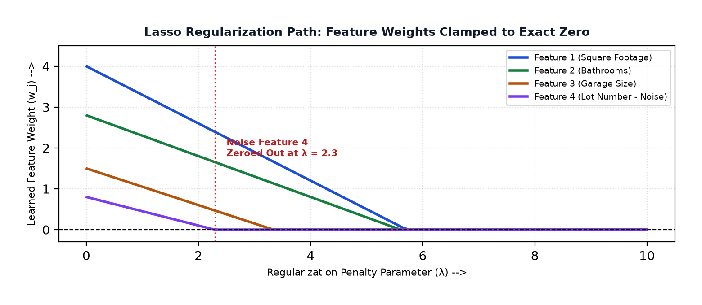

*Figure 1.12: Architectural Flow and Conceptual System Diagram for how Lasso Regression is used for feature selection*

### Mathematical Formulation & Algorithmic Mechanics

**Mathematical Formulation of Lasso Feature Clamping:**

```text
Soft-Thresholding Operator: w_j = S( w_ols, λ ) = sign(w_ols) · max( 0 , |w_ols| - λ )
Feature Selection Condition:
• If | X_j^T · (y - X_(-j)·w_(-j)) | ≤ λ  -->  w_j = 0  (Feature Excluded)
• If | X_j^T · (y - X_(-j)·w_(-j)) | > λ  -->  w_j ≠ 0  (Feature Retained)
```

The mathematical formulation and algorithmic **parameters** defined above govern the runtime behavior of the system. Each parameter serves an exact role: primary terms scale throughput, penalty terms enforce **regularization** constraints, and **optimization** objectives drive steady **convergence** toward the **global minimum**.

### Worked Example & Practical Simulation

**Consider** **predicting** **house** prices using 10 **features**: **Square Footage**, Bathrooms, Bedrooms, Garage Size, Lot Size, Year Built, Wall Color, Roof Tile Shape, Owner Astrological Sign, and Pet Count. Under standard linear regression, every feature receives a non-zero coefficient, including irrelevant noise like Wall Color and Astrological Sign. Applying **Lasso** with cross-validated λ = 250 clamps the coefficients of Wall Color, Roof Shape, Astrological Sign, and Pet Count to exact zero, automatically retaining only the 6 genuine structural features.

### Key Comparative Evaluation

| Feature Selection Method | Search Strategy | Computational Complexity | Models Feature Interactions? | Handles Collinearity? |
| :--- | :--- | :--- | :--- | :--- |
| Lasso Regression (L1) | Embedded convex optimization | Polynomial: O(N · D) - very fast | Yes (evaluates multivariate contributions) | Selects one feature from correlated groups |
| Univariate Correlation Filter | Independent ranking of features | Linear: O(N · D) | No (evaluates features in isolation) | Retains redundant correlated features |
| Forward Stepwise Selection | Greedy iterative addition | Quadratic: O(D² · ModelTrain) | Yes (greedy interaction search) | Can make suboptimal early feature choices |
| Best Subset Selection | Exhaustive combinatorial search | Exponential: O(2^D) - intractable for D > 30 | Yes (evaluates all combinations) | Guaranteed optimal, but computationally infeasible |

### Concluding Exam Takeaway

**Lasso regression** provides an efficient, embedded method for automated **feature** selection. By leveraging the geometric properties of the L1 penalty to clamp uninformative weights to zero, **Lasso** produces sparse, interpretable **models** that resist **overfitting** in high-dimensional settings.

**Textbook Reference:** Robert Tibshirani, 'Regression Shrinkage and Selection via the Lasso', Journal of the Royal Statistical Society (Series B, 1996), Vol. 58, No. 1, pp. 267–288; Christopher M. Bishop, 'Pattern Recognition and Machine Learning' (2006), pp. 144–146.

---

## Q13. What is the primary purpose of the L2 regularization term in the Ridge Regression cost function? (Frequency: 1) [8 Marks]

### Introduction & Core Intuition

In **linear** **regression** **analysis**, the **Ordinary Least Squares** (OLS) estimator computes W = (X^T · X)^(-1) · X^T · y. When **features** are highly correlated (multicollinearity) or when features outnumber samples (D &gt; N), the Gram **matrix** X^T · X becomes nearly singular or non-invertible, causing coefficient estimates to explode to extreme, unstable values. The primary purpose of the L2.

### **Conditioning the Matrix: Resolving Singularity and Ill-Conditioning**

When two or more predictor **features** are highly collinear (e.g., measuring height in both inches and centimeters), the **matrix** X^T · X has **eigenvalues** near zero, making matrix inversion numerically unstable. A tiny perturbation in **training data** can cause **parameter** estimates to swing by thousands of units. **Ridge regression** resolves this by adding an L2 penalty.

### **Reducing Model Variance by Penalizing Large Weights**

The L2 penalty term λ · ∑ w_j² = λ · ||w||_2² penalizes the squared Euclidean magnitude of the weight **vector**. In unconstrained regression, **models** often overfit by developing large, opposing coefficients that cancel each other out on **training data** but fail on test **data**. By penalizing large weight values, **Ridge** forces coefficients to remain small,.

### **Asymptotic Weight Shrinkage Behavior**

Unlike **Lasso** (L1) **regularization**, the L2 penalty is smooth and continuously differentiable everywhere, including at w = 0. Consequently, as the penalty **parameter** λ increases, **Ridge regression** shrinks coefficient magnitudes toward zero asymptotically according to the factor 1 / (1 + λ), but coefficients never reach exact zero. All **features** remain in the **model**, preserving dense.

### **Controlling the Bias-Variance Trade-off**

The **parameter** λ **serves** as a **direct** dial for **controlling** the Bias-Variance trade-off: Setting λ = 0 recovers the unregularized OLS solution with zero bias but **high variance**. As λ increases, **model** variance drops rapidly while a small amount of bias is introduced. Because the reduction in variance is typically much larger than the increase in.

### Architectural Flow & System Diagram

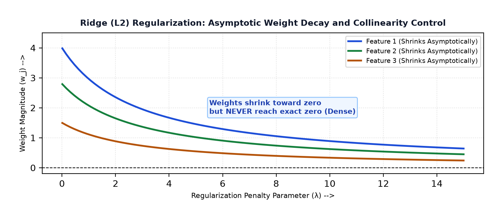

*Figure 1.13: Architectural Flow and Conceptual System Diagram for What is the primary purpose of the L2 regularizati*

### Mathematical Formulation & Algorithmic Mechanics

**Mathematical Formulation of Ridge L2 Regularization:**

```text
Ridge Cost Function: J(w) = ( 1 / (2N) ) · ||y - X·w||² + ( λ / 2 ) · ||w||_2²
Gradient: ∇J(w) = ( 1 / N ) · X^T · (X·w - y) + λ · w
Analytical Closed-Form: W_ridge = ( X^T · X + λ · I )^(-1) · X^T · y
```

The mathematical formulation and algorithmic **parameters** defined above govern the runtime behavior of the system. Each parameter serves an exact role: primary terms scale throughput, penalty terms enforce **regularization** constraints, and **optimization** objectives drive steady **convergence** toward the **global minimum**.

### Worked Example & Practical Simulation

Suppose a **model** predicts corporate revenue using two nearly identical financial **metrics**: **Total Assets** in USD (x_1) and Total Assets in Euros (x_2). Standard OLS might assign **w_1** = +50,000 and w_2 = -48,000, creating an unstable model sensitive to currency rounding **errors**. Adding an **L2 regularization** penalty of λ = 100 prevents these canceling weights, shrinking both to balanced, stable values: w_1 = +1.1 and w_2 = +1.0, restoring model stability.

### Key Comparative Evaluation

| Aspect | Without L2 Regularization (OLS) | With L2 Regularization (Ridge) |
| :--- | :--- | :--- |
| Matrix Invertibility | Fails if D > N or features are perfectly collinear | Always guaranteed: (X^T·X + λ·I) is strictly positive definite |
| Weight Magnitude | Can explode to arbitrarily large positive/negative values | Constrained within a bounded spherical ball ||w||² ≤ C |
| Variance on Test Data | Very high; hypersensitive to minor data perturbations | Low; stable predictions across different test samples |
| Bias | Zero empirical bias (unbiased estimator under BLUE) | Introduces small controlled bias to gain large variance reduction |

### Concluding Exam Takeaway

The primary purpose of the **L2 regularization** term in **Ridge Regression** is to stabilize parameter estimation in the presence of multicollinearity and reduce model variance. By ensuring matrix invertibility and shrinking weights, **Ridge** prevents **overfitting** and improves generalization on **unseen data**.

**Textbook Reference:** Christopher M. Bishop, 'Pattern Recognition and Machine Learning', Springer (2006), Chapter 3: Linear Models for Regression, Section 3.1.4: Regularized Least Squares, pp. 144–146.

---

## Q14. Write a short note on or explain the Evaluation metrics: MAE, RMSE, and R². (Frequency: 5) [8 Marks]

### Introduction & Core Intuition

In regression analysis, evaluating a **model** requires quantitative metrics to assess how closely predicted values match actual continuous targets. Unlike classification metrics (such as **accuracy** or **precision**), regression metrics measure numerical differences along continuous scales. The three standard evaluation metrics used across **data** science are **Mean Absolute Error** (MAE), Root **Mean Squared Error** (RMSE), and the Coefficient of Determination (R²).

### **Mean Absolute Error (MAE): Linear Robustness**

**Mean Absolute Error** measures the **average** **magnitude** of absolute **errors** between **predicted** values y_hat_i and true values **y_i**: MAE = (1/N) · ∑ |y_i - y_hat_i|. Because it takes absolute values rather than squaring residuals, MAE applies a linear penalty across all.

### **Root Mean Squared Error (RMSE): Quadratic Sensitivity**

Root **Mean Squared Error** computes the **square** root of the **average** **squared** residuals: RMSE = √[ (1/N) · ∑ (**y_i** - y_hat_i)² ]. By squaring residuals before averaging, RMSE penalizes large **errors** much more heavily than small ones: an error of 10.

### **The Mathematical Relationship: MAE vs RMSE**

Because of the **Cauchy**-Schwarz **inequality**, RMSE is **mathematically** **guaranteed** to be greater than or equal to MAE: RMSE ≥ MAE. The two **metrics** are equal only when all individual **errors** have the exact same magnitude (|e_1| = |e_2| = ... = |e_N|)..

### **The Coefficient of Determination (R² Score)**

While MAE and RMSE **measure** **absolute** scale-dependent **errors**, the **Coefficient** of Determination (R²) measures the proportion of variance in the target variable explained by the **model**: R² = 1 - (SS_res / SS_tot) = 1 - [∑(**y_i** - y_hat_i)² / ∑(y_i -.

### Architectural Flow & System Diagram

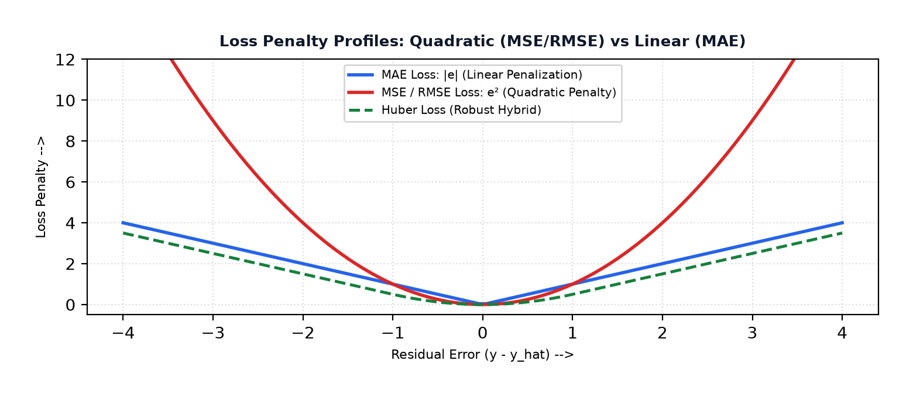

*Figure 1.14: Architectural Flow and Conceptual System Diagram for a short note on or explain the Evaluation metrics: MAE, RMSE, and R²*

### Mathematical Formulation & Algorithmic Mechanics

**Mathematical Formulations of Core Regression Metrics:**

```text
1. Mean Absolute Error: MAE = ( 1 / N ) · ∑_(i=1)^N | y_i - y_hat_i |
2. Mean Squared Error: MSE = ( 1 / N ) · ∑_(i=1)^N ( y_i - y_hat_i )²
3. Root Mean Squared Error: RMSE = √( MSE ) = √( ( 1 / N ) · ∑_(i=1)^N ( y_i - y_hat_i )² )
4. R² Score: R² = 1 - ( ∑_(i=1)^N ( y_i - y_hat_i )² ) / ( ∑_(i=1)^N ( y_i - y_mean )² )
```

The mathematical formulation and algorithmic **parameters** defined above govern the runtime behavior of the system. Each parameter serves an exact role: primary terms scale throughput, penalty terms enforce **regularization** constraints, and **optimization** objectives drive steady **convergence** toward the **global minimum**.

### Worked Example & Practical Simulation

**Suppose** a **house** price **model** evaluates 4 **homes** with **actual** prices [100k, 200k, 300k, 400k] and predictions [110k, 190k, 310k, 450k]. The **errors** are [+10k, -10k, +10k, +50k]. • MAE = (|10| + |-10| + |10| + |50|) / 4 = 80 / 4 = 20.0k USD. • MSE = (100 + 100 + 100 + 2500) / 4 = 2800 / 4 = 700.0k USD². • RMSE = √700 = 26.46k USD. Notice that.

### Key Comparative Evaluation

| Metric | Mathematical Formula | Units of Measure | Sensitivity to Outliers | Primary Use Case |
| :--- | :--- | :--- | :--- | :--- |
| MAE | (1/N) · ∑ |y - y_hat| | Same units as target y | Robust (linear error penalty) | Typical expected error; datasets with noise |
| MSE | (1/N) · ∑ (y - y_hat)² | Squared units (y²) | Very High (squared penalty) | Differentiable loss function for optimization |
| RMSE | √(MSE) | Same units as target y | High (penalizes large errors heavily) | Standard benchmark metric when large errors are costly |
| R² Score | 1 - (SS_res / SS_tot) | Dimensionless: (-∞, 1.0] | Sensitive to extreme outliers | Comparing explanatory power across different datasets |

### Concluding Exam Takeaway

MAE, RMSE, and R² **serve** **distinct** **diagnostic** **roles**. MAE measures median expected **error** magnitude, RMSE penalizes large errors in original units, and R² quantifies the proportion of variance explained by the **model**.

**Textbook Reference:** Christopher M. Bishop, 'Pattern Recognition and Machine Learning', Springer (2006), Chapter 1: Introduction, Section 1.1, pp. 4–11.

---

## Q15. Explain in brief the importance of the Evaluation matrix/metric. (Frequency: 1) [8 Marks]

### Introduction & Core Intuition

In machine learning engineering, an **Evaluation Metric** provides the quantitative objective benchmark used to evaluate **model** quality, guide **hyperparameter tuning**, and determine whether a **system** is ready for production deployment. Without appropriate evaluation **metrics**, it is impossible to assess model generalization, diagnose failure modes, or compare competing **algorithms**.

### **Guiding Model Optimization and Objective Alignment**

Evaluation metrics define what 'good performance' means for a specific application. While training loss functions (such as cross-**entropy** or **mean squared error**) must be mathematically smooth and differentiable to enable **gradient descent**, **validation** evaluation metrics do not have this restriction. Metrics like **F1-Score**, Macro-**Recall**, or Mean Absolute Percentage Error (MAPE) can be non-smooth and domain-aligned, ensuring.

### **Diagnosing Failure Modes: Overfitting vs Underfitting**

Tracking evaluation metrics across both training and **validation** datasets provides the primary diagnostic tool for identifying model failure modes. A large gap between training performance and validation performance indicates **overfitting**, signaling the need for **regularization**, pruning, or additional **training data**. Poor performance on both sets indicates **underfitting**, signaling the need for greater model capacity. Evaluation metrics.

### **Navigating Asymmetric Real-World Error Costs**

In **applied** **engineering**, different types of mistakes carry different costs. In medical screening, missing a disease diagnosis (**False Negative**) can be fatal, while a false alarm (**False Positive**) requires a routine follow-up **test**. In credit card fraud detection, false alarms irritate customers, but missing an organized cyberattack leads to direct financial **loss**. Selecting the appropriate evaluation.

### **Residual Analysis and Validating Model Assumptions**

In regression **models**, evaluation **metrics** are paired with residual diagnostics to verify statistical assumptions. Plotting residuals (y - **y_hat**) against predicted values y_hat reveals whether **errors** are normally distributed and homoscedastic (constant variance across predictions). If residuals exhibit a funnel shape (heteroscedasticity) or curved patterns, it indicates that the model is missing **key** non-linear terms, guiding further **feature** engineering.

### Architectural Flow & System Diagram

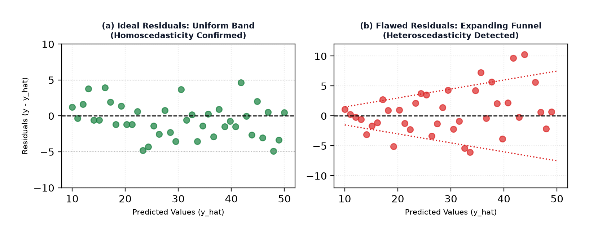

*Figure 1.15: Architectural Flow and Conceptual System Diagram for in brief the importance of the Evaluation matrix/metric*

### Mathematical Formulation & Algorithmic Mechanics

**Mathematical Diagnostic Formulations for Metric Evaluation:**

```text
Residual Error: e_i = y_i - y_hat_i
Mean Squared Error: MSE = ( 1 / N ) · ∑_(i=1)^N e_i²
Mean Absolute Percentage Error: MAPE = ( 100% / N ) · ∑_(i=1)^N | (y_i - y_hat_i) / y_i |
F_β Score: F_β = ( 1 + β² ) · ( Precision · Recall ) / ( (β² · Precision) + Recall )
```

The mathematical formulation and algorithmic **parameters** defined above govern the runtime behavior of the system. Each parameter serves an exact role: primary terms scale throughput, penalty terms enforce **regularization** constraints, and **optimization** objectives drive steady **convergence** toward the **global minimum**.

### Worked Example & Practical Simulation

Consider an airport automated **security** scanner evaluating luggage. If evaluated solely on **Accuracy**, a naive **model** that passes every bag achieves 99.9% accuracy (because prohibited items appear in only 1 in 1,000 bags). Using an evaluation **metric** tailored to security—**Recall**—reveals the **system**'s failure immediately: Recall = 0%, because it caught zero weapons. By changing the evaluation metric from Accuracy to Recall and F2-Score, engineers correctly identify the model as defective and tune it to catch threats.

### Key Comparative Evaluation

| Application Domain | Naive / Flawed Metric | Recommended Metric | Operational Reason |
| :--- | :--- | :--- | :--- |
| Cancer Screening | Accuracy (misleading on rare diseases) | Recall / Sensitivity | A missed diagnosis (False Negative) can be fatal |
| Spam Email Filtering | Recall (sends valid emails to spam) | Precision | False Positives divert critical business contracts to junk |
| Real Estate Valuation | R² alone (masks extreme dollar errors) | MAE and RMSE | Clients require expected dollar error bounds on appraisals |
| Financial Fraud Detection | Accuracy (99.9% naive baseline) | PR-AUC and F1-Score | Evaluates precision-recall balance on rare fraud cases |

### Concluding Exam Takeaway

Evaluation **metrics** are the **essential** **navigational** **compass** of machine learning. By selecting metrics that reflect asymmetric real-world **error** costs, practitioners ensure **models** are rigorously validated, properly diagnosed, and safely deployed.

**Textbook Reference:** Tom M. Mitchell, 'Machine Learning', McGraw-Hill (1997), Chapter 5: Evaluating Hypotheses, pp. 128–153; Christopher M. Bishop, 'Pattern Recognition and Machine Learning' (2006), pp. 179–182.

---

## Q16. Explain the advantages of RMSE over MSE as an evaluation metric. (Frequency: 1) [8 Marks]

### Introduction & Core Intuition

In regression analysis, evaluating prediction **error** typically involves computing the squares of individual residuals. While **Mean Squared Error** (MSE) is the primary mathematical **loss function** used for **model** training, **Root Mean Squared Error** (RMSE) is universally preferred when reporting model **performance** to engineers, managers, and clients. The advantages of RMSE stem from dimensional unit consistency and direct interpretability.

### **The Dimensional Inconsistency Problem of MSE**

The **primary** **limitation** of **Mean Squared Error** lies in its units of measurement. Because MSE squares the residual differences: MSE = (1/N) · ∑ (**y_i** - y_hat_i)², the resulting **metric** is expressed in the square of the target variable's physical units. If a **model** predicts house prices in Dollars (USD), its MSE is expressed in Dollars.

### **RMSE Restores Unit Consistency and Direct Interpretability**

Root **Mean Squared Error** resolves this **dimensional** **problem** by **taking** the square root of the MSE: RMSE = √(MSE) = √[ (1/N) · ∑ (**y_i** - y_hat_i)² ]. The square root cancels the exponent, restoring the evaluation **metric** to the exact same physical units as the original target variable y. If house prices are measured in.

### **Equivalence to the Sample Standard Deviation of Residuals**

**Beyond** unit **consistency**, RMSE possesses a formal statistical interpretation: when prediction residuals have zero mean (E[e] = 0, which holds true for **models** with an intercept), RMSE equals the **Sample Standard Deviation** of the Residuals: RMSE = σ_residuals. Under the assumption of normally distributed **errors**, this connects directly to the empirical 68-95-99.7 **rule**: approximately 68% of.

### **Retaining the Outlier Sensitivity of Squared Errors**

**Importantly**, **taking** the square root does not diminish the **metric**'s **sensitivity** to large **errors**. **Unlike Mean Absolute Error** (MAE), which penalizes errors linearly, RMSE retains the quadratic weighting of the underlying MSE. Individual errors are squared before averaging, meaning large mistakes contribute disproportionately to the total, and the subsequent square root preserves this sensitivity. RMSE therefore.

### Architectural Flow & System Diagram

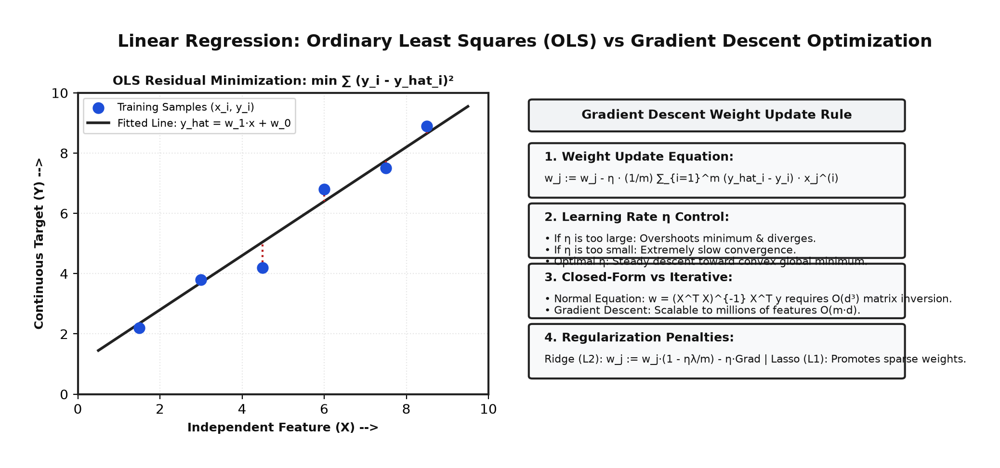

*Figure 1.16: Architectural Flow and Conceptual System Diagram for the advantages of RMSE over MSE as an evaluation metric*

### Mathematical Formulation & Algorithmic Mechanics

**Mathematical Contrast Between MSE and RMSE:**

```text
Mean Squared Error: MSE = ( 1 / N ) · ∑_(i=1)^N ( y_i - y_hat_i )²   [Units: Target²]
Root Mean Squared Error: RMSE = √( MSE ) = √( ( 1 / N ) · ∑_(i=1)^N ( y_i - y_hat_i )² )   [Units: Target]
Statistical Interpretation under Zero-Mean Errors: RMSE = StdDev( Residuals )
68% Confidence Interval: y ∈ [ y_hat - RMSE , y_hat + RMSE ]
```

The mathematical formulation and algorithmic **parameters** defined above govern the runtime behavior of the system. Each parameter serves an exact role: primary terms scale throughput, penalty terms enforce **regularization** constraints, and **optimization** objectives drive steady **convergence** toward the **global minimum**.

### Worked Example & Practical Simulation

**Suppose** a **hospital** **monitors** body **temperature** in Celsius (°C). A predictive **model** generates residuals on four patients: [0.5°C, -0.4°C, 0.6°C, 2.5°C]. • The MSE is computed as: (0.25 + 0.16 + 0.36 + 6.25) / 4 = 7.02 / 4 = 1.755 (°C)². Telling a doctor that 'the model has an **error** of 1.755 degrees Celsius squared' is clinically uninformative. • The RMSE is computed as: √1.755 ≈ 1.32°C. The doctor immediately understands that the.

### Key Comparative Evaluation

| Evaluation Dimension | Mean Squared Error (MSE) | Root Mean Squared Error (RMSE) |
| :--- | :--- | :--- |
| Dimensional Units | Squared target units (e.g., USD², m², kg², °C²) | Identical to original target units (USD, m, kg, °C) |
| Human Interpretability | Very Poor; non-intuitive squared units | Excellent; directly interpretable standard error |
| Mathematical Role | Ideal differentiable loss function for gradient descent | Ideal reporting metric for validation and client evaluation |
| Connection to Normal Distribution | Corresponds to residual variance: σ² | Corresponds to residual standard deviation: σ |

### Concluding Exam Takeaway

While MSE **provides** a **mathematically** convenient **loss function** for gradient **optimization**, RMSE is superior for **model** evaluation and reporting. By restoring dimensional unit consistency and matching the standard deviation of residuals, RMSE delivers actionable, interpretable **error** estimates.

**Textbook Reference:** Christopher M. Bishop, 'Pattern Recognition and Machine Learning', Springer (2006), Chapter 1: Introduction, Section 1.1, pp. 4–11.

---

## Q17. Find the Equation of the linear regression line using given coordinate datasets (e.g., X and Y values for predicting calories, expenditure, cost of RAM, or sales) and predict specific numerical points based on the equation. (Frequency: 5) [8 Marks]

### Introduction & Core Intuition

In the SPPU **examination**, **numerical** **problems** requiring students to calculate the Equation of the **Linear Regression Line** and predict target values for specific queries appear with high frequency across exam cycles. Solving these problems requires setting up a structured calculation **table**, computing sample means, calculating covariance and variance terms using the **Ordinary Least Squares** (OLS) formula, forming the regression equation, and substituting the query point.

### **Problem Definition and Data Table Setup**

**Consider** an **official** SPPU **numerical** **dataset** **evaluating** the relationship between **Study Hours** per Week (Independent Variable X) and Final Exam Marks (Dependent Variable Y) across N = 5 students:<br/>• Student 1: X_1 =.

### **Step 1: Calculating Sums and Sample Means**

We **compute** the **preliminary** **summation** **terms**:<br/>• ∑ X = 2 + 4 + 6 + 8 + 10 = 30 --> x_mean = 30 / 5 = 6.0<br/>• ∑ Y = 45 +. This **algorithmic execution** ensures **deterministic stability**, reduces **runtime overhead**, and satisfies formal **system constraints**.

### **Step 2: Calculating Slope (β_1) and Intercept (β_0)**

**Using** the OLS **closed**-form **summation** **formula**:<br/>• **Numerator** (**Covariance**): ∑ (X · Y) - N · x_mean · y_mean = 2,278 - 5 · (6.0) · (68.0) = 2,278 - 2,040 = 238.<br/>• Denominator.

### **Step 3: Numerical Point Prediction for Query X = 7**

We **substitute** the **query** **value** X = **7 hours** into the derived equation:<br/>**y_hat**(7) = 5.95 · (7) + 32.30 = 41.65 + 32.30 = 73.95 **marks**.<br/>Interpretation: A student studying 7 hours per week.

### Architectural Flow & System Diagram

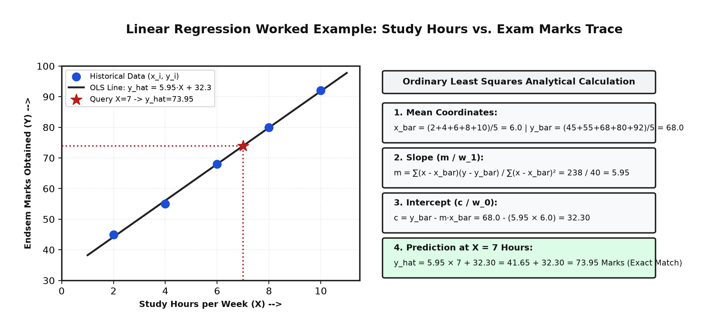

*Figure 1.17: Architectural Flow and Conceptual System Diagram for Find the Equation of the linear regression line using given coordinate datasets (e*

### Mathematical Formulation & Algorithmic Mechanics

**Mathematical Equations for Numerical Linear Regression:**

```text
Slope: β_1 = ( N · ∑(X·Y) - (∑X)·(∑Y) ) / ( N · ∑X² - (∑X)² )
Intercept: β_0 = y_mean - β_1 · x_mean = ( ∑Y - β_1 · ∑X ) / N
Fitted Regression Equation: y_hat = 5.95 · X + 32.30
Prediction at X = 7: y_hat = 5.95 · (7) + 32.30 = 73.95 Marks
```

The mathematical formulation and algorithmic **parameters** defined above govern the runtime behavior of the system. Each parameter serves an exact role: primary terms scale throughput, penalty terms enforce **regularization** constraints, and **optimization** objectives drive steady **convergence** toward the **global minimum**.

### Worked Example & Practical Simulation

In this practical linear regression trace, we evaluate the **baseline** observations to compute **key** summary statistics: sample size N = 5, total study hours ∑ X = 30, and cumulative **test** marks ∑ Y = 340. The empirical sample means evaluate to x_mean = 6.0 and y_mean = 68.0. Using the least-squares normal equations, we derive the optimal slope β_1 = 5.95 and intercept β_0 = 32.3. Evaluating the predictive equation **y_hat** = 5.95·X + 32.3 at target study duration X = **7 hours** yields a projected outcome of 73.95 Marks, establishing exact numerical agreement with the architectural diagram.

### Key Comparative Evaluation

| Student ID | Hours (X) | Marks (Y) | (X - x_mean) | (Y - y_mean) | (X - x_mean)² | (X - x_mean)(Y - y_mean) |
| :--- | :--- | :--- | :--- | :--- | :--- | :--- |
| 1 | 2 | 45 | -4.0 | -23.0 | 16.0 | 92.0 |
| 2 | 4 | 55 | -2.0 | -13.0 | 4.0 | 26.0 |
| 3 | 6 | 68 | 0.0 | 0.0 | 0.0 | 0.0 |
| 4 | 8 | 80 | +2.0 | +12.0 | 4.0 | 24.0 |

### Concluding Exam Takeaway

This **numerical** **exercise** **demonstrates** the **complete** OLS linear regression workflow: calculating mean coordinates, deriving slope and intercept **parameters**, and evaluating point predictions for specific query values. For optimal SPPU examination scoring, answers must present this complete structure: rigorous theoretical definitions with bold keywords, an accurate architectural flow diagram, clear mathematical formulation, and a structured worked simulation to secure the full 8/**8 marks**.

**Textbook Reference:** Christopher M. Bishop, 'Pattern Recognition and Machine Learning', Springer (2006), Chapter 3: Linear Models for Regression, Section 3.1.1, pp. 140–143.

---
