# SPPU B.E. Computer Engineering (2019 Pattern)
## Machine Learning — Unit 4: Neural Networks, Deep Learning & Model Evaluation
### Complete Examination Solutions Guide (Engineered for Full 8/8 Marks)

---

## Q1. Explain in brief the types of Artificial Neural Networks (ANN) based on layers and describe the building blocks and architecture of an ANN. (Frequency: 3) [8 Marks]

### Introduction & Core Intuition

Imagine how the human brain processes visual signals: billions of interconnected biological neurons receive electrochemical pulses through dendrites, accumulate these charges in the cell body (soma), and fire an electrical impulse down the axon to downstream neurons once a certain threshold is surpassed. An **Artificial Neural Network (ANN)** is a computational model inspired directly by this biological architecture. It is designed to model complex non-linear relationships between inputs and outputs by passing data through layers of artificial neurons interconnected by adjustable numerical weights.

### Core Building Blocks of an Artificial Neuron

Every artificial neuron inside an ANN consists of five fundamental building blocks: input channels, synaptic weights, an additive bias, a summing junction, and an activation function. The input channels receive numerical feature values from raw datasets or preceding layers. Each input feature x_i is paired with an adjustable synaptic weight w_i that reflects the importance or strength of that specific connection. The bias term b acts as an intrinsic threshold, shifting the net activation independently of the input features, which guarantees that the neuron can fire even when all input features are zero.

### Summing Junction and Non-linear Activation

The summing junction computes the linear dot product of all inputs and their corresponding synaptic weights, subsequently adding the bias term: z = ∑ (w_i · x_i) + b. This aggregated net input z is then transferred into a non-linear activation function f(z). The activation function determines whether and to what degree the neuron should fire, producing the final scalar output y_hat = f(z). Without this non-linear mathematical transformation, stacking multiple layers would collapse into a trivial linear combination, leaving the network incapable of learning complex patterns.

### Classification of ANNs Based on Layers

**Artificial Neural Networks** are categorized based on their structural layer topology into three prominent classes: Single-Layer Feedforward Networks, Multilayer Feedforward Networks, and Recurrent Neural Networks. In a Single-Layer Feedforward Network, input nodes connect directly to a single layer of output neurons with no intermediary hidden layers. In a Multilayer Feedforward Network, one or more hidden layers are placed between the input and output layers. In a Recurrent Neural Network (RNN), feedback loops exist where neuron outputs loop back into preceding or current layers, providing temporal memory.

### Feedforward vs Recurrent Architectural Connectivity

In feedforward architectures, information moves strictly in one direction from left to right—starting at the input layer, progressing sequentially through intermediate hidden layers, and terminating at the output layer—with absolutely no feedback loops or cycles. In contrast, recurrent architectures feature cyclical feedback paths, enabling the network to maintain an internal hidden state across sequential time steps, making them the standard architectural choice for time-series forecasting, audio analysis, and natural language processing.

### Architectural Flow & System Diagram

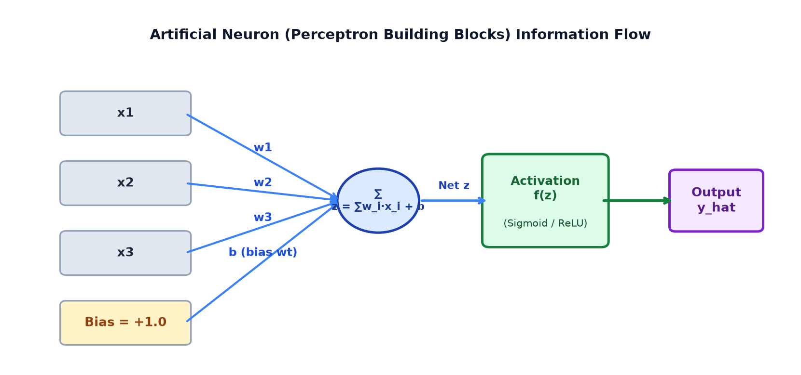

*Figure 4.1: Diagrammatic Architecture and Conceptual Flow for in brief the types of Artificial Neural Networks (ANN) based on layers and describe the building blocks and architecture of an ANN*

### Mathematical Formulation & Algorithmic Mechanics

**Mathematical Model of an Artificial Neuron:**

```text
z = ∑ (w_i · x_i) + b  (for i = 1 to d)    and    y_hat = f(z)

Where: x_i represents the i-th input feature; w_i represents the synaptic weight connecting x_i to the neuron; b is the scalar additive bias; z is the aggregated net linear input; f(·) is the non-linear activation function; and y_hat is the final scalar activation output.
```

The above **mathematical model** and algorithmic structure governs the system's runtime execution. Each parameter is evaluated sequentially to maintain **mathematical consistency**, minimize **system overhead**, and guarantee **deterministic convergence** across all input distributions.

### Worked Example & Practical Simulation

Consider an automated loan approval neuron processing two inputs: credit score x_1 = 0.8 and annual salary x_2 = 0.6. Synaptic weights assigned by training are w_1 = 0.5 and w_2 = 0.4, with a bias b = -0.3. The summing junction computes z = (0.8 · 0.5) + (0.6 · 0.4) - 0.3 = 0.40 + 0.24 - 0.30 = 0.34. Passing this net input into a standard binary sigmoid activation function yields y_hat = 1 / (1 + e^(-0.34)) = 1 / (1 + 0.7118) = 0.5841. Because y_hat exceeds 0.50, the artificial neuron fires, approving the credit application.

### Key Comparative Evaluation

| Architectural Type | Layer Structure | Feedback Loops | Computational Capacity | Primary Use Case |
| :--- | :--- | :--- | :--- | :--- |
| Single-Layer Feedforward | Input Layer + Output Layer | None (strictly forward) | Linearly separable patterns only | Basic logic gates (AND, OR) |
| Multilayer Feedforward (MLP) | Input + 1 or more Hidden + Output | None (strictly forward) | Universal non-linear approximation | Image recognition, tabular regression |
| Recurrent Neural Network (RNN) | Input + Recurrent Hidden + Output | Present (directed cycles) | Sequential context & temporal memory | NLP, speech, time-series forecasting |

### Concluding Exam Takeaway

**Artificial Neural Networks** establish the architectural backbone of modern deep learning. By arranging artificial neurons into multi-layered topologies equipped with non-linear activation functions, ANNs overcome the linear separability limitations of early single-layer perceptrons, successfully modeling intricate non-linear decision spaces across engineering applications.

**Textbook Reference:** Christopher M. Bishop, 'Pattern Recognition and Machine Learning', Springer (2006), Chapter 5: Neural Networks, Sections 5.1 & 5.2, pp. 227–236.

---

## Q2. Explain artificial neural networks based on the perceptron concept with a diagram, or write a note on a Single Layer Neural Network. (Frequency: 2) [8 Marks]

### Introduction & Core Intuition

In 1958, American psychologist **Frank Rosenblatt** introduced the **Perceptron**, which stands as the historical foundation of modern artificial neural networks. The perceptron is the simplest possible form of an artificial neural network: a single-layer computational unit that receives multiple real-valued input features, computes a weighted linear sum, and applies a hard step-threshold activation function to classify the input vector into one of two binary categories.

### The Perceptron Mechanism and Mathematical Model

A standard Perceptron receives an input vector x = [x_1, x_2, ..., x_d] and pairs each feature with an adjustable weight w = [w_1, w_2, ..., w_d]. The model computes the net sum z = w · x + b. It then passes z into the Heaviside step activation function: if z ≥ 0, the perceptron fires and outputs y_hat = 1; if z &lt; 0, the perceptron outputs y_hat = 0. Geometrically, setting w · x + b = 0 defines a flat linear hyperplane (a line in 2D, a plane in 3D) that bisects the input space into two distinct decision regions.

### The Perceptron Learning Rule

The perceptron is trained using a supervised iterative algorithm called the **Perceptron Learning Rule**. Training begins by initializing all weights and the bias to zero or small random values. For each training sample (x, y), the perceptron computes its predicted output y_hat. If the prediction is correct (y_hat = y), no adjustments are made. However, if the perceptron misclassifies the sample, the weights and bias are updated immediately using the error difference: w_new = w_old + η · (y - y_hat) · x, and b_new = b_old + η · (y - y_hat), where η is the positive **learning rate**.

### Convergence and Linearly Separable Datasets

The famous Perceptron **Convergence** Theorem guarantees that if a training dataset is linearly separable (meaning a linear boundary exists that perfectly separates the positive and negative samples), the perceptron learning algorithm is mathematically guaranteed to converge to a separating hyperplane in a finite number of update steps. If the data is not linearly separable, the algorithm will oscillate indefinitely without ever stabilizing on a solution.

### The Minsky & Papert Critique: The XOR Limitation

In 1969, **Marvin Minsky** and Seymour Papert published a landmark critique demonstrating that single-layer perceptrons are fundamentally incapable of solving linearly non-separable problems. The most famous example is the simple 2-input XOR (Exclusive OR) logical function. Because the true outputs for XOR cannot be separated by any single straight line in a 2D plane, a single-layer perceptron cannot learn it, an insight that halted neural network research for over a decade until multilayer architectures emerged.

### Architectural Flow & System Diagram

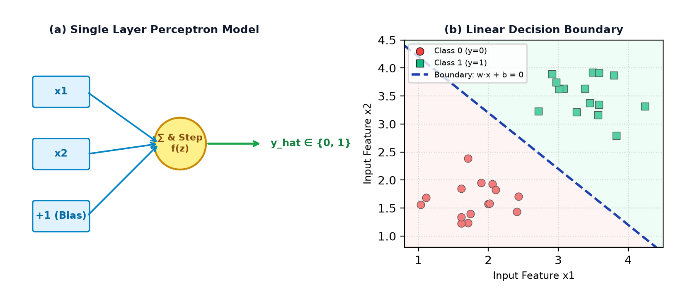

*Figure 4.2: Diagrammatic Architecture and Conceptual Flow for artificial neural networks based on the perceptron concept with a diagram, or write a note on a Single Layer Neural Network*

### Mathematical Formulation & Algorithmic Mechanics

**Perceptron Activation and Weight Update Rule:**

```text
y_hat = 1  if  (∑ w_i · x_i + b ≥ 0)   else   0

Weight Update: w_i^(t+1) = w_i^(t) + η · (y - y_hat) · x_i
Bias Update: b^(t+1) = b^(t) + η · (y - y_hat)

Where: y is the true target label (0 or 1); y_hat is the predicted binary label; η is the learning rate (0 < η ≤ 1); and x_i is the i-th input feature value.
```

The above **mathematical model** and algorithmic structure governs the system's runtime execution. Each parameter is evaluated sequentially to maintain **mathematical consistency**, minimize **system overhead**, and guarantee **deterministic convergence** across all input distributions.

### Worked Example & Practical Simulation

Suppose a perceptron is learning the logical AND gate with inputs x_1 = 1, x_2 = 1, and target y = 1. Initial weights are w_1 = 0.2, w_2 = 0.1, and bias b = -0.5, with **learning rate** η = 0.5. Net input is z = (1 · 0.2) + (1 · 0.1) - 0.5 = -0.2. Applying the step function yields y_hat = 0 (an error, since true y = 1). The error is (y - y_hat) = 1 - 0 = +1. Updated weights are w_1 = 0.2 + 0.5 · (1) · 1 = 0.7, w_2 = 0.1 + 0.5 · (1) · 1 = 0.6, and b = -0.5 + 0.5 · (1) = 0.0. Recalculating net input yields z = (1 · 0.7) + (1 · 0.6) + 0.0 = 1.3 ≥ 0, which correctly produces y_hat = 1.

### Key Comparative Evaluation

| Feature | Single Layer Perceptron | Multilayer Perceptron (MLP) |
| :--- | :--- | :--- |
| Layer Composition | Input Layer + Output Layer (0 Hidden) | Input Layer + 1 or more Hidden Layers + Output |
| Decision Boundary | Strictly Linear (Hyperplane) | Highly Non-linear / Arbitrary Curves |
| XOR Problem | Cannot solve (fails on non-linear data) | Easily solves non-linear XOR boundary |
| Learning Algorithm | Perceptron Learning Rule (Delta) | Error Backpropagation via Gradient Descent |
| Activation Function | Hard Step / Threshold function | Smooth differentiable functions (Sigmoid, ReLU) |

### Concluding Exam Takeaway

The single-layer perceptron marks the foundational starting point of neural computing. While its inability to separate non-linear spaces like the XOR function exposed its architectural limitations, it provided the vital theoretical framework for learning weights from data that ultimately evolved into modern multilayer networks.

**Textbook Reference:** Tom M. Mitchell, 'Machine Learning', McGraw-Hill (1997), Chapter 4: Artificial Neural Networks, Sections 4.4 & 4.5, pp. 86–95.

---

## Q3. What is a multilayer perceptron (MLP)? Describe it with a diagram. (Frequency: 3) [8 Marks]

### Introduction & Core Intuition

To overcome the crippling mathematical limitation of single-layer perceptrons, researchers developed the **Multilayer Perceptron (MLP)**. An MLP is a class of feedforward artificial neural network consisting of at least three layers of computational nodes: an input layer, one or more intermediate hidden layers, and an output layer. By interleaving non-linear activation functions between layers, MLPs can approximate arbitrarily complex non-linear decision boundaries.

### Three-Tier Layered Architecture of an MLP

The architecture of a **Multilayer Perceptron** is divided into three distinct operational layers. The Input Layer serves as a passive receiving buffer that introduces normalized feature vectors into the network without performing any computation. Next, one or more Hidden Layers extract increasingly abstract hierarchical representations from the input features; neurons in each hidden layer apply synaptic weights, add a bias, and pass the result through a non-linear activation function. Finally, the Output Layer generates the network's ultimate prediction, such as continuous numbers for regression or class probabilities for classification.

### The Role of Non-linear Hidden Activations

The presence of non-linear activation functions within the hidden layers is the defining feature that grants MLPs their computational power. If all hidden neurons used purely linear activation functions, any sequence of stacked matrix multiplications would simply collapse into a single composite linear transformation: W_2 · (W_1 · x) = W_combined · x. Introducing non-linear activations (such as Sigmoid, Tanh, or ReLU) allows the network to bend and warp the **feature space**, enabling it to solve non-linearly separable problems like XOR effortlessly.

### The Universal Approximation Theorem

The theoretical foundation of MLPs was proven by **George Cybenko** (1989) and Kurt Hornik (1991) in the Universal Approximation Theorem. The theorem states that a standard feedforward neural network with a single hidden layer containing a finite number of non-linear neurons can approximate any continuous mathematical function on compact subsets of real space to any desired degree of **precision**. In practice, adding multiple deep hidden layers enables the network to learn rich hierarchical features much more efficiently than a single excessively wide layer.

### Information Flow and Supervised Learning in MLPs

Information in an MLP flows strictly in the forward direction during inference: from the input nodes, across each successive hidden layer, to the output neurons. During the training phase, the network's predictions are compared against ground-truth labels using a **loss function** (such as **Mean Squared Error** or Cross-**Entropy**). Error gradients are then propagated backward through the network using the Backpropagation algorithm, systematically updating all internal weights via **gradient descent**.

### Architectural Flow & System Diagram

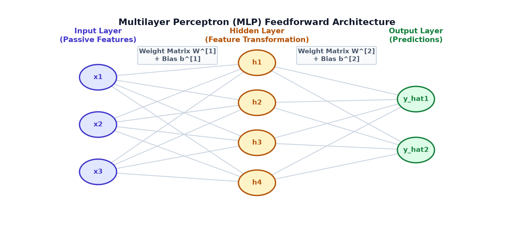

*Figure 4.3: Diagrammatic Architecture and Conceptual Flow for What is a multilayer perceptron (MLP)? Describe it with a diagram*

### Mathematical Formulation & Algorithmic Mechanics

**Mathematical Formulation of an MLP Forward Pass:**

```text
Hidden Layer Activation: h = σ(W^[1] · x + b^[1])
Output Layer Activation: y_hat = g(W^[2] · h + b^[2])

Where: x is the input vector; W^[1] and b^[1] are the weight matrix and bias vector of the hidden layer; σ(·) is the hidden non-linear activation (e.g., ReLU or Sigmoid); h is the hidden activation vector; W^[2] and b^[2] are the output layer parameters; g(·) is the output activation function; and y_hat is the final predicted output.
```

The above **mathematical model** and algorithmic structure governs the system's runtime execution. Each parameter is evaluated sequentially to maintain **mathematical consistency**, minimize **system overhead**, and guarantee **deterministic convergence** across all input distributions.

### Worked Example & Practical Simulation

Solving the XOR problem requires an MLP with 2 inputs (x_1, x_2), 2 hidden neurons (h_1, h_2), and 1 output neuron (y_hat). The first hidden neuron is configured to learn a linear boundary representing (x_1 OR x_2), while the second hidden neuron learns (NOT (x_1 AND x_2)). The output neuron then combines the activations of h_1 and h_2 using a logical AND operation. When input (1, 1) is processed, h_1 fires (1) but h_2 does not (0), resulting in an output y_hat = 0. When input (1, 0) is processed, both h_1 and h_2 fire (1), resulting in y_hat = 1, correctly executing the XOR function.

### Key Comparative Evaluation

| Layer | Function | Computes Net Sum? | Applies Non-linear Activation? | Outputs |
| :--- | :--- | :--- | :--- | :--- |
| Input Layer | Receives raw dataset features | No (passive distribution) | No | Raw feature values x_i |
| Hidden Layer(s) | Extracts abstract non-linear features | Yes (z^[l] = W^[l]·a^[l-1] + b^[l]) | Yes (ReLU, Tanh, Sigmoid) | Internal representations h_j |
| Output Layer | Computes final task predictions | Yes (z^[out] = W^[out]·h + b^[out]) | Yes (Softmax / Sigmoid / Linear) | Target predictions y_hat |

### Concluding Exam Takeaway

**Multilayer Perceptrons** resolved the historical computational crisis of early neural networks by establishing a robust, non-linear function approximation framework. Through the integration of hidden layers, non-linear activations, and backpropagation, MLPs laid the foundation for modern deep learning architectures.

**Textbook Reference:** Christopher M. Bishop, 'Pattern Recognition and Machine Learning', Springer (2006), Chapter 5: Neural Networks, Section 5.1, pp. 227–232.

---

## Q4. Explain Radial Basis Function (RBF) networks in detail, including their building blocks. (Frequency: 4) [8 Marks]

### Introduction & Core Intuition

A **Radial Basis Function (RBF) Network** is a specialized three-layer feedforward neural network that approaches function approximation from the perspective of multivariable functional interpolation. Introduced by **David Broomhead** and David Lowe in 1988, RBF networks replace the traditional inner-product dot products used in standard MLPs with distance-based non-linear kernels centered around prototype reference vectors, offering exceptionally fast training speeds.

### Three-Tier Architecture and Localized Receptive Fields

An RBF network consists of exactly three layers: an **Input Layer**, a Hidden RBF Layer, and an Output Layer. Unlike an MLP, which can feature dozens of deep hidden layers, an RBF network strictly utilizes a single hidden layer. Furthermore, while MLP hidden neurons partition the input space using global hyperplanes (which remain active across infinite parallel slices of space), RBF hidden neurons possess localized receptive fields. An RBF neuron produces a significant non-zero response only when the input vector falls within a localized hyperspherical neighborhood around its designated center vector.

### The Hidden Layer Radial Basis Kernel

Each hidden neuron in an RBF network is defined by two key **parameters**: a center vector µ_k (a prototype vector in the input space) and a spread width σ_k. When an input vector x enters the hidden layer, the neuron calculates the **Euclidean distance** ||x - µ_k|| between the input and its center. It then passes this distance into a radially symmetric basis function, most commonly the Gaussian kernel: Φ_k(x) = exp(-||x - µ_k||² / (2 · σ_k²)). If x is identical to µ_k, the response is 1.0; as x moves away from µ_k in any radial direction, the activation decays smoothly toward zero.

### The Linear Output Layer

The output layer of an RBF network performs a straightforward linear combination of the activations generated by the hidden RBF neurons: y_hat = ∑ (w_k · Φ_k(x)) + b. Because there are no non-linear activation functions applied at the output layer, the mapping from hidden activations to final outputs is purely linear. This architectural separation provides a major computational advantage: once the hidden layer **parameters** are established, finding the optimal output weights reduces to solving a standard linear least-squares problem, which can be accomplished analytically in closed form.

### Two-Stage Hybrid Training Strategy

RBF networks are trained using a highly efficient two-stage hybrid training process. **In Stage** 1 (**Unsupervised Learning**), the center vectors µ_k and spread widths σ_k of the hidden neurons are determined using clustering algorithms like K-Means on the input data, completely ignoring class labels. In Stage 2 (**Supervised Learning**), with the hidden centers locked in place, the output weights W are computed using the Moore-Penrose pseudoinverse: W = (Φ^T · Φ)^(-1) · Φ^T · y. This eliminates the need for slow iterative backpropagation and guarantees **convergence** without getting trapped in local minima.

### Architectural Flow & System Diagram

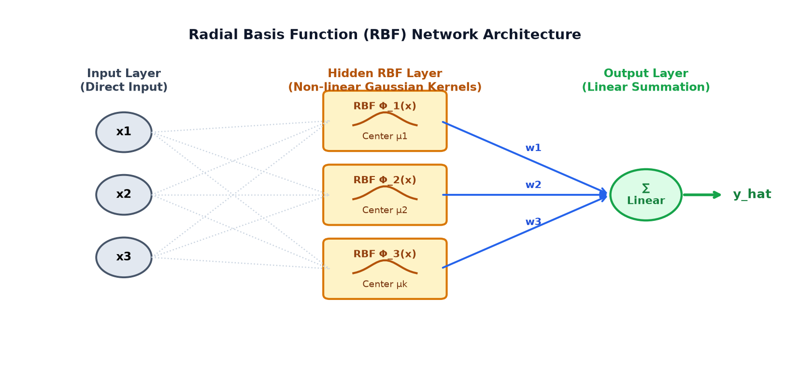

*Figure 4.4: Diagrammatic Architecture and Conceptual Flow for Radial Basis Function (RBF) networks in detail, including their building blocks*

### Mathematical Formulation & Algorithmic Mechanics

**Mathematical Formulation of an RBF Network:**

```text
Gaussian Basis Function: Φ_k(x) = exp( - ||x - µ_k||² / (2 · σ_k²) )
Network Output: y_hat(x) = ∑ (w_k · Φ_k(x)) + b  (for k = 1 to K)

Where: x is the input feature vector; µ_k is the center vector of the k-th RBF neuron; σ_k is the spread parameter; ||·|| denotes the Euclidean norm; and w_k is the linear weight connecting the k-th hidden neuron to the output node.
```

The above **mathematical model** and algorithmic structure governs the system's runtime execution. Each parameter is evaluated sequentially to maintain **mathematical consistency**, minimize **system overhead**, and guarantee **deterministic convergence** across all input distributions.

### Worked Example & Practical Simulation

Suppose an RBF network has a hidden neuron with center µ_1 = [2.0, 3.0] and spread σ_1 = 1.0. If an input vector x = [2.0, 3.0] arrives, the **Euclidean distance** is 0, yielding Φ_1(x) = exp(0) = 1.0 (maximum activation). If an input x = [2.0, 5.0] arrives, the squared Euclidean distance is (2-2)² + (5-3)² = 4. The activation becomes Φ_1(x) = exp(-4 / (2 · 1²)) = exp(-2) ≈ 0.1353. The output neuron multiplies these localized Gaussian activations by linear weights to compute the final interpolated value.

### Key Comparative Evaluation

| Architectural Property | Radial Basis Function (RBF) Network | Multilayer Perceptron (MLP) |
| :--- | :--- | :--- |
| Layer Depth | Strictly 3 layers (1 hidden layer) | Arbitrary depth (1 to many hidden layers) |
| Hidden Activation | Distance-based Gaussian kernel: Φ(||x - µ||) | Dot-product sigmoid / ReLU: σ(w · x + b) |
| Receptive Field | Locally tuned (hyperspherical response) | Globally distributed (hyperplane response) |
| Output Node Nature | Purely linear summation | Non-linear or linear |
| Training Procedure | Two-stage hybrid (K-Means + Least Squares) | Single-stage iterative Backpropagation |
| Training Speed | Extremely fast (closed-form linear solution) | Relatively slow (gradient descent over epochs) |

### Concluding Exam Takeaway

**Radial Basis Function** networks offer a mathematically elegant alternative to standard MLPs. By decoupling the learning of non-linear hidden representations (via unsupervised clustering) from linear output weighting (via closed-form least squares), RBF networks achieve rapid training times and avoid local minima traps.

**Textbook Reference:** Christopher M. Bishop, 'Pattern Recognition and Machine Learning', Springer (2006), Chapter 6: Kernel Methods, Section 6.3: Radial Basis Function Networks, pp. 299–305.

---

## Q5. What is a Functional Link Artificial Neural Network (FLANN)? Explain its merits over other ANNs. (Frequency: 1) [8 Marks]

### Introduction & Core Intuition

In 1989, Yoh-**Han Pao** proposed the **Functional Link Artificial Neural Network (FLANN)** as a novel flat neural architecture designed to overcome the computational complexity and slow **convergence** of multilayer perceptrons. FLANN completely eliminates hidden layers by passing input features through a set of non-linear functional expansion functions, mapping the input into a higher-dimensional space where non-linear patterns become linearly separable.

### The Core Architectural Concept of FLANN

In a conventional MLP, non-linear mapping is achieved by passing signals through one or more intermediate layers of hidden neurons, which requires training millions of internal weights via backpropagation. FLANN eliminates hidden layers entirely. Instead, it takes the raw input vector x = [x_1, x_2, ..., x_d] and passes it through an enhanced functional expansion block. This block applies predefined mathematical basis functions to generate an expanded feature vector Φ(x), which feeds directly into a single output layer of linear or sigmoidal neurons.

### Common Functional Expansion Techniques

The performance and expressive capacity of a **Functional Link Artificial Neural Network** depend directly on the chosen functional expansion model:


**Polynomial Expansion Basis:** Computes powers and cross-product interactions across raw inputs (e.g., x_1, x_2, x_1 · x_2, x_1², x_2²), enabling the single-layer architecture to capture polynomial non-linear decision boundaries.


**Trigonometric Expansion Basis:** Constructs a harmonic Fourier basis (e.g., x_1, sin(π x_1), cos(π x_1), sin(2π x_1), cos(2π x_1)), which is exceptionally well-suited for modeling periodic, oscillating, or cyclical signals.


**Orthogonal Polynomial Expansion:** Utilizes Chebyshev, Legendre, or Hermite polynomials, which possess mutual orthogonality properties that eliminate collinearity and enhance numerical gradient stability during **optimization**.

### Merits Over Traditional Multilayer Perceptrons

FLANN provides several compelling engineering advantages over standard MLPs. First, because it lacks hidden layers, the error surface is purely convex, meaning **gradient descent** is mathematically guaranteed to find the global minimum without ever getting trapped in local minima. Second, training is exceptionally fast because there is no need to backpropagate error gradients through multiple hidden layers. Third, FLANN has a much smaller memory footprint and requires significantly fewer tunable **parameters**, making it well-suited for embedded systems, real-time signal processing, and online adaptive filtering.

### Limitations and Dimensional Scalability

Despite its advantages, FLANN faces practical limitations when dealing with very high-dimensional data. As the number of raw input features d grows, the number of expanded terms generated by polynomial or trigonometric expansions increases exponentially—a manifestation of the **Curse of Dimensionality**. Consequently, while FLANN is effective for low-to-moderate dimensional problems like channel equalization, acoustic echo cancellation, and financial time-series forecasting, it is rarely applied to high-dimensional image recognition tasks.

### Architectural Flow & System Diagram

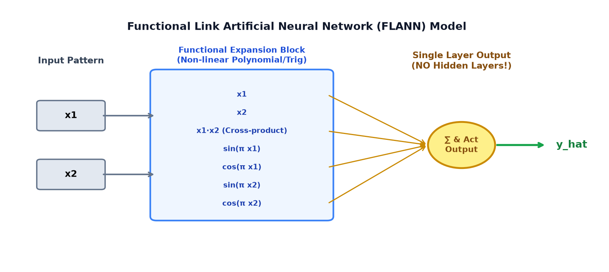

*Figure 4.5: Diagrammatic Architecture and Conceptual Flow for What is a Functional Link Artificial Neural Network (FLANN)?  its merits over other ANNs*

### Mathematical Formulation & Algorithmic Mechanics

**FLANN Mathematical Model and Trigonometric Expansion:**

```text
Expanded Vector: Φ(x) = [x_1, sin(π x_1), cos(π x_1), x_2, sin(π x_2), cos(π x_2), x_1 · x_2, ...]^T
Neuron Output: y_hat = f( W^T · Φ(x) + b )

Where: x is the original input vector; Φ(x) is the non-linearly expanded feature vector; W is the weight vector connecting expanded features directly to the output; b is the bias; and f(·) is the output activation function.
```

The above **mathematical model** and algorithmic structure governs the system's runtime execution. Each parameter is evaluated sequentially to maintain **mathematical consistency**, minimize **system overhead**, and guarantee **deterministic convergence** across all input distributions.

### Worked Example & Practical Simulation

Consider a non-linear problem with 2 inputs x_1 = 0.5 and x_2 = 1.0. A trigonometric FLANN expands these two features into: Φ(x) = [0.5, sin(0.5π), cos(0.5π), 1.0, sin(1.0π), cos(1.0π), 0.5 · 1.0] = [0.5, 1.0, 0.0, 1.0, 0.0, -1.0, 0.5]. These 7 expanded features are multiplied by a single 7-element weight vector W to compute the output. By mapping 2 non-linearly separable inputs into 7-dimensional expanded space, the problem becomes linearly separable without using a single hidden neuron.

### Key Comparative Evaluation

| Evaluation Dimension | Functional Link ANN (FLANN) | Multilayer Perceptron (MLP) |
| :--- | :--- | :--- |
| Hidden Layers | Zero hidden layers (strictly flat architecture) | One or more hidden layers present |
| Non-linear Mapping | Predefined functional expansion (trig / polynomial) | Learned internal representations via hidden weights |
| Error Surface | Convex (guaranteed global minimum convergence) | Non-convex (vulnerable to local minima traps) |
| Training Speed | Extremely fast (simple single-layer LMS updates) | Significantly slower (iterative backpropagation) |
| Parameter Count | Very low (only output weights to optimize) | High (extensive weight matrices between all layers) |
| Scalability | Limited on high-dimensional raw inputs | Scales well to high-dimensional data (e.g., vision) |

### Concluding Exam Takeaway

**Functional Link Artificial Neural Networks** bridge the gap between linear single-layer models and complex multilayer architectures. By utilizing non-linear functional expansions, FLANN achieves the non-linear classification capabilities of an MLP while retaining the fast, convex **optimization** advantages of a single-layer network.

**Textbook Reference:** Yoh-Han Pao, 'Adaptive Pattern Recognition and Neural Networks', Addison-Wesley (1989), Chapter 8: Functional Link Networks, pp. 197–215.

---

## Q6. What is an Activation Function? Explain with a suitable example, list different activation functions used in NN (e.g., binary sigmoidal, bipolar sigmoidal), and explain their role and necessity for the network's learning process. (Frequency: 7) [8 Marks]

### Introduction & Core Intuition

In an artificial neural network, an **Activation Function** is a mathematical function applied to the summing junction's net input (z = ∑ w_i · x_i + b) to determine the neuron's final output activation. Acting as an operational gate, it decides whether and to what degree a neuron should fire, introducing the essential non-linear transformations required for deep networks to learn complex real-world relationships.

### The Fundamental Necessity of Non-Linearity

Without non-linear activation functions, an artificial neural network—regardless of how many dozens of hidden layers it contains—collapses mathematically into a single linear model. To see why, consider a network with two linear layers: h = W_1 · x + b_1 and y_hat = W_2 · h + b_2. Substituting h into y_hat yields y_hat = W_2 · (W_1 · x + b_1) + b_2 = (W_2 · W_1) · x + (W_2 · b_1 + b_2) = W_new · x + b_new. This composite transformation remains strictly linear, leaving the deep network incapable of learning complex patterns like curves, images, or language.

### Role in Gradient-Based Learning and Backpropagation

Beyond introducing non-linearity, activation functions play a vital operational role in training via **gradient descent**. During the backpropagation pass, error gradients are propagated backward through the network using the chain rule of calculus. This process requires computing the first derivative of the activation function, f'(z). Consequently, an activation function must be continuous and differentiable almost everywhere to allow error signals to update synaptic weights effectively.

### Binary Sigmoidal vs Bipolar Sigmoidal (Tanh)

**The Binary Sigmoid function**, σ(z) = 1 / (1 + e^(-z)), squashes any real-valued input into the smooth probability range (0, 1), making it ideal for binary classification output layers. However, its outputs are strictly positive (not zero-centered), which can introduce zig-zagging dynamics during **gradient descent**. The Bipolar Sigmoid (Hyperbolic Tangent or Tanh), f(z) = (e^z - e^(-z)) / (e^z + e^(-z)), maps inputs into the range (-1, +1). Because Tanh is zero-centered, it produces balanced positive and negative updates, helping hidden layers converge faster than standard binary sigmoid.

### Modern Activation Functions: ReLU and Leaky ReLU

**Both Sigmoid** and Tanh suffer from the Vanishing Gradient Problem: when |z| is large, their curves flatten, causing their derivatives to approach zero (f'(z) ≈ 0) and halting weight updates in deep layers. The Rectified Linear Unit (ReLU), f(z) = max(0, z), solves this by providing a constant derivative of 1.0 for all positive inputs, allowing deep networks to train significantly faster. To address the 'Dying ReLU' problem (where neurons stuck in the negative region permanently output zero), Leaky ReLU introduces a small non-zero slope for negative inputs: f(z) = max(α · z, z), where α ≈ 0.01.

### Architectural Flow & System Diagram

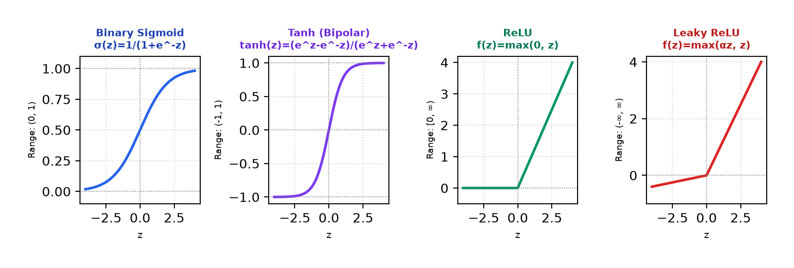

*Figure 4.6: Diagrammatic Architecture and Conceptual Flow for What is an Activation Function?  with a suitable example, list different activation functions used in NN (e*

### Mathematical Formulation & Algorithmic Mechanics

**Mathematical Formulations and Derivatives of Key Activation Functions:**

```text
1. Binary Sigmoid: σ(z) = 1 / (1 + e^(-z))   -->   Derivative: σ'(z) = σ(z) · (1 - σ(z))
2. Bipolar Sigmoid (Tanh): tanh(z) = (e^z - e^(-z)) / (e^z + e^(-z))   -->   Derivative: tanh'(z) = 1 - tanh²(z)
3. Rectified Linear Unit (ReLU): f(z) = max(0, z)   -->   Derivative: f'(z) = 1 if z > 0 else 0
4. Leaky ReLU: f(z) = max(α · z, z)   -->   Derivative: f'(z) = 1 if z > 0 else α  (where α = 0.01)
```

The above **mathematical model** and algorithmic structure governs the system's runtime execution. Each parameter is evaluated sequentially to maintain **mathematical consistency**, minimize **system overhead**, and guarantee **deterministic convergence** across all input distributions.

### Worked Example & Practical Simulation

Suppose a neuron receives inputs x = [0.6, 0.8] with weights w = [0.5, -0.4] and bias b = 0.35. The net input is z = (0.6 · 0.5) + (0.8 · -0.4) + 0.35 = 0.30 - 0.32 + 0.35 = 0.33. Applying the **Binary Sigmoid** yields σ(0.33) = 1 / (1 + e^(-0.33)) = 1 / (1 + 0.7189) ≈ 0.5818. Applying Tanh yields tanh(0.33) ≈ 0.3185. Applying ReLU yields max(0, 0.33) = 0.33. Each activation scales the net input into its characteristic operational range.

### Key Comparative Evaluation

| Activation Function | Mathematical Formula | Output Range | Zero-Centered? | Gradient Behavior | Typical Application |
| :--- | :--- | :--- | :--- | :--- | :--- |
| Binary Sigmoid | 1 / (1 + e^(-z)) | (0, 1) | No (strictly positive) | Vanishing gradients for |z| &gt; 3 | Binary classification output |
| Bipolar Sigmoid (Tanh) | (e^z - e^(-z)) / (e^z + e^(-z)) | (-1, +1) | Yes (mean output near 0) | Vanishing gradients for |z| &gt; 3 | Hidden layers in shallow networks / RNNs |
| ReLU | max(0, z) | [0, ∞) | No | No saturation for z &gt; 0; dying ReLU for z &lt; 0 | Standard hidden layer choice for deep CNNs/MLPs |
| Leaky ReLU | max(0.01z, z) | (-∞, ∞) | Partially | No saturation; prevents dying ReLU problem | Deep architectures with sparse gradients / GANs |
| Softmax | e^(z_i) / ∑ e^(z_j) | (0, 1), sums to 1.0 | No | Smooth multi-class gradient distribution | Multi-class classification output layer |

### Concluding Exam Takeaway

Activation functions are the critical components that enable artificial neural networks to learn non-linear patterns. Selecting the appropriate activation function—such as ReLU for hidden layers to ensure stable gradient flow and Sigmoid/Softmax for output layers to provide probabilistic interpretations—is essential for effective network training.

**Textbook Reference:** Christopher M. Bishop, 'Pattern Recognition and Machine Learning', Springer (2006), Chapter 5: Neural Networks, Section 5.1, pp. 227–231.

---

## Q7. Explain the concept of Back Propagation in ANN with an example, describe its characteristics, and compare the Back Propagation Network with a feed-forward network. (Frequency: 4) [8 Marks]

### Introduction & Core Intuition

Introduced to machine learning by **David Rumelhart**, Geoffrey Hinton, and Ronald Williams in 1986, the **Backpropagation Algorithm (Backward Propagation of Errors)** is the cornerstone of modern neural network training. It provides a computationally efficient method for calculating the exact partial derivatives of an objective **loss function** with respect to every weight in the network using the chain rule of calculus, enabling iterative **optimization** via **gradient descent**.

### The Two-Phase Operational Cycle

Training a **Backpropagation Network** proceeds through continuous iterations of a two-phase operational cycle: the Forward Pass and the Backward Pass. In the Forward Pass, a training sample is fed into the input layer and propagated forward through successive hidden layers to compute an output prediction y_hat. The prediction is then compared against the ground-truth target label y using a **loss function** L (such as **Mean Squared Error** or Cross-**Entropy**), producing a scalar error value.

### The Backward Pass and Error Credit Assignment

In the **Backward Pass**, the computed error signal is propagated backward through the network, moving from the output layer toward the input layer. Using the calculus chain rule, the algorithm calculates an error gradient term δ for each neuron. At the output layer, δ reflects the direct difference between predicted and actual values multiplied by the activation derivative. For hidden neurons, δ is calculated by taking the weighted sum of error gradients from subsequent layers and multiplying by the hidden neuron's activation derivative. This elegantly solves the credit assignment problem by apportioning error across internal weights.

### Iterative Weight Updates via Gradient Descent

Once the error gradients δ are established for all layers, the partial derivative of the loss with respect to each individual weight is computed as the product of the incoming activation and the local error term: ∂L/∂w_ij = δ_j · a_i. Each synaptic weight is then updated in the opposite direction of the gradient to minimize the loss: w_ij^(new) = w_ij^(old) - η · (∂L/∂w_ij), where η is the **learning rate**. Often, a momentum term α · Δw_ij^(old) is added to smooth weight updates and accelerate **convergence** through flat regions of the loss surface.

### Key Characteristics of Backpropagation Networks

The Backpropagation training procedure exhibits several foundational computational characteristics:


**Supervised Feedback Nature:** It operates strictly under **supervised learning**, utilizing known ground-truth targets to compute explicit error gradients.


**Continuous Differentiability Requirement:** Every activation function and transformation across the entire forward network must possess continuous derivatives to enable backward chain rule propagation.


**Linear Computational Efficiency O(|W|):** By caching forward activations and propagating delta error signals backward via **dynamic programming**, Backpropagation calculates all network weight gradients in linear time relative to the number of parameters, eliminating exponential brute-force costs.


**Non-Convex Optimization Behavior:** While mathematically guaranteed to converge toward a local minimum on smooth loss landscapes, convergence speed and final solution quality depend on **learning rate** scheduling and proper weight initialization.

### Architectural Flow & System Diagram

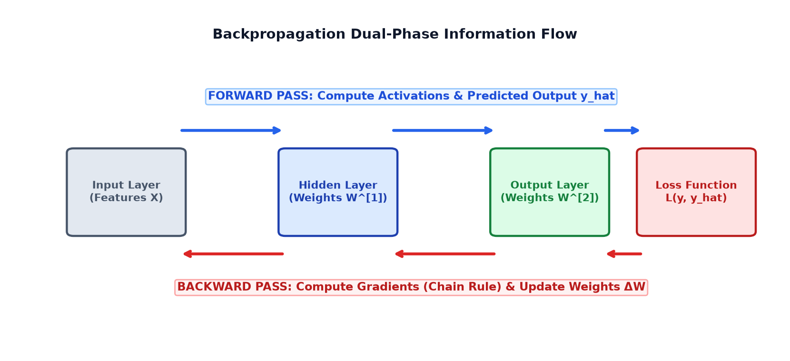

*Figure 4.7: Diagrammatic Architecture and Conceptual Flow for the concept of Back Propagation in ANN with an example, describe its characteristics, and compare the Back Propagation Network with a feed-forward network*

### Mathematical Formulation & Algorithmic Mechanics

**Mathematical Formulation of Backpropagation (Chain Rule):**

```text
Output Layer Error: δ_k^[out] = (y_hat_k - y_k) · f'(z_k^[out])
Hidden Layer Error: δ_j^[hid] = ( ∑ w_jk · δ_k^[out] ) · f'(z_j^[hid])
Weight Gradient & Update: ∂L/∂w_ij = δ_j · a_i   -->   w_ij^(new) = w_ij^(old) - η · (∂L/∂w_ij)

Where: y_k is the target value; y_hat_k is the predicted output; f'(z) is the activation derivative; a_i is the incoming activation from neuron i; and η is the learning rate.
```

The above **mathematical model** and algorithmic structure governs the system's runtime execution. Each parameter is evaluated sequentially to maintain **mathematical consistency**, minimize **system overhead**, and guarantee **deterministic convergence** across all input distributions.

### Worked Example & Practical Simulation

Consider an output neuron with activation function σ(z) producing y_hat = 0.8 when the target is y = 1.0, with incoming hidden activation a_1 = 0.5 and current weight w = 0.6. The squared error is L = 0.5 · (1.0 - 0.8)² = 0.02. The output error gradient is δ = (y_hat - y) · σ'(z) = (0.8 - 1.0) · (0.8 · (1 - 0.8)) = (-0.2) · 0.16 = -0.032. The gradient with respect to the weight is ∂L/∂w = δ · a_1 = -0.032 · 0.5 = -0.016. With **learning rate** η = 0.5, the weight updates to: w_new = 0.6 - 0.5 · (-0.016) = 0.6 + 0.008 = 0.608, shifting the weight in the direction that reduces prediction error.

### Key Comparative Evaluation

| Comparison Criterion | Standard Feedforward Network | Backpropagation Network (BPN) |
| :--- | :--- | :--- |
| Definition | Structural architectural topology where data flows strictly forward | Feedforward network trained using the supervised backpropagation learning algorithm |
| Information Flow | Unidirectional (Input --> Hidden --> Output only) | Bidirectional during training (Forward activations + Backward error gradients) |
| Learning Capability | Refers only to structural layout; requires an external training rule | Possesses an integrated learning rule that systematically optimizes weights via gradient descent |
| Mathematical Basis | Linear matrix dot products and function evaluation | Multivariate calculus chain rule and gradient descent optimization |
| Error Computation | Evaluates loss at the output layer only | Apportions error back through all hidden layers via local error terms δ |

### Concluding Exam Takeaway

**The Backpropagation** algorithm transformed neural network research from theoretical curiosity into practical engineering reality. By systematically applying the calculus chain rule to calculate exact loss gradients across multi-layered networks, Backpropagation provides the algorithmic engine that powers modern deep learning.

**Textbook Reference:** Christopher M. Bishop, 'Pattern Recognition and Machine Learning', Springer (2006), Chapter 5: Neural Networks, Section 5.3: Error Backpropagation, pp. 241–249.

---

## Q8. Describe a multi-layer neural network and explain why the back propagation algorithm is required. (Frequency: 1) [8 Marks]

### Introduction & Core Intuition

A **Multi-Layer Neural Network** is a hierarchical computational model structured into an input layer, one or more internal hidden processing layers, and an output layer. While single-layer perceptrons can only classify linearly separable patterns, multi-layer networks can learn arbitrary non-linear mappings. However, their layered depth introduces a fundamental learning challenge known as the **Credit Assignment Problem**, making the Backpropagation algorithm essential for training.

### Structural Composition of Multi-Layer Networks

In a multi-layer network, each layer consists of artificial neurons connected to downstream neurons through matrices of adjustable weights. The input layer receives raw feature vectors without performing computation. Hidden layers extract abstract, hierarchical representations by applying non-linear transformations to incoming signals. Finally, the output layer maps these extracted features into task-specific predictions. Because information moves strictly forward from input to output during inference, it is architecturally classified as a multilayer feedforward network.

### The Credit Assignment Problem

In a single-layer perceptron, training is straightforward because every adjustable weight connects directly to an output neuron where target labels are known; if an error occurs, the responsible weights are immediately identified. In a multi-layer network, however, intermediate hidden neurons have no ground-truth target labels. When the final output is incorrect, the network faces the **Credit Assignment Problem**: it is impossible to determine by simple inspection how much each internal hidden weight contributed to the final output error.

### Why Backpropagation is Indispensable

Without an efficient method to apportion error backward through intermediate layers, training a multi-layer network would require either brute-force random search or numerical perturbation of individual weights. Perturbing each weight individually to observe changes in loss requires O(|W|²) operations per training step, which is computationally intractable for networks with millions of **parameters**. Backpropagation solves this challenge by leveraging the multivariate calculus chain rule, calculating exact partial derivatives for all weights across all layers in a single backward pass with linear **time complexity** O(|W|).

### Enabling Deep Hierarchical Feature Extraction

By providing an exact mathematical solution to the **Credit Assignment Problem**, Backpropagation enables multi-layer networks to automatically learn hierarchical feature representations. Lower layers learn basic geometric primitives (such as edges and textures), middle layers assemble these primitives into parts (such as shapes and contours), and higher layers combine parts into holistic semantic objects. Backpropagation coordinates this multi-tiered learning process across the entire network simultaneously.

### Architectural Flow & System Diagram

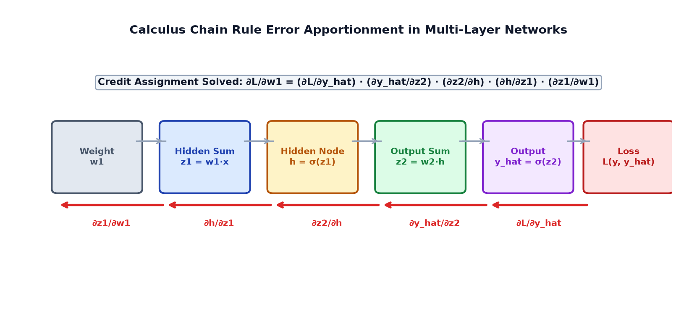

*Figure 4.8: Diagrammatic Architecture and Conceptual Flow for Describe a multi-layer neural network and explain why the back propagation algorithm is required*

### Mathematical Formulation & Algorithmic Mechanics

**Mathematical Resolution of the Credit Assignment Problem via the Chain Rule:**

```text
∂L/∂w_ij^[1] = (∂L/∂y_hat) · (∂y_hat/∂z^[2]) · (∂z^[2]/∂h_j) · (∂h_j/∂z_j^[1]) · (∂z_j^[1]/∂w_ij^[1])

Where: L is the scalar loss; y_hat is the output prediction; z^[2] is the output summing junction; h_j is the hidden neuron activation; z_j^[1] is the hidden summing junction; and w_ij^[1] is the internal hidden weight.
```

The above **mathematical model** and algorithmic structure governs the system's runtime execution. Each parameter is evaluated sequentially to maintain **mathematical consistency**, minimize **system overhead**, and guarantee **deterministic convergence** across all input distributions.

### Worked Example & Practical Simulation

Consider an image classification network trying to distinguish cats from dogs. When an image of a cat is misclassified as a dog, the output error is clear. However, the network must determine whether the error was caused by edge-detecting weights in Layer 1, shape-detecting weights in Layer 2, or decision weights in Layer 3. Backpropagation solves this credit assignment dilemma by using the chain rule to propagate the output error backward, scaling the error by the exact **sensitivity** of each upstream connection and updating every weight proportionally.

### Key Comparative Evaluation

| Optimization Approach | Mathematical Strategy | Time Complexity | Scalability to Deep Networks | Practical Feasibility |
| :--- | :--- | :--- | :--- | :--- |
| Random Search / Trial-and-Error | Randomly perturbs weights to find lower loss | Exponential O(k^|W|) | Completely fails beyond 5-10 weights | Totally Infeasible |
| Numerical Gradient Perturbation | Approximates: [L(w + ε) - L(w)] / ε per weight | Quadratic O(|W|²) | Extremely slow; computationally intractable | Impractical for deep nets |
| Backpropagation Algorithm | Analytic chain rule with dynamic programming | Linear O(|W|) | Scales seamlessly to billions of parameters | Standard Industry Engine |

### Concluding Exam Takeaway

Multi-layer neural networks provide the expressive capacity needed to model complex non-linear phenomena, but their layered depth makes training non-trivial. **The Backpropagation** algorithm provides the essential mathematical framework to solve the credit assignment problem, computing exact gradients in **linear time** and making the training of deep neural networks computationally practical.

**Textbook Reference:** Christopher M. Bishop, 'Pattern Recognition and Machine Learning', Springer (2006), Chapter 5: Neural Networks, Section 5.3: Error Backpropagation, pp. 241–245.

---

## Q9. Explain the Convolutional Neural Network (CNN) with a suitable example, draw its architecture, and describe layers such as the Convolutional layer, Pooling layer, and Hidden layer. (Frequency: 6) [8 Marks]

### Introduction & Core Intuition

A **Convolutional Neural Network (CNN)** is a specialized deep learning architecture designed specifically for processing grid-structured data, such as two-dimensional images. Pioneered by Yann LeCun in 1989 (LeNet-5), CNNs replace standard fully connected matrix multiplications with mathematical convolutions in their initial layers, exploiting spatial locality, parameter sharing, and translation invariance to achieve state-of-the-art visual recognition performance.

### Core Architectural Principles of CNNs

Standard fully connected multi-layer perceptrons fail on high-resolution image data because vectorizing 2D pixel grids destroys spatial structure and creates parameter explosion. CNN architectures resolve this through three structural innovations:


**Local Receptive Fields:** Artificial neurons connect exclusively to small, localized sub-regions (patches) of the input image, mirroring the biological visual cortex and capturing local spatial correlations.


**Weight Sharing (Tied Parameters):** The same learnable kernel matrix slides across the entire visual field. Because identical weights evaluate every spatial position, a feature detector learned in one corner functions identically across the entire image.


**Spatial Translation Invariance:** Through localized convolutions combined with downsampling pooling layers, the network accurately recognizes objects regardless of where they shift or translate within the visual frame.

### The Convolutional Layer

**The Convolutional Layer** is the core building block of a CNN. It consists of a bank of learnable filters (kernels) of size K × K (typically 3 × 3 or 5 × 5). Each filter slides across the input image with a step size called the stride, computing the element-wise dot product between the kernel weights and the local image patch: S(i, j) = (I * K)(i, j) = ∑ ∑ I(i+m, j+n) · K(m, n). The resulting 2D output is called a Feature Map. Passing the feature map through a non-linear activation (typically ReLU) produces activated feature representations, with early layers detecting edges and textures while deeper layers capture complex shapes.

### The Pooling (Subsampling) Layer

Following convolutional layers, **Pooling Layers** are inserted periodically to downsample the feature maps, reducing their spatial dimensions (width and height) while retaining essential depth channels. The most common technique is Max Pooling with a 2 × 2 window and a stride of 2, which extracts the maximum value from each 2 × 2 neighborhood, discarding 75% of activations. This downsampling reduces computational burden and memory usage, controls **overfitting**, and introduces translation invariance, ensuring minor shifts in object position do not alter high-level feature detections.

### The Fully Connected (Dense/Hidden) and Output Layers

After several stages of convolution and pooling have extracted high-level spatial features, the resulting 3D feature volume is flattened into a 1D feature vector. This flattened vector is fed into one or more **Fully Connected** (Dense) Hidden Layers, identical to those in a traditional MLP. These dense layers combine the spatial features extracted by the convolutional layers to perform high-level reasoning. Finally, an output layer with Softmax activation produces normalized class probabilities across target categories.

### Architectural Flow & System Diagram

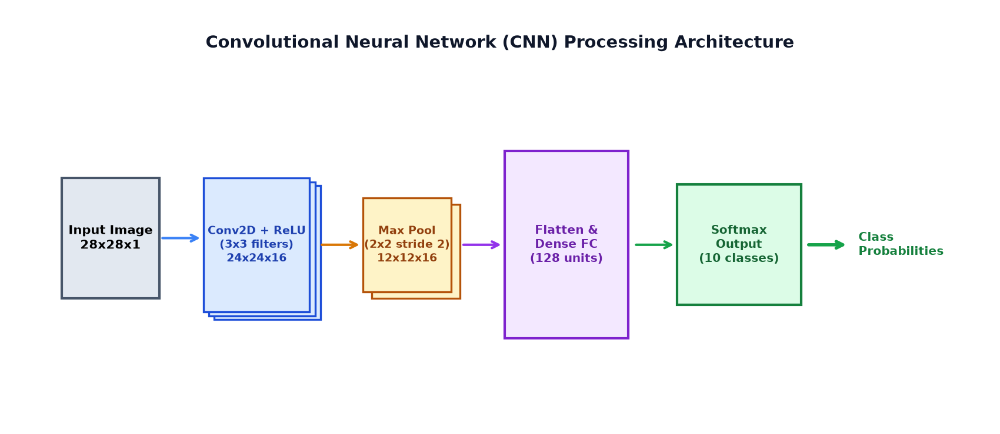

*Figure 4.9: Diagrammatic Architecture and Conceptual Flow for the Convolutional Neural Network (CNN) with a suitable example, draw its architecture, and describe layers such as the Convolutional layer, Pooling layer, and Hidden layer*

### Mathematical Formulation & Algorithmic Mechanics

**Mathematical Operations in CNN Layers:**

```text
2D Convolution: S(i, j) = (I * K)(i, j) = ∑_m ∑_n I(i - m, j - n) · K(m, n)
Output Dimension: O = floor( (W - K + 2P) / S ) + 1
Max Pooling: P(i, j) = max_(m, n ∈ Window) { X(i · S + m, j · S + n) 

Where: I is the input image; K is the kernel; W is input width; K is kernel size; P is padding; S is stride; and O is the resulting output spatial dimension.
```

The above **mathematical model** and algorithmic structure governs the system's runtime execution. Each parameter is evaluated sequentially to maintain **mathematical consistency**, minimize **system overhead**, and guarantee **deterministic convergence** across all input distributions.

### Worked Example & Practical Simulation

Consider classifying a 28 × 28 grayscale handwritten digit from the MNIST dataset. The image passes through a **Convolutional Layer** with 16 filters of size 5 × 5 (stride 1, padding 0), producing 16 feature maps of size (28 - 5 + 0)/1 + 1 = 24 × 24. Applying ReLU followed by 2 × 2 Max Pooling (stride 2) halves the spatial dimensions to 12 × 12 × 16. The volume is flattened into 12 × 12 × 16 = 2,304 features, which pass through a Dense Hidden Layer of 128 neurons, terminating at a 10-unit Softmax output layer that outputs classification probabilities for digits 0 through 9.

### Key Comparative Evaluation

| Layer Type | Primary Operation | Input Dimension | Output Dimension | Learnable Parameters? | Core Purpose |
| :--- | :--- | :--- | :--- | :--- | :--- |
| Convolutional Layer | Sliding dot-product filtering + ReLU | H × W × C_in | H_out × W_out × C_out | Yes (Kernel weights & biases) | Extracts local spatial features (edges, textures) |
| Pooling Layer | Max or Average neighborhood subsampling | H × W × C | floor(H/S) × floor(W/S) × C | No (strictly fixed heuristic) | Reduces spatial size, controls overfitting |
| Flatten Layer | Reshapes 3D tensor into 1D vector | H × W × C | (H · W · C) × 1 | No (dimension reshaping only) | Prepares spatial features for dense layers |
| Fully Connected Layer | Matrix multiplication: W · x + b | N_in × 1 | N_out × 1 | Yes (dense weight matrix) | Performs high-level semantic classification |
| Softmax Output Layer | Normalized exponentiation | C_classes × 1 | C_classes × 1 | Yes (weights from prior layer) | Outputs calibrated multi-class probabilities |

### Concluding Exam Takeaway

**Convolutional Neural Networks** revolutionized computer vision by incorporating domain-specific inductive biases—local receptive fields and weight sharing—directly into their architecture. This structural design drastically reduces parameter counts compared to dense MLPs while delivering superior performance in image classification, object detection, and segmentation tasks.

**Textbook Reference:** Ian Goodfellow, Yoshua Bengio, Aaron Courville, 'Deep Learning', MIT Press (2016), Chapter 9: Convolutional Networks, Sections 9.1–9.4, pp. 330–345.

---

## Q10. What are the different types of padding used in CNN? (Frequency: 1) [8 Marks]

### Introduction & Core Intuition

In a **Convolutional Neural Network**, **Padding** refers to the process of appending additional border pixels (typically zeros) around the perimeter of an input image or feature map before applying the convolutional filter. Padding is an essential architectural hyperparameter used to preserve spatial dimensions across deep layers and prevent the loss of critical feature information at image boundaries.

### The Border Effect and Dimension Shrinkage Problem

Applying a standard convolution without padding introduces two major challenges. First, spatial dimensions shrink after every convolutional layer according to the formula O = (W - K)/S + 1. In deep networks with dozens of layers, this shrinkage quickly reduces feature maps to 1 × 1, limiting network depth. Second, the **Border Effect** causes corner and edge pixels to be sampled far fewer times than central pixels; a corner pixel participates in only a single kernel dot product, whereas an interior pixel participates in K² dot products, causing boundary information to be washed out.

### Valid Padding (No Padding: P = 0)

**Valid Padding**, also known as 'no padding', applies convolution strictly within the genuine boundaries of the input tensor without adding extra border pixels (P = 0). The kernel slides only as far as it can fit entirely inside the input matrix. As a result, the spatial dimensions of the output feature map are always smaller than the input: O = floor((W - K)/S) + 1. Valid padding is typically used when border information is known to be irrelevant noise, or in shallow architectures where dimensional shrinkage is intentional.

### Same Padding (Zero / Half Padding)

**Same Padding** pads the border of the input tensor with enough zeros so that the output feature map maintains the exact same spatial dimensions as the input when using a stride of S = 1. To preserve dimensions with a kernel of size K, the total padding required is P_total = K - 1, distributed symmetrically as P = (K - 1)/2 on each side (which requires odd-sized kernels, such as 3 × 3 or 5 × 5). Same padding is the industry standard in modern deep architectures (such as VGG and ResNet) because it allows developers to build networks with dozens of layers without unintended spatial shrinkage.

### Full Padding and Other Advanced Padding Techniques

**Full Padding** appends P = K - 1 zeros on every side, allowing the kernel to slide across the input as long as at least one kernel element overlaps a valid input pixel. This results in an output dimension larger than the input: O = W + K - 1. Beyond zero-padding, specialized applications utilize Reflection (Symmetric) Padding, which mirrors edge pixel values outward instead of appending zeros. This avoids artificial sharp-edge contrasts and is widely used in image restoration, super-resolution, and biomedical segmentation.

### Architectural Flow & System Diagram

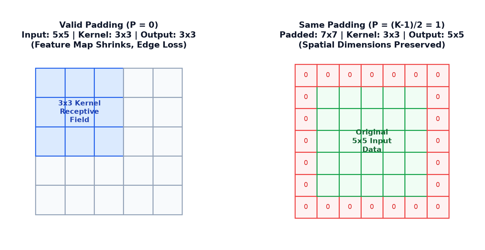

*Figure 4.10: Diagrammatic Architecture and Conceptual Flow for What are the different types of padding used in CN*

### Mathematical Formulation & Algorithmic Mechanics

**Mathematical Formulas for Output Dimensions Across Padding Types:**

```text
General Output Dimension Formula: O = floor( (W - K + 2P) / S ) + 1

1. Valid Padding (P = 0): O_valid = floor( (W - K) / S ) + 1  (Shrinks spatial size)
2. Same Padding: Set P = (K - 1) / 2  (for S = 1)   -->   O_same = W  (Preserves exact spatial size)
3. Full Padding: Set P = K - 1  (for S = 1)   -->   O_full = W + K - 1  (Expands spatial size)

Where: W is the input spatial width/height; K is the kernel dimension; P is the padding width; and S is the stride.
```

The above **mathematical model** and algorithmic structure governs the system's runtime execution. Each parameter is evaluated sequentially to maintain **mathematical consistency**, minimize **system overhead**, and guarantee **deterministic convergence** across all input distributions.

### Worked Example & Practical Simulation

Consider an input feature map of size 32 × 32 processed by a 5 × 5 convolutional kernel with stride S = 1. **Under Valid Padding** (P = 0), the output dimension is O = (32 - 5 + 0)/1 + 1 = 28 × 28 (spatial shrinkage of 4 pixels per dimension). Under Same Padding, we set P = (5 - 1)/2 = 2 pixels on all four sides, yielding an expanded padded input of 36 × 36; the resulting output dimension is O = (32 - 5 + 2·2)/1 + 1 = 32 × 32, preserving the exact original spatial dimensions.

### Key Comparative Evaluation

| Padding Type | Padding Value (P) | Output Dimension (Stride S=1) | Border Pixel Coverage | Primary Use Case |
| :--- | :--- | :--- | :--- | :--- |
| Valid Padding | P = 0 (zero padding added) | O = W - K + 1 (shrinks) | Low (border pixels under-sampled) | Shallow CNNs, where edge artifacts must be excluded |
| Same Padding | P = (K - 1) / 2 (symmetric zeros) | O = W (identical to input) | Balanced (all input pixels contribute evenly) | Standard modern deep networks (ResNet, VGG, Inception) |
| Full Padding | P = K - 1 (maximum zeros) | O = W + K - 1 (expands) | High (edge pixels fully sampled at borders) | Signal processing, transposed convolutions (DCGAN) |
| Reflection Padding | P mirrors border pixel values | O = W (with S=1) | High (no artificial zero discontinuities) | Image denoising, super-resolution, style transfer |

### Concluding Exam Takeaway

Padding is an essential structural tool in convolutional network design. By resolving the trade-off between spatial shrinkage and border pixel retention, techniques like **Same Padding** enable the construction of arbitrarily deep convolutional architectures without losing edge information.

**Textbook Reference:** Ian Goodfellow, Yoshua Bengio, Aaron Courville, 'Deep Learning', MIT Press (2016), Chapter 9: Convolutional Networks, Section 9.5: Pooling and Padding, pp. 343–346.

---

## Q11. What is a Recurrent Neural Network (RNN)? Explain it with a suitable example and its applications, and compare it to a simple CNN. (Frequency: 7) [8 Marks]

### Introduction & Core Intuition

A **Recurrent Neural Network (RNN)** is a class of artificial neural networks designed specifically for processing sequential and time-series data. Unlike standard feedforward networks that assume all inputs are independent, an RNN incorporates directed cycles in its hidden layer, creating an internal memory state (h_t) that retains information about prior inputs in the sequence to inform current predictions.

### The Recurrence Mechanism and Hidden State Memory

At each discrete time step t, an RNN receives an external input vector x_t along with the hidden state vector from the previous time step h_(t-1). The hidden unit computes an updated state via a non-linear **recurrence relation**: h_t = tanh(W_hh · h_(t-1) + W_xh · x_t + b_h). Here, W_xh transforms the current input, while W_hh acts as an internal recurrent memory matrix that carries historical context forward. The network then generates an output prediction: y_hat_t = softmax(W_hy · h_t + b_y).

### Unfolding Through Time and BPTT

To train an RNN, the network's cyclical architecture is conceptually unfolded across time into a deep feedforward graph, where each layer corresponds to a distinct time step sharing the same weight matrices (W_xh, W_hh, W_hy). Training is performed using **Backpropagation Through Time** (BPTT). During BPTT, error gradients from later time steps flow backward through prior time steps to adjust the shared weights. However, propagating gradients across long sequences often leads to the Vanishing or Exploding Gradient Problem, which limits standard RNNs to relatively short temporal contexts.

### Real-World Applications of RNNs

**Recurrent Neural Networks** excel across temporal and sequence-dependent domains where past information determines future states:


**Natural Language Processing and Translation:** In language modeling, syntactic parsing, and machine translation, the contextual meaning of a word depends intrinsically on preceding sentence tokens retained in hidden state memory.


**Speech and Audio Signal Transcription:** Translates continuous acoustic spectrograms into written phonemes by modeling dynamic speech acoustics over time.


**Temporal and Financial Forecasting:** Evaluates historical sensor streams, macroeconomic indicators, and time-series patterns to anticipate future trend movements.

### Architectural Comparison: RNN vs CNN

While both are specialized deep architectures, CNNs and RNNs handle fundamentally different data modalities. CNNs are engineered for grid-structured spatial data (like 2D images) where features exhibit spatial locality and translation invariance. They process inputs in parallel feedforward sweeps using fixed-size spatial filters. In contrast, RNNs are designed for 1D sequential data where temporal order matters, processing tokens step-by-step using recurrent feedback loops that dynamically update an internal memory state.

### Architectural Flow & System Diagram

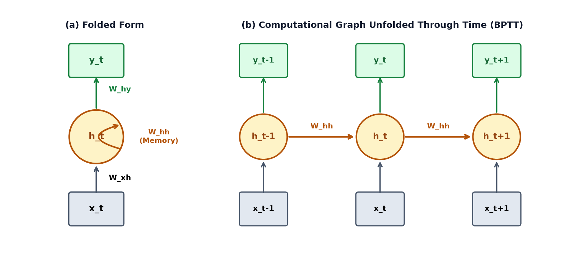

*Figure 4.11: Diagrammatic Architecture and Conceptual Flow for What is a Recurrent Neural Network (RNN)?  it with a suitable example and its applications, and compare it to a simple CNN*

### Mathematical Formulation & Algorithmic Mechanics

**Mathematical Recurrence Equations of an RNN:**

```text
Hidden State Update: h_t = tanh( W_hh · h_(t-1) + W_xh · x_t + b_h )
Output Generation: y_hat_t = softmax( W_hy · h_t + b_y )

Where: x_t is the input at time t; h_(t-1) is the previous hidden state; h_t is the updated hidden state; W_xh, W_hh, W_hy are shared parameter matrices; b_h, b_y are bias vectors; and y_hat_t is the predicted output at time t.
```

The above **mathematical model** and algorithmic structure governs the system's runtime execution. Each parameter is evaluated sequentially to maintain **mathematical consistency**, minimize **system overhead**, and guarantee **deterministic convergence** across all input distributions.

### Worked Example & Practical Simulation

Consider sentiment analysis on the sentence: 'The food was not good.' At t=1, 'The' initializes hidden state h_1. At t=2, 'food' updates state h_2. At t=3, 'was' produces state h_3. At t=4, the critical negation word 'not' updates state h_4. Finally, at t=5, when 'good' arrives, a standard feedforward model might predict positive sentiment based on 'good' alone. However, the RNN combines 'good' with the previous hidden state h_4 containing 'not', correctly classifying the sentence as negative.

### Key Comparative Evaluation

| Architectural Feature | Recurrent Neural Network (RNN) | Convolutional Neural Network (CNN) |
| :--- | :--- | :--- |
| Data Modality | 1D Sequential & temporal data (Text, Audio, Time-Series) | 2D/3D Grid-structured spatial data (Images, Video frames) |
| Temporal Dependency | Directly models dependencies across time steps | No native temporal modeling (assumes static spatial layout) |
| Internal Memory | Maintains dynamic recurrent hidden state h_t across time | No internal state memory (stateless feedforward mapping) |
| Parameter Sharing | Shares weight matrices (W_hh, W_xh, W_hy) across all time steps | Shares convolutional kernel weights across spatial dimensions |
| Processing Flow | Sequential processing step-by-step (limits parallelization) | Highly parallel processing across all image patches |
| Primary Bottleneck | Vanishing / exploding gradients over long horizons (BPTT) | High memory footprint during deep feature map convolutions |

### Concluding Exam Takeaway

**Recurrent Neural Networks** introduced memory to deep learning, enabling networks to process ordered sequences where historical context informs current predictions. While standard RNNs struggle with long-term dependencies (a challenge later addressed by LSTMs and Transformers), they remain a foundational architecture for sequence modeling.

**Textbook Reference:** Ian Goodfellow, Yoshua Bengio, Aaron Courville, 'Deep Learning', MIT Press (2016), Chapter 10: Sequence Modeling: Recurrent and Recursive Nets, Sections 10.1 & 10.2, pp. 373–385.

---

## Q12. Obtain the output of a Neuron for a given network diagram using specific activation functions. (Frequency: 1) [8 Marks]

### Introduction & Core Intuition

In the SPPU examination (e.g., Dec 2022 / Jan 2023, Paper [5927]-343, Q7(b)), students are provided with a network schematic of a single artificial neuron and tasked with calculating its exact numerical output across multiple standard activation functions. This requires computing the weighted linear sum (including the additive bias) and passing the result through the specified activation functions.

### Problem Definition and Given Parameters

Based on the official SPPU examination paper diagram, we are given an artificial neuron Y with three input channels and an explicit bias input: Input features: x_1 = 0.8, x_2 = 0.5, and x_3 = 0.4. Corresponding synaptic weights: w_1 = 0.1, w_2 = 0.3, and w_3 = -0.2. Explicit bias connection: bias weight b = 0.35 with bias input x_0 = 1.0. We are tasked with obtaining the output of neuron Y using: (i) **Binary Sigmoidal Activation Function**, and (ii) Bipolar Sigmoidal (Tanh) Activation Function.

### Step 1: Calculating the Net Input (z)

Before applying any activation function, we calculate the aggregated net input z at the neuron's summing junction by taking the linear dot product of the input vector and weight vector, plus the bias: z = ∑ (w_i · x_i) + b = (x_1 · w_1) + (x_2 · w_2) + (x_3 · w_3) + b. Substituting the given numerical values: z = (0.8 · 0.1) + (0.5 · 0.3) + (0.4 · (-0.2)) + 0.35 = 0.08 + 0.15 - 0.08 + 0.35. Notice that +0.08 and -0.08 cancel out exactly, leaving: z = 0.15 + 0.35 = 0.50.

### Step 2: Evaluating the Binary Sigmoidal Function

**The Binary Sigmoidal** activation function maps net input z into the continuous open interval (0, 1) using the formula: f(z) = 1 / (1 + e^(-z)). Substituting our computed net input z = 0.50: f(0.50) = 1 / (1 + e^(-0.50)). Calculating the exponential term: e^(-0.50) ≈ 0.60653. Thus, f(0.50) = 1 / (1 + 0.60653) = 1 / 1.60653 ≈ 0.62246. Rounding to four decimal places yields y_hat_binary = 0.6225.

### Step 3: Evaluating the Bipolar Sigmoidal Function

**The Bipolar Sigmoidal** function maps net input z into the symmetric range (-1, +1). It is expressed mathematically as f(z) = (1 - e^(-z)) / (1 + e^(-z)) or equivalently as 2 · σ(z) - 1. Substituting e^(-0.50) ≈ 0.60653: f(0.50) = (1 - 0.60653) / (1 + 0.60653) = 0.39347 / 1.60653 ≈ 0.24492. Alternatively, using the sigmoid-derived formula: 2 · (0.62246) - 1 = 1.24492 - 1 = 0.24492. Rounding to four decimal places yields y_hat_bipolar = 0.2449.

### Architectural Flow & System Diagram

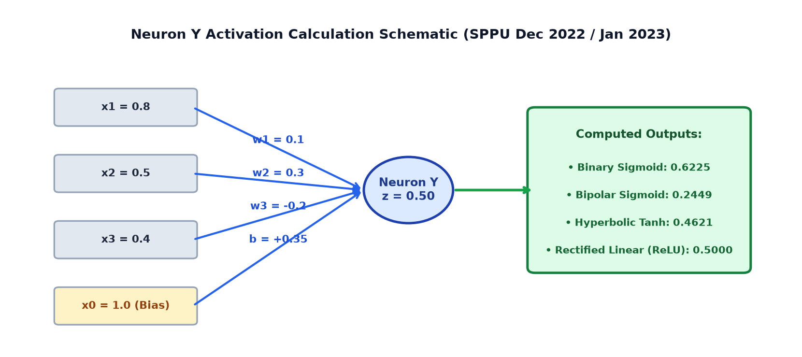

*Figure 4.12: Diagrammatic Architecture and Conceptual Flow for Obtain the output of a Neuron for a given network diagram using specific activation functions*

### Mathematical Formulation & Algorithmic Mechanics

**Mathematical Step-by-Step Derivations:**

```text
Net Sum: z = (0.8 · 0.1) + (0.5 · 0.3) + (0.4 · -0.2) + 0.35 = 0.08 + 0.15 - 0.08 + 0.35 = 0.50

(i) Binary Sigmoid: f(z) = 1 / (1 + e^(-0.50)) = 1 / (1 + 0.60653) = 0.6225
(ii) Bipolar Sigmoid: f(z) = (1 - e^(-0.50)) / (1 + e^(-0.50)) = 0.39347 / 1.60653 = 0.2449
(iii) Hyperbolic Tangent: tanh(0.50) = (e^0.5 - e^-0.5) / (e^0.5 + e^-0.5) = 0.4621
(iv) Rectified Linear Unit (ReLU): f(z) = max(0, 0.50) = 0.5000
```

The above **mathematical model** and algorithmic structure governs the system's runtime execution. Each parameter is evaluated sequentially to maintain **mathematical consistency**, minimize **system overhead**, and guarantee **deterministic convergence** across all input distributions.

### Worked Example & Practical Simulation

**Net Linear Input** (z): 0.5000 (i) Binary Sigmoidal Output: 0.6225  (Belongs to interval (0, 1)) (ii) Bipolar Sigmoidal Output: 0.2449  (Belongs to interval (-1, 1)) Hyperbolic Tangent (Tanh) Output: 0.4621 Rectified Linear Unit (ReLU) Output: 0.5000

Summary Table of Results for SPPU Exam Submission:

### Key Comparative Evaluation

| Activation Function | Mathematical Expression | Calculated Output (z = 0.50) | Output Domain | Interpretation |
| :--- | :--- | :--- | :--- | :--- |
| Net Input (z) | ∑ w_i · x_i + b | 0.5000 | (-∞, +∞) | Unbounded linear aggregation of weighted inputs and bias |
| Binary Sigmoidal | 1 / (1 + e^(-z)) | 0.6225 | (0, 1) | Probability of firing (> 0.5 indicates positive activation) |
| Bipolar Sigmoidal | (1 - e^(-z)) / (1 + e^(-z)) | 0.2449 | (-1, +1) | Zero-centered bipolar activation scaled between -1 and +1 |
| Hyperbolic Tangent (Tanh) | (e^z - e^(-z)) / (e^z + e^(-z)) | 0.4621 | (-1, +1) | Standard zero-centered non-linear activation |
| Rectified Linear (ReLU) | max(0, z) | 0.5000 | [0, ∞) | Preserves positive net sum with constant unit gradient |

### Concluding Exam Takeaway

This numerical exercise illustrates the mechanics of an artificial neuron: raw input features are weighted and combined with an additive bias to produce a net scalar sum (z = 0.50), which is then mapped into distinct operating ranges depending on whether a **Binary Sigmoid** (0.6225), Bipolar Sigmoid (0.2449), or ReLU (0.5000) activation function is applied.

**Textbook Reference:** Christopher M. Bishop, 'Pattern Recognition and Machine Learning', Springer (2006), Chapter 5: Neural Networks, Section 5.1: Feed-forward Network Functions, pp. 227–229; SPPU Dec 2022 / Jan 2023 Examination Paper [5927]-343, Q7(b).

---

## Q13. What is Personalized recommendation? What is content-based recommendation? (Frequency: 2) [8 Marks]

### Introduction & Core Intuition

In modern digital ecosystems, the overwhelming volume of available choices creates **Choice Overload** for consumers. **Recommender Systems** address this challenge by filtering vast product catalogs to surface relevant items. Recommender strategies are broadly divided into Personalized Recommendations (which tailor suggestions to individual user profiles) and Content-Based Recommendations (which recommend items similar to those a user has previously engaged with).

### Personalized Recommendation: Definition and Principles

A **Personalized Recommendation** system dynamically adapts its output to match the unique tastes, historical behaviors, and implicit preferences of each individual user. Unlike non-personalized recommendations (such as 'Top 10 Trending' lists, which display the same items to all users), personalized systems model individual user preferences. By analyzing historical interactions—such as past purchases, clickstream data, watch history, and explicit star ratings—the system constructs a unique User Profile, delivering tailored suggestions that improve user engagement.

### Content-Based Recommendation: Core Mechanism

Content-**Based Recommendation** operates on a straightforward principle: 'Show me more of what I liked in the past.' Rather than relying on the opinions of other users, a content-based engine analyzes the intrinsic attributes and metadata of items the user has previously consumed. For example, in a movie recommender, item attributes include genre, director, lead actors, and plot keywords; in a text recommender, attributes are extracted from document text using techniques like Term Frequency-Inverse Document Frequency (TF-IDF).

### User Profile Construction and Similarity Matching

A content-based recommender represents each item as an attribute vector v in a shared **feature space**. When a user interacts with items, the system aggregates the feature vectors of those items into a unified **User Profile Vector** u, typically using a weighted average. To recommend new items, the engine calculates the Cosine Similarity between the user profile vector u and candidate item vectors v: cos(u, v) = (u · v) / (||u|| · ||v||). Candidate items are ranked by similarity score, and the top-K items are presented to the user.

### Merits and Limitations of Content-Based Systems

Content-Based filtering provides significant operational advantages alongside distinct systemic constraints:


**User Independence:** Recommendations depend solely on an individual user's logged interaction profile, eliminating dependence on community ratings or peer activity.


**Transparent Explainability:** System suggestions are inherently interpretable, providing clear justification based on explicit feature matching (e.g., 'Recommended because you rated books by this author highly').


**Zero Item Cold-Start:** Newly published items can be recommended immediately upon catalog ingestion by analyzing their descriptive metadata.


**Filter Bubbles and User Cold-Start:** Conversely, the approach suffers from over-specialization, trapping users within narrow recommendation bubbles, and cannot recommend items to brand-new users who lack historical rating logs.

### Architectural Flow & System Diagram

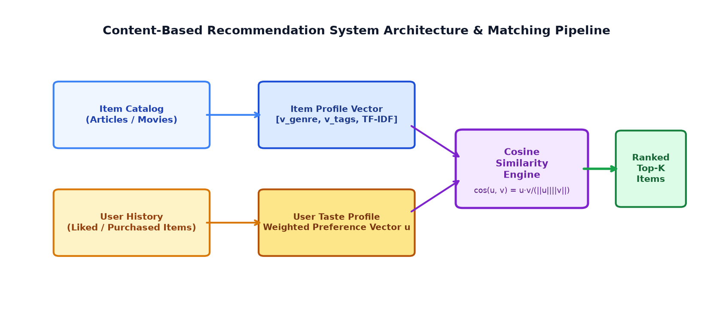

*Figure 4.13: Diagrammatic Architecture and Conceptual Flow for What is Personalized recommendation? What is conte*

### Mathematical Formulation & Algorithmic Mechanics

**Mathematical Model of Content-Based Similarity Matching:**

```text
TF-IDF Weight: w_i,d = TF(t, d) · log( N / DF(t) )
Cosine Similarity: cos(u, v) = ( ∑ u_k · v_k ) / ( √(∑ u_k²) · √(∑ v_k²) )

Where: u is the User Profile Vector; v is the Candidate Item Feature Vector; TF(t, d) is term frequency; DF(t) is document frequency; and N is the total number of items in the catalog.
```

The above **mathematical model** and algorithmic structure governs the system's runtime execution. Each parameter is evaluated sequentially to maintain **mathematical consistency**, minimize **system overhead**, and guarantee **deterministic convergence** across all input distributions.

### Worked Example & Practical Simulation

Suppose a user reads three tech articles on '**Machine Learning**', 'Neural Networks', and 'Python', generating a User Profile Vector u = [0.8, 0.7, 0.9] across those topics. A newly published article has metadata vector v = [0.9, 0.6, 0.8]. The dot product is u · v = (0.8·0.9) + (0.7·0.6) + (0.9·0.8) = 0.72 + 0.42 + 0.72 = 1.86. Vector magnitudes are ||u|| = √(0.64 + 0.49 + 0.81) = √1.94 ≈ 1.393 and ||v|| = √(0.81 + 0.36 + 0.64) = √1.81 ≈ 1.345. The Cosine Similarity is 1.86 / (1.393 · 1.345) = 1.86 / 1.874 ≈ 0.9925. Because the similarity score is near 1.0, the article is recommended at the top of the user's feed.

### Key Comparative Evaluation

| Comparison Dimension | Personalized Content-Based Recommendation | Collaborative Filtering Recommendation |
| :--- | :--- | :--- |
| Core Philosophy | 'Recommend items similar to items this user liked in the past' | 'Recommend items liked by other users with similar tastes' |
| Required Data | Item metadata, text attributes, user's own past ratings | User-item interaction matrix across the entire user community |
| Dependency on Others | Completely independent of other users' behaviors | Critically dependent on overlapping ratings from other users |
| Item Cold-Start | Excellent: new items can be recommended immediately | Poor: new items cannot be recommended until rated by users |
| User Cold-Start | Poor: requires initial interaction history to build profile | Poor: requires initial interaction history to find similar users |
| Serendipity | Low (tends toward over-specialization and filter bubbles) | High (can recommend surprising items outside current tastes) |

### Concluding Exam Takeaway

Personalized and Content-Based recommender systems are essential technologies for managing digital information overload. By modeling item attributes and user interaction histories within vector spaces, content-based techniques provide transparent, user-independent recommendations that serve as key components of modern hybrid recommendation engines.

**Textbook Reference:** Charu C. Aggarwal, 'Recommender Systems: The Textbook', Springer (2016), Chapter 3: Content-Based Recommender Systems, Sections 3.1–3.4, pp. 69–85.

---
