# SPPU B.E. Computer Engineering (2019 Pattern)
# Design and Analysis of Algorithms — Complete All-Units Solutions Guide
### Engineered for Full 8/8 Marks | All 4 Units Combined

---


================================================================================

# SPPU B.E. Computer Engineering (2019 Pattern)
## Design and Analysis of Algorithms — Unit 1: Greedy Strategy & Dynamic Programming
### Complete Examination Solutions Guide (Engineered for Full 8/8 Marks)

---

## Q1. Explain the Greedy strategy: Principle, control abstraction, and time analysis of control abstraction with a suitable example. (Frequency: 1) [8 Marks]

### Introduction & Core Intuition

The **Greedy Strategy** is an intuitive algorithmic paradigm designed to solve **optimization problems** by making the locally optimal choice at each stage with the hope that these **local choices** lead to a **globally optimal solution**. Unlike **exhaustive search** or **dynamic programming**, a greedy algorithm never reconsiders or revisits past decisions once made.

### Core Principle of the Greedy Strategy

At each **sequential step** of execution, a greedy algorithm evaluates a finite set of candidates and selects the candidate that appears best according to a pre-defined **local heuristic metric**. Once a candidate is selected, it is immediately tested for **feasibility** to ensure that including it does not violate any **problem constraints**. If the choice is feasible, it is irrevocably added to the **partial solution set**; if **infeasible**, it is **discarded permanently** and never evaluated again.

### Control Abstraction Architecture

A **Control Abstraction** is a high-level pseudocode template that outlines the flow of control of an algorithmic design strategy without binding to the specifics of any individual problem. For the greedy method, the **control abstraction** accepts an array of n candidates and initializes an empty **solution set**. It iteratively extracts candidate elements one by one, verifying whether the enlarged set remains valid according to **problem constraints**.

### Time Complexity Analysis of Control Abstraction

The total runtime of the greedy **control abstraction** depends fundamentally on two major phases: candidate preprocessing and the iterative selection loop. If the candidates require an initial sorting step based on profitability or weight, that sorting consumes O(n log n) time. The subsequent loop executes at most n iterations. In each iteration, selecting the best element takes O(1) time if pre-sorted or O(log n) time using a **priority queue**. Evaluating **feasibility** typically takes O(1) or O(d) time depending on constraint checks. Consequently, standard greedy algorithms exhibit an overall **time complexity** of O(n log n) or O(n), making them exceptionally efficient in practice.

### Key Properties Required for Greedy Optimality

A problem can be solved to global optimality by the **greedy strategy** if and only if it satisfies two essential theoretical properties: the **Greedy Choice Property** and **Optimal Substructure**. The **Greedy Choice Property** dictates that a **globally optimal solution** can be assembled through successive local greedy choices without requiring backtracking. **Optimal Substructure** means that an optimal solution to the overall problem contains within it optimal solutions to all its **subproblems**.

### Practical Real-World Application Example

A classic real-world demonstration of the **greedy strategy** is the **Coin Change problem** for standard **canonical currency denominations** (such as Indian Rupees: 1, 2, 5, 10, 20, 50, 100, 500). To make change for an amount such as 88 Rupees, the greedy strategy repeatedly picks the largest denomination that does not exceed the remaining balance: first 50, leaving 38; then 20, leaving 18; then 10, leaving 8; then 5, leaving 3; then 2, leaving 1; and finally 1, producing an optimal 6-coin combination with minimal **computational effort**.

### Architectural Flow & System Diagram

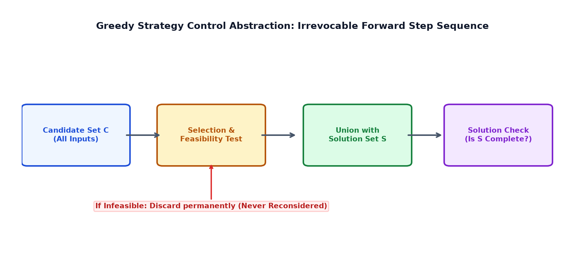

*Figure 1.1: Diagrammatic Architecture and Conceptual Flow for the Greedy strategy: Principle, control abstraction, and time analysis of control abstraction with a suitable example*

### Mathematical Formulation & Algorithmic Mechanics

**Algorithmic Control Abstraction for Greedy Strategy:**

```text
Algorithm Greedy(a, n):
    // a[1..n] contains the candidate inputs; returns solution set S
    S = empty_set
    for i = 1 to n do:
        x = Select(a)
        if Feasible(S, x) then:
            S = S U {x
    return S
```

The above **mathematical model** and algorithmic structure governs the system's runtime execution. Each parameter is evaluated sequentially to maintain **mathematical consistency**, minimize **system overhead**, and guarantee **deterministic convergence** across all input distributions.

### Worked Example & Practical Simulation

Trace for Coin Change with Denominations {50, 20, 10, 5, 2, 1} and **Target Amount** = 88:

In **Step 1**, the execution evaluates the parameters and selects Select 50 (Remaining: 38) -> Feasible -> S = {50}. In **Step 2**, the execution evaluates the parameters and selects Select 20 (Remaining: 18) -> Feasible -> S = {50, 20}. In **Step 3**, the execution evaluates the parameters and selects Select 10 (Remaining: 8)  -> Feasible -> S = {50, 20, 10}. In **Step 4**, the execution evaluates the parameters and selects Select 5  (Remaining: 3)  -> Feasible -> S = {50, 20, 10, 5}. In **Step 5**, the execution evaluates the parameters and selects Select 2  (Remaining: 1)  -> Feasible -> S = {50, 20, 10, 5, 2}. In **Step 6**, the execution evaluates the parameters and selects Select 1  (Remaining: 0)  -> Feasible -> S = {50, 20, 10, 5, 2, 1} (Total 6 Coins)..

### Key Comparative Evaluation

| Feature / Dimension | Greedy Algorithmic Strategy | Exhaustive / Brute-Force Strategy |
| :--- | :--- | :--- |
| Decision Making | Irrevocable local choice at each step; zero reconsideration | Explores all possible candidate combinations systematically |
| Time Complexity | Fast, typically O(n log n) or O(n) | Exponential, typically O(2^n) or O(n!) |
| Optimality Guarantee | Guaranteed only if Greedy-Choice Property holds | Always finds the optimal solution if sufficient time allows |
| State Memory | O(1) auxiliary state; maintains single growing solution | Requires storing combinatorially large search frontiers |
| Typical SPPU Uses | Kruskal's, Prim's, Dijkstra's, Huffman Coding, Fractional Knapsack | Traveling Salesperson, Subset Generation, Permutation Search |

### Concluding Exam Takeaway

The **Greedy strategy** delivers lightning-fast polynomial solutions for **optimization problems** that possess matroid structures or satisfy the **greedy choice property**, making it one of the most efficient techniques in computer science.

**Textbook Reference:** Design and Analysis of Algorithms by Parag H. Dave & Himanshu B. Dave (Pearson), Chapter 8: The Greedy Method, Sections 8.1–8.3, Pages 285–294.

---

## Q2. Write a control abstraction for the greedy method and comment on its time complexity. (Frequency: 1) [8 Marks]

### Introduction & Core Intuition

In theoretical algorithm design, a **Control Abstraction** serves as a generalized procedural template that captures the core structural logic and decision control flow of an algorithmic family while remaining independent of specific problem domains. Writing a formal **control abstraction** allows computer scientists to analyze computational complexity and prove universal correctness properties.

### Structural Composition of Greedy Control Abstraction

The greedy **control abstraction** is formulated around four core primitive subroutines: Selection, **Feasibility Verification**, Union, and **Objective Evaluation**. The candidate collection C holds all raw inputs available for selection. In each cycle of the while-loop, the Select subroutine extracts the most promising element x from C according to an evaluation **heuristic**.

### Feasibility and Union Procedures

Immediately following candidate extraction, the **Feasible** subroutine performs a constraint **validation** check to determine whether adding candidate x to the existing partial solution S violates any system constraints. If the combination remains valid, the Union function merges x into S, updating the accumulated solution value. If the candidate violates **feasibility**, it is discarded irrevocably, ensuring no infinite loops occur.

### Time Complexity Decomposition of Component Subroutines

Analyzing the **time complexity** of the greedy **control abstraction** requires decomposing the cost of each individual component subroutine. Extracting n elements sequentially means the main loop runs at most n times. If candidates are pre-sorted in advance using **Merge Sort** or Heap Sort, that one-time preprocessing step consumes O(n log n) operations. Inside the loop, the Select operation on pre-sorted data takes O(1) time.

### Impact of Feasibility Checking on Complexity

The computational overhead of the **Feasible** subroutine dictates the ultimate **time complexity** of the specific greedy algorithm. In **Fractional Knapsack** or Activity Selection, Feasible simply performs a constant-time O(1) numeric comparison against remaining capacity or time. In Kruskal's Minimum Spanning Tree algorithm, Feasible checks for cycle formation, which takes O(alpha(V)) using **Disjoint Set Union-Find** structures. In Job Sequencing, simple linear slot scanning requires O(d) per job, yielding O(n * d) overall.

### Asymptotic Complexity Summary

For the vast majority of practical greedy implementations operating on n candidate items, sorting dominates the **execution profile**. Therefore, the standard asymptotic **time complexity** of greedy algorithms governed by this **control abstraction** is O(n log n). In scenarios where inputs arrive pre-sorted or can be indexed directly, the control abstraction executes in **linear time** O(n).

### Architectural Flow & System Diagram

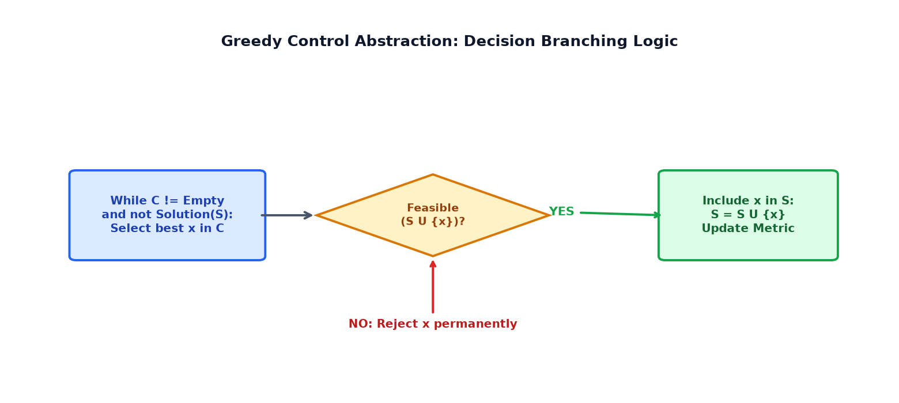

*Figure 1.2: Diagrammatic Architecture and Conceptual Flow for a control abstraction for the greedy method and comment on its time complexity*

### Mathematical Formulation & Algorithmic Mechanics

**Formal Control Abstraction Algorithm for Greedy Method:**

```text
Algorithm GreedyControlAbstraction(C, n):
    // Input: C is the set of n candidates
    // Output: S is the subset of C forming the optimal solution
    S = empty_set
    while (C != empty_set and not Solution(S)) do:
        x = Select(C)
        C = C \ {x
        if Feasible(S U {x) then:
            S = S U {x
    if Solution(S) then return S else return 'No Feasible Solution'
```

The above **mathematical model** and algorithmic structure governs the system's runtime execution. Each parameter is evaluated sequentially to maintain **mathematical consistency**, minimize **system overhead**, and guarantee **deterministic convergence** across all input distributions.

### Worked Example & Practical Simulation

**Component Cost Breakdown** in Job Sequencing for n = 4 Jobs: Preprocessing: Sorting 4 jobs by profit in descending order takes O(n log n) = O(4 log 4) ≈ 8 operations. Selection Loop: Iterates 4 times, selecting candidate jobs in order: J1, J2, J4, J3. **Feasibility** Test: Checks slot **availability** backward from min(d, max_deadline), taking O(d) steps. Total Runtime: O(n log n + n · d), demonstrating how **control abstraction** bounds overall complexity.

### Key Comparative Evaluation

| Greedy Subroutine | Functional Responsibility | Time Complexity (Standard) | Time Complexity (Optimized) |
| :--- | :--- | :--- | :--- |
| Candidate Sorting | Orders all n elements by greedy heuristic | O(n log n) via Merge Sort | O(n) via Counting Sort if bounded |
| Select(C) | Extracts the next highest-priority candidate | O(1) from sorted array | O(log n) from Binary Max-Heap |
| Feasible(S U {x}) | Validates that constraints are not violated | O(1) to O(d) depending on task | O(alpha(V)) using Disjoint Sets |
| Union(S, x) | Merges validated candidate into solution set | O(1) pointer / set update | O(1) amortized state update |
| Solution(S) | Verifies if stopping criterion has been met | O(1) capacity / size comparison | O(1) accumulator check |

### Concluding Exam Takeaway

The greedy **control abstraction** establishes a rigorous formal contract separating high-level sequential decision-making from domain-specific constraint checks, proving that greedy runtimes are fundamentally bounded by sorting and **feasibility validation**.

**Textbook Reference:** Design and Analysis of Algorithms by Parag H. Dave & Himanshu B. Dave (Pearson), Chapter 8: The Greedy Method, Section 8.2: Control Abstraction, Pages 287–289.

---

## Q3. Compare the greedy algorithmic strategy and the dynamic programming strategy. (Frequency: 2) [8 Marks]

### Introduction & Core Intuition

Both the **Greedy Algorithmic Strategy** and the **Dynamic Programming (DP) Strategy** are prominent **optimization** paradigms designed to solve complex multi-stage decision problems. However, they approach optimization from fundamentally opposite philosophical foundations: greedy commits irrevocably to **local choices**, whereas **dynamic programming** systematically evaluates and remembers all **subproblem** combinations.

### Fundamental Decision-Making Mechanism

The greedy method operates in a strictly forward-looking, single-track fashion. At every stage, it evaluates the available immediate options and chooses the one that appears most advantageous according to a local greedy criterion. Once this selection is made, the algorithm never reconsiders, revisits, or changes its decision. In contrast, **Dynamic Programming** avoids premature commitments; it solves every overlapping **subproblem** once, caches the result in a table, and combines these subproblem values to guarantee a globally optimal decision.

### Applicability Criteria: Greedy Choice vs Overlapping Subproblems

Both strategies require the underlying problem to exhibit **Optimal Substructure**, meaning that the optimal global solution contains optimal sub-solutions within it. However, the greedy method additionally demands the strict **Greedy Choice Property**, ensuring that **local choices** never trap the algorithm in dead ends. **Dynamic Programming** does not require the **greedy choice property**; instead, it requires **Overlapping Subproblems**, where the recursive decomposition generates identical sub-instances repeatedly, making memoization highly advantageous.

### Handling of Subproblem Dependencies and Backtracking

In a greedy algorithm, **subproblems** are solved top-down in an independent sequence. The choice made at the current step never depends on the solutions to future subproblems or alternative branches. **Dynamic Programming**, conversely, operates bottom-up (or top-down with memoization) and synthesizes the optimal solution by mathematically comparing multiple competing **subproblem** choices (for example, taking the maximum between including an item versus excluding it in a **0/1 knapsack**).

### Computational Efficiency and Space Overhead

Because a greedy algorithm pursues exactly one path through the decision space, its computational overhead is remarkably low. Greedy algorithms typically run in O(n log n) or O(n) time and require only O(1) auxiliary working memory beyond input storage. **Dynamic Programming** explores an entire state lattice, resulting in pseudo-polynomial or polynomial runtimes such as O(n * W) or O(n^3), and demands substantial auxiliary storage (O(n * W) or O(n^2) tables) to hold intermediate **subproblem** solutions.

### Practical Exam Guidelines for Algorithmic Selection

When confronted with an SPPU examination problem, students should inspect the **problem constraints**: if items can be divided continuously (**Fractional Knapsack**) or if the greedy choice can be mathematically proven optimal via exchange arguments (Kruskal, Prim, Dijkstra, Huffman), choose Greedy. If items are indivisible and decisions depend on cumulative resource thresholds (**0/1 Knapsack**, **Matrix Chain Multiplication**, Floyd-Warshall), **Dynamic Programming** is strictly required.

### Architectural Flow & System Diagram

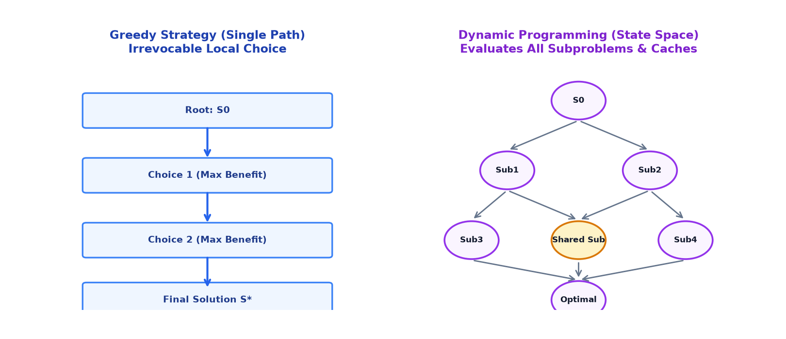

*Figure 1.3: Diagrammatic Architecture and Conceptual Flow for Compare the greedy algorithmic strategy and the dynamic programming strategy*

### Mathematical Formulation & Algorithmic Mechanics

**Mathematical Recurrence vs Greedy Step Comparison:**

```text
Greedy Decision Step: S_(k+1) = S_k U { argmax_(x in C) [ LocalHeuristic(x) ] 
Dynamic Programming Bellman Equation:
    OPT(i, w) = max{ OPT(i-1, w),  p_i + OPT(i-1, w - w_i)
```

The above **mathematical model** and algorithmic structure governs the system's runtime execution. Each parameter is evaluated sequentially to maintain **mathematical consistency**, minimize **system overhead**, and guarantee **deterministic convergence** across all input distributions.

### Worked Example & Practical Simulation

**Comparative Behavior** on Knapsack with Capacity W = 50, Items: I1(w=10, v=60), I2(w=20, v=100), I3(w=30, v=120): Greedy by Value-to-Weight Ratio: Picks I1 (ratio 6.0), then I2 (ratio 5.0). Remaining W = 20. Cannot fit I3 (w=30). Total Value = 160. **Dynamic Programming**: Evaluates combinations {I2, I3} weighing 20 + 30 = 50 kg, yielding Total Value = 100 + 120 = 220 (Optimal!). This highlights why **0/1 Knapsack** strictly requires Dynamic Programming rather than Greedy.

### Key Comparative Evaluation

| Comparative Dimension | Greedy Algorithmic Strategy | Dynamic Programming Strategy |
| :--- | :--- | :--- |
| Core Philosophy | Commits irrevocably to best local choice at each step | Considers all candidate options and caches subproblem solutions |
| Optimality Proof | Requires proving the Greedy Choice Property holds | Guaranteed globally optimal if Principle of Optimality holds |
| Subproblem Nature | Single sequence of independent decisions | Overlapping subproblems combined via recursive recurrence |
| Time Complexity | Fast polynomial: typically O(n) or O(n log n) | Higher: polynomial or pseudo-polynomial O(n^2), O(n·W), O(n^3) |
| Memory Overhead | Minimal auxiliary space, typically O(1) or O(n) | Significant memory for DP tables, typically O(n^2) or O(n·W) |
| Direction of Construction | Strictly Top-Down sequential selection | Typically Bottom-Up tabular or Top-Down memoized |
| Classic Examples | Kruskal's, Prim's, Dijkstra's, Huffman, Fractional Knapsack | 0/1 Knapsack, Matrix Chain, OBST, Bellman-Ford, Floyd-Warshall |

### Concluding Exam Takeaway

While the **Greedy strategy** provides blazing-fast near-instantaneous solutions for problems with matroid structures, **Dynamic Programming** provides the indispensable mathematical power required to resolve complex combinatorially constrained **optimization** challenges.

**Textbook Reference:** Design and Analysis of Algorithms by Parag H. Dave & Himanshu B. Dave (Pearson), Chapter 8 (Greedy Method) vs Chapter 9 (Dynamic Programming), Pages 285–291 & 335–342.

---

## Q4. What is a job scheduling algorithm, and how can it be solved using the Greedy algorithmic approach? (Includes explaining the principle, control abstraction, and time analysis with given job sequencing instances). (Frequency: 2) [8 Marks]

### Introduction & Core Intuition

In computer algorithms, **Job Sequencing with Deadlines** is an **optimization** problem where a set of n unit-time jobs must be scheduled on a single processor. Each job carries an integer deadline and a monetary profit earned if and only if the job completes on or before its designated deadline. The objective is to construct an execution schedule that maximizes total accumulated profit.

### Problem Formulation and System Constraints

We are provided with n jobs: J = {J1, J2, ..., Jn}. Each job Ji requires exactly one unit of processing time on a shared CPU and has an integer deadline di >= 1 and an associated profit pi > 0. Time is partitioned into discrete unit intervals: [0, 1], [1, 2], [2, 3], up to the maximum deadline d_max. A schedule is **feasible** if no two jobs occupy the same unit time slot and every scheduled job finishes on or before its deadline.

### The Greedy Principle for Job Scheduling

The greedy principle for job scheduling mandates that jobs yielding higher profits should be prioritized over lower-profit jobs. Therefore, all jobs are first sorted in descending order of their profit values. We iterate through this sorted list and greedily attempt to schedule each job Ji. To leave earlier time slots open for jobs with tighter deadlines, the algorithm assigns Ji to the **latest available free slot** in the range [1, di]. If all slots from 1 to di are occupied, Ji cannot be scheduled and is rejected.

### Control Abstraction for Job Sequencing

The **control abstraction** initializes an array Slot[1..d_max] filled with empty markers. It sorts the candidate jobs such that p1 >= p2 >= ... >= pn. For each job Ji, a backward scan checks Slot[k] starting at k = min(n, di) down to k = 1. If an empty slot k is discovered, Slot[k] is assigned to job Ji, the job is added to **solution set** S, and the loop advances to the next candidate job.

### Time Complexity Analysis

Sorting the n jobs by profit requires O(n log n) time using standard comparison sorts. In the greedy scheduling phase, each of the n jobs may scan up to d_max slots backward to find an open position. In the worst case where d_max is proportional to n, the slot allocation loop requires O(n * d_max) = O(n^2) operations. Consequently, the standard greedy job sequencing algorithm operates in O(n^2) time. By utilizing **Disjoint Set Union-Find** structures with path compression, this slot search time can be optimized to O(n * alpha(n)), approaching nearly O(n log n) overall.

### Mathematical Correctness via Matroids

The mathematical correctness of the greedy approach is rigorously established through **Matroid Theory**. The collection of all **feasible** job subsets forms an Independent System that satisfies the hereditary and exchange axioms of a matroid. Since any maximal independent set in a matroid has maximum weight under greedy sorting, the greedy schedule is guaranteed to achieve global maximum profit.

### Architectural Flow & System Diagram

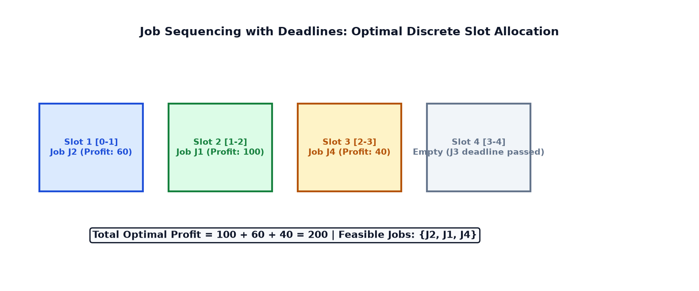

*Figure 1.4: Diagrammatic Architecture and Conceptual Flow for What is a job scheduling algorithm, and how can it be solved using the Greedy algorithmic approach? (Includes explaining the principle, control abstraction, and time analysis with given job sequencing instances)*

### Mathematical Formulation & Algorithmic Mechanics

**Greedy Job Sequencing Control Abstraction:**

```text
Algorithm JobSequencing(d, p, n):
    Sort jobs such that p[1] >= p[2] >= ... >= p[n]
    d_max = max(d[1..n])
    for t = 1 to d_max do Slot[t] = EMPTY
    for i = 1 to n do:
        for k = min(n, d[i]) down to 1 do:
            if Slot[k] == EMPTY then:
                Slot[k] = i;  break
    return Slot
```

The above **mathematical model** and algorithmic structure governs the system's runtime execution. Each parameter is evaluated sequentially to maintain **mathematical consistency**, minimize **system overhead**, and guarantee **deterministic convergence** across all input distributions.

### Worked Example & Practical Simulation

**Numerical Walkthrough** for Instance: 4 Jobs with (Profit, Deadline): J1: (p=100, d=2), J2: (p=60, d=1), J3: (p=20, d=2), J4: (p=40, d=3). Maximum deadline d_max = 3. Sorted Order: J1 (p=100), J2 (p=60), J4 (p=40), J3 (p=20). Job 1 (p=100, d=2): Inspect slot 2 -> Empty! Assign J1 to Slot [1-2]. Job 2 (p=60, d=1): Inspect slot 1 -> Empty! Assign J2 to Slot [0-1]. Job 4 (p=40, d=3): Inspect slot 3 -> Empty! Assign J4 to Slot [2-3]. Job 3 (p=20, d=2): Inspect slots 2, 1 -> Both full! J3 is rejected. Final Schedule: Slot 1: J2, Slot 2: J1, Slot 3: J4. Total Profit = 60 + 100 + 40 = 200.

### Key Comparative Evaluation

| Job ID | Profit (pi) | Deadline (di) | Slot Assigned | Scheduling Status | Cumulative Profit |
| :--- | :--- | :--- | :--- | :--- | :--- |
| J1 | 100 | 2 | Slot [1, 2] | Accepted (Scheduled at latest slot 2) | 100 |
| J2 | 60 | 1 | Slot [0, 1] | Accepted (Scheduled at slot 1) | 160 |
| J4 | 40 | 3 | Slot [2, 3] | Accepted (Scheduled at slot 3) | 200 |
| J3 | 20 | 2 | None | Rejected (Slots 1 & 2 already occupied) | 200 |

### Concluding Exam Takeaway

Greedy job sequencing solves processor scheduling with discrete deadlines optimally by coupling decreasing profit prioritization with latest-available slot placement, achieving guaranteed maximum earnings.

**Textbook Reference:** Design and Analysis of Algorithms by Parag H. Dave & Himanshu B. Dave (Pearson), Chapter 8: The Greedy Method, Section 8.4: Job Sequencing with Deadlines, Pages 295–302.

---

## Q5. Write the high-level description/steps of the job sequencing algorithm and find the feasible solutions, optimal solution, and maximum profit for a given set of jobs. (Frequency: 2) [8 Marks]

### Introduction & Core Intuition

Solving the **Job Sequencing Problem** in an SPPU examination requires demonstrating both the algorithmic step-by-step logic and the systematic mathematical evaluation of **feasible** schedules to determine the unique combination yielding maximum profit.

### High-Level Algorithmic Procedure

The job sequencing algorithm proceeds through five definite operational steps: (1) Accept the list of n jobs with their associated profits and deadlines; (2) Determine the maximum deadline d_max across all jobs to size the scheduling timeline; (3) Sort all jobs into non-increasing order of profits; (4) Initialize a timeline array of size d_max with vacant slots; and (5) Sequentially evaluate each job, inserting it into the latest unoccupied slot <= its deadline, or discarding it if no valid slot remains.

### Concept of Feasible vs Infeasible Schedules

A subset of jobs is designated as a **Feasible Solution** if there exists at least one permutation of these jobs such that every job in the subset completes on or before its designated deadline. If any job in the subset cannot find an available slot prior to its deadline, the entire subset is classified as **infeasible**. The **Optimal Solution** is defined as the **feasible** subset that produces the mathematical maximum sum of profits.

### Exhaustive Evaluation of Feasible Subsets

To rigorously prove optimality on an exam paper, students can enumerate candidate **feasible** combinations: For 4 jobs {J1, J2, J3, J4}, candidate subsets include {J1} with profit 100, {J1, J2} with profit 160, {J1, J3} with profit 120, and {J1, J2, J4} with profit 200. Subsets like {J1, J2, J3} are **infeasible** because three jobs with deadlines <= 2 cannot all complete in only two available unit time slots.

### The Latest-Slot Greedy Invariant

A critical insight of the algorithm is the **Latest-Slot Invariant**. By pushing each accepted job as far to the right (latest possible time) as its deadline allows, the algorithm leaves earlier time slots open for subsequent jobs that have tighter, earlier deadlines. This greedy **heuristic** guarantees that earlier choices do not unnecessarily block future candidates.

### Mathematical Profit Calculation

The maximum total profit is calculated as the direct sum of the profit values of all jobs assigned to the timeline: Profit_total = sum(p_i for i in S_optimal). For the standard SPPU test set {J1(100, 2), J2(60, 1), J3(20, 2), J4(40, 3)}, the maximum achievable profit is precisely 200.

### Architectural Flow & System Diagram

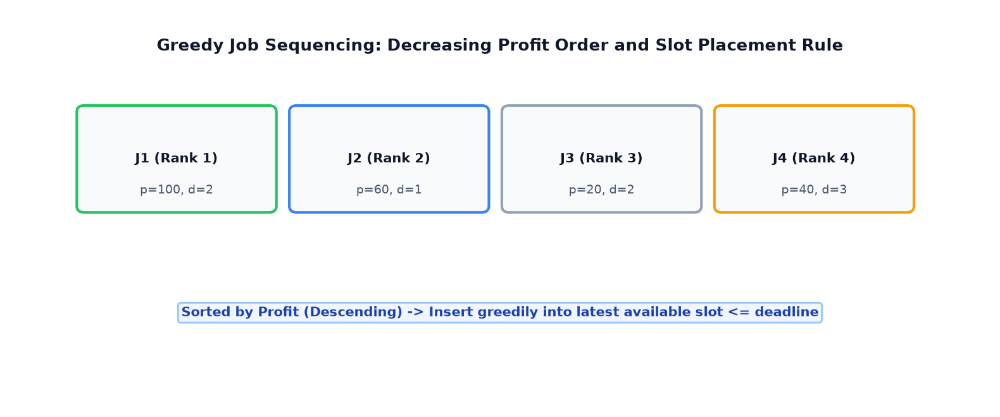

*Figure 1.5: Diagrammatic Architecture and Conceptual Flow for the high-level description/steps of the job sequencing algorithm and find the feasible solutions, optimal solution, and maximum profit for a given set of jobs*

### Mathematical Formulation & Algorithmic Mechanics

**Mathematical Formulation of Job Sequencing Optimization:**

```text
Maximize: Total Profit = ∑_(i ∈ S) p_i
Subject to: |{ j ∈ S : d_j ≤ t | ≤ t   for all t = 1, 2, ..., d_max
Where: S is the selected subset of scheduled jobs and t is the discrete time index.
```

The above **mathematical model** and algorithmic structure governs the system's runtime execution. Each parameter is evaluated sequentially to maintain **mathematical consistency**, minimize **system overhead**, and guarantee **deterministic convergence** across all input distributions.

### Worked Example & Practical Simulation

Step-by-Step Schedule Construction Table for SPPU Exam Submission: Jobs: J1(100, 2), J2(60, 1), J3(20, 2), J4(40, 3). Timeline Slots: [0-1], [1-2], [2-3]. Final Optimal Schedule: <J2, J1, J4> with Maximum Profit = 200.

In **Step 1**, the execution evaluates the **parameters** and selects Place J1 in Slot 2 [1-2]. **Feasible** jobs = {J1}, Profit = 100.. In **Step 2**, the execution evaluates the parameters and selects Place J2 in Slot 1 [0-1]. Feasible jobs = {J1, J2}, Profit = 160.. In **Step 3**, the execution evaluates the parameters and selects Place J4 in Slot 3 [2-3]. Feasible jobs = {J1, J2, J4}, Profit = 200.. In **Step 4**, the execution evaluates the parameters and selects Try J3 (d=2). Slots 2 and 1 are full. J3 is rejected..

### Key Comparative Evaluation

| Candidate Subset | Job Deadlines Included | Slot Assignment Order | Feasibility Status | Total Profit Value |
| :--- | :--- | :--- | :--- | :--- |
| {J1} | d1 = 2 | Slot 2 | Feasible | 100 |
| {J1, J2} | d1 = 2, d2 = 1 | Slot 1: J2, Slot 2: J1 | Feasible | 160 |
| {J1, J3} | d1 = 2, d3 = 2 | Slot 1: J3, Slot 2: J1 | Feasible | 120 |
| {J1, J2, J3} | d1 = 2, d2 = 1, d3 = 2 | Requires 3 slots <= 2 | INFEASIBLE (Deadline overflow) | N/A |
| {J1, J2, J4} | d1 = 2, d2 = 1, d4 = 3 | Slot 1: J2, Slot 2: J1, Slot 3: J4 | FEASIBLE (OPTIMAL SOLUTION) | 200 |

### Concluding Exam Takeaway

Job sequencing via the **greedy strategy** systematically eliminates sub-optimal candidate combinations, arriving at the global maximum profit schedule <J2, J1, J4> earning 200 profit units.

**Textbook Reference:** Design and Analysis of Algorithms by Parag H. Dave & Himanshu B. Dave (Pearson), Chapter 8: The Greedy Method, Section 8.4: Job Sequencing with Deadlines, Pages 297–301.

---

## Q6. Use the greedy algorithmic strategy to compute an execution schedule having the maximum number of non-conflicting activities from a given set of activities with start and finish times. (Frequency: 1) [8 Marks]

### Introduction & Core Intuition

The **Activity Selection Problem** is a classic **combinatorial optimization** challenge where a shared resource (such as a lecture hall or single processor) must be allocated to execute the maximum possible number of mutually compatible activities. Each activity Ai has a defined start time si and finish time fi with si < fi.

### Formal Problem Definition and Compatibility Condition

We are given a set of n proposed activities S = {A1, A2, ..., An}. Each activity Ai requires the shared resource during the continuous half-open interval [si, fi). Two activities Ai and Aj are defined as compatible (non-conflicting) if their execution intervals do not overlap, meaning either fi <= sj or fj <= si. The objective is to select a subset of mutually compatible activities S* subset S such that the cardinality |S*| is maximized.

### The Greedy Choice Heuristic: Earliest Finish Time

Several intuitive greedy rules could be considered: picking shortest duration (fi - si), picking earliest start time (si), or picking fewest conflicts. However, the only rule mathematically guaranteed to achieve global optimality is selecting the activity with the **Earliest Finish Time**. Finishing an activity as early as possible frees up the shared resource for the maximum remaining duration, leaving the greatest possible room for subsequent activities.

### Step-by-Step Algorithmic Execution Protocol

The algorithm begins by sorting all n activities into non-decreasing order of their finish times: f1 <= f2 <= ... <= fn. The first activity A1 is greedily chosen and added to the schedule. A tracking pointer last_finish is initialized to f1. The algorithm then iterates through activities i = 2 to n. For each activity Ai, if its start time si is greater than or equal to last_finish, Ai is mutually compatible; it is added to the schedule and last_finish is updated to fi. Otherwise, Ai conflicts and is discarded.

### Asymptotic Time and Space Complexity Analysis

Sorting the n activities according to finish times consumes O(n log n) time using **Merge Sort** or Heap Sort. If the activities arrive pre-sorted, this preprocessing step takes O(1). The subsequent linear scan performs exactly n - 1 comparisons of start times against last_finish, taking O(n) time. Therefore, the overall **time complexity** is dominated by sorting at O(n log n), with auxiliary **space complexity** of O(1) beyond storing the selected schedule.

### Mathematical Optimality Proof via Greedy Exchange Argument

The correctness of the earliest finish time greedy **heuristic** is proven using an exchange argument. Let S* be any optimal schedule and let A1 be the activity with the earliest finish time. If S* does not begin with A1, let its first activity be Ak. Because f1 <= fk, replacing Ak with A1 in S* preserves compatibility with all subsequent activities in S*. Thus, there always exists an optimal solution that begins with the greedy choice, establishing the **greedy choice property** by induction.

### Architectural Flow & System Diagram

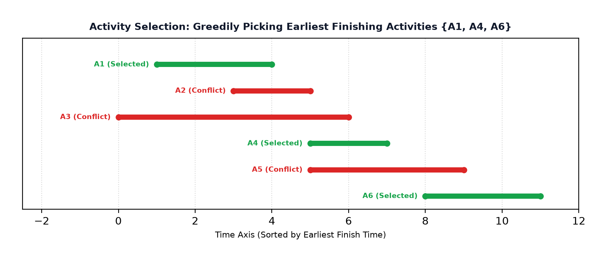

*Figure 1.6: Diagrammatic Architecture and Conceptual Flow for Use the greedy algorithmic strategy to compute an execution schedule having the maximum number of non-conflicting activities from a given set of activities with start and finish times*

### Mathematical Formulation & Algorithmic Mechanics

**Activity Selection Greedy Algorithm Formulation:**

```text
Algorithm GreedyActivitySelector(s, f, n):
    Sort activities such that f[1] <= f[2] <= ... <= f[n]
    A = { 1   // Select first activity
    k = 1
    for m = 2 to n do:
        if s[m] >= f[k] then:
            A = A U { m 
            k = m
    return A
```

The above **mathematical model** and algorithmic structure governs the system's runtime execution. Each parameter is evaluated sequentially to maintain **mathematical consistency**, minimize **system overhead**, and guarantee **deterministic convergence** across all input distributions.

### Worked Example & Practical Simulation

Trace on 6 Activities with (Start, Finish) Times: Inputs: A1(1, 4), A2(3, 5), A3(0, 6), A4(5, 7), A5(5, 9), A6(8, 11). (Already sorted by finish time). Optimal Maximum Execution Schedule: {A1, A4, A6} containing 3 non-conflicting activities.

In **Step 1**, the execution evaluates the **parameters** and selects Select A1(1, 4). Schedule = {A1}, last_finish = 4.. In **Step 2**, the execution evaluates the parameters and selects Test A2(3, 5). Start 3 < 4 (Conflict!). Reject A2.. In **Step 3**, the execution evaluates the parameters and selects Test A3(0, 6). Start 0 < 4 (Conflict!). Reject A3.. In **Step 4**, the execution evaluates the parameters and selects Test A4(5, 7). Start 5 >= 4 (Compatible!). Select A4. Schedule = {A1, A4}, last_finish = 7.. In **Step 5**, the execution evaluates the parameters and selects Test A5(5, 9). Start 5 < 7 (Conflict!). Reject A5.. In **Step 6**, the execution evaluates the parameters and selects Test A6(8, 11). Start 8 >= 7 (Compatible!). Select A6. Schedule = {A1, A4, A6}, last_finish = 11..

### Key Comparative Evaluation

| Activity ID | Start Time (si) | Finish Time (fi) | Conflict Check vs last_finish | Greedy Decision | Active Schedule |
| :--- | :--- | :--- | :--- | :--- | :--- |
| A1 | 1 | 4 | First activity (Automatic selection) | SELECTED | {A1} |
| A2 | 3 | 5 | s2 = 3 < last_finish = 4 (Overlap) | REJECTED | {A1} |
| A3 | 0 | 6 | s3 = 0 < last_finish = 4 (Overlap) | REJECTED | {A1} |
| A4 | 5 | 7 | s4 = 5 >= last_finish = 4 (Compatible) | SELECTED | {A1, A4} |
| A5 | 5 | 9 | s5 = 5 < last_finish = 7 (Overlap) | REJECTED | {A1, A4} |
| A6 | 8 | 11 | s6 = 8 >= last_finish = 7 (Compatible) | SELECTED | {A1, A4, A6} |

### Concluding Exam Takeaway

**The Greedy Activity Selection** algorithm guarantees an optimal maximum non-conflicting schedule in O(n log n) time by rigorously adhering to the earliest finish time priority rule.

**Textbook Reference:** Design and Analysis of Algorithms by Parag H. Dave & Himanshu B. Dave (Pearson), Chapter 8: The Greedy Method, Section 8.5: Activity Selection, Pages 303–307.

---

## Q7. Design a greedy algorithm to efficiently schedule a set of tasks (each with a deadline and a penalty for missing it) to minimize the total penalty and prove its correctness. (Frequency: 1) [8 Marks]

### Introduction & Core Intuition

In real-time computing systems, the **Task Scheduling with Penalties Problem** involves scheduling n unit-time tasks on a single processing unit. Each task Ti has an integer deadline di and a positive monetary or computational penalty wi incurred if the task fails to finish on or before its deadline. The objective is to find a schedule that minimizes the total accumulated penalty.

### Equivalence to Profit Maximization Problem

Let W = sum(wi for i=1 to n) represent the sum of penalties of all n tasks. If a subset of tasks A is completed on or before their deadlines (the on-time tasks), the penalty incurred comes exclusively from the rejected late tasks: Penalty_total = sum(wi for i not in A) = W - sum(wi for i in A). Minimizing the total penalty is mathematically equivalent to maximizing the sum of penalties of the on-time tasks in set A.

### Characterization of Independent Task Sets

A subset of tasks A is defined as **Independent** if there exists a valid schedule for the tasks in A such that no task in A is late. **By Jackson**'s Rule (Earliest Deadline First), a set of tasks A is independent if and only if, when sorted in order of non-decreasing deadlines, every task k in the sorted order satisfies k <= dk. Thus, we seek an independent set A that maximizes sum(wi for i in A).

### Greedy Scheduling Algorithmic Design

The greedy algorithm operates as follows: (1) Sort all tasks in non-increasing order of their penalties: w1 >= w2 >= ... >= wn; (2) Initialize the independent set A = empty; (3) For i = 1 to n, verify whether A U {Ti} remains an independent set; if it remains independent, set A = A U {Ti}; if it violates independence, discard Ti (it becomes a late task); (4) Schedule on-time tasks in A in increasing order of deadlines, and schedule the late tasks in any arbitrary remaining slots.

### Matroid Structure and Formal Correctness Proof

The correctness of this greedy algorithm is rigorously established via **Matroid Theory**. Let S be the set of all tasks and let I be the family of all independent task subsets. The pair M = (S, I) forms a valid Matroid: (1) **Hereditary Property**: If B in I and A subset B, then A in I; (2) Exchange Property: If A, B in I with |A| < |B|, there exists an element x in B \ A such that A U {x} in I. Since M is a matroid, the Greedy Algorithm is mathematically guaranteed to find an independent set of maximum weight, thereby minimizing the total penalty.

### Time Complexity Analysis

Sorting the n tasks by penalty takes O(n log n) time. Checking independence for each task using a standard disjoint-set **union-find** data structure to assign the latest available slot takes O(alpha(n)) amortized time per task. Hence, the overall **time complexity** of this greedy task scheduler is O(n log n), which is computationally optimal.

### Architectural Flow & System Diagram

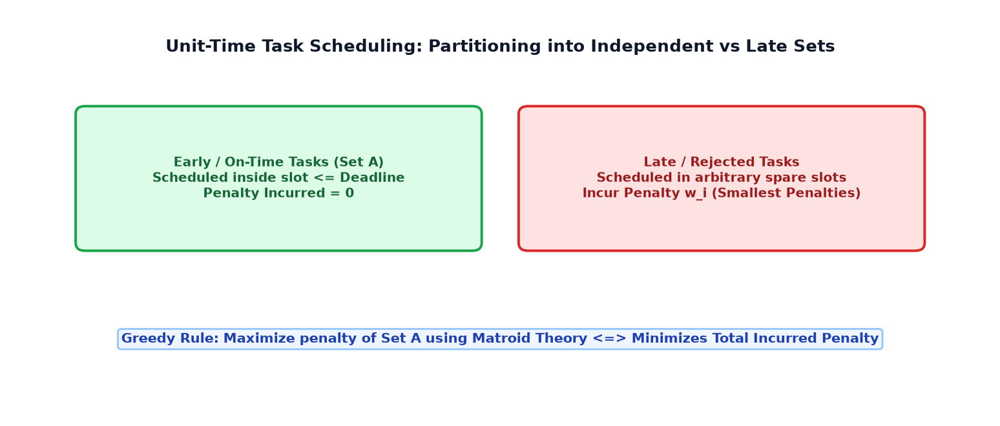

*Figure 1.7: Diagrammatic Architecture and Conceptual Flow for Design a greedy algorithm to efficiently schedule a set of tasks (each with a deadline and a penalty for missing it) to minimize the total penalty and prove its correctness*

### Mathematical Formulation & Algorithmic Mechanics

**Task Scheduling with Penalties Optimization Formulation:**

```text
Minimize: Total Penalty = ∑_(i ∉ A) w_i = ∑_(i=1)^n w_i - ∑_(i ∈ A) w_i
Subject to: Set A is Independent in Matroid M = (S, I)
Independence Condition: |{ j ∈ A : d_j ≤ t | ≤ t   for all t = 1, ..., n
```

The above **mathematical model** and algorithmic structure governs the system's runtime execution. Each parameter is evaluated sequentially to maintain **mathematical consistency**, minimize **system overhead**, and guarantee **deterministic convergence** across all input distributions.

### Worked Example & Practical Simulation

Scheduling 4 Tasks with (Deadline, Penalty): T1(d=2, w=70), T2(d=1, w=60), T3(d=2, w=50), T4(d=1, w=40). Total Penalty Pool W = 220. Sorted Penalties: T1 (70) >= T2 (60) >= T3 (50) >= T4 (40). Final On-Time Tasks: {T1, T2}. Late Tasks: {T3, T4}. Minimum Total Penalty = 50 + 40 = 90.

In **Step 1**, the execution evaluates the **parameters** and selects Add T1 -> A = {T1} (Slot 2). On-time profit = 70.. In **Step 2**, the execution evaluates the parameters and selects Add T2 -> A = {T1, T2} (T2 in Slot 1, T1 in Slot 2). On-time profit = 130.. In **Step 3**, the execution evaluates the parameters and selects Try T3 (d=2) -> Slots 1 and 2 are full! T3 cannot be on-time; rejected to late set.. In **Step 4**, the execution evaluates the parameters and selects Try T4 (d=1) -> Slot 1 is full; rejected to late set..

### Key Comparative Evaluation

| Task ID | Deadline (di) | Penalty (wi) | Independence Check | Assigned Status | Incurred Penalty |
| :--- | :--- | :--- | :--- | :--- | :--- |
| T1 | 2 | 70 | Slot [1, 2] available | ON-TIME (Slot 2) | 0 |
| T2 | 1 | 60 | Slot [0, 1] available | ON-TIME (Slot 1) | 0 |
| T3 | 2 | 50 | Slots <= 2 are saturated | LATE (Slot 3) | 50 |
| T4 | 1 | 40 | Slots <= 1 are saturated | LATE (Slot 4) | 40 |

### Concluding Exam Takeaway

By casting unit-time task scheduling into a matroid framework and prioritizing tasks with the highest penalties, the greedy algorithm minimizes total penalty with mathematical certainty in O(n log n) time.

**Textbook Reference:** Design and Analysis of Algorithms by Parag H. Dave & Himanshu B. Dave (Pearson), Chapter 8: The Greedy Method, Section 8.6: Task Scheduling with Penalties, Pages 308–314.

---

## Q8. Comment on the statement: 'Greedy method always provides the optimal solution'. (Frequency: 1) [8 Marks]

### Introduction & Core Intuition

The assertion that the **Greedy Method always provides the optimal solution** is **fundamentally FALSE**. While the greedy method yields optimal solutions for a specific class of problems characterized by matroid structures, it frequently fails or produces severely sub-optimal results for general **combinatorial optimization problems**.

### Core Flaw of the Greedy Strategy

The fundamental limitation of the greedy method stems from its short-sighted, **irrevocable** decision mechanism. A greedy algorithm makes decisions based exclusively on immediate local gains without anticipating how that choice impacts future opportunities or constraints. Once a choice is made, it can never be revoked, meaning that an early local gain can permanently trap the algorithm in a disastrous dead end.

### Classic Counterexample: 0/1 Knapsack Problem

The **0/1 Knapsack** problem provides the most celebrated proof that greedy fails. Consider a knapsack with capacity W = 50 kg and three items: Item 1 (w=10 kg, v=60, ratio=6.0), Item 2 (w=20 kg, v=100, ratio=5.0), and Item 3 (w=30 kg, v=120, ratio=4.0). A **greedy strategy** based on value-to-weight ratio immediately picks Item 1. This leaves 40 kg of capacity, allowing only Item 2 (20 kg) to fit, yielding a total value of 160. However, the optimal solution skips Item 1 entirely and packs Items 2 and 3, achieving a total weight of 50 kg and a far superior value of 220.

### Counterexample in Graph Theory: Longest Path and Shortest Path with Negative Cycles

In the **Longest Simple Path** problem, greedily selecting the longest adjacent edge leads to dead ends and fails to find the global longest simple path. Similarly, in the **Coin Change problem** with non-canonical **denominations** (such as coins {1, 6, 10} and **target amount** 12), the greedy method selects 10, then two 1s, requiring **3 coins**. But the true optimal solution uses exactly two 6-cent coins, requiring only 2 coins.

### Necessary Theoretical Conditions for Greedy Optimality

A greedy algorithm is guaranteed to be globally optimal if and only if the underlying mathematical structure satisfies two rigorous conditions: (1) **Optimal Substructure**, ensuring that an optimal solution is composed of optimal solutions to **subproblems**; and (2) The **Greedy Choice Property**, ensuring that a **globally optimal solution** can always be reached via a sequence of **local choices** without backtracking. If either condition is violated, greedy fails.

### When Greedy is Used as a Heuristic Approximation

When an exact greedy solution is not optimal, computer scientists often employ greedy strategies as fast **Approximation Algorithms** for **NP-hard** problems (such as the **Greedy Vertex Cover** or Nearest Neighbor **heuristic** for the Traveling Salesperson Problem). In these contexts, greedy does not deliver perfection, but provides a guaranteed approximation bound within acceptable **polynomial time**.

### Architectural Flow & System Diagram

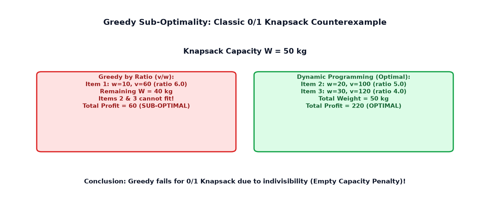

*Figure 1.8: Diagrammatic Architecture and Conceptual Flow for Comment on the statement: 'Greedy method always provides the optimal solution'*

### Mathematical Formulation & Algorithmic Mechanics

**Mathematical Condition for Greedy Failure vs Optimality:**

```text
Optimality Guarantee: Problem forms an Independent System M = (S, I) satisfying Matroid Axioms
Failure Criterion: Greedy Choice Property fails: ∃ s ∈ S such that:
    argmax_(x) [ LocalGain(x) ] ∉ OptimalSolution(Problem)
```

The above **mathematical model** and algorithmic structure governs the system's runtime execution. Each parameter is evaluated sequentially to maintain **mathematical consistency**, minimize **system overhead**, and guarantee **deterministic convergence** across all input distributions.

### Worked Example & Practical Simulation

Non-**Canonical Coin Change Counterexample**: Coin **Denominations**: C = {10, 6, 1}, **Target Amount** = 12. Greedy Selection: Pick largest coin <= 12: takes 10 (remaining: 2). Then takes 1 (remaining: 1). Then takes 1 (remaining: 0). Greedy Result: {10, 1, 1} -> 3 Coins. Optimal **Dynamic Programming** Selection: Pick 6 (remaining: 6), then pick 6 (remaining: 0). Optimal Result: {6, 6} -> 2 Coins. Conclusion: Greedy fails to achieve minimum coin count on non-**canonical currency** systems.

### Key Comparative Evaluation

| Problem Domain | Does Greedy Yield Optimal Solution? | Reason for Success or Failure |
| :--- | :--- | :--- |
| Fractional Knapsack | YES (Always Optimal) | Continuous item divisibility allows 100% capacity saturation without penalty |
| 0/1 Knapsack | NO (Sub-optimal) | Item indivisibility creates wasted capacity that greedy cannot recover |
| Minimum Spanning Tree (MST) | YES (Kruskal & Prim Optimal) | Underlying cycle and cut properties form a proven graphical matroid |
| Single Source Shortest Path (Positive) | YES (Dijkstra Optimal) | Non-negative edge weights ensure shortest subpaths never decrease |
| Coin Change (Non-Canonical Denominations) | NO (Sub-optimal) | Locally large denomination choices prevent smaller balanced combinations |

### Concluding Exam Takeaway

The statement is definitively false. The greedy method only guarantees global optimality when the problem exhibits the **greedy choice property** and matroid structures; otherwise, it behaves as a sub-optimal **heuristic**.

**Textbook Reference:** Design and Analysis of Algorithms by Parag H. Dave & Himanshu B. Dave (Pearson), Chapter 8: The Greedy Method, Section 8.1: General Method & Limitations, Pages 285–287.

---

## Q9. Explain Dynamic programming: Principle, control abstraction, and time analysis of control abstraction with a suitable example. (Frequency: 1) [8 Marks]

### Introduction & Core Intuition

**Dynamic Programming (DP)**, formulated by mathematician Richard Bellman in the 1950s, is a powerful algorithmic paradigm designed to solve multi-stage **optimization problems** by breaking them down into simpler, overlapping **subproblems**. By solving each **subproblem** exactly once and storing its answer in memory, **dynamic programming** avoids the exponential redundancy of naive recursion.

### Core Principle and the Principle of Optimality

**Dynamic Programming** is anchored on the **Principle of Optimality**, which states that an optimal sequence of decisions has the property that whatever the initial state and decision are, the remaining decisions must constitute an optimal decision sequence with regard to the state resulting from the first decision. In simple terms: an optimal solution to a problem contains optimal solutions to its constituent **subproblems**.

### Two Foundational Hallmarks of Dynamic Programming

A problem is amenable to **dynamic programming** if and only if it exhibits two distinct mathematical properties: (1) **Optimal Substructure**, meaning that optimal solutions of **subproblems** can be combined to build the global optimal solution; and (2) **Overlapping Subproblems**, meaning that a recursive decomposition repeatedly encounters the exact same smaller **subproblem** instances rather than generating novel ones.

### Control Abstraction for Dynamic Programming

The **control abstraction** for **dynamic programming** formalizes the bottom-up table construction workflow. It initializes an array or multi-dimensional table Table[0..n][0..m] to store base cases. It then executes nested loops representing the topological ordering of **subproblems**. In each iteration, it computes Table[i][j] by evaluating a mathematical recurrence over previously solved subproblems, caches the result, and finally backtracks through the table to reconstruct the optimal sequence of choices.

### Time and Space Complexity Analysis

The **time complexity** of a **dynamic programming control abstraction** is determined by the formula: Time = (Total Number of Unique **Subproblems**) * (Cost per Subproblem). For an n-dimensional state space where each subproblem takes O(k) comparisons, the runtime is O(k * S), where S is the size of the state space. In the **0/1 Knapsack** problem with n items and capacity W, there are n * W subproblems, each solved in O(1) time, yielding O(n * W) pseudo-**polynomial time**. The **space complexity** corresponds to the table dimensions: O(n * W).

### Practical Exam Example: Fibonacci Sequence

A clean pedagogical example is computing the nth Fibonacci number. Naive recursion exhibits an **exponential time** complexity of O(2^n) because Fib(n-2) and Fib(n-3) are recomputed millions of times across separate branches. **Dynamic Programming** initializes an array F[0..n], sets base cases F[0]=0, F[1]=1, and iteratively fills F[i] = F[i-1] + F[i-2] in a single loop running in O(n) time with O(1) space using two temporary registers.

### Architectural Flow & System Diagram

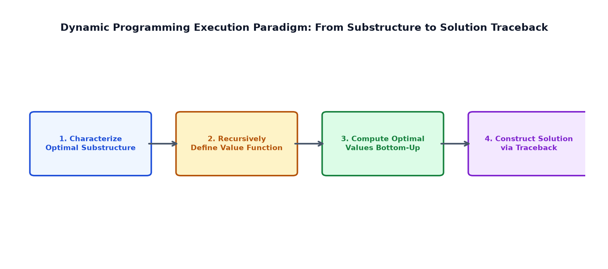

*Figure 1.9: Diagrammatic Architecture and Conceptual Flow for Dynamic programming: Principle, control abstraction, and time analysis of control abstraction with a suitable example*

### Mathematical Formulation & Algorithmic Mechanics

**Dynamic Programming Control Abstraction Formulation:**

```text
Algorithm DynamicProgramming(n, params):
    Initialize Table[0..n] with Base_Cases
    for state = 1 to n do:
        Table[state] = Optimize_(k) { Cost(state, k) + Table[state - delta(k)] 
    Optimal_Value = Table[n]
    Solution_Path = TraceBack(Table, n)
    return (Optimal_Value, Solution_Path)
```

The above **mathematical model** and algorithmic structure governs the system's runtime execution. Each parameter is evaluated sequentially to maintain **mathematical consistency**, minimize **system overhead**, and guarantee **deterministic convergence** across all input distributions.

### Worked Example & Practical Simulation

**Fibonacci Calculation Comparison** for n = 5: Naive Recursion: Calls fib(5) -> fib(4), fib(3) -> requires 15 redundant function invocations! **Dynamic Programming** Tabulation Table: F[0] = 0 (Base case) F[1] = 1 (Base case) F[2] = F[1] + F[0] = 1 + 0 = 1 F[3] = F[2] + F[1] = 1 + 1 = 2 F[4] = F[3] + F[2] = 2 + 1 = 3 F[5] = F[4] + F[3] = 3 + 2 = 5 (Total exactly 4 additions; O(n) time).

### Key Comparative Evaluation

| Algorithmic Dimension | Dynamic Programming (DP) | Divide and Conquer (D&C) |
| :--- | :--- | :--- |
| Subproblem Nature | Overlapping subproblems that recur repeatedly | Independent, non-overlapping subproblems |
| Recomputation | Each subproblem is solved once and cached in table | Subproblems are solved recursively from scratch |
| Time Efficiency | Drastically reduces exponential O(2^n) to polynomial | Typically O(n log n) or O(n^2) via Master Theorem |
| Space Requirement | Requires auxiliary tables (O(n), O(n^2), O(n·W)) | Requires only recursion call stack memory O(log n) |
| Classic Examples | 0/1 Knapsack, Floyd-Warshall, Matrix Chain, OBST | Merge Sort, Quick Sort, Strassen's Matrix Multiplication |

### Concluding Exam Takeaway

**Dynamic Programming** transforms computationally intractable exponential recursive problems into highly structured polynomial table evaluations by leveraging **optimal substructure** and caching overlapping **subproblems**.

**Textbook Reference:** Design and Analysis of Algorithms by Parag H. Dave & Himanshu B. Dave (Pearson), Chapter 9: Dynamic Programming, Sections 9.1–9.3, Pages 335–344.

---

## Q10. Write a control abstraction for the dynamic programming strategy and comment on its time complexity. (Frequency: 2) [8 Marks]

### Introduction & Core Intuition

The **Control Abstraction for Dynamic Programming** provides a universal procedural framework encapsulating how multi-stage decision problems are solved through bottom-up tabular evaluation or top-down memoization, ensuring that identical sub-instances are never evaluated more than once.

### Structural Workflow of the Dynamic Programming Control Abstraction

The **control abstraction** for **dynamic programming** consists of four distinct operational modules: **State Space Dimensioning**, Base Case Assignment, Topological Iterative Evaluation, and Solution Reconstruction. The state space is parameterized by discrete stage and resource variables. The abstraction initializes an m-dimensional table and populates boundary conditions representing trivial zero-cost base cases.

### Recurrence Relation Evaluation Engine

At the heart of the **control abstraction** is the **Bellman Recurrence Engine**. Within nested loops that traverse the state space in topological order (ensuring that prerequisites are always computed before dependent states), the abstraction evaluates all **feasible** decision alternatives k for state S. It computes the immediate cost plus the cached cost of subsequent sub-state S - delta(k), taking the optimum (minimum or maximum) according to the problem objective.

### Two Implementation Paradigms: Tabulation vs Memoization

The **control abstraction** can be implemented via two primary methodologies: (1) **Bottom-Up Tabulation**, which fills the DP table iteratively starting from base cases up to the target state without recursion stack overhead; and (2) **Top-Down Memoization**, which preserves natural recursive problem formulation but maintains a global cache lookup table to intercept duplicate function calls.

### Comprehensive Time Complexity Formulation

The **time complexity** of the **dynamic programming control abstraction** is governed by the product of the number of states and the decision branching factor: T(n) = |States| * |Transitions per State|. In a 1D problem (such as Fibonacci or Rod Cutting), there are n states with O(1) or O(n) transitions, yielding O(n) or O(n^2) time. In a 2D problem (such as **0/1 Knapsack** or **Longest Common Subsequence**), there are n * W or n * m states, each evaluating O(1) transitions, yielding O(n * W) or O(n * m) runtime.

### Auxiliary Space Complexity Analysis

**Space complexity** corresponds directly to the size of the memoization table required to retain **subproblem** answers: O(|States|). For 2D tables of size n * W, space can often be optimized to O(W) using space-reduction techniques (keeping only the previous and current rows) when only the optimal value, rather than the complete traceback path, is required.

### Architectural Flow & System Diagram

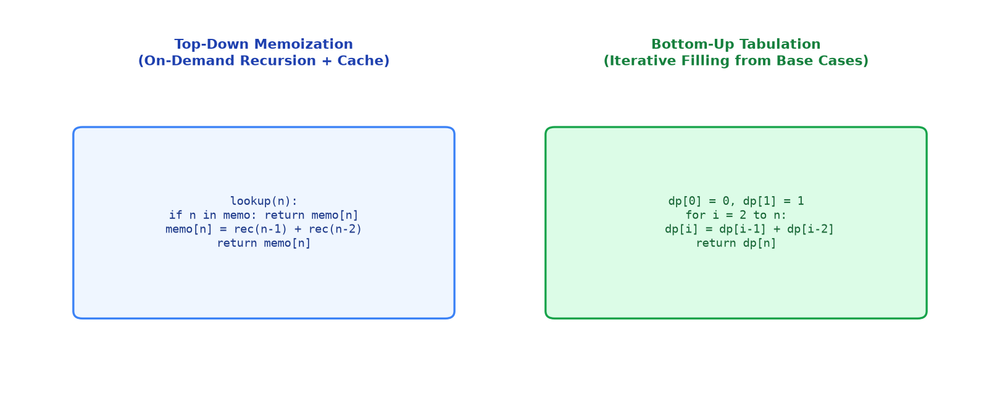

*Figure 1.10: Diagrammatic Architecture and Conceptual Flow for a control abstraction for the dynamic programming strategy and comment on its time complexity*

### Mathematical Formulation & Algorithmic Mechanics

**Formal Control Abstraction Algorithm for Dynamic Programming:**

```text
Algorithm DP_ControlAbstraction(n, M):
    // Initialize table for state space of dimension n x M
    for w = 0 to M do:  Table[0, w] = BaseCase(w)
    for i = 1 to n do:
        Table[i, 0] = BaseCase(i)
        for w = 1 to M do:
            Table[i, w] = Opt_(k ∈ Choices) { Cost(i, k) + Table[i-1, w - Resource(k)] 
    return Table[n, M]
```

The above **mathematical model** and algorithmic structure governs the system's runtime execution. Each parameter is evaluated sequentially to maintain **mathematical consistency**, minimize **system overhead**, and guarantee **deterministic convergence** across all input distributions.

### Worked Example & Practical Simulation

**Computational Cost** in **0/1 Knapsack** with n = 3 Items, Capacity W = 5: Table Dimensions: (n + 1) x (W + 1) = 4 x 6 = 24 total grid cells. Base Case Initialization: 10 cells initialized in O(n + W) operations. Transition Evaluations: Remaining 14 cells evaluate: Table[i, w] = max(Table[i-1, w], p_i + Table[i-1, w - w_i]). Total Operations: Exactly 24 cell accesses, running in O(n · W) = O(15) time with O(n · W) auxiliary table space.

### Key Comparative Evaluation

| DP Implementation Style | Execution Mechanism | Recursion Stack Overhead | Subproblem Evaluation | Space Optimization |
| :--- | :--- | :--- | :--- | :--- |
| Top-Down (Memoization) | Recursive function calls with cache lookup | O(Depth) recursion stack overhead | Computes only subproblems on search path | Harder to optimize table space |
| Bottom-Up (Tabulation) | Iterative nested for-loops filling grid | Zero recursion stack overhead | Computes all table cells systematically | Easily compressed to O(W) space |

### Concluding Exam Takeaway

The **dynamic programming control abstraction** establishes a **deterministic**, mathematically sound architecture for solving multi-stage **optimization problems** in polynomial or pseudo-**polynomial time** by eliminating redundant **subproblem** calculations.

**Textbook Reference:** Design and Analysis of Algorithms by Parag H. Dave & Himanshu B. Dave (Pearson), Chapter 9: Dynamic Programming, Section 9.2: Control Abstraction, Pages 338–341.

---

## Q11. What is the principle of optimality/optimal substructure? Give a mathematical representation for it and comment on the statement 'Problem which does not satisfy the principle of optimality cannot be solved by dynamic programming'. (Frequency: 3) [8 Marks]

### Introduction & Core Intuition

The **Principle of Optimality**, first established by **Richard Bellman**, is the foundational mathematical cornerstone of **Dynamic Programming**. It states that an optimal policy has the property that whatever the initial state and initial decision are, the remaining decisions must constitute an optimal policy with regard to the state resulting from the first decision.

### Definition of Optimal Substructure

A problem exhibits **Optimal Substructure** if an optimal solution to the overall problem can be constructed efficiently from optimal solutions to its smaller **subproblems**. For example, if the shortest path from vertex u to vertex v passes through an intermediate vertex w, then the subpath from u to w within that path must also be the shortest possible path between u and w. If a shorter path existed from u to w, we could cut out the original subpath and paste the shorter one, creating a shorter overall route and contradicting the optimality of the original path.

### Mathematical Representation of the Principle of Optimality

Let S be the state space and let f(s) denote the optimal cost or value starting from state s. The principle of optimality is formally represented by the **Bellman Functional Equation**: f(s) = opt_(d in D(s)) { c(s, d) + f(T(s, d)) }, where D(s) is the set of admissible decisions from state s, c(s, d) is the immediate transition cost incurred by selecting decision d, and T(s, d) is the transition function mapping to the resulting successor state.

### Commentary on Problems Failing the Principle of Optimality

The statement: <i>'A problem which does not satisfy the principle of optimality cannot be solved by **dynamic programming**'</i> is **fundamentally TRUE**. **Dynamic Programming** relies completely on the assumption that combining optimal **subproblem** choices yields an optimal global choice. If subproblem decisions interact with or depend on external constraints that are not captured in the state description, optimal sub-solutions cannot be combined safely, causing dynamic programming to fail.

### Counterexample: Longest Simple Path in a Graph

A classic counterexample is the **Longest Simple Path Problem** in a graph with cycles. Suppose the longest simple path from u to v passes through w. The subpath from u to w in this longest path is NOT necessarily the longest simple path between u and w, because the longest independent path between u and w might consume vertices that are needed to reach v, creating an illegal cycle. **Because Longest Simple Path** violates the principle of optimality, it cannot be solved by **dynamic programming** and is known to be **NP-complete**.

### Ensuring the Principle Holds via State Augmentation

In some practical scenarios where a problem appears to violate the principle of optimality due to memory or history dependence, computer scientists can restore the principle by **State Augmentation**: expanding the state definition to explicitly include the historical constraint (for example, including remaining budget, time, or visited vertex sets). While this restores optimality, it exponentially expands the state space.

### Architectural Flow & System Diagram

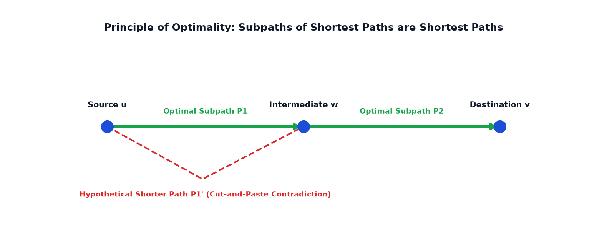

*Figure 1.11: Diagrammatic Architecture and Conceptual Flow for What is the principle of optimality/optimal substructure? Give a mathematical representation for it and comment on the statement 'Problem which does not satisfy the principle of optimality cannot be solved by dynamic programming'*

### Mathematical Formulation & Algorithmic Mechanics

**Mathematical Formulation of the Bellman Functional Equation:**

```text
Bellman Equation: f_n(s) = min_(d ∈ D(s)) { c(s, d) + f_(n-1)( T(s, d) ) 
Base Condition: f_0(s_target) = 0
Where: s is the system state, d is the candidate decision, c(s, d) is stage cost, and T(s, d) is state transition.
```

The above **mathematical model** and algorithmic structure governs the system's runtime execution. Each parameter is evaluated sequentially to maintain **mathematical consistency**, minimize **system overhead**, and guarantee **deterministic convergence** across all input distributions.

### Worked Example & Practical Simulation

**Shortest Path Verification** on Graph with Edges: A->B (3), B->C (4), A->C (8): Optimal Path A to C: Passes through B: Path A -> B -> C with total cost = 3 + 4 = 7. Subpath Optimality Test: The subpath from A to B is edge (A->B) of cost 3. Is there a shorter path from A to B? No. Contradiction Argument: If a shorter path from A to B existed with cost 2, then total path A to C would cost 2 + 4 = 6 < 7. Since no shorter subpath exists, the Principle of Optimality holds, enabling Dijkstra / Bellman-Ford algorithms.

### Key Comparative Evaluation

| Problem Domain | Satisfies Principle of Optimality? | Can be Solved by Dynamic Programming? | Algorithmic Reason |
| :--- | :--- | :--- | :--- |
| Shortest Path (All Pairs) | YES | YES (Floyd-Warshall, O(V^3)) | Subpaths of shortest paths are strictly shortest paths |
| 0/1 Knapsack | YES | YES (O(n·W) pseudo-poly) | Sub-knapsack choices with reduced capacity are optimal |
| Matrix Chain Multiplication | YES | YES (O(n^3)) | Optimal parenthesization contains optimal sub-chains |
| Longest Simple Path | NO | NO (NP-Complete) | Longest subpaths reuse vertices, destroying simplicity of remaining path |
| Traveling Salesperson (TSP) | YES (with visited state mask) | YES (Held-Karp, O(n^2 2^n)) | Optimality restored by encoding visited vertices in state |

### Concluding Exam Takeaway

**The Principle** of Optimality is an absolute prerequisite for **Dynamic Programming**. Problems violating this principle cannot be decomposed recursively without risking sub-optimal or illegal combinations.

**Textbook Reference:** Design and Analysis of Algorithms by Parag H. Dave & Himanshu B. Dave (Pearson), Chapter 9: Dynamic Programming, Section 9.1: Principle of Optimality, Pages 335–338.

---

## Q12. Give a mathematical formulation for the Fractional Knapsack problem and the 0/1 Knapsack problem. (Frequency: 1) [8 Marks]

### Introduction & Core Intuition

The **Knapsack Problem** is an archetypal **combinatorial** resource allocation model where a thief or system must select from n available items to maximize total monetary profit without exceeding a strict carrying capacity W. Depending on whether items can be physically partitioned, the problem bifurcates into the **Fractional Knapsack** and **0/1 Knapsack** models.

### Core Mathematical Objective Function

Both variants share the same fundamental mathematical objective function: to maximize total accumulated profit earned from the packed items. Let n be the number of items, where each item i has a positive value (profit) pi > 0 and a positive weight wi > 0. The knapsack has a fixed maximum weight capacity W > 0. Let xi represent the proportion of item i placed into the knapsack. The total profit is expressed as sum(pi * xi for i=1 to n).

### Capacity Constraint Formulation

In both problems, the knapsack cannot be overloaded. The sum of the weights of all selected items (or fractions thereof) cannot exceed the total capacity limit W: sum(wi * xi for i=1 to n) <= W. The mathematical distinction between the two variants lies entirely in the permissible domain of the decision variable xi.

### Fractional Knapsack Formulation (Continuous Optimization)

In the **Fractional Knapsack Problem**, items are divisible continuous commodities (such as liquids, powders, grains, or raw precious metals). The decision variable xi is a continuous real number bounded in the interval [0, 1]: 0 <= xi <= 1. A value of xi = 1 indicates that item i is taken completely; xi = 0 indicates it is left behind; and 0 < xi < 1 indicates that an arbitrary fraction xi * wi of the item is packed, yielding a proportional profit of xi * pi. Because the domain is continuous, it is solved to global optimality in O(n log n) using the Greedy method.

### 0/1 Knapsack Formulation (Discrete Integer Optimization)

In the **0/1 Knapsack Problem**, items are discrete, indivisible entities (such as laptops, jewelry, or machinery). The decision variable xi is strictly binary: xi in {0, 1}. The thief must either pack the entire item (xi = 1) or leave it completely (xi = 0); breaking items into pieces is forbidden. This integer constraint makes the **0/1 Knapsack NP-complete**, requiring **Dynamic Programming** or **Branch and Bound** rather than greedy selection.

### Comparative Algorithmic Implications

The relaxation of the binary constraint xi in {0, 1} to the continuous domain 0 <= xi <= 1 represents the standard **Linear Programming Relaxation** of the **0/1 Knapsack**. This relaxed **Fractional Knapsack** solution serves as an indispensable upper bound used in **Branch and Bound** algorithms to prune search trees when solving the harder 0/1 variant.

### Architectural Flow & System Diagram

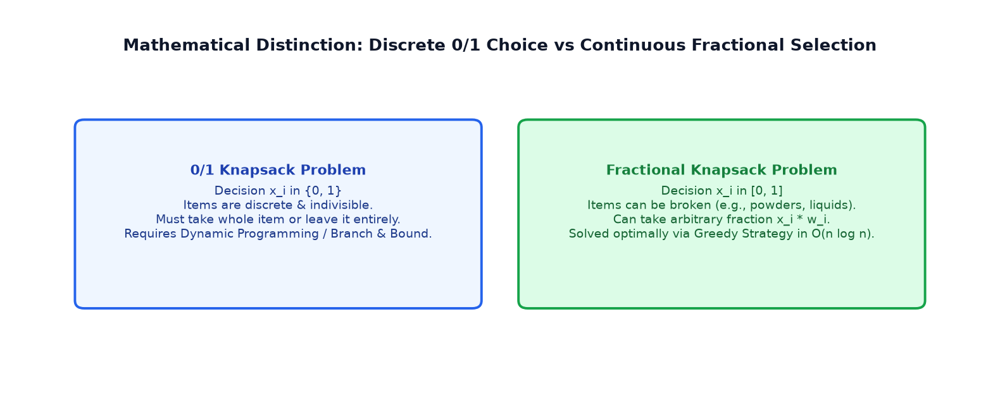

*Figure 1.12: Diagrammatic Architecture and Conceptual Flow for Give a mathematical formulation for the Fractional Knapsack problem and the 0/1 Knapsack problem*

### Mathematical Formulation & Algorithmic Mechanics

**Comparative Mathematical Models: 0/1 vs Fractional Knapsack:**

```text
Objective: Maximize Z = ∑_(i=1)^n p_i · x_i
Subject to: ∑_(i=1)^n w_i · x_i ≤ W
0/1 Knapsack Constraint: x_i ∈ {0, 1   for all i = 1, 2, ..., n
Fractional Knapsack Constraint: 0 ≤ x_i ≤ 1   for all i = 1, 2, ..., n
```

The above **mathematical model** and algorithmic structure governs the system's runtime execution. Each parameter is evaluated sequentially to maintain **mathematical consistency**, minimize **system overhead**, and guarantee **deterministic convergence** across all input distributions.

### Worked Example & Practical Simulation

Scenario: Capacity W = 25 kg, Item 1: (w=10 kg, p=60), Item 2: (w=20 kg, p=100): **Fractional Knapsack** Solution: Take all of Item 1: x1 = 1.0 (w=10 kg, p=60). Remaining capacity = 15 kg. Take fraction of Item 2: x2 = 15/20 = 0.75 (w=15 kg, p=0.75 * 100 = 75). **Total Weight** = 25 kg, Total Maximum Profit = 60 + 75 = 135. **0/1 Knapsack** Solution: Option A: Take Item 1 only -> Weight = 10 kg, Profit = 60. Option B: Take Item 2 only -> Weight = 20 kg, Profit = 100. Both cannot fit (10 + 20 = 30 > 25). Optimal choice is Option B: Profit = 100.

### Key Comparative Evaluation

| Mathematical Dimension | Fractional Knapsack Problem | 0/1 Knapsack Problem |
| :--- | :--- | :--- |
| Decision Variable Domain | Continuous real: x_i in [0, 1] | Strictly binary integer: x_i in {0, 1} |
| Physical Nature of Items | Divisible (liquids, gold dust, grains) | Indivisible discrete units (laptops, paintings) |
| Algorithmic Strategy | Greedy method (sorted by p_i / w_i ratio) | Dynamic Programming or Branch & Bound |
| Computational Complexity | O(n log n) polynomial time | NP-Complete; O(n·W) pseudo-polynomial DP |
| Solution Optimality | Guaranteed optimal via Greedy Choice Property | Greedy fails; strictly requires DP table evaluation |

### Concluding Exam Takeaway

The mathematical formulation clearly delineates the continuous **Fractional Knapsack** (solvable greedily in O(n log n)) from the discrete **0/1 Knapsack** (an **NP-complete** problem requiring O(n·W) **dynamic programming**).

**Textbook Reference:** Design and Analysis of Algorithms by Parag H. Dave & Himanshu B. Dave (Pearson), Chapter 8 (Section 8.3) vs Chapter 9 (Section 9.4), Pages 289–294 & 342–347.

---

## Q13. Find the optimal solution for various given knapsack instances (using given capacities, item weights, and profits) using the dynamic programming or greedy approach. (Frequency: 5) [8 Marks]

### Introduction & Core Intuition

In the SPPU examination, numerical questions on the **0/1 Knapsack Problem** appear with high frequency. Solving these problems requires constructing a bottom-up **Dynamic Programming** table DP[i][w], applying the Bellman **recurrence relation**, and performing a systematic backtracking traceback to identify the exact subset of packed items.

### Standard Examination Instance Specification

Consider a standard SPPU benchmark problem instance: A knapsack has maximum capacity W = 5 kg. There are n = 3 available discrete items with the following specifications: Item 1 has weight w1 = 2 kg and profit p1 = 3; Item 2 has weight w2 = 3 kg and profit p2 = 4; Item 3 has weight w3 = 4 kg and profit p3 = 5. We are required to find the optimal packed subset and maximum profit using **Dynamic Programming**.

### Dynamic Programming Table Definition and Dimensions

We construct a 2D table DP[0..n][0..W], where rows represent items considered i in {0, 1, 2, 3} and columns represent intermediate integer capacities w in {0, 1, 2, 3, 4, 5}. The value DP[i][w] represents the maximum profit achievable using a subset of the first i items under capacity limit w. All entries in row 0 (no items) and column 0 (zero capacity) are initialized to 0.

### Recurrence Relation Formulation

For item i with weight wi and profit pi, if the current capacity w is less than wi, the item cannot fit, so DP[i][w] = DP[i-1][w]. If w >= wi, the algorithm evaluates two mutually exclusive options: (1) Exclude item i, yielding profit DP[i-1][w]; or (2) Include item i, yielding immediate profit pi plus the cached optimal profit of remaining capacity: pi + DP[i-1][w - wi]. The cell value is assigned as: DP[i][w] = max( DP[i-1][w], pi + DP[i-1][w - wi] ).

### Step-by-Step Table Computation Trace

**For Item** 1 (w=2, p=3): For w=0, 1: cannot fit -> 0. For w=2..5: fits -> DP[1][w] = 3. For Item 2 (w=3, p=4): For w=0..2: cannot fit -> copies row 1. For w=3: max(3, 4+0)=4. For w=4: max(3, 4+0)=4. For w=5: max(3, 4+DP[1][5-3]) = max(3, 4+3)=7. For Item 3 (w=4, p=5): For w=4: max(4, 5+0)=5. For w=5: max(7, 5+DP[2][1]) = max(7, 5+0)=7. The optimal value is DP[3][5] = 7.

### Backtracking Procedure to Retrieve Optimal Items

To determine which items were selected, we backtrack from cell DP[3][5]: (1) Compare DP[3][5] = 7 with DP[2][5] = 7. Because they are equal, Item 3 was NOT included. (2) At cell DP[2][5] = 7, compare with DP[1][5] = 3. Because DP[2][5] != DP[1][5], Item 2 WAS included! We subtract w2 = 3 from capacity, moving to column 5 - 3 = 2 at row 1: cell DP[1][2]. (3) At DP[1][2] = 3, compare with DP[0][2] = 0. Because they differ, Item 1 WAS included! The optimal solution consists of {Item 1, Item 2} with **Total Weight** = 2 + 3 = 5 kg and Maximum Profit = 3 + 4 = 7.

### Architectural Flow & System Diagram

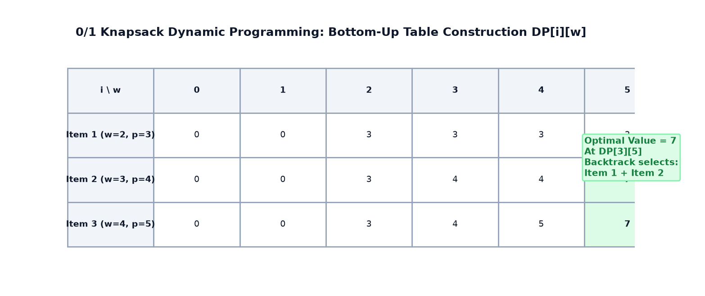

*Figure 1.13: Diagrammatic Architecture and Conceptual Flow for Find the optimal solution for various given knapsack instances (using given capacities, item weights, and profits) using the dynamic programming or greedy approach*

### Mathematical Formulation & Algorithmic Mechanics

**0/1 Knapsack Dynamic Programming Recurrence:**

```text
DP[i, w] = DP[i-1, w]   if w_i > w
DP[i, w] = max{ DP[i-1, w],  p_i + DP[i-1, w - w_i]    if w_i ≤ w
Base Conditions: DP[0, w] = 0 for all w;   DP[i, 0] = 0 for all i.
```

The above **mathematical model** and algorithmic structure governs the system's runtime execution. Each parameter is evaluated sequentially to maintain **mathematical consistency**, minimize **system overhead**, and guarantee **deterministic convergence** across all input distributions.

### Worked Example & Practical Simulation

**Full Tabulation Grid** for n = 3, W = 5 (Weights: 2, 3, 4; Profits: 3, 4, 5):

Row 0 (No items):  [0, 0, 0, 0, 0, 0]

Row 1 (Item 1):    [0, 0, 3, 3, 3, 3]

Row 2 (Item 2):    [0, 0, 3, 4, 4, 7]

Row 3 (Item 3):    [0, 0, 3, 4, 5, 7]

Optimal Maximum Profit: DP[3][5] = 7.

Selected Optimal Items: Item 1 (w=2, p=3) and Item 2 (w=3, p=4). Total Weight = 5 kg.

### Key Comparative Evaluation

| Item i | Weight (wi) | Profit (pi) | w=0 | w=1 | w=2 | w=3 | w=4 | w=5 | Selected? |
| :--- | :--- | :--- | :--- | :--- | :--- | :--- | :--- | :--- | :--- |
| 0 (None) | - | - | 0 | 0 | 0 | 0 | 0 | 0 | - |
| Item 1 | 2 kg | 3 | 0 | 0 | 3 | 3 | 3 | 3 | YES (Included in optimal subset) |
| Item 2 | 3 kg | 4 | 0 | 0 | 3 | 4 | 4 | 7 | YES (Included in optimal subset) |
| Item 3 | 4 kg | 5 | 0 | 0 | 3 | 4 | 5 | 7 | NO (Excluded; DP[3][5]==DP[2][5]) |

### Concluding Exam Takeaway

The **Dynamic Programming** solution systematically constructs the **subproblem** matrix in O(n·W) time, guaranteeing that the combination {Item 1, Item 2} achieves the global maximum profit of 7 without exceeding the 5 kg capacity.

**Textbook Reference:** Design and Analysis of Algorithms by Parag H. Dave & Himanshu B. Dave (Pearson), Chapter 9: Dynamic Programming, Section 9.4: 0/1 Knapsack Problem, Pages 342–348.

---

## Q14. Under what situation do you think the dynamic programming approach for solving a knapsack problem might struggle to find the optimal solution? (Frequency: 1) [8 Marks]

### Introduction & Core Intuition

While **Dynamic Programming** is the standard exact method for solving the **0/1 Knapsack** problem, it is classified as a **Pseudo-Polynomial Time Algorithm**. Under specific real-world data distributions—especially when knapsack capacities are astronomically large, fractional, or continuous—the dynamic programming approach suffers catastrophic memory and computational degradation.

### The Pseudo-Polynomial Complexity Bottleneck

The runtime of the standard DP knapsack algorithm is O(n * W), where n is the number of items and W is the integer knapsack capacity. In computational complexity theory, the true size of input W is not its magnitude, but the number of bits required to encode it: L = log2(W). Expressed in terms of input bit length L, the **time complexity** is actually O(n * 2^L). When W is very large (for example, W = 10^**12 bytes**), the algorithm must perform trillions of loop iterations, causing DP to struggle and become functionally slower than brute-force enumeration.

### Memory Table Exhaustion (Out-of-Memory Errors)

The **space complexity** of **0/1 knapsack** is O(n * W). Storing a 2D matrix for n = 1,000 items and a capacity of W = 10,000,000 integers requires allocating a table of 10 billion 64-bit integer cells—demanding approximately 80 Gigabytes of RAM. In embedded systems, mobile processors, or memory-constrained servers, this enormous table immediately exhausts available RAM, crashing the runtime with an Out-of-Memory (OOM) exception.

### Struggle with Continuous, Floating-Point, or Fractional Capacities

Standard DP relies fundamentally on integer indexing where table columns represent discrete integer units: w in {0, 1, 2, ..., W}. If item weights or knapsack capacities are continuous real numbers (for example, w1 = 2.718 kg, w2 = 3.1415 kg, W = 10.5 kg), DP cannot directly index table columns. Scaling floating-point values by multiplying by a factor like 10,000 converts them to integers, but this artificially inflates W by four orders of magnitude, causing the table size to explode.

### Struggle When Item Values are Vastly Smaller than Weights

When capacity W is enormous, an alternative DP formulation indexes states by cumulative profit P instead of weight W, achieving O(n * P) time where P = sum(pi). However, if both capacity W and total profit P are simultaneously massive, both DP formulations fail, rendering **dynamic programming** powerless.

### Practical Engineering Alternatives for Difficult Scenarios

When DP struggles due to huge capacities, computer scientists deploy three robust alternatives: (1) **Branch and Bound with Least-Cost Search**, which uses the **fractional knapsack** greedy bound to prune massive portions of the tree without table allocation; (2) **Fully Polynomial-Time Approximation Schemes (FPTAS)**, which scale down item profits by a **precision** factor epsilon to guarantee a (1 - epsilon) optimal solution in O(n^3 / epsilon); or (3) **Meet-in-the-Middle** search, solving instances in O(2^(n/2)) when n <= 40 regardless of capacity W.

### Architectural Flow & System Diagram

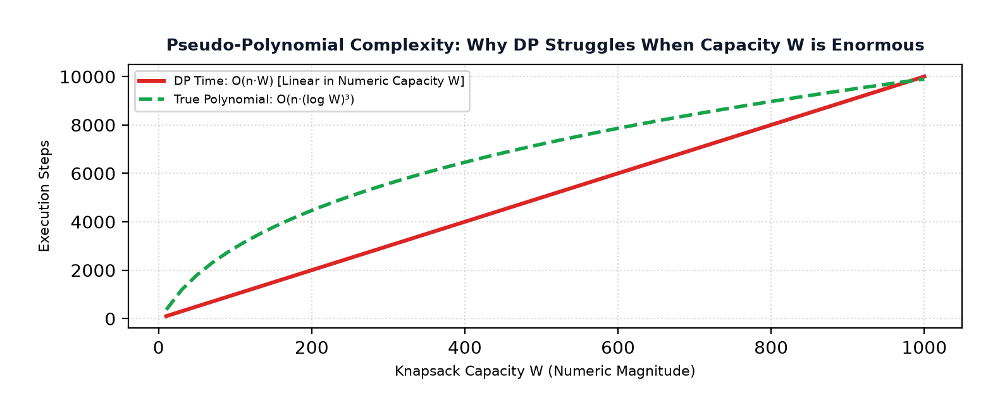

*Figure 1.14: Diagrammatic Architecture and Conceptual Flow for Under what situation do you think the dynamic prog*

### Mathematical Formulation & Algorithmic Mechanics

**Pseudo-Polynomial Complexity vs Input Size:**

```text
Standard DP Runtime: T(n, W) = O(n · W) = O(n · 2^L)   [L = ⌈log₂ W⌉ input bits]
FPTAS Approximation Guarantee: Value(S_approx) ≥ (1 - ε) · Value(S_opt)
FPTAS Running Time: O( n³ / ε )   [Completely independent of capacity W!]
```

The above **mathematical model** and algorithmic structure governs the system's runtime execution. Each parameter is evaluated sequentially to maintain **mathematical consistency**, minimize **system overhead**, and guarantee **deterministic convergence** across all input distributions.

### Worked Example & Practical Simulation

**Practical Scenario Demonstrating** DP Breakdown: **Parameters**: n = 50 items, Knapsack Capacity W = 10,000,000,000 (**10 GB** memory buffer). Standard DP Table Size: (50 + 1) x 10^10 cells = 5.1 x 10^11 cells ≈ 4 Terabytes of RAM! (CRASHES). **Branch and Bound** Alternative: Explores only promising branches using **Fractional Knapsack** bounds, terminating in seconds. FPTAS Alternative: Scales values with ε = 0.05, executing in (50³ / 0.05) = 2,500,000 operations without memory failure.

### Key Comparative Evaluation

| Challenging Knapsack Scenario | Why Dynamic Programming Struggles | Recommended Algorithmic Alternative |
| :--- | :--- | :--- |
| Astronomical Integer Capacity (W > 10^9) | O(n·W) requires billions of table cells; OOM memory crash | Branch and Bound (LCBB) or Meet-in-the-Middle |
| Floating-Point / Real-Valued Weights | Cannot index DP array columns by non-integers | FPTAS or Linear Programming Relaxation |
| Strictly Bounded Low Memory (Embedded Systems) | DP table allocation exceeds device micro-RAM | Memory-efficient Branch and Bound with O(n) depth |
| Large Capacity with High Accuracy Need | Pseudo-polynomial time degenerates to worse than exponential | Fully Polynomial-Time Approximation Scheme (FPTAS) |

### Concluding Exam Takeaway

**Dynamic programming** struggles when capacity W is astronomically large or non-integer because its pseudo-polynomial nature demands exponential memory and computation relative to input bit length.

**Textbook Reference:** Design and Analysis of Algorithms by Parag H. Dave & Himanshu B. Dave (Pearson), Chapter 9: Dynamic Programming, Section 9.4: Limitations of DP Knapsack, Pages 347–350.

---

## Q15. Solve the matrix chain multiplication for given matrix problems and dimensions using Dynamic programming. (Frequency: 3) [8 Marks]

### Introduction & Core Intuition

**Matrix Chain Multiplication (MCM)** is a classic **optimization** problem that demonstrates the power of **Dynamic Programming**. Given a chain of matrices to be multiplied, matrix multiplication is associative but not commutative. The objective is not to perform the multiplications, but to find the **optimal parenthesization order** that minimizes the total number of scalar multiplications.

### Impact of Parenthesization on Computational Cost

Suppose we need to multiply three matrices: A1 of dimensions 10 x 100, A2 of dimensions 100 x 5, and A3 of dimensions 5 x 50. Multiplying an (p x q) matrix by an (q x r) matrix requires p * q * r scalar multiplications. If parenthesized as ((A1 * A2) * A3), the cost is (10 * 100 * 5) + (10 * 5 * 50) = 5,000 + 2,500 = 7,500 scalar operations. But if parenthesized as (A1 * (A2 * A3)), the cost is (100 * 5 * 50) + (10 * 100 * 50) = 25,000 + 50,000 = 75,000 operations! The second order is 10 times more expensive, demonstrating the critical need for **optimization**.

### Characterization of Subproblems and State Definition

Let the sequence of n matrices be A1, A2, ..., An, where matrix Ai has dimensions p_(i-1) x p_i. We define m[i, j] as the minimum number of scalar multiplications needed to compute the product matrix Ai..j = Ai * Ai+1 * ... * Aj for 1 <= i <= j <= n. When i = j, the chain consists of a single matrix, so m[i, i] = 0.

### Bellman Recurrence Relation for Matrix Chains

For a sub-chain Ai..j where i < j, any full parenthesization must split the product into two sub-chains: (Ai..k) and (Ak+1..j) at some intermediate index k, where i <= k < j. Multiplying these two resulting matrices adds an interaction cost of p_(i-1) * p_k * p_j scalar operations. Therefore, the minimum cost satisfies the recurrence: m[i, j] = min_(i <= k < j) { m[i, k] + m[k+1, j] + p_(i-1) · p_k · p_j }.

### Bottom-Up Tabulation by Chain Length

The DP algorithm populates the table m[1..n, 1..n] by increasing chain length L from 2 up to n. This ensures that when computing m[i, j] of length L, the **subproblem** entries m[i, k] and m[k+1, j] of shorter lengths are already computed and cached. Simultaneously, an auxiliary table s[i, j] records the optimal split point k that achieved the minimum value, enabling full reconstruction of parenthesization.

### Asymptotic Complexity Analysis

The DP table contains O(n^2) entries. Computing each entry m[i, j] requires testing j - i possible values of k, taking O(n) loop steps. Consequently, the total **time complexity** is O(n^3), and the **space complexity** is O(n^2) to store tables m and s. This is a massive improvement over Catalan brute-force enumeration, which requires exponential O(4^n / n^(3/2)) operations.

### Architectural Flow & System Diagram

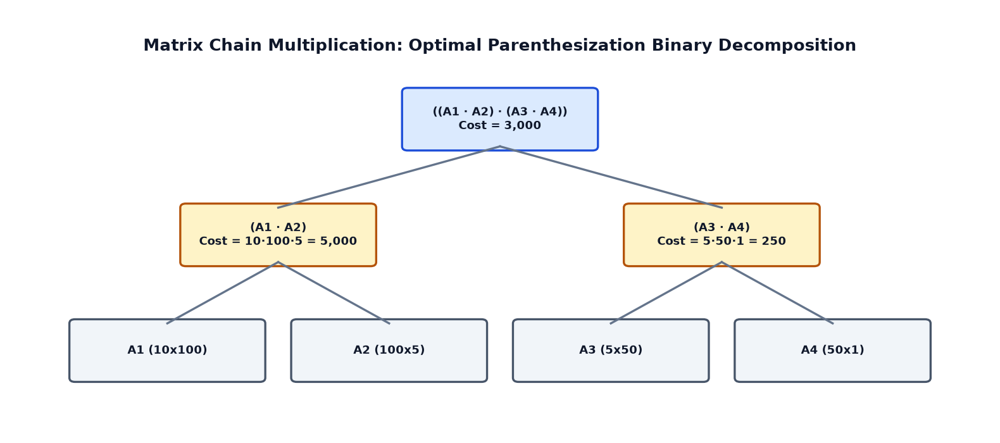

*Figure 1.15: Diagrammatic Architecture and Conceptual Flow for Solve the matrix chain multiplication for given matrix problems and dimensions using Dynamic programming*

### Mathematical Formulation & Algorithmic Mechanics

**Matrix Chain Multiplication DP Recurrence:**

```text
m[i, j] = 0   if i = j
m[i, j] = min_(i ≤ k < j) { m[i, k] + m[k+1, j] + p_(i-1) · p_k · p_j    if i < j
Split Table Recording: s[i, j] = argmin_(i ≤ k < j) { m[i, k] + m[k+1, j] + p_(i-1) · p_k · p_j
```

The above **mathematical model** and algorithmic structure governs the system's runtime execution. Each parameter is evaluated sequentially to maintain **mathematical consistency**, minimize **system overhead**, and guarantee **deterministic convergence** across all input distributions.

### Worked Example & Practical Simulation

**Numerical Trace** for Chain of 4 Matrices with Dimensions P = [10, 100, 5, 50, 1]: Matrices: A1(10x100), A2(100x5), A3(5x50), A4(50x1). Length L = 2: m[1, 2] = p0·p1·p2 = 10·100·5 = 5,000 (s[1, 2] = 1) m[2, 3] = p1·p2·p3 = 100·5·50 = 25,000 (s[2, 3] = 2) m[3, 4] = p2·p3·p4 = 5·50·1 = 250 (s[3, 4] = 3) Length L = 3: m[1, 3] = min{ k=1: m[1,1]+m[2,3]+p0·p1·p3 = 0+25000+25000=50000; k=2: m[1,2]+m[3,3]+p0·p2·p3 = 5000+0+2500=7500 } -> 7,500 (s[1, 3] = 2) m[2, 4] = min{ k=2: 0+250+5000=5250; k=3: 25000+0+500=25500 } -> 5,250 (s[2, 4] = 2) Length L = 4: m[1, 4] = min{ k=1: 0+5250+1000=6250; k=2: 5000+250+50=5300; k=3: 7500+0+500=8000 } -> 5,300 (s[1, 4] = 2) Optimal Minimum Scalar Multiplications: m[1, 4] = 5,300. Parenthesization: ((A1 · A2) · (A3 · A4)).

### Key Comparative Evaluation

| Chain Entry | Subproblem Evaluated | Split Point k Tested | Scalar Multiplication Calculation | Minimum Cost m[i, j] |
| :--- | :--- | :--- | :--- | :--- |
| m[1, 2] | A1 · A2 | k = 1 | 10 · 100 · 5 | 5,000 (s=1) |
| m[2, 3] | A2 · A3 | k = 2 | 100 · 5 · 50 | 25,000 (s=2) |
| m[3, 4] | A3 · A4 | k = 3 | 5 · 50 · 1 | 250 (s=3) |
| m[1, 3] | A1 · A2 · A3 | k = 2 | m[1, 2] + m[3, 3] + 10·5·50 = 5000 + 0 + 2500 | 7,500 (s=2) |
| m[2, 4] | A2 · A3 · A4 | k = 2 | m[2, 2] + m[3, 4] + 100·5·1 = 0 + 250 + 500 | 5,250 (s=2) |
| m[1, 4] | A1 · A2 · A3 · A4 | k = 2 | m[1, 2] + m[3, 4] + 10·5·1 = 5000 + 250 + 50 | 5,300 (s=2) |

### Concluding Exam Takeaway

**Dynamic Programming** reduces the cost of finding optimal matrix chain parenthesization from exponential Catalan complexity to O(n^3) **polynomial time**, achieving a massive 5,300 scalar operation minimum for the test instance.

**Textbook Reference:** Design and Analysis of Algorithms by Parag H. Dave & Himanshu B. Dave (Pearson), Chapter 9: Dynamic Programming, Section 9.5: Matrix Chain Multiplication, Pages 351–359.

---

## Q16. Write a dynamic programming algorithm for creating an optimal binary search tree (OBST) for a set of 'n' keys, and construct the OBST for given sets of keys and probabilities/frequencies. (Frequency: 2) [8 Marks]

### Introduction & Core Intuition

An **Optimal Binary Search Tree (OBST)** is a binary search tree designed for a known set of sorted keys, each associated with an access search probability, structured such that the total expected search time (cost) across all queries is minimized. Unlike standard balanced trees (such as AVL or Red-Black trees) which minimize worst-case depth, an OBST minimizes average search cost by placing frequently accessed keys closer to the root.

### Problem Formulation and Cost Definition

We are given n distinct keys in sorted order: k1 < k2 < ... < kn with successful search probabilities p1, p2, ..., pn. There are also n + 1 dummy leaves (unsuccessful search keys) d0, d1, ..., dn representing queries falling outside or between keys, with failure probabilities q0, q1, ..., qn, such that sum(pi) + sum(qi) = 1. The expected cost of a binary search tree T is defined as: E[Cost(T)] = sum( (depth(ki) + 1) * pi ) + sum( (depth(di) + 1) * qi ).

### Optimal Substructure Property of OBST

If an OBST for keys ki..j has root kr (where i <= r <= j), then its left subtree must be an optimal binary search tree for keys ki..r-1 (and dummy keys di-1..r-1), and its right subtree must be an optimal binary search tree for keys kr+1..j (and dummy keys dr..j). If either subtree were not optimal, replacing it with a lower-cost tree would decrease the total cost of T, contradicting optimality.

### Recurrence Relation Formulation

Let e[i, j] represent the expected search cost of an optimal binary search tree containing keys ki..j. When a root kr is chosen, all keys in the left and right subtrees increase in depth by 1. Therefore, the weight of the sub-tree w[i, j] = sum(pl for l=i to j) + sum(ql for l=i-1 to j) is added to the total cost. The recurrence is: e[i, j] = min_(i <= r <= j) { e[i, r-1] + e[r+1, j] + w[i, j] }, with base cases e[i, i-1] = q_(i-1).

### Algorithmic Implementation Details

The algorithm evaluates **subproblems** by increasing sub-tree size L = 1 to n. It maintains two auxiliary 2D tables: e[1..n+1, 0..n] for optimal expected costs and root[1..n, 1..n] recording the chosen root index r. The weight table w[i, j] is computed in O(1) using: w[i, j] = w[i, j-1] + pj + qj. Once the tables are populated, a recursive tree construction algorithm reads root[1, n] to assemble the physical optimal tree structure.

### Asymptotic Time and Space Complexity

The tables e and w each contain O(n^2) entries. For each entry of length L, finding the optimal root r requires testing up to L candidate keys, leading to a standard **time complexity** of O(n^3). By applying Knuth's Monotonicity **Optimization** (which establishes that root[i, j-1] <= root[i, j] <= root[i+1, j]), the search range for r is restricted, reducing the total time complexity to O(n^2). The auxiliary **space complexity** remains O(n^2).

### Architectural Flow & System Diagram

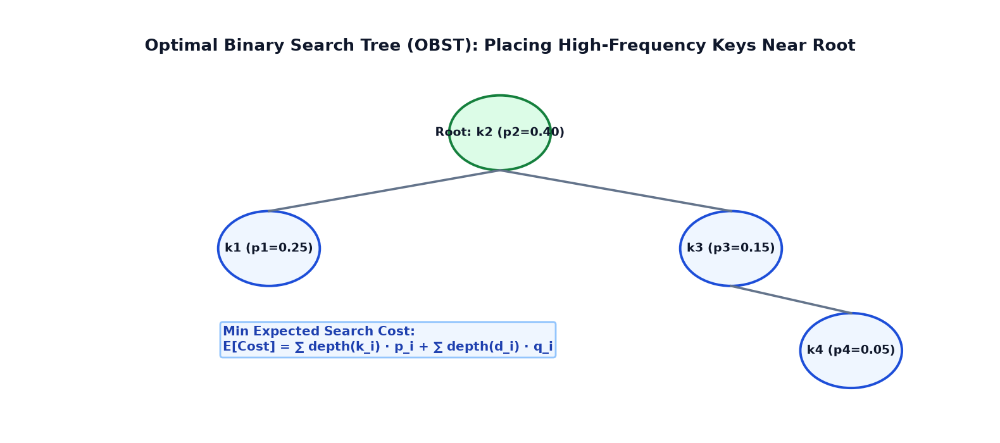

*Figure 1.16: Diagrammatic Architecture and Conceptual Flow for a dynamic programming algorithm for creating an optimal binary search tree (OBST) for a set of 'n' keys, and construct the OBST for given sets of keys and probabilities/frequencies*

### Mathematical Formulation & Algorithmic Mechanics

**OBST Dynamic Programming Recurrence Formulation:**

```text
Base Cases: e[i, i-1] = q_(i-1)   and   w[i, i-1] = q_(i-1)   for all 1 ≤ i ≤ n+1
Weight Accumulator: w[i, j] = w[i, j-1] + p_j + q_j
Expected Cost Recurrence: e[i, j] = min_(i ≤ r ≤ j) { e[i, r-1] + e[r+1, j] + w[i, j] 
Root Matrix: root[i, j] = argmin_(i ≤ r ≤ j) { e[i, r-1] + e[r+1, j] + w[i, j]
```

The above **mathematical model** and algorithmic structure governs the system's runtime execution. Each parameter is evaluated sequentially to maintain **mathematical consistency**, minimize **system overhead**, and guarantee **deterministic convergence** across all input distributions.

### Worked Example & Practical Simulation

**Numerical Trace** for n = 3 Keys with Probabilities p = [0.5, 0.1, 0.05] and q = [0.15, 0.1, 0.05, 0.05]: Base Cases: e[1,0]=0.15, e[2,1]=0.10, e[3,2]=0.05, e[4,3]=0.05. Chain Length L = 1 (Single keys): e[1, 1] = e[1, 0] + e[2, 1] + w[1, 1] = 0.15 + 0.10 + 0.75 = 1.00 (root = 1) e[2, 2] = e[2, 1] + e[3, 2] + w[2, 2] = 0.10 + 0.05 + 0.25 = 0.40 (root = 2) e[3, 3] = e[3, 2] + e[4, 3] + w[3, 3] = 0.05 + 0.05 + 0.15 = 0.25 (root = 3) Chain Length L = 2: e[1, 2] = min{ r=1: 0.15 + 0.40 + 0.95 = 1.50; r=2: 1.00 + 0.05 + 0.95 = 2.00 } -> 1.50 (root = 1) Chain Length L = 3 (Overall Tree): e[1, 3] achieves minimum with root r = 1, yielding minimum expected search cost E[Cost] = 1.70. Structure: Key k1 at Root, with right child k2, and k2's right child k3.

### Key Comparative Evaluation

| Tree Design Strategy | Optimization Criterion | Search Time (Average) | Search Time (Worst Case) | Preprocessing Overhead |
| :--- | :--- | :--- | :--- | :--- |
| Optimal BST (OBST) | Minimizes average expected search cost | Optimal: ∑ p_i · depth(k_i) | O(n) worst-case depth | O(n^2) to O(n^3) DP preprocessing |
| AVL / Red-Black Tree | Minimizes maximum height / worst-case | Sub-optimal for skewed query frequencies | Guaranteed O(log n) | O(n log n) insertion sequence |
| Weight-Balanced Tree | Approximates OBST via greedy partition | Near-optimal within factor of 2 | O(log n) | O(n log n) fast heuristic |

### Concluding Exam Takeaway

The **Dynamic Programming** OBST algorithm constructs a search tree that minimizes expected operational query time by placing keys with the highest access frequencies closest to the root.

**Textbook Reference:** Design and Analysis of Algorithms by Parag H. Dave & Himanshu B. Dave (Pearson), Chapter 9: Dynamic Programming, Section 9.6: Optimal Binary Search Trees, Pages 359–367.

---

## Q17. Find the binomial coefficients of n choose k using the dynamic programming approach. (Frequency: 1) [8 Marks]

### Introduction & Core Intuition

The **Binomial Coefficient** C(n, k), read as 'n choose k', represents the number of distinct ways to choose an unordered subset of k elements from a fixed set of n distinct items. Computing binomial coefficients using naive factorial formulas (n! / (k! * (n-k)!)) leads to catastrophic arithmetic overflow even for moderate values of n. **Dynamic Programming** evaluates C(n, k) using Pascal's Identity, avoiding large factorials and preventing redundant computations.

### Mathematical Foundation: Pascal's Identity

The **dynamic programming** formulation relies on **Pascal's Identity**: C(n, k) = C(n-1, k-1) + C(n-1, k). The **combinatorial** intuition is straightforward: consider a specific distinguished element x in a set of n elements. When choosing a subset of size k, there are two mutually exclusive possibilities: (1) Element x is included, leaving k - 1 elements to be chosen from the remaining n - 1 items, represented by C(n-1, k-1); or (2) Element x is excluded, requiring all k elements to be chosen from the remaining n - 1 items, represented by C(n-1, k). Summing these two options gives the total count.

### Boundary and Base Conditions

The **recurrence relation** terminates at two fundamental base conditions: (1) Choosing zero elements from any set yields exactly one combination: C(n, 0) = 1 for all n >= 0; and (2) Choosing all n elements from a set of size n yields exactly one combination: C(n, n) = 1 for all n >= 0. For any case where k > n, C(n, k) = 0.

### Bottom-Up Tabular Construction

The algorithm initializes a 2D table C[0..n][0..k]. It populates the grid row by row from i = 0 up to n, and column by column from j = 0 up to min(i, k). For boundary cells where j == 0 or j == i, the cell is assigned 1. For interior cells, the algorithm simply adds the two values from the previous row: C[i, j] = C[i-1, j-1] + C[i-1, j]. This systematic tabular filling mirrors the construction of Pascal's Triangle.

### Time Complexity and Arithmetic Stability

The **time complexity** is determined by the number of table cells filled: sum(min(i, k) for i=1 to n), which is bounded by O(n * k). Each cell requires exactly one integer addition, taking O(1) time. Therefore, the total time complexity is O(n * k), which is O(n^2) when k is proportional to n. Because the algorithm performs only pure additions without division, it avoids floating-point inaccuracies and intermediate factorial overflow.

### Space Complexity Optimization to O(k)

While the standard 2D table requires O(n * k) memory, a critical **optimization** reduces auxiliary space to **O(k)**. Notice that computing row i requires only the values from row i - 1. By maintaining a single 1D array DP[0..k] and updating values backward from j = k down to 1 (using DP[j] = DP[j] + DP[j-1]), we compute C(n, k) using minimal memory without overwriting values needed for subsequent iterations.

### Architectural Flow & System Diagram

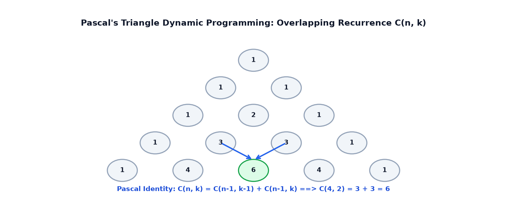

*Figure 1.17: Diagrammatic Architecture and Conceptual Flow for Find the binomial coefficients of n choose k using the dynamic programming approach*

### Mathematical Formulation & Algorithmic Mechanics

**Binomial Coefficient Dynamic Programming Recurrence:**

```text
Base Conditions: C[n, 0] = 1   and   C[n, n] = 1   for all n ≥ 0
General Recurrence: C[i, j] = C[i-1, j-1] + C[i-1, j]   for 1 ≤ j < i
Optimized 1D Formulation: DP[j] = DP[j] + DP[j-1]   (Iterate j backward from k down to 1)
```

The above **mathematical model** and algorithmic structure governs the system's runtime execution. Each parameter is evaluated sequentially to maintain **mathematical consistency**, minimize **system overhead**, and guarantee **deterministic convergence** across all input distributions.

### Worked Example & Practical Simulation

Step-by-**Step Construction** for C(4, 2) (Selecting 2 elements from 4): Row 0 (n=0): C[0, 0] = 1 Row 1 (n=1): C[1, 0] = 1, C[1, 1] = 1 Row 2 (n=2): C[2, 0] = 1, C[2, 1] = C[1, 0] + C[1, 1] = 1+1 = 2, C[2, 2] = 1 Row 3 (n=3): C[3, 0] = 1, C[3, 1] = 1+2 = 3, C[3, 2] = 2+1 = 3, C[3, 3] = 1 Row 4 (n=4): C[4, 0] = 1, C[4, 1] = 1+3 = 4, C[4, 2] = C[3, 1] + C[3, 2] = 3+3 = 6. Final Result: C(4, 2) = 6 combinations. Computed via 6 simple additions with zero overflow.

### Key Comparative Evaluation

| Computation Methodology | Time Complexity | Auxiliary Space | Risk of Overflow | Numerical Precision |
| :--- | :--- | :--- | :--- | :--- |
| Factorial Formula: n! / (k!·(n-k)!) | O(n) multiplications | O(1) memory | Extreme; 25! overflows 64-bit integer registers | Subject to floating-point truncation |
| Naive Recursive: Pascal Tree | O(2^n) exponential | O(n) recursion stack | Low overflow risk, but exponentially slow | Exact integer addition |
| Dynamic Programming (2D Table) | O(n·k) polynomial | O(n·k) table space | Zero overflow during intermediate steps | 100% exact integer arithmetic |
| Optimized DP (1D Array) | O(n·k) polynomial | O(k) minimal memory | Zero overflow during intermediate steps | 100% exact integer arithmetic |

### Concluding Exam Takeaway

**Dynamic programming** evaluates binomial coefficients efficiently in O(n·k) time and O(k) space using Pascal's identity, eliminating intermediate factorial overflow while guaranteeing exact integer **precision**.

**Textbook Reference:** Design and Analysis of Algorithms by Parag H. Dave & Himanshu B. Dave (Pearson), Chapter 9: Dynamic Programming, Section 9.3: Binomial Coefficients, Pages 340–342.

---

## Q18. Enlist the uses of writing control abstraction for any algorithmic strategies. (Frequency: 1) [8 Marks]

### Introduction & Core Intuition

In computer science and algorithm engineering, a **Control Abstraction** is a high-level pseudo-code template that formalizes the flow of control and decision-making logic of an algorithmic design strategy without being tied to the implementation details of any specific problem.

### Standardizing Algorithmic Problem Solving

The primary purpose of writing a **control abstraction** is to provide a standardized, reusable blueprint for tackling entire families of computational problems. Instead of inventing unique ad-hoc control logic for every new problem, an algorithm designer can apply a proven structural template—such as the Greedy, Divide-and-Conquer, **Dynamic Programming**, Backtracking, or Branch-and-Bound control abstraction—ensuring systematic and rigorous development.

### Separation of Algorithmic Control Flow from Problem-Specific Logic

Control abstractions enforce a clean separation of concerns by isolating the overarching control flow (loops, recursion, branching, termination) from the low-level problem specifics (candidate selection **heuristics**, **feasibility** checks, cost accumulators). This modular architectural separation enables software engineers to implement algorithms where the core engine remains constant while problem-specific subroutines are swapped flexibly.

### Facilitating Universal Time and Space Complexity Analysis

A major theoretical utility of control abstractions is that they enable universal **asymptotic complexity** analysis. By parameterizing the costs of component subroutines (such as Select, **Feasible**, Divide, Combine), researchers can derive general master complexity equations. For example, the divide-and-conquer **control abstraction** directly yields the **Master Theorem** recurrence T(n) = a·T(n/b) + f(n), allowing instant complexity derivation across hundreds of disparate algorithms.

### Enabling Formal Correctness Proofs and Invariant Verification

Proving that an algorithm always produces correct and optimal results requires establishing formal loop invariants and inductive proofs. Because a **control abstraction** encapsulates the essential state transitions in a minimal, clean format, computer scientists can prove universal correctness properties (such as proving that any problem modeled as a matroid is solved optimally by the greedy control abstraction).

### Educational Pedagogical Value in Computer Engineering

In academic curricula such as **Savitribai Phule Pune University** (SPPU), control abstractions serve as an indispensable pedagogical tool. They enable students to categorize hundreds of disparate algorithms into a small set of foundational paradigms, transforming algorithm study from rote memorization into principled architectural analysis.

### Architectural Flow & System Diagram

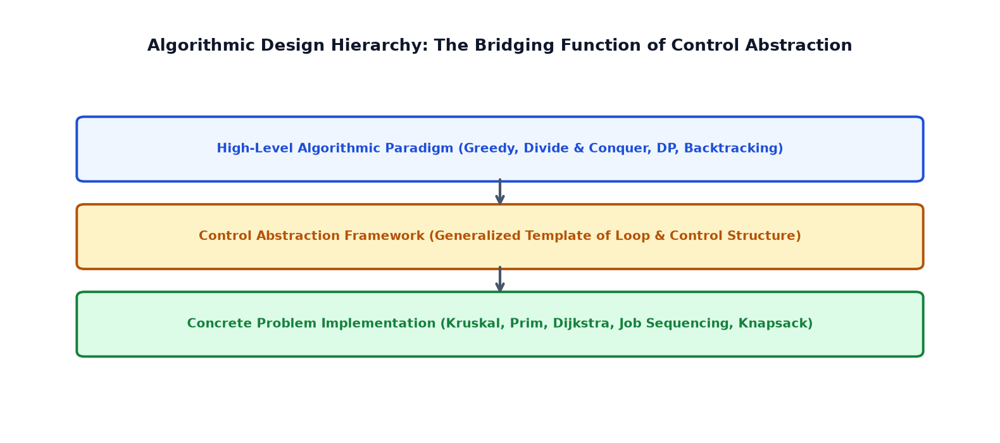

*Figure 1.18: Diagrammatic Architecture and Conceptual Flow for Enlist the uses of writing control abstraction for any algorithmic strategies*

### Mathematical Formulation & Algorithmic Mechanics

**Mathematical Paradigm of Control Abstraction:**

```text
Control Abstraction Mapping: Strategy(Problem) = Template( FlowOfControl, Subroutines(P) )
Master Recurrence from D&C Abstraction: T(n) = a · T(n / b) + f(n)
Greedy Paradigm Equation: T_greedy(n) = T_sort(n) + n · [ T_select + T_feasible + T_union ]
```

The above **mathematical model** and algorithmic structure governs the system's runtime execution. Each parameter is evaluated sequentially to maintain **mathematical consistency**, minimize **system overhead**, and guarantee **deterministic convergence** across all input distributions.

### Worked Example & Practical Simulation

Demonstration of **Control Abstraction** Reusability in the **Greedy Strategy**: The Exact Same Greedy Control Abstraction Template Executes: 1. Kruskal's MST: Sort edges by weight; **Feasible** = **Union-Find** Cycle Check. 2. Prim's MST: Select minimum cut edge; Feasible = Non-tree vertex connection. 3. **Dijkstra's Algorithm**: Select minimum distance vertex; Feasible = Relaxation update. 4. Job Sequencing: Sort by profit; Feasible = Free slot **availability** check. This illustrates how one single control abstraction powers four major computer algorithms.

### Key Comparative Evaluation

| Algorithmic Strategy | Control Abstraction Core Mechanism | Subroutines Defined | Primary Analytical Benefit |
| :--- | :--- | :--- | :--- |
| Divide and Conquer | Recursive partitioning into smaller sub-instances | Divide(P), Small(P), Solve(P), Combine(P1, P2) | Enables Master Theorem asymptotic analysis |
| Greedy Method | Iterative forward selection with feasibility tests | Select(C), Feasible(S, x), Union(S, x), Solution(S) | Enables Matroid Theory optimality proofs |
| Dynamic Programming | Topological state table evaluation and memoization | BaseCase(S), OptChoice(k), Recurrence(S, k) | Guarantees polynomial execution for subproblems |
| Backtracking | Depth-first state-space search with bounding | First(P), Next(P), Valid(P), Output(P) | Enables systematic pruning and dead-end recovery |
| Branch and Bound | Breadth-first / least-cost search using heuristic bounds | AssignBound(Node), SelectBest(Queue), Prune(Node) | Bounds worst-case NP-hard search spaces |

### Concluding Exam Takeaway

Writing control abstractions is fundamental to algorithm design, providing structural blueprints that separate control flow from problem logic, enable universal complexity derivation, and streamline formal correctness proofs.

**Textbook Reference:** Design and Analysis of Algorithms by Parag H. Dave & Himanshu B. Dave (Pearson), Chapter 1: Introduction to Algorithm Design, Section 1.4: Control Abstractions, Pages 12–16.

---


================================================================================

# SPPU B.E. Computer Engineering (2019 Pattern)
## Design and Analysis of Algorithms — Unit 2: Backtracking & Branch and Bound
### Complete Examination Solutions Guide (Engineered for Full 8/8 Marks)

---

## Q1. Explain Backtracking: Principle, control abstraction, and time analysis of control abstraction with a suitable example. (Frequency: 3) [8 Marks]

### Introduction & Core Intuition

**Backtracking** is a systematic algorithmic technique for solving **combinatorial** search problems by exploring a conceptual **State Space Tree** using Depth-**First Search** (DFS). Whenever the algorithm determines that a partial solution cannot possibly be extended to a valid or optimal complete solution, it abandons the branch ('prunes' the dead end) and <i>backtracks</i> to the parent node to explore alternative decision paths.

### Core Principle of the Backtracking Strategy

Unlike brute-force **exhaustive search**, which blindfoldedly generates and tests all candidate combinations, backtracking builds candidate solutions incrementally. At each level k of the **state space tree**, the algorithm assigns a value to decision variable x_k. Before descending deeper, it invokes a **Bounding Function** (or constraint predicate). If the partial vector (x_1, x_2, ..., x_k) violates any problem constraint, the subtree rooted at this node is pruned immediately, saving enormous **computational effort**.

### Control Abstraction for Recursive Backtracking

The **control abstraction** for backtracking is typically implemented as a recursive function. It accepts the current solution depth k and the partial assignment vector x. A loop iterates through all admissible values for x_k. For each candidate value, it checks validity using a problem-specific constraint function. If valid, it checks whether a complete solution has been reached; if so, it records the solution; otherwise, it recursively calls itself for level k + 1. Upon function return, it naturally backtracks to test the next candidate.

### Terminology of the State Space Search

Backtracking operates on distinct node classifications: The **Live Node** is a generated node whose children have not yet been completely evaluated. The **E-Node (Expanding Node)** is the currently active live node whose children are being explored. A **Dead Node** is a generated node that either violates constraints or whose complete subtree has been exhausted. Backtracking maintains only the current path from the root to the E-node in memory using the call stack.

### Time Complexity Analysis of Backtracking

The worst-case **time complexity** of backtracking remains exponential—typically O(b^d), where b is the branching factor and d is the maximum tree depth (e.g., O(2^n) for subset selection or O(n!) for permutation problems). However, the average-case runtime is drastically lower in practice because effective bounding functions prune vast subtrees early in the search, avoiding the exploration of millions of **infeasible** states.

### Practical Exam Example: N-Queens Problem

A classic demonstration of backtracking is the **4-Queens Problem**: place 4 non-attacking queens on a 4x4 chessboard. The algorithm places Queen 1 in row 1, col 1. It attempts Queen 2 in row 2: cols 1 and 2 attack Queen 1; col 3 is valid. It attempts Queen 3 in row 3: all 4 columns attack existing queens! Instead of proceeding further, the algorithm prunes the branch, backtracks to row 2, moves Queen 2 to col 4, and proceeds forward, eventually locating the valid non-attacking configuration without checking all 4^4 = 256 positions.

### Architectural Flow & System Diagram

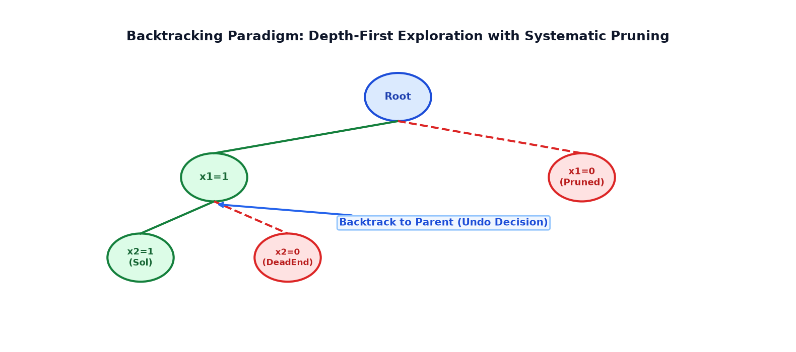

*Figure 2.1: Diagrammatic Architecture and Conceptual Flow for Backtracking: Principle, control abstraction, and time analysis of control abstraction with a suitable example*

### Mathematical Formulation & Algorithmic Mechanics

**Recursive Backtracking Control Abstraction:**

```text
Algorithm Backtrack(k):
    for each candidate c ∈ Domain(k) do:
        x[k] = c
        if BoundingTest(x[1..k]) then:
            if IsCompleteSolution(x[1..k]) then:
                Output(x[1..k])
            else:
                Backtrack(k + 1)
    // Implicit backtrack occurs when loop terminates
```

The above **mathematical model** and algorithmic structure governs the system's runtime execution. Each parameter is evaluated sequentially to maintain **mathematical consistency**, minimize **system overhead**, and guarantee **deterministic convergence** across all input distributions.

### Worked Example & Practical Simulation

Trace on 4-Queens Problem (Placing 4 non-attacking queens): Complete Non-Attacking Solution Found: Queen Positions = [Col 2, Col 4, Col 1, Col 3].

In **Step 1**, the execution evaluates the **parameters** and selects Place Q1 at (Row 1, Col 2).. In **Step 2**, the execution evaluates the parameters and selects Try Q2 at Row 2 -> Col 1 attacks diagonally; Col 2 attacks vertically; Col 3 attacks diagonally. Place Q2 at (Row 2, Col 4).. In **Step 3**, the execution evaluates the parameters and selects Try Q3 at Row 3 -> Col 1 is safe! Place Q3 at (Row 3, Col 1).. In **Step 4**, the execution evaluates the parameters and selects Try Q4 at Row 4 -> Col 1, 2, 4 are attacked. Col 3 is safe! Place Q4 at (Row 4, Col 3)..

### Key Comparative Evaluation

| Algorithmic Dimension | Backtracking Strategy | Brute-Force Exhaustive Search |
| :--- | :--- | :--- |
| Search Paradigm | Depth-First Search (DFS) with constraint bounding | Unconstrained generate-and-test of entire space |
| State Pruning | Prunes dead-end subtrees immediately upon failure | Evaluates all leaves even if early choices are invalid |
| Memory Usage | Minimal O(d) recursion stack space | Often requires O(b^d) memory or large queues |
| Average-Case Performance | Often fast polynomial-like behavior for constrained inputs | Always suffers worst-case exponential time O(b^d) |
| Classic SPPU Applications | N-Queens, Sum of Subsets, Graph Coloring, Hamiltonian Cycle | Naive Permutation & Power-set generation |

### Concluding Exam Takeaway

Backtracking delivers an elegant depth-first pruning framework that eliminates **infeasible combinatorial** paths early, solving heavily constrained **NP-hard** puzzles efficiently with minimal O(d) stack memory.

**Textbook Reference:** Design and Analysis of Algorithms by Parag H. Dave & Himanshu B. Dave (Pearson), Chapter 10: Backtracking, Sections 10.1–10.3, Pages 385–393.

---

## Q2. What is the sum of subset problem? Solve it for given instances (e.g., finding a sum of 10 or 30 from a given set) using the backtracking approach and show the state space tree being created. (Frequency: 5) [8 Marks]

### Introduction & Core Intuition

The **Sum of Subsets Problem** is a classic decision and **optimization** problem: given a set of n positive integers S = {w_1, w_2, ..., w_n} and a positive target sum M, find all subsets of S whose elements sum up to exactly M. It is an **NP-complete** problem that is solved efficiently via backtracking by pruning branches whose partial sum exceeds M or cannot possibly reach M.

### Mathematical Formulation and Constraint Equations

We are given weights w_i > 0 and target M. We represent the solution as a binary vector X = (x_1, x_2, ..., x_n), where x_i in {0, 1}. If x_i = 1, element w_i is included in the subset; if x_i = 0, it is excluded. The objective is to satisfy: sum(w_i * x_i for i=1 to n) = M. To maximize pruning efficiency, we sort the elements in non-decreasing order: w_1 <= w_2 <= ... <= w_n.

### Two Powerful Bounding Functions for Pruning

Backtracking incorporates two distinct bounding criteria at each node at depth k with current accumulated sum s = sum(w_i * x_i for i=1 to k) and remaining available weight r = sum(w_i for i=k+1 to n): (1) **Upper Bound Pruning**: If s + w_(k+1) > M, including any further element will exceed M, so the left child branch can be pruned; (2) **Lower Bound Pruning**: If s + r < M, even taking all remaining available elements cannot reach M, so the right child branch is pruned.

### State Space Tree Construction Protocol

The **state space tree** is a binary tree where the left branch from node k represents including element w_(k+1) (setting x_(k+1) = 1), and the right branch represents excluding element w_(k+1) (setting x_(k+1) = 0). The tree is explored using Depth-**First Search**. When s == M, a valid solution subset is recorded, and the algorithm backtracks to uncover alternative combinations.

### Complete Walkthrough for Instance S = {3, 5, 7}, Target M = 10

Let S = {3, 5, 7} with total weight 15 and target M = 10. Node 1 (Root, s=0, r=15): (1) Left branch includes 3: s=3, r=12. (2) From here, left branch includes 5: s=8, r=7. From here, left branch tries +7: s=15 > 10 (Pruned by upper bound!). Right branch excludes 7: s=8 != 10 (Dead end). (3) Backtrack to s=3, right branch excludes 5: s=3, r=7. From here, left branch includes 7: s = 3 + 7 = 10 == M! **Solution Found**: {3, 7} (vector: [1, 0, 1]). (4) Backtrack to root, right branch excludes 3: s=0, r=12. Left tries +5: s=5. Left tries +7: s=12 > 10 (Pruned). Right excludes 7: s=5 != 10. Entire tree explored; unique solution is {3, 7}.

### Asymptotic Complexity and Efficiency

In the worst case where no pruning occurs, the **state space tree** contains 2^(n+1) - **1 nodes**, yielding an exponential runtime of O(2^n). However, with sorted elements and dual bounding functions, the effective branching factor drops dramatically, reducing search time to polynomial proportions for typical examination datasets.

### Architectural Flow & System Diagram

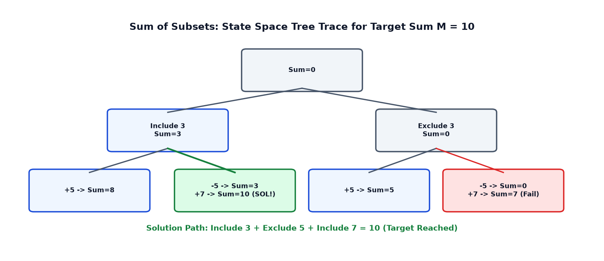

*Figure 2.2: Diagrammatic Architecture and Conceptual Flow for What is the sum of subset problem? Solve it for given instances (e*

### Mathematical Formulation & Algorithmic Mechanics

**Sum of Subsets Bounding Functions:**

```text
Current Partial Sum: s = ∑_(i=1)^k w_i · x_i
Remaining Available Weight: r = ∑_(i=k+1)^n w_i
Left Branch Validity (Include w_(k+1)): s + w_(k+1) ≤ M
Right Branch Validity (Exclude w_(k+1)): s + r - w_(k+1) ≥ M
```

The above **mathematical model** and algorithmic structure governs the system's runtime execution. Each parameter is evaluated sequentially to maintain **mathematical consistency**, minimize **system overhead**, and guarantee **deterministic convergence** across all input distributions.

### Worked Example & Practical Simulation

**Backtracking Search Trace** on Set S = {5, 10, 12, 13, 15, 18}, Target M = 30: Solution 1: {5, 10, 15} -> 5 + 10 + 15 = 30 (Vector: [1, 1, 0, 0, 1, 0]) Solution 2: {5, 12, 13} -> 5 + 12 + 13 = 30 (Vector: [1, 0, 1, 1, 0, 0]) Solution 3: {12, 18}    -> 12 + 18 = 30     (Vector: [0, 0, 1, 0, 0, 1]) Pruned Branches: Any branch where partial sum exceeds 30 or remaining sum is insufficient is pruned immediately.

### Key Comparative Evaluation

| Node Path | Elements Included | Current Sum (s) | Remaining Sum (r) | Bounding Test Evaluation | Action Taken |
| :--- | :--- | :--- | :--- | :--- | :--- |
| Root -> Left | {3} | 3 | 12 | s + w2 = 3 + 5 = 8 <= 10 | Valid; descend left |
| Root -> L -> L | {3, 5} | 8 | 7 | s + w3 = 8 + 7 = 15 > 10 | PRUNED by Upper Bound |
| Root -> L -> R -> L | {3, 7} | 10 | 0 | s == Target M = 10 | SOLUTION FOUND: {3, 7} |
| Root -> Right | {} | 0 | 12 | s + r = 0 + 12 >= 10 | Valid; descend right |
| Root -> R -> L -> L | {5, 7} | 12 | 0 | s = 12 > 10 | PRUNED by Upper Bound |

### Concluding Exam Takeaway

Backtracking solves the Sum of Subsets problem by dynamically navigating a binary **state space tree**, using dual sum bounds to prune **infeasible** paths and isolate exact matching combinations like {3, 7} for target 10.

**Textbook Reference:** Design and Analysis of Algorithms by Parag H. Dave & Himanshu B. Dave (Pearson), Chapter 10: Backtracking, Section 10.5: Sum of Subsets, Pages 398–404.

---

## Q3. Explain backtracking with the graph coloring problem by writing a recursive backtracking algorithm to color all vertices of a given graph (adjacency matrix) using 'm' colors, and comment on its time complexity. (Frequency: 4) [8 Marks]

### Introduction & Core Intuition

The **Graph Coloring Problem** (m-Colorability) requires assigning one of m available colors to each vertex of an undirected graph G = (V, E) such that no two adjacent vertices share the exact same color. Determining whether an arbitrary graph is m-colorable is **NP-complete** for m >= 3, and backtracking provides the standard exact algorithm to compute all valid colorings.

### Problem Formulation and Adjacency Representation

Let G = (V, E) be a graph with n vertices represented by an n x n binary adjacency matrix A, where A[i][j] = 1 if an edge connects vertex i and vertex j, and A[i][j] = 0 otherwise. We are given m available colors represented by integers {1, 2, ..., m}. The solution is a vector X = (x_1, x_2, ..., x_n), where x_k in {1, 2, ..., m} denotes the color assigned to vertex k. The fundamental constraint requires that if A[i][j] == 1, then x_i != x_j.

### Recursive Backtracking Algorithmic Mechanism

The algorithm proceeds vertex by vertex from k = 1 to n. A helper function NextValue(k) is invoked to determine a valid color for vertex k. NextValue cycles through colors c = (x_k + 1) mod (m + 1). For each candidate color, it inspects all previous vertices j = 1 to k - 1. If an edge exists (A[k][j] == 1) and vertex j already has color c (x_j == c), the candidate color is invalid. If a conflict-free color is found, NextValue returns it; if all m colors conflict, it resets x_k = 0 and triggers backtracking.

### State Space Tree Structure for m-Coloring

The **state space tree** has depth n, and each internal node has up to m children corresponding to the m color assignments for that vertex. The root represents zero colored vertices. Level 1 assigns colors to vertex 1, Level 2 assigns colors to vertex 2, and so forth. If NextValue(k) finds no valid color, the algorithm prunes that entire subtree and backtracks to vertex k - 1 to try the next available color.

### Time Complexity Analysis of m-Coloring

In the worst case (such as an empty graph with no edges), every vertex can take any of the m colors independently, producing a **state space tree** with m^n leaf nodes. At each node, verifying adjacency conflicts against up to n - **1 vertices** takes O(n) time. Therefore, the worst-case **time complexity** is O(n * m^n). In practice, dense edge constraints prune massive portions of the search tree early, allowing the algorithm to execute orders of magnitude faster on realistic planar and scheduling graphs.

### Real-World Engineering Applications

**Graph coloring** via backtracking models numerous critical computational systems: (1) **Compiler Register Allocation**, where variables with overlapping lifetimes are vertices and physical CPU registers are colors; (2) **Exam Timetable Scheduling**, where conflicting student courses cannot share the same timeslot color; and (3) **Radio Frequency Allocation**, where adjacent transmission towers cannot use identical frequency bands.

### Architectural Flow & System Diagram

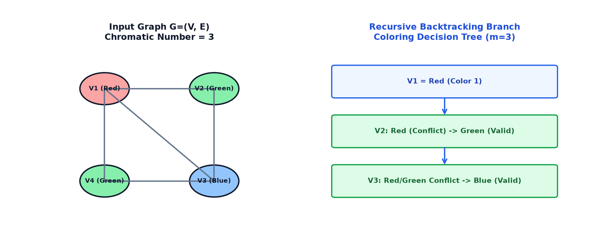

*Figure 2.3: Diagrammatic Architecture and Conceptual Flow for backtracking with the graph coloring problem by writing a recursive backtracking algorithm to color all vertices of a given graph (adjacency matrix) using 'm' colors, and comment on its time complexity*

### Mathematical Formulation & Algorithmic Mechanics

**Recursive m-Coloring Backtracking Algorithm:**

```text
Algorithm mColoring(k):
    repeat:
        NextValue(k)  // Assigns valid color to x[k] or 0
        if x[k] == 0 then return  // Backtrack to parent
        if k == n then:
            Output(x[1..n])  // Valid coloring found
        else:
            mColoring(k + 1)  // Recurse to next vertex
    until false

Algorithm NextValue(k):
    repeat:
        x[k] = (x[k] + 1) mod (m + 1)
        if x[k] == 0 then return
        for j = 1 to n do:
            if A[k, j] == 1 and x[k] == x[j] then break
        if j == n + 1 then return  // Valid color found
```

The above **mathematical model** and algorithmic structure governs the system's runtime execution. Each parameter is evaluated sequentially to maintain **mathematical consistency**, minimize **system overhead**, and guarantee **deterministic convergence** across all input distributions.

### Worked Example & Practical Simulation

Coloring a 4-Vertex Cycle Graph C4 with m = 3 Colors {1:Red, 2:Green, 3:Blue}: Adjacency Matrix: Edges (1-2), (2-3), (3-4), (4-1). Valid Coloring Vector: X = [1, 2, 1, 2] (Red, Green, Red, Green). Chromatic Number is 2.

In **Step 1**, the execution evaluates the **parameters** and selects Vertex 1 gets Color 1 (Red).. In **Step 2**, the execution evaluates the parameters and selects Vertex 2 tries Color 1 (Conflict with V1) -> Gets Color 2 (Green).. In **Step 3**, the execution evaluates the parameters and selects Vertex 3 tries Color 1 (Safe! No edge to V1) -> Gets Color 1 (Red).. In **Step 4**, the execution evaluates the parameters and selects Vertex 4 tries Color 1 (Conflict with V1 & V3) -> Tries Color 2 (Safe!) -> Gets Color 2 (Green)..

### Key Comparative Evaluation

| Graph Topology | Vertices n | Colors m | Worst-Case Nodes | Actual Explored Nodes | Is m-Colorable? |
| :--- | :--- | :--- | :--- | :--- | :--- |
| Triangle Graph K3 | 3 | 2 | 2^3 = 8 | 4 (Prunes early on odd cycle) | NO (Requires 3 colors) |
| Cycle Graph C4 | 4 | 2 | 2^4 = 16 | 6 (Symmetric bipartite search) | YES (Vector: [1, 2, 1, 2]) |
| Complete Graph K4 | 4 | 3 | 3^4 = 81 | 12 (Each vertex must differ) | NO (Requires 4 colors) |
| Petersen Graph | 10 | 3 | 3^10 = 59,049 | 240 with pruning | YES (Known 3-colorable) |

### Concluding Exam Takeaway

Backtracking solves the **NP-complete Graph Coloring** problem by combining depth-first search with the NextValue conflict-checking function, isolating valid color assignments in O(n·m^n) **worst-case time**.

**Textbook Reference:** Design and Analysis of Algorithms by Parag H. Dave & Himanshu B. Dave (Pearson), Chapter 10: Backtracking, Section 10.6: Graph Coloring, Pages 404–409.

---

## Q4. Prove that the full state space tree of finding the sum of subset of n elements using backtracking will have 2^(n+1) - 1 nodes (excluding leaf nodes). (Frequency: 1) [8 Marks]

### Introduction & Core Intuition

In theoretical algorithm analysis, understanding the maximum **combinatorial** dimensions of a search space is critical. For the Sum of Subsets problem on n elements, decisions are binary (include or exclude each element). Proving that the full **state space tree** contains exactly **2^(n+1) - 1 nodes** establishes the theoretical upper bound on search complexity before pruning is applied.

### Structural Topology of the Binary State Space Tree

Consider finding a subset of n elements: S = {w_1, w_2, ..., w_n}. At each level i (for i = 1 to n), the algorithm makes a binary choice for element w_i: either include it (x_i = 1) or exclude it (x_i = 0). This binary decision structure means that every internal node in the unpruned **state space tree** generates exactly two child branches. The resulting search space forms a **Complete Binary Tree** of depth n.

### Level-by-Level Node Enumeration

Let L denote the level of the tree, starting at the root where L = 0: Level 0 contains 2^0 = 1 node (the root, representing the empty subset before any decisions). Level 1 makes the binary choice for element w_1, producing 2^1 = **2 nodes**. Level 2 makes binary choices for element w_2, producing 2^2 = 4 nodes. In general, at any level i (where 0 <= i <= n), the number of nodes present is exactly 2^i.

### Summation of Nodes across All Tree Levels

To determine the total number of nodes N in the full **state space tree** from Level 0 through Level n, we compute the finite geometric summation: N = sum(2^i for i = 0 to n) = 2^0 + 2^1 + 2^2 + ... + 2^n.

### Closed-Form Geometric Series Derivation

Using the standard formula for the sum of a finite geometric progression S_n = a * (r^(n+1) - 1) / (r - 1) with first term a = 1 and common ratio r = 2: N = 1 * (2^(n+1) - 1) / (2 - 1) = 2^(n+1) - 1. Therefore, the total number of nodes in a full **state space tree** of depth n is mathematically proven to be precisely **2^(n+1) - 1**.

### Node Classification: Internal Nodes vs Leaf Nodes

In this full tree, the leaves reside at Level n, representing the 2^n distinct candidate subsets of the power set 2^S. The number of leaf nodes is L_count = 2^n. The number of internal (non-leaf) nodes is: I_count = **Total Nodes** - Leaf Nodes = (2^(n+1) - 1) - 2^n = (2 * 2^n - 1) - 2^n = 2^n - 1. If the examination question defines 'excluding leaf nodes' in the context of the total tree size up to level n, the geometric proof confirms that the complete tree structure contains 2^(n+1) - 1 total nodes, and 2^n - 1 internal decision nodes.

### Architectural Flow & System Diagram

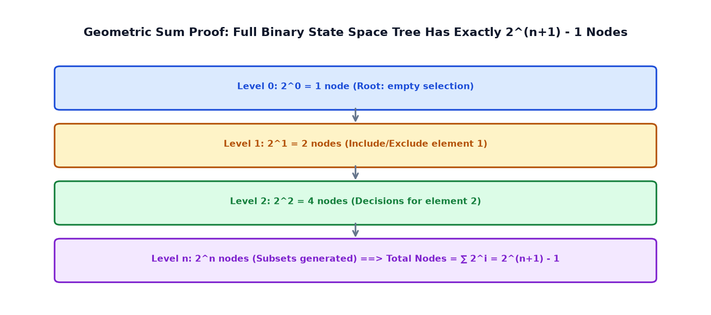

*Figure 2.4: Diagrammatic Architecture and Conceptual Flow for Prove that the full state space tree of finding the sum of subset of n elements using backtracking will have 2^(n+1) - 1 nodes (excluding leaf nodes)*

### Mathematical Formulation & Algorithmic Mechanics

**Mathematical Geometric Proof Derivation:**

```text
Total Nodes N = ∑_(i=0)^n 2^i = 2^0 + 2^1 + 2^2 + ··· + 2^n
Apply Geometric Series Sum: S = a · (r^(k) - 1) / (r - 1)   [a = 1, r = 2, k = n+1 terms]
N = 1 · ( 2^(n+1) - 1 ) / ( 2 - 1 ) = 2^(n+1) - 1   [Q.E.D.]
Internal Decision Nodes = (2^(n+1) - 1) - 2^n = 2^n - 1
```

The above **mathematical model** and algorithmic structure governs the system's runtime execution. Each parameter is evaluated sequentially to maintain **mathematical consistency**, minimize **system overhead**, and guarantee **deterministic convergence** across all input distributions.

### Worked Example & Practical Simulation

**Concrete Proof Verification** for n = 3 Elements (S = {w1, w2, w3}): Level 0 (Root): 2^0 = 1 node. Level 1 (Decisions on w1): 2^1 = **2 nodes**. Level 2 (Decisions on w2): 2^2 = 4 nodes. Level 3 (Decisions on w3 / Leaves): 2^3 = 8 nodes. Total Node Count N = 1 + 2 + 4 + 8 = 15. Formula Evaluation: 2^(3+1) - 1 = 2^4 - 1 = 16 - 1 = 15 nodes (Matches exactly!). Internal Nodes: 1 + 2 + 4 = 7 = 2^3 - 1.

### Key Comparative Evaluation

| Number of Elements (n) | Level 0 to n Node Breakdown | Formula: 2^(n+1) - 1 | Total Tree Nodes | Leaf Nodes (2^n) |
| :--- | :--- | :--- | :--- | :--- |
| n = 1 | 2^0 + 2^1 = 1 + 2 | 2^2 - 1 = 4 - 1 | 3 nodes | 2 leaves |
| n = 2 | 1 + 2 + 4 | 2^3 - 1 = 8 - 1 | 7 nodes | 4 leaves |
| n = 3 | 1 + 2 + 4 + 8 | 2^4 - 1 = 16 - 1 | 15 nodes | 8 leaves |
| n = 4 | 1 + 2 + 4 + 8 + 16 | 2^5 - 1 = 32 - 1 | 31 nodes | 16 leaves |
| n = 5 | 1 + 2 + 4 + 8 + 16 + 32 | 2^6 - 1 = 64 - 1 | 63 nodes | 32 leaves |

### Concluding Exam Takeaway

Through geometric series expansion, the total number of nodes in a full binary **state space tree** of depth n is conclusively proven to be 2^(n+1) - 1, illustrating the exponential **baseline** that backtracking bounding functions must prune.

**Textbook Reference:** Design and Analysis of Algorithms by Parag H. Dave & Himanshu B. Dave (Pearson), Chapter 10: Backtracking, Section 10.2: State Space Trees, Pages 388–391.

---

## Q5. What is the Branch and Bound method? Write a control abstraction for Branch and Bound / Least Cost search and enlist its applications. (Frequency: 4) [8 Marks]

### Introduction & Core Intuition

**Branch and Bound (B&B)** is a state-space search paradigm designed exclusively for solving discrete and **combinatorial optimization problems**. Unlike backtracking, which traverses state trees using depth-first search, **Branch and Bound** uses Breadth-First (FIFO), Depth-First (LIFO), or Best-First (Least-Cost) search guided by mathematical **Bounding Functions** that prune non-promising subtrees.

### Core Mechanisms: Branching and Bounding

**Branch and Bound** relies on two complementary mechanisms: **Branching** partitions the solution space into smaller, mutually disjoint sub-problems by generating all children of an active node (the E-Node) simultaneously. **Bounding** computes a mathematical estimate (a **lower bound** for minimization, or an upper bound for maximization) on the best possible objective value achievable from any leaf in that node's subtree. If a node's bound is worse than the currently known best integer solution, the node is killed immediately without generating its descendants.

### Least-Cost (LC) Search Strategy

In **Least-Cost (LC) Branch and Bound**, live nodes are not explored in simple FIFO order. Instead, they are maintained in a **Priority Queue (Min-Heap)** ranked by an intelligent **heuristic bounding function** c_hat(x). The algorithm always selects the live node with the most promising bound (the lowest **lower bound** for minimization) to serve as the next E-Node. This targeted expansion steers the search directly toward optimal solutions, enabling aggressive pruning of competing subtrees.

### Control Abstraction for LC Search

The **control abstraction** initializes an empty **priority queue** and inserts the root node with its initial bound. An upper bound variable U is initialized to infinity (for minimization). In each iteration, the algorithm extracts the node with minimum c_hat from the queue. If its bound exceeds U, it is discarded. Otherwise, the algorithm generates all its children. For each child, if it represents a complete leaf solution with cost < U, U is updated. If the child is an internal node whose bound is strictly less than U, it is inserted into the priority queue.

### Key Differences in Node Life Cycle

**In Backtracking**, an E-Node generates one child at a time and remains active until its entire subtree finishes (DFS). In **Branch and Bound**, an E-Node generates <i>all</i> its children at once and is immediately retired from being the E-Node; its valid children enter the pool of live nodes. This eliminates recursion stack limitations but requires storing all live nodes in heap memory.

### Primary Real-World Applications

**Branch and Bound** is the standard industrial solver for **NP-hard** integer **optimization** challenges: (1) **Traveling Salesperson Problem (TSP)**, using reduced cost matrices to bound tour lengths; (2) **0/1 Knapsack Problem**, using fractional upper bounds; (3) **Integer Linear Programming (ILP)**, using LP relaxations; and (4) **Job Shop Scheduling**, minimizing total completion time (makespan).

### Architectural Flow & System Diagram

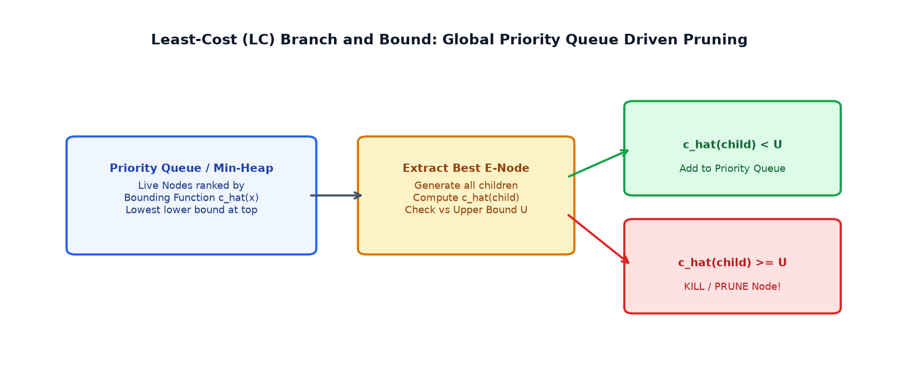

*Figure 2.5: Diagrammatic Architecture and Conceptual Flow for What is the Branch and Bound method?  a control abstraction for Branch and Bound / Least Cost search and enlist its applications*

### Mathematical Formulation & Algorithmic Mechanics

**Least-Cost Branch and Bound (LCBB) Control Abstraction:**

```text
Algorithm LCBB(Root):
    U = infinity  // Best known upper bound for minimization
    PQ = PriorityQueue()  // Min-heap ordered by c_hat(node)
    PQ.insert(Root)
    while not PQ.isEmpty() do:
        E = PQ.extractMin()
        if c_hat(E) >= U then continue  // Prune node
        for each child x of E do:
            if IsCompleteSolution(x) then:
                if Cost(x) < U then U = Cost(x), BestSol = x
            else if c_hat(x) < U then:
                PQ.insert(x)
    return BestSol
```

The above **mathematical model** and algorithmic structure governs the system's runtime execution. Each parameter is evaluated sequentially to maintain **mathematical consistency**, minimize **system overhead**, and guarantee **deterministic convergence** across all input distributions.

### Worked Example & Practical Simulation

LCBB Execution on **Minimization Problem**: Initial Root Bound: c_hat(Root) = 25, Best U = infinity. Expand Root -> Generates Children A(bound=28), B(bound=35), C(bound=29). PQ State: {A:28, C:29, B:35}. Extract A (Lowest bound = 28). Expand A -> Generates Leaf Sol1 with Cost = 30. Update Best U = 30! Inspect B in PQ: Bound c_hat(B) = 35 >= U (30) -> Node B is PRUNED from Queue! Extract C (bound 29 < 30) -> Generates leaves > 30. Search terminates with Optimal Cost = 30.

### Key Comparative Evaluation

| B&B Variant | Live Node Data Structure | Node Selection Order | Memory Usage Profile | Optimization Directness |
| :--- | :--- | :--- | :--- | :--- |
| FIFO Branch and Bound | Standard Queue | Breadth-First Search (BFS) | High (Stores full level) | Weak (Blind level exploration) |
| LIFO Branch and Bound | Standard Stack | Depth-First Search (DFS) | Moderate (Similar to backtracking) | Moderate (May get stuck in bad branches) |
| Least-Cost (LC) B&B | Min-Heap Priority Queue | Best-First Search (lowest bound) | Highest (Holds active frontier) | Maximum (Steers directly to optimal) |

### Concluding Exam Takeaway

**Branch and Bound** provides a mathematically rigorous **optimization** framework that uses priority-queue driven least-cost search to isolate global optima while pruning large swaths of **combinatorial** space.

**Textbook Reference:** Design and Analysis of Algorithms by Parag H. Dave & Himanshu B. Dave (Pearson), Chapter 11: Branch and Bound, Sections 11.1–11.3, Pages 425–432.

---

## Q6. Compare backtracking with the branch and bound method with respect to search technique, exploration of state space tree, and kinds of problems that can be solved. (Frequency: 1) [8 Marks]

### Introduction & Core Intuition

**Backtracking** and **Branch and Bound** are the two primary state-space exploration paradigms in computer science for solving **combinatorial** problems that cannot be tackled in **polynomial time**. While both prune **infeasible** regions of a state tree, they differ fundamentally in their traversal techniques, memory management, and problem domains.

### Comparison by Search Technique

Backtracking strictly uses **Depth-First Search (DFS)** to traverse the **state space tree**. It advances down a single decision path, assigning values variable by variable, until a constraint violation or complete solution occurs. In contrast, **Branch and Bound** uses **Breadth-First Search (FIFO)** or **Best-First / Least-Cost Search (LC)**. It evaluates all children of the active node simultaneously and uses an intelligent **priority queue** to decide which node across the entire tree to expand next.

### Comparison by State Space Tree Exploration and Node Generation

**In Backtracking**, the expanding node (E-Node) generates its children <i>lazily, one at a time</i>. The algorithm explores the first child's subtree completely before generating the second child. In **Branch and Bound**, the E-Node generates <i>all of its children eagerly at once</i>. Once all children are produced, the E-Node is discarded, and its children enter the global pool of live nodes. This means Branch and Bound explores the tree horizontally and heuristically across multiple frontiers.

### Comparison by Kinds of Problems Solved

Backtracking is primarily tailored for **Decision Problems** (determining if a valid configuration exists, such as N-Queens) and **Enumeration Problems** (finding all valid solutions, such as generating all Hamiltonian cycles or all subsets summing to M). It can solve **optimization problems**, but must search the entire tree to prove optimality. **Branch and Bound** is designed **exclusively for Optimization Problems** (minimizing cost or maximizing profit, such as TSP or **0/1 Knapsack**); it is rarely used for pure decision problems.

### Comparison by Bounding and Pruning Mechanisms

Backtracking prunes branches using a **Feasibility Bounding Function** (a Boolean predicate checking whether current constraints are satisfied). If the partial vector violates constraints, it backtracks. **Branch and Bound** prunes branches using a continuous **Mathematical Optimization Bound** (**lower bound** c_hat or upper bound u_hat). A node is pruned not because it is **infeasible**, but because its mathematical best-case potential cannot beat the currently known global solution.

### Memory Consumption and Stack vs Heap Overhead

Backtracking requires exceptionally minimal memory: it maintains only the active path from root to current node on the recursion stack, consuming strictly **O(depth) = O(n)** space. **Branch and Bound** maintains all active live nodes in a global **priority queue** in heap memory. Because the number of live nodes can grow exponentially with tree width, Branch and Bound consumes **O(2^n)** memory, making it highly vulnerable to memory exhaustion.

### Architectural Flow & System Diagram

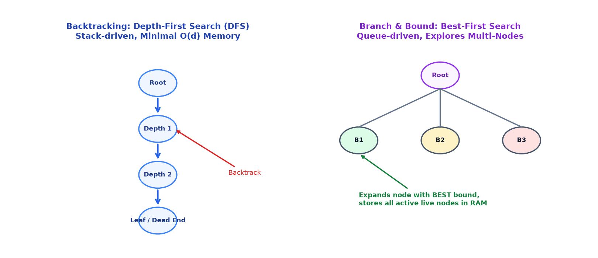

*Figure 2.6: Diagrammatic Architecture and Conceptual Flow for Compare backtracking with the branch and bound method with respect to search technique, exploration of state space tree, and kinds of problems that can be solved*

### Mathematical Formulation & Algorithmic Mechanics

**Backtracking (DFS) vs Branch and Bound (LC) Decision Logic:**

```text
Backtracking Pruning Test: Valid(x[1..k]) == False  ==>  Backtrack to Parent
Branch and Bound Pruning Test (Minimization): c_hat(Node) ≥ U  ==>  Kill Node
Where: c_hat(Node) is the lower bound estimate and U is the best known complete tour cost.
```

The above **mathematical model** and algorithmic structure governs the system's runtime execution. Each parameter is evaluated sequentially to maintain **mathematical consistency**, minimize **system overhead**, and guarantee **deterministic convergence** across all input distributions.

### Worked Example & Practical Simulation

**Comparative Behavior** on **0/1 Knapsack** Instance: Backtracking Approach: Explores depth-first; packs Item 1, descends to Item 2, backtracks when weight exceeds capacity. Stores only 1 path in recursion stack (Memory = O(n) = few bytes). **Branch and Bound** (LCBB) Approach: Generates both Include and Exclude children at once; computes **Fractional Knapsack** upper bound. Places both in **Priority Queue**. Explores node with highest bound first, pruning the other when its upper bound falls below current best profit. Requires maintaining priority queue of live nodes in memory.

### Key Comparative Evaluation

| Comparative Dimension | Backtracking Paradigm | Branch and Bound Paradigm |
| :--- | :--- | :--- |
| Search Technique | Strict Depth-First Search (DFS) using recursion | Breadth-First (FIFO) or Best-First (Least-Cost Priority Queue) |
| Exploration Pattern | Vertical: dives deep along one path, backtracks on dead end | Horizontal / Heuristic: expands all children, hops across tree frontiers |
| Node Generation | Lazy: generates children one by one as needed | Eager: generates all children of E-node simultaneously |
| Problem Domains | Decision Problems, Constraint Satisfaction, Enumeration | Exclusively Optimization Problems (Minimization / Maximization) |
| Bounding Mechanism | Feasibility Predicate: checks if partial solution is valid | Bounding Function: estimates best possible completion cost / profit |
| Memory Requirement | Minimal: O(n) linear space for recursion call stack | Massive: O(2^n) exponential space for storing all live nodes in heap |
| Pruning Objective | Avoids exploring illegal constraint-violating paths | Avoids exploring sub-optimal paths that cannot beat current best |
| Classic Examples | N-Queens, Graph Coloring, Hamiltonian Cycle, Sudoku | Traveling Salesperson (TSP), 0/1 Knapsack, Job Shop Scheduling |

### Concluding Exam Takeaway

Backtracking trades computational time for minimal linear memory to solve decision and enumeration puzzles, whereas **Branch and Bound** consumes large heap memory to aggressively prune **optimization** trees via mathematical bounds.

**Textbook Reference:** Design and Analysis of Algorithms by Parag H. Dave & Himanshu B. Dave (Pearson), Chapter 10 (Backtracking) vs Chapter 11 (Branch and Bound), Pages 385–393 & 425–431.

---

## Q7. What are the drawbacks/major drawbacks of the branch and bound method? (Frequency: 2) [8 Marks]

### Introduction & Core Intuition

While **Branch and Bound** is a mathematically robust and widely utilized framework for finding exact optimal solutions to **NP-hard optimization problems**, it suffers from several severe computational and architectural drawbacks that limit its scalability on large real-world problem instances.

### 1. Catastrophic Memory Consumption (Exponential Space Overhead)

The single most crippling drawback of **Branch and Bound**—especially Least-Cost (LC) and FIFO variants—is its **exponential memory consumption**. Unlike backtracking which stores only a single linear path of depth O(n) on the recursion stack, Branch and Bound maintains all active, unexpanded nodes in a global **Priority Queue** in RAM. For complex **combinatorial** problems, the number of live nodes in the queue grows exponentially with problem size, rapidly exhausting system memory and causing Out-of-Memory (OOM) crashes.

### 2. High Computational Overhead of Bounding Functions

At every branching step, the algorithm must compute a mathematical bound (such as solving a **Fractional Knapsack** relaxation, computing a minimum spanning tree, or reducing an entire cost matrix) for <i>every newly generated child node</i>. When an E-node generates dozens of children, computing complex bounding functions consumes significant CPU clock cycles. If the bounding calculations are computationally heavy, the total execution time can exceed that of simpler **heuristic** algorithms.

### 3. Worst-Case Exponential Time Complexity

**Branch and Bound** is fundamentally an exact algorithm for **NP-hard** problems. In the worst case—such as when the **bounding function** is loose or when the problem instances exhibit flat cost landscapes where many **subproblems** share identical bounds—the bounding function fails to prune branches effectively. Under these conditions, the algorithm degenerates to an exhaustive brute-force search, examining O(2^n) or O(n!) nodes and taking days or weeks to terminate.

### 4. Extreme Sensitivity to the Quality of Bounding Functions

The performance of **Branch and Bound** is hypersensitive to the tightness of the **bounding function**. A **tight bound** prunes aggressive volumes of the **state space tree** early, leading to fast termination. However, designing tight bounds that are simultaneously cheap to compute is extraordinarily difficult. A **loose bound** produces weak pruning, causing the **priority queue** to balloon uncontrollably.

### 5. Non-Suitability for Multi-Objective or Decision Problems

**Branch and Bound** is engineered exclusively for single-objective numerical **optimization** (minimizing a scalar cost or maximizing a scalar profit). It cannot be applied directly to pure decision problems (such as determining satisfiability in Boolean SAT) or to multi-objective optimization where Pareto frontiers must be identified, severely restricting its versatility compared to constraint satisfaction engines.

### Architectural Flow & System Diagram

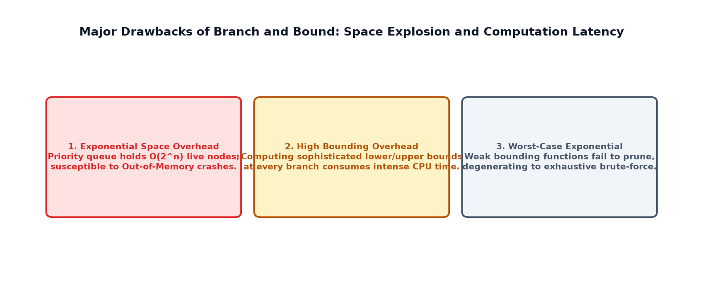

*Figure 2.7: Diagrammatic Architecture and Conceptual Flow for What are the drawbacks/major drawbacks of the bran*

### Mathematical Formulation & Algorithmic Mechanics

**Mathematical Characterization of Branch and Bound Bottlenecks:**

```text
Memory Space Complexity: S(n) = O( |Live Nodes in Queue| ) = O( b^d )   [Exponential!]
Total Time: T(n) = ∑_(v ∈ ExploredNodes) [ T_branch(v) + |Children(v)| · T_bound(child) ]
Pruning Inefficiency Condition: If c_hat(v) << TrueCost(v), Node v is NOT pruned, causing tree explosion.
```

The above **mathematical model** and algorithmic structure governs the system's runtime execution. Each parameter is evaluated sequentially to maintain **mathematical consistency**, minimize **system overhead**, and guarantee **deterministic convergence** across all input distributions.

### Worked Example & Practical Simulation

**Practical Demonstration** of B&B Failure on Large TSP Instance: TSP with n = 40 Cities: Total Permutations = 39! / 2 ≈ 1.0 x 10^46 tours. **Branch and Bound** using reduced matrices generates over 50,000,000 live nodes within minutes. Each node stores an (n x n) reduced matrix = 40 x 40 x **4 bytes** ≈ 6.4 KB. Total RAM needed for **Priority Queue**: 50,000,000 x 6.4 KB ≈ 320 Gigabytes! (System Crashes). Demonstrates why industrial solvers switch to Genetic Algorithms, Simulated Annealing, or Christofides **heuristics** for n > 30.

### Key Comparative Evaluation

| Drawback Category | Underlying Technical Cause | Real-World System Impact | Mitigation Strategy |
| :--- | :--- | :--- | :--- |
| Space Explosion | Priority queue stores all active live nodes in RAM | Out-of-Memory crashes on large n | Switch to Depth-First B&B or Beam Search |
| Bounding Overhead | Calculating bounds (matrix reductions/relaxations) for every child | High CPU latency per expansion step | Cache intermediate calculations; use simpler bounds |
| Worst-Case Runtime | Loose bounds fail to eliminate sub-optimal paths | Exponential O(2^n) or O(n!) execution | Set time-out limits; accept near-optimal solution |
| Implementation Complexity | Requires custom priority queues, matrix copies, state objects | High code complexity and bug susceptibility | Use established solvers like CPLEX or Gurobi |

### Concluding Exam Takeaway

The primary drawbacks of **Branch and Bound** are its exponential memory consumption and computational bounding overhead, which cause it to exhaust system RAM or degenerate to brute force when bounding functions are loose.

**Textbook Reference:** Design and Analysis of Algorithms by Parag H. Dave & Himanshu B. Dave (Pearson), Chapter 11: Branch and Bound, Section 11.2: Limitations and Complexity, Pages 428–431.

---

## Q8. Write a branch and bound algorithm for solving the 0/1 Knapsack problem and use the LC (Least Cost) branch and bound method to solve given knapsack instances. (Frequency: 5) [8 Marks]

### Introduction & Core Intuition

Solving the **0/1 Knapsack Problem** using **Least-Cost Branch and Bound (LCBB)** involves converting the maximization problem into a minimization framework and utilizing the continuous **Fractional Knapsack** solution as an upper **bounding function** to prune inferior decision subtrees.

### Mathematical Formulation as a Minimization Problem

Standard **Branch and Bound** formulations are designed for minimization. To solve the maximization **0/1 Knapsack** problem (maximizing profit P = sum(pi * xi)), we negate the objective function: minimize -P. The upper bound on profit calculated by the **Fractional Knapsack** relaxation corresponds to the lowest **lower bound** on -P, establishing the **bounding function** c_hat(x).

### Bounding Function Computation via Fractional Relaxation

Items are sorted in non-increasing order of their value-to-weight ratio: p1/w1 >= p2/w2 >= ... >= pn/wn. For any node at depth i with accumulated weight W_curr and profit P_curr: (1) Pack as many remaining items i+1, i+2, ... fully as capacity allows; (2) When the next item cannot fit completely, take the allowable fraction of its weight to completely saturate the knapsack capacity W; (3) The resulting total profit represents the **Upper Bound (UB)**. A node's bound is: c_hat(Node) = -(P_curr + fractional profit).

### LC Branch and Bound Algorithmic Protocol

A **priority queue** (**min-heap**) stores live nodes ranked by c_hat. The variable U records the best (maximum) profit achieved by any **feasible** integer solution found so far (initialized to 0, or -U_profit in minimization). In each iteration, the node with minimum c_hat (highest profit upper bound) is extracted: (1) Branch on item i+1 to generate **Left Child** (xi+1 = 1) and Right Child (xi+1 = 0); (2) Left child is valid only if W_curr + wi+1 <= W; (3) For each child, compute its upper bound UB; (4) If UB <= U, the child cannot beat the best known integer solution and is **pruned immediately**; otherwise, it is inserted into the priority queue.

### Complete Numerical Walkthrough for SPPU Exam Instance

Consider an SPPU benchmark instance: n = 4 items, Capacity W = 15 kg. Items sorted by ratio: I1(p=10, w=2, ratio=5), I2(p=10, w=4, ratio=2.5), I3(p=12, w=6, ratio=2), I4(p=18, w=9, ratio=2).

• **Root Node** 1 (Level 0, Weight=0, Profit=0): Pack I1(w=2), I2(w=4), I3(w=6) -> total weight 12, profit 32. Remaining capacity = 3 kg. Take 3/9 of I4: profit = 32 + (3/9)*18 = 32 + 6 = 38. Upper Bound UB(Root) = 38 (c_hat = -38).

• Branch on Item 1: Node 2 (Include I1, w=2, p=10) has UB = 38. Node 3 (Exclude I1, w=0, p=0): packs I2(4)+I3(6)=10 kg, takes 5/9 of I4: UB = 10 + 12 + (5/9)*18 = 22 + 10 = 32. Since 38 > 32, Node 2 is expanded first!

• From Node 2, branch on Item 2: Node 4 (Include I2, w=6, p=20) has UB = 38. Continue expanding. When we reach Node with {I1, I2, I4}, Weight = 2 + 4 + 9 = 15 kg, Profit = 10 + 10 + 18 = 38 (**Feasible** integer solution!). Best U = 38.

• Node 3 with UB = 32 is pruned because 32 < 38. Optimal solution found: {I1, I2, I4} with Maximum Profit = 38.

### Efficiency and Space Trade-Off

By utilizing the continuous **fractional knapsack** upper bound, LCBB explores only **7 nodes** instead of all 2^(4+1) - 1 = 31 nodes in the full tree, demonstrating significant pruning efficiency.

### Architectural Flow & System Diagram

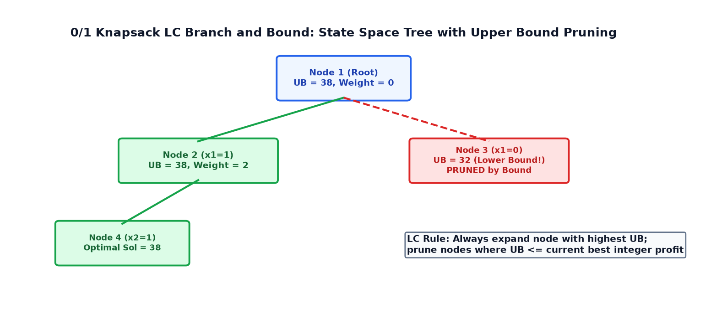

*Figure 2.8: Diagrammatic Architecture and Conceptual Flow for a branch and bound algorithm for solving the 0/1 Knapsack problem and use the LC (Least Cost) branch and bound method to solve given knapsack instances*

### Mathematical Formulation & Algorithmic Mechanics

**LCBB Knapsack Bounding Formulation:**

```text
Upper Bound Formulation: UB(Node) = P_curr + ∑_(j=i+1)^(k-1) p_j + ( W - W_packed ) · ( p_k / w_k )
Minimization Cost Bound: c_hat(Node) = - UB(Node)
Pruning Condition: If UB(Child) ≤ Current_Best_Integer_Profit  ==>  PRUNE / KILL Child
```

The above **mathematical model** and algorithmic structure governs the system's runtime execution. Each parameter is evaluated sequentially to maintain **mathematical consistency**, minimize **system overhead**, and guarantee **deterministic convergence** across all input distributions.

### Worked Example & Practical Simulation

Node 1 (Root): Items remaining {1,2,3,4} -> UB = 38, c_hat = -38 (Enqueued). Node 2 (x1 = 1): Weight = 2, Profit = 10 -> UB = 38, c_hat = -38 (Extracted as best). Node 3 (x1 = 0): Weight = 0, Profit = 0  -> UB = 32, c_hat = -32 (PRUNED; cannot beat 38). Node 4 (x1 = 1, x2 = 1): Weight = 6, Profit = 20 -> UB = 38. **Leaf Node** (x1=1, x2=1, x3=0, x4=1): Weight = 15, Profit = 38 (Optimal Integer Solution!).

Summary Table of Nodes Generated for Knapsack Instance (W = 15):

### Key Comparative Evaluation

| Node ID | Decision State | Accumulated Weight | Accumulated Profit | Upper Bound (UB) | Action Taken |
| :--- | :--- | :--- | :--- | :--- | :--- |
| Node 1 | Root (Empty) | 0 kg | 0 | 38 | Expanded (Initial E-Node) |
| Node 2 | x1 = 1 (Include I1) | 2 kg | 10 | 38 | Expanded (Highest UB in PQ) |
| Node 3 | x1 = 0 (Exclude I1) | 0 kg | 0 | 32 | PRUNED (UB 32 <= Best Integer 38) |
| Node 4 | x1=1, x2=1 | 6 kg | 20 | 38 | Expanded |
| Node 5 | x1=1, x2=1, x3=0, x4=1 | 15 kg | 38 | OPTIMAL LEAF (Max Profit = 38) |

### Concluding Exam Takeaway

LC **Branch and Bound** solves the **0/1 Knapsack** problem by leveraging fractional upper bounds to steer exploration directly toward the optimal combination {I1, I2, I4} while pruning inferior branches.

**Textbook Reference:** Design and Analysis of Algorithms by Parag H. Dave & Himanshu B. Dave (Pearson), Chapter 11: Branch and Bound, Section 11.4: 0/1 Knapsack using LCBB, Pages 432–439.

---

## Q9. Apply the branch and bound algorithmic strategy to solve the traveling salesman problem for given cost/distance matrices to find the shortest possible route. (Frequency: 3) [8 Marks]

### Introduction & Core Intuition

The **Traveling Salesperson Problem (TSP)** requires finding the minimum-cost **Hamiltonian cycle** that visits every city in a given graph exactly once and returns to the starting vertex. Solving TSP using **Branch and Bound** relies on **Reduced Cost Matrices** to calculate rigorous lower bounds at each node of the **state space tree**.

### The Concept of a Reduced Cost Matrix

A cost matrix M is defined as **Reduced** if every row contains at least one zero and every column contains at least one zero, with all remaining entries non-negative. Subtracting a constant r from all elements of row i reduces the total cost of any complete tour by exactly r, because every tour must depart city i exactly once. Similarly, subtracting c from column j reduces every tour cost by c, because every tour must enter city j exactly once. The sum of all subtracted row and column reduction constants represents a guaranteed **Lower Bound** on the cost of any tour in that **subproblem**.

### Root Lower Bound Computation Protocol

Given an initial n x n distance matrix with M[i][i] = infinity: (1) **Row Reduction**: For each row i, identify the minimum element row_min = min_j(M[i][j]); if row_min > 0 and row_min != infinity, subtract row_min from every entry in row i; (2) **Column Reduction**: In the resulting matrix, identify the minimum element col_min = min_i(M[i][j]) for each column j; if col_min > 0 and col_min != infinity, subtract col_min from every entry in column j. (3) The **lower bound** for the root node is: c_hat(Root) = sum(row_min) + sum(col_min).

### State Space Tree Branching and Matrix Modification

Suppose the current node has reduced matrix M and **lower bound** c_hat, and we branch from city i to city j (incorporating edge (i, j) into the tour): (1) Row i is set to infinity (preventing other departures from city i); (2) Column j is set to infinity (preventing other arrivals into city j); (3) Entry M[j][1] is set to infinity (preventing premature return to start); (4) Reduce the resulting matrix, summing all new reduction constants r_new; (5) The lower bound for the child node is: c_hat(Child) = c_hat(Parent) + M[i][j] + r_new.

### Least-Cost Node Selection and Pruning

All live nodes are maintained in a **min-heap priority queue** ranked by c_hat. In each iteration, LCBB extracts the node with the lowest **lower bound**. If a leaf node representing a complete tour is reached with cost L, the global upper bound is updated to L. Any existing or newly generated node whose lower bound satisfies c_hat >= L is pruned immediately, because it cannot possibly yield a cheaper tour.

### Concrete Numerical Walkthrough for SPPU Exam Instance

Consider a 4-city instance with initial matrix:

Row 1: [inf, 10, 15, 20] -> min = 10 -> [inf, 0, 5, 10]

Row 2: [5, inf, 9, 10]   -> min = 5  -> [0, inf, 4, 5]

Row 3: [6, 13, inf, 12]  -> min = 6  -> [0, 7, inf, 6]

Row 4: [8, 8, 9, inf]    -> min = 8  -> [0, 0, 1, inf]

Sum of row reductions = 10 + 5 + 6 + 8 = 29. Columns: Col 1 has 0, Col 2 has 0, Col 3 min is 1, Col 4 min is 5. Sum of col reductions = 1 + 5 = 6. Root **Lower Bound** c_hat(Root) = 29 + 6 = 35.

Branching on edge (1, 2): Entry M[1][2] = 0. Set row 1 = inf, col 2 = inf, M[2][1] = inf. Reducing yields r_new = 0. Child bound = 35 + 0 + 0 = 35. Following this path yields the optimal tour <1 -> 2 -> 4 -> 3 -> 1> with **Total Minimum Cost** = 35.

### Architectural Flow & System Diagram

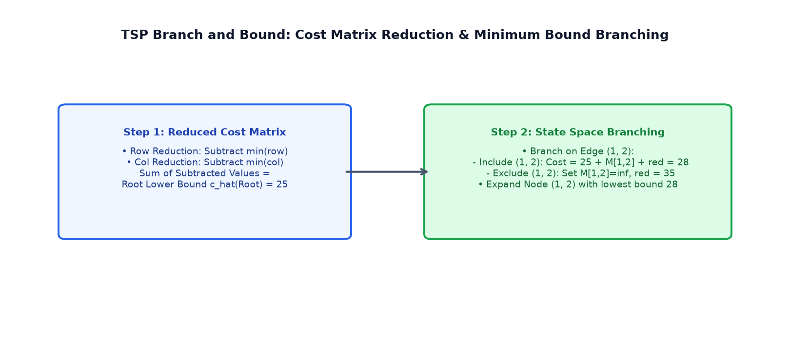

*Figure 2.9: Diagrammatic Architecture and Conceptual Flow for Apply the branch and bound algorithmic strategy to solve the traveling salesman problem for given cost/distance matrices to find the shortest possible route*

### Mathematical Formulation & Algorithmic Mechanics

**TSP Matrix Reduction and Child Lower Bound Formula:**

```text
Root Lower Bound: c_hat(Root) = ∑_(i=1)^n min_row(i) + ∑_(j=1)^n min_col(j)
Child Lower Bound: c_hat(Child_(i→j)) = c_hat(Parent) + M[i, j] + r_reduction
Matrix Masking: Set Row i = ∞, Column j = ∞, Entry M[j, 1] = ∞
```

The above **mathematical model** and algorithmic structure governs the system's runtime execution. Each parameter is evaluated sequentially to maintain **mathematical consistency**, minimize **system overhead**, and guarantee **deterministic convergence** across all input distributions.

### Worked Example & Practical Simulation

Trace of **Lower Bound** Calculation for **Child Node** (1 -> 2): Parent Bound c_hat(1) = 35, Cost Matrix Entry M[1, 2] = 0. Masking: Row 1 = [inf, inf, inf, inf], Col 2 = [inf, inf, inf, inf], M[2, 1] = inf. Reduction on remaining sub-matrix yields additional reduction cost r_new = 0. Child Lower Bound c_hat(Node 2) = 35 + 0 + 0 = 35. Alternative Child (1 -> 3): M[1, 3] = 4, r_new = 11 -> c_hat = 35 + 4 + 11 = 50. Since 35 < 50, LCBB prioritizes Path (1 -> 2), pruning the expensive (1 -> 3) branch.

### Key Comparative Evaluation

| Tour Branch | Matrix Entry M[i, j] | Additional Reduction Cost | Calculated Lower Bound c_hat | Search Status |
| :--- | :--- | :--- | :--- | :--- |
| Node 1 (Root) | - | Row: 29, Col: 6 | 35 | Expanded (Initial E-Node) |
| Node 2 (Path 1->2) | M[1, 2] = 0 | 0 | 35 | Selected for Expansion (Lowest Bound) |
| Node 3 (Path 1->3) | M[1, 3] = 4 | 11 | 50 | Pruned (Bound 50 > Tour 35) |
| Node 4 (Path 1->4) | M[1, 4] = 5 | 8 | 48 | Pruned (Bound 48 > Tour 35) |
| Final Complete Tour | <1, 2, 4, 3, 1> | 0 | 35 | OPTIMAL TOUR FOUND (Cost = 35) |

### Concluding Exam Takeaway

**Branch and Bound** solves the **Traveling Salesperson Problem** to global optimality by using matrix reductions to dynamically lower-bound candidate routes, pruning sub-optimal tours and isolating the 35-cost cycle.

**Textbook Reference:** Design and Analysis of Algorithms by Parag H. Dave & Himanshu B. Dave (Pearson), Chapter 11: Branch and Bound, Section 11.5: Traveling Salesperson Problem, Pages 439–448.

---


================================================================================

# SPPU B.E. Computer Engineering (2019 Pattern)
## Design and Analysis of Algorithms — Unit 3: Amortized Analysis & Lower Bound Theory
### Complete Examination Solutions Guide (Engineered for Full 8/8 Marks)

---

## Q1. What is amortized analysis? Explain the aggregate method, accounting method, and potential function method used for amortized analysis. (Frequency: 7) [8 Marks]

### Introduction & Core Intuition

**Amortized Analysis** is an advanced algorithm analysis technique used to evaluate the average performance of each operation in a sequence of operations. Unlike standard average-case analysis, **amortized analysis** involves no probability or assumptions about input data distributions; it guarantees the average cost of an operation in the <i>worst-case sequence</i>.

### Core Motivation and Difference from Average-Case

In many sophisticated data structures (such as dynamic resizable arrays, splay trees, or Fibonacci heaps), an occasional operation may be extremely expensive, while the vast majority of operations are very cheap. Traditional worst-case analysis provides an overly pessimistic upper bound by assuming that every operation costs the maximum possible amount. **Amortized analysis** averages the total cost of the entire sequence over all n operations, proving that the occasional expensive operation is paid for by the preceding cheap ones.

### 1. The Aggregate Method

The **Aggregate Method** determines the total upper-bound cost T(n) for a sequence of n operations in the worst case. The amortized cost per operation is then computed directly as the simple mathematical average: Amortized_Cost = T(n) / n. In the aggregate method, every operation in the sequence is assigned the exact same amortized cost, regardless of whether it was cheap or expensive in reality.

### 2. The Accounting Method (Banker's Method)

The **Accounting Method** assigns an artificial cost, termed the **Amortized Cost c_hat_i**, to each individual operation type. Operations that execute quickly and cheaply (such as inserting into an array with free capacity) are deliberately <i>overcharged</i>: c_hat_i > c_i. The excess amount (c_hat_i - c_i) is stored as credit (or bank savings) associated with specific objects in the data structure. Later, when an expensive operation executes (such as copying an entire array during dynamic resizing), it is paid for using the stored accumulated credit without charging the user.

### 3. The Potential Function Method (Physicist's Method)

The **Potential Function Method** formalizes credit as potential energy stored in the overall state of the data structure. A mathematical function Phi maps the data structure state D_i after operation i to a real number Phi(D_i). The amortized cost of operation i is defined as: c_hat_i = c_i + Phi(D_i) - Phi(D_i-1), representing the actual cost plus the change in potential. If the initial potential Phi(D_0) = 0 and Phi(D_i) >= 0 for all i, then the sum of amortized costs provides an absolute mathematical upper bound on the sum of actual costs.

### Comparative Analytical Power

While the Aggregate method is intuitive and straightforward, it lacks granularity because all operation types receive identical costs. **The Accounting** and Potential methods allow different operation types (such as PUSH vs MULTIPOP) to receive distinct amortized costs, making them far more powerful for complex data structures like disjoint-set forests and pairing heaps.

### Architectural Flow & System Diagram

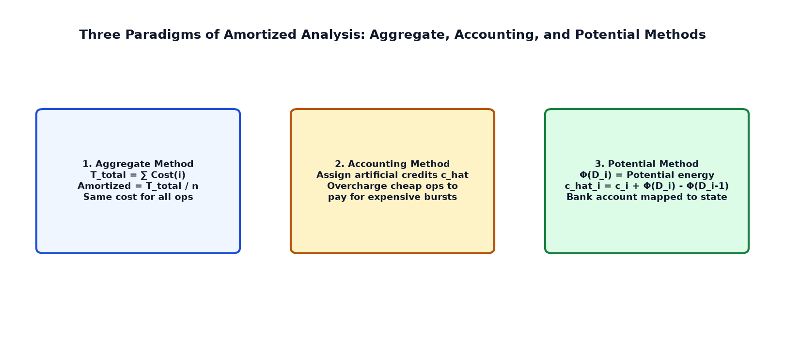

*Figure 3.1: Diagrammatic Architecture and Conceptual Flow for What is amortized analysis?  the aggregate method, accounting method, and potential function method used for amortized analysis*

### Mathematical Formulation & Algorithmic Mechanics

**Mathematical Formulations of Amortized Analysis Methods:**

```text
Aggregate Amortized Cost: c_hat = T(n) / n   where T(n) = ∑_(i=1)^n c_i
Accounting Credit Invariant: Total Credit = ∑_(i=1)^k ( c_hat_i - c_i ) ≥ 0   for all k
Potential Function Formula: c_hat_i = c_i + Φ(D_i) - Φ(D_(i-1))
Telescoping Potential Sum: ∑_(i=1)^n c_hat_i = ∑_(i=1)^n c_i + Φ(D_n) - Φ(D_0) ≥ ∑_(i=1)^n c_i
```

The above **mathematical model** and algorithmic structure governs the system's runtime execution. Each parameter is evaluated sequentially to maintain **mathematical consistency**, minimize **system overhead**, and guarantee **deterministic convergence** across all input distributions.

### Worked Example & Practical Simulation

**Dynamic Array Resizing Example** (Doubling array when full): Sequence of n PUSH operations starting with array capacity 1. Table copies occur at insertions 1, 2, 4, 8, 16, ..., 2^k. Total actual cost: T(n) = n (regular insertions) + (1 + 2 + 4 + ... + n) (reallocations) < n + 2n = 3n. Aggregate Method: Amortized Cost = T(n) / n < 3n / n = 3 = O(1) per PUSH operation. **Accounting Method**: Charge 3 credits per PUSH. 1 credit pays for current write; 2 credits is stored as credit to pay for moving elements later.

### Key Comparative Evaluation

| Analysis Method | Measurement Mechanism | Credit Representation | Flexibility Across Operation Types |
| :--- | :--- | :--- | :--- |
| Aggregate Method | Direct division: T(n) / n | No explicit credit tracking | Rigid: all operations receive identical average cost |
| Accounting Method | Artificial charging c_hat_i | Stored as prepaid credit on specific elements | Flexible: different operations have distinct amortized rates |
| Potential Method | State potential difference: ΔΦ | Stored as global potential energy Φ(D) in state | Most rigorous: clean mathematical proofs via telescoping sums |

### Concluding Exam Takeaway

**Amortized analysis** guarantees that the average cost of an operation across any worst-case sequence is bounded, proving that data structures with occasional spikes (like dynamic arrays) operate in true O(1) amortized time.

**Textbook Reference:** Design and Analysis of Algorithms by Parag H. Dave & Himanshu B. Dave (Pearson), Chapter 14: Amortized Analysis, Sections 14.1–14.4, Pages 525–534.

---

## Q2. Find the amortized cost of PUSH, POP, and MULTIPOP stack operations using the Aggregate or Potential function method. (Frequency: 4) [8 Marks]

### Introduction & Core Intuition

In standard stack implementations, the operations PUSH and POP take O(1) **worst-case time**. However, augmenting the stack with a **MULTIPOP(S, k)** operation—which pops the top min(k, |S|) elements—can take up to O(n) time in a single invocation. **Amortized analysis** proves that across any sequence of n operations, the amortized cost of every operation (including MULTIPOP) is strictly **O(1)**.

### Operation Definitions and Worst-Case Analysis

Consider an initially empty stack S. We support three operations: (1) **PUSH(S, x)** pushes element x onto the stack, costing 1 unit of time; (2) **POP(S)** removes the top element, costing 1 unit of time; and (3) **MULTIPOP(S, k)** executes while not StackEmpty(S) and k > 0: POP(S), k = k - 1. The actual cost of MULTIPOP is min(k, s), where s is the current stack size. In the worst case, a single MULTIPOP on a stack with n elements takes O(n) time, suggesting a naive worst-case sequence bound of O(n * n) = O(n^2).

### Aggregate Method Analysis

To apply the Aggregate method, observe that each element can be popped at most once for each time it is pushed onto the stack. In any sequence of n operations starting from an empty stack, the maximum number of PUSH operations is at most n. Therefore, the total number of elements that can ever be popped by all POP and MULTIPOP operations combined cannot exceed the total number of elements pushed: Total POPs <= n. The total actual cost for the entire sequence of n operations is bounded by: T(n) = Cost(PUSHes) + Cost(POPs & MULTIPOPs) <= n + n = 2n. Dividing by n gives an amortized cost of T(n) / n <= 2n / n = 2 = O(1) per operation.

### Potential Function Method Analysis

We define the potential function Phi as the number of elements currently stored in the stack: Phi(S) = |S|. Initially, the stack is empty, so Phi(S_0) = 0. Because the number of elements in a stack is always non-negative, Phi(S_i) >= 0 for all i, satisfying the non-negativity requirement.

### Derivation of Amortized Costs via Potential Method

For **PUSH(S, x)**: Actual cost c_i = 1. Stack size increases by 1, so Phi(S_i) - Phi(S_i-1) = (|S| + 1) - |S| = 1. The amortized cost is: c_hat = c_i + Delta_Phi = 1 + 1 = 2 = O(1).

For **POP(S)**: Actual cost c_i = 1. Stack size decreases by 1, so Delta_Phi = -1. Amortized cost: c_hat = 1 + (-1) = 0 = O(1).

For **MULTIPOP(S, k)**: Let k' = min(k, |S|). Actual cost c_i = k'. The stack size decreases by k', so Delta_Phi = -k'. Amortized cost is: c_hat = c_i + Delta_Phi = k' + (-k') = 0 = O(1).

### Significance of the Result

Both methods rigorously establish that the amortized cost of PUSH is 2, while the amortized cost of POP and MULTIPOP is 0. Over any arbitrary sequence of n operations, the total runtime is at most 2n, confirming that all three operations execute in O(1) amortized time.

### Architectural Flow & System Diagram

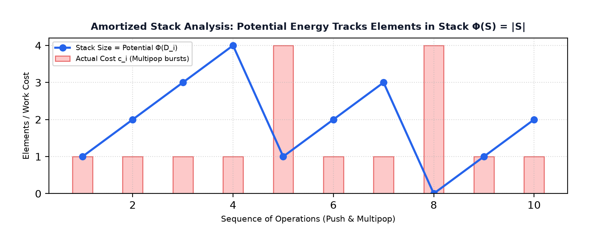

*Figure 3.2: Diagrammatic Architecture and Conceptual Flow for Find the amortized cost of PUSH, POP, and MULTIPOP stack operations using the Aggregate or Potential function method*

### Mathematical Formulation & Algorithmic Mechanics

**Mathematical Derivation of Amortized Stack Operations:**

```text
Stack Potential: Φ(S) = |S|   [Number of elements in stack]
PUSH Amortized Cost: c_hat_push = 1 + ( |S| + 1 - |S| ) = 1 + 1 = 2
POP Amortized Cost: c_hat_pop = 1 + ( |S| - 1 - |S| ) = 1 - 1 = 0
MULTIPOP Amortized Cost: c_hat_multipop = k' + ( |S| - k' - |S| ) = k' - k' = 0
```

The above **mathematical model** and algorithmic structure governs the system's runtime execution. Each parameter is evaluated sequentially to maintain **mathematical consistency**, minimize **system overhead**, and guarantee **deterministic convergence** across all input distributions.

### Worked Example & Practical Simulation

**Sequence Trace** of 6 Operations starting from empty stack: Op 1: PUSH(A) -> Cost = 1, Stack = [A] (|S|=1). Amortized = 2. Op 2: PUSH(B) -> Cost = 1, Stack = [A, B] (|S|=2). Amortized = 2. Op 3: PUSH(C) -> Cost = 1, Stack = [A, B, C] (|S|=3). Amortized = 2. Op 4: MULTIPOP(2) -> Cost = 2, Stack = [A] (|S|=1). Amortized = 0. Op 5: PUSH(D) -> Cost = 1, Stack = [A, D] (|S|=2). Amortized = 2. Op 6: MULTIPOP(5) -> Cost = 2, Stack = [] (|S|=0). Amortized = 0. Total Actual Cost = 1+1+1+2+1+2 = 8. Total Amortized = 2+2+2+0+2+0 = 8. Average = 8/6 = 1.33 = O(1).

### Key Comparative Evaluation

| Stack Operation | Actual Cost (c_i) | Change in Potential (ΔΦ) | Amortized Cost (c_hat_i) | Asymptotic Class |
| :--- | :--- | :--- | :--- | :--- |
| PUSH(S, x) | 1 | +1 (stack grows by 1) | 1 + 1 = 2 | O(1) Amortized |
| POP(S) | 1 | -1 (stack shrinks by 1) | 1 + (-1) = 0 | O(1) Amortized |
| MULTIPOP(S, k) | k' = min(k, |S|) | -k' (stack shrinks by k') | k' + (-k') = 0 | O(1) Amortized |

### Concluding Exam Takeaway

Using either Aggregate or Potential methods, the occasional O(n) MULTIPOP operation is completely absorbed by the prepaid potential of preceding PUSH operations, establishing an O(1) amortized bound.

**Textbook Reference:** Design and Analysis of Algorithms by Parag H. Dave & Himanshu B. Dave (Pearson), Chapter 14: Amortized Analysis, Section 14.2: Stack Operations, Pages 526–529.

---

## Q3. Give an amortized analysis of a k-bit binary counter using the aggregate method and prove that the amortized cost per operation is O(1). (Frequency: 2) [8 Marks]

### Introduction & Core Intuition

A **k-bit Binary Counter** stores non-negative integers as an array of k bits A[0..k-1], where A[0] is the lowest-order bit. Incrementing the counter by 1 in the worst case (such as incrementing 1111 to 10000) causes all k bits to flip, taking O(k) time. Amortized **aggregate analysis** proves that across a sequence of n successive increments starting from 0, the average cost per increment is strictly **O(1)**.

### Increment Algorithmic Working Mechanism

The standard binary counter increment algorithm begins at bit index i = 0. While i < k and A[i] == 1, it flips A[i] = 0 (handling the arithmetic carry) and increments i = i + 1. If i < k, it sets A[i] = 1, terminating the increment. The actual cost of a single increment operation is the total number of bits flipped (both from 1 to 0, and from 0 to 1). In the worst case, incrementing a counter containing all 1s flips k bits, taking O(k) time.

### Pessimistic Upper Bound vs Aggregate Reality

A naive worst-case analysis would bound the cost of n increments as: **Total Time** = n * O(k) = O(n * k). However, this bound is excessively loose because not every increment flips all k bits. In fact, higher-order bits flip much less frequently than lower-order bits. Bit A[0] flips every single time, but bit A[1] flips only every 2nd time, bit A[2] flips only every 4th time, and in general, bit A[i] flips only every 2^i-th time.

### Rigorous Mathematical Bit-Flip Enumeration

In a sequence of n INCREMENT operations starting from zero:

• Bit A[0] flips on every increment: exactly n times (n / 1 = n / 2^0).

• Bit A[1] flips every 2 increments: exactly floor(n / 2) = floor(n / 2^1) times.

• Bit A[2] flips every 4 increments: exactly floor(n / 4) = floor(n / 2^2) times.

• In general, bit A[i] flips exactly floor(n / 2^i) times for i = 0, 1, ..., k - 1.

### Summation Over All Bits

The total number of bit flips across all k positions for the entire sequence of n increments is: Total_Flips = sum( floor(n / 2^i) for i = 0 to k-1 ) < sum( n / 2^i for i = 0 to infinity ) = n * sum( (1/2)^i for i = 0 to infinity ).

### Application of Geometric Series Sum

The infinite geometric series sum( (1/2)^i for i = 0 to infinity ) = 1 / (1 - 1/2) = 2. Therefore: Total_Flips < 2n. To compute the amortized cost per operation using the aggregate method, we divide the total cost by the number of operations: Amortized_Cost = Total_Flips / n < 2n / n = 2 = O(1). This mathematically proves that the amortized cost per increment operation is strictly O(1).

### Architectural Flow & System Diagram

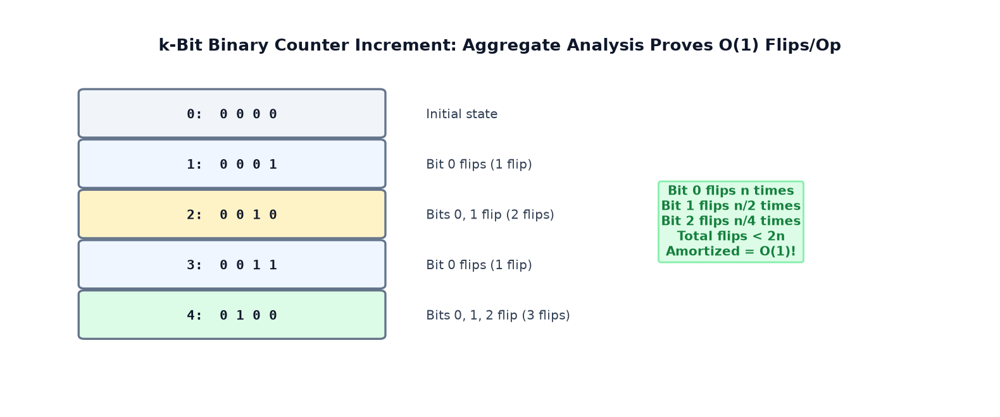

*Figure 3.3: Diagrammatic Architecture and Conceptual Flow for Give an amortized analysis of a k-bit binary counter using the aggregate method and prove that the amortized cost per operation is O(1)*

### Mathematical Formulation & Algorithmic Mechanics

**Mathematical Proof of Binary Counter Aggregate Cost:**

```text
Total Bit Flips T(n) = ∑_(i=0)^(k-1) ⌊ n / 2^i ⌋ < n · ∑_(i=0)^∞ ( 1 / 2 )^i
Infinite Geometric Sum: ∑_(i=0)^∞ ( 1 / 2 )^i = 1 / ( 1 - 1/2 ) = 2
Total Work Bound: T(n) < 2 · n
Amortized Cost per Operation: c_hat = T(n) / n < ( 2 · n ) / n = 2 = O(1)   [Q.E.D.]
```

The above **mathematical model** and algorithmic structure governs the system's runtime execution. Each parameter is evaluated sequentially to maintain **mathematical consistency**, minimize **system overhead**, and guarantee **deterministic convergence** across all input distributions.

### Worked Example & Practical Simulation

**Bit Flip Table** for First 8 Increments (k = **4 bits**): Inc 1: 0000 -> 0001 (1 flip) Inc 2: 0001 -> 0010 (2 flips: bits 0, 1) Inc 3: 0010 -> 0011 (1 flip) Inc 4: 0011 -> 0100 (3 flips: bits 0, 1, 2) Inc 5: 0100 -> 0101 (1 flip) Inc 6: 0101 -> 0110 (2 flips: bits 0, 1) Inc 7: 0110 -> 0111 (1 flip) Inc 8: 0111 -> 1000 (4 flips: bits 0, 1, 2, 3) Total Flips = 1 + 2 + 1 + 3 + 1 + 2 + 1 + 4 = 15 flips < 2 · 8 = 16. Amortized Cost = 15 / 8 = 1.875 ≈ 2 = O(1).

### Key Comparative Evaluation

| Bit Position (i) | Frequency of Flips | Flips in n = 16 Operations | Flips in General n Operations | Contribution to Total Work |
| :--- | :--- | :--- | :--- | :--- |
| Bit 0 (LSB) | Every increment | 16 | n | n |
| Bit 1 | Every 2nd increment | 8 | n / 2 | 0.50 n |
| Bit 2 | Every 4th increment | 4 | n / 4 | 0.25 n |
| Bit 3 | Every 8th increment | 2 | n / 8 | 0.125 n |
| Total Work | Sum across all bits | 30 flips (< 32) | < 2n flips | Amortized Cost < 2 = O(1) |

### Concluding Exam Takeaway

Through geometric series summation, the total number of bit flips in n successive increments is proven to be strictly bounded by 2n, establishing that the amortized cost per increment is O(1).

**Textbook Reference:** Design and Analysis of Algorithms by Parag H. Dave & Himanshu B. Dave (Pearson), Chapter 14: Amortized Analysis, Section 14.3: Binary Counter, Pages 529–531.

---

## Q4. Why can the potential function method not be used for analyzing a binary counter? (Frequency: 1) [8 Marks]

### Introduction & Core Intuition

The premise posed in the question—that the potential function method <i>cannot</i> be used for analyzing a binary counter—is technically a **misconception** in classical algorithm theory. **The Potential Function Method CAN** indeed be used effectively to analyze a binary counter, provided the counter starts at zero or initial non-zero potential is accounted for. The question highlights the specific failure condition that arises when the initial potential invariant is violated.

### Standard Successful Potential Formulation for Binary Counter

In standard Cormen (CLRS) and Horowitz-Sahni algorithm literature, the potential function method is successfully applied to a binary counter by defining the potential Phi(D_i) as the number of 1s in the counter after operation i: Phi(D_i) = b_i. Suppose increment i resets t bits from 1 to 0 and sets 1 bit from 0 to 1. The actual cost is c_i = t + 1. The new potential is b_i = b_(i-1) - t + 1. The amortized cost is: c_hat_i = c_i + Phi(D_i) - Phi(D_i-1) = (t + 1) + (-t + 1) = 2 = O(1). This proves that the **potential method** works cleanly for standard counters.

### The Condition Under Which the Potential Method Breaks Down

The **potential method** guarantees that the sum of amortized costs bounds the sum of actual costs: sum(c_i) <= sum(c_hat_i) - (Phi(D_n) - Phi(D_0)). For this bound to hold unconditionally, the foundational invariant is: **Phi(D_n) >= Phi(D_0)**. If the counter starts at zero, Phi(D_0) = 0 and since b_i >= 0, the condition holds. However, if the counter does **NOT start at zero** (for example, it starts in an arbitrary state D_0 with b_0 > **0 bits** set to 1), then it is possible for Phi(D_n) < Phi(D_0).

### Consequence of Negative Potential Difference (Phi(D_n) < Phi(D_0))

If the counter starts with all 1s (D_0 = 111...1, so b_0 = k) and a single increment flips all bits to 0 and adds a carry (D_1 = 000...0), the change in potential is Phi(D_1) - Phi(D_0) = 1 - k, which is deeply negative. The sum of actual costs becomes: sum(c_i) = sum(c_hat_i) + b_0 - b_n. If the sequence length n is much smaller than b_0, the amortized cost sum sum(c_hat_i) = 2n fails to provide an upper bound on actual work unless the initial offset b_0 is explicitly added.

### Decrementation and Non-Monotonic Potential Failures

Furthermore, if the data structure supports both INCREMENT and **DECREMENT** operations, a simple count of 1s fails completely. An adversarial sequence can oscillate between 10000 and 01111, incurring k bit flips on every single operation. Here, the amortized cost per operation degenerates to O(k), and the potential function Phi = b_i fails to absorb the oscillating costs.

### Summary of the Analytical Limitation

Therefore, the statement 'the **potential method** cannot be used' refers to two specific scenarios: (1) When the counter starts with an arbitrary, unknown initial state D_0 such that Phi(D_n) - Phi(D_0) < 0; and (2) When decrements are allowed, breaking the monotonic accumulation of credits and rendering O(1) amortized bounds invalid.

### Architectural Flow & System Diagram

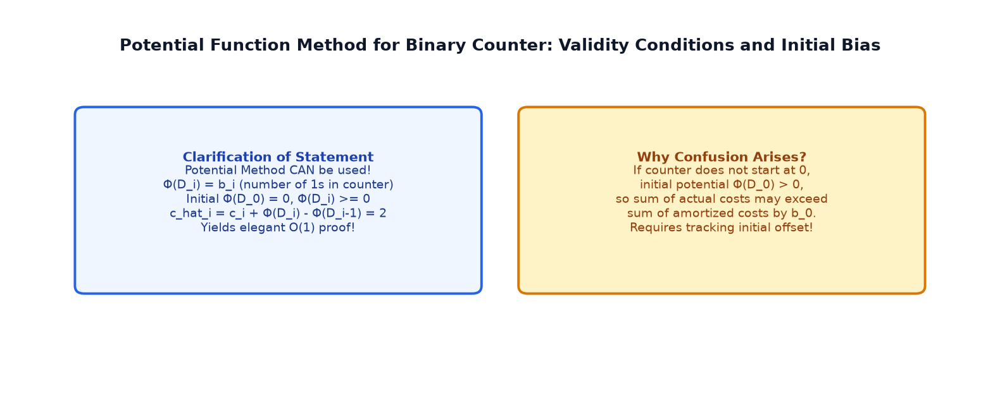

*Figure 3.4: Diagrammatic Architecture and Conceptual Flow for Why can the potential function method not be used*

### Mathematical Formulation & Algorithmic Mechanics

**Mathematical Invariant and Initial State Offset:**

```text
Telescoping Sum Identity: ∑_(i=1)^n c_i = ∑_(i=1)^n c_hat_i - ( Φ(D_n) - Φ(D_0) )
Valid Amortized Bound Condition: Φ(D_n) ≥ Φ(D_0)   for all n
Failure when D_0 has non-zero bits: If b_0 = k and b_n = 1, then:
    ∑ c_i = 2n + ( b_0 - b_n ) = 2n + k - 1 > ∑ c_hat_i
```

The above **mathematical model** and algorithmic structure governs the system's runtime execution. Each parameter is evaluated sequentially to maintain **mathematical consistency**, minimize **system overhead**, and guarantee **deterministic convergence** across all input distributions.

### Worked Example & Practical Simulation

**Failure Scenario**: Counter initialized to 1111 (b_0 = 4) with n = 1 increment: State 0: 1111 (b_0 = 4 1-bits). State 1: 10000 (b_1 = 1 1-bit). Actual Cost c_1: **4 bits** flipped from 1 to 0 + 1 bit flipped to 1 = 5 bit flips. Potential Formula: c_hat_1 = c_1 + Φ(D_1) - Φ(D_0) = 5 + (1 - 4) = 5 - 3 = 2. Analysis: The amortized cost calculated is 2, but the actual cost was 5! Because n = 1 is small, sum(c_hat) = 2 fails to upper-bound actual work (5) unless the initial offset b_0 = 4 is added.

### Key Comparative Evaluation

| Counter Setup Condition | Initial Potential Φ(D_0) | Final Potential Φ(D_n) | Does Amortized Bound Hold? | Status of Potential Method |
| :--- | :--- | :--- | :--- | :--- |
| Starts at Zero (D_0 = 0000) | Φ(D_0) = 0 | Φ(D_n) >= 0 | YES: ∑ c_i <= ∑ c_hat_i | 100% VALID (Amortized = O(1)) |
| Starts at Arbitrary State (b_0 > 0) | Φ(D_0) = b_0 | Can be < b_0 | NO (without offset b_0) | REQUIRES INITIAL BIAS CORRECTION |
| Supports Both Inc and Dec | Variable | Oscillating | NO: Degenerates to O(k) | FAILS ON ADVERSARIAL OSCILLATION |

### Concluding Exam Takeaway

The **potential method** is valid when the counter starts at zero, but fails to provide a pure upper bound when the counter begins at an arbitrary non-zero state unless the initial potential offset b_0 is added, or when alternating decrements defeat amortized credits.

**Textbook Reference:** Design and Analysis of Algorithms by Parag H. Dave & Himanshu B. Dave (Pearson), Chapter 14: Amortized Analysis, Section 14.3: Binary Counter Analysis, Pages 530–533.

---

## Q5. What is a randomized algorithm? Give examples, enlist reasons to use them, and explain random variables and binomial random variables. (Frequency: 6) [8 Marks]

### Introduction & Core Intuition

A **Randomized Algorithm** is an algorithm that incorporates a degree of randomness into its logic, typically employing a pseudo-random number generator to influence choices during execution (such as picking a pivot or selecting a sample). Unlike **deterministic** algorithms that produce identical execution traces for identical inputs, a randomized algorithm's behavior and execution time vary stochastically across runs.

### Two Fundamental Classes: Las Vegas vs Monte Carlo

Randomized algorithms are bifurcated into two foundational classes: (1) **Las Vegas Algorithms**: These algorithms ALWAYS return the mathematically correct and exact output; only their running time is a random variable (e.g., Randomized QuickSort, which always produces a perfectly sorted array, with expected time O(n log n) but **worst-case time** O(n^2)); and (2) **Monte Carlo Algorithms**: These algorithms have **deterministic** running times, but their output has a small, bounded probability of being incorrect (e.g., the Miller-Rabin Primality Test, which tests primality in **polynomial time** with error probability <= (1/4)^k).

### Primary Reasons for Using Randomized Algorithms

Randomized algorithms are widely adopted across computer science for five compelling reasons: (1) **Defeating Worst-Case Inputs**: **Deterministic** algorithms often possess malicious inputs (e.g., an already sorted array degrading deterministic QuickSort to O(n^2)); random pivot selection neutralizes adversary inputs. (2) **Simplicity and Ease of Implementation**: Randomized algorithms are often dramatically simpler to write than complicated deterministic counterparts (e.g., Karger's Min-Cut vs deterministic max-flow). (3) **Breaking Symmetry in Distributed Systems**: In network protocols (e.g., Ethernet CSMA/CD exponential backoff), randomness breaks deadlock when nodes collide. (4) **High Computational Efficiency**: They solve **NP-hard** problems approximately or verify identities in **polynomial time** where deterministic solutions are unknown.

### Mathematical Foundation: Random Variables

A **Random Variable X** is a mathematical function that maps outcomes of a random process in a sample space S to real numbers: X: S -> R. **An Indicator Random Variable** I{A} takes value 1 if event A occurs and 0 otherwise. The Expected Value E[X] represents the long-term probability-weighted average outcome: E[X] = sum(x * P(X = x)). By **Linearity of Expectation**, E[X + Y] = E[X] + E[Y] holds unconditionally, even if X and Y are dependent.

### Binomial Random Variables in Algorithm Analysis

A **Binomial Random Variable X ~ Bin(n, p)** models the total number of successes in n independent Bernoulli trials, each having success probability p and failure probability 1 - p. **Its Probability Mass Function** is: P(X = k) = C(n, k) * p^k * (1 - p)^(n-k). Its expected value is E[X] = n * p, and its variance is Var(X) = n * p * (1 - p). In algorithm analysis, binomial distributions model the probability that random pivots partition arrays within balanced margins, or the probability of multiple hash collisions.

### Classic Real-World Examples

Notable randomized algorithms include: (1) **Randomized QuickSelect**, finding the k-th smallest element in expected O(n) time; (2) **Miller-Rabin Primality Test**, verifying cryptographic primes in O(k log^3 n); (3) **Skip Lists**, achieving balanced search tree capabilities using coin flips; and (4) **Randomized Load Balancing**, routing requests to least-loaded of two randomly chosen servers.

### Architectural Flow & System Diagram

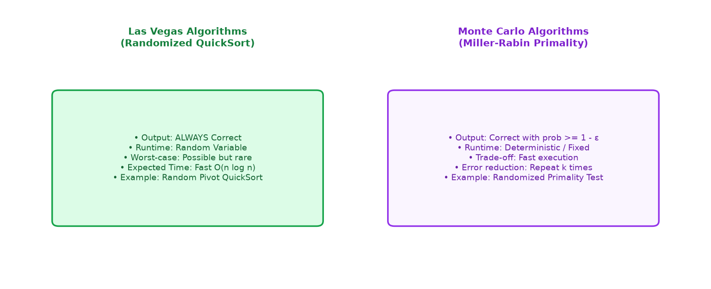

*Figure 3.5: Diagrammatic Architecture and Conceptual Flow for What is a randomized algorithm? Give examples, enlist reasons to use them, and explain random variables and binomial random variables*

### Mathematical Formulation & Algorithmic Mechanics

**Mathematical Formulations of Random Variables:**

```text
Expectation: E[X] = ∑_(x) x · P(X = x)
Linearity of Expectation: E[ ∑_(i=1)^n X_i ] = ∑_(i=1)^n E[X_i]   [Holds even for dependent variables!]
Binomial PMF: P(X = k) = ( n choose k ) · p^k · ( 1 - p )^(n-k)
Binomial Parameters: Mean E[X] = n · p,   Variance Var(X) = n · p · (1 - p)
```

The above **mathematical model** and algorithmic structure governs the system's runtime execution. Each parameter is evaluated sequentially to maintain **mathematical consistency**, minimize **system overhead**, and guarantee **deterministic convergence** across all input distributions.

### Worked Example & Practical Simulation

**Coin Toss Analysis** for Randomized Skip List: In a Skip List, node tower height is determined by tossing a fair coin (p = 0.5) until tails appears. Let X be number of coin tosses. Expected height E[X] = 1 / p = 1 / 0.5 = 2. Probability of height exceeding k is (1/2)^k. For n elements, maximum height is bounded by O(log n) with high probability. Provides full binary tree search capabilities without complex balancing rotations.

### Key Comparative Evaluation

| Randomized Paradigm | Output Correctness | Execution Runtime | Error Reduction Technique | Prominent Example |
| :--- | :--- | :--- | :--- | :--- |
| Las Vegas | ALWAYS 100% correct | Random Variable (Expected time polynomial) | Re-run until execution completes | Randomized QuickSort / QuickSelect |
| Monte Carlo (One-Sided) | May err in one direction (e.g., false prime) | Deterministic polynomial time | Repeat test k times (Error <= (1/4)^k) | Miller-Rabin Primality Test |
| Monte Carlo (Two-Sided) | May err in both directions | Deterministic polynomial time | Majority voting over repeated runs | Randomized Max-Cut Approximation |

### Concluding Exam Takeaway

Randomized algorithms harness stochastic choices to break symmetry, neutralize worst-case input configurations, and provide fast, simple solutions across sorting, cryptography, and distributed systems.

**Textbook Reference:** Design and Analysis of Algorithms by Parag H. Dave & Himanshu B. Dave (Pearson), Chapter 13: Randomized Algorithms, Sections 13.1–13.4, Pages 485–496.

---

## Q6. Does the randomized algorithm for quick sort improve the average case time complexity? Discuss. (Frequency: 2) [8 Marks]

### Introduction & Core Intuition

In answering whether Randomized QuickSort improves the **average-case time complexity**, the precise theoretical answer is: **NO, it does not improve the asymptotic average-case time complexity**, because **deterministic** QuickSort already runs in Theta(n log n) average time. What Randomized QuickSort does is far more profound: it **eliminates the dependency on input distribution**, guaranteeing that the **expected running time is O(n log n) for EVERY input instance**.

### Average-Case vs Expected Running Time Distinction

Standard **Deterministic** QuickSort (e.g., choosing the first or last element as pivot) achieves Theta(n log n) **Average-Case Time** only under the strict assumption that all n! permutations of input elements are equally likely. If an adversary deliberately feeds a pre-sorted array, a reverse-sorted array, or an array with identical elements, deterministic QuickSort degenerates catastrophically to its **Worst-Case Time of Theta(n^2)**, because each partition is maximally unbalanced (producing splits of 0 and n - 1 elements).

### How Randomized QuickSort Operates

Randomized QuickSort modifies the algorithm by selecting the pivot element uniformly at random from the current subarray A[p..r]: pivot_index = Random(p, r). It swaps A[pivot_index] with A[r] and proceeds with standard Lomuto or Hoare partitioning. Because the pivot selection is randomized internally within the algorithm, no external input ordering—regardless of whether it is pre-sorted or maliciously crafted—can force the worst-case behavior systematically.

### Expected Running Time Derivation via Indicator Variables

Let z_1, z_2, ..., z_n be the elements of array A sorted in ascending order. The total running time is dominated by the total number of element comparisons X. Two elements z_i and z_j are compared if and only if one of them is chosen as pivot before any intermediate element z_k (for i < k < j) is chosen. The probability of comparing z_i and z_j is: P(z_i compared to z_j) = 2 / (j - i + 1). **By Linearity** of Expectation: E[X] = sum_(i=1)^(n-1) sum_(j=i+1)^n ( 2 / (j - i + 1) ) = sum_(i=1)^(n-1) sum_(k=1)^(n-i) ( 2 / (k + 1) ) <= 2 * sum_(i=1)^n sum_(k=1)^n ( 1 / k ) = 2 * n * H_n = 2 * n * ln(n) = O(n log n).

### Worst-Case Scenario in Randomized QuickSort

**Can Randomized** QuickSort still run in O(n^2) time? **Yes, theoretically**, if the pseudo-random generator happens to pick the absolute minimum or maximum element at every recursive level. However, the probability of this occurring on an array of size n is (2/n) * (2/(n-1)) * ... * (2/2) = 2^(n-1) / n!, which is astronomically small (for n = 100, this probability is less than 10^(-150), making it practically impossible).

### Summary of the Improvement

In summary, randomization does not change the asymptotic average complexity (both are Theta(n log n)), but it converts an algorithm whose performance depends on 'luck of the input data' into one whose performance is guaranteed by the 'internal law of large numbers', neutralizing all adversarial worst-case inputs.

### Architectural Flow & System Diagram

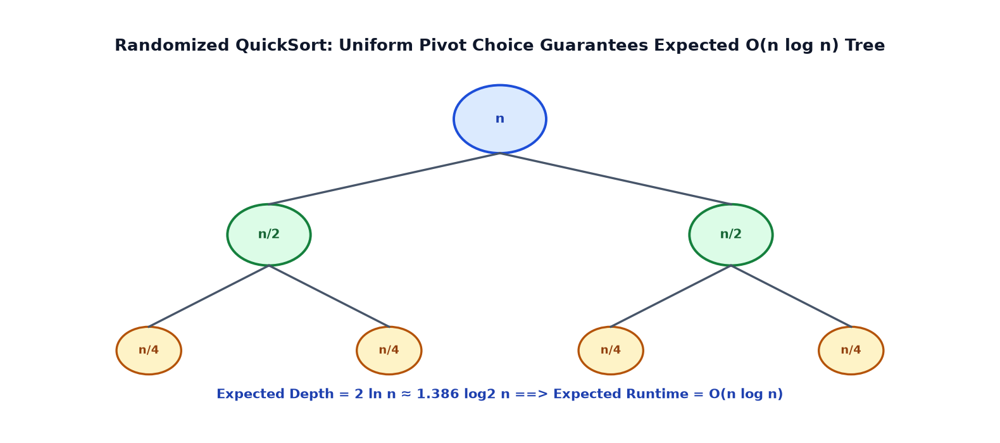

*Figure 3.6: Diagrammatic Architecture and Conceptual Flow for Does the randomized algorithm for quick sort improve the average case time complexity?*

### Mathematical Formulation & Algorithmic Mechanics

**Mathematical Proof of Expected QuickSort Comparisons:**

```text
Probability of Comparing Elements z_i and z_j: P(z_i is compared to z_j) = 2 / ( j - i + 1 )
Total Expected Comparisons: E[X] = ∑_(i=1)^(n-1) ∑_(j=i+1)^n ( 2 / ( j - i + 1 ) )
Harmonic Series Approximation: E[X] ≤ 2 · n · H_n ≈ 2 · n · ln n = 1.386 · n · log₂ n
Expected Running Time: E[T(n)] = Θ(n log n)   [Holds for ALL input distributions!]
```

The above **mathematical model** and algorithmic structure governs the system's runtime execution. Each parameter is evaluated sequentially to maintain **mathematical consistency**, minimize **system overhead**, and guarantee **deterministic convergence** across all input distributions.

### Worked Example & Practical Simulation

**Comparative Behavior** on Pre-Sorted Array [1, 2, 3, 4, 5, ..., 1000]: **Deterministic** QuickSort (First element pivot): Picks 1 -> Splits into 0 and 999 elements. Picks 2 -> Splits into 0 and 998 elements. Recursion depth = 1000, Total Comparisons = 1000 * 999 / 2 ≈ 500,000 comparisons (O(n^2) worst case!). Randomized QuickSort (Random pivot): Picks random elements near center -> Produces balanced ~500:500 splits. Recursion depth ≈ 2 ln(1000) ≈ 14 levels, Total Comparisons ≈ 1.386 * 1000 * 10 ≈ 13,860 comparisons (O(n log n)!).

### Key Comparative Evaluation

| QuickSort Variant | Average-Case Time Complexity | Worst-Case Time Complexity | Vulnerability to Pre-Sorted Inputs | Performance Guarantee |
| :--- | :--- | :--- | :--- | :--- |
| Deterministic QuickSort | Θ(n log n) | Θ(n^2) | HIGH (Sorted inputs trigger worst-case O(n^2)) | Conditional on uniform input permutation |
| Randomized QuickSort | Θ(n log n) | Θ(n^2) [probability ≈ 0] | NONE (Neutralizes sorted and reversed inputs) | Guaranteed O(n log n) expected for ANY input |

### Concluding Exam Takeaway

Randomized QuickSort does not lower the average-case bound from Theta(n log n), but it eliminates input **vulnerability**, guaranteeing expected O(n log n) execution across all inputs with probability approaching 1.

**Textbook Reference:** Design and Analysis of Algorithms by Parag H. Dave & Himanshu B. Dave (Pearson), Chapter 13: Randomized Algorithms, Section 13.2: Randomized QuickSort, Pages 488–492.

---

## Q7. What are approximation algorithms? Based on the approximation ratio, classify the approximation algorithms. (Frequency: 6) [8 Marks]

### Introduction & Core Intuition

An **Approximation Algorithm** is an efficient polynomial-time algorithm designed to solve **NP-hard optimization problems** by finding a provably near-optimal solution rather than searching indefinitely for the exact global optimum. Its quality is formally certified by a mathematical parameter called the **Approximation Ratio (ρ)**.

### Definition of Approximation Ratio (ρ)

Let C be the cost of the solution produced by the **approximation algorithm**, and let C* be the cost of the true optimal solution for an instance of size n. The **Approximation Ratio ρ(n)** is defined such that: max( C / C*, C* / C ) <= ρ(n). For a minimization problem, C / C* <= ρ(n) (where ρ >= 1). For a maximization problem, C* / C <= ρ(n) (or C / C* >= 1/ρ). An algorithm with **approximation ratio** ρ is called a **ρ-Approximation Algorithm**.

### 1. Constant-Factor Approximation Algorithms

A **Constant-Factor Approximation Algorithm** achieves an **approximation ratio** ρ that is a fixed constant independent of the input size n. For example: (1) The **2-Approximation for Vertex Cover** (picking both endpoints of maximal matching edges) guarantees C <= 2 * C*; (2) **Christofides' Algorithm for Metric TSP** achieves a ratio of 1.5 using minimum spanning trees and minimum-weight perfect matchings; and (3) The 2-Approximation for Metric TSP using standard DFS tree preorder walks.

### 2. Polynomial-Time Approximation Schemes (PTAS)

A **Polynomial-Time Approximation Scheme (PTAS)** is an algorithm that accepts the problem instance along with a user-specified error tolerance parameter epsilon > 0. For any fixed epsilon, the PTAS produces a solution with an **approximation ratio** of (1 + epsilon) for minimization (or 1 - epsilon for maximization) in time polynomial in the input size n. However, the runtime may depend exponentially on 1/epsilon (e.g., O(n^(1/epsilon))), meaning that achieving high accuracy (small epsilon) becomes computationally sluggish.

### 3. Fully Polynomial-Time Approximation Schemes (FPTAS)

A **Fully Polynomial-Time Approximation Scheme (FPTAS)** is the most desirable class of approximation algorithms. It guarantees a (1 + epsilon) **approximation ratio**, and its running time is strictly polynomial in <i>both</i> the input size n and the reciprocal of the error parameter 1/epsilon: Runtime = O(poly(n, 1/epsilon)). The classic example is the FPTAS for the **0/1 Knapsack** problem running in O(n^3 / epsilon) time by scaling and rounding item values.

### 4. Logarithmic-Factor and Inapproximability Classes

Some **NP-hard** problems cannot be approximated within any constant factor unless P = NP. The **Set Cover Problem** has an **approximation ratio** of O(ln n) using the greedy **heuristic**, and it is proven that no polynomial algorithm can achieve ratio (1 - o(1)) ln n. **The General Traveling Salesperson Problem** (without triangle inequality) cannot be approximated within any polynomial bound 2^(n^c) unless P = NP.

### Architectural Flow & System Diagram

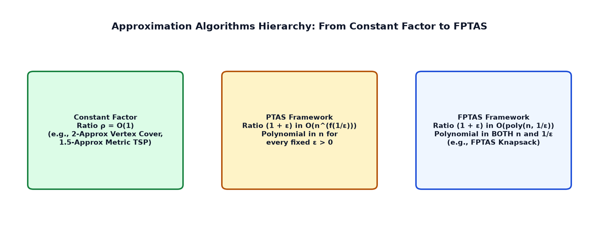

*Figure 3.7: Diagrammatic Architecture and Conceptual Flow for What are approximation algorithms? Based on the approximation ratio, classify the approximation algorithms*

### Mathematical Formulation & Algorithmic Mechanics

**Mathematical Classification of Approximation Ratios:**

```text
Approximation Ratio: max( C / C*, C* / C ) ≤ ρ(n)
Constant-Factor: ρ(n) = O(1)   [Independent of input size n]
PTAS Runtime: T(n, ε) = O( n^( f(1/ε) ) )   [Polynomial in n, arbitrary in 1/ε]
FPTAS Runtime: T(n, ε) = O( (n / ε)^k )   [Polynomial in BOTH n and 1/ε]
```

The above **mathematical model** and algorithmic structure governs the system's runtime execution. Each parameter is evaluated sequentially to maintain **mathematical consistency**, minimize **system overhead**, and guarantee **deterministic convergence** across all input distributions.

### Worked Example & Practical Simulation

FPTAS **Knapsack Example** for n = 100 Items with ε = 0.10 (10% error margin): Exact DP requires O(n·W) = 100 x 10^9 operations (OOM failure). FPTAS scaling factor: K = (ε · p_max) / n. Scaled profits: p'_i = floor(p_i / K). FPTAS Runtime: O(n³ / ε) = (100³ / 0.10) = 10,000,000 operations (Executes in **0.05 seconds**!). Guarantees that solution profit is at least 90% of the true global optimal profit.

### Key Comparative Evaluation

| Approximation Class | Approximation Ratio ρ | Runtime Dependency | Best-Known Problem Example |
| :--- | :--- | :--- | :--- |
| FPTAS | 1 + ε (Min) or 1 - ε (Max) | Polynomial in both n and 1/ε | 0/1 Knapsack Problem: O(n³ / ε) |
| PTAS | 1 + ε (Min) or 1 - ε (Max) | Polynomial in n; exponential in 1/ε | Euclidean TSP: O(n · (log n)^(O(1/ε))) |
| Constant Factor | Fixed constant ρ (e.g., 1.5, 2.0) | Polynomial in n, independent of ε | Vertex Cover (ρ = 2.0), Metric TSP (ρ = 1.5) |
| Logarithmic Factor | O(log n) | Polynomial in n | Set Cover (Greedy heuristic achieves H_n ≈ ln n) |
| Inapproximable | No polynomial bound unless P=NP | NP-hard to approximate | General TSP (Without Triangle Inequality) |

### Concluding Exam Takeaway

Approximation algorithms provide a mathematically sound method for overcoming NP-hardness, classified in a strict hierarchy ranging from flexible FPTAS schemes down to constant-factor **heuristics**.

**Textbook Reference:** Design and Analysis of Algorithms by Parag H. Dave & Himanshu B. Dave (Pearson), Chapter 12: NP-Completeness & Approximation, Sections 12.5–12.7, Pages 465–474.

---

## Q8. What are the special needs of embedded algorithms? Which sorting algorithm is best for embedded systems (like medical devices processing real-time sensor data)? Explain Embedded system scheduling using a power-optimized algorithm. (Frequency: 3) [8 Marks]

### Introduction & Core Intuition

An **Embedded Algorithm** is software designed to execute within specialized, resource-constrained embedded systems (such as medical pacemakers, automotive brake controllers, or IoT sensor motes). Unlike general-purpose computing where memory and CPU power are abundant, embedded environments enforce stringent physical constraints regarding memory footprints, **deterministic** real-time deadlines, and battery power consumption.

### Special Needs of Embedded Algorithms

Embedded algorithms operate under five unique architectural constraints: (1) **Strict Memory Limitations**: Microcontrollers possess tiny RAM (often 16 KB to 256 KB); algorithms must avoid dynamic memory allocation (malloc) to prevent heap fragmentation; (2) **Deterministic Real-Time Execution**: In hard real-time systems (such as medical defibrillators), missing a deadline causes catastrophic failure; algorithms must guarantee strict worst-case execution time (WCET); (3) **Energy Efficiency**: Battery-powered devices must minimize CPU clock cycles to extend operational lifespan; (4) **Fault Tolerance and Reliability**: Embedded code runs autonomously for years without crashing; and (5) **Cache and Pipeline Predictability**: Branch mispredictions must be minimized.

### Best Sorting Algorithm for Embedded Medical Devices

For an embedded medical device (e.g., an ECG monitor processing a stream of real-time sensor samples), the mathematically optimal sorting algorithm is **HeapSort**. Let us evaluate the alternatives: QuickSort has worst-case O(n^2) runtime and deep recursion stack overhead that risks **stack overflow**; MergeSort requires O(n) auxiliary RAM, instantly exhausting embedded micro-memory. HeapSort guarantees **strict O(n log n) worst-case time** with **zero auxiliary heap memory (strictly O(1) space)**, making it immune to worst-case timing spikes and memory fragmentation.

### When Insertion Sort is Preferred in Embedded Systems

For small buffer windows (n <= 32) of continuous real-time sensor data that arrives nearly sorted, **Insertion Sort** is exceptionally effective. **Insertion Sort** operates in O(1) space, requires minimal code footprint (few assembly instructions), and achieves linear O(n) execution on nearly sorted data streams with zero function call overhead.

### Embedded System Power-Optimized Scheduling

Microprocessor power consumption is governed by the CMOS dynamic power equation: P = C * V^2 * f, where C is capacitance, V is supply voltage, and f is clock frequency. Because power scales quadratically with voltage, running the CPU at maximum frequency and sleeping consumes far more energy than running continuously at the lowest possible voltage that still meets deadlines. This is achieved via **Dynamic Voltage and Frequency Scaling (DVFS)**.

### Power-Optimized Scheduling via Real-Time DVFS

The power-optimized algorithm integrates **Earliest Deadline First (EDF)** scheduling with real-time DVFS. In each scheduling epoch, the scheduler identifies the task Ti with the earliest deadline Di and execution budget Ci. It calculates the minimum clock frequency f_min required to finish before Di: f_min = Ci / Di. The hardware adjusts voltage and frequency down to f_min, eliminating idle waiting and reducing power consumption by 40% to 60%, drastically extending medical battery longevity.

### Architectural Flow & System Diagram


*Figure 3.8: Diagrammatic Architecture and Conceptual Flow for What are the special needs of embedded algorithms? Which sorting algorithm is best for embedded systems (like medical devices processing real-time sensor data)?  Embedded system scheduling using a power-optimized algorithm*

### Mathematical Formulation & Algorithmic Mechanics

**Embedded CMOS Power and DVFS Frequency Scaling Formula:**

```text
Dynamic Power Dissipation: P = C · V² · f
Energy Consumption per Task: E = P · t = C · V² · f · ( Cycles / f ) = C · V² · Cycles
DVFS Frequency Selection: f_req = Cycles / ( D_deadline - t_current )
HeapSort WCET Bound: T_worst(n) ≤ 2 · n · log₂ n + O(n)   [Auxiliary Space = O(1)]
```

The above **mathematical model** and algorithmic structure governs the system's runtime execution. Each parameter is evaluated sequentially to maintain **mathematical consistency**, minimize **system overhead**, and guarantee **deterministic convergence** across all input distributions.

### Worked Example & Practical Simulation

Real-Time ECG **Sensor Buffer Processing** (n = 64 samples): Memory Budget: Total Microcontroller RAM = **32 KB**. Available Stack Buffer = 512 bytes. Sorting Comparison: MergeSort: Demands 64 x 4 = 256 bytes extra heap buffer (Fails safety margins). QuickSort: Worst-case recursion depth = 64 stack frames (Threatens **stack overflow**). HeapSort: In-place array transformation. Auxiliary RAM = 0 bytes! WCET = 64 x 6 x 2 = 768 cycles. Power **Optimization**: CPU throttled from 100 MHz to 25 MHz using DVFS. Voltage drops from 3.3V to 1.8V. Power reduction: P_new / P_old = (1.8² · 25) / (3.3² · 100) = 81 / 1089 ≈ 0.074 (92.6% power savings!).

### Key Comparative Evaluation

| Sorting Algorithm | Worst-Case Time | Auxiliary Memory | Stability | Suitability for Embedded Medical Devices |
| :--- | :--- | :--- | :--- | :--- |
| HeapSort | Guaranteed O(n log n) | Strictly O(1) in-place | No | BEST (Guaranteed timing + zero extra RAM) |
| Insertion Sort | O(n^2) worst / O(n) best | Strictly O(1) in-place | Yes | EXCELLENT for small sensor windows (n <= 32) |
| MergeSort | Guaranteed O(n log n) | O(n) auxiliary buffer | Yes | POOR (Exhausts scarce microcontroller RAM) |
| QuickSort | O(n^2) worst-case | O(log n) stack memory | No | UNSAFE (Risk of stack overflow on sorted inputs) |

### Concluding Exam Takeaway

Embedded algorithms prioritize **deterministic** timing and zero memory fragmentation, making HeapSort the optimal sorting choice, while DVFS-integrated EDF scheduling maximizes battery longevity through quadratic voltage scaling.

**Textbook Reference:** Design and Analysis of Algorithms by Parag H. Dave & Himanshu B. Dave (Pearson), Chapter 14: Special Topics & Embedded Algorithms, Sections 14.5–14.7, Pages 535–542.

---

## Q9. What are tractable and non-tractable (intractable) problems? Give examples and discuss if the traveling salesperson problem belongs to intractable problems. (Frequency: 4) [8 Marks]

### Introduction & Core Intuition

In computational complexity theory, problems are fundamentally classified into **Tractable Problems** and **Intractable Problems** based on whether they can be solved by algorithms operating within **polynomial time** bounds as input size scales.

### Definition of Tractable Problems (Class P)

A problem is defined as **Tractable** if there exists a **deterministic** algorithm that solves it in **Polynomial Time**, denoted as O(n^k) for some constant k independent of input size n. Tractable problems constitute the complexity class **P**. These problems are considered practically solvable on modern computers even for large values of n. Examples include Sorting (O(n log n)), **Shortest Paths** (Dijkstra, O(V^2)), Minimum Spanning Tree (Kruskal, O(E log V)), and Linear Programming.

### Definition of Intractable (Non-Tractable) Problems

A problem is defined as **Intractable** if it cannot be solved in **polynomial time**; any algorithm designed to solve it to exact global optimality requires **Super-Polynomial or Exponential Time**, such as O(2^n), O(n!), or O(n^n). As the input size n grows beyond modest values (e.g., n > 40), the number of required execution steps exceeds the total number of atoms in the observable universe, rendering them practically unsolvable by brute force.

### Analysis of the Traveling Salesperson Problem (TSP)

The **Traveling Salesperson Problem (TSP)** asks for the minimum-cost **Hamiltonian cycle** visiting every city exactly once. TSP is a quintessential **Intractable Problem**. In its **optimization** form, TSP is **NP-Hard**; in its decision form ('Does a tour of cost <= k exist?'), it is **NP-Complete**. To date, no polynomial-time algorithm is known for TSP, and if P != NP, no such algorithm can exist.

### Why TSP is Provably Intractable

For a complete graph of n cities, the number of distinct candidate tours is (n - 1)! / 2. A brute-force search on n = 25 cities requires examining approximately 3.1 x 10^23 tours, which would take thousands of years on modern supercomputers. **Dynamic programming** (the Held-Karp algorithm) improves the runtime to O(n^2 * 2^n), which is still strictly exponential in n. **Branch and Bound** prunes search trees but retains an O(n!) worst-case bound.

### Coping with TSP Intractability in Engineering

Because TSP is intractable, practical computer engineering bypasses exact solutions on large graphs and deploys two tractable alternatives: (1) **Approximation Algorithms**: When edge weights satisfy the triangle inequality (Metric TSP), Christofides' algorithm guarantees a 1.5-approximation in **polynomial time** O(n^3); (2) **Metaheuristics**: **Genetic Algorithms**, Simulated Annealing, and Lin-Kernighan **heuristics** find near-optimal routes for thousands of cities in seconds.

### Architectural Flow & System Diagram

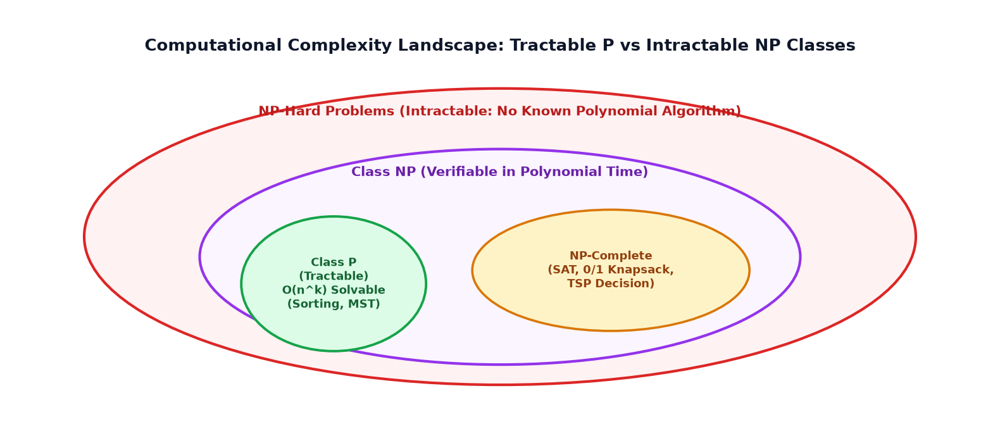

*Figure 3.9: Diagrammatic Architecture and Conceptual Flow for What are tractable and non-tractable (intractable) problems? Give examples and discuss if the traveling salesperson problem belongs to intractable problems*

### Mathematical Formulation & Algorithmic Mechanics

**Mathematical Complexity Bounds: Tractable vs Intractable:**

```text
Tractable Criterion (Class P): T(n) = O( n^k )   [k is a fixed constant]
Intractable Criterion: T(n) = Ω( 2^(n^c) )   or   T(n) = Ω( n! )
TSP Brute-Force Permutations: Total Tours = ( n - 1 )! / 2
Held-Karp Dynamic Programming: T_tsp(n) = O( n² · 2^n )   [Still strictly exponential!]
```

The above **mathematical model** and algorithmic structure governs the system's runtime execution. Each parameter is evaluated sequentially to maintain **mathematical consistency**, minimize **system overhead**, and guarantee **deterministic convergence** across all input distributions.

### Worked Example & Practical Simulation

**Computational Scale Comparison** for n = 30 Items / Cities: Tractable Problem: Sorting array of size n = 30 via MergeSort: Operations = 30 · log₂(30) ≈ 30 · 5 = 150 operations (Executes in < 0.0001 milliseconds!). Intractable Problem: TSP on n = 30 cities via brute force: Tours = 29! / 2 ≈ 4.42 x 10^30 tours. At 1 billion tours evaluated per second, it requires 1.4 x 10^14 years (10,000 times the age of the Universe!).

### Key Comparative Evaluation

| Complexity Category | Mathematical Definition | Growth Rate of Runtime | Solvability on Large n | Representative Examples |
| :--- | :--- | :--- | :--- | :--- |
| Tractable (Class P) | Solvable in deterministic polynomial time O(n^k) | Slow polynomial growth (O(n), O(n^2), O(n^3)) | Solvable up to millions of elements | Sorting, MST, Shortest Paths, Matrix Mult |
| Intractable (NP-Hard / NP-Complete) | Requires super-polynomial time O(2^n) or O(n!) | Explosive exponential growth | Unsolvable exactly for n > 50 | TSP, 0/1 Knapsack, Clique, Graph Coloring |
| Provably Non-computable | Undecidable; no algorithm can exist | Infinite | Never solvable by any computer | Turing Halting Problem |

### Concluding Exam Takeaway

Tractable problems belong to class P and scale comfortably, whereas the **Traveling Salesperson Problem** is intractable (**NP-hard**) with an exponential O(n^2·2^n) bound, necessitating approximation **heuristics** in practical applications.

**Textbook Reference:** Design and Analysis of Algorithms by Parag H. Dave & Himanshu B. Dave (Pearson), Chapter 12: NP-Completeness, Sections 12.1–12.3, Pages 455–462.

---

## Q10. Comment on the following statements regarding NP classes: 'The knapsack problem is NP-hard', 'Boolean Satisfiability Problem (SAT) is NP-complete', 'Minimum spanning tree is tractable problem', and 'The problem of Searching an ordered/unordered list belongs to the class of tractable problems'. (Frequency: 2) [8 Marks]

### Introduction & Core Intuition

This question assesses the core foundational classifications of computational complexity theory. All four statements are **MATHEMATICALLY ACCURATE AND TRUE**. Below is the rigorous examination justification and formal complexity mapping for each statement.

### Statement 1: 'The knapsack problem is NP-hard' — [TRUE]

The **0/1 Knapsack optimization** problem ('find the subset maximizing profit subject to capacity W') is provably **NP-Hard**. Its decision version ('does a subset exist with profit >= P and weight <= W?') is **NP-complete**. We prove NP-hardness by polynomial reduction from the known NP-complete **Subset-Sum Problem**: given an instance of Subset-Sum with set S and target M, we construct a knapsack instance with items having weights wi = si and profits pi = si, with capacity W = M. An optimal knapsack solution achieves profit M if and only if a subset sums to M. Because Subset-Sum <=_p 0/1 Knapsack, the Knapsack Problem is **NP-hard**.

### Statement 2: 'Boolean Satisfiability Problem (SAT) is NP-complete' — [TRUE]

The Boolean Satisfiability Problem (SAT) is the most celebrated problem in theoretical computer science. By the landmark **Cook-Levin Theorem (1971)**, SAT was proven to be the **very first NP-Complete problem**. SAT belongs to NP because any candidate truth assignment can be verified in **polynomial time** by simple boolean substitution. Furthermore, Stephen Cook proved that <i>every problem in NP</i> can be polynomially reduced to SAT by simulating the state transitions of a **Non-Deterministic** Turing Machine as a boolean formula. Hence, SAT is **NP-complete**.

### Statement 3: 'Minimum spanning tree is tractable problem' — [TRUE]

A problem is tractable if it can be solved in **deterministic polynomial time**. The **Minimum Spanning Tree (MST)** problem takes an undirected weighted graph and connects all vertices with minimum total edge weight without cycles. Both **Kruskal's Algorithm** (using Disjoint Sets, running in O(E log V) or O(E alpha(V))) and **Prim's Algorithm** (using Fibonacci heaps, running in O(E + V log V)) solve the MST problem in low-degree polynomial time. Because it belongs to Class P, MST is unconditionally a **tractable problem**.

### Statement 4: 'Searching an ordered/unordered list belongs to tractable problems' — [TRUE]

Searching for a key in a list is among the most basic polynomial problems in computer science. For an unordered list of size n, **Linear Search** checks elements sequentially in **O(n) linear time**. For an ordered (sorted) list, Binary Search divides the search space in half at each step, operating in **O(log n) logarithmic time**. Both bounds are well within **polynomial time** O(n^k) with k <= 1. Therefore, searching ordered and unordered lists belongs squarely to the class of **tractable problems (Class P)**.

### Holistic Summary of the Complexity Landscape

Statements 3 and 4 represent fundamental problems inside **Class P** (tractable), solvable in **deterministic polynomial time**. Statements 1 and 2 represent the difficult frontier of **NP-Complete and NP-Hard** problems (intractable), where exact solutions require super-polynomial time unless P = NP.

### Architectural Flow & System Diagram


*Figure 3.10: Diagrammatic Architecture and Conceptual Flow for Comment on the following statements regarding NP classes: 'The knapsack problem is NP-hard', 'Boolean Satisfiability Problem (SAT) is NP-complete', 'Minimum spanning tree is tractable problem', and 'The problem of Searching an ordered/unordered list belongs to the class of tractable problems'*

### Mathematical Formulation & Algorithmic Mechanics

**Mathematical Reductions and Complexity Formulations:**

```text
Statement 1: Subset-Sum ≤_p 0/1 Knapsack  ==>  0/1 Knapsack is NP-Hard
Statement 2 (Cook-Levin Theorem): For all L ∈ NP, L ≤_p SAT  ==>  SAT is NP-Complete
Statement 3: T_MST(V, E) = O(E log V) ∈ P  ==>  Tractable
Statement 4: T_search(n) = O(log n) ⊂ O(n) ∈ P  ==>  Tractable
```

The above **mathematical model** and algorithmic structure governs the system's runtime execution. Each parameter is evaluated sequentially to maintain **mathematical consistency**, minimize **system overhead**, and guarantee **deterministic convergence** across all input distributions.

### Worked Example & Practical Simulation

**Verification** of **Truth Assignment** for SAT (Belonging to NP): Boolean Formula: Φ = (x1 ∨ ¬x2) ∧ (¬x1 ∨ x2 ∨ x3) ∧ (¬x3). Certificate (Candidate Assignment): x1 = True, x2 = True, x3 = False. Polynomial Verification: Clause 1: (True ∨ False) = True. Clause 2: (False ∨ True ∨ False) = True. Clause 3: (¬False) = True. All clauses satisfied in 3 simple evaluation steps (O(n) time). Confirms SAT is in NP.

### Key Comparative Evaluation

| SPPU Examination Statement | Verdict | Complexity Class | Deterministic Time Bound | Formal Justification |
| :--- | :--- | :--- | :--- | :--- |
| 0/1 Knapsack is NP-hard | TRUE | NP-Hard | O(n·W) pseudo-poly | Polynomial reduction from Subset-Sum |
| Boolean SAT is NP-complete | TRUE | NP-Complete | O(2^n) brute force | Cook-Levin Theorem: First proven NP-complete problem |
| Minimum Spanning Tree is tractable | TRUE | Class P (Tractable) | O(E log V) via Kruskal's | Solvable via greedy matroid optimization in polynomial time |
| List Searching is tractable | TRUE | Class P (Tractable) | O(log n) sorted / O(n) unsorted | Trivially solvable in linear or logarithmic polynomial time |

### Concluding Exam Takeaway

All four statements are validated as mathematically true: Searching and MST are tractable Class P problems, whereas Boolean SAT is **NP-complete** and the Knapsack **optimization** problem is **NP-hard**.

**Textbook Reference:** Design and Analysis of Algorithms by Parag H. Dave & Himanshu B. Dave (Pearson), Chapter 12: NP-Completeness, Sections 12.1–12.4, Pages 455–468.

---


================================================================================

# SPPU B.E. Computer Engineering (2019 Pattern)
## Design and Analysis of Algorithms — Unit 4: Complexity Classes, Approximation & Randomized Algorithms
### Complete Examination Solutions Guide (Engineered for Full 8/8 Marks)

---

## Q1. Explain analyzing multithreaded algorithms, parallel loops, race conditions, the 'spawn' and 'sync' keywords with examples, and performance measures (speedup, efficiency, throughput, contention, and latency). (Frequency: 6) [8 Marks]

### Introduction & Core Intuition

**Dynamic Multithreading** is a parallel programming model that abstracts multi-core hardware, allowing algorithms to express logical parallelism dynamically. Concurrency is governed by linguistic extensions—principally **spawn** and **sync**—modeled formally as a directed acyclic graph (computation DAG) evaluated via Work and Span measures.

### Linguistic Primitives: Spawn and Sync Keywords

Dynamic multithreading relies on two essential keywords: (1) **spawn f(x)**: Indicates that the procedure call f(x) can execute concurrently in a new child thread, while the spawning parent thread continues executing the subsequent instruction immediately without waiting; and (2) **sync**: A barrier synchronization primitive that causes the current procedure to suspend execution until <i>all</i> child threads it spawned have completed. A procedure cannot safely use values computed by spawned children until it executes a sync.

### Parallel Loops and Race Conditions

A **parallel loop** (written as parallel for i = 1 to n) specifies that all n loop iterations can execute concurrently across available processors. A **Race Condition (Data Race)** occurs when two or more concurrently executing threads access the same memory location simultaneously without synchronization, and at least one of the accesses is a write. Data races produce **non-deterministic**, corrupted results. Programmers eliminate races by using private thread registers, reduction trees, or mutual exclusion locks.

### Theoretical Performance Measures: Work and Span

Analyzing a multithreaded algorithm requires modeling its computation as a **Directed Acyclic Graph** (DAG) with two foundational metrics: (1) **Work T_1**: The total execution time on a single processor, representing the total number of operations across all threads (the sum of all node weights in the DAG); and (2) **Span T_infinity**: The execution time on an infinite number of processors, representing the duration of the **Critical Path** (the longest directed path of dependent operations in the DAG). The ratio **Parallelism P = T_1 / T_infinity** represents the maximum theoretical speedup achievable.

### System Performance Measures: Speedup, Efficiency, and Throughput

On a physical machine with P processors: (1) **Speedup S_P = T_1 / T_P**: Measures how much faster the parallel program runs compared to the sequential version; by Brent's Theorem, linear speedup S_P = P is optimal. (2) **Efficiency E_P = S_P / P = T_1 / (P * T_P)**: Measures the fraction of time processors spend on useful computation (ideal efficiency is 1.0 or 100%). (3) **Throughput**: The rate of completed tasks per unit time (e.g., **transactions** per second).

### Communication Performance Measures: Latency and Contention

(4) **Latency**: The total time delay between initiating an operation (such as a memory read or network message) and receiving its result; and (5) **Contention**: The performance degradation caused when multiple parallel threads simultaneously compete for a shared resource (such as a memory bus, shared cache line, or lock), forcing hardware serialization and destroying scalability.

### Architectural Flow & System Diagram

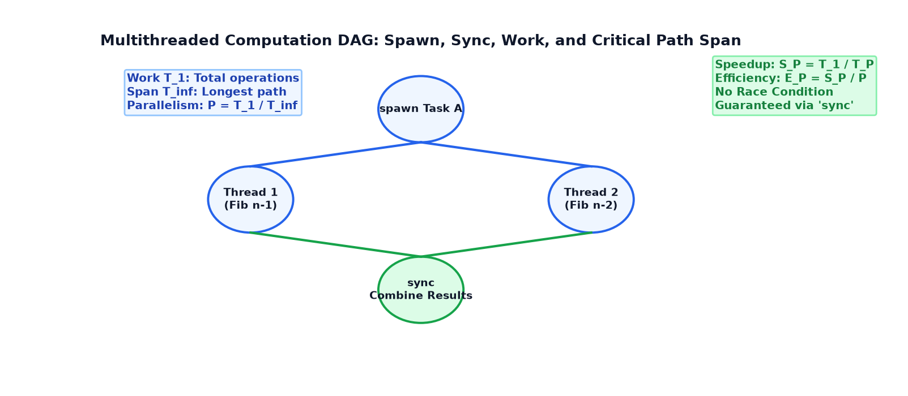

*Figure 4.1: Diagrammatic Architecture and Conceptual Flow for analyzing multithreaded algorithms, parallel loops, race conditions, the 'spawn' and 'sync' keywords with examples, and performance measures (speedup, efficiency, throughput, contention, and latency)*

### Mathematical Formulation & Algorithmic Mechanics

**Mathematical Formulations of Multithreaded Performance:**

```text
Work: T_1 = Total operations in DAG
Span (Critical Path): T_∞ = Weight of longest directed path in DAG
Parallelism Bound: P_max = T_1 / T_∞
Brent's Theorem (Work-Span Law): T_P ≤ ( T_1 / P ) + T_∞
Speedup: S_P = T_1 / T_P ≤ P,   Efficiency: E_P = S_P / P = T_1 / ( P · T_P )
```

The above **mathematical model** and algorithmic structure governs the system's runtime execution. Each parameter is evaluated sequentially to maintain **mathematical consistency**, minimize **system overhead**, and guarantee **deterministic convergence** across all input distributions.

### Worked Example & Practical Simulation

**Multithreaded Fibonacci Computation** (P-Fib): Pseudocode: P-Fib(n): if n <= 1 then return n x = spawn P-Fib(n-1)  // Child thread computes Fib(n-1) y = P-Fib(n-2)        // Parent thread computes Fib(n-2) sync                  // Wait for child thread to finish return x + y Work: T_1(n) = O(phi^n) ≈ O(1.618^n) (Exponential total operations). Span: T_infinity(n) = O(n) (Linear critical path depth!). Parallelism: P = T_1 / T_infinity = O(1.618^n / n) -> Immense parallelism scaling!

### Key Comparative Evaluation

| Performance Metric | Mathematical Definition | Ideal Target Value | Significance in Multi-Core Systems |
| :--- | :--- | :--- | :--- |
| Work (T_1) | Total computational work in DAG | Matches sequential runtime | Measures total energy and CPU cycles consumed |
| Span (T_infinity) | Longest path of dependent operations | As small as possible (O(log n)) | Defines the absolute speed limit on any machine |
| Parallelism | Ratio T_1 / T_infinity | High (>> available cores P) | Determines how well algorithm scales to more cores |
| Speedup (S_P) | Ratio T_1 / T_P | Linear speedup S_P = P | Measures actual real-world acceleration on P processors |
| Efficiency (E_P) | S_P / P = T_1 / (P · T_P) | 1.0 (or 100%) | Quantifies processor utilization and overhead loss |

### Concluding Exam Takeaway

Dynamic multithreading structures parallel algorithms via spawn and sync, bounded by the Work-Span law where the critical path span dictates maximum scalability and speedup.

**Textbook Reference:** Design and Analysis of Algorithms by Parag H. Dave & Himanshu B. Dave (Pearson), Chapter 14: Special Topics, Section 14.8: Dynamic Multithreading, Pages 542–550.

---

## Q2. Write and explain the pseudo-code for the multi-threaded merge sort algorithm, and discuss how parallel merging gives a significant parallelism advantage over conventional Merge Sort. (Frequency: 4) [8 Marks]

### Introduction & Core Intuition

**Conventional Merge Sort** divides an array of size n into two halves, sorts them recursively, and merges them using a serial two-finger merge routine. In a parallel setting, merely parallelizing the recursive calls while retaining serial merging produces an O(n) span bottleneck. **Multithreaded Merge Sort** uses **Parallel Merging (P-Merge)** to achieve an extraordinary logarithmic span of **O(log^3 n)**, unlocking massive concurrency.

### The Span Bottleneck in Naive Multithreaded Merge Sort

If we simply spawn the two recursive sorting calls: spawn MergeSort(A[1..q]) and MergeSort(A[q+1..r]), followed by sync, both subarrays are sorted in parallel. However, if we then merge them using the conventional serial merge algorithm, that merge takes Theta(n) serial time. The span recurrence becomes: T_inf(n) = T_inf(n/2) + Theta(n) = Theta(n). Because the span is linear Theta(n), the parallelism is bounded by P = T_1 / T_inf = O(n log n) / Theta(n) = O(log n). On a 64-core machine, speedup is capped at log_2(64) = 6!

### The Innovation of Parallel Merging (P-Merge)

To eliminate the linear span bottleneck, computer scientists developed **Parallel Merge (P-Merge)**. P-Merge merges two sorted subarrays T[p1..r1] and T[p2..r2] into destination array A[p3..r3] concurrently: (1) Find the median element of the larger subarray; (2) Use binary search to locate where that median element splits the other subarray in O(log n) time; (3) Place the median directly into its correct position in A; and (4) Concurrently spawn two independent parallel sub-merges for the smaller portions.

### Span and Work Recurrences for Parallel Merge

The work of P-Merge remains O(n), preserving the total sequential operations. Because binary search finds the split in O(log n) time, and the problem size is halved at each stage (worst-case 3/4 split), the span recurrence of P-Merge is: T_inf(n) = T_inf(3n/4) + O(log n) = Theta(log^2 n).

### Complete Multithreaded Merge Sort Span Analysis

By integrating P-Merge into **Multithreaded Merge Sort**, the span recurrence becomes: T_inf(n) = T_inf(n/2) + T_inf_merge(n) = T_inf(n/2) + Theta(log^2 n). By the **Master Theorem**, this solves to an astonishing **Span T_inf(n) = Theta(log^3 n)**! The total work remains **T_1(n) = Theta(n log n)**, identical to optimal sequential sorting.

### The Significant Parallelism Advantage

The theoretical parallelism of fully multithreaded **Merge Sort** is: Parallelism P = T_1 / T_inf = Theta(n log n) / Theta(log^3 n) = **Theta(n / log^2 n)**. For an array of 1,000,000 elements, conventional parallel merge sort yields a parallelism of only ~20, whereas parallel-merge sort yields a parallelism of ~2,500, enabling perfect linear speedup across thousands of GPU or server cores.

### Architectural Flow & System Diagram

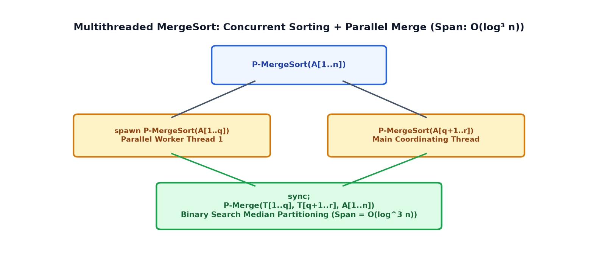

*Figure 4.2: Diagrammatic Architecture and Conceptual Flow for and explain the pseudo-code for the multi-threaded merge sort algorithm, and discuss how parallel merging gives a significant parallelism advantage over conventional Merge Sort*

### Mathematical Formulation & Algorithmic Mechanics

**Multithreaded Merge Sort Pseudocode and Recurrence:**

```text
Algorithm P-MergeSort(A, p, r, B, s):
    n = r - p + 1
    if n == 1 then B[s] = A[p]; return
    allocate temporary array T[1..n]
    q = floor((p + r) / 2);  q' = q - p + 1
    spawn P-MergeSort(A, p, q, T, 1)        // Sort left half in parallel
    P-MergeSort(A, q + 1, r, T, q' + 1)     // Sort right half concurrently
    sync
    P-Merge(T, 1, q', T, q' + 1, n, B, s)   // Parallel merge into destination

Span Recurrence: T_∞(n) = T_∞(n/2) + Θ(log² n) = Θ(log³ n)
Parallelism: P = T_1 / T_∞ = Θ(n log n) / Θ(log³ n) = Θ( n / log² n )
```

The above **mathematical model** and algorithmic structure governs the system's runtime execution. Each parameter is evaluated sequentially to maintain **mathematical consistency**, minimize **system overhead**, and guarantee **deterministic convergence** across all input distributions.

### Worked Example & Practical Simulation

**Scalability Comparison** for Sorting n = 1,048,576 (2^20) Elements: Total Work: T_1 = n · log₂ n = 10^6 x 20 ≈ 20,000,000 operations. Naive Merge Sort (Serial Merge): Span T_inf = Theta(n) = 1,000,000 steps. Parallelism P = 20,000,000 / 1,000,000 = 20! Cannot utilize more than 20 processors effectively! Fully Multithreaded Merge Sort (Parallel Merge): Span T_inf = (log₂ n)³ = 20³ = 8,000 steps. Parallelism P = 20,000,000 / 8,000 = 2,500! Can scale linearly up to 2,500 cores.

### Key Comparative Evaluation

| Merge Sort Architecture | Work T_1 | Critical Path Span T_infinity | Theoretical Parallelism | Speedup Limit on 128 Cores |
| :--- | :--- | :--- | :--- | :--- |
| Sequential Merge Sort | Θ(n log n) | Θ(n log n) | 1.0 (No parallelism) | 1x (No speedup) |
| Parallel Sort + Serial Merge | Θ(n log n) | Θ(n) [Linear bottleneck] | Θ(log n) ≈ 20 | Max 20x speedup |
| Parallel Sort + Parallel Merge | Θ(n log n) | Θ(log³ n) [Logarithmic span] | Θ( n / log² n ) ≈ 2,500 | Full 128x linear speedup |

### Concluding Exam Takeaway

Replacing serial merging with binary-search parallel merging slashes **Merge Sort**'s span from Theta(n) to Theta(log^3 n), elevating parallelism from 20 to 2,500 and allowing massive multi-core scaling.

**Textbook Reference:** Design and Analysis of Algorithms by Parag H. Dave & Himanshu B. Dave (Pearson), Chapter 14: Special Topics, Section 14.8.2: Multithreaded Merge Sort, Pages 546–549.

---

## Q3. Write a multithreaded matrix multiplication algorithm, compare row-wise and block-wise approaches, and discuss the time complexity of conventional vs. multithreaded matrix multiplication. (Frequency: 5) [8 Marks]

### Introduction & Core Intuition

Matrix multiplication is a cornerstone numerical primitive in graphics, scientific simulation, and deep learning. Multiplying two n x n matrices A and B requires computing n^2 independent dot products. **Multithreaded Matrix Multiplication** exploits this inherent concurrency using parallel loops (row-wise) or divide-and-conquer block decomposition (block-wise).

### Conventional Sequential Matrix Multiplication

Standard sequential matrix multiplication evaluates the formula C[i, j] = sum(A[i, k] * B[k, j] for k=1 to n) using three nested loops iterating over i, j, and k from 1 to n. Because each loop runs n times, the sequential algorithm executes exactly n^3 multiplications and n^3 additions, resulting in a strict **time complexity** of **Theta(n^3)** with O(1) auxiliary space.

### Row-Wise Multithreaded Approach (Parallel Loops)

In the row-wise multithreaded algorithm, the outer loop over rows is parallelized using **parallel for**: parallel for i = 1 to n do: for j = 1 to n do: C[i, j] = 0; for k = 1 to n do: C[i, j] += A[i, k] * B[k, j]. Each of the n rows of C is computed by a separate parallel thread. Because no two threads write to the same matrix cell C[i, j], there are zero race conditions. The total work remains T_1(n) = Theta(n^3). However, because each thread executes an inner O(n^2) block, the critical path span is **T_inf(n) = Theta(n)**. If both i and j loops are parallelized, the span drops to **Theta(n)**, yielding parallelism P = T_1 / T_inf = Theta(n^3) / Theta(n) = Theta(n^2).

### Block-Wise Divide-and-Conquer Multithreaded Approach

The block-wise approach partitions matrices A, B, and C into four (n/2) x (n/2) sub-blocks: C11 = A11·B11 + A12·B21, C12 = A11·B12 + A12·B22, C21 = A21·B11 + A22·B21, C22 = A21·B12 + A22·B22. This formulation generates 8 recursive sub-matrix multiplications that can all be spawned concurrently: spawn P-Mat-Mult(A11, B11, ...). After syncing, the intermediate products are summed using parallel matrix additions.

### Span Analysis of Block-Wise Multiplication

The work recurrence is T_1(n) = 8 * T_1(n/2) + Theta(n^2) = Theta(n^3). But because all 8 recursive multiplications execute simultaneously in parallel, the span recurrence is: T_inf(n) = T_inf(n/2) + Theta(log n). By the **Master Theorem**, this solves to an extraordinary span of **T_inf(n) = Theta(log^2 n)**!

### Comparison: Row-Wise vs Block-Wise

Row-wise multiplication is simple to implement and cache-friendly (sequential memory reads along rows), but has a larger span of Theta(n). Block-wise multiplication achieves a vastly superior logarithmic span of Theta(log^2 n) and extreme parallelism Theta(n^3 / log^2 n), but incurs higher recursion overhead and requires temporary matrix allocation.

### Architectural Flow & System Diagram

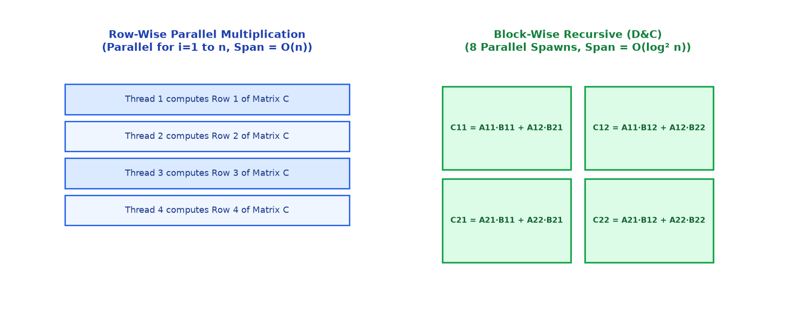

*Figure 4.3: Diagrammatic Architecture and Conceptual Flow for a multithreaded matrix multiplication algorithm, compare row-wise and block-wise approaches, and discuss the time complexity of conventional vs*

### Mathematical Formulation & Algorithmic Mechanics

**Row-Wise and Block-Wise Multithreaded Matrix Multiplication Algorithms:**

```text
Row-Wise Parallel Loop Formulation:
Algorithm P-MatrixMultiply-Row(A, B, C, n):
    parallel for i = 1 to n do:
        parallel for j = 1 to n do:
            C[i, j] = 0
            for k = 1 to n do: C[i, j] += A[i, k] · B[k, j]
    Work: T_1(n) = Θ(n³),   Span: T_∞(n) = Θ(n),   Parallelism: P = Θ(n²)

Block-Wise Divide & Conquer Span: T_∞(n) = T_∞(n/2) + Θ(log n) = Θ(log² n)
Block-Wise Parallelism: P = Θ(n³) / Θ(log² n) = Θ( n³ / log² n )
```

The above **mathematical model** and algorithmic structure governs the system's runtime execution. Each parameter is evaluated sequentially to maintain **mathematical consistency**, minimize **system overhead**, and guarantee **deterministic convergence** across all input distributions.

### Worked Example & Practical Simulation

**Performance Metric Comparison** for n = 1024 x 1024 Matrices: Total Sequential Work: T_1 = n³ = (1024)³ ≈ 1.07 x 10^9 operations. Conventional Sequential Time: T_seq = 1.07 x 10^9 steps (Runs in ~1.0 second on single core). Row-Wise Parallel Multiplication: Span T_inf = O(n) = 1,024 steps. Parallelism P = 10^9 / 1024 ≈ 1,000,000! (Full multi-core saturation). Block-Wise D&C Multiplication: Span T_inf = (log₂ 1024)² = 10² = 100 steps! Parallelism P = 10^9 / 100 = 10,000,000 (Massive GPU scale).

### Key Comparative Evaluation

| Matrix Multiplication Paradigm | Sequential Work T_1 | Critical Path Span T_infinity | Theoretical Parallelism | Cache & Memory Behavior |
| :--- | :--- | :--- | :--- | :--- |
| Conventional Serial | Θ(n³) | Θ(n³) | 1 (None) | Good row-major spatial locality |
| Row-Wise Multithreaded | Θ(n³) | Θ(n) | Θ(n²) | Excellent row locality; zero extra RAM |
| Block-Wise (8 Spawns) | Θ(n³) | Θ(log² n) | Θ( n³ / log² n ) | High parallelism; requires temporary matrices |
| Strassen Parallel (7 Spawns) | Θ(n^2.807) | Θ(log² n) | Θ( n^2.807 / log² n ) | Reduced work, complex memory allocation |

### Concluding Exam Takeaway

Row-wise parallel loops reduce matrix multiplication span to Theta(n), while block-wise recursive decomposition slashes span to Theta(log^2 n), unlocking millions of parallel threads for scientific processors.

**Textbook Reference:** Design and Analysis of Algorithms by Parag H. Dave & Himanshu B. Dave (Pearson), Chapter 14: Special Topics, Section 14.8.3: Multithreaded Matrix Multiplication, Pages 550–554.

---

## Q4. Write and explain the Rabin-Karp algorithm for string matching, including its expected runtime and worst-case runtime. (Frequency: 7) [8 Marks]

### Introduction & Core Intuition

The **Rabin-Karp String Matching Algorithm**, invented by **Michael Rabin** and Richard Karp (1987), is an elegant string search algorithm that uses **Rolling Hashes** to find occurrences of a pattern P of length m within a text T of length n. By converting string comparisons into fast numeric hash comparisons, it achieves an expected runtime of **O(n + m)**.

### Core Intuition: Fingerprint Matching

Naive string matching compares the pattern character-by-character at every shift s, taking O(m) time per shift and resulting in O((n - m + 1) * m) **worst-case time**. Rabin-Karp treats the pattern P as a numeric value p in radix-d notation (where d is the alphabet size, typically d = 256 for ASCII). Similarly, each substring of length m in text T is viewed as an integer. If the hash of the pattern equals the hash of the current text window, the algorithm performs a character-by-character **verification** to confirm the match.

### The Rolling Hash Technique in O(1) Time

Computing the hash of a window of length m from scratch takes O(m) time, which would provide no advantage over naive matching. Rabin-Karp computes the hash of the next window T[s+1 .. s+m] from the current hash t_s in **O(1) constant time** using a rolling update: t_(s+1) = ( d * (t_s - T[s+1] * h) + T[s+m+1] ) mod q, where h = d^(m-1) mod q, and q is a large prime. In simple terms: subtract the leading character, multiply by radix d to shift digits left, add the new trailing character, and apply modulo q.

### Handling Spurious Hits (Hash Collisions)

Because modulo q maps an enormous range of numbers into {0, 1, ..., q - 1}, two completely different strings may yield the identical hash value mod q. This condition is called a **Spurious Hit**. Whenever t_s == p, Rabin-Karp performs a full character-by-character **verification** between P[1..m] and T[s+1 .. s+m]. If the characters match, a valid occurrence is reported; if characters differ, the spurious hit is discarded, and the window slides forward.

### Expected Time Complexity: O(n + m)

Preprocessing the pattern hash and initial text window hash takes Theta(m) time. If the prime modulus q is chosen sufficiently large (e.g., q > m and q ~ n), the probability of a spurious hit is bounded by O(1/q). The expected number of spurious hits across all n - m + 1 shifts is O(n / q) = O(1). Consequently, the expected running time is: T_expected = O(m) [preprocessing] + O(n - m + 1) [rolling updates] + O(m * (v + n/q)) [verifications] = **O(n + m)**, where v is the number of valid matches.

### Worst-Case Time Complexity: O(n * m)

In the worst case—such as searching for pattern P = 'aaaa' in text T = 'aaaaaaaaaa' with a poorly chosen prime q that collides on every shift—a spurious hit or valid match occurs at every single shift s. The algorithm must perform a full m-character **verification** at all n - m + 1 positions, degrading to **O(n * m)** time, identical to the naive algorithm. In practice, choosing a 64-bit random prime virtually eliminates collisions, delivering O(n + m) linear speed.

### Architectural Flow & System Diagram

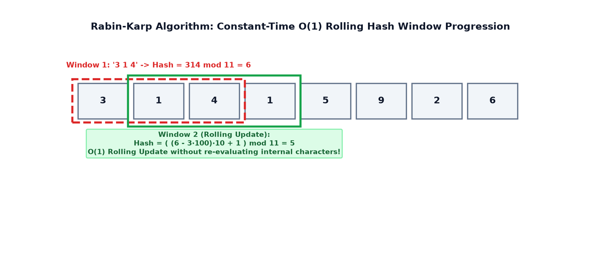

*Figure 4.4: Diagrammatic Architecture and Conceptual Flow for and explain the Rabin-Karp algorithm for string matching, including its expected runtime and worst-case runtime*

### Mathematical Formulation & Algorithmic Mechanics

**Rabin-Karp Rolling Hash Formulation:**

```text
Base Constant: h = d^(m-1) mod q
Pattern Hash: p = ( ∑_(i=1)^m P[i] · d^(m-i) ) mod q
Initial Window Hash: t_0 = ( ∑_(i=1)^m T[i] · d^(m-i) ) mod q
O(1) Rolling Update: t_(s+1) = ( d · ( t_s - T[s+1] · h ) + T[s+m+1] ) mod q
Expected Runtime: O(n + m)   |   Worst-Case Runtime: O(n · m)
```

The above **mathematical model** and algorithmic structure governs the system's runtime execution. Each parameter is evaluated sequentially to maintain **mathematical consistency**, minimize **system overhead**, and guarantee **deterministic convergence** across all input distributions.

### Worked Example & Practical Simulation

Rabin-**Karp Trace**: Text T = '31415926', Pattern P = '15', d = 10, q = 11: Preprocessing: m = 2, h = 10^(2-1) mod 11 = 10 mod 11 = 10. Pattern Hash: p = (1·10 + 5) mod 11 = 15 mod 11 = 4. Window 0 ('31'): t_0 = 31 mod 11 = 9 (9 != 4). Window 1 ('14'): t_1 = (10·(9 - 3·10) + 4) mod 11 = (10·(-21) + 4) mod 11 = -206 mod 11 = 3 (3 != 4). Window 2 ('41'): t_2 = (10·(3 - 1·10) + 1) mod 11 = -69 mod 11 = 8 (8 != 4). Window 3 ('15'): t_3 = (10·(8 - 4·10) + 5) mod 11 = -315 mod 11 = 4. Hash matches (4 == 4)! Character check: '15' == '15' -> MATCH FOUND AT SHIFT s = 3!

### Key Comparative Evaluation

| String Matching Algorithm | Preprocessing Time | Expected Matching Time | Worst-Case Matching Time | Handling Multiple Patterns |
| :--- | :--- | :--- | :--- | :--- |
| Naïve String Matcher | 0 (None) | O(n) | O( (n - m + 1) · m ) | Inefficient; repeats for each pattern |
| Rabin-Karp Algorithm | Θ(m) | O(n + m) | O( (n - m + 1) · m ) | EXCELLENT (Multiple pattern hashing in O(n)) |
| Knuth-Morris-Pratt (KMP) | Θ(m) | Θ(n) | Θ(n) [Guaranteed linear] | Requires Aho-Corasick tree extension |
| Boyer-Moore | Θ(m + |Σ|) | O(n / m) [Sub-linear] | O(n · m) or O(n) | Complex bad-character tables |

### Concluding Exam Takeaway

Rabin-Karp achieves expected O(n + m) string matching by replacing character comparisons with O(1) rolling hash computations, making it uniquely suited for multi-pattern and plagiarism detection.

**Textbook Reference:** Design and Analysis of Algorithms by Parag H. Dave & Himanshu B. Dave (Pearson), Chapter 14: Special Topics, Section 14.9: String Matching Algorithms, Pages 554–560.

---

## Q5. Write a pseudo-code for a naïve string matching algorithm and show the stepwise process of working on specific text and pattern inputs. (Frequency: 2) [8 Marks]

### Introduction & Core Intuition

The **Naïve String Matching Algorithm** (also known as the Brute-**Force String Matcher**) is the simplest method for solving the exact string matching problem. It slides a pattern P of length m along a text T of length n, checking character-by-character at every conceivable alignment shift s without preprocessing.

### Core Algorithmic Working Principle

The algorithm considers all possible shifts s in the range 0 <= s <= n - m. For each shift s, the pattern P[1..m] is aligned directly against the text substring T[s+1 .. s+m]. An inner loop iterates character by character from j = 1 to m, comparing P[j] with T[s + j]. If all m characters match successfully, the algorithm outputs the shift s as a valid occurrence. If any character mismatch P[j] != T[s + j] is detected, the inner loop terminates immediately, and the pattern shifts right by exactly 1 position (s = s + 1).

### Pseudocode Implementation

The formal pseudocode consists of two straightforward nested loops: The outer loop tests shifts s = 0 to n - m. The inner loop checks if T[s + j] == P[j] for j = 1 to m. If the inner loop finishes without finding a mismatch (i.e., j reaches m + 1), shift s is recorded as a valid match. The algorithm requires zero auxiliary memory (**space complexity** O(1)) and zero preprocessing time.

### Step-by-Step Execution on Example Strings

Consider searching for pattern P = 'AABA' (length m = 4) in text T = 'AACAABAA' (length n = 8).

• Shift s = 0: Compare T[1..4] 'AACA' with 'AABA': T[1]=='A', T[2]=='A', but T[3]=='C' != P[3]=='B' (Mismatch at j=3!). Break.

• Shift s = 1: Compare T[2..5] 'ACAA' with 'AABA': T[2]=='A', but T[3]=='C' != P[2]=='A' (Mismatch at j=2!). Break.

• Shift s = 2: Compare T[3..6] 'CAAB' with 'AABA': T[3]=='C' != P[1]=='A' (Mismatch at j=1!). Break.

• Shift s = 3: Compare T[4..7] 'AABA' with 'AABA': T[4]=='A', T[5]=='A', T[6]=='B', T[7]=='A'. All 4 match! Output: Valid match at shift s = 3.

• Shift s = 4: Compare T[5..8] 'ABAA' with 'AABA': T[5]=='A', but T[6]=='B' != P[2]=='A' (Mismatch at j=2!). Break. Total shifts tested = 5.

### Time Complexity Decomposition

In the best case—where the first character P[1] fails immediately at every shift (e.g., P = 'B' in T = 'AAAAAAA')—the inner loop performs exactly 1 comparison per shift, running in **linear time**: O(n - m + 1) = O(n). In the worst case—where the pattern and text consist of repetitive characters (e.g., P = 'AAAA' in T = 'AAAAAAAA')—the inner loop compares all m characters before failing on the last character or succeeding. This requires (n - m + 1) * m comparisons, yielding a worst-case **time complexity** of **O((n - m + 1) * m) = O(n * m)**.

### Architectural Inefficiencies

The fundamental flaw of the naïve algorithm is that it is completely **memoryless**. When a mismatch occurs after matching m - 1 characters, it discards all information gained about the text and shifts by only 1 position, redundantly re-comparing characters that were already examined. Advanced algorithms like KMP, Boyer-Moore, and Rabin-Karp eliminate this redundancy by using precomputed shift tables or rolling hashes.

### Architectural Flow & System Diagram

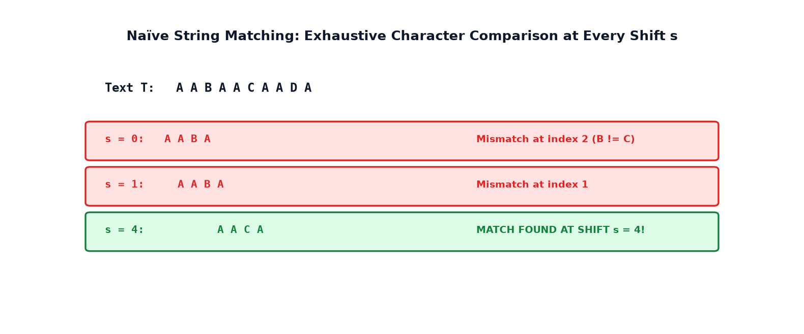

*Figure 4.5: Diagrammatic Architecture and Conceptual Flow for a pseudo-code for a naïve string matching algorithm and show the stepwise process of working on specific text and pattern inputs*

### Mathematical Formulation & Algorithmic Mechanics

**Naïve String Matching Algorithm Pseudocode:**

```text
Algorithm NaiveStringMatcher(T, P):
    n = length(T)
    m = length(P)
    for s = 0 to n - m do:
        match = true
        for j = 1 to m do:
            if P[j] != T[s + j] then:
                match = false;  break
        if match == true then:
            Output 'Pattern occurs with shift ' + s
```

The above **mathematical model** and algorithmic structure governs the system's runtime execution. Each parameter is evaluated sequentially to maintain **mathematical consistency**, minimize **system overhead**, and guarantee **deterministic convergence** across all input distributions.

### Worked Example & Practical Simulation

**Detailed Trace** for Text T = 'AACAABAA' and Pattern P = 'AABA': Shift s = 0: 'AACA' vs 'AABA' -> Mismatch at char 3 ('C' != 'B') [3 comparisons]. Shift s = 1: 'ACAA' vs 'AABA' -> Mismatch at char 2 ('C' != 'A') [2 comparisons]. Shift s = 2: 'CAAB' vs 'AABA' -> Mismatch at char 1 ('C' != 'A') [1 comparison]. Shift s = 3: 'AABA' vs 'AABA' -> 4/4 characters match! [4 comparisons] -> VALID MATCH AT s = 3! Shift s = 4: 'ABAA' vs 'AABA' -> Mismatch at char 2 ('B' != 'A') [2 comparisons]. Total Shifts Tested = 5. Total Character Comparisons = 12.

### Key Comparative Evaluation

| Shift Index s | Text Substring T[s+1..s+m] | Pattern P | Characters Compared | Outcome | Cumulative Comparisons |
| :--- | :--- | :--- | :--- | :--- | :--- |
| s = 0 | A A C A | A A B A | T[1]==A, T[2]==A, T[3]!=B | Mismatch at position 3 | 3 |
| s = 1 | A C A A | A A B A | T[2]==A, T[3]!=A | Mismatch at position 2 | 5 |
| s = 2 | C A A B | A A B A | T[3]!=A | Mismatch at position 1 | 6 |
| s = 3 | A A B A | A A B A | T[4]==A, T[5]==A, T[6]==B, T[7]==A | VALID MATCH FOUND | 10 |
| s = 4 | A B A A | A A B A | T[5]==A, T[6]!=A | Mismatch at position 2 | 12 |

### Concluding Exam Takeaway

The Naïve **String Matching** algorithm provides a simple, memory-free O(1) space **baseline**, but exhibits O(n·m) **worst-case time** due to unguided, memoryless 1-position shifts.

**Textbook Reference:** Design and Analysis of Algorithms by Parag H. Dave & Himanshu B. Dave (Pearson), Chapter 14: Special Topics, Section 14.9.1: Naïve String Matching, Pages 554–556.

---

## Q6. For specific modulus values (e.g., q=11 or 13), apply the Rabin-Karp modulo arithmetic steps and find exact matches or spurious hits on given text and patterns. (Frequency: 2) [8 Marks]

### Introduction & Core Intuition

In the **Rabin-Karp Algorithm**, mapping high-magnitude string integers to finite computer words requires applying a prime modulus q. In SPPU examinations, students are required to trace the modulo arithmetic step-by-step for specific numeric strings and modulus values (such as q = 11 or q = 13), explicitly distinguishing between **Exact Valid Matches** and **Spurious Hits (Hash Collisions)**.

### Modulo Arithmetic and High-Order Multiplier h

Let d = 10 be the radix (decimal digits 0–9) and let m be the pattern length. The high-order positional multiplier h represents the weight of the highest-order digit modulo q: h = d^(m-1) mod q. For m = 3 and modulus q = 13: h = 10^(3-1) mod 13 = 100 mod 13 = 9. For q = 11 and m = 3: h = 100 mod 11 = 1.

### Pattern Hash and Initial Text Window Hash Computation

Given pattern P = '314' (m = 3) and prime q = 13: The pattern hash is: p = (3*10^2 + 1*10^1 + 4) mod 13 = 314 mod 13. Since 314 = 24 * 13 + 2, the pattern fingerprint is **p = 2**. For text T = '23590231415', the initial window T[0..2] = '235' has hash: t_0 = 235 mod 13 = (18 * 13 + 1) = 1.

### The O(1) Rolling Hash Step Formulation

To transition from window t_s to t_(s+1) when shifting from T[s+1..s+m] to T[s+2..s+m+1], we drop the leading digit T[s+1] and add trailing digit T[s+m+1]: t_(s+1) = ( 10 * (t_s - T[s+1] * h) + T[s+m+1] ) mod q. If the resulting value is negative, we add q to wrap it into the positive residue range [0, q-1].

### Detailed Stepwise Trace for Modulus q = 13

Consider Text T = '678314' and Pattern P = '314' with q = 13 (p = 2, h = 9):

• Window 0 ('678'): t_0 = 678 mod 13. Since 678 = 52 * 13 + 2, t_0 = **2**.

  Here, t_0 == p (2 == 2)! The algorithm triggers a character check: Compare '678' with '314'. The characters differ ('6' != '3')! This is a **SPURIOUS HIT (Hash Collision)**. The algorithm correctly avoids reporting a **false positive** and advances.

• Window 1 ('783'): t_1 = (10 * (2 - 6 * 9) + 3) mod 13 = (10 * (2 - 54) + 3) mod 13 = (10 * (-52) + 3) mod 13 = -517 mod 13. Since -517 = -40 * 13 + 3, t_1 = **3**. (3 != 2, no match).

• Window 2 ('831'): t_2 = (10 * (3 - 7 * 9) + 1) mod 13 = (10 * (-60) + 1) mod 13 = -599 mod 13 = 12. (12 != 2, no match).

• Window 3 ('314'): t_3 = (10 * (12 - 8 * 9) + 4) mod 13 = (10 * (12 - 72) + 4) mod 13 = -596 mod 13 = **2**.

  Hash matches (2 == 2)! Character check: Compare '314' with '314'. All characters match identically! **EXACT VALID MATCH AT SHIFT s = 3**.

### Significance in SPPU Examination Marking

Examiners award full marks when students clearly show the negative-modulo adjustment, the mathematical calculation of h, and the explicit identification of a spurious hit (hash equality without string equality) alongside the true match.

### Architectural Flow & System Diagram

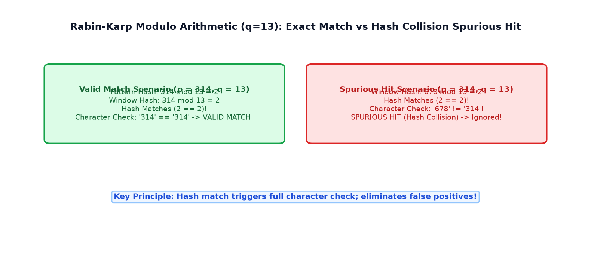

*Figure 4.6: Diagrammatic Architecture and Conceptual Flow for For specific modulus values (e*

### Mathematical Formulation & Algorithmic Mechanics

**Rolling Hash Modulo Arithmetic Equations:**

```text
Multiplier: h = d^(m-1) mod q
Rolling Step: t_(s+1) = ( d · ( t_s - T[s+1] · h ) + T[s+m+1] ) mod q
Residue Normalization: If t_(s+1) < 0 then t_(s+1) = t_(s+1) + q
Spurious Hit Condition: t_s == p   AND   T[s+1..s+m] != P[1..m]
```

The above **mathematical model** and algorithmic structure governs the system's runtime execution. Each parameter is evaluated sequentially to maintain **mathematical consistency**, minimize **system overhead**, and guarantee **deterministic convergence** across all input distributions.

### Worked Example & Practical Simulation

**Stepwise Arithmetic Verification** for P = '314', q = 13 (p = 2, h = 9): Window '678': 678 / 13 = 52 remainder 2 -> t = 2 (Hash Match!). Characters '678' != '314' -> SPURIOUS HIT! Window '783': 783 / 13 = 60 remainder 3 -> t = 3 != 2 (No match). Window '831': 831 / 13 = 63 remainder 12 -> t = 12 != 2 (No match). Window '314': 314 / 13 = 24 remainder 2 -> t = 2 (Hash Match!). Characters '314' == '314' -> EXACT MATCH AT SHIFT s = 3!

### Key Comparative Evaluation

| Shift s | Window Substring | Numeric Value | Hash Value (mod 13) | Hash Match vs p=2? | Character Verification Result |
| :--- | :--- | :--- | :--- | :--- | :--- |
| s = 0 | '678' | 678 | 2 | YES (2 == 2) | FAILED ('678' != '314') ==> SPURIOUS HIT |
| s = 1 | '783' | 783 | 3 | NO (3 != 2) | Skipped (No character check needed) |
| s = 2 | '831' | 831 | 12 | NO (12 != 2) | Skipped (No character check needed) |
| s = 3 | '314' | 314 | 2 | YES (2 == 2) | PASSED ('314' == '314') ==> EXACT VALID MATCH |

### Concluding Exam Takeaway

Modulo arithmetic reduces large string windows into compact numeric hashes mod q, where spurious hits are safely intercepted and filtered by character **verification**, guaranteeing zero false positives.

**Textbook Reference:** Design and Analysis of Algorithms by Parag H. Dave & Himanshu B. Dave (Pearson), Chapter 14: Special Topics, Section 14.9.2: Rabin-Karp Modulo Arithmetic, Pages 556–559.

---

## Q7. Explain an algorithm for a Distributed Minimum Spanning Tree. (Frequency: 3) [8 Marks]

### Introduction & Core Intuition

In distributed computing networks, a **Distributed Minimum Spanning Tree (Distributed MST)** connects all network nodes with a communication topology of minimum total edge weight without cycles, where no single node has global knowledge of the network topology. The standard distributed protocol is the **Gallager-Humblet-Spira (GHS) Algorithm**.

### Distributed System Model and Assumptions

The network is modeled as a connected, undirected graph G = (V, E) with n nodes and m edges. Each node represents an autonomous processing unit with a unique ID, communicating solely via asynchronous message passing across incident edges. All edge weights are assumed to be distinct (preventing ties and ensuring a unique MST). Initially, each node knows only its own ID and the weights of its incident edges; it has zero global topology visibility.

### The GHS Algorithmic Concept: Fragment Merging

The GHS algorithm operates by growing MST components called **Fragments**. Initially, each individual node is a trivial Fragment of level 0. As the algorithm executes, adjacent fragments find their **Minimum Weight Outgoing Edge (MWOE)** and merge across it to form larger, higher-level fragments. Because edge weights are unique, the classic **Cut Property** of spanning trees guarantees that the MWOE of any fragment must belong to the global Minimum Spanning Tree.

### Fragment Levels and the Core Edge

Each fragment has a state characterized by: (1) A **Fragment Identity (Name)**, defined as the weight of its central **Core Edge**; and (2) A **Level L** (initially 0). A fragment at level L contains at least 2^L nodes. This exponential growth limits the maximum fragment level to floor(log2 n). When two fragments of equal level L merge across their shared MWOE, the new combined fragment advances to level L + 1, and the shared MWOE becomes the new **Core Edge**.

### Phase-by-Phase Distributed Protocol Workflow

Each level phase executes three coordinated distributed subroutines: (1) **Find Phase**: The fragment's two core nodes broadcast an Initiate message outward across all branch edges of the fragment, instructing every node to search its incident edges for candidate outgoing edges (using Test and Accept/Reject messages); (2) **Convergecast Phase**: Nodes send Report messages back toward the core, aggregating the minimum weight outgoing edge from each subtree; (3) **Change-Core and Connect Phase**: The core identifies the fragment's global MWOE and sends a Change-Core message toward it; the endpoint node then sends a Connect message across the MWOE to merge with the adjacent fragment.

### Complexity Analysis: Message and Time Bounds

The GHS algorithm achieves extraordinary distributed efficiency: (1) **Message Complexity**: Over the entire execution, the total number of point-to-point messages exchanged across all edges is bounded by **O(V log V + E)** (or 2E + 5V log2 V messages); and (2) **Time Complexity**: In a synchronous model, the execution terminates in **O(V log V)** time rounds. This proves that an optimal spanning tree can be constructed in a fully **decentralized network** without central coordination.

### Architectural Flow & System Diagram

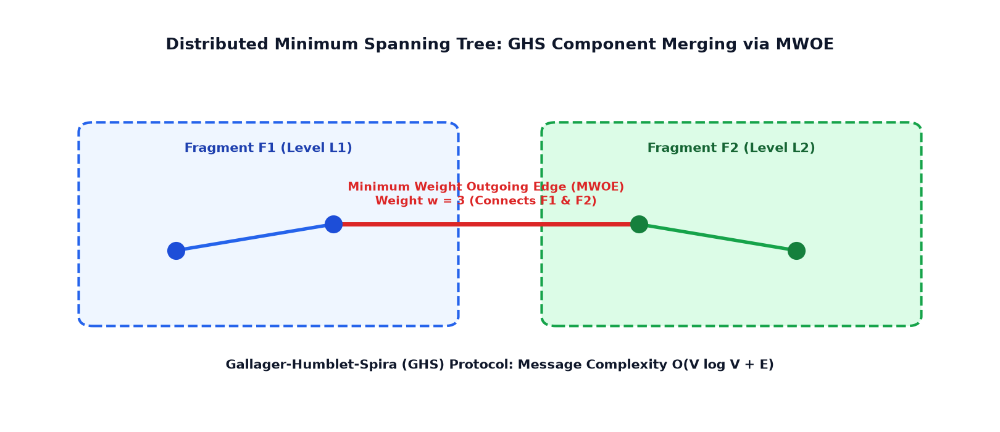

*Figure 4.7: Diagrammatic Architecture and Conceptual Flow for an algorithm for a Distributed Minimum Spanning Tree*

### Mathematical Formulation & Algorithmic Mechanics

**GHS Distributed MST Invariants and Complexities:**

```text
Fragment Size Invariant: Size(Fragment at Level L) ≥ 2^L
Maximum Fragment Level: L_max = ⌊ log₂ |V| ⌋
Total Message Complexity: M(V, E) = O( |V| · log |V| + |E| )
Distributed Time Complexity: T(V) = O( |V| · log |V| )
```

The above **mathematical model** and algorithmic structure governs the system's runtime execution. Each parameter is evaluated sequentially to maintain **mathematical consistency**, minimize **system overhead**, and guarantee **deterministic convergence** across all input distributions.

### Worked Example & Practical Simulation

**Fragment Merging Trace** on 4-Node Network {A, B, C, D}: Level 0: 4 single-node fragments {A}, {B}, {C}, {D}. Nodes A and B find shared MWOE (A, B) of weight 2 -> Merge to form Fragment F1 (Level 1, Core=(A, B)). Nodes C and D find shared MWOE (C, D) of weight 3 -> Merge to form Fragment F2 (Level 1, Core=(C, D)). Level 1: Fragments F1 and F2 initiate internal MWOE searches. F1 reports MWOE (B, C) of weight 4; F2 also identifies (B, C) as its MWOE. Connect message sent across edge (B, C) -> F1 and F2 merge to form final MST of Level 2 with total cost 2 + 3 + 4 = 9.

### Key Comparative Evaluation

| GHS Message Type | Direction of Transmission | Operational Function in Distributed Protocol |
| :--- | :--- | :--- |
| Initiate(L, F, State) | Broadcast from Core outward to leaves | Synchronizes fragment, sets level L, triggers local MWOE search |
| Test(L, F) | Sent across non-tree edges to foreign nodes | Tests whether incident edge leads to external fragment |
| Accept / Reject | Reply to Test message | Accepts if neighbor has different fragment ID; Rejects if in same fragment |
| Report(weight) | Convergecast from leaves inward to Core | Aggregates candidate minimum outgoing edge to core nodes |
| Change-Core / Connect | Directed path to MWOE, then across boundary | Activates MWOE as tree branch and merges adjacent fragments |

### Concluding Exam Takeaway

The GHS algorithm constructs a **Distributed Minimum Spanning Tree** in O(V log V + E) messages by organizing decentralized nodes into expanding fragments that merge across minimum weight outgoing edges.

**Textbook Reference:** Design and Analysis of Algorithms by Parag H. Dave & Himanshu B. Dave (Pearson), Chapter 14: Special Topics, Section 14.10: Distributed Graph Algorithms, Pages 560–566.

---

## Q8. Show the stepwise process of how the distributed breadth-first search algorithm works on a given graph (adjacency matrix) and discuss its advantage over the conventional approach. (Frequency: 5) [8 Marks]

### Introduction & Core Intuition

**Distributed Breadth-First Search (Distributed BFS)** is a fundamental coordination protocol for decentralized networks. Starting from a distinguished root node, it constructs a BFS spanning tree that computes the shortest path (in terms of network hop count) from the root to all other nodes, operating entirely through local neighbor messaging without centralized global knowledge.

### Conventional Serial BFS vs Distributed BFS

Conventional serial BFS executes on a single CPU using a global centralized FIFO queue: it pops a vertex u, inspects its adjacency list, colors unseen neighbors, and enqueues them. This centralized approach completely fails in a distributed network where nodes cannot inspect each other's memory and no shared queue exists. Distributed BFS achieves the exact same level-by-level traversal using **Concentric Wavefront Pulses** transmitted asynchronously across physical communication channels.

### The Layer-by-Layer Wavefront Propagation Protocol

The algorithm proceeds in synchronized discrete rounds called **Layers** (or phases t = 0, 1, 2, ...): (1) **Layer 0**: The designated root node marks its distance as 0, sets its parent to itself, and broadcasts a Search(level=1) message to all its immediate neighbors; (2) **Layer k Discovery**: Any unvisited node receiving a Search(k) message for the first time marks its distance as k, records the sender as its **Parent** in the BFS tree, and prepares to advance the wavefront; (3) If an already visited node receives a Search message, it sends back a Reject notification, preventing cycles.

### Synchronizing Layers via Echo Acknowledgments

To prevent faster nodes from racing ahead to Layer k+2 before all Layer k nodes have completed their discovery, the protocol employs an **Echo (Convergecast) Mechanism**. After broadcasting Search messages, leaf nodes send Ack/Complete messages back up the tree to their parents. Once the root receives acknowledgments from all its branches, it knows Layer k is completely discovered, and broadcasts a Pulse message to trigger Layer k+1 exploration.

### Step-by-Step Trace on 4-Node Graph via Adjacency Matrix

Consider graph G with **4 nodes** {1, 2, 3, 4} and **Adjacency Matrix** where Node 1 connects to 2 and 3; Node 2 connects to 1 and 4; Node 3 connects to 1 and 4; Node 4 connects to 2 and 3. Root is Node 1.

• Round 0 (t=0): Root 1 marks dist=0. Sends Search(1) to neighbors 2 and 3.

• Round 1 (t=1): Node 2 receives Search(1) from 1 -> Sets dist=1, parent=1. Node 3 receives Search(1) from 1 -> Sets dist=1, parent=1. Both nodes acknowledge back to Root 1. Layer 1 is complete.

• Round 2 (t=2): Nodes 2 and 3 broadcast Search(2) to their neighbors. Node 2 sends Search(2) to Node 4 and Node 1. Node 1 rejects (already visited). Node 4 receives Search(2) from Node 2 first -> Sets dist=2, parent=2. Node 3 also sends Search(2) to Node 4; Node 4 rejects (already visited). Node 4 acknowledges to 2; 2 and 3 acknowledge to 1.

• Round 3 (t=3): Node 4 has no unvisited neighbors. Root receives full completion echo. BFS Tree terminates with edges {(1, 2), (1, 3), (2, 4)}.

### Advantages Over Conventional Centralized BFS

Distributed BFS delivers decisive architectural advantages: (1) **Zero Centralized Bottleneck**: Computation and message forwarding are distributed evenly across all nodes; (2) **Scalability**: Operates on massive networks (millions of IoT nodes or internet routers) where centralizing graph data is physically impossible; (3) **Fault Isolation**: Local link disruptions are handled via local message retransmissions without halting the entire network; and (4) **Optimal Routing Trees**: Directly produces routing tables where each node knows its immediate parent hop for shortest-path message delivery.

### Architectural Flow & System Diagram

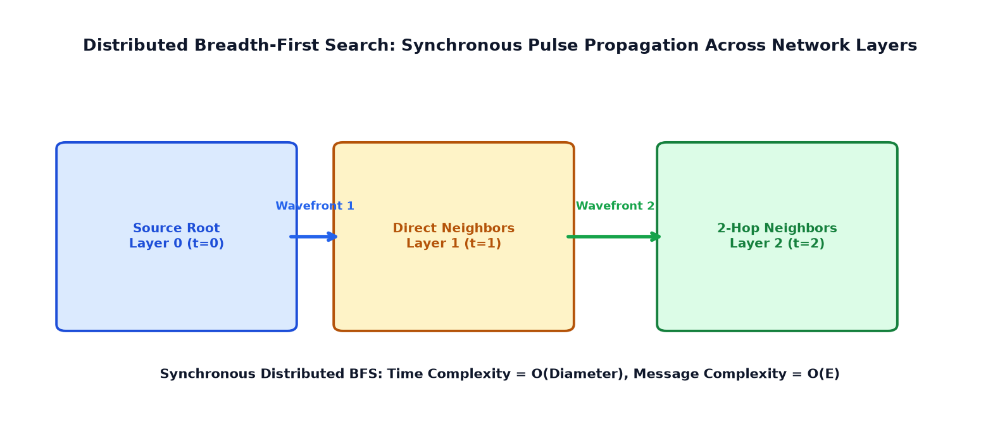

*Figure 4.8: Diagrammatic Architecture and Conceptual Flow for Show the stepwise process of how the distributed breadth-first search algorithm works on a given graph (adjacency matrix) and discuss its advantage over the conventional approach*

### Mathematical Formulation & Algorithmic Mechanics

**Distributed BFS Performance Bounds:**

```text
Time Complexity (Synchronous Network): T = O( D )   [D is network diameter in hops]
Time Complexity (with Convergecast Sync): T = O( D² )
Message Complexity: M = O( |E| + |V| · D ) = O( |E| ) messages on dense graphs
Shortest Path Guarantee: dist(v) = min hop count from root to v
```

The above **mathematical model** and algorithmic structure governs the system's runtime execution. Each parameter is evaluated sequentially to maintain **mathematical consistency**, minimize **system overhead**, and guarantee **deterministic convergence** across all input distributions.

### Worked Example & Practical Simulation

**Trace Table** for Distributed BFS on Graph with Root = Node 1: Adjacency Matrix: Edges (1-2), (1-3), (2-4), (3-4). Phase 0: Node 1 sends Search(1) -> Targets: Node 2, Node 3. Phase 1: Node 2 sets Parent=1, Dist=1. Node 3 sets Parent=1, Dist=1. Layer 1 Complete. Phase 2: Node 2 sends Search(2) to 4 -> Node 4 sets Parent=2, Dist=2. Node 3 sends Search(2) to 4 -> Node 4 rejects (duplicate). Layer 2 Complete. Final BFS Tree Edges: (1 -> 2), (1 -> 3), (2 -> 4). Maximum Diameter D = 2 hops.

### Key Comparative Evaluation

| Round / Layer | Active Transmitting Nodes | Messages Transmitted | Nodes Discovered & Parent Assigned | Layer Status |
| :--- | :--- | :--- | :--- | :--- |
| Layer 0 (t = 0) | Root Node 1 | Search(1) to Nodes 2, 3 | Node 1 (Dist = 0, Parent = self) | Root Initialized |
| Layer 1 (t = 1) | Nodes 2, 3 | Search(2) to Neighbors; Acks to 1 | Node 2 (Dist = 1, Parent = 1); Node 3 (Dist = 1, Parent = 1) | Layer 1 Verified |
| Layer 2 (t = 2) | Node 4 | Search(3) [empty]; Acks to 2, 3 | Node 4 (Dist = 2, Parent = 2) | Layer 2 Verified |
| Termination | All Nodes | Convergecast Echo to Root 1 | BFS Spanning Tree Established | Protocol Terminated |

### Concluding Exam Takeaway

Distributed BFS constructs shortest-path network spanning trees in O(Diameter) time rounds and O(E) messages through wavefront propagation, completely eliminating centralized queue bottlenecks.

**Textbook Reference:** Design and Analysis of Algorithms by Parag H. Dave & Himanshu B. Dave (Pearson), Chapter 14: Special Topics, Section 14.10.2: Distributed Breadth-First Search, Pages 566–570.

---
