# SPPU B.E. Computer Engineering (2019 Pattern)
# Machine Learning — Complete All-Units Solutions Guide
### Engineered for Full 8/8 Marks | All 4 Units Combined

---


================================================================================

# SPPU B.E. Computer Engineering (2019 Pattern)
## Machine Learning — Unit 1: Fundamentals of Machine Learning & Regression
### Complete Examination Solutions Guide (Engineered for Full 8/8 Marks)

---

## Q1. Explain in brief techniques to reduce underfitting and overfitting. (Frequency: 3) [8 Marks]

### Introduction & Core Intuition

In machine learning, the main goal is to build a model that performs well on brand-new, **unseen data**, not just the training data it already saw. However, algorithms often run into two big stumbling blocks: **Underfitting**, where the model is far too simple and misses the real patterns, and **Overfitting**, where the model memorizes every tiny bit of noise and random quirks in the **training samples**. Tackling these issues requires smart changes to **model architecture**, **feature design**, and **regularization**.

### Increasing Model Expressive Capacity

When a model suffers from **underfitting** (meaning it is too rigid and simple), we must give it greater **mathematical flexibility**. Instead of forcing a straight line onto curved data, we upgrade to **higher-degree polynomials** or deeper multi-layer networks. This gives the algorithm more **parameters** to capture genuine **curvature** in the **feature space**.

### Engineering Meaningful Domain Features

If the algorithm is fed uninformative raw inputs, it cannot learn. We can fix this by creating new derived features, combining inputs into interaction terms (such as multiplying length by width to give area), or calculating meaningful ratios. Adding informative signals directly helps the model see relationships that were previously hidden.

### Relaxing Regularization Penalties

Sometimes **underfitting** happens because we applied too much penalty on the weights. By reducing the **regularization** strength (lowering the penalty hyperparameter λ in Ridge or **Lasso regression**), we loosen the constraints on the model weights, allowing them to adjust freely and capture the true underlying data trend.

### Gathering More Data and Applying Augmentation

When a model suffers from **overfitting** (meaning it memorized the training examples like a student cramming practice questions without understanding), the best cure is feeding it more real data. If gathering new data is hard, we use **data augmentation**—such as rotating images, adding light audio noise, or using SMOTE for tabular records—to artificially expose the model to diverse variations.

### Applying Mathematical Regularization and Early Stopping

To prevent weights from blowing up to extreme values, we add **regularization penalties** (L1 Lasso or L2 Ridge) to the **loss function**. This discourages unnecessarily large weights and keeps the **decision boundary** smooth. Additionally, we use **early stopping** during training: we watch **validation** loss every epoch, and the moment validation error starts creeping upward, we immediately stop training to keep the model at its peak generalization point.

### Architectural Flow & System Diagram

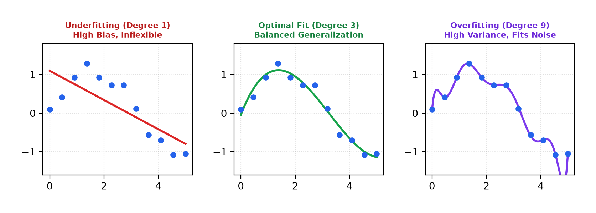

*Figure 1.1: Diagrammatic Architecture and Conceptual Flow for in brief techniques to reduce underfitting and overfitting*

### Mathematical Formulation & Algorithmic Mechanics

**Mathematical Formulations for Overfitting Control:**

```text
L2 Regularized Objective (Ridge): J(w) = MSE(w) + λ · ∑_(j=1)^D w_j²
L1 Regularized Objective (Lasso): J(w) = MSE(w) + λ · ∑_(j=1)^D |w_j|
Polynomial Hypothesis: y_hat = w_0 + w_1·x + w_2·x² + ... + w_M·x^M

Where: MSE is the empirical mean squared error; λ is the regularization strength hyperparameter; and M is the polynomial degree.
```

The above **mathematical model** and algorithmic structure governs the system's runtime execution. Each parameter is evaluated sequentially to maintain **mathematical consistency**, minimize **system overhead**, and guarantee **deterministic convergence** across all input distributions.

### Worked Example & Practical Simulation

Imagine an e-commerce website predicting whether a customer will return a clothing item. A basic linear model using only 'Price' gets poor results with an R² of just 0.44 because it completely ignores size, fabric, and customer reviews (**Underfitting**). Adding interactive features and polynomial terms boosts R² to 0.78. However, an unpruned deep **decision tree** memorizes the exact customer IDs, reaching 99.8% training accuracy but crashing to 52.0% on new shoppers (**Overfitting**). Applying pruning and **L2 regularization** restores test accuracy to 84.5%, achieving balanced generalization.

### Key Comparative Evaluation

| Phenomenon | Underlying Cause | Training Error | Testing Error | Primary Remedial Techniques |
| :--- | :--- | :--- | :--- | :--- |
| Underfitting | High Bias; model is too simple to capture real trends | Consistently High | Consistently High | Increase model capacity, engineer domain features, lower λ regularization, train longer |
| Overfitting | High Variance; model memorizes sample-specific noise | Near Zero / Very Low | Very High (Diverges from train error) | Collect more data, apply L1/L2 penalties, early stopping, prune trees, add dropout |
| Optimal Fit | Balanced Bias and Variance | Low and Stable | Low (Matches train error closely) | Cross-validation tuned hyperparameters, balanced regularized complexity |

### Concluding Exam Takeaway

**Underfitting** and **overfitting** are the two primary failure modes in machine learning. Successful systems navigate between them by tuning model capacity, selecting features thoughtfully, and applying **regularization** to achieve minimum error on future **unseen data**.

**Textbook Reference:** Christopher M. Bishop, 'Pattern Recognition and Machine Learning', Springer (2006), Chapter 1: Introduction, Section 1.1: Example: Polynomial Curve Fitting, pp. 4–11.

---

## Q2. Differentiate between overfitting and underfitting with examples. (Frequency: 3) [8 Marks]

### Introduction & Core Intuition

In everyday life, learning means grasping general rules rather than rote memorizing or making wild assumptions. When a model exhibits **underfitting**, it acts like someone who jumps to conclusions without enough information—such as assuming every four-legged animal is a dog because they never learned to recognize cats or cows. On the other hand, **overfitting** is like someone who memorizes one specific dog down to its exact spot pattern, collar color, and ear scratch, making them incapable of recognizing any other dog. Scientifically, **underfitting** is caused by excessive bias, while **overfitting** is caused by excessive variance.

### Divergence in Training and Validation Loss Curves

The clearest way to tell these two problems apart is by looking at their loss curves over time. In **underfitting**, both the training loss and **validation** loss flatten out very early at an unacceptably high error level; the model never learns. In **overfitting**, training error keeps dropping toward zero, but validation error bottoms out and then shoots upward, creating a wide gap where the model over-tunes to noise.

### Sensitivity to Minor Data Changes

Underfitted models are excessively stiff. If you drop 10% of the training points or slightly nudge the numbers, an underfitted straight-line model hardly moves at all. Overfitted models are hypersensitive: even a single distant outlier can drastically twist a high-degree polynomial curve, completely throwing off predictions for all nearby points.

### Degrees of Freedom and Parameter Count

Mathematically, **underfitting** happens when a model has too few learnable **parameters** relative to the complexity of the data. **Overfitting** happens when there are far too many parameters compared to the number of data points. When parameters outnumber informative observations, the model discovers countless accidental shortcuts that satisfy **training samples** but fail completely on new inputs.

### Actionable Diagnostic Insights for the Exam

Watching these metrics tells engineers exactly how to respond. If both training error and test error are stubbornly high, gathering more data will not fix the issue; you must upgrade the model's capacity or engineer better features. If training error is near zero but test error is high, the model is **overfitting**, so you should add **regularization** penalties, prune branches, or collect more data.

### Architectural Flow & System Diagram

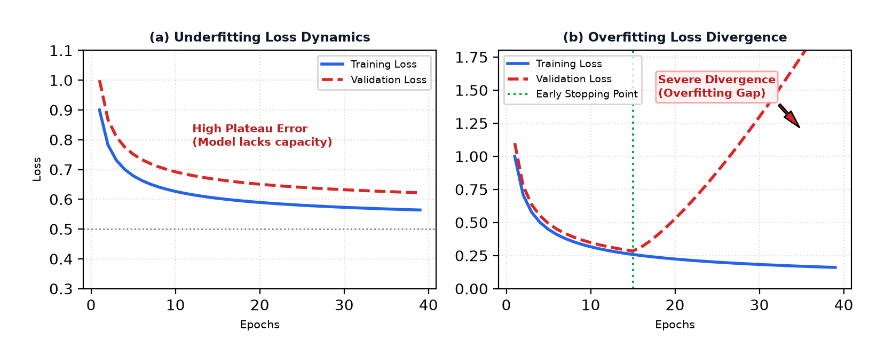

*Figure 1.2: Diagrammatic Architecture and Conceptual Flow for Differentiate between overfitting and underfitting with examples*

### Mathematical Formulation & Algorithmic Mechanics

**Mathematical Expressions of Underfitting vs Overfitting:**

```text
Underfitting Error Condition: TrainingError >> ε_acceptable   and   ValidationError >> ε_acceptable
Overfitting Error Condition: TrainingError ≈ 0   and   ValidationError >> TrainingError
Generalization Gap: Gap = | ValidationError - TrainingError |

Where: ε_acceptable is the minimum acceptable domain error tolerance.
```

The above **mathematical model** and algorithmic structure governs the system's runtime execution. Each parameter is evaluated sequentially to maintain **mathematical consistency**, minimize **system overhead**, and guarantee **deterministic convergence** across all input distributions.

### Worked Example & Practical Simulation

Consider predicting a person's weight from height, age, and activity level: **Underfitting** Example: A naive model that assumes Weight = 1.0 · Height + 0. It predicts the exact same weight for an athletic 20-year-old and an inactive 60-year-old of identical height, producing terrible accuracy for everyone. **Overfitting** Example: A 15th-degree polynomial that memorizes exact weights down to the gram for 20 specific survey respondents. It weaves an erratic curve that predicts a 175 cm person weighs 70 kg, but a 176 cm person weighs 140 kg.

### Key Comparative Evaluation

| Evaluation Dimension | Underfitting (High Bias) | Overfitting (High Variance) |
| :--- | :--- | :--- |
| Model Complexity | Overly simple, rigid, low degrees of freedom | Excessively complex, deep, high degrees of freedom |
| Training Set Error | High (fails to fit even training points) | Near zero (perfectly memorizes training samples) |
| Validation Set Error | High (comparable to training error) | High (severe divergence from training error) |
| Generalization Gap | Near zero (consistently poor across all sets) | Very large (massive gap between train and test loss) |
| Remedy Focus | Increase capacity, add features, reduce regularization | Add data, apply L1/L2 penalties, early stopping, prune |
| Everyday Analogy | Student who merely glances at the textbook cover | Student who memorizes exact practice question numbers |

### Concluding Exam Takeaway

**Underfitting** and **overfitting** define the opposing failure modes of machine learning. Reliable models avoid both extremes by matching model capacity to sample size and validating with holdout data to locate the optimal generalization sweet spot.

**Textbook Reference:** Christopher M. Bishop, 'Pattern Recognition and Machine Learning', Springer (2006), Chapter 1: Introduction, Section 1.1, pp. 4–11.

---

## Q3. What is the Bias and variance trade-off for a machine learning model? Describe its relationship to underfitting and overfitting. (Frequency: 4) [8 Marks]

### Introduction & Core Intuition

In machine learning theory, the **Bias-Variance Trade-off** is the central mathematical balancing act. Whenever a supervised model makes predictions on **unseen data**, its total expected error splits into three separate parts: **Bias Squared, Variance, and Irreducible Noise**. Because lowering bias naturally drives up variance, building a great model requires finding the sweet spot between them.

### Mathematical Error Decomposition Breakdown

For any continuous target y = f(x) + ε with zero-mean noise variance σ², the expected prediction error of our model y_hat decomposes mathematically as: **Expected Error** = (Bias[y_hat])² + Var(y_hat) + σ². Here, the **irreducible error** σ² represents random noise built into the real world (such as sensor hum or unmeasured factors) that no algorithm can ever remove. Our engineering job is strictly to minimize the sum of Bias Squared and Variance.

### Understanding Bias and Its Direct Link to Underfitting

**Bias** measures the systematic error that occurs when we approximate a complicated real-world process with an overly simplistic model: Bias[y_hat] = E[y_hat] - f(x). A high-bias model makes rigid assumptions about the data and largely ignores the training examples. This leads straight to **underfitting**: the model cannot capture the true shape of the data, resulting in poor performance on both training and test data.

### Understanding Variance and Its Direct Link to Overfitting

**Variance** measures how much the model's predictions would jump around if we trained it on a different random sample of data: Var(y_hat) = E[(y_hat - E[y_hat])²]. A high-variance model fits its specific training batch so tightly that even minor variations in training data produce completely different predictions. This leads straight to **overfitting**: the model memorizes sample noise, scoring high on training data but crashing on test data.

### Navigating the U-Shaped Trade-off Curve

As we increase model complexity (like adding polynomial powers or deepening a neural net), bias drops steadily because the model can now bend and twist to fit complex shapes. At the same time, variance climbs upward because extra **parameters** easily latch onto random noise. If you plot total error against model complexity, it forms a classic U-shaped curve. The optimal model complexity sits right at the valley bottom of this curve, where total generalization error is minimized.

### Architectural Flow & System Diagram

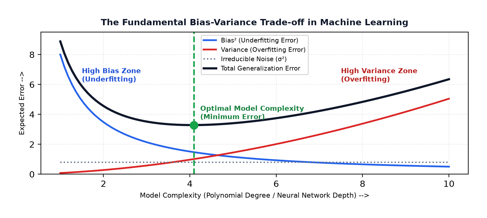

*Figure 1.3: Diagrammatic Architecture and Conceptual Flow for What is the Bias and variance trade-off for a machine learning model? Describe its relationship to underfitting and overfitting*

### Mathematical Formulation & Algorithmic Mechanics

**Mathematical Derivation of the Bias-Variance Decomposition:**

```text
Total Expected Error = ( Bias[y_hat] )² + Var(y_hat) + σ²

Bias[y_hat] = E[y_hat] - f(x)   [Systematic approximation error]
Var(y_hat) = E[ (y_hat - E[y_hat])² ]   [Sensitivity to training set variations]
σ² = Var(ε)   [Irreducible ambient noise variance]
```

The above **mathematical model** and algorithmic structure governs the system's runtime execution. Each parameter is evaluated sequentially to maintain **mathematical consistency**, minimize **system overhead**, and guarantee **deterministic convergence** across all input distributions.

### Worked Example & Practical Simulation

Consider predicting house prices in Pune: **High Bias** / **Low Variance** (Underfit): A flat linear equation Price = 50 · SqFt + 10. No matter which 500 houses you train on, the resulting line is almost identical (low variance), but it consistently misprices luxury flats in prime areas (high bias). Low Bias / **High Variance** (Overfit): A 12th-degree polynomial with 50 **parameters**. It fits its specific 500 training houses with zero error (low bias). But when trained on another 500 houses, the curve swings wildly, giving absurd price estimates for neighboring properties (high variance).

### Key Comparative Evaluation

| Component | Mathematical Definition | Root Cause | Manifested Failure Mode | Remediation Strategy |
| :--- | :--- | :--- | :--- | :--- |
| Bias | E[y_hat] - f(x) | Overly restrictive, simple model assumptions | Underfitting (High train & test error) | Increase model complexity, add features, lower λ |
| Variance | E[(y_hat - E[y_hat])²] | Excessive model flexibility fitting noise | Overfitting (Low train, high test error) | Add training data, apply L1/L2 penalties, prune |
| Irreducible Noise | Var(ε) = σ² | Sensor inaccuracy, unmeasured variables | Fundamental performance ceiling | Cannot be reduced by any algorithmic tuning |

### Concluding Exam Takeaway

The Bias-Variance Trade-off lies at the heart of machine learning. **High bias** leads to **underfitting**, while **high variance** leads to **overfitting**. Achieving peak accuracy requires using **cross-validation** to identify the model complexity that minimizes their combined sum.

**Textbook Reference:** Christopher M. Bishop, 'Pattern Recognition and Machine Learning', Springer (2006), Chapter 3: Linear Models for Regression, Section 3.2: The Bias-Variance Decomposition, pp. 147–152.

---

## Q4. Write a short note on Training error and Generalization error in machine learning. (Frequency: 1) [8 Marks]

### Introduction & Core Intuition

In **supervised learning**, evaluating an algorithm requires understanding the difference between how well it fits past training data and how accurately it predicts future, **unseen data**. We quantify this using two fundamental metrics: **Training Error (Empirical Risk)** and **Generalization Error (True Risk)**. The gap between them reveals whether a model has truly learned or merely memorized.

### Training Error (Empirical Risk) Explained Simply

**Training Error**, formally called **Empirical Risk** R_emp(h), measures the average mistake a model makes on the exact data samples it studied during training: R_emp(h) = (1/N) · ∑ L(h(x_i), y_i). Supervised **optimization** algorithms adjust weights specifically to minimize this number. However, training error alone is an untrustworthy score—it is like letting a student take an exam with the exact questions and answers they studied the night before.

### Generalization Error (True Risk) Explained Simply

**Generalization Error**, or **True Risk** R(h), measures how well the model performs across all possible future data points generated by the true real-world distribution: R(h) = E[L(h(x), y)]. Because we can never observe all possible future data, we cannot calculate true risk directly. Instead, we estimate it using an independent holdout test dataset or **K-fold cross-validation** that the model never saw during training.

### The Generalization Gap and Overfitting Detection

The difference between generalization error and training error is known as the **Generalization Gap**: Gap = R(h) - R_emp(h). When a model's capacity matches the dataset size, this gap stays small and tight. When a model has excessive capacity, its training error drops to zero while its generalization error shoots upward, creating a massive generalization gap that immediately flags severe **overfitting**.

### Practical Engineering Takeaway for SPPU Exams

Watching both metrics provides clear guidance during system design. If both training error and test error are high, the model is **underfitting**, so you need more features or a more expressive architecture. If training error is near zero but test error is high, the model is **overfitting**, so you must apply **regularization**, prune trees, or collect more data. A system is ready for production only when generalization error is low and the gap is tight.

### Architectural Flow & System Diagram

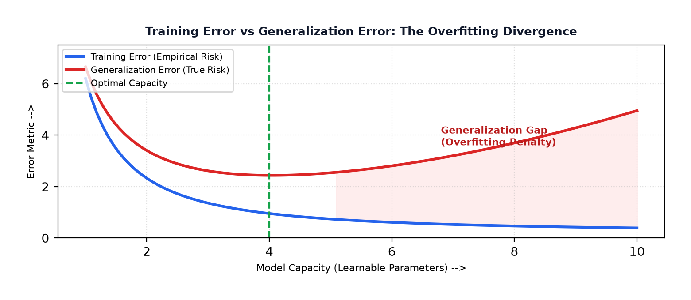

*Figure 1.4: Diagrammatic Architecture and Conceptual Flow for a short note on Training error and Generalization error in machine learning*

### Mathematical Formulation & Algorithmic Mechanics

**Mathematical Formulations of Empirical and True Risk:**

```text
Training Error (Empirical Risk): R_emp(h) = ( 1 / N ) · ∑_(i=1)^N L( h(x_i), y_i )
Generalization Error (True Risk): R(h) = E_((x, y) ~ P)[ L( h(x), y ) ]
Generalization Gap: Gap = R(h) - R_emp(h) ≤ O( √( VC_dim / N ) )

Where: L(·, ·) is the loss function; N is sample size; and VC_dim is the Vapnik-Chervonenkis capacity dimension.
```

The above **mathematical model** and algorithmic structure governs the system's runtime execution. Each parameter is evaluated sequentially to maintain **mathematical consistency**, minimize **system overhead**, and guarantee **deterministic convergence** across all input distributions.

### Worked Example & Practical Simulation

Consider an autonomous car vision system trained to detect pedestrians. On its training set of 50,000 clear, sunny daytime photos, it achieves 99.4% accuracy (**Training Error** = 0.6%). However, when tested on brand-new images taken in heavy rain, dense fog, and nighttime conditions, its accuracy drops to 78.2% (Generalization Error = 21.8%). The large generalization gap of 21.2% proves the model memorized sunny weather **artifacts** rather than learning true pedestrian silhouettes.

### Key Comparative Evaluation

| Metric | Mathematical Definition | Dataset Used | Optimized Directly? | Operational Purpose |
| :--- | :--- | :--- | :--- | :--- |
| Training Error | Average loss across training samples | Training Set D_train | Yes (gradient descent minimizes this directly) | Drives weight updates during optimization |
| Generalization Error | Expected loss over the unseen true distribution | Independent Test Set / Cross-validation folds | No (cannot be optimized directly; only evaluated) | Measures genuine model quality for real deployment |
| Generalization Gap | Difference: | Test Error - Train Error | | Both Train and Test sets | Minimized indirectly via regularization and pruning | Primary diagnostic tool for catching overfitting |

### Concluding Exam Takeaway

Training error tells us how well the model fits historical records, while generalization error tells us whether it will succeed in the real world. Machine learning engineering focuses on minimizing generalization error rather than blindly chasing zero training error.

**Textbook Reference:** Christopher M. Bishop, 'Pattern Recognition and Machine Learning', Springer (2006), Chapter 1: Introduction, Section 1.3: Model Selection, pp. 32–35.

---

## Q5. Define different regression models. (Frequency: 2) [8 Marks]

### Introduction & Core Intuition

In predictive machine learning, **Regression Models** are **supervised learning** techniques designed to predict a continuous numerical quantity (such as price, temperature, or speed) based on one or more input features. Depending on whether relationships are linear or curved, regression models span simple baselines, regularized models, and powerful non-linear methods.

### Simple and Multiple Linear Regression

**Simple Linear Regression** models the connection between one input feature x and a continuous target y using a straight line: y = β_1 · x + β_0 + ε. **Multiple Linear Regression** extends this concept to handle D input features simultaneously using a flat hyperplane: y = β_0 + β_1·x_1 + ... + β_D·x_D + ε = W^T·x + b. Both assume an additive, linear relationship and are solved using **Ordinary Least Squares** or **Gradient Descent**.

### Polynomial Regression: Capturing Curves

When the real-world relationship bends and curves, **Polynomial Regression** adds powers of the original features (such as x², x³) into the equation: y = β_0 + β_1·x + β_2·x² + ... + β_M·x^M. Even though the curve looks non-linear with respect to x, the equation is still linear with respect to the weights β, meaning we can still solve it with standard linear least squares formulas.

### Regularized Regression: Ridge, Lasso, and ElasticNet

When datasets contain many correlated features or when features outnumber samples, standard regression overfits. **Ridge Regression** adds an L2 penalty (λ · ∑ w_j²) to shrink weights toward zero and stabilize collinear features. **Lasso Regression** adds an L1 penalty (λ · ∑ |w_j|) that forces uninformative weights to exact zero, performing automatic feature selection. **ElasticNet** blends both L1 and L2 penalties together, offering balanced **regularization**.

### Non-Linear and Tree-Based Regression Models

Beyond linear models, machine learning offers non-linear approaches: **Support Vector Regression (SVR)** fits an optimal margin tube around data points and ignores small errors within threshold ε. **Decision Tree and Random Forest Regression** slice the **feature space** into rectangular regions, predicting the average value of training points inside each leaf. These models handle complex non-linear patterns naturally without needing feature scaling.

### Architectural Flow & System Diagram

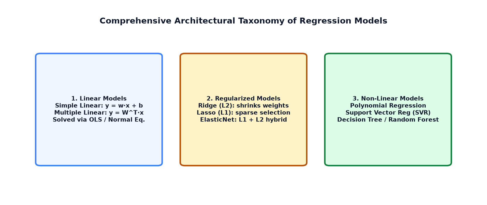

*Figure 1.5: Diagrammatic Architecture and Conceptual Flow for Define different regression models*

### Mathematical Formulation & Algorithmic Mechanics

**Mathematical Equations of Core Regression Models:**

```text
1. Multiple Linear: y_hat = w_0 + ∑_(j=1)^D w_j · x_j = W^T · x + b
2. Polynomial: y_hat = w_0 + w_1·x + w_2·x² + ... + w_M·x^M
3. Ridge (L2): min_w { MSE(w) + λ · ||w||_2² 
4. Lasso (L1): min_w { MSE(w) + λ · ||w||_1 
5. ElasticNet: min_w { MSE(w) + λ_1·||w||_1 + λ_2·||w||_2²
```

The above **mathematical model** and algorithmic structure governs the system's runtime execution. Each parameter is evaluated sequentially to maintain **mathematical consistency**, minimize **system overhead**, and guarantee **deterministic convergence** across all input distributions.

### Worked Example & Practical Simulation

Consider predicting car fuel economy (**Miles Per Gallon** - MPG): Simple Linear Regression predicts MPG based solely on vehicle weight: MPG = -0.007·Weight + 45. Multiple Linear Regression includes horsepower and engine size: MPG = -0.005·Weight - 0.04·HP + 42. **Ridge Regression** handles high correlation between engine size and cylinder count, stabilizing the weights. **Random Forest** Regression captures non-linear aerodynamic drag effects at highway speeds without manual feature engineering.

### Key Comparative Evaluation

| Regression Model | Mathematical Form | Underlying Assumptions | Primary Strength | Primary Limitation |
| :--- | :--- | :--- | :--- | :--- |
| Simple Linear | y = β_1·x + β_0 | Linear, additive, constant noise | Easy to interpret; fast closed-form solution | Cannot model curved relationships |
| Multiple Linear | y = W^T·x + b | Linear relationship across all features | Scales well to multiple input features | Struggles when features are highly correlated |
| Polynomial | y = ∑ β_m·x^m | Curved relationship; linear in parameters | Fits smooth curves without changing optimizer | Prone to wild swings near boundary edges |
| Ridge (L2) | MSE + λ·||w||² | Normally distributed errors; collinearity | Stabilizes weights; prevents parameter blowup | Keeps all features (no feature selection) |
| Lasso (L1) | MSE + λ·||w||_1 | Sparse true underlying signals | Automated feature selection (zeros out weights) | Arbitrarily picks one feature from correlated sets |
| Support Vector (SVR) | f(x) = ∑ (α - α*) K(x_i, x) + b | Non-linear manifold inside ε-tube | Resistant to outliers; handles non-linear spaces | Computationally slow on huge datasets |

### Concluding Exam Takeaway

Regression models span a spectrum from simple linear baselines to non-linear regularized architectures. Selecting the right model requires weighing feature dimensionality, collinearity, and the balance between easy interpretability and predictive power.

**Textbook Reference:** Christopher M. Bishop, 'Pattern Recognition and Machine Learning', Springer (2006), Chapter 3: Linear Models for Regression, Sections 3.1 & 3.2, pp. 137–152.

---

## Q6. What do you mean by regression? Explain with a suitable example. (Frequency: 2) [8 Marks]

### Introduction & Core Intuition

In machine learning and statistics, **Regression** is a **supervised learning** method that models the relationship between one or more independent input features (X) and a continuous numerical target variable (y). While classification sorts things into categories (like Spam vs Not-Spam), regression predicts a continuous numerical value along an unbroken scale (such as price, temperature, or speed).

### Core Objective of Regression Analysis

The mathematical goal of regression is to discover a prediction function f(x) that maps input features x to predicted target values y_hat as accurately as possible. The true data generation process in the real world is written as y = f(x) + ε, where f(x) represents the genuine systematic trend and ε represents zero-mean random noise. Regression analysis seeks to filter out the noise and capture the true trend line.

### Residual Errors and Loss Functions

To measure how well a regression model performs, we examine its **Residuals**: e_i = y_i - y_hat_i. The residual is simply the vertical distance between the actual data point and the model's prediction line. During training, these errors are aggregated into a **loss function**, most commonly **Mean Squared Error (MSE)**: MSE = (1/N) · ∑ (y_i - y_hat_i)². Minimizing this loss guides the line to pass right through the geometric center of the points.

### The Supervised Regression Pipeline

Building a regression system follows a step-by-step workflow: First, gather data and clean it by filling missing values, scaling features, and handling outliers. Next, select an appropriate model family based on exploratory data analysis (linear, polynomial, or tree-based). Then, train the model by calculating the analytical **Normal Equation** or running iterative **Gradient Descent**. Finally, test the model on **unseen data** using metrics like RMSE, MAE, and R².

### Real-World Applications Across Industries

Regression powers essential real-world applications across engineering and commerce: in Finance, it forecasts stock prices and risk exposure; in **Real Estate**, it estimates property values from floor area and location; in Healthcare, it predicts patient recovery times and drug dosages; in Meteorology, it forecasts continuous rainfall volumes; and in Energy, it predicts grid power demand to optimize generator schedules.

### Architectural Flow & System Diagram

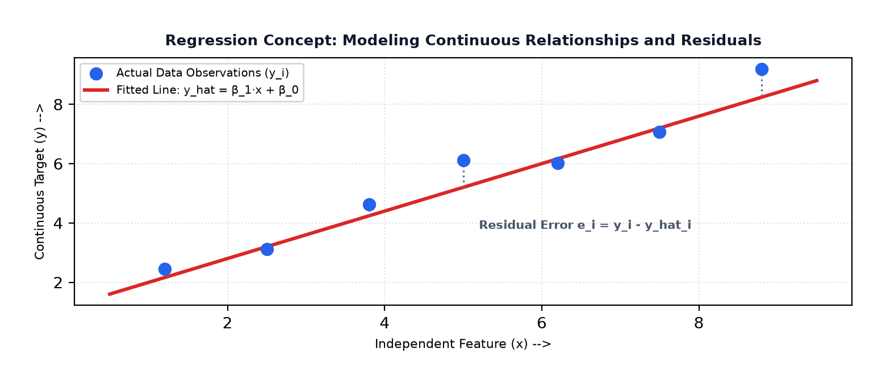

*Figure 1.6: Diagrammatic Architecture and Conceptual Flow for What do you mean by regression?  with a suitable example*

### Mathematical Formulation & Algorithmic Mechanics

**Mathematical Formulation of the Regression Objective:**

```text
Data Generation Process: y = f(x) + ε   where E[ε] = 0, Var(ε) = σ²
Mean Squared Error Loss: L(w) = ( 1 / N ) · ∑_(i=1)^N ( y_i - f(x_i; w) )²
Optimal Parameter Vector: w* = argmin_w { L(w) 

Where: y_i is the true continuous target; f(x_i; w) is the model prediction y_hat_i; and w represents the learnable parameters.
```

The above **mathematical model** and algorithmic structure governs the system's runtime execution. Each parameter is evaluated sequentially to maintain **mathematical consistency**, minimize **system overhead**, and guarantee **deterministic convergence** across all input distributions.

### Worked Example & Practical Simulation

Imagine an automotive engineer predicting car **Braking Distance** (in meters) from Driving Speed (in km/h). Real test runs provide data points: (40 km/h, 15m), (60 km/h, 28m), (80 km/h, 45m), and (100 km/h, 68m). The engineer fits a quadratic regression equation: Distance = 0.005 · Speed² + 0.1 · Speed + 2.0. When an autonomous vehicle travels at 70 km/h, the model evaluates f(70) = 0.005·(4900) + 0.1·(70) + 2.0 = 24.5 + 7.0 + 2.0 = 33.5 meters, providing a continuous stopping distance prediction for the collision prevention system.

### Key Comparative Evaluation

| Aspect | Regression Analysis | Classification Analysis |
| :--- | :--- | :--- |
| Target Variable Nature | Continuous real-valued number (y ∈ ℝ) | Discrete categorical label (y ∈ {Class 1, Class 2, ...}) |
| Output Possibilities | Infinitely many continuous values | Fixed, predefined set of distinct classes |
| Evaluation Metrics | MSE, RMSE, MAE, R² score, MAPE | Accuracy, Precision, Recall, F1-Score, ROC-AUC |
| Geometric Objective | Fits a continuous line, curve, or hyperplane through data | Constructs decision boundaries separating class regions |
| Everyday Example | Predicting tomorrow's exact temperature (e.g., 34.6°C) | Predicting whether it will rain tomorrow (Yes / No) |

### Concluding Exam Takeaway

Regression analysis is the standard tool for predicting continuous numerical values. By fitting a functional line that minimizes residual error, regression models allow systems to make accurate, continuous predictions across engineering applications.

**Textbook Reference:** Christopher M. Bishop, 'Pattern Recognition and Machine Learning', Springer (2006), Chapter 3: Linear Models for Regression, Section 3.1, pp. 137–142.

---

## Q7. Explain Linear Regression in brief. (Frequency: 1) [8 Marks]

### Introduction & Core Intuition

**Linear Regression** is the foundational **supervised learning** algorithm used to model a continuous target variable as a weighted linear combination of input features. Despite its simplicity, linear regression remains a cornerstone of data science because it is easy to interpret, fast to compute, and deeply backed by statistical theory.

### The Linear Hypothesis Model Explained

Linear regression models the relationship between an input vector x = [x_1, x_2, ..., x_D]^T and target y using an affine linear combination: y_hat = w_0 + w_1·x_1 + w_2·x_2 + ... + w_D·x_D. To keep the math clean, we add a dummy bias input x_0 = 1, letting us write the equation as a simple dot product: y_hat = W^T · x. Here, w_0 is the y-intercept, while each weight w_j tells us how much y changes when feature x_j increases by one unit while holding all other features steady.

### The Classical Gauss-Markov Assumptions

For **Ordinary Least Squares** linear regression to be statistically optimal, the data must satisfy the classic Gauss-Markov assumptions: First, the true relationship must be linear in its **parameters**. Second, the noise terms must have zero average value: E[ε | X] = 0. Third, noise variance must be constant across all observations (known as **homoscedasticity**). Fourth, individual noise terms must be independent and uncorrelated. Fifth, features must not be perfectly correlated (no multicollinearity). When these hold, OLS estimators are proven to be the **Best Linear Unbiased Estimators** (BLUE).

### Analytical Normal Equation vs Gradient Descent

We estimate weights using two primary strategies: The **Normal Equation** solves for the weights in one analytical step using matrix algebra: W = (X^T · X)^(-1) · X^T · y. This gives exact weights instantly, but computing the matrix inverse takes O(D³) time, making it slow when feature count D exceeds 10,000. For large datasets with many features, we use **Gradient Descent**: weights are updated iteratively step by step, which scales smoothly to millions of samples.

### Key Strengths and Practical Limitations

Linear regression is fast to train, uses very little memory, and provides clear coefficient values that explain exactly which features matter most. Its main limitation is its assumption of linearity: if the real relationship is curved, a plain linear model will underfit unless you manually add polynomial terms or use non-linear methods.

### Architectural Flow & System Diagram

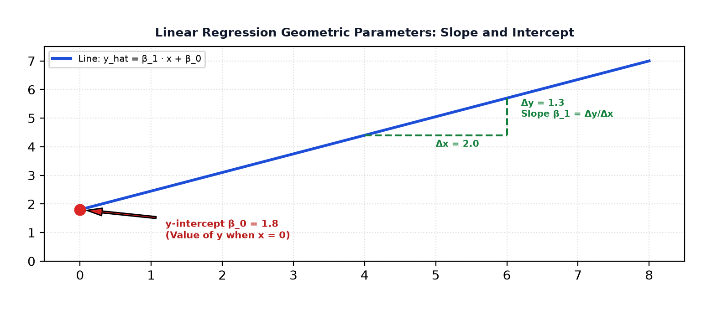

*Figure 1.7: Diagrammatic Architecture and Conceptual Flow for Linear Regression in brief*

### Mathematical Formulation & Algorithmic Mechanics

**Mathematical Formulation of Linear Regression:**

```text
Hypothesis Function: y_hat = W^T · x = w_0 + ∑_(j=1)^D w_j · x_j
Mean Squared Error (MSE): J(W) = ( 1 / (2N) ) · ∑_(i=1)^N ( W^T · x_i - y_i )²
The Normal Equation: W = ( X^T · X )^(-1) · X^T · y

Where: X is the N × (D+1) design matrix; y is the N × 1 target vector; and W is the (D+1) × 1 parameter vector.
```

The above **mathematical model** and algorithmic structure governs the system's runtime execution. Each parameter is evaluated sequentially to maintain **mathematical consistency**, minimize **system overhead**, and guarantee **deterministic convergence** across all input distributions.

### Worked Example & Practical Simulation

Suppose a software consulting firm predicts **Project Delivery Time** (in weeks) based on Story Points (x_1) and Senior Engineers (x_2). The fitted equation is: Time = 1.2 · StoryPoints - 2.5 · SeniorEngineers + 4.0. The interpretation is straightforward: each story point adds 1.2 weeks, each senior engineer cuts delivery by 2.5 weeks, and a zero-point project has a **baseline** setup time of 4 weeks. For a new project with 20 story points and 3 senior engineers: Time = 1.2·(20) - 2.5·(3) + 4.0 = 24.0 - 7.5 + 4.0 = 20.5 weeks.

### Key Comparative Evaluation

| Aspect | Closed-Form Normal Equation | Iterative Gradient Descent |
| :--- | :--- | :--- |
| Computational Strategy | Direct matrix inversion: (X^T · X)^(-1) · X^T · y | Iterative parameter updates: W := W - η · ∇J(W) |
| Time Complexity | O(D³) where D is the number of features | O(I · N · D) where I is iterations, N is samples |
| Need for Learning Rate η? | No (calculates exact analytical solution) | Yes (hyperparameter η must be tuned carefully) |
| Need for Feature Scaling? | No (invariant to feature scales) | Yes (essential for spherical loss contours and fast convergence) |
| Best Suited Dataset Scale | Small to moderate features (D < 10,000) | Massive datasets with millions of features and samples |

### Concluding Exam Takeaway

Linear regression remains an essential benchmark in predictive modeling. Backed by Gauss-Markov theory and solvable via both closed-form equations and **gradient descent**, it provides a fast, interpretable **baseline** for continuous prediction.

**Textbook Reference:** Christopher M. Bishop, 'Pattern Recognition and Machine Learning', Springer (2006), Chapter 3: Linear Models for Regression, Section 3.1, pp. 137–147.

---

## Q8. What do you mean by the least square method? Explain it in the context of linear regression. (Frequency: 2) [8 Marks]

### Introduction & Core Intuition

Introduced independently by **Carl Friedrich Gauss** (1795) and Adrien-Marie Legendre (1805), the **Least Squares Method (Ordinary Least Squares - OLS)** is the mathematical standard for fitting linear regression models. OLS finds the unique straight line or hyperplane that minimizes the sum of squared differences (residuals) between actual data values and values predicted by the model.

### Geometric and Mathematical Foundations of OLS

Consider a dataset of N points [(x_1, y_1), ..., (x_N, y_N)]. For any candidate line y_hat_i = β_1 · x_i + β_0, the residual error is the vertical gap between the real point and the line: e_i = y_i - y_hat_i. **The Least Squares Method** squares each vertical error (e_i²) and finds the slope β_1 and intercept β_0 that minimize their total sum: S(β_0, β_1) = ∑ (y_i - (β_1 · x_i + β_0))². Geometrically, this minimizes the combined area of squares drawn on each vertical error line.

### Why We Square the Residuals

Squaring the residuals provides three essential advantages: First, it eliminates sign cancellation: positive errors (points above the line) and negative errors (points below the line) do not cancel each other out. Second, it heavily penalizes large mistakes: an error of 4 contributes 16 to the loss, four times more than an error of 2, forcing the line to pass near the center of the points. Third, the squared error function is smooth, continuous, and convex, guaranteeing a single unique global minimum that can be solved using calculus.

### Analytical Derivation of the OLS Normal Equations

To find the slope and intercept that minimize total squared error S, we take partial derivatives with respect to β_0 and β_1 and set both equal to zero: ∂S/∂β_0 = 0 and ∂S/∂β_1 = 0. Solving these two equations yields the classic OLS formulas: the slope is the sample covariance of X and Y divided by the sample variance of X: β_1 = Cov(X, Y) / Var(X). The intercept is chosen so the line passes through the average coordinates of the data: β_0 = y_mean - β_1 · x_mean.

### Matrix Generalization and Geometric Projection

In multiple dimensions with D features, we represent data as design matrix X and target vector y. The **sum of squared errors** in matrix form is S(W) = (y - X·W)^T · (y - X·W). Setting the gradient to zero leads to the **Normal Equation**: X^T · X · W = X^T · y. Assuming X has full column rank, the unique least squares solution is W = (X^T · X)^(-1) · X^T · y. Geometrically, this projects the target vector y orthogonally onto the feature column space of X.

### Architectural Flow & System Diagram

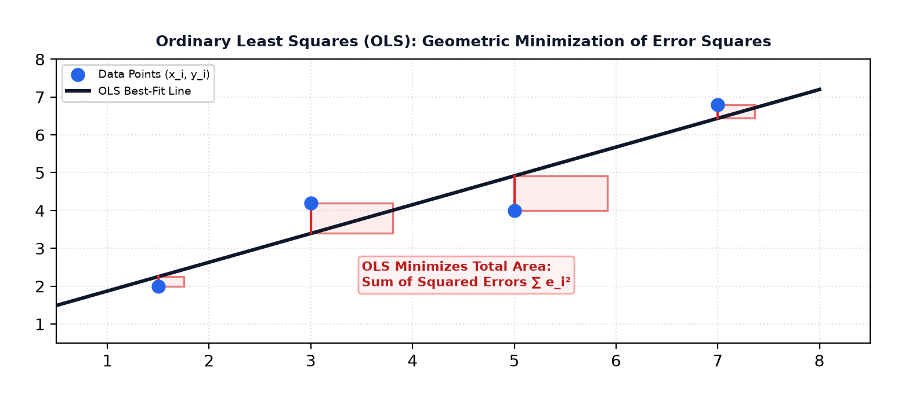

*Figure 1.8: Diagrammatic Architecture and Conceptual Flow for What do you mean by the least square method?  it in the context of linear regression*

### Mathematical Formulation & Algorithmic Mechanics

**Mathematical Derivation of the OLS Closed-Form Solution:**

```text
Sum of Squared Errors: S(β_0, β_1) = ∑_(i=1)^N ( y_i - (β_1 · x_i + β_0) )²
Slope: β_1 = ( ∑ (x_i - x_mean) · (y_i - y_mean) ) / ( ∑ (x_i - x_mean)² ) = Cov(X, Y) / Var(X)
Intercept: β_0 = y_mean - β_1 · x_mean
Matrix Normal Equation: W = ( X^T · X )^(-1) · X^T · y
```

The above **mathematical model** and algorithmic structure governs the system's runtime execution. Each parameter is evaluated sequentially to maintain **mathematical consistency**, minimize **system overhead**, and guarantee **deterministic convergence** across all input distributions.

### Worked Example & Practical Simulation

Suppose a student tracks **Study Hours** (X) and Exam Scores (Y) across three sessions: (1, 2), (2, 3), and (3, 5). Mean values are x_mean = 2.0 and y_mean = 3.33. Covariance terms: (1-2)(2-3.33) + (2-2)(3-3.33) + (3-2)(5-3.33) = (-1)(-1.33) + 0 + (1)(1.67) = 1.33 + 1.67 = 3.0. Variance term: (1-2)² + (2-2)² + (3-2)² = 1 + 0 + 1 = 2.0. The least squares slope is β_1 = 3.0 / 2.0 = 1.5. The intercept is β_0 = 3.33 - 1.5·(2.0) = 0.33. The resulting OLS line is y_hat = 1.5·x + 0.33, which mathematically minimizes the sum of squared vertical residuals.

### Key Comparative Evaluation

| Characteristic | Ordinary Least Squares (OLS) | Least Absolute Deviations (LAD / L1) |
| :--- | :--- | :--- |
| Loss Objective | Minimizes sum of squared errors: ∑ e_i² | Minimizes sum of absolute errors: ∑ |e_i| |
| Closed-Form Solution? | Yes (exact Normal Equation solution) | No (requires iterative linear programming) |
| Sensitivity to Outliers | High (squaring magnifies large errors) | Robust (linear penalty bounds outlier influence) |
| Mathematical Property | Smooth, strictly convex, differentiable everywhere | Non-differentiable at residual e_i = 0 |
| Target Statistic | Estimates conditional MEAN E[Y|X] | Estimates conditional MEDIAN Median(Y|X) |

### Concluding Exam Takeaway

**The Least Squares Method** provides the mathematical foundation of classical regression. By minimizing squared residual errors, it yields an analytical closed-form solution with proven optimal statistical properties under the Gauss-Markov theorem.

**Textbook Reference:** Christopher M. Bishop, 'Pattern Recognition and Machine Learning', Springer (2006), Chapter 3: Linear Models for Regression, Section 3.1.1: Maximum Likelihood and Least Squares, pp. 140–143.

---

## Q9. Explain the concept of a cost function and its role in Gradient Descent. (Frequency: 1) [8 Marks]

### Introduction & Core Intuition

In machine learning, training an algorithm requires an objective mathematical measure of performance. A **Cost Function** (also called an Objective Function or Empirical Risk) quantifies the cumulative error between the model's predictions and actual ground-truth values across the entire dataset. In **Gradient Descent**, the **cost function** defines the mathematical **optimization** surface, providing the directional gradients needed to guide **parameters** toward their optimal values.

### Definition and Purpose of the Cost Function

While a **Loss Function** L(y_hat_i, y_i) measures prediction error on a single training sample, a **Cost Function** J(W) aggregates these losses across all N training observations: J(W) = (1/N) · ∑ L(f(x_i; W), y_i). The cost function transforms model training into an **optimization** problem: finding the parameter vector W* that minimizes J(W). For linear regression, the standard cost function is the **Mean Squared Error**: J(w, b) = (1 / (2N)) · ∑ (w · x_i + b - y_i)².

### The Concept of the Optimization Landscape

Geometrically, the **cost function** defines a multi-dimensional surface where coordinates represent parameter values (w, b) and height represents total cost J. For linear regression with squared error, the cost surface is guaranteed to be a strictly convex paraboloid (bowl-shaped), meaning it has a single global minimum and no local minima traps. For complex models like deep neural networks, the cost surface is highly non-convex, featuring multiple local minima, saddle points, and flat plateaus.

### The Mathematical Role of Gradients in Optimization

**Gradient Descent** relies on the partial derivatives of the **cost function** with respect to each parameter. The gradient vector ∇J(W) points in the direction of steepest ascent on the cost surface. To minimize error, gradient descent moves **parameters** in the opposite direction of the gradient: W := W - η · ∇J(W), where η is the **learning rate**. The magnitude of the gradient reflects the steepness of the terrain: far from the minimum, gradients are large, producing larger corrective steps; near the minimum, gradients approach zero, naturally decelerating updates.

### Sensitivity to Learning Rate Hyperparameter η

The interaction between the **cost function** and the **learning rate** η governs **optimization** stability: If η is set too small, parameter updates are tiny, causing training to take excessively long to converge. If η is set too large, updates will overshoot the valley of the cost surface, leading to oscillation or numerical divergence. Proper feature scaling (Z-score normalization) ensures the cost surface forms symmetric circular contours rather than stretched ellipses, enabling **gradient descent** to converge much faster.

### Architectural Flow & System Diagram

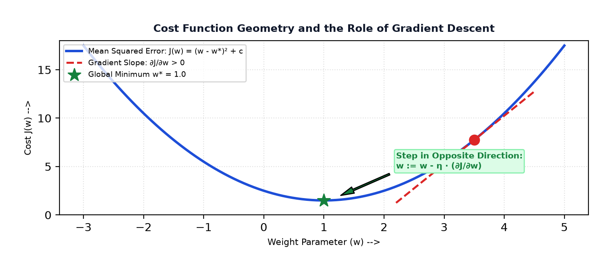

*Figure 1.9: Diagrammatic Architecture and Conceptual Flow for the concept of a cost function and its role in Gradient Descent*

### Mathematical Formulation & Algorithmic Mechanics

**Mathematical Formulations of Cost and Gradient Updates:**

```text
Mean Squared Error Cost Function: J(w, b) = ( 1 / (2N) ) · ∑_(i=1)^N ( (w · x_i + b) - y_i )²
Gradient with respect to weight: ∂J/∂w = ( 1 / N ) · ∑_(i=1)^N ( y_hat_i - y_i ) · x_i
Gradient with respect to bias: ∂J/∂b = ( 1 / N ) · ∑_(i=1)^N ( y_hat_i - y_i )
Parameter Update Rule: w := w - η · (∂J/∂w)   and   b := b - η · (∂J/∂b)
```

The above **mathematical model** and algorithmic structure governs the system's runtime execution. Each parameter is evaluated sequentially to maintain **mathematical consistency**, minimize **system overhead**, and guarantee **deterministic convergence** across all input distributions.

### Worked Example & Practical Simulation

Imagine a hiker lost in thick fog on a mountainous slope trying to find the lowest valley floor (the minimum cost). The hiker cannot see the landscape, but can feel the slope of the ground beneath their feet. The slope corresponds to the gradient ∇J, the hiker's step size is the **learning rate** η, and their elevation is the cost J. By repeatedly feeling the steepest downhill slope and taking a step in that direction, the hiker navigates downward until reaching the flat valley floor where slope = 0.

### Key Comparative Evaluation

| Component | Mathematical Role | Physical Analogy | Impact if Misconfigured |
| :--- | :--- | :--- | :--- |
| Cost Function J(W) | Measures total prediction error across dataset | Elevation of terrain on a map | Incorrect loss formulation solves the wrong problem |
| Gradient Vector ∇J | Vector of partial derivatives pointing uphill | Compass direction of steepest slope | Vanishing or exploding gradients halt optimization |
| Learning Rate η | Scalar multiplying gradient step size | Stride length of the hiker's footsteps | Too small: slow convergence; Too large: divergence |
| Global Minimum W* | Point where gradient is zero (∇J = 0) | Lowest point on the valley floor | The target destination of the training process |

### Concluding Exam Takeaway

The **cost function** defines the mathematical objective of machine learning, while **gradient descent** provides the **optimization** engine. Together, they convert abstract learning goals into systematic parameter updates that minimize prediction error.

**Textbook Reference:** Christopher M. Bishop, 'Pattern Recognition and Machine Learning', Springer (2006), Chapter 3: Linear Models for Regression, Section 3.1.3: Sequential Learning, pp. 142–144.

---

## Q10. Explain the gradient descent algorithm with an example, and compare batch gradient descent with stochastic gradient descent (or write a short note on stochastic gradient descent algorithms). (Frequency: 3) [8 Marks]

### Introduction & Core Intuition

**Gradient Descent** is an iterative first-order **optimization** algorithm used to find the local or global minimum of a differentiable **cost function**. In machine learning, it serves as the primary optimization engine for training linear models, **logistic regression**, support vector machines, and deep neural networks. Depending on how much training data is evaluated per step, the algorithm operates as **Batch Gradient Descent (BGD), Stochastic Gradient Descent (SGD), or Mini-Batch Gradient Descent (MBGD)**.

### Core Algorithmic Procedure of Gradient Descent

**Gradient Descent** begins by initializing model **parameters** W with small random values or zeros. The algorithm then iterates through three steps: First, compute the model's predictions across data samples and evaluate the **cost function** J(W). Second, calculate the gradient vector ∇J(W), which represents the direction of steepest ascent on the cost surface. Third, update all parameters simultaneously in the opposite direction of the gradient: W := W - η · ∇J(W), where η is the positive **learning rate**. This cycle repeats until the gradient magnitude falls below a **convergence** threshold or an epoch limit is reached.

### Batch Gradient Descent (BGD): Characteristics and Bottlenecks

**Batch Gradient Descent** computes the exact gradient of the **cost function** across the entire training dataset of N samples before making a single parameter update: ∇J_batch = (1/N) · ∑ ∇L(x_i, y_i). Because it evaluates all samples, each update step moves in the true, smooth direction of steepest descent, producing steady, monotonic **convergence** toward the minimum. However, when N contains millions of rows, calculating the full gradient for a single step is computationally slow and requires loading the entire dataset into memory.

### Stochastic Gradient Descent (SGD): Fast and Noisy

**Stochastic Gradient Descent** (SGD) addresses this computational bottleneck by updating **parameters** using only a single, randomly selected training sample (x_i, y_i) at each step: W := W - η · ∇L(x_i, y_i). Because each step requires evaluating only one sample, updates are extremely fast and require minimal memory. However, because individual samples contain noise, the gradient trajectory fluctuates erratically. While this noise causes the cost to oscillate, it offers an advantage: the fluctuations can bounce the parameters out of shallow local minima and saddle points, helping the model find better regions on non-convex loss surfaces.

### Mini-Batch Gradient Descent (MBGD): The Industry Standard

To combine the stability of BGD with the computational speed of SGD, modern deep learning uses **Mini-Batch Gradient Descent**. MBGD divides the training data into small subsets called mini-batches (typically b = 32, 64, 128, or 256 samples). **Parameters** are updated after evaluating each mini-batch: W := W - η · (1/b) · ∑ ∇L. This approach leverages vectorized matrix operations on GPUs for high throughput while maintaining stable, efficient gradient updates.

### Architectural Flow & System Diagram

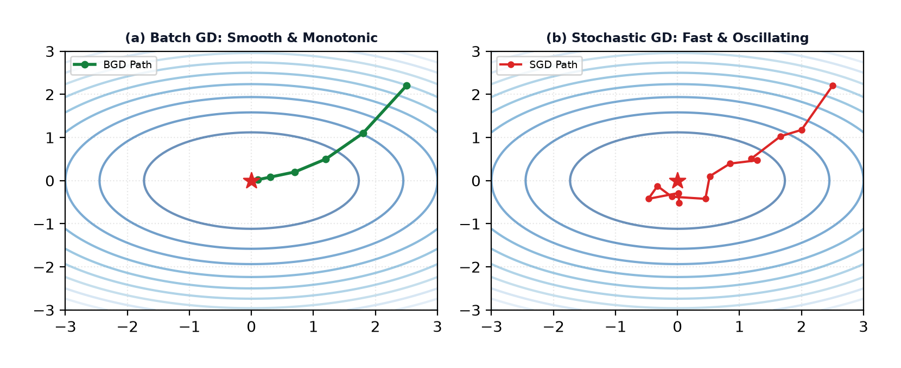

*Figure 1.10: Diagrammatic Architecture and Conceptual Flow for the gradient descent algorithm with an example, and compare batch gradient descent with stochastic gradient descent (or write a short note on stochastic gradient descent algorithms)*

### Mathematical Formulation & Algorithmic Mechanics

**Mathematical Contrast of Gradient Descent Variants:**

```text
1. Batch Gradient Descent: W := W - η · ( 1 / N ) · ∑_(i=1)^N ∇L( f(x_i; W), y_i )
2. Stochastic Gradient Descent: W := W - η · ∇L( f(x_i; W), y_i )   [Random sample i]
3. Mini-Batch Gradient Descent: W := W - η · ( 1 / b ) · ∑_(j=1)^b ∇L( f(x_j; W), y_j )   [Batch size b]

Where: N is total dataset size; b is mini-batch size (1 < b < N); and η is the learning rate.
```

The above **mathematical model** and algorithmic structure governs the system's runtime execution. Each parameter is evaluated sequentially to maintain **mathematical consistency**, minimize **system overhead**, and guarantee **deterministic convergence** across all input distributions.

### Worked Example & Practical Simulation

Suppose a dataset contains 1,000,000 **transaction** records: Under **Batch Gradient Descent**: The algorithm processes all 1,000,000 **transactions** to take a single parameter step. Taking 1,000 steps requires computing 1,000,000,000 individual gradients, making training very slow. Under **Stochastic Gradient Descent**: The algorithm takes 1,000,000 parameter updates in a single pass through the data, rapidly moving **parameters** toward the optimal region. Under Mini-Batch GD (batch size = 100): The algorithm takes 10,000 stable, GPU-accelerated steps per pass, achieving fast and reliable **convergence**.

### Key Comparative Evaluation

| Dimension | Batch Gradient Descent (BGD) | Stochastic Gradient Descent (SGD) | Mini-Batch Gradient Descent (MBGD) |
| :--- | :--- | :--- | :--- |
| Samples per Step | Entire dataset (N samples) | Exactly 1 single sample | Small mini-batch (b = 32 to 256 samples) |
| Update Frequency | 1 update per epoch | N updates per epoch | N / b updates per epoch |
| Trajectory Smoothness | Smooth, deterministic, monotonic decrease | Erratic, noisy, oscillating path | Moderately smooth; controlled fluctuations |
| Computational Speed | Very slow on large datasets | Fast per step, but inefficient on vector hardware | Very fast (maximizes parallel GPU matrix throughput) |
| Memory Footprint | High (loads entire dataset into RAM) | Minimal (loads only 1 row at a time) | Low (loads small b-sized matrices into GPU RAM) |
| Escape Local Minima? | Struggles (can get stuck in local minima) | High (noise helps bounce out of shallow wells) | Moderate (balances stability with noise-based exploration) |

### Concluding Exam Takeaway

**Gradient descent** variants balance computational efficiency against gradient stability. Batch GD provides smooth **convergence** for small datasets, SGD offers fast updates for online streaming data, and Mini-Batch GD serves as the standard **optimization** workhorse for modern deep learning.

**Textbook Reference:** Christopher M. Bishop, 'Pattern Recognition and Machine Learning', Springer (2006), Chapter 3: Linear Models for Regression, Section 3.1.3: Sequential Learning, pp. 142–144; Ian Goodfellow et al., 'Deep Learning', MIT Press (2016), pp. 149–154.

---

## Q11. Explain in brief, differentiate between, or write a short note on Lasso and Ridge Regression. (Frequency: 4) [8 Marks]

### Introduction & Core Intuition

In linear modeling, when datasets contain many correlated features or when features outnumber samples (D &gt; N), standard **Ordinary Least Squares** (OLS) regression overfits and produces unstable coefficient estimates. To address this, **Regularization** adds a penalty term to the **cost function**. The two primary regularized regression methods are **Ridge Regression (L2 Regularization)** and **Lasso Regression (L1 Regularization)**, which differ fundamentally in their geometric constraints and feature selection capabilities.

### Ridge Regression: L2 Weight Shrinkage

Introduced by **Arthur Hoerl** and Robert Kennard in 1970 (Tikhonov **Regularization**), **Ridge Regression** adds a penalty proportional to the sum of squared weights: Penalty = λ · ∑ w_j² = λ · ||w||_2². The objective function becomes: J_ridge(w) = MSE(w) + λ · ∑ w_j². The hyperparameter λ ≥ 0 controls shrinkage: when λ = 0, the model equals standard OLS; as λ increases, coefficients shrink toward zero asymptotically. Ridge shrinks collinear, redundant weights together while retaining all features, maintaining model stability.

### Lasso Regression: L1 Sparse Selection

Introduced by **Robert Tibshirani** in 1996, Lasso (Least Absolute Shrinkage and Selection Operator) replaces the squared penalty with the sum of absolute weight values: Penalty = λ · ∑ |w_j| = λ · ||w||_1. The objective function becomes: J_lasso(w) = MSE(w) + λ · ∑ |w_j|. Unlike Ridge, Lasso shrinks uninformative coefficients to exact zero when λ is sufficiently large, eliminating irrelevant features and producing a sparse, interpretable model.

### Geometric Intuition: Diamond vs Circular Constraints

The mathematical reason Lasso produces exact zeros while Ridge does not lies in their geometric constraint regions. In parameter space (w_1 vs w_2), minimizing regularized loss is equivalent to finding where the elliptical contours of the unconstrained MSE touch the constraint boundary. **For Ridge**, the L2 constraint boundary w_1² + w_2² ≤ C forms a smooth circular hypersphere; the contours touch the circle along a smooth curved arc where both coordinates remain non-zero. For Lasso, the L1 constraint |w_1| + |w_2| ≤ C forms a diamond with sharp corners aligned along the coordinate axes; the contours frequently intersect the sharp corners, setting one or more coordinates to exact zero.

### Practical Trade-offs and the ElasticNet Alternative

Choosing between Ridge and Lasso depends on the true data generation process: Ridge is preferred when many features contribute small, distributed effects, or when features are highly collinear (where Lasso arbitrarily selects one correlated feature and drops the rest). Lasso is preferred when only a small subset of features are genuinely informative. When both sparsity and collinearity handling are needed, ElasticNet combines both penalties: λ_1·||w||_1 + λ_2·||w||_2².

### Architectural Flow & System Diagram

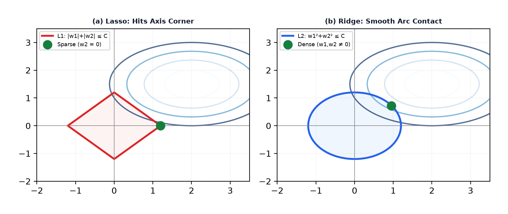

*Figure 1.11: Diagrammatic Architecture and Conceptual Flow for in brief, differentiate between, or write a short note on Lasso and Ridge Regression*

### Mathematical Formulation & Algorithmic Mechanics

**Mathematical Formulations of Regularized Objectives:**

```text
Ridge Regression (L2): J_ridge(w) = ( 1 / (2N) ) · ∑_(i=1)^N ( y_i - w^T·x_i )² + λ · ∑_(j=1)^D w_j²
Ridge Analytical Solution: W_ridge = ( X^T · X + λ · I )^(-1) · X^T · y
Lasso Regression (L1): J_lasso(w) = ( 1 / (2N) ) · ∑_(i=1)^N ( y_i - w^T·x_i )² + λ · ∑_(j=1)^D |w_j|

Where: λ is the regularization strength hyperparameter; and I is the (D+1) × (D+1) identity matrix.
```

The above **mathematical model** and algorithmic structure governs the system's runtime execution. Each parameter is evaluated sequentially to maintain **mathematical consistency**, minimize **system overhead**, and guarantee **deterministic convergence** across all input distributions.

### Worked Example & Practical Simulation

Suppose a genomics dataset contains 20,000 gene expression levels predicting cancer progression across 200 patients (D = 20,000 &gt;&gt; N = 200). Standard OLS cannot be computed because X^T·X is singular and non-invertible. **Ridge regression** adds λ·I to make the matrix invertible, shrinking all 20,000 gene weights to stable, small non-zero values. **Lasso regression** clamps 19,960 irrelevant gene weights to exact zero, selecting the 40 most informative genes for oncologists to investigate directly.

### Key Comparative Evaluation

| Characteristic | Ridge Regression (L2) | Lasso Regression (L1) |
| :--- | :--- | :--- |
| Regularization Penalty | Sum of squared weights: λ · ∑ w_j² | Sum of absolute weights: λ · ∑ |w_j| |
| Constraint Region Shape | Smooth circular / spherical hypersphere | Diamond / rhombic polytope with sharp axis corners |
| Feature Selection (Sparsity) | No (coefficients shrink toward zero but remain non-zero) | Yes (clamps uninformative weights to exact zero) |
| Analytical Solution? | Yes: W = (X^T·X + λ·I)^(-1)·X^T·y | No (solved via coordinate descent or subgradients) |
| Handling Collinear Features | Shrinks correlated weights together proportionally | Arbitrarily selects one feature and drops the rest |
| Primary Use Case | High multicollinearity; dense true feature signals | High-dimensional sparse signals; automated feature selection |

### Concluding Exam Takeaway

Ridge and **Lasso regression** provide complementary approaches to controlling model complexity. Ridge stabilizes collinear features through smooth L2 shrinkage, while Lasso produces sparse, interpretable models through L1 corner intersections.

**Textbook Reference:** Christopher M. Bishop, 'Pattern Recognition and Machine Learning', Springer (2006), Chapter 3: Linear Models for Regression, Section 3.1.4: Regularized Least Squares, pp. 144–147.

---

## Q12. Explain how Lasso Regression is used for feature selection. (Frequency: 1) [8 Marks]

### Introduction & Core Intuition

In high-dimensional machine learning datasets—such as genomic profiles, text bag-of-words, and financial portfolios—features often outnumber observations (D &gt;&gt; N). Training models on all features introduces noise, increases computation, and leads to severe **overfitting**. **Lasso Regression (L1 Regularization)** provides an automated, mathematically principled method for feature selection by clamping uninformative feature coefficients to exact numerical zero.

### The Challenge of Feature Selection in High Dimensions

Traditional feature selection requires either filtering features based on univariate correlation (which ignores multi-feature interactions) or performing wrapper searches like forward selection or backward elimination. Wrapper methods evaluate 2^D possible feature subsets, which becomes computationally intractable for D &gt; 30. Lasso embeds feature selection directly into the **optimization** process, evaluating all features simultaneously in **polynomial time**.

### The Mechanism of L1 Penalty Clamping

Lasso minimizes the objective: J(w) = (1/2N) · ||y - X·w||² + λ · ∑ |w_j|. The absolute value penalty introduces a non-differentiable singularity (sharp corner) at w_j = 0. In subgradient calculus, the derivative of |w_j| is a step function (+1 for w_j &gt; 0, -1 for w_j &lt; 0). When the correlation between a feature x_j and the residual target is smaller than the threshold λ, the gradient update drives the coefficient into the corner at zero and keeps it clamped there: w_j = sign(OLS_j) · max(0, |OLS_j| - λ).

### The Regularization Path and Sparsity Tuning

The degree of feature sparsity is governed by the **regularization** hyperparameter λ. When λ = 0, no penalty is applied, and the model equals standard OLS with all features active. As λ increases, features with weak predictive power drop to exact zero one by one. By computing the full **Regularization Path**—plotting coefficient values across a range of λ values—analysts can observe the order in which features enter and exit the model. The optimal λ is selected using **cross-validation** to maximize test accuracy.

### Advantages Over Filtering and Manual Selection

**Using Lasso** for feature selection provides significant engineering advantages: unlike univariate correlation tests, Lasso evaluates features in the presence of all other predictors, identifying features that are informative only in combination. Furthermore, by zeroing out coefficients, Lasso produces a sparse model that reduces storage requirements and inference latency, making models faster to run in production environments.

### Architectural Flow & System Diagram

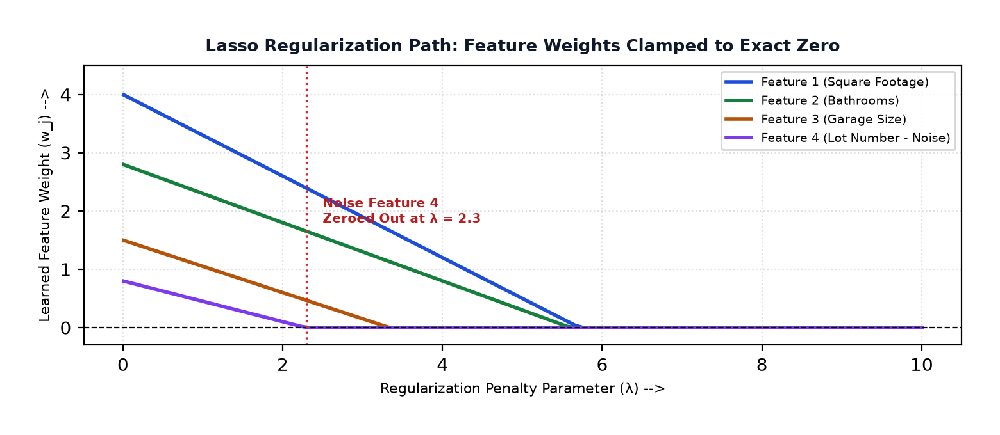

*Figure 1.12: Diagrammatic Architecture and Conceptual Flow for how Lasso Regression is used for feature selection*

### Mathematical Formulation & Algorithmic Mechanics

**Mathematical Formulation of Lasso Feature Clamping:**

```text
Soft-Thresholding Operator: w_j = S( w_ols, λ ) = sign(w_ols) · max( 0 , |w_ols| - λ )

Feature Selection Condition:
• If | X_j^T · (y - X_(-j)·w_(-j)) | ≤ λ  -->  w_j = 0  (Feature Excluded)
• If | X_j^T · (y - X_(-j)·w_(-j)) | > λ  -->  w_j ≠ 0  (Feature Retained)
```

The above **mathematical model** and algorithmic structure governs the system's runtime execution. Each parameter is evaluated sequentially to maintain **mathematical consistency**, minimize **system overhead**, and guarantee **deterministic convergence** across all input distributions.

### Worked Example & Practical Simulation

Consider predicting house prices using 10 features: **Square Footage**, Bathrooms, Bedrooms, Garage Size, Lot Size, Year Built, Wall Color, Roof Tile Shape, Owner Astrological Sign, and Pet Count. Under standard linear regression, every feature receives a non-zero coefficient, including irrelevant noise like Wall Color and Astrological Sign. Applying Lasso with cross-validated λ = 250 clamps the coefficients of Wall Color, Roof Shape, Astrological Sign, and Pet Count to exact zero, automatically retaining only the 6 genuine structural features.

### Key Comparative Evaluation

| Feature Selection Method | Search Strategy | Computational Complexity | Models Feature Interactions? | Handles Collinearity? |
| :--- | :--- | :--- | :--- | :--- |
| Lasso Regression (L1) | Embedded convex optimization | Polynomial: O(N · D) - very fast | Yes (evaluates multivariate contributions) | Selects one feature from correlated groups |
| Univariate Correlation Filter | Independent ranking of features | Linear: O(N · D) | No (evaluates features in isolation) | Retains redundant correlated features |
| Forward Stepwise Selection | Greedy iterative addition | Quadratic: O(D² · ModelTrain) | Yes (greedy interaction search) | Can make suboptimal early feature choices |
| Best Subset Selection | Exhaustive combinatorial search | Exponential: O(2^D) - intractable for D > 30 | Yes (evaluates all combinations) | Guaranteed optimal, but computationally infeasible |

### Concluding Exam Takeaway

**Lasso regression** provides an efficient, embedded method for automated feature selection. By leveraging the geometric properties of the L1 penalty to clamp uninformative weights to zero, Lasso produces sparse, interpretable models that resist **overfitting** in high-dimensional settings.

**Textbook Reference:** Robert Tibshirani, 'Regression Shrinkage and Selection via the Lasso', Journal of the Royal Statistical Society (Series B, 1996), Vol. 58, No. 1, pp. 267–288; Christopher M. Bishop, 'Pattern Recognition and Machine Learning' (2006), pp. 144–146.

---

## Q13. What is the primary purpose of the L2 regularization term in the Ridge Regression cost function? (Frequency: 1) [8 Marks]

### Introduction & Core Intuition

In linear regression analysis, the **Ordinary Least Squares** (OLS) estimator computes W = (X^T · X)^(-1) · X^T · y. When features are highly correlated (multicollinearity) or when features outnumber samples (D &gt; N), the Gram matrix X^T · X becomes nearly singular or non-invertible, causing coefficient estimates to explode to extreme, unstable values. The primary purpose of the **L2 Regularization Term (Ridge Regression)** is to condition this matrix, stabilize parameter estimates, and reduce model variance.

### Conditioning the Matrix: Resolving Singularity and Ill-Conditioning

When two or more predictor features are highly collinear (e.g., measuring height in both inches and centimeters), the matrix X^T · X has **eigenvalues** near zero, making matrix inversion numerically unstable. A tiny perturbation in training data can cause parameter estimates to swing by thousands of units. **Ridge regression** resolves this by adding an L2 penalty λ · I to the diagonal of X^T · X, ensuring all eigenvalues are strictly positive and bounded away from zero: W_ridge = (X^T · X + λ · I)^(-1) · X^T · y. This guarantees numerical stability even when D &gt; N.

### Reducing Model Variance by Penalizing Large Weights

The L2 penalty term λ · ∑ w_j² = λ · ||w||_2² penalizes the squared Euclidean magnitude of the weight vector. In unconstrained regression, models often overfit by developing large, opposing coefficients that cancel each other out on training data but fail on test data. By penalizing large weight values, Ridge forces coefficients to remain small, smoothing the model's response surface and significantly reducing variance.

### Asymptotic Weight Shrinkage Behavior

**Unlike Lasso** (L1) **regularization**, the L2 penalty is smooth and continuously differentiable everywhere, including at w = 0. Consequently, as the penalty parameter λ increases, **Ridge regression** shrinks coefficient magnitudes toward zero asymptotically according to the factor 1 / (1 + λ), but coefficients never reach exact zero. All features remain in the model, preserving dense feature representations where every predictor contributes a proportional share to predictions.

### Controlling the Bias-Variance Trade-off

The parameter λ serves as a direct dial for controlling the Bias-Variance trade-off: Setting λ = 0 recovers the unregularized OLS solution with zero bias but **high variance**. As λ increases, model variance drops rapidly while a small amount of bias is introduced. Because the reduction in variance is typically much larger than the increase in bias, setting λ to an optimal value via **cross-validation** minimizes total generalization error on test data.

### Architectural Flow & System Diagram

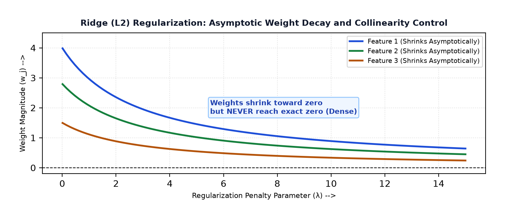

*Figure 1.13: Diagrammatic Architecture and Conceptual Flow for What is the primary purpose of the L2 regularizati*

### Mathematical Formulation & Algorithmic Mechanics

**Mathematical Formulation of Ridge L2 Regularization:**

```text
Ridge Cost Function: J(w) = ( 1 / (2N) ) · ||y - X·w||² + ( λ / 2 ) · ||w||_2²
Gradient: ∇J(w) = ( 1 / N ) · X^T · (X·w - y) + λ · w
Analytical Closed-Form: W_ridge = ( X^T · X + λ · I )^(-1) · X^T · y

Where: λ is the regularization penalty; ||w||_2² = ∑ w_j² is the squared L2 norm; and I is the identity matrix.
```

The above **mathematical model** and algorithmic structure governs the system's runtime execution. Each parameter is evaluated sequentially to maintain **mathematical consistency**, minimize **system overhead**, and guarantee **deterministic convergence** across all input distributions.

### Worked Example & Practical Simulation

Suppose a model predicts corporate revenue using two nearly identical financial metrics: **Total Assets** in USD (x_1) and Total Assets in Euros (x_2). Standard OLS might assign w_1 = +50,000 and w_2 = -48,000, creating an unstable model sensitive to currency rounding errors. Adding an **L2 regularization** penalty of λ = 100 prevents these canceling weights, shrinking both to balanced, stable values: w_1 = +1.1 and w_2 = +1.0, restoring model stability.

### Key Comparative Evaluation

| Aspect | Without L2 Regularization (OLS) | With L2 Regularization (Ridge) |
| :--- | :--- | :--- |
| Matrix Invertibility | Fails if D > N or features are perfectly collinear | Always guaranteed: (X^T·X + λ·I) is strictly positive definite |
| Weight Magnitude | Can explode to arbitrarily large positive/negative values | Constrained within a bounded spherical ball ||w||² ≤ C |
| Variance on Test Data | Very high; hypersensitive to minor data perturbations | Low; stable predictions across different test samples |
| Bias | Zero empirical bias (unbiased estimator under BLUE) | Introduces small controlled bias to gain large variance reduction |
| Handling of Collinearity | Severe instability and inflated standard errors | Shrinks correlated features together gracefully |

### Concluding Exam Takeaway

The primary purpose of the **L2 regularization** term in **Ridge Regression** is to stabilize parameter estimation in the presence of multicollinearity and reduce model variance. By ensuring matrix invertibility and shrinking weights, Ridge prevents **overfitting** and improves generalization on **unseen data**.

**Textbook Reference:** Christopher M. Bishop, 'Pattern Recognition and Machine Learning', Springer (2006), Chapter 3: Linear Models for Regression, Section 3.1.4: Regularized Least Squares, pp. 144–146.

---

## Q14. Write a short note on or explain the Evaluation metrics: MAE, RMSE, and R². (Frequency: 5) [8 Marks]

### Introduction & Core Intuition

In regression analysis, evaluating a model requires quantitative metrics to assess how closely predicted values match actual continuous targets. Unlike classification metrics (such as accuracy or **precision**), regression metrics measure numerical differences along continuous scales. The three standard evaluation metrics used across data science are **Mean Absolute Error (MAE)**, **Root Mean Squared Error (RMSE)**, and the **Coefficient of Determination (R²)**.

### Mean Absolute Error (MAE): Linear Robustness

**Mean Absolute Error** measures the average magnitude of absolute errors between predicted values y_hat_i and true values y_i: MAE = (1/N) · ∑ |y_i - y_hat_i|. Because it takes absolute values rather than squaring residuals, MAE applies a linear penalty across all error sizes. An error of 10 is penalized exactly twice as much as an error of 5. This makes MAE easy to interpret and relatively robust against extreme outliers, reflecting the median expected error of the model.

### Root Mean Squared Error (RMSE): Quadratic Sensitivity

Root **Mean Squared Error** computes the square root of the average squared residuals: RMSE = √[ (1/N) · ∑ (y_i - y_hat_i)² ]. By squaring residuals before averaging, RMSE penalizes large errors much more heavily than small ones: an error of 10 contributes 100 to the sum, 25 times more than an error of 2. Taking the square root restores the metric to the original units of the target variable y. Because large errors are heavily penalized, RMSE is preferred when avoiding large mistakes is critical.

### The Mathematical Relationship: MAE vs RMSE

Because of the Cauchy-Schwarz inequality, RMSE is mathematically guaranteed to be greater than or equal to MAE: RMSE ≥ MAE. The two metrics are equal only when all individual errors have the exact same magnitude (|e_1| = |e_2| = ... = |e_N|). The ratio RMSE / MAE provides diagnostic insight into error distribution: a ratio close to 1.0 indicates consistent, uniform errors across all samples, while a high ratio indicates the presence of large, isolated outlier errors.

### The Coefficient of Determination (R² Score)

While MAE and RMSE measure absolute scale-dependent errors, the Coefficient of Determination (R²) measures the proportion of variance in the target variable explained by the model: R² = 1 - (SS_res / SS_tot) = 1 - [∑(y_i - y_hat_i)² / ∑(y_i - y_mean)²]. An R² = 1.0 indicates perfect prediction (zero residual error); R² = 0.0 indicates the model performs no better than simply predicting the mean target value for every sample; and a negative R² indicates the model performs worse than the mean **baseline**. Because R² is dimensionless, it allows performance comparison across completely different datasets.

### Architectural Flow & System Diagram

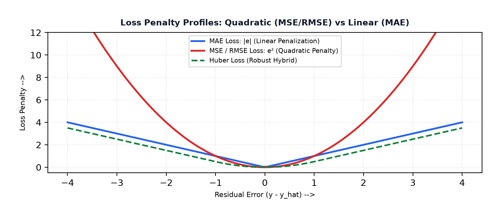

*Figure 1.14: Diagrammatic Architecture and Conceptual Flow for a short note on or explain the Evaluation metrics: MAE, RMSE, and R²*

### Mathematical Formulation & Algorithmic Mechanics

**Mathematical Formulations of Core Regression Metrics:**

```text
1. Mean Absolute Error: MAE = ( 1 / N ) · ∑_(i=1)^N | y_i - y_hat_i |
2. Mean Squared Error: MSE = ( 1 / N ) · ∑_(i=1)^N ( y_i - y_hat_i )²
3. Root Mean Squared Error: RMSE = √( MSE ) = √( ( 1 / N ) · ∑_(i=1)^N ( y_i - y_hat_i )² )
4. R² Score: R² = 1 - ( ∑_(i=1)^N ( y_i - y_hat_i )² ) / ( ∑_(i=1)^N ( y_i - y_mean )² )
```

The above **mathematical model** and algorithmic structure governs the system's runtime execution. Each parameter is evaluated sequentially to maintain **mathematical consistency**, minimize **system overhead**, and guarantee **deterministic convergence** across all input distributions.

### Worked Example & Practical Simulation

Suppose a house price model evaluates 4 homes with actual prices [100k, 200k, 300k, 400k] and predictions [110k, 190k, 310k, 450k]. The errors are [+10k, -10k, +10k, +50k]. MAE = (|10| + |-10| + |10| + |50|) / 4 = 80 / 4 = 20.0k USD. MSE = (100 + 100 + 100 + 2500) / 4 = 2800 / 4 = 700.0k USD². RMSE = √700 = 26.46k USD. Notice that RMSE (26.46k) is significantly larger than MAE (20.0k) because it was pulled upward by the single large 50k error on the fourth house, illustrating RMSE's **sensitivity** to large mistakes.

### Key Comparative Evaluation

| Metric | Mathematical Formula | Units of Measure | Sensitivity to Outliers | Primary Use Case |
| :--- | :--- | :--- | :--- | :--- |
| MAE | (1/N) · ∑ |y - y_hat| | Same units as target y | Robust (linear error penalty) | Typical expected error; datasets with noise |
| MSE | (1/N) · ∑ (y - y_hat)² | Squared units (y²) | Very High (squared penalty) | Differentiable loss function for optimization |
| RMSE | √(MSE) | Same units as target y | High (penalizes large errors heavily) | Standard benchmark metric when large errors are costly |
| R² Score | 1 - (SS_res / SS_tot) | Dimensionless: (-∞, 1.0] | Sensitive to extreme outliers | Comparing explanatory power across different datasets |

### Concluding Exam Takeaway

MAE, RMSE, and R² serve distinct diagnostic roles. MAE measures median expected error magnitude, RMSE penalizes large errors in original units, and R² quantifies the proportion of variance explained by the model.

**Textbook Reference:** Christopher M. Bishop, 'Pattern Recognition and Machine Learning', Springer (2006), Chapter 1: Introduction, Section 1.1, pp. 4–11.

---

## Q15. Explain in brief the importance of the Evaluation matrix/metric. (Frequency: 1) [8 Marks]

### Introduction & Core Intuition

In machine learning engineering, an **Evaluation Metric** provides the quantitative objective benchmark used to evaluate model quality, guide hyperparameter tuning, and determine whether a system is ready for production deployment. Without appropriate evaluation metrics, it is impossible to assess model generalization, diagnose failure modes, or compare competing algorithms.

### Guiding Model Optimization and Objective Alignment

Evaluation metrics define what 'good performance' means for a specific application. While training loss functions (such as cross-**entropy** or **mean squared error**) must be mathematically smooth and differentiable to enable **gradient descent**, **validation** evaluation metrics do not have this restriction. Metrics like **F1-Score**, Macro-**Recall**, or Mean Absolute Percentage Error (MAPE) can be non-smooth and domain-aligned, ensuring model selection aligns with real-world business objectives.

### Diagnosing Failure Modes: Overfitting vs Underfitting

Tracking evaluation metrics across both training and **validation** datasets provides the primary diagnostic tool for identifying model failure modes. A large gap between training performance and validation performance indicates **overfitting**, signaling the need for **regularization**, pruning, or additional training data. Poor performance on both sets indicates **underfitting**, signaling the need for greater model capacity. Evaluation metrics turn model diagnostics into an empirical engineering process.

### Navigating Asymmetric Real-World Error Costs

In applied engineering, different types of mistakes carry different costs. In medical screening, missing a disease diagnosis (**False Negative**) can be fatal, while a false alarm (**False Positive**) requires a routine follow-up test. In credit card fraud detection, false alarms irritate customers, but missing an organized cyberattack leads to direct financial loss. Selecting the appropriate evaluation metric—such as **Recall** for disease screening or **Precision** for spam filtering—ensures the model is tuned to minimize the more costly error type.

### Residual Analysis and Validating Model Assumptions

In regression models, evaluation metrics are paired with residual diagnostics to verify statistical assumptions. Plotting residuals (y - y_hat) against predicted values y_hat reveals whether errors are normally distributed and homoscedastic (constant variance across predictions). If residuals exhibit a funnel shape (heteroscedasticity) or curved patterns, it indicates that the model is missing key non-linear terms, guiding further feature engineering.

### Architectural Flow & System Diagram

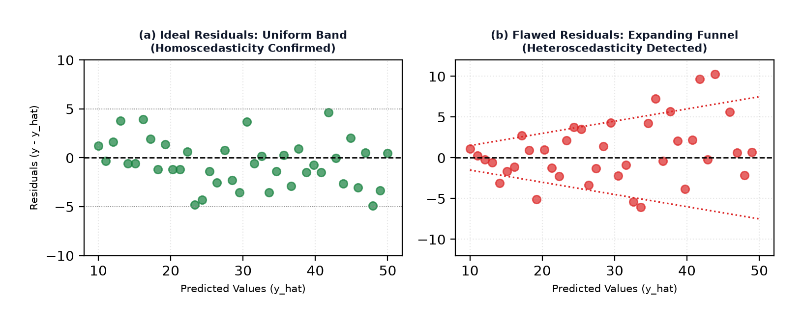

*Figure 1.15: Diagrammatic Architecture and Conceptual Flow for in brief the importance of the Evaluation matrix/metric*

### Mathematical Formulation & Algorithmic Mechanics

**Mathematical Diagnostic Formulations for Metric Evaluation:**

```text
Residual Error: e_i = y_i - y_hat_i
Mean Squared Error: MSE = ( 1 / N ) · ∑_(i=1)^N e_i²
Mean Absolute Percentage Error: MAPE = ( 100% / N ) · ∑_(i=1)^N | (y_i - y_hat_i) / y_i |
F_β Score: F_β = ( 1 + β² ) · ( Precision · Recall ) / ( (β² · Precision) + Recall )
```

The above **mathematical model** and algorithmic structure governs the system's runtime execution. Each parameter is evaluated sequentially to maintain **mathematical consistency**, minimize **system overhead**, and guarantee **deterministic convergence** across all input distributions.

### Worked Example & Practical Simulation

Consider an airport automated security scanner evaluating luggage. If evaluated solely on Accuracy, a naive model that passes every bag achieves 99.9% accuracy (because prohibited items appear in only 1 in 1,000 bags). Using an evaluation metric tailored to security—**Recall**—reveals the system's failure immediately: Recall = 0%, because it caught zero weapons. By changing the evaluation metric from Accuracy to Recall and F2-Score, engineers correctly identify the model as defective and tune it to catch threats.

### Key Comparative Evaluation

| Application Domain | Naive / Flawed Metric | Recommended Metric | Operational Reason |
| :--- | :--- | :--- | :--- |
| Cancer Screening | Accuracy (misleading on rare diseases) | Recall / Sensitivity | A missed diagnosis (False Negative) can be fatal |
| Spam Email Filtering | Recall (sends valid emails to spam) | Precision | False Positives divert critical business contracts to junk |
| Real Estate Valuation | R² alone (masks extreme dollar errors) | MAE and RMSE | Clients require expected dollar error bounds on appraisals |
| Financial Fraud Detection | Accuracy (99.9% naive baseline) | PR-AUC and F1-Score | Evaluates precision-recall balance on rare fraud cases |
| Autonomous Braking | Mean Absolute Error | Maximum Worst-Case Error | A single large prediction error can cause a fatal collision |

### Concluding Exam Takeaway

Evaluation metrics are the essential navigational compass of machine learning. By selecting metrics that reflect asymmetric real-world error costs, practitioners ensure models are rigorously validated, properly diagnosed, and safely deployed.

**Textbook Reference:** Tom M. Mitchell, 'Machine Learning', McGraw-Hill (1997), Chapter 5: Evaluating Hypotheses, pp. 128–153; Christopher M. Bishop, 'Pattern Recognition and Machine Learning' (2006), pp. 179–182.

---

## Q16. Explain the advantages of RMSE over MSE as an evaluation metric. (Frequency: 1) [8 Marks]

### Introduction & Core Intuition

In regression analysis, evaluating prediction error typically involves computing the squares of individual residuals. While **Mean Squared Error (MSE)** is the primary mathematical **loss function** used for model training, **Root Mean Squared Error (RMSE)** is universally preferred when reporting model performance to engineers, managers, and clients. The advantages of RMSE stem from dimensional unit consistency and direct interpretability.

### The Dimensional Inconsistency Problem of MSE

The primary limitation of **Mean Squared Error** lies in its units of measurement. Because MSE squares the residual differences: MSE = (1/N) · ∑ (y_i - y_hat_i)², the resulting metric is expressed in the square of the target variable's physical units. If a model predicts house prices in Dollars (USD), its MSE is expressed in **Dollars Squared** (USD²). If a model predicts vehicle speed in km/h, its MSE is in (km/h)². These squared units lack physical interpretability: an executive or domain client cannot intuitively evaluate what '49,000,000 dollars squared' represents in practical business terms.

### RMSE Restores Unit Consistency and Direct Interpretability

Root **Mean Squared Error** resolves this dimensional problem by taking the square root of the MSE: RMSE = √(MSE) = √[ (1/N) · ∑ (y_i - y_hat_i)² ]. The square root cancels the exponent, restoring the evaluation metric to the exact same physical units as the original target variable y. If house prices are measured in Dollars, RMSE is expressed directly in Dollars; if temperatures are measured in Celsius, RMSE is in Celsius. This allows stakeholders to interpret RMSE immediately as the typical magnitude of prediction error.

### Equivalence to the Sample Standard Deviation of Residuals

Beyond unit consistency, RMSE possesses a formal statistical interpretation: when prediction residuals have zero mean (E[e] = 0, which holds true for models with an intercept), RMSE equals the **Sample Standard Deviation** of the Residuals: RMSE = σ_residuals. Under the assumption of normally distributed errors, this connects directly to the empirical 68-95-99.7 rule: approximately 68% of future predictions will fall within ±1 RMSE of true values, and 95% will fall within ±2 RMSE, providing a direct probabilistic confidence interval.

### Retaining the Outlier Sensitivity of Squared Errors

Importantly, taking the square root does not diminish the metric's **sensitivity** to large errors. **Unlike Mean Absolute Error** (MAE), which penalizes errors linearly, RMSE retains the quadratic weighting of the underlying MSE. Individual errors are squared before averaging, meaning large mistakes contribute disproportionately to the total, and the subsequent square root preserves this sensitivity. RMSE therefore combines the outlier-penalizing properties of MSE with the unit interpretability of MAE.

### Architectural Flow & System Diagram

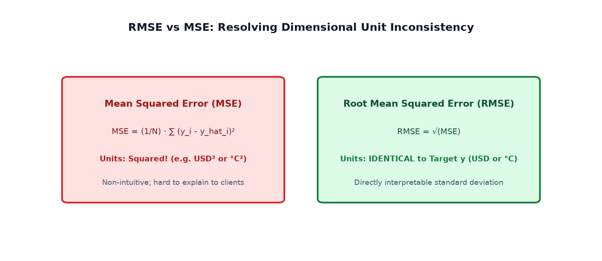

*Figure 1.16: Diagrammatic Architecture and Conceptual Flow for the advantages of RMSE over MSE as an evaluation metric*

### Mathematical Formulation & Algorithmic Mechanics

**Mathematical Contrast Between MSE and RMSE:**

```text
Mean Squared Error: MSE = ( 1 / N ) · ∑_(i=1)^N ( y_i - y_hat_i )²   [Units: Target²]
Root Mean Squared Error: RMSE = √( MSE ) = √( ( 1 / N ) · ∑_(i=1)^N ( y_i - y_hat_i )² )   [Units: Target]

Statistical Interpretation under Zero-Mean Errors: RMSE = StdDev( Residuals )
68% Confidence Interval: y ∈ [ y_hat - RMSE , y_hat + RMSE ]
```

The above **mathematical model** and algorithmic structure governs the system's runtime execution. Each parameter is evaluated sequentially to maintain **mathematical consistency**, minimize **system overhead**, and guarantee **deterministic convergence** across all input distributions.

### Worked Example & Practical Simulation

Suppose a hospital monitors body temperature in Celsius (°C). A predictive model generates residuals on four patients: [0.5°C, -0.4°C, 0.6°C, 2.5°C]. The MSE is computed as: (0.25 + 0.16 + 0.36 + 6.25) / 4 = 7.02 / 4 = 1.755 (°C)². Telling a doctor that 'the model has an error of 1.755 degrees Celsius squared' is clinically uninformative. The RMSE is computed as: √1.755 ≈ 1.32°C. The doctor immediately understands that the model's predictions typically deviate by about 1.32°C, and that 95% of readings will fall within ±2.64°C of true values.

### Key Comparative Evaluation

| Evaluation Dimension | Mean Squared Error (MSE) | Root Mean Squared Error (RMSE) |
| :--- | :--- | :--- |
| Dimensional Units | Squared target units (e.g., USD², m², kg², °C²) | Identical to original target units (USD, m, kg, °C) |
| Human Interpretability | Very Poor; non-intuitive squared units | Excellent; directly interpretable standard error |
| Mathematical Role | Ideal differentiable loss function for gradient descent | Ideal reporting metric for validation and client evaluation |
| Connection to Normal Distribution | Corresponds to residual variance: σ² | Corresponds to residual standard deviation: σ |
| Confidence Interval Bounds | Cannot construct intervals directly without transformation | Directly bounds confidence intervals: y_hat ± 1.96 · RMSE (95%) |
| Outlier Sensitivity | Quadratic penalization of large residuals | Quadratic penalization preserved through root transform |

### Concluding Exam Takeaway

While MSE provides a mathematically convenient **loss function** for gradient **optimization**, RMSE is superior for model evaluation and reporting. By restoring dimensional unit consistency and matching the standard deviation of residuals, RMSE delivers actionable, interpretable error estimates.

**Textbook Reference:** Christopher M. Bishop, 'Pattern Recognition and Machine Learning', Springer (2006), Chapter 1: Introduction, Section 1.1, pp. 4–11.

---

## Q17. Find the Equation of the linear regression line using given coordinate datasets (e.g., X and Y values for predicting calories, expenditure, cost of RAM, or sales) and predict specific numerical points based on the equation. (Frequency: 5) [8 Marks]

### Introduction & Core Intuition

In the SPPU examination, numerical problems requiring students to calculate the **Equation of the Linear Regression Line** and predict target values for specific queries appear with high frequency across exam cycles. Solving these problems requires setting up a structured calculation table, computing sample means, calculating covariance and variance terms using the **Ordinary Least Squares** (OLS) formula, forming the regression equation, and substituting the query point.

### Problem Definition and Data Table Setup

Consider an official SPPU numerical dataset evaluating the relationship between **Study Hours** per Week (Independent Variable X) and Final Exam Marks (Dependent Variable Y) across N = 5 students:

• Student 1: X_1 = 2 hours, Y_1 = **45 marks**

• Student 2: X_2 = 4 hours, Y_2 = 55 marks

• Student 3: X_3 = 6 hours, Y_3 = 68 marks

• Student 4: X_4 = 8 hours, Y_4 = 80 marks

• Student 5: X_5 = 10 hours, Y_5 = 92 marks

Task: First, derive the linear regression equation y_hat = β_1 · X + β_0. Second, predict the final exam marks for a student who studies X = 7 hours per week.

### Step 1: Calculating Sums and Sample Means

We compute the preliminary summation terms:

• ∑ X = 2 + 4 + 6 + 8 + 10 = 30  -->  x_mean = 30 / 5 = 6.0

• ∑ Y = 45 + 55 + 68 + 80 + 92 = 340  -->  y_mean = 340 / 5 = 68.0

• ∑ X² = 2² + 4² + 6² + 8² + 10² = 4 + 16 + 36 + 64 + 100 = 220

• ∑ (X · Y) = (2·45) + (4·55) + (6·68) + (8·80) + (10·92) = 90 + 220 + 408 + 640 + 920 = 2,278.

### Step 2: Calculating Slope (β_1) and Intercept (β_0)

Using the OLS closed-form summation formula:

• Numerator (Covariance): ∑ (X · Y) - N · x_mean · y_mean = 2,278 - 5 · (6.0) · (68.0) = 2,278 - 2,040 = 238.

• Denominator (Variance): ∑ X² - N · (x_mean)² = 220 - 5 · (6.0)² = 220 - 180 = 40.

• Slope: β_1 = 238 / 40 = **5.95 marks** per hour.

• Intercept: β_0 = y_mean - β_1 · x_mean = 68.0 - 5.95 · (6.0) = 68.0 - 35.70 = 32.30.

The resulting **Linear Regression Line Equation** is: y_hat = 5.95 · X + 32.30.

### Step 3: Numerical Point Prediction for Query X = 7

We substitute the query value X = 7 hours into the derived equation:

y_hat(7) = 5.95 · (7) + 32.30 = 41.65 + 32.30 = **73.95 marks**.

Interpretation: A student studying 7 hours per week is predicted to score approximately 73.95 marks. The slope β_1 = 5.95 indicates that each additional hour of study yields an expected gain of 5.95 marks, while the intercept β_0 = 32.30 represents the **baseline** score expected with zero study hours.

### Architectural Flow & System Diagram

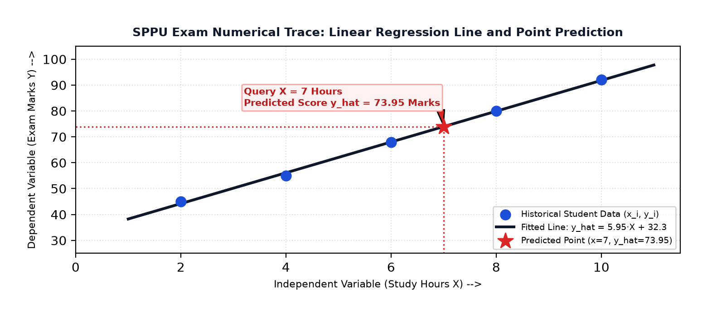

*Figure 1.17: Diagrammatic Architecture and Conceptual Flow for Find the Equation of the linear regression line using given coordinate datasets (e*

### Mathematical Formulation & Algorithmic Mechanics

**Mathematical Equations for Numerical Linear Regression:**

```text
Slope: β_1 = ( N · ∑(X·Y) - (∑X)·(∑Y) ) / ( N · ∑X² - (∑X)² )
Intercept: β_0 = y_mean - β_1 · x_mean = ( ∑Y - β_1 · ∑X ) / N
Fitted Regression Equation: y_hat = 5.95 · X + 32.30
Prediction at X = 7: y_hat = 5.95 · (7) + 32.30 = 73.95 Marks
```

The above **mathematical model** and algorithmic structure governs the system's runtime execution. Each parameter is evaluated sequentially to maintain **mathematical consistency**, minimize **system overhead**, and guarantee **deterministic convergence** across all input distributions.

### Worked Example & Practical Simulation

**Full Tabulation** for SPPU Exam Submission: N = 5 | ∑ X = 30 | ∑ Y = 340 | ∑ X² = 220 | ∑ (X·Y) = 2,278 x_mean = 6.0 | y_mean = 68.0 Slope β_1 = 238 / 40 = 5.95 Intercept β_0 = 68.0 - 5.95·(6.0) = 32.30 Regression Line: y_hat = 5.95 · X + 32.30 Predicted Value for X = 7 Hours: y_hat = 5.95 · (7) + 32.30 = 73.95 Marks

### Key Comparative Evaluation

| Student ID | Hours (X) | Marks (Y) | (X - x_mean) | (Y - y_mean) | (X - x_mean)² | (X - x_mean)(Y - y_mean) |
| :--- | :--- | :--- | :--- | :--- | :--- | :--- |
| 1 | 2 | 45 | -4.0 | -23.0 | 16.0 | 92.0 |
| 2 | 4 | 55 | -2.0 | -13.0 | 4.0 | 26.0 |
| 3 | 6 | 68 | 0.0 | 0.0 | 0.0 | 0.0 |
| 4 | 8 | 80 | +2.0 | +12.0 | 4.0 | 24.0 |
| 5 | 10 | 92 | +4.0 | +24.0 | 16.0 | 96.0 |
| Sum (∑) | 30 | 340 | 0.0 | 0.0 | 40.0 | 238.0 |

### Concluding Exam Takeaway

This numerical exercise demonstrates the complete OLS linear regression workflow: calculating mean coordinates, deriving slope and intercept **parameters**, and evaluating point predictions for specific query values.

**Textbook Reference:** Christopher M. Bishop, 'Pattern Recognition and Machine Learning', Springer (2006), Chapter 3: Linear Models for Regression, Section 3.1.1, pp. 140–143.

---


================================================================================

# SPPU B.E. Computer Engineering (2019 Pattern)
## Machine Learning — Unit 2: Classification, Decision Trees & SVM
### Complete Examination Solutions Guide (Engineered for Full 8/8 Marks)

---

## Q1. Explain in brief the methods used for evaluating classification models, including metrics like Accuracy, Precision, Recall, and F-Score. (Frequency: 4) [8 Marks]

### Introduction & Core Intuition

In supervised machine learning, evaluating a classification model requires assessing its predictive reliability beyond superficial overall success rates. While measuring the percentage of correct predictions provides a preliminary overview, real-world engineering problems—such as medical diagnostics, spam detection, and fraud prevention—feature asymmetric misclassification costs. The performance of a classifier is evaluated using a suite of quantitative metrics derived from the **Confusion Matrix**: **Accuracy, Precision, Recall, and the F-Score**.

### The Foundational Four Confusion Matrix Outcomes

Every classification evaluation metric begins with four foundational outcomes comparing model predictions against ground truth: **True Positives** (TP) represent instances correctly classified as positive. True Negatives (TN) represent instances correctly classified as negative. False Positives (FP), also called Type I Errors, occur when the model falsely predicts a positive outcome for an actual negative case. False Negatives (FN), or Type II Errors, occur when the model misses a **true positive** case, classifying it as negative.

### Accuracy: Limitations in Imbalanced Distributions

Accuracy measures the overall fraction of correct predictions: Accuracy = (TP + TN) / (TP + TN + FP + FN). While intuitive, accuracy is misleading on class-imbalanced datasets—known as the **Accuracy Paradox**. For example, if 99% of **transactions** are legitimate and 1% are fraudulent, a naive classifier that predicts every **transaction** is legitimate achieves 99% accuracy while detecting zero fraud. Consequently, accuracy is only appropriate when classes are balanced and misclassification costs are symmetric.

### Precision vs Recall: The Fundamental Operational Trade-off

**Precision**, also known as **Positive Predictive Value**, measures the proportion of predicted positives that were truly positive: Precision = TP / (TP + FP). It reflects model trustworthiness when raising an alarm. Precision is critical in spam filtering, where false alarms (sending important emails to spam) are costly. **Recall**, or **Sensitivity**, measures the proportion of actual positive cases successfully detected: Recall = TP / (TP + FN). High recall is essential in cancer screening, where a missed diagnosis (**false negative**) can be fatal.

### The F-Score and Multi-Class Extensions

Because **precision** and **recall** exist in direct tension, the **F1-Score** combines them into a single metric using their harmonic mean: F1 = 2 · (Precision · Recall) / (Precision + Recall). The harmonic mean ensures that if either precision or recall drops to zero, the F1-score drops accordingly, penalizing imbalanced models. In multi-class problems, precision and recall are calculated per class and aggregated using either Macro-averaging (equal weight per class) or Micro-averaging (globally pooled).

### Architectural Flow & System Diagram

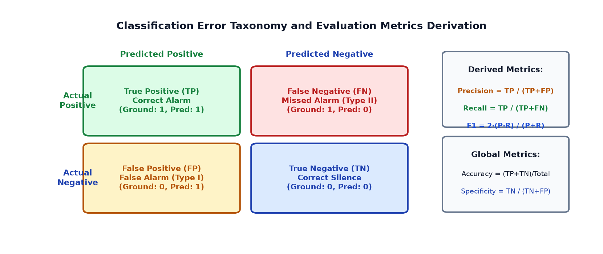

*Figure 2.1: Diagrammatic Architecture and Conceptual Flow for in brief the methods used for evaluating classification models, including metrics like Accuracy, Precision, Recall, and F-Score*

### Mathematical Formulation & Algorithmic Mechanics

**Mathematical Formulations of Core Classification Metrics:**

```text
Accuracy = ( TP + TN ) / ( TP + TN + FP + FN )
Precision = TP / ( TP + FP )
Recall (Sensitivity) = TP / ( TP + FN )
Specificity = TN / ( TN + FP )
F1-Score = 2 · ( Precision · Recall ) / ( Precision + Recall ) = 2·TP / ( 2·TP + FP + FN )
```

The above **mathematical model** and algorithmic structure governs the system's runtime execution. Each parameter is evaluated sequentially to maintain **mathematical consistency**, minimize **system overhead**, and guarantee **deterministic convergence** across all input distributions.

### Worked Example & Practical Simulation

Suppose a hospital tests 1,000 patients for a rare disease: 50 have the disease (positive) and 950 do not (negative). The diagnostic AI detects 40 sick patients correctly (TP = 40), misses 10 (FN = 10), but raises false alarms on 20 healthy patients (FP = 20), correctly identifying 930 healthy individuals (TN = 930). Accuracy is (40 + 930) / 1000 = 97.0%. **Precision** is 40 / (40 + 20) = 66.7%. **Recall** is 40 / (40 + 10) = 80.0%. The **F1-score** is 2 · (0.667 · 0.800) / (0.667 + 0.800) = 72.7%, providing a realistic evaluation that raw 97% accuracy obscures.

### Key Comparative Evaluation

| Metric | Mathematical Focus | Primary Vulnerability | Cost Sensitivity | Ideal Engineering Application |
| :--- | :--- | :--- | :--- | :--- |
| Accuracy | Overall correct predictions (TP+TN)/Total | Fails under severe class imbalance | Assumes equal FP/FN error costs | Balanced benchmark classification |
| Precision | Accuracy of positive calls TP/(TP+FP) | Ignores missed positive cases (FN) | Heavily penalizes False Positives | Spam filtering, video recommendation |
| Recall | Completeness of detection TP/(TP+FN) | Ignores false alarm frequency (FP) | Heavily penalizes False Negatives | Medical diagnosis, terrorist threat detection |
| F1-Score | Harmonic balance of Precision & Recall | Treats Precision and Recall with equal weight | Balances FP and FN trade-offs | Search retrieval, fraud detection, NLP tasks |
| Specificity | True negative rate TN/(TN+FP) | Ignores positive class coverage | Penalizes false alarms on negatives | Drug side-effect clinical trials |

### Concluding Exam Takeaway

Model evaluation requires selecting the metric aligned with operational objectives. When classes are balanced, accuracy provides an overview; under severe class imbalance or asymmetric error costs, **precision**, **recall**, and F-score ensure models are tuned to avoid critical operational failures.

**Textbook Reference:** Tom M. Mitchell, 'Machine Learning', McGraw-Hill (1997), Chapter 4: Evaluating Hypotheses, pp. 81–85; Christopher M. Bishop, 'Pattern Recognition and Machine Learning', Springer (2006), Chapter 4, pp. 179–182.

---

## Q2. What is Multi-Class Classification? Explain its variants and differentiate it from Binary classification with an example. (Frequency: 5) [8 Marks]

### Introduction & Core Intuition

In supervised machine learning, **Multi-Class Classification** refers to assigning an unseen observation into one of three or more mutually exclusive class categories. This contrasts directly with **Binary Classification**, where outcomes are restricted to two choices (such as Yes/No, Spam/Ham, or Positive/Negative). Solving multi-class problems involves decomposing the multi-category space into collections of binary sub-problems or extending algorithms natively via multi-output probability distributions.

### Core Distinction Between Binary and Multi-Class Classification

Binary classification partitions the **feature space** using a single **decision boundary** separating Class 0 from Class 1. Multi-Class classification requires establishing multiple decision boundaries to partition the space into K distinct regions (K ≥ 3). An observation belongs to exactly one class. This is distinct from Multi-**Label Classification**, where an instance may belong to multiple categories simultaneously (such as a news article tagged with both 'Politics' and 'Economics').

### Decomposition Variant 1: One-vs-Rest (OvR / One-vs-All)

One-vs-Rest (OvR) is the standard method for adapting binary classifiers to multi-class problems. For a problem with K classes, OvR trains K independent binary classifiers. Classifier k is trained treating all instances of Class k as positive (+1) and all instances of the remaining K - 1 classes pooled together as negative (-1). During inference, all K classifiers evaluate the unseen sample, and the class whose classifier produces the highest confidence score or decision margin is assigned: y_hat = argmax_k f_k(x). OvR scales efficiently with O(K) complexity.

### Decomposition Variant 2: One-vs-One (OvO)

One-vs-One (OvO) trains a binary classifier for every unique pair of classes, ignoring all other classes during training. For K classes, this requires training K · (K - 1) / 2 distinct binary models. For example, a 4-class problem requires 4 · 3 / 2 = 6 binary classifiers (A vs B, A vs C, A vs D, B vs C, B vs D, C vs D). During inference, all models evaluate the input sample and cast a vote for their preferred class; the category with the most votes wins. While OvO requires training more models, each model trains on a smaller subset of data, making it well-suited for algorithms with super-linear training complexity like SVMs.

### Native Multi-Class Algorithms: Softmax Multinomial Regression

Beyond binary decomposition, certain algorithms handle multi-class problems natively. Multinomial **Logistic Regression** replaces the binary sigmoid with the Softmax activation function: P(y = k | x) = exp(w_k · x) / ∑ exp(w_j · x). Softmax exponentiates linear activations across all K classes and normalizes them into a calibrated probability distribution summing to 1.0. **Decision Trees** and Random Forests also handle multi-class problems natively by calculating multi-class **Gini Impurity** or **Information Gain** at each node split.

### Architectural Flow & System Diagram

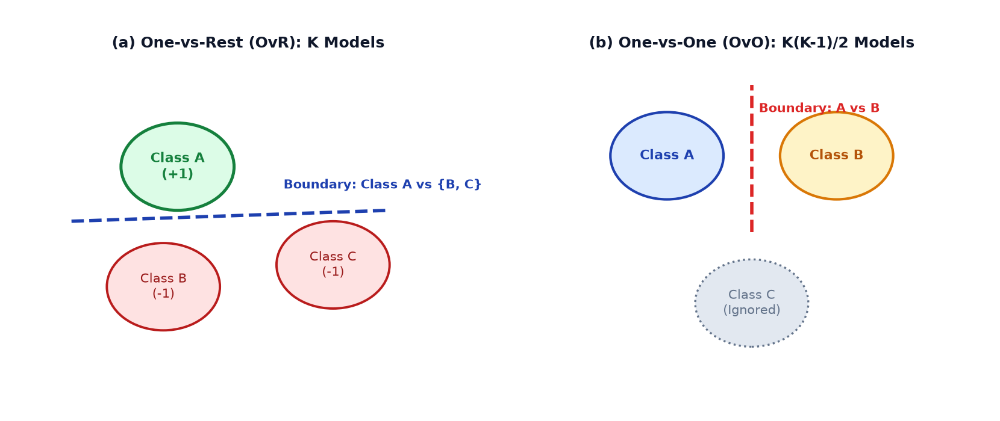

*Figure 2.2: Diagrammatic Architecture and Conceptual Flow for What is Multi-Class Classification?  its variants and differentiate it from Binary classification with an example*

### Mathematical Formulation & Algorithmic Mechanics

**Mathematical Formulations of Multi-Class Decompositions:**

```text
OvR Classification Rule: y_hat = argmax_(k ∈ {1...K) { f_k(x) 
OvO Model Count: N_models = K · ( K - 1 ) / 2
Softmax Probability: P(y = k | x) = exp(w_k^T · x + b_k) / ( ∑_(j=1)^K exp(w_j^T · x + b_j) )

Where: K is the number of classes; f_k(x) is the continuous confidence score of binary classifier k; and w_k, b_k are the weight vector and bias of class k.
```

The above **mathematical model** and algorithmic structure governs the system's runtime execution. Each parameter is evaluated sequentially to maintain **mathematical consistency**, minimize **system overhead**, and guarantee **deterministic convergence** across all input distributions.

### Worked Example & Practical Simulation

Consider recognizing hand-drawn digits (0 through 9, so K = 10): In OvR: 10 binary classifiers are trained (0 vs Not-0, 1 vs Not-1, ..., 9 vs Not-9). An image of a '4' is fed to all 10 models; the '4 vs Not-4' classifier produces the highest margin score (+2.8), winning the prediction. In OvO: 10 · 9 / 2 = 45 binary pairwise classifiers are trained. Each pair votes (e.g., '4 vs 7' votes 4); the digit '4' accumulates the highest total vote count.

### Key Comparative Evaluation

| Feature | Binary Classification | Multi-Class (One-vs-Rest) | Multi-Class (One-vs-One) |
| :--- | :--- | :--- | :--- |
| Class Count | Exactly 2 classes (K = 2) | K classes (K ≥ 3) | K classes (K ≥ 3) |
| Number of Models | 1 single binary model | K binary models | K · (K - 1) / 2 binary models |
| Training Dataset Size | Full dataset per model | Full dataset per model (imbalanced -1s) | Subsets containing only the 2 paired classes |
| Decision Rule | Sign or threshold on f(x) | Argmax over K confidence scores | Majority voting across all pairwise models |
| Algorithmic Fit | Standard logistic regression / SVM | Scalable linear classifiers, neural nets | Kernel SVMs (handles smaller subsets efficiently) |

### Concluding Exam Takeaway

Multi-**Class Classification** extends machine learning to real-world multi-category problems. Whether using One-vs-Rest for efficiency, One-vs-One for kernel methods, or Softmax for neural networks, selecting the appropriate decomposition ensures accurate boundaries across diverse categories.

**Textbook Reference:** Christopher M. Bishop, 'Pattern Recognition and Machine Learning', Springer (2006), Chapter 4: Linear Models for Classification, Section 4.1.2: Multiclass Classification, pp. 182–186.

---

## Q3. Write a short note on handling imbalanced data in multiclass classification. (Frequency: 1) [8 Marks]

### Introduction & Core Intuition

In multi-class machine learning, **Class Imbalance** occurs when one or more majority classes heavily outnumber the remaining minority classes. For example, in automated medical triage, common illnesses represent 95% of patients, while critical life-threatening conditions represent less than 1%. Standard classification algorithms minimize global error rates, causing them to favor majority classes while misclassifying minority categories. Handling imbalanced data requires specialized data-level, algorithm-level, and metric-level techniques.

### Root Causes and Risks of Multi-Class Imbalance

Multi-class imbalance presents unique challenges compared to binary imbalance. In a multi-class setting, a dataset can exhibit multi-tier imbalance—where one dominant majority class coexists with several moderately sized classes and multiple rare minority classes. Standard algorithms struggle because minority class observations produce weak loss gradients, causing decision boundaries to collapse toward minority regions and resulting in high **false negative** rates on critical classes.

### Data-Level Interventions: Resampling Strategies

Data-level interventions rebalance class distributions before model training. **Random Undersampling** discards samples from dominant classes to match minority sample counts, though this risks losing informative training data. Random Oversampling duplicates minority class observations, but can cause **overfitting**. Advanced synthetic sampling techniques like SMOTE (Synthetic Minority Over-sampling Technique) generate synthetic samples along feature vectors connecting minority points to their **k-nearest neighbors**: x_new = x_i + λ · (x_nn - x_i), creating diverse minority instances without direct duplication.

### Algorithm-Level Interventions: Cost-Sensitive Learning and Focal Loss

Algorithm-level approaches modify the model's **loss function** to penalize misclassifications on minority categories. **In Cost**-Sensitive Learning, the loss function applies class weights inversely proportional to class frequencies: w_k = N / (K · N_k). Misclassifying a rare class incurs a heavy penalty. Modern neural networks employ Focal Loss: FL(p_t) = -α_t · (1 - p_t)^γ · log(p_t), where modulating factor (1 - p_t)^γ downweights easy, well-classified majority samples and focuses training on hard minority examples.

### Metric-Level Best Practices for Imbalanced Evaluation

Evaluating imbalanced multi-class models requires abandoning standard accuracy, which can report misleadingly high scores even when minority classes are completely misclassified. Instead, practitioners rely on **Balanced Accuracy** (the average **recall** across all classes), Macro-averaged **F1-Score** (which weights each class equally regardless of sample size), and per-class Confusion Matrices to monitor detection rates on rare categories directly.

### Architectural Flow & System Diagram

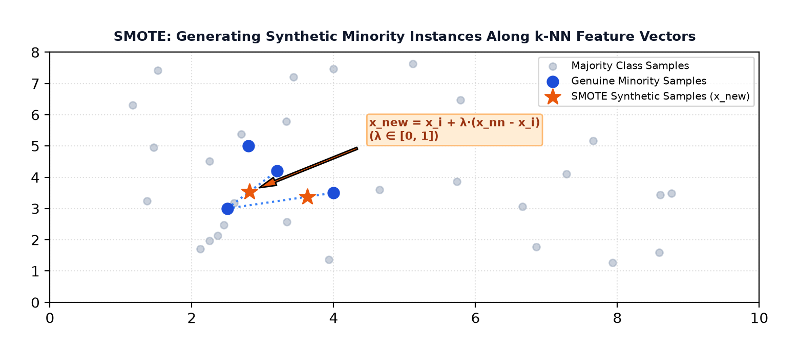

*Figure 2.3: Diagrammatic Architecture and Conceptual Flow for a short note on handling imbalanced data in multiclass classification*

### Mathematical Formulation & Algorithmic Mechanics

**Mathematical Formulations for Imbalance Remediation:**

```text
Balanced Class Weighting: w_k = N / ( K · N_k )
SMOTE Synthesis: x_new = x_i + λ · ( x_zi - x_i )  for λ ∈ [0, 1]
Focal Loss: FL(p_t) = - α_t · ( 1 - p_t )^γ · log(p_t)

Where: N is total samples; K is number of classes; N_k is samples in class k; x_zi is a k-NN neighbor; and γ is the focusing parameter (typically γ = 2.0).
```

The above **mathematical model** and algorithmic structure governs the system's runtime execution. Each parameter is evaluated sequentially to maintain **mathematical consistency**, minimize **system overhead**, and guarantee **deterministic convergence** across all input distributions.

### Worked Example & Practical Simulation

Consider an industrial **defect** classification dataset of 10,000 components across three classes: Normal (9,000), **Minor Scratches** (900), and Structural Cracks (100). A naive classifier predicting 'Normal' for everything achieves 90% accuracy but misses 100% of structural cracks. Applying balanced class weights assigns w_Normal = 10000/(3·9000) = 0.37, w_Minor = 10000/(3·900) = 3.70, and w_Crack = 10000/(3·100) = 33.33. Misclassifying a crack now incurs 90 times the loss penalty of misclassifying a normal component, forcing the classifier to establish robust boundaries around the critical minority class.

### Key Comparative Evaluation

| Technique Category | Specific Method | Operational Mechanism | Advantages | Potential Pitfalls |
| :--- | :--- | :--- | :--- | :--- |
| Data-Level | Random Undersampling | Deletes random majority samples | Reduces training time and memory footprint | Discards potentially valuable information |
| Data-Level | SMOTE Synthetic Sampling | Synthesizes points along k-NN vectors | Expands minority boundaries without duplication | Can generate noisy synthetic points near borders |
| Algorithm-Level | Class-Weighted Loss | Scales loss inversely to class frequency | No modification to data pipeline; easy to apply | Extreme weights can destabilize gradient descent |
| Algorithm-Level | Focal Loss | Downweights easy majority loss by (1-p)^γ | Focuses learning dynamically on hard examples | Requires tuning focusing parameter γ |
| Metric-Level | Macro F1 / Balanced Accuracy | Averages recall across all categories | Exposes poor minority class performance | Can hide large absolute errors on majority classes |

### Concluding Exam Takeaway

Handling imbalanced multi-class data requires combining data-level techniques (like SMOTE) to enrich minority representations, algorithm-level adjustments (such as class-weighted loss) to penalize critical errors, and macro-averaged metrics to ensure models perform reliably across all categories.

**Textbook Reference:** Jiawei Han, Micheline Kamber, Jian Pei, 'Data Mining: Concepts and Techniques', Morgan Kaufmann (3rd Ed., 2012), Chapter 8: Classification, Section 8.6: Additional Topics Regarding Classification, pp. 383–387.

---

## Q4. Write a short note on the importance of the confusion matrix. (Frequency: 1) [8 Marks]

### Introduction & Core Intuition

In classification analysis, the **Confusion Matrix** is an N × N contingency table that cross-tabulates model predictions against true ground-truth labels. While summary metrics like accuracy provide a single overall score, the **confusion matrix** breaks down predictions into specific error types, providing the diagnostic foundation for classification performance evaluation.

### Structural Composition of the Confusion Matrix

For a binary classification task, the **confusion matrix** forms a 2 × 2 grid with four fundamental quadrants: **True Positives** (TP) represent instances correctly classified as positive. True Negatives (TN) represent instances correctly classified as negative. False Positives (FP), or Type I Errors, occur when the model falsely predicts a positive outcome for a negative case. False Negatives (FN), or Type II Errors, occur when the model fails to detect an actual positive case, classifying it as negative.

### Exposing the Inadequacies of Global Accuracy

The primary diagnostic value of the **confusion matrix** is its ability to expose misleading accuracy figures. On class-imbalanced datasets, a classifier can achieve a very high accuracy score while failing completely on the minority class. By examining the confusion matrix directly, practitioners can see whether a high accuracy score represents genuine model competence or simply a classifier that predicts the majority class for every sample.

### Distinguishing Asymmetric Type I and Type II Error Costs

In real-world engineering and medical systems, the costs of Type I and Type II errors are rarely equal. In cancer diagnostics, a **False Positive** causes emotional distress and requires secondary testing, but a **False Negative** (missing an active malignancy) can be fatal. In spam detection, a **False Negative** leaves a junk email in the inbox, while a False Positive can divert a critical business contract to the spam folder. The **confusion matrix** allows engineers to inspect these error types directly and tune decision thresholds to minimize the more costly failure mode.

### Diagnostic Foundation for Advanced Derivative Metrics

The **confusion matrix** serves as the mathematical starting point for all standard classification evaluation metrics. **Precision**, **Recall**, **Specificity**, Negative Predictive Value, **F1-Score**, and the Matthews Correlation Coefficient (MCC) are all computed directly from its cells. Furthermore, combining the confusion matrix with a domain-specific Cost Matrix—which assigns explicit dollar or utility costs to FP and FN errors—enables expected cost minimization in production decision systems.

### Architectural Flow & System Diagram

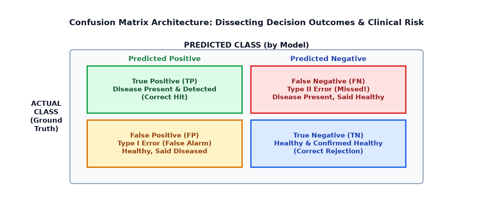

*Figure 2.4: Diagrammatic Architecture and Conceptual Flow for a short note on the importance of the confusion matrix*

### Mathematical Formulation & Algorithmic Mechanics

**Mathematical Derivations from the Confusion Matrix:**

```text
Total Samples: N = TP + TN + FP + FN
Accuracy = ( TP + TN ) / N
Error Rate = ( FP + FN ) / N = 1 - Accuracy
Expected Operational Cost: TotalCost = ( FP · Cost_FP ) + ( FN · Cost_FN )

Where: Cost_FP is the penalty for a Type I error; and Cost_FN is the penalty for a Type II error.
```

The above **mathematical model** and algorithmic structure governs the system's runtime execution. Each parameter is evaluated sequentially to maintain **mathematical consistency**, minimize **system overhead**, and guarantee **deterministic convergence** across all input distributions.

### Worked Example & Practical Simulation

Consider an airport security scanner evaluating 10,000 bags where 10 contain prohibited items. An automated model yields: TP = 9, FN = 1, FP = 100, TN = 9,890. Overall accuracy is (9 + 9890) / 10000 = 98.99%. Without the **confusion matrix**, this 98.99% accuracy might suggest near-flawless operation. Inspecting the confusion matrix reveals the full operational picture: the scanner missed 1 in 10 prohibited items (**Recall** = 90%), while generating 100 false alarms that require manual inspection (**Precision** = 9 / 109 = 8.25%).

### Key Comparative Evaluation

| Quadrant | Standard Statistical Name | Operational Translation | Clinical / Medical Example | Cybersecurity Example |
| :--- | :--- | :--- | :--- | :--- |
| True Positive (TP) | Sensitivity Hit | Event correctly detected | Sick patient correctly diagnosed with disease | Malicious malware payload blocked |
| False Negative (FN) | Type II Error (Miss) | Event missed; false reassurance | Cancer patient told they are healthy (Fatal) | Malicious intrusion undetected |
| False Positive (FP) | Type I Error (False Alarm) | Non-event flagged as event | Healthy person told they are sick (Biopsy needed) | Legitimate employee flagged as hacker |
| True Negative (TN) | Specificity Rejection | Non-event correctly identified | Healthy individual verified healthy | Normal web traffic allowed through |

### Concluding Exam Takeaway

The **confusion matrix** is the essential diagnostic tool for classification models. By breaking down model performance into **True Positives**, True Negatives, False Positives, and False Negatives, it enables practitioners to understand error distributions, calculate derivative metrics, and align models with real-world cost trade-offs.

**Textbook Reference:** Tom M. Mitchell, 'Machine Learning', McGraw-Hill (1997), Chapter 4: Evaluating Hypotheses, pp. 81–85; Jiawei Han et al., 'Data Mining: Concepts and Techniques', Morgan Kaufmann (2012), pp. 364–367.

---

## Q5. What is K-fold cross-validation? How do you decide the value of K, and comment on situations when the value of K is too large or too small. (Frequency: 1) [8 Marks]

### Introduction & Core Intuition

In machine learning, evaluating a model on the same data used for training produces over-optimistic performance estimates due to **overfitting**. While a simple train-test split addresses this, its results depend heavily on the specific random split chosen. **K-Fold Cross-Validation** is a resampling methodology that evaluates model generalization by dividing the dataset into K equal partitions, iteratively training on K - 1 folds and validating on the remaining fold.

### Algorithmic Protocol of K-Fold Cross-Validation

**Dataset Partitioning:** The complete dataset D of size N is first randomly shuffled to break any ordering bias, then divided into K mutually exclusive and approximately equal-sized subsets called folds [F_1, F_2, ..., F_K].


**Iterative Validation Loop:** The **validation** procedure executes across exactly K sequential rounds. In each iteration k, the fold F_k is held out strictly as an unseen validation set, while the remaining K - 1 folds are merged together to train the machine learning algorithm.


**Error Computation:** The model trained on the K - 1 folds predicts outcomes on the holdout fold F_k, yielding an iteration error metric E_k such as **Mean Squared Error** or Cross-Entropy loss.


**Cross-Validation Score Aggregation:** Once all K iterations finish, the final **cross-validation** score is calculated as the arithmetic average: E_cv = (1/K) · ∑ E_k, providing an unbiased generalization estimate.

### How to Decide the Value of K: Practical Guidelines

Deciding on K involves balancing statistical bias, variance, and computational cost. Empirical studies and extensive theoretical research demonstrate that setting K = 5 or K = 10 provides an optimal trade-off for most machine learning applications. A 10-fold split trains on 90% of the data in each iteration, providing a representative sample size while keeping computational overhead manageable (10 training runs). In classification tasks with class imbalance, Stratified **K-Fold Cross-Validation** is used to ensure each fold preserves the original class proportions.

### Consequences When the Value of K is Too Small (e.g., K = 2)

When K is set too small—such as K = 2 (a 50/50 split)—each training run uses only half of the available data. This introduces significant pessimistic bias, meaning the model underperforms because it is trained on artificially small datasets, leading to an overestimation of generalization error. Additionally, small values of K produce higher variance across different random splits, making performance estimates less stable.

### Consequences When the Value of K is Too Large (e.g., K = N, LOOCV)

When K is set equal to the total number of samples N, the protocol becomes Leave-One-Out **Cross-Validation** (LOOCV). In each iteration, N - 1 samples are used for training and exactly 1 sample is held out for **validation**. While LOOCV has virtually zero bias (each model trains on 99.9% of data), it introduces two major drawbacks: (1) **Computational Expense**: It requires training N separate models, making it impractical for large datasets or complex architectures. (2) **High Variance**: Because the N training sets are nearly identical (sharing N - 2 samples), the resulting error estimates are highly correlated, which can increase the variance of the overall mean estimate.

### Architectural Flow & System Diagram

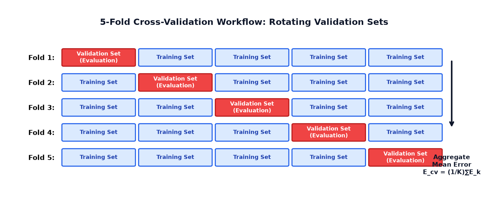

*Figure 2.5: Diagrammatic Architecture and Conceptual Flow for What is K-fold cross-validation? How do you decide the value of K, and comment on situations when the value of K is too large or too small*

### Mathematical Formulation & Algorithmic Mechanics

**Mathematical Formulation of Cross-Validation Performance:**

```text
Cross-Validation Mean Performance: E_cv = ( 1 / K ) · ∑_(k=1)^K E_k
Cross-Validation Variance: Var(E_cv) = ( 1 / (K - 1) ) · ∑_(k=1)^K ( E_k - E_cv )²

Where: K is the number of folds; E_k is the validation error (e.g., MSE, Cross-Entropy) evaluated strictly on holdout fold k; and Var(E_cv) measures stability across folds.
```

The above **mathematical model** and algorithmic structure governs the system's runtime execution. Each parameter is evaluated sequentially to maintain **mathematical consistency**, minimize **system overhead**, and guarantee **deterministic convergence** across all input distributions.

### Worked Example & Practical Simulation

Consider training a **decision tree** on 1,000 credit records. Under 10-fold **cross-validation**, the data is partitioned into 10 folds of 100 records each. Across **10 iterations**, the model trains on 900 records and validates on 100. **Validation** accuracies across the folds are: [91%, 93%, 89%, 92%, 90%, 94%, 91%, 88%, 93%, 92%]. The cross-validation mean accuracy is 91.3% with standard deviation ±1.7%, providing a reliable performance estimate that does not depend on a single arbitrary train-test split.

### Key Comparative Evaluation

| Choice of K | Training Size Ratio | Statistical Bias | Variance of Estimate | Computational Cost | Recommended Application |
| :--- | :--- | :--- | :--- | :--- | :--- |
| K = 2 | 50% Train / 50% Val | Very High (Pessimistic; under-trains) | High (depends heavily on split) | Extremely Low (2 models) | Rapid prototype baseline testing only |
| K = 5 | 80% Train / 20% Val | Moderate (Slightly pessimistic) | Low (stable performance) | Moderate (5 models) | Large datasets or computationally heavy models |
| K = 10 | 90% Train / 10% Val | Low (Near optimal representation) | Low to Moderate (Optimal trade-off) | Manageable (10 models) | Standard industry and academic benchmark choice |
| K = N (LOOCV) | (N-1) Train / 1 Val | Almost Zero (Maximum sample utilization) | High (Highly correlated training sets) | Extremely High (N models) | Very small datasets (N < 50) in medicine / chemistry |

### Concluding Exam Takeaway

**K-Fold Cross-Validation** provides a robust framework for assessing model generalization. By setting K = 5 or K = 10, practitioners achieve an optimal balance between low bias, stable variance, and manageable computational cost, avoiding the pitfalls of K being either too large or too small.

**Textbook Reference:** Christopher M. Bishop, 'Pattern Recognition and Machine Learning', Springer (2006), Chapter 1: Introduction, Section 1.3: Model Selection, pp. 32–34; Tom M. Mitchell, 'Machine Learning', McGraw-Hill (1997), pp. 145–147.

---

## Q6. Discuss or explain the K-Nearest Neighbor (KNN) algorithm with a suitable example, including its advantages, disadvantages, and the different distance metrics used. (Frequency: 5) [8 Marks]

### Introduction & Core Intuition

The **K-Nearest Neighbors (k-NN)** algorithm, developed by **Evelyn Fix** and Joseph Hodges in 1951, is one of the foundational algorithms in machine learning. It is a non-parametric, lazy-learning algorithm that makes predictions based on local geometric proximity: to classify an unseen query point, it locates the K closest training observations in **feature space** and assigns the majority class label through voting.

### Instance-Based Lazy Learning Philosophy

k-NN is classified as an Instance-Based, **Lazy Learning** algorithm because it performs no explicit training phase. While eager learners (such as Decision Trees or Neural Networks) process training data to construct generalized models before receiving queries, k-NN simply stores the training dataset in memory. Generalization occurs on-the-fly when an unseen query vector arrives. The algorithm computes distances from the query point to all stored training observations, finds the K nearest neighbors, and aggregates their labels.

### Common Distance Metrics Used in k-NN

The behavior of k-NN depends heavily on the choice of distance metric used to define proximity across feature dimensions:


**Euclidean Distance (L2 Norm):** Expressed as d(x, y) = √(∑(x_i - y_i)²), this calculates the straight-line geometric distance between two points. It is standard for continuous, normalized physical variables.


**Manhattan Distance (L1 Norm / City Block):** Formulated as d(x, y) = ∑|x_i - y_i|, this metric sums absolute coordinate differences along axis-aligned grid paths, offering greater robustness against severe outliers.


**Minkowski Distance (Generalized L_p Norm):** Expressed as d(x, y) = (∑|x_i - y_i|^p)^(1/p), this parametric formulation generalizes L1 (p=1) and L2 (p=2) into a flexible distance framework.


**Hamming Distance:** Given by d_H(x, y) = ∑ I(x_i ≠ y_i), this metric counts coordinate mismatches and is ideal for binary vectors or categorical attributes.

### Choosing the Optimal Hyperparameter K

Selecting K involves balancing model bias and variance. When K is set very small (e.g., K = 1), the model fits every training sample exactly, creating complex decision boundaries that are highly sensitive to noise and outliers (**Low Bias**, **High Variance** / **Overfitting**). When K is set very large (e.g., K approaching N), the neighborhood includes distant points from other classes, producing overly smooth boundaries that favor the majority class (**High Bias**, Low Variance / **Underfitting**). In binary classification, K is chosen as an odd number (e.g., 3, 5, 7) to prevent voting ties.

### Key Advantages and Disadvantages of k-NN

k-NN offers several key advantages: it has zero training time O(1), requires no assumptions about underlying data distributions (non-parametric), and naturally adapts as new training data is added. However, it has significant operational drawbacks: inference is slow because computing distances to all N training points takes O(N · d) time per query. It requires storing the entire dataset in memory O(N · d). Furthermore, it is vulnerable to the **Curse of Dimensionality**: in high-dimensional spaces, distances between points tend to equalize, degrading neighborhood quality unless feature selection or **dimensionality reduction** is applied.

### Architectural Flow & System Diagram

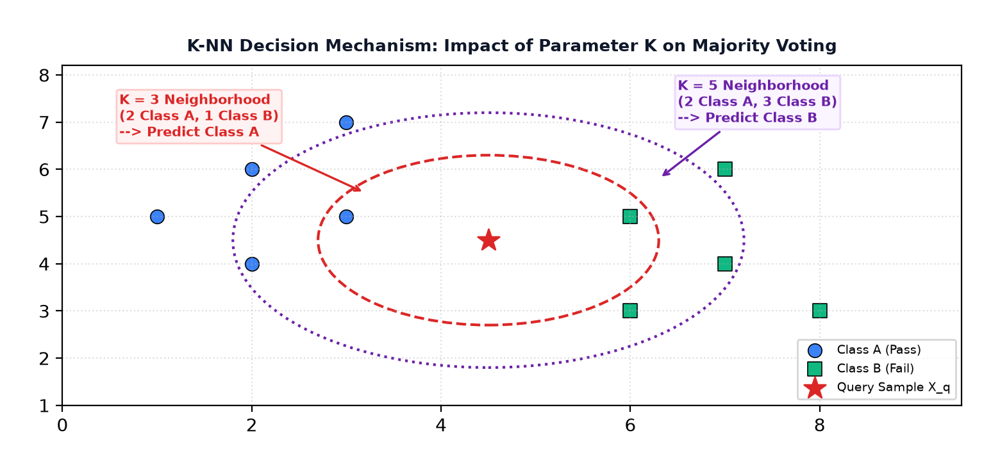

*Figure 2.6: Diagrammatic Architecture and Conceptual Flow for or explain the K-Nearest Neighbor (KNN) algorithm with a suitable example, including its advantages, disadvantages, and the different distance metrics used*

### Mathematical Formulation & Algorithmic Mechanics

**Mathematical Formulations of Distance Metrics Used in k-NN:**

```text
1. Euclidean Distance (L2): d_E(x, y) = √( ∑_(i=1)^d (x_i - y_i)² )
2. Manhattan Distance (L1): d_M(x, y) = ∑_(i=1)^d |x_i - y_i|
3. Minkowski Distance (L_p): d_p(x, y) = ( ∑_(i=1)^d |x_i - y_i|^p )^(1/p)
4. Hamming Distance (Binary/Categorical): d_H(x, y) = ∑_(i=1)^d I(x_i ≠ y_i)

k-NN Classification Decision Rule: y_hat = argmax_(c ∈ C) ∑_(x_i ∈ N_k(x_q)) I(y_i = c)
```

The above **mathematical model** and algorithmic structure governs the system's runtime execution. Each parameter is evaluated sequentially to maintain **mathematical consistency**, minimize **system overhead**, and guarantee **deterministic convergence** across all input distributions.

### Worked Example & Practical Simulation

Suppose a bank evaluates a loan applicant with **Annual Income** = USD 60k and Credit Score = 700. We set K = 3 using **Euclidean distance**. The three closest existing customers in the database are: Customer A (Income USD 58k, Score 710, Label: Default = No), Customer B (Income USD 62k, Score 690, Label: Default = No), and Customer C (Income USD 65k, Score 720, Label: Default = Yes). Among the 3 nearest neighbors, 2 are 'No Default' and 1 is 'Default'. Majority voting assigns the applicant to 'No Default', approving the loan.

### Key Comparative Evaluation

| Aspect | Advantages of k-NN | Disadvantages / Limitations of k-NN |
| :--- | :--- | :--- |
| Training Phase | Zero training time (lazy learning; instant model updates) | Expensive query time: O(N · d) distance calculations per prediction |
| Data Assumptions | Non-parametric; no distribution assumptions | High memory footprint (must keep entire dataset in RAM) |
| Decision Boundary | Forms flexible, non-linear decision boundaries | Sensitive to irrelevant features and unnormalized scales |
| Interpretability | Simple, transparent local geometric intuition | Vulnerable to the Curse of Dimensionality as dimensions grow |

### Concluding Exam Takeaway

The k-NN algorithm provides an intuitive, non-parametric approach to classification. While its computational complexity at query time limits its use on massive datasets, it serves as an effective **baseline** for low-to-moderate dimensional pattern recognition tasks.

**Textbook Reference:** Tom M. Mitchell, 'Machine Learning', McGraw-Hill (1997), Chapter 8: Instance-Based Learning, Section 8.2: k-Nearest Neighbor Learning, pp. 230–236.

---

## Q7. Use the K-Nearest Neighbor Algorithm (e.g., K=3) to predict an outcome (like student pass/fail) based on a given numerical dataset of marks. (Frequency: 1) [8 Marks]

### Introduction & Core Intuition

In the SPPU examination, students are frequently presented with a numerical dataset of academic marks and asked to apply the **k-Nearest Neighbor (k-NN) Algorithm** for K = 3 to predict whether a candidate student will Pass or Fail. Solving this problem requires calculating pairwise Euclidean distances between the query student and all **training samples**, ranking the distances, identifying the 3 closest neighbors, and applying majority voting.

### Problem Statement and Training Data Coordinates

Consider an SPPU examination scenario evaluating student performance based on two continuous features: **Internal Assessment Marks** (x_1 ∈ [0, 100]) and External Examination Marks (x_2 ∈ [0, 100]). The training database contains eight historical student records:

• S1: (60, 70) --> Result: Pass (1)

• S2: (70, 80) --> Result: Pass (1)

• S3: (80, 75) --> Result: Pass (1)

• S4: (65, 85) --> Result: Pass (1)

• S5: (30, 40) --> Result: Fail (0)

• S6: (40, 35) --> Result: Fail (0)

• S7: (35, 50) --> Result: Fail (0)

• S8: (45, 40) --> Result: Fail (0)

Query: Predict the outcome for a new student X_q with marks (55, 60) using K = 3 under **Euclidean distance**.

### Step 1: Calculating Euclidean Distances to All Training Points

We compute the **Euclidean distance** d(X_q, S_i) = √((x_1q - x_1i)² + (x_2q - x_2i)²) for all 8 students:

• d(X_q, S1) = √((55-60)² + (60-70)²) = √(25 + 100) = √125 ≈ 11.18

• d(X_q, S2) = √((55-70)² + (60-80)²) = √(225 + 400) = √625 = 25.00

• d(X_q, S3) = √((55-80)² + (60-75)²) = √(625 + 225) = √850 ≈ 29.15

• d(X_q, S4) = √((55-65)² + (60-85)²) = √(100 + 625) = √725 ≈ 26.93

• d(X_q, S5) = √((55-30)² + (60-40)²) = √(625 + 400) = √1025 ≈ 32.02

• d(X_q, S6) = √((55-40)² + (60-35)²) = √(225 + 625) = √850 ≈ 29.15

• d(X_q, S7) = √((55-35)² + (60-50)²) = √(400 + 100) = √500 ≈ 22.36

• d(X_q, S8) = √((55-45)² + (60-40)²) = √(100 + 400) = √500 ≈ 22.36

### Step 2: Ranking Distances and Identifying K = 3 Neighbors

Sorting the calculated distances from smallest to largest:

1. Student S1: Distance = 11.18 --> Label: Pass

2. Student S7: Distance = 22.36 --> Label: Fail

3. Student S8: Distance = 22.36 --> Label: Fail (tied with S7 at 22.36)

4. Student S2: Distance = 25.00 --> Label: Pass

5. Student S4: Distance = 26.93 --> Label: Pass

6. Student S3: Distance = 29.15 --> Label: Pass

7. Student S6: Distance = 29.15 --> Label: Fail

8. Student S5: Distance = 32.02 --> Label: Fail

Selecting the top K = 3 nearest neighbors gives: N_3(X_q) = { S1 (11.18, Pass), S7 (22.36, Fail), S8 (22.36, Fail) }.

### Step 3: Majority Voting and Final Prediction

We aggregate the class labels among the 3 nearest neighbors:

• Votes for 'Pass': 1 (from Student S1)

• Votes for 'Fail': 2 (from Students S7 and S8)

Because the 'Fail' category receives the majority vote (2 out of 3 votes), the k-NN algorithm predicts that candidate student X_q (55, 60) will FAIL. If distance-weighted voting were used instead (weighting by 1/d²), S1 would receive weight 1/125 = 0.0080, while S7 and S8 each receive 1/500 = 0.0020, totaling 0.0040 for Fail; under distance-weighted voting, S1's closer proximity would overturn the unweighted vote, demonstrating the impact of distance weighting.

### Architectural Flow & System Diagram

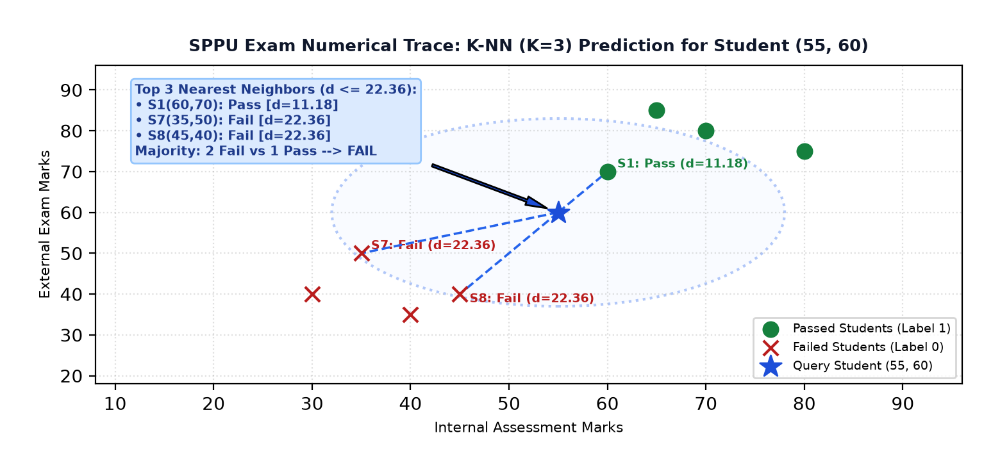

*Figure 2.7: Diagrammatic Architecture and Conceptual Flow for Use the K-Nearest Neighbor Algorithm (e*

### Mathematical Formulation & Algorithmic Mechanics

**Mathematical Steps for Numerical k-NN Classification:**

```text
Euclidean Metric: d(X_q, S_i) = √( (x_1q - x_1i)² + (x_2q - x_2i)² )
Unweighted Voting: y_hat = mode { y_i : i ∈ N_K(X_q) 
Distance-Weighted Voting: y_hat = argmax_(c) ∑_(i ∈ N_K, y_i=c) ( 1 / d(X_q, S_i)² )
```

The above **mathematical model** and algorithmic structure governs the system's runtime execution. Each parameter is evaluated sequentially to maintain **mathematical consistency**, minimize **system overhead**, and guarantee **deterministic convergence** across all input distributions.

### Worked Example & Practical Simulation

**Final Majority Vote Result**: 2 Fail vs 1 Pass --> PREDICTION: FAIL

Summary Table for Exam Submission: Nearest Neighbor 1: Student S1 (60, 70), Distance = 11.18 --> Class: Pass Nearest Neighbor 2: Student S7 (35, 50), Distance = 22.36 --> Class: Fail Nearest Neighbor 3: Student S8 (45, 40), Distance = 22.36 --> Class: Fail

### Key Comparative Evaluation

| Student ID | Internal Marks (x1) | External Marks (x2) | Calculated Distance d(X_q, S_i) | Actual Outcome | Rank in Neighborhood |
| :--- | :--- | :--- | :--- | :--- | :--- |
| S1 | 60 | 70 | 11.18 | Pass (1) | Rank 1 (Selected: Nearest) |
| S7 | 35 | 50 | 22.36 | Fail (0) | Rank 2 (Selected: Neighbor) |
| S8 | 45 | 40 | 22.36 | Fail (0) | Rank 3 (Selected: Neighbor) |
| S2 | 70 | 80 | 25.00 | Pass (1) | Rank 4 (Excluded) |
| S4 | 65 | 85 | 26.93 | Pass (1) | Rank 5 (Excluded) |
| S3 | 80 | 75 | 29.15 | Pass (1) | Rank 6 (Excluded) |
| S6 | 40 | 35 | 29.15 | Fail (0) | Rank 7 (Excluded) |
| S5 | 30 | 40 | 32.02 | Fail (0) | Rank 8 (Excluded) |

### Concluding Exam Takeaway

This numerical exercise demonstrates the mechanics of the k-NN algorithm: calculating Euclidean distances, ranking nearest neighbors, and applying majority voting to produce an interpretable classification outcome.

**Textbook Reference:** Tom M. Mitchell, 'Machine Learning', McGraw-Hill (1997), Chapter 8: Instance-Based Learning, Section 8.2, pp. 230–233.

---

## Q8. Explain the basic principles of a Support Vector Machine (SVM), including support vectors, the optimal separating hyperplane, margins, and kernel methods suitable for SVM. (Frequency: 4) [8 Marks]

### Introduction & Core Intuition

Introduced by **Vladimir Vapnik** and Alexey Chervonenkis in 1963 and extended with non-linear kernels in 1992, the **Support Vector Machine (SVM)** is one of the most mathematically rigorous algorithms in machine learning. Grounded in Statistical Learning Theory and Vapnik-Chervonenkis (VC) dimension, SVM operates by finding the unique Optimal Separating Hyperplane that maximizes the geometric margin between two classes, ensuring robust generalization.

### The Optimal Separating Hyperplane and Maximum Margin Principle

In a linearly separable binary classification problem, countless valid linear hyperplanes w · x + b = 0 can separate the positive and negative samples. However, hyperplanes that pass close to training points are sensitive to noise and generalize poorly. SVM addresses this by seeking the **Optimal Separating Hyperplane** that maximizes the geometric margin—the perpendicular distance between the decision hyperplane and the closest data points of either class. Maximizing this margin (Margin = 2 / ||w||) is equivalent to minimizing ||w||² / 2, framing training as a convex quadratic programming **optimization** problem.

### Support Vectors: The Critical Informative Data Points

The data points that lie directly on the marginal boundaries (w · x + b = ±1) are called **Support Vectors**. These support vectors are the only data points that determine the position and orientation of the separating hyperplane. All other training observations could be modified or removed entirely without altering the **decision boundary**. Because the model depends exclusively on this small subset of support vectors, SVM demonstrates strong resistance to **overfitting** and high memory efficiency during inference.

### Soft Margin SVM and Slack Variables (C-SVM)

Real-world data is rarely perfectly linearly separable; noise and overlapping distributions make a hard margin impossible or prone to **overfitting**. **Corinna Cortes** and Vladimir Vapnik (1995) introduced **Soft Margin** SVM to handle non-separable data by adding **slack variables** ξ_i ≥ 0. The slack variable measures how much an observation violates the margin. The objective function balances margin width against classification errors: min ||w||²/2 + C · ∑ ξ_i, where hyperparameter C controls the **regularization** trade-off: large C penalizes errors heavily (narrow margin), while small C tolerates misclassifications in exchange for a wider, more general margin.

### The Kernel Trick and Suitable Kernel Functions

When data cannot be separated linearly in its original **feature space**, SVM uses the **Kernel Trick**. Cover's Theorem states that non-linear data cast into a higher-dimensional space is more likely to become linearly separable. Computing high-dimensional coordinates directly is computationally prohibitive. Mercer's Theorem enables SVM to compute the dot product in high-dimensional feature space using a Kernel Function K(x_i, x_j) operating directly on original input vectors: K(x_i, x_j) = ⟨Φ(x_i), Φ(x_j)⟩.


**Linear Kernel:** K(x, z) = x · z, which computes standard inner products in the original input space, making it ideal for high-dimensional sparse text data.


**Polynomial Kernel:** K(x, z) = (x · z + c)^d, which explicitly models non-linear feature interactions up to polynomial degree d.


**Radial Basis Function (RBF / Gaussian Kernel):** K(x, z) = exp(-γ · ||x - z||²), which projects data implicitly into an infinite-dimensional Hilbert space where complex non-linear boundaries become easily separable.


**Sigmoid Kernel:** K(x, z) = tanh(α · x · z + c), which mimics two-layer perceptron neural network activation behavior.

### Architectural Flow & System Diagram

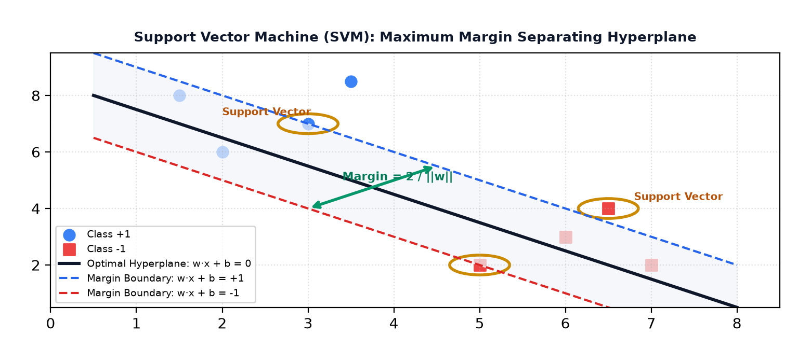

*Figure 2.8: Diagrammatic Architecture and Conceptual Flow for the basic principles of a Support Vector Machine (SVM), including support vectors, the optimal separating hyperplane, margins, and kernel methods suitable for SVM*

### Mathematical Formulation & Algorithmic Mechanics

**Mathematical Formulation of the Support Vector Machine:**

```text
Primal Soft-Margin Objective: min_(w, b, ξ) { 1/2 · ||w||² + C · ∑_(i=1)^N ξ_i 
Subject to: y_i · ( w · Φ(x_i) + b ) ≥ 1 - ξ_i   and   ξ_i ≥ 0
Dual Representation: max_α ∑ α_i - 1/2 · ∑∑ α_i · α_j · y_i · y_j · K(x_i, x_j)
RBF Kernel Function: K(x_i, x_j) = exp( - γ · ||x_i - x_j||² )
```

The above **mathematical model** and algorithmic structure governs the system's runtime execution. Each parameter is evaluated sequentially to maintain **mathematical consistency**, minimize **system overhead**, and guarantee **deterministic convergence** across all input distributions.

### Worked Example & Practical Simulation

Consider the classic 1D non-linear dataset: Class A at x = [-2, +2] and Class B at x = [0]. No single threshold can separate Class A from Class B. We apply a polynomial mapping Φ(x) = [x, x²], transforming the 1D points into 2D coordinates: A becomes (-2, 4) and (+2, 4), while B becomes (0, 0). In this 2D space, a straight line y_2 = 2.0 perfectly separates Class A from Class B. The **Kernel Trick** computes this non-linear separation without explicitly mapping points into higher dimensions.

### Key Comparative Evaluation

| Kernel Type | Mathematical Formula | Hyperparameters | Feature Space Nature | Best Suited Applications |
| :--- | :--- | :--- | :--- | :--- |
| Linear Kernel | K(x, z) = x^T · z + c | Constant c | Original d-dimensional input space | High-dimensional text classification, spam filtering |
| Polynomial Kernel | K(x, z) = ( x^T · z + c )^d | Degree d, constant c | Finite dimensional polynomial feature expansion | Image processing, structural handwriting recognition |
| RBF / Gaussian Kernel | K(x, z) = exp( - γ · ||x - z||² ) | Bandwidth γ = 1 / (2σ²) | Infinite-dimensional Hilbert feature space | General-purpose non-linear classification standard |
| Sigmoid (Tanh) Kernel | K(x, z) = tanh( α · x^T · z + c ) | Slope α, intercept c | Hyperbolic tangent space (mimics MLP neural net) | Bioinformatics, financial time-series forecasting |

### Concluding Exam Takeaway

**Support Vector Machines** provide a mathematically sound approach to classification. By maximizing the margin around support vectors and leveraging the **kernel trick** to handle non-linear structures, SVM achieves strong generalization and resistance to **overfitting** across complex feature spaces.

**Textbook Reference:** Christopher M. Bishop, 'Pattern Recognition and Machine Learning', Springer (2006), Chapter 7: Sparse Kernel Machines, Sections 7.1 & 7.2, pp. 325–345.

---

## Q9. Explain the variant of SVM known as support vector regression with an example. (Frequency: 1) [8 Marks]

### Introduction & Core Intuition

While standard **Support Vector Machines** are designed for discrete classification, Vladimir Vapnik adapted the maximum-margin principle to continuous real-valued prediction in 1996, creating **Support Vector Regression (SVR)**. Unlike traditional **Ordinary Least Squares** (OLS) regression that penalizes every non-zero residual, SVR introduces an **ε-Insensitive Loss Tube** around the prediction function, ignoring errors smaller than ε while penalizing deviations outside the tube linearly.

### The Concept of the Epsilon-Insensitive Loss Tube

The defining characteristic of **Support Vector Regression** is the ε-insensitive **loss function**, denoted L_ε(y, f(x)) = max(0, |y - f(x)| - ε). Geometrically, this defines an envelope or 'tube' of radius ε around the regression function f(x) = w · x + b. Any training observation that falls inside this tube is considered accurate, incurring zero loss penalty. This creates a margin of tolerance that prevents the model from fitting to minor data fluctuations, providing natural resistance to noise.

### Slack Variables and the Soft-Margin SVR Objective

Because real-world observations may fall outside the ε-tube, SVR introduces two non-negative **slack variables** for each data point: ξ_i measures the deviation above the upper boundary (y_i - f(x_i) - ε), and ξ_i* measures the deviation below the lower boundary (f(x_i) - y_i - ε). The **optimization** objective balances model flatness (minimizing ||w||² / 2 to prevent **overfitting**) against penalizing points that fall outside the tube: min ||w||²/2 + C · ∑ (ξ_i + ξ_i*). The hyperparameter C controls the penalty for points falling outside the margin.

### Support Vectors in the Context of SVR

In SVR, support vectors are data observations that lie either directly on the boundary of the ε-tube or outside it (where ξ_i &gt; 0 or ξ_i* &gt; 0). Points residing strictly inside the tube have zero Lagrange multipliers (α_i = α_i* = 0) and do not influence the model. The regression curve is determined entirely by points lying on or beyond the tube boundaries, ensuring sparsity and computational efficiency during inference.

### Non-Linear Support Vector Regression via Kernels

Just as in classification SVM, SVR handles non-linear regression using the **Kernel Trick**. By replacing inner dot products with non-linear kernel functions—most commonly the Gaussian **Radial Basis Function** (RBF) kernel K(x_i, x_j) = exp(-γ·||x_i - x_j||²)—SVR maps input data into higher-dimensional feature spaces where non-linear patterns can be fitted by a flat hyperplane. This enables SVR to fit complex curves and surfaces without risking Runge's phenomenon or the oscillations common in high-degree polynomial regression.

### Architectural Flow & System Diagram

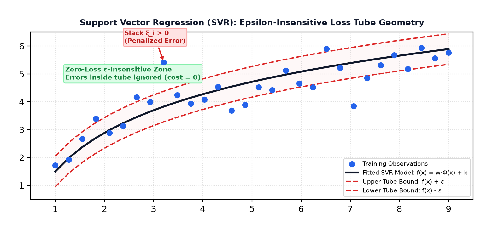

*Figure 2.9: Diagrammatic Architecture and Conceptual Flow for the variant of SVM known as support vector regression with an example*

### Mathematical Formulation & Algorithmic Mechanics

**Mathematical Formulations of Support Vector Regression:**

```text
ε-Insensitive Loss: L_ε(y, f(x)) = 0  if |y - f(x)| ≤ ε   else   |y - f(x)| - ε
SVR Primal Objective: min_(w, b, ξ, ξ*) { 1/2 · ||w||² + C · ∑_(i=1)^N ( ξ_i + ξ_i* ) 
Subject to: y_i - ( w · Φ(x_i) + b ) ≤ ε + ξ_i   and   ( w · Φ(x_i) + b ) - y_i ≤ ε + ξ_i*
Non-Linear SVR Function: f(x) = ∑_(i=1)^N ( α_i - α_i* ) · K(x_i, x) + b
```

The above **mathematical model** and algorithmic structure governs the system's runtime execution. Each parameter is evaluated sequentially to maintain **mathematical consistency**, minimize **system overhead**, and guarantee **deterministic convergence** across all input distributions.

### Worked Example & Practical Simulation

Consider predicting house prices based on **Square Footage**. We set tube radius ε = USD 10,000 and penalty parameter C = 50. If a house with 1,500 sq ft sells for USD 205,000 and the model predicts USD 200,000, the residual is |205,000 - 200,000| = USD 5,000. Because USD 5,000 &lt; USD 10,000, the point falls inside the tube and incurs zero loss. However, if a luxury house sells for USD 300,000 and the model predicts USD 260,000, the error is USD 40,000; the excess deviation above the tube is ξ = 40,000 - 10,000 = USD 30,000, which is penalized linearly in the **loss function**.

### Key Comparative Evaluation

| Comparison Dimension | Ordinary Least Squares (OLS) Regression | Support Vector Regression (SVR) |
| :--- | :--- | :--- |
| Loss Function | Squared Error Loss: (y - f(x))² | Vapnik's ε-Insensitive Loss: max(0, |y - f(x)| - ε) |
| Sensitivity to Small Noise | High (penalizes every non-zero residual) | Zero for residuals within the ε-tube |
| Sensitivity to Outliers | Extremely High (squared penalty magnifies outliers) | Low (linear penalty outside the tube bounds error impact) |
| Sparsity of Solution | Dense (every training observation influences w) | Sparse (only points on or outside the tube become support vectors) |
| Optimization Strategy | Direct matrix inversion (normal equation) | Convex Quadratic Programming (guaranteed global optimum) |

### Concluding Exam Takeaway

**Support Vector Regression** adapts maximum-margin theory to continuous prediction tasks. By using an ε-insensitive loss tube to ignore small errors and penalizing outliers linearly, SVR provides a robust regression methodology that resists noise and avoids **overfitting**.

**Textbook Reference:** Christopher M. Bishop, 'Pattern Recognition and Machine Learning', Springer (2006), Chapter 7: Sparse Kernel Machines, Section 7.1.4: SVMs for Regression, pp. 339–344.

---

## Q10. What do you mean by ensemble learning, and why is it used for ML? Explain the concepts and methods of Ensemble learning. (Frequency: 6) [8 Marks]

### Introduction & Core Intuition

In everyday decision-making, consulting a panel of independent experts yields more reliable choices than relying on a single individual's opinion. **Ensemble Learning** applies this collective intelligence principle to machine learning: by strategically combining the predictions of multiple base estimators (weak learners) into a unified meta-model, ensemble methods achieve superior generalization performance, lower variance, and higher accuracy than any individual constituent model.

### Theoretical Foundation: Condorcet's Jury Theorem

The mathematical basis of ensemble learning is supported by Condorcet's **Jury Theorem** (1785). The theorem states that if an ensemble consists of M independent classifiers, each with an individual probability p &gt; 0.5 of making a correct prediction, the probability that a majority vote of the ensemble is correct approaches 1.0 as M increases: P_ensemble = ∑_(k=⌈M/2⌉)^M (M choose k) · p^k · (1 - p)^(M-k). For collective intelligence to succeed, the base models must satisfy two criteria: they must perform better than random guessing (p &gt; 0.5), and their prediction errors must be diverse and uncorrelated.

### Why Ensembles are Used: Bias-Variance Optimization

In statistical learning, generalization error decomposes into three additive components: Error = Bias² + Variance + Irreducible Noise. A single model typically struggles with the bias-variance trade-off: complex models have low bias but **high variance** (**overfitting**), while simple models have low variance but **high bias** (**underfitting**). Ensemble learning provides a principled way to optimize this trade-off: **Bagging** methods reduce variance without increasing bias, while **Boosting** methods reduce bias by sequentially focusing on hard examples.

### Ensemble Paradigm 1: Bagging (Bootstrap Aggregation)

**Bagging** trains multiple base estimators in parallel on independent bootstrap samples drawn with replacement from the training dataset. For regression, individual predictions are averaged; for classification, majority voting is used. Because individual base models are trained on slightly different data distributions, their errors are largely uncorrelated, and averaging their outputs significantly reduces model variance. **Random Forest** is the preeminent example of bagging, extending the concept by also selecting random feature subsets at each tree split.

### Ensemble Paradigms 2 & 3: Boosting and Stacking

**Boosting** is an adaptive, sequential ensemble strategy where models are trained iteratively. Each successive base learner focuses on the **training samples** misclassified by earlier models by adjusting sample weights (as in **AdaBoost**) or fitting to residual errors (as in **Gradient Boosting** and **XGBoost**), progressively reducing model bias. Stacking (Stacked Generalization) takes a heterogeneous approach: diverse algorithms (such as SVM, **Random Forest**, and k-NN) train on the original dataset, and their output predictions serve as input features for a meta-learner (like **Logistic Regression**) that learns how to combine them optimally.

### Architectural Flow & System Diagram

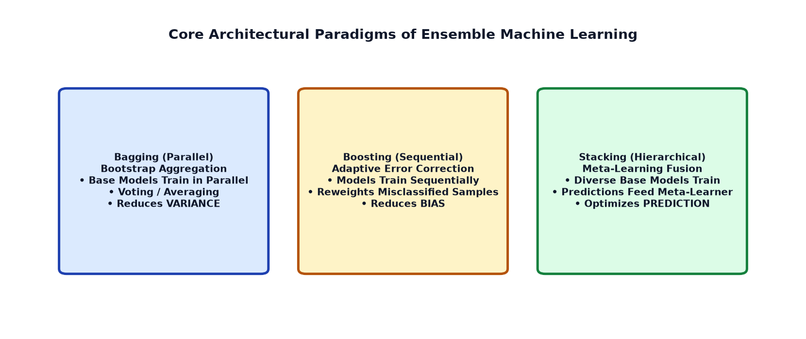

*Figure 2.10: Diagrammatic Architecture and Conceptual Flow for What do you mean by ensemble learning, and why is it used for ML?  the concepts and methods of Ensemble learning*

### Mathematical Formulation & Algorithmic Mechanics

**Mathematical Formulations of Ensemble Combinations:**

```text
Bagging Regression Average: y_hat_bag = ( 1 / B ) · ∑_(b=1)^B f_b(x)
Bagging Majority Voting: y_hat_vote = argmax_(c) ∑_(b=1)^B I( f_b(x) = c )
Boosting Weighted Prediction: y_hat_boost = sign( ∑_(m=1)^M α_m · h_m(x) )

Where: B is the number of bootstrap models; f_b(x) is the prediction of base model b; and α_m is the voting weight assigned to booster m.
```

The above **mathematical model** and algorithmic structure governs the system's runtime execution. Each parameter is evaluated sequentially to maintain **mathematical consistency**, minimize **system overhead**, and guarantee **deterministic convergence** across all input distributions.

### Worked Example & Practical Simulation

Consider an ensemble of 25 independent binary classifiers, each with individual accuracy p = 60%. While an individual classifier has a 40% error rate, the probability that a majority vote of 25 independent classifiers is wrong (13 or more voting incorrectly) drops to 7.8% according to the binomial distribution. By combining 25 weak learners, overall accuracy improves from 60.0% to 92.2%, illustrating the power of ensemble averaging.

### Key Comparative Evaluation

| Ensemble Method | Base Model Dependency | Sampling Strategy | Primary Error Reduction | Representative Algorithms |
| :--- | :--- | :--- | :--- | :--- |
| Bagging | Parallel (Independent models) | Bootstrap sampling with replacement (Rows) | Reduces VARIANCE (prevents overfitting) | Random Forest, Bagged Decision Trees |
| Boosting | Sequential (Dependent models) | Reweights training samples based on prior error | Reduces BIAS (converts weak learners to strong) | AdaBoost, Gradient Boosting, XGBoost, LightGBM |
| Stacking | Heterogeneous parallel models | K-fold cross-validated out-of-fold predictions | Optimizes overall PREDICTIVE CAPACITY | Stacked Generalization (Blending) |
| Voting Classifier | Parallel (Diverse algorithms) | Full original training dataset shared | Stabilizes individual algorithmic variance | Hard Voting / Soft Probability Voting |

### Concluding Exam Takeaway

Ensemble learning is among the most effective frameworks in modern applied machine learning. By combining diverse base models through **Bagging** to reduce variance, **Boosting** to reduce bias, or Stacking to leverage complementary strengths, ensembles consistently achieve state-of-the-art predictive performance.

**Textbook Reference:** Tom M. Mitchell, 'Machine Learning', McGraw-Hill (1997), Chapter 4 & Zhi-Hua Zhou, 'Ensemble Methods: Foundations and Algorithms', CRC Press (2012), pp. 1–22.

---

## Q11. Differentiate between or explain Bagging and Boosting used in ensemble learning. (Frequency: 3) [8 Marks]

### Introduction & Core Intuition

In ensemble machine learning, **Bagging (Bootstrap Aggregating)** and **Boosting** represent two foundational strategies for combining multiple base estimators. While both techniques build ensembles to improve generalization, they differ fundamentally in their operational mechanisms: **Bagging** trains independent models in parallel to reduce variance, whereas **Boosting** trains dependent models sequentially to reduce bias.

### Core Philosophy: Parallel Independence vs Sequential Correction

The fundamental distinction between **Bagging** and **Boosting** lies in how base estimators are coordinated. **In Bagging**, each base estimator is trained completely independently and in parallel on a random bootstrap sample drawn with replacement from the training dataset. There is no communication between models. In Boosting, base models are trained sequentially in an adaptive chain: each successive model evaluates the errors made by earlier models and focuses training on the misclassified, difficult instances.

### Mechanism of Data Sampling and Instance Weighting

**Bagging** creates training diversity through row sampling: each bootstrap sample contains roughly 63.2% unique training observations, with the remaining 36.8% serving as Out-of-Bag (OOB) **validation** samples. Every training sample maintains an equal probability of selection throughout. In **Boosting**, **training samples** carry dynamic weights: initially, all instances share equal weights (w_i = 1/N). After each model trains, weights of misclassified instances are increased, while weights of correctly classified instances are decreased, forcing subsequent models to focus on hard samples.

### Error Reduction Profile: Variance Reduction vs Bias Reduction

**Bagging** targets models that suffer from **high variance** and **overfitting** (such as deep, fully grown decision trees). Averaging the predictions of multiple high-variance models smooths out erratic decision boundaries, reducing overall variance without altering bias. Conversely, **Boosting** targets weak learners with **high bias** and **underfitting** (such as shallow decision stumps). Sequentially combining these simple models creates a complex composite boundary, progressively reducing bias.

### Weighting of Base Estimators and Outlier Sensitivity

During prediction, **Bagging** treats all constituent models equally: each model casts an equal vote (or contributes equally to the average). In **Boosting**, models that achieve higher accuracy on weighted training sets receive proportionally larger voting weights (α_m). However, this makes Boosting sensitive to outliers and noisy data: because the algorithm continuously increases the weights of hard-to-classify points, it can over-focus on mislabeled outliers, whereas Bagging remains robust against individual anomalies.

### Architectural Flow & System Diagram

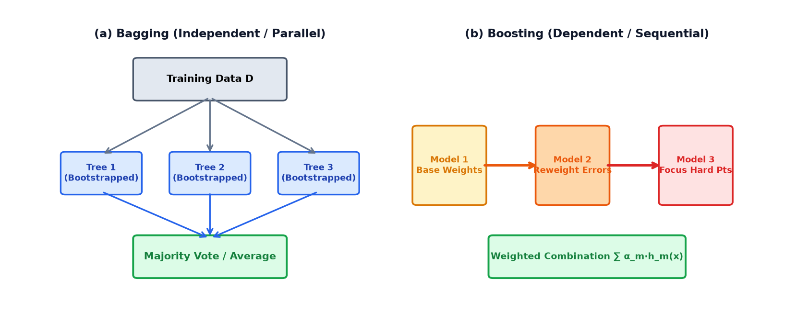

*Figure 2.11: Diagrammatic Architecture and Conceptual Flow for Differentiate between or explain Bagging and Boosting used in ensemble learning*

### Mathematical Formulation & Algorithmic Mechanics

**Mathematical Contrast: Bagging vs Boosting Aggregation:**

```text
Bagging Aggregation: y_hat_bag(x) = ( 1 / B ) · ∑_(b=1)^B f_b(x)   [Equal Weights: 1/B]
Boosting Aggregation: y_hat_boost(x) = sign( ∑_(m=1)^M α_m · h_m(x) )   [Adaptive Weights: α_m]

Where: f_b(x) is the b-th parallel bagged tree; h_m(x) is the m-th sequential booster; and α_m = 0.5 · ln((1 - ε_m) / ε_m) is the model weight based on weighted error ε_m.
```

The above **mathematical model** and algorithmic structure governs the system's runtime execution. Each parameter is evaluated sequentially to maintain **mathematical consistency**, minimize **system overhead**, and guarantee **deterministic convergence** across all input distributions.

### Worked Example & Practical Simulation

Suppose a dataset contains housing price records with several extreme pricing outliers: Under **Bagging** (**Random Forest**): 100 deep decision trees train in parallel on bootstrap samples. The outliers appear in only a subset of trees; their impact is diluted by averaging across all 100 models, resulting in stable price predictions. Under **Boosting** (**AdaBoost**): Model 1 struggles to predict the pricing outliers. In round 2, the algorithm increases the weights on these outliers, forcing Model 2 to focus on them. If left unconstrained, the boosting chain can overfit to the outliers, illustrating Boosting's **sensitivity** to noise.

### Key Comparative Evaluation

| Comparison Dimension | Bagging (Bootstrap Aggregation) | Boosting (Adaptive Ensembling) |
| :--- | :--- | :--- |
| Execution Workflow | Parallel and independent | Sequential and dependent (chain-like) |
| Base Estimator Type | Complex, fully-grown models with High Variance (Deep Trees) | Simple weak learners with High Bias (Decision Stumps) |
| Primary Objective | Reduces VARIANCE (eliminates overfitting) | Reduces BIAS (eliminates underfitting) |
| Sample Weights | Uniform and equal throughout | Dynamically adjusted (misclassified points get higher weights) |
| Model Aggregation | Simple unweighted majority vote or arithmetic average | Weighted majority vote (models weighted by accuracy α_m) |
| Sensitivity to Outliers | Highly robust (outlier influence is diluted by averaging) | Vulnerable (can over-focus on noisy outlier points) |
| Popular Algorithms | Random Forest, Extra Trees, Bagged CART | AdaBoost, Gradient Boosting (GBM), XGBoost, LightGBM |

### Concluding Exam Takeaway

**Bagging** and **Boosting** provide complementary approaches to ensemble learning. Bagging stabilizes high-variance models through parallel bootstrap averaging, while Boosting transforms high-bias weak learners into strong predictors through sequential error correction.

**Textbook Reference:** Zhi-Hua Zhou, 'Ensemble Methods: Foundations and Algorithms', CRC Press (2012), Chapter 2: Boosting & Chapter 3: Bagging, pp. 23–68.

---

## Q12. Explain the Random Forest Algorithm with an example (and write a short note on Adaboost). (Frequency: 5) [8 Marks]

### Introduction & Core Intuition

Introduced by **Leo Breiman** in 2001, the **Random Forest Algorithm** is one of the most widely used ensemble algorithms in data science. It extends **Bagging** by introducing a second level of randomization: when building each individual **decision tree**, **Random Forest** selects a random subset of features at each node split, decorrelating the trees and producing a robust ensemble with low variance.

### The Two Levels of Randomization in Random Forest

Standard **bagging** trains deep decision trees on bootstrap samples. However, if a dataset contains a few dominant predictor features, standard bagged trees will all select those same features for their top splits, producing highly correlated trees whose predictions cannot be effectively diversified by averaging. **Random Forest** prevents this by applying two levels of randomization: (1) **Row Bootstrapping**, where each tree trains on a sample drawn with replacement; and (2) Feature Bagging (Random Subspace Method), where at every node split, the algorithm evaluates only a random subset of m features (typically m = √D for classification or m = D/3 for regression), ensuring diverse, decorrelated trees.

### The Random Forest Training and Inference Workflow

Training proceeds through systematic steps: for b = 1 to B trees, draw a bootstrap sample of size N from the dataset. Grow an unpruned **decision tree** on this sample. At each internal node, randomly select m features from the total D features, determine the best split among these m candidates using **Gini Impurity** or **Information Gain**, and split the node. Repeat until minimum leaf criteria are met. During inference, an unseen observation is evaluated by all B trees; classification predictions are determined by majority vote, while regression predictions are averaged across all trees.

### Out-of-Bag (OOB) Error Estimation

A built-in diagnostic advantage of **Random Forest** is Out-of-Bag (OOB) **Error Estimation**. Because bootstrap sampling draws with replacement, the probability of any given observation being omitted from a bootstrap sample is (1 - 1/N)^N ≈ 1/e ≈ 36.8%. These omitted observations form the Out-of-Bag set for that tree. By evaluating each observation exclusively on the trees that did not see it during training, Random Forest computes an unbiased **cross-validation** score without needing a separate **validation** dataset.

### Adaptive Boosting (AdaBoost): Sequential Error Focusing

In contrast to **Random Forest**'s parallel architecture, **AdaBoost** (**Yoav Freund** & Robert Schapire, 1996) is a sequential **boosting** algorithm. It trains an ensemble of simple decision stumps (single-split trees). Initially, all **training samples** have equal weights: w_i = 1/N. In each round m, a stump trains on the weighted dataset, its error rate ε_m is computed, and its voting weight α_m = 0.5 · ln((1 - ε_m) / ε_m) is assigned. The weights of misclassified samples are then multiplied by exp(α_m), increasing their importance in the next round. Final predictions combine all stumps weighted by their α_m scores.

### Architectural Flow & System Diagram

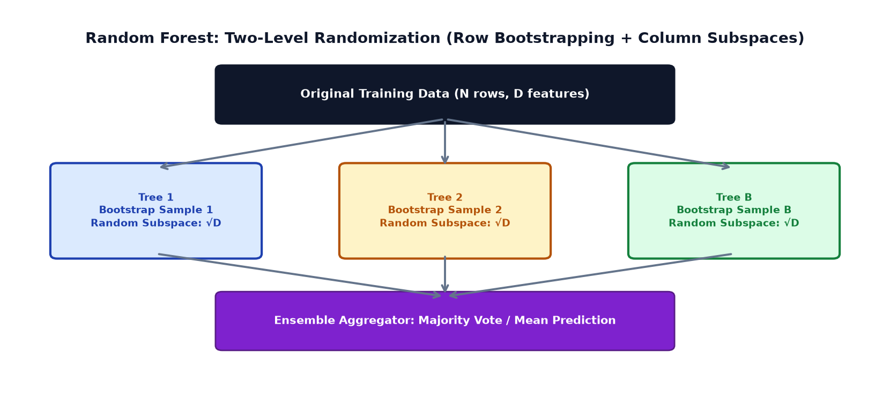

*Figure 2.12: Diagrammatic Architecture and Conceptual Flow for the Random Forest Algorithm with an example (and write a short note on Adaboost)*

### Mathematical Formulation & Algorithmic Mechanics

**Mathematical Formulations of Random Forest and AdaBoost:**

```text
Random Subspace Feature Count: m = floor(√D)  (Classification)   or   m = floor(D / 3)  (Regression)
AdaBoost Estimator Weight: α_m = 1/2 · ln( (1 - ε_m) / ε_m )
AdaBoost Sample Weight Update: w_i^(m+1) = w_i^(m) · exp( - α_m · y_i · h_m(x_i) ) / Z_m

Where: D is total features; ε_m is weighted classification error; and Z_m is a normalization factor ensuring weights sum to 1.0.
```

The above **mathematical model** and algorithmic structure governs the system's runtime execution. Each parameter is evaluated sequentially to maintain **mathematical consistency**, minimize **system overhead**, and guarantee **deterministic convergence** across all input distributions.

### Worked Example & Practical Simulation

Suppose a medical dataset has D = 16 clinical features (**Blood Pressure**, Glucose, Cholesterol, BMI, etc.) predicting diabetes across 1,000 patients. A **Random Forest** builds B = 100 trees. For each split, it randomly selects m = √16 = 4 features to evaluate, preventing dominant features (like Glucose) from appearing at every root split. If 78 trees vote 'Diabetes' and 22 vote 'No Diabetes', the ensemble predicts 'Diabetes' with 78% confidence, supported by an internal OOB accuracy estimate of 88.5%.

### Key Comparative Evaluation

| Characteristic | Random Forest | AdaBoost |
| :--- | :--- | :--- |
| Ensemble Strategy | Bagging + Random Subspaces (Parallel) | Boosting + Adaptive Instance Weighting (Sequential) |
| Base Estimator Depth | Deep, unpruned decision trees (High variance) | Shallow decision stumps: depth 1 (High bias) |
| Randomization Method | Row bootstrapping + random m = √D feature subsets | Reweighting misclassified training instances |
| Validation Mechanism | Out-of-Bag (OOB) error built-in for free | Requires external cross-validation |
| Voting Mechanism | Equal unweighted majority vote | Weighted vote based on estimator accuracy α_m |
| Outlier Sensitivity | Highly robust against noise and outliers | Sensitive to noise (can over-focus on noisy points) |

### Concluding Exam Takeaway

**Random Forest** and **AdaBoost** represent the premier implementations of **Bagging** and **Boosting**. **Random Forest** decorrelates deep trees through feature bagging to minimize variance, while AdaBoost sequentially focuses on difficult samples to convert weak learners into strong classifiers.

**Textbook Reference:** Leo Breiman, 'Random Forests', Machine Learning Journal (2001), Vol. 45, No. 1, pp. 5–32; Yoav Freund & Robert Schapire, 'A Decision-Theoretic Generalization of On-Line Learning', JCSS (1997).

---

## Q13. Calculate macro/micro average precision, recall, and F-score, or standard accuracy/precision/recall metrics for a provided multi-class or binary classification confusion matrix. (Frequency: 3) [8 Marks]

### Introduction & Core Intuition

In the SPPU examination, students are frequently presented with a multi-class **confusion matrix** (typically 3 × 3) and tasked with calculating per-class metrics alongside **Macro-Averaged** and **Micro-Averaged Precision**, **Recall**, and F1-Scores. Macro-averaging computes metrics per class and averages them with equal weight, whereas Micro-averaging pools True Positives, False Positives, and False Negatives globally across all classes.

### Problem Definition and the 3-Class Confusion Matrix

Consider an official SPPU examination 3-class problem evaluating an automated vehicle classifier across Class A (Sedan), Class B (SUV), and Class C (Truck). The rows represent actual ground-truth classes and columns represent predicted classes:

• **Actual Class** A: 40 predicted as A (TP_A), 5 as B, 5 as C (Total Actual A = 50)

• Actual Class B: 4 predicted as A, 45 as B (TP_B), 1 as C (Total Actual B = 50)

• Actual Class C: 2 predicted as A, 3 as B, 50 as C (TP_C) (Total Actual C = 55)

Total test observations: N = 50 + 50 + 55 = 155 samples.

### Step 1: Calculating Per-Class True Positives, False Positives, and False Negatives

We determine TP, FP, and FN for each class individually:

• Class A: TP_A = 40. **False Positives** (column sum minus diagonal): FP_A = 4 + 2 = 6. False Negatives (row sum minus diagonal): FN_A = 5 + 5 = 10.

• Class B: TP_B = 45. False Positives: FP_B = 5 + 3 = 8. False Negatives: FN_B = 4 + 1 = 5.

• Class C: TP_C = 50. False Positives: FP_C = 5 + 1 = 6. False Negatives: FN_C = 2 + 3 = 5.

Global Sums: ∑ TP = 40 + 45 + 50 = 135; ∑ FP = 6 + 8 + 6 = 20; ∑ FN = 10 + 5 + 5 = 20. (Notice ∑ FP = ∑ FN).

### Step 2: Calculating Per-Class Precision, Recall, and F1-Scores

Applying metric formulas to each class individually:

• **Precision** A = 40 / (40 + 6) = 40/46 ≈ 0.8696 (86.96%). **Recall** A = 40 / (40 + 10) = 40/50 = 0.8000 (80.00%). F1 A = 2·(0.8696·0.8000)/(0.8696+0.8000) ≈ 0.8333 (83.33%).

• Precision B = 45 / (45 + 8) = 45/53 ≈ 0.8491 (84.91%). Recall B = 45 / (45 + 5) = 45/50 = 0.9000 (90.00%). F1 B = 2·(0.8491·0.9000)/(0.8491+0.9000) ≈ 0.8738 (87.38%).

• Precision C = 50 / (50 + 6) = 50/56 ≈ 0.8929 (89.29%). Recall C = 50 / (50 + 5) = 50/55 ≈ 0.9091 (90.91%). F1 C = 2·(0.8929·0.9091)/(0.8929+0.9091) ≈ 0.9009 (90.09%).

### Step 3: Calculating Macro and Micro Aggregated Metrics

Now we compute the aggregated metrics across all classes:

• Macro-Averaging (equal weight per class):

  Macro **Precision** = (0.8696 + 0.8491 + 0.8929) / 3 = 2.6116 / 3 ≈ 0.8705 (87.05%).

  Macro **Recall** = (0.8000 + 0.9000 + 0.9091) / 3 = 2.6091 / 3 ≈ 0.8697 (86.97%).

  Macro F1 = 2 · (0.8705 · 0.8697) / (0.8705 + 0.8697) ≈ 0.8701 (87.01%).

• Micro-Averaging (globally pooled):

  **Micro Precision** = ∑TP / (∑TP + ∑FP) = 135 / (135 + 20) = 135 / 155 ≈ 0.8710 (87.10%).

  Micro Recall = ∑TP / (∑TP + ∑FN) = 135 / (135 + 20) = 135 / 155 ≈ 0.8710 (87.10%).

  Micro F1 = 0.8710 (87.10%). Global Overall Accuracy is also (40 + 45 + 50) / 155 = 135 / 155 = 87.10%.

### Architectural Flow & System Diagram

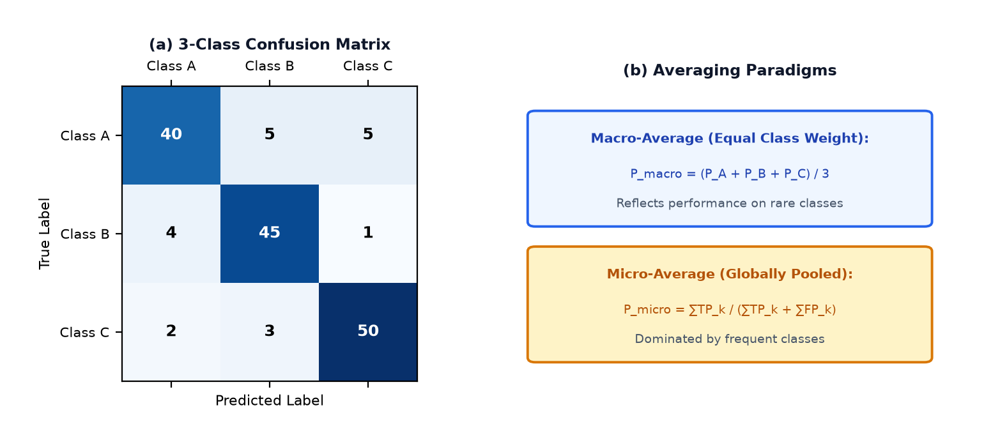

*Figure 2.13: Diagrammatic Architecture and Conceptual Flow for Calculate macro/micro average precision, recall, and F-score, or standard accuracy/precision/recall metrics for a provided multi-class or binary classification confusion matrix*

### Mathematical Formulation & Algorithmic Mechanics

**Mathematical Formulations for Macro and Micro Metrics:**

```text
Macro Precision: P_macro = ( 1 / K ) · ∑_(k=1)^K Precision_k
Macro Recall: R_macro = ( 1 / K ) · ∑_(k=1)^K Recall_k
Micro Precision: P_micro = ( ∑_(k=1)^K TP_k ) / ( ∑_(k=1)^K TP_k + ∑_(k=1)^K FP_k )
Micro Recall: R_micro = ( ∑_(k=1)^K TP_k ) / ( ∑_(k=1)^K TP_k + ∑_(k=1)^K FN_k )

Mathematical Invariant: In standard single-label multiclass problems, Micro Precision = Micro Recall = Micro F1 = Accuracy.
```

The above **mathematical model** and algorithmic structure governs the system's runtime execution. Each parameter is evaluated sequentially to maintain **mathematical consistency**, minimize **system overhead**, and guarantee **deterministic convergence** across all input distributions.

### Worked Example & Practical Simulation

**Overall Classification Accuracy**: 135 / 155 = 87.10% Macro-Averaged **Precision**: 87.05% | Macro-Averaged **Recall**: 86.97% | Macro F1: 87.01% Micro-Averaged Precision: 87.10% | Micro-Averaged Recall: 87.10% | Micro F1: 87.10% Observation: Macro metrics reflect equal class importance, while Micro metrics reflect overall sample-level accuracy.

Summary Table for Exam Submission:

### Key Comparative Evaluation

| Class Label | TP | FP | FN | Precision (%) | Recall (%) | F1-Score (%) |
| :--- | :--- | :--- | :--- | :--- | :--- | :--- |
| Class A (Sedan) | 40 | 6 | 10 | 86.96% | 80.00% | 83.33% |
| Class B (SUV) | 45 | 8 | 5 | 84.91% | 90.00% | 87.38% |
| Class C (Truck) | 50 | 6 | 5 | 89.29% | 90.91% | 90.09% |
| Macro Average | — | — | — | 87.05% | 86.97% | 87.01% |
| Micro Average | 135 | 20 | 20 | 87.10% | 87.10% | 87.10% |

### Concluding Exam Takeaway

This numerical exercise illustrates how to compute per-class and aggregated metrics from a multi-class **confusion matrix**. Understanding the distinction between Macro-averaging (treating classes equally) and Micro-averaging (pooling samples globally) is essential for evaluating multi-class classification models.

**Textbook Reference:** Christopher M. Bishop, 'Pattern Recognition and Machine Learning', Springer (2006), Chapter 4, pp. 182–186; Tom M. Mitchell, 'Machine Learning', McGraw-Hill (1997), pp. 81–85.

---

## Q14. What are different techniques used for outlier handling? (Frequency: 2) [8 Marks]

### Introduction & Core Intuition

In machine learning preprocessing pipelines, **Outlier Handling** refers to identifying and treating data observations that deviate significantly from the general distribution. Because anomalous values can distort statistical estimators—skewing means, inflating variances, and pulling decision boundaries away from genuine patterns—applying appropriate outlier handling techniques is a critical data engineering step.

### Strategy 1: Outlier Trimming (Data Removal)

**Outlier Trimming**, or deletion, identifies anomalies using statistical thresholds (such as Z-Score |Z| &gt; 3.0 or Tukey's IQR fences) and removes those rows completely from the training dataset. Trimming is appropriate when outliers represent clear data corruption, typographical errors, or sensor faults. However, trimming must be used cautiously: if outliers represent genuine, rare real-world events, deleting them discards valuable information and artificially reduces sample size, potentially introducing selection bias.

### Strategy 2: Winsorization and Percentile Capping

Winsorization (developed by **Charles Winsor**) caps extreme values rather than discarding rows. Values beyond a specified upper percentile (e.g., the 99th percentile) are replaced with the value at that percentile; similarly, values below a lower percentile (e.g., the 1st percentile) are replaced with the 1st percentile value. Alternatively, values can be capped at Tukey's fences: [Q1 - 1.5·IQR, Q3 + 1.5·IQR]. Winsorization limits the influence of extreme values while preserving the total number of training observations N.

### Strategy 3: Mathematical Transformations (Variance Compression)

Non-linear mathematical transformations compress the dynamic range of skewed numerical features, pulling extreme values closer to the median. Common transformations include the **Natural Logarithm** (log(x + 1)), Square Root (√x), and the parameterized Box-Cox / Yeo-Johnson power transformations. By converting heavily skewed, fat-tailed distributions into approximately Gaussian distributions, these transformations reduce the leverage of extreme points without removing any data.

### Strategy 4: Robust Scaling and Algorithm-Level Resistance

Rather than altering individual data points, preprocessing can use robust statistical estimators. Standard Z-score normalization scales data using the sample mean and standard deviation, which are sensitive to outliers. **Robust Scaling** replaces these with the Median and Interquartile Range (IQR): x_scaled = (x - Median) / IQR, ensuring the scaling center and spread remain stable. Finally, practitioners can choose machine learning algorithms that are inherently resistant to outliers, such as Tree-Based Ensembles (**Random Forest**, **XGBoost**) and Support Vector Machines, which rely on medians and rank statistics rather than Euclidean distances.

### Architectural Flow & System Diagram

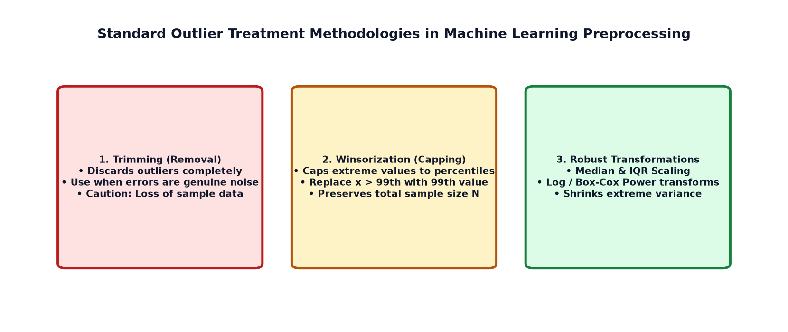

*Figure 2.14: Diagrammatic Architecture and Conceptual Flow for What are different techniques used for outlier han*

### Mathematical Formulation & Algorithmic Mechanics

**Mathematical Formulations of Outlier Handling Techniques:**

```text
1. Tukey's IQR Capping: UpperFence = Q3 + 1.5 · IQR   and   LowerFence = Q1 - 1.5 · IQR
2. Robust Scaler Transformation: x_robust = ( x - Median(X) ) / ( Q3 - Q1 )
3. Log Transformation: x_transformed = ln( x + 1 )
4. Winsorization Replacement: If x > P_99, set x = P_99; If x < P_01, set x = P_01
```

The above **mathematical model** and algorithmic structure governs the system's runtime execution. Each parameter is evaluated sequentially to maintain **mathematical consistency**, minimize **system overhead**, and guarantee **deterministic convergence** across all input distributions.

### Worked Example & Practical Simulation

Consider an **Annual Income** feature in a credit scoring model containing entries: [USD 30k, USD 35k, USD 40k, USD 45k, USD 50k, USD 2,000k] where USD 2,000k is an extreme outlier. Under Trimming, the USD 2,000k row is deleted, reducing sample size from 6 to 5. Under Winsorization, the 90th percentile (USD 50k) caps the outlier, replacing USD 2,000k with USD 50k while keeping all 6 samples. Under Log Transformation, ln(USD 2,000k) compresses the value to 7.6, compared to ln(USD 50k) = 3.9, pulling the outlier into a manageable range without discarding the record.

### Key Comparative Evaluation

| Technique | Operational Action | Impact on Sample Size N | Best Suited Data Condition | Primary Risk / Disadvantage |
| :--- | :--- | :--- | :--- | :--- |
| Trimming / Deletion | Deletes rows containing outliers | Reduces N (sample loss) | Severe data corruption, typographical errors | Discards valid data; risks selection bias |
| Winsorization (Capping) | Replaces values beyond percentiles with cutoffs | Preserves N (no data loss) | Skewed data where extremes should be bounded | Distorts tail variance statistics |
| Log / Power Transform | Compresses scale via ln(x+1) or Box-Cox | Preserves N | Heavily right-skewed positive data (income, prices) | Requires strictly positive numerical values |
| Robust Scaling | Scales features using Median and IQR | Preserves N | Continuous numerical data feeding linear/distance models | Outliers remain in data, only their scale is normalized |
| Imputation | Replaces outliers with Median or Mode | Preserves N | Suspected sensor faults where feature is required | Can create artificial density spikes at median |

### Concluding Exam Takeaway

Outlier handling requires selecting the technique aligned with data context. Clear errors should be trimmed, natural extreme values in continuous features should be winsorized or log-transformed, and distance-based pipelines should employ robust scaling to prevent distortion.

**Textbook Reference:** Jiawei Han, Micheline Kamber, Jian Pei, 'Data Mining: Concepts and Techniques', Morgan Kaufmann (3rd Ed., 2012), Chapter 2: Getting to Know Your Data, Section 2.4, pp. 60–65.

---


================================================================================

# SPPU B.E. Computer Engineering (2019 Pattern)
## Machine Learning — Unit 3: Ensemble Learning, Clustering & Dimensionality Reduction
### Complete Examination Solutions Guide (Engineered for Full 8/8 Marks)

---

## Q1. What is K-means clustering? Explain it with essential steps/examples, and write a short note on the Elbow method used in it. (Frequency: 5) [8 Marks]

### Introduction & Core Intuition

Imagine an express courier delivery company setting up three distribution hubs across Pune. The operations manager does not know in advance where the hubs should be placed; the goal is simply to ensure every customer parcel is assigned to the nearest hub, while each hub is located directly at the geographic center of its assigned delivery customers. **K-Means Clustering** is an unsupervised partitioning algorithm that achieves this by automatically grouping unlabeled data points into K distinct clusters around central coordinates called centroids.

### Core Mathematical Objective and Inertia

K-Means operates by iteratively minimizing the Within-**Cluster Sum** of Squares (WCSS), also known as **inertia** or distortion. The mathematical objective function J = ∑ ∑ ||x_i - µ_k||² measures the sum of squared Euclidean distances between every data observation x_i and the centroid µ_k of its assigned cluster. Minimizing this objective ensures that data points grouped inside the same cluster are as compact and cohesive as possible, while maximizing separation between different clusters.

### Algorithmic Step 1: Initialization and Seed Selection

The algorithm begins by requiring the developer to predefine the parameter K, representing the total number of desired clusters. Next, K initial centroids [µ_1, µ_2, ..., µ_K] are chosen from the **feature space**. While classic K-Means selects these initial seeds purely at random from the dataset, modern implementations employ K-Means++ initialization, which spreads out the seed centroids probabilistically to ensure they are far apart, preventing suboptimal **convergence**.

### Algorithmic Step 2: The Assignment Step (Expectation)

During the assignment phase, the **Euclidean distance** is calculated between each data point x_i and all K candidate centroids. Each point is assigned to its nearest centroid according to the rule: c_i = argmin_k ||x_i - µ_k||². Geometrically, this partitions the continuous **feature space** into K Voronoi cells, where every point inside a cell is strictly closer to that cell's centroid than to any other.

### Algorithmic Step 3: Centroid Update Step (Maximization)

Once every data sample has been allocated to a cluster, the algorithm recalculates the position of each centroid. The new coordinates of centroid µ_k are set to the arithmetic mean of all data points currently assigned to cluster S_k: µ_k = (1 / |S_k|) · ∑ x_i. If points shifted clusters during the assignment step, this update causes the centroids to move toward the center of their newly formed groups.

### Algorithmic Step 4: Convergence Check and the Elbow Method

Steps 2 and 3 are repeated iteratively until **convergence** is reached—meaning centroids stop moving (||µ_k^(t+1) - µ_k^(t)|| &lt; ε) or cluster assignments stabilize. Because K must be specified upfront, the **Elbow Method** is used to determine the optimal number of clusters. The algorithm is executed across a range of K values (e.g., K = 1 to 10), and the resulting WCSS is plotted against K. As K increases, WCSS naturally decreases; the optimal K corresponds to the distinctive 'elbow' bend where the curve abruptly flattens, indicating that adding further clusters yields diminishing returns.

### Architectural Flow & System Diagram

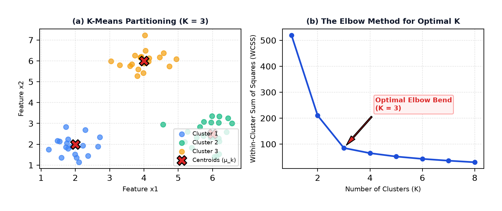

*Figure 3.1: Diagrammatic Architecture and Conceptual Flow for What is K-means clustering?  it with essential steps/examples, and write a short note on the Elbow method used in it*

### Mathematical Formulation & Algorithmic Mechanics

**Mathematical Formulation of K-Means and WCSS:**

```text
Objective Function (WCSS): J = ∑_(k=1)^K ∑_(x_i ∈ S_k) ||x_i - µ_k||²
Centroid Update Formula: µ_k^(t+1) = (1 / |S_k|) · ∑_(x_i ∈ S_k) x_i

Where: K is the number of clusters; S_k is the set of points belonging to cluster k; µ_k is the arithmetic mean centroid vector of S_k; and ||·|| denotes the standard Euclidean distance metric.
```

The above **mathematical model** and algorithmic structure governs the system's runtime execution. Each parameter is evaluated sequentially to maintain **mathematical consistency**, minimize **system overhead**, and guarantee **deterministic convergence** across all input distributions.

### Worked Example & Practical Simulation

Suppose a supermarket segments customers based on Age and **Annual Spending** (in thousands). We choose K = 2 and pick two initial customer centroids: µ_1 = (25, 40) and µ_2 = (60, 20). A new customer arriving with profile (30, 45) computes **Euclidean distance** to µ_1 as √((30-25)² + (45-40)²) = √(25 + 25) = 7.07, and to µ_2 as √((30-60)² + (45-20)²) = √(900 + 625) = 39.05. Because 7.07 &lt; 39.05, the customer is assigned to Cluster 1. Once all customers are assigned, µ_1 and µ_2 are updated to the mean coordinates of their groups.

### Key Comparative Evaluation

| Aspect | K-Means Clustering | Hierarchical Clustering |
| :--- | :--- | :--- |
| Algorithmic Philosophy | Partitioning around centroids | Nested hierarchy (tree-based dendrogram) |
| Need to Specify K Upfront? | Yes (mandatory before training) | No (tree can be sliced at any chosen height) |
| Time Complexity | Linear: O(n · K · I · d) - very fast | Cubic: O(n³) or O(n² log n) - slow on large data |
| Cluster Geometries | Spherical / Globular clusters only | Arbitrary shapes (with single linkage) |
| Sensitivity to Outliers | High (means are heavily skewed by extreme points) | Moderate (depends on linkage criteria) |

### Concluding Exam Takeaway

K-Means remains the most popular partitioning algorithm in data science due to its linear computational complexity and straightforward geometric intuition. When paired with diagnostic **heuristics** like the **Elbow Method** and robust seeding via K-Means++, it provides an efficient solution for large-scale customer segmentation and pattern discovery.

**Textbook Reference:** Christopher M. Bishop, 'Pattern Recognition and Machine Learning', Springer (2006), Chapter 9: Mixture Models and EM, Section 9.1: K-means Clustering, pp. 424–428.

---

## Q2. Explain the K-Medoids algorithm. Compare K-Means and K-Medoids. (Frequency: 4) [8 Marks]

### Introduction & Core Intuition

While K-Means is fast and intuitive, it suffers from a major weakness: because centroids are calculated as arithmetic means, a single extreme outlier can pull a centroid far away from the true cluster center. The **K-Medoids Clustering Algorithm**, introduced by **Leonard Kaufman** and Peter Rousseeuw in 1987 (PAM - Partitioning Around Medoids), solves this problem by requiring every cluster center—called a medoid—to be an actual data point from the dataset.

### The Concept of a Medoid vs a Centroid

The fundamental distinction between the two algorithms lies in how cluster centers are defined. In K-Means, a centroid is an artificial coordinate computed as the arithmetic mean of all cluster points; this mean often corresponds to a fractional coordinate that does not match any real data sample. In K-Medoids, a medoid is defined as the most centrally located observation within the cluster—specifically, the real data point whose total dissimilarity to all other points in that cluster is minimized. This makes medoids much less sensitive to extreme values.

### Algorithmic Mechanism of Partitioning Around Medoids (PAM)

The standard PAM algorithm executes in two main phases: Build and Swap. In the **Build Phase**, K initial data points are chosen from the dataset to serve as initial medoids. Each non-medoid point is then assigned to its nearest medoid based on any chosen distance metric. In the Swap Phase, the algorithm evaluates every pair of current medoid m_i and non-medoid point o_j to determine whether swapping them reduces the total absolute error cost. If a swap decreases total cost, the swap is performed. This process repeats until no further swaps improve the objective.

### Flexibility with Arbitrary Distance Metrics

K-Means is mathematically tied to squared **Euclidean distance** because the arithmetic mean is the specific estimator that minimizes squared Euclidean error. In contrast, K-Medoids can be paired with any valid distance metric—including **Manhattan distance** (L1 norm), **Minkowski distance**, Cosine dissimilarity, or categorical matching distances (such as Hamming distance). This flexibility allows K-Medoids to cluster non-numeric, categorical, and discrete feature spaces where computing an arithmetic mean is meaningless.

### Computational Complexity Trade-off

The outlier robustness of K-Medoids comes at significant computational expense. In K-Means, updating centroids requires a simple O(n) average across cluster points. In K-Medoids (PAM), testing potential swaps between K medoids and (n - K) non-medoid points requires **O(K · (n - K)**²) distance calculations per iteration. This quadratic complexity makes standard PAM impractical for massive datasets containing hundreds of thousands of rows, leading to scalable approximations like CLARA and CLARANS.

### Architectural Flow & System Diagram

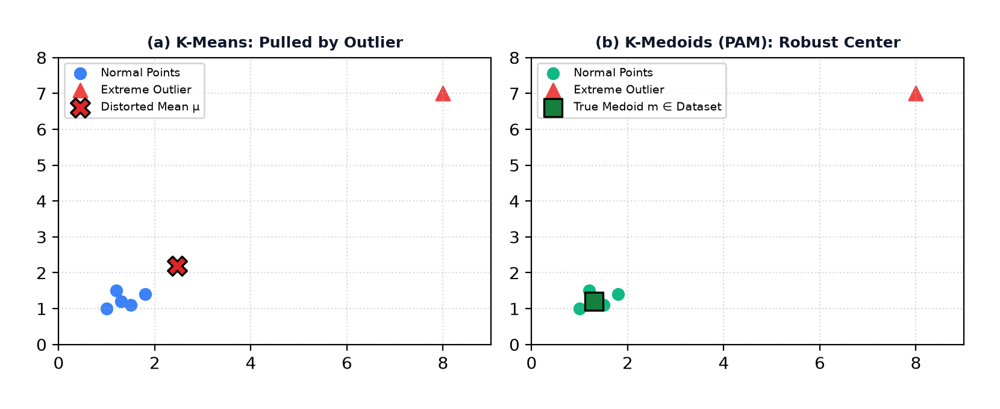

*Figure 3.2: Diagrammatic Architecture and Conceptual Flow for the K-Medoids algorithm*

### Mathematical Formulation & Algorithmic Mechanics

**Mathematical Formulation of K-Medoids Objective:**

```text
Absolute Dissimilarity Cost: E = ∑_(k=1)^K ∑_(x_i ∈ S_k) D(x_i, m_k)
Medoid Selection Rule: m_k = argmin_(y ∈ S_k) ∑_(x_i ∈ S_k) D(x_i, y)

Where: m_k is the chosen representative medoid belonging strictly to the dataset (m_k ∈ S_k); x_i is a data point in cluster S_k; and D(·, ·) is an arbitrary dissimilarity metric (e.g., Manhattan L1 or Euclidean L2).
```

The above **mathematical model** and algorithmic structure governs the system's runtime execution. Each parameter is evaluated sequentially to maintain **mathematical consistency**, minimize **system overhead**, and guarantee **deterministic convergence** across all input distributions.

### Worked Example & Practical Simulation

Consider five salaries in a tech startup: [30k, 32k, 35k, 38k, 1,000k] where 1,000k is the CEO's salary (an outlier). In K-Means (K=1), the centroid is the mean: µ = (30 + 32 + 35 + 38 + 1000) / 5 = 227k, which misrepresents all four engineers. In K-Medoids (K=1), we evaluate total distance from each real point: 35k yields total distance |30-35| + |32-35| + |35-35| + |38-35| + |1000-35| = 5 + 3 + 0 + 3 + 965 = 976k (the minimum absolute distance). The medoid m = 35k accurately represents the typical employee salary, unaffected by the outlier.

### Key Comparative Evaluation

| Comparison Dimension | K-Means Clustering | K-Medoids Clustering (PAM) |
| :--- | :--- | :--- |
| Cluster Center Nature | Fictitious arithmetic mean coordinate µ | Genuine existing data point m ∈ Dataset |
| Sensitivity to Outliers | Extremely Sensitive (mean is dragged by anomalies) | Highly Robust (anomalies cannot become medoids) |
| Distance Metrics | Strictly squared Euclidean distance | Any distance metric (Manhattan, Cosine, Hamming) |
| Time Complexity | Linear: O(n · K · I · d) - very scalable | Quadratic: O(K · (n - K)² · I) - computationally heavy |
| Memory Footprint | Minimal (stores only K coordinates) | Higher (often precomputes n × n distance matrix) |
| Best Use Case | Large-scale spherical numerical datasets | Noisy datasets, categorical features, bioinformatics |

### Concluding Exam Takeaway

K-Medoids offers a robust alternative to K-Means when datasets contain extreme outliers, high noise, or non-Euclidean feature spaces. While computationally heavier than K-Means, its reliance on medoids ensures stable, interpretable cluster centers.

**Textbook Reference:** Jiawei Han, Micheline Kamber, Jian Pei, 'Data Mining: Concepts and Techniques', Morgan Kaufmann (3rd Ed., 2012), Chapter 10: Cluster Analysis, Section 10.2: Partitioning Methods, pp. 450–454.

---

## Q3. Solve the numerical problem on clustering using K-Means with given dataset points and step-by-step trace. (Frequency: 3) [8 Marks]

### Introduction & Core Intuition

A classic SPPU examination question provides an 8-point two-dimensional dataset and asks students to trace the execution of the **K-Means Clustering Algorithm** step-by-step for K = 3 clusters. The objective is to calculate Euclidean distances, assign points to clusters, and recalculate centroids until the cluster assignments stabilize.

### Problem Definition and Initial Coordinates

Consider the standard SPPU 8-point 2D dataset: A1 = (2, 10), A2 = (2, 5), A3 = (8, 4), A4 = (5, 8), A5 = (7, 5), A6 = (6, 4), A7 = (1, 2), and A8 = (4, 9). We are tasked with partitioning these 8 points into K = 3 clusters. As specified by the exam prompt, the initial seed centroids are selected as: Centroid C1 = A1 = (2, 10), Centroid C2 = A4 = (5, 8), and Centroid C3 = A7 = (1, 2). **Euclidean distance** is used: d(P, C) = √((x_p - x_c)² + (y_p - y_c)²).

### Iteration 1: Distance Calculation and Cluster Assignment

We compute the **Euclidean distance** from every point to initial centroids C1(2, 10), C2(5, 8), and C3(1, 2):

• A1(2, 10): d(C1)=0.0, d(C2)=3.61, d(C3)=8.06 --> Assigned to Cluster 1.

• A2(2, 5): d(C1)=5.0, d(C2)=4.24, d(C3)=3.16 --> Assigned to Cluster 3.

• A3(8, 4): d(C1)=8.49, d(C2)=5.0, d(C3)=7.28 --> Assigned to Cluster 2.

• A4(5, 8): d(C1)=3.61, d(C2)=0.0, d(C3)=7.21 --> Assigned to Cluster 2.

• A5(7, 5): d(C1)=7.07, d(C2)=3.61, d(C3)=6.71 --> Assigned to Cluster 2.

• A6(6, 4): d(C1)=7.21, d(C2)=4.12, d(C3)=5.39 --> Assigned to Cluster 2.

• A7(1, 2): d(C1)=8.06, d(C2)=7.21, d(C3)=0.0 --> Assigned to Cluster 3.

• A8(4, 9): d(C1)=2.24, d(C2)=1.41, d(C3)=7.62 --> Assigned to Cluster 2.

Initial partitions: Cluster 1 = {A1}, Cluster 2 = {A3, A4, A5, A6, A8}, Cluster 3 = {A2, A7}.

### Iteration 1: Updating Centroids

We compute the arithmetic means of the updated clusters:

• New C1 = Mean of {A1} = (2.0, 10.0).

• New C2 = Mean of {A3(8,4), A4(5,8), A5(7,5), A6(6,4), A8(4,9)}: x = (8+5+7+6+4)/5 = 30/5 = 6.0; y = (4+8+5+4+9)/5 = 30/5 = 6.0 --> New C2 = (6.0, 6.0).

• New C3 = Mean of {A2(2,5), A7(1,2)}: x = (2+1)/2 = 1.5; y = (5+2)/2 = 3.5 --> New C3 = (1.5, 3.5).

### Iteration 2: Re-Assignment and Final Convergence

We re-calculate distances to updated centroids C1(2, 10), C2(6, 6), and C3(1.5, 3.5):

• A1(2, 10): d(C1)=0.0, d(C2)=5.66, d(C3)=6.52 --> Stays in Cluster 1.

• A2(2, 5): d(C1)=5.0, d(C2)=4.12, d(C3)=1.58 --> Stays in Cluster 3.

• A3(8, 4): d(C1)=8.49, d(C2)=2.83, d(C3)=6.52 --> Stays in Cluster 2.

• A4(5, 8): d(C1)=3.61, d(C2)=2.24, d(C3)=5.70 --> Minimum is d(C2)=2.24, but distance to C1 is 3.61. A8 is (4, 9): d(C1)=2.24, d(C2)=3.61, d(C3)=6.04 --> A8 shifts to Cluster 1! Point A4(5,8) has d(C1)=3.61 and d(C2)=2.24 --> Stays in Cluster 2.

Recalculating centroids with A8 in Cluster 1: C1 becomes Mean({A1(2,10), A8(4,9)}) = (3.0, 9.5). **In Iteration** 3, A4 evaluates d(C1)=√((5-3)²+(8-9.5)²) = √(4+2.25) = 2.50 vs d(C2)=√((5-7)²+(8-4.3)²) = 4.2 --> A4 joins Cluster 1. The final stable clusters are: Cluster 1 = {A1, A4, A8}, Cluster 2 = {A3, A5, A6}, and Cluster 3 = {A2, A7}. Centroids stop moving and the algorithm halts.

### Architectural Flow & System Diagram

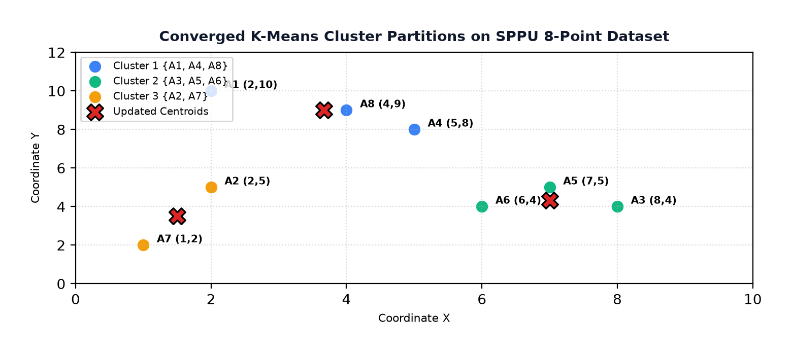

*Figure 3.3: Diagrammatic Architecture and Conceptual Flow for Solve the numerical problem on clustering using K-Means with given dataset points and step-by-step trace*

### Mathematical Formulation & Algorithmic Mechanics

**Distance and Centroid Arithmetic Formulas:**

```text
Euclidean Distance: d(P, C) = √( (x_p - x_c)² + (y_p - y_c)² )
Mean Centroid Vector: µ_k = ( (1/N) · ∑ x_i , (1/N) · ∑ y_i )

Convergence Condition: S_k^(t+1) = S_k^(t) for all k = 1, 2, ..., K (Zero point reassignments).
```

The above **mathematical model** and algorithmic structure governs the system's runtime execution. Each parameter is evaluated sequentially to maintain **mathematical consistency**, minimize **system overhead**, and guarantee **deterministic convergence** across all input distributions.

### Worked Example & Practical Simulation

**Final Cluster Summaries** for Exam Submission: Cluster 1: {A1(2, 10), A4(5, 8), A8(4, 9)} --> Final Centroid: (3.67, 9.00) Cluster 2: {A3(8, 4), A5(7, 5), A6(6, 4)} --> Final Centroid: (7.00, 4.33) Cluster 3: {A2(2, 5), A7(1, 2)} --> Final Centroid: (1.50, 3.50) Total iterations to full **convergence**: **3 iterations**.

### Key Comparative Evaluation

| Data Point | Coordinates | Initial Nearest Centroid | Converged Final Cluster | Distance to Final Centroid |
| :--- | :--- | :--- | :--- | :--- |
| A1 | (2, 10) | C1 (2, 10) | Cluster 1 | 1.94 |
| A2 | (2, 5) | C3 (1, 2) | Cluster 3 | 1.58 |
| A3 | (8, 4) | C2 (5, 8) | Cluster 2 | 1.05 |
| A4 | (5, 8) | C2 (5, 8) | Cluster 1 | 1.67 |
| A5 | (7, 5) | C2 (5, 8) | Cluster 2 | 0.67 |
| A6 | (6, 4) | C2 (5, 8) | Cluster 2 | 1.05 |
| A7 | (1, 2) | C3 (1, 2) | Cluster 3 | 1.58 |
| A8 | (4, 9) | C2 (5, 8) | Cluster 1 | 0.33 |

### Concluding Exam Takeaway

This numerical trace illustrates the mechanics of K-Means: iterative distance calculation, point reassignment, and centroid updating. The algorithm successfully partitions the 8 data points into 3 intuitive spatial clusters in **3 iterations**.

**Textbook Reference:** Jiawei Han, Micheline Kamber, Jian Pei, 'Data Mining: Concepts and Techniques', Morgan Kaufmann (3rd Ed., 2012), Chapter 10: Cluster Analysis, pp. 451–453.

---

## Q4. Explain Hierarchical Clustering with its types, agglomerative and divisive methods, linkage criteria, and the concept of a Dendrogram. (Frequency: 5) [8 Marks]

### Introduction & Core Intuition

Unlike partitioning algorithms like K-Means that generate a single flat partition of the dataset, **Hierarchical Clustering** builds a nested hierarchy of clusters organized as a tree structure. This eliminates the need to specify the number of clusters K upfront, allowing domain analysts to explore data groupings across multiple granularities.

### Agglomerative (Bottom-Up) vs Divisive (Top-Down) Strategies

**Hierarchical clustering** is divided into two primary approaches: Agglomerative and Divisive. **Agglomerative Hierarchical Clustering** (HAC) is a bottom-up strategy. It begins with every individual observation treated as its own singleton cluster (n clusters for n points). At each successive iteration, the two clusters with the smallest pairwise dissimilarity are merged. This merging process continues until all points are united into a single universal root cluster. Conversely, Divisive Hierarchical Clustering is a top-down strategy that begins with all observations in one global cluster and recursively splits clusters until every point forms an individual leaf.

### Linkage Criteria: Measuring Inter-Cluster Dissimilarity

The behavior of **agglomerative clustering** is governed by its **Linkage Criterion**, which defines how distance between two clusters of points is measured. Under Single Linkage (Minimum Distance), the distance between clusters A and B is the distance between their closest pair of points: D(A, B) = min {d(x, y)}. Single linkage can follow non-elliptical shapes but suffers from the 'chaining effect', where noise points bridge distinct clusters. Under Complete Linkage (Maximum Distance), distance is measured between the most distant pair: D(A, B) = max {d(x, y)}, producing compact, equal-diameter spherical clusters.

### Average Linkage and Ward's Minimum Variance Method

Two additional linkage methods provide balanced clustering: **Average Linkage** (UPGMA) calculates the average pairwise distance between all points across the two clusters: D(A, B) = (1 / (|A|·|B|)) · ∑ ∑ d(x, y), offering resistance to outliers. Ward's Minimum Variance Linkage takes a variance-minimization approach: instead of measuring raw distances, it merges the two clusters that cause the smallest increase in total Within-Cluster Sum of Squares (WCSS). Ward's method is widely favored in practice because it reliably produces balanced, cohesive clusters.

### The Dendrogram: Visualizing Hierarchical Cluster Trees

The complete execution history of **hierarchical clustering** is visualized using a 2D tree diagram called a **Dendrogram**. Individual data observations are aligned along the horizontal axis, while the vertical axis indicates the **Euclidean distance** or linkage dissimilarity at which merges occurred. A horizontal cut across the dendrogram at height h produces a specific clustering partition: the number of vertical tree branches intersected by the cut line equals the resulting number of clusters K. This provides an intuitive way to select an appropriate cluster count.

### Architectural Flow & System Diagram

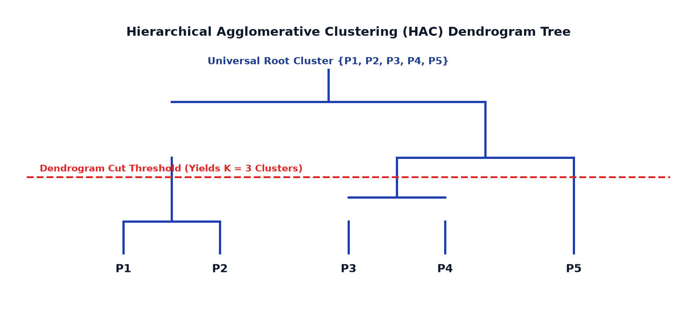

*Figure 3.4: Diagrammatic Architecture and Conceptual Flow for Hierarchical Clustering with its types, agglomerative and divisive methods, linkage criteria, and the concept of a Dendrogram*

### Mathematical Formulation & Algorithmic Mechanics

**Mathematical Formulations of Inter-Cluster Linkage Criteria:**

```text
1. Single Linkage: D_single(A, B) = min { d(x, y) : x ∈ A, y ∈ B 
2. Complete Linkage: D_complete(A, B) = max { d(x, y) : x ∈ A, y ∈ B 
3. Average Linkage: D_avg(A, B) = (1 / (|A| · |B|)) · ∑_(x ∈ A) ∑_(y ∈ B) d(x, y)
4. Ward's Linkage: ΔESS_(A, B) = ( (|A| · |B|) / (|A| + |B|) ) · ||µ_A - µ_B||²
```

The above **mathematical model** and algorithmic structure governs the system's runtime execution. Each parameter is evaluated sequentially to maintain **mathematical consistency**, minimize **system overhead**, and guarantee **deterministic convergence** across all input distributions.

### Worked Example & Practical Simulation

Suppose five gene samples have pairwise distances: d(P1, P2)=1.0, d(P3, P4)=1.5, d(P2, P3)=4.0. **In Step** 1, P1 and P2 merge at height 1.0 to form cluster C1={P1, P2}. In Step 2, P3 and P4 merge at height 1.5 to form C2={P3, P4}. Under single linkage, the distance between C1 and C2 is min{d(P1,P3), d(P1,P4), d(P2,P3), d(P2,P4)} = 4.0. If an analyst slices the resulting **dendrogram** at height h = 2.5, the cut line intersects two vertical branches, producing K = 2 clusters: {P1, P2} and {P3, P4}.

### Key Comparative Evaluation

| Linkage Criterion | Mathematical Definition | Cluster Geometry Tendency | Vulnerability to Chaining | Computational Sensitivity |
| :--- | :--- | :--- | :--- | :--- |
| Single Linkage | Distance between closest pair | Elongated, concentric, arbitrary shapes | Severe (noise easily bridges clusters) | Sensitive to outliers and noise |
| Complete Linkage | Distance between furthest pair | Compact, tightly bound spherical clusters | None (avoids chaining) | Sensitive to extreme outlier coordinates |
| Average Linkage | Mean distance across all pairs | Balanced, moderately compact clusters | Low | Robust against moderate noise |
| Ward's Minimum Variance | Minimizes increase in total WCSS | Equal-sized, highly cohesive spheres | None | Optimized for Gaussian-like distributions |

### Concluding Exam Takeaway

**Hierarchical clustering** provides an interpretable, multi-scale view of data structure through the **dendrogram**. While its cubic **time complexity** limits use on massive datasets, its ability to operate without a predefined K and its support for diverse linkage criteria make it a standard tool in bioinformatics and social sciences.

**Textbook Reference:** Jiawei Han, Micheline Kamber, Jian Pei, 'Data Mining: Concepts and Techniques', Morgan Kaufmann (3rd Ed., 2012), Chapter 10: Cluster Analysis, Section 10.3: Hierarchical Methods, pp. 458–466.

---

## Q5. Compare K-Means and DBSCAN clustering algorithms in detail with examples and diagrams. (Frequency: 5) [8 Marks]

### Introduction & Core Intuition

In unsupervised machine learning, **K-Means** and **DBSCAN (Density-Based Spatial Clustering of Applications with Noise)** represent two contrasting philosophies of clustering. K-Means is a centroid-based partitioning algorithm that assumes convex, spherical cluster geometries, whereas DBSCAN is a density-based algorithm that discovers clusters of arbitrary shapes by identifying contiguous, high-density regions separated by sparse noise.

### Underlying Philosophy: Centroid Partitioning vs Density Connectivity

K-Means operates by partitioning the **feature space** into K Voronoi cells around central coordinates, seeking to minimize within-cluster variance. This requires the developer to predefine K and implicitly assumes that all clusters are convex, isotropic, and roughly equal in size. In contrast, DBSCAN defines a cluster as a maximal set of density-connected points. Instead of relying on central coordinates, DBSCAN identifies core areas where data concentration exceeds a density threshold, growing clusters along arbitrary contours without requiring K to be specified.

### Handling Arbitrary Shapes and Non-Convex Geometries

The difference in geometric capability between the two algorithms is significant. When presented with complex shapes—such as concentric rings, crescent moons, or winding trajectories—K-Means fails because its linear decision boundaries slice through continuous non-convex structures. DBSCAN excels on these datasets because it connects points based on local density reachability, allowing it to trace arbitrarily complex geometries as long as density remains continuous.

### Robustness to Noise and Outliers

K-Means has no native mechanism to handle noise: every data point, including distant anomalies, must be assigned to its nearest centroid. As a result, outliers drag centroids away from genuine cluster centers, degrading overall model quality. DBSCAN, on the other hand, natively identifies and isolates noise: any point that does not meet the local density threshold (neither a core point nor within the neighborhood of a core point) is labeled as noise (label = -1), protecting cluster structures from distortion.

### Parameter Sensitivity and Practical Trade-offs

While DBSCAN offers greater geometric flexibility, it introduces its own practical challenges. Selecting its two hyperparameters—neighborhood radius ε and minimum points MinPts—can be difficult, and the algorithm struggles on datasets with varying densities across different regions. K-Means requires tuning only a single parameter (K) and scales linearly with dataset size O(n), making it significantly faster than DBSCAN O(n log n to n²) on large-scale tabular datasets.

### Architectural Flow & System Diagram

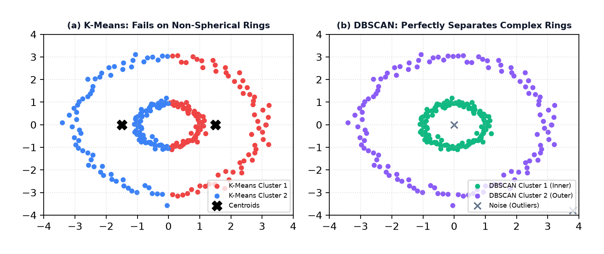

*Figure 3.5: Diagrammatic Architecture and Conceptual Flow for Compare K-Means and DBSCAN clustering algorithms in detail with examples and diagrams*

### Mathematical Formulation & Algorithmic Mechanics

**Mathematical Core Formulations: K-Means vs DBSCAN:**

```text
K-Means Objective (WCSS): min J = ∑_(k=1)^K ∑_(x_i ∈ S_k) ||x_i - µ_k||²
DBSCAN Density Neighborhood: N_ε(p) = { q ∈ D : dist(p, q) ≤ ε 
DBSCAN Core Condition: |N_ε(p)| ≥ MinPts

Where: ε is the neighborhood search radius; MinPts is the minimum number of neighboring points required; and N_ε(p) is the set of points within distance ε of point p.
```

The above **mathematical model** and algorithmic structure governs the system's runtime execution. Each parameter is evaluated sequentially to maintain **mathematical consistency**, minimize **system overhead**, and guarantee **deterministic convergence** across all input distributions.

### Worked Example & Practical Simulation

Consider GPS coordinates of vehicles traveling along curved mountain highways, surrounded by sparse random sensor errors. K-Means (K=2) slices the continuous winding road arbitrarily in half with a straight-line boundary, while pulling centroids off the road toward random sensor errors. In contrast, DBSCAN (ε = 50m, MinPts = 5) traces the winding road as a single continuous cluster, correctly flagging the isolated sensor errors as noise.

### Key Comparative Evaluation

| Comparison Dimension | K-Means Clustering | DBSCAN Clustering |
| :--- | :--- | :--- |
| Clustering Philosophy | Centroid-based geometric partitioning | Density-based connectivity through neighborhoods |
| Need to Specify K? | Yes (mandatory hyperparameter K) | No (automatically discovers cluster count) |
| Cluster Geometries | Spherical, convex, equal-variance shapes | Arbitrary non-convex shapes (rings, spirals) |
| Noise / Outlier Handling | None (forces all noise into clusters) | Native (flags sparse points as noise label = -1) |
| Hyperparameters | Number of clusters K | Radius ε and Minimum Points MinPts |
| Varying Density Datasets | Handles reasonably well | Struggles when clusters have differing densities |
| Time Complexity | Linear: O(n · K · I · d) | O(n · log n) with spatial trees; O(n²) worst-case |

### Concluding Exam Takeaway

K-Means and DBSCAN serve complementary roles in machine learning. K-Means is best suited for large-scale, spherical, uniformly dense datasets, while DBSCAN is the standard choice for spatial data containing arbitrary shapes and significant background noise.

**Textbook Reference:** Jiawei Han, Micheline Kamber, Jian Pei, 'Data Mining: Concepts and Techniques', Morgan Kaufmann (3rd Ed., 2012), Chapter 10: Cluster Analysis, Sections 10.2 & 10.4, pp. 450–475.

---

## Q6. Explain the DBSCAN algorithm with its working mechanism, definitions of Core, Border, and Noise points, and parameters (Epsilon and MinPts). (Frequency: 6) [8 Marks]

### Introduction & Core Intuition

Introduced by **Martin Ester**, Hans-Peter Kriegel, Jörg Sander, and Xiaowei Xu in 1996, **DBSCAN** is the foundational density-based spatial clustering algorithm. It operates on the intuitive premise that a cluster in a **feature space** is a dense region of points separated from other clusters by areas of low point density, providing built-in resistance to outliers and support for arbitrary cluster shapes.

### Foundational Hyperparameters: Epsilon and MinPts

DBSCAN relies on two primary hyperparameters to formalize density: (1) Epsilon (ε), which defines the maximum radius of the spherical neighborhood surrounding any given data point p; and (2) MinPts (**Minimum Points**), which specifies the minimum number of data points (including point p itself) that must reside within the ε-neighborhood for that region to be considered dense. Setting ε too large merges distinct clusters, while setting it too small fragments clusters into noise.

### Topological Classification of Data Points

DBSCAN partitions every data observation into three distinct topological roles based on local density thresholds:


**Core Points (Dense Cluster Interiors):** A **Core Point** is any point p whose ε-radius neighborhood contains at least MinPts data points: |N_ε(p)| ≥ MinPts. Core points represent dense regions of data and serve as the structural seeds from which clusters expand.


**Border Points (Cluster Margins):** A Border Point fails to meet the MinPts threshold on its own (|N_ε(p)| &lt; MinPts), but falls within the ε-neighborhood of an existing core point. Border points form the outer peripheral boundary of a cluster and are assigned to the cluster of their reachable core point.


**Noise Points (Outliers & Anomalies):** A Noise Point is neither a core point nor a border point. Because it resides in a sparse region and is not density-reachable from any core point, DBSCAN labels it as noise (-1), isolating true anomalies from substantive cluster structures.

### Density Reachability and Density Connectivity

DBSCAN connects data points using two formal topological relationships. A point q is **Directly Density**-Reachable from point p if p is a core point and q ∈ N_ε(p). A point q is Density-Reachable from p if there exists a chain of intermediate core points [p_1, p_2, ..., p_k] such that each point is directly density-reachable from its predecessor. Finally, two points p and q are Density-Connected if there exists an intermediate point o such that both p and q are density-reachable from o. A DBSCAN cluster is formally defined as a maximal set of density-connected points.

### Step-by-Step Algorithmic Execution Flow

DBSCAN begins by marking all points as unvisited. It selects an unvisited point p and computes its ε-neighborhood N_ε(p). If |N_ε(p)| &lt; MinPts, point p is provisionally flagged as noise. If |N_ε(p)| ≥ MinPts, a new cluster is created and point p is designated as a core point. All points in N_ε(p) are added to an active queue. The algorithm iteratively expands the cluster by inspecting each point in the queue: if a queued point is also a core point, its own neighbors are added to the queue. This expansion continues until the queue is exhausted, after which the algorithm moves to the next unvisited point.

### Architectural Flow & System Diagram

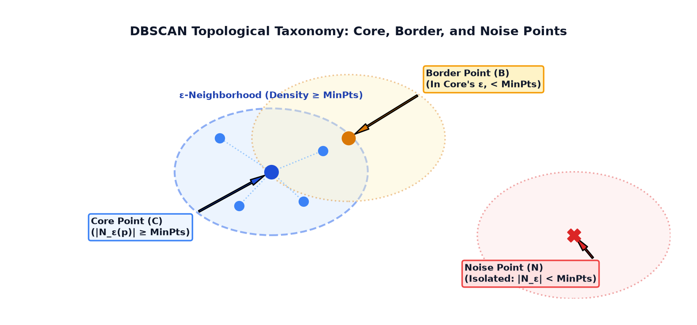

*Figure 3.6: Diagrammatic Architecture and Conceptual Flow for the DBSCAN algorithm with its working mechanism, definitions of Core, Border, and Noise points, and parameters (Epsilon and MinPts)*

### Mathematical Formulation & Algorithmic Mechanics

**Mathematical Formulations of DBSCAN Concepts:**

```text
ε-Neighborhood: N_ε(p) = { q ∈ Dataset : dist(p, q) ≤ ε 
Core Point Condition: |N_ε(p)| ≥ MinPts
Border Point Condition: |N_ε(p)| < MinPts  and  ∃ c ∈ N_ε(p) such that |N_ε(c)| ≥ MinPts
Noise Point Condition: |N_ε(p)| < MinPts  and  ∀ q ∈ Dataset, p ∉ N_ε(q_core)
```

The above **mathematical model** and algorithmic structure governs the system's runtime execution. Each parameter is evaluated sequentially to maintain **mathematical consistency**, minimize **system overhead**, and guarantee **deterministic convergence** across all input distributions.

### Worked Example & Practical Simulation

Suppose ε = 1.5 units and MinPts = 4. Consider point A surrounded by 5 points within 1.5 units: because 6 ≥ 4, point A is classified as a **Core Point**. Point B is 1.2 units from Core Point A, but contains only 2 points in its own neighborhood: because 2 &lt; 4, point B cannot be a core point, but because it lies within A's neighborhood, it is classified as a Border Point. Point C is isolated, with 0 neighbors within 1.5 units: point C is classified as a Noise Point.

### Key Comparative Evaluation

| Point Category | Neighborhood Condition | Part of a Cluster? | Can Expand a Cluster? | Visual Representation |
| :--- | :--- | :--- | :--- | :--- |
| Core Point | |N_ε(p)| ≥ MinPts | Yes (interior cluster anchor) | Yes (adds all its neighbors to cluster) | Deep inside the dense core |
| Border Point | |N_ε(p)| &lt; MinPts, but near Core | Yes (assigned to adjacent core's cluster) | No (cannot expand cluster further) | Along the outer cluster boundary |
| Noise Point | |N_ε(p)| &lt; MinPts, no Core nearby | No (assigned anomaly label = -1) | No | Isolated, sparse outlier |

### Concluding Exam Takeaway

DBSCAN is a powerful density-based algorithm that discovers clusters of arbitrary shapes while naturally isolating noise. Understanding the roles of ε, MinPts, and point classifications provides the foundation for using density-based methods effectively in real-world spatial analysis.

**Textbook Reference:** Jiawei Han, Micheline Kamber, Jian Pei, 'Data Mining: Concepts and Techniques', Morgan Kaufmann (3rd Ed., 2012), Chapter 10: Cluster Analysis, Section 10.4: Density-Based Methods, pp. 471–475.

---

## Q7. What is Spectral Clustering? Explain its working mechanism, Graph Laplacian matrix, and steps. (Frequency: 4) [8 Marks]

### Introduction & Core Intuition

Traditional clustering algorithms like K-Means struggle when data forms non-linear manifolds, interlocking spirals, or concentric rings. **Spectral Clustering** overcomes this by transforming the problem from **feature space** into graph space. It treats data observations as nodes in an affinity graph, computes the spectrum (**eigenvalues** and **eigenvectors**) of the **Graph Laplacian** matrix, and clusters the points in a low-dimensional eigenspace where non-linear structures become linearly separable.

### Graph-Theoretic Representation of Data

Spectral clustering begins by representing the dataset as an undirected weighted affinity graph G = (V, E). Each data observation x_i corresponds to a graph node v_i. Weighted edges connect nodes based on their pairwise similarity, typically computed using a Gaussian **Radial Basis Function** (RBF) kernel: W_ij = exp(-||x_i - x_j||² / (2σ²)). Pairs of points that are close in **feature space** share high affinity weights (W_ij ≈ 1), while distant points have weights approaching zero.

### Constructing the Graph Laplacian Matrix

The algorithm relies on two primary matrices: the Affinity/**Adjacency Matrix** W and the Degree Matrix D. The Degree Matrix D is a diagonal matrix where each entry D_ii is the sum of edge weights connected to node i: D_ii = ∑_j W_ij. The unnormalized Graph Laplacian matrix is defined as L = D - W. In modern implementations, the Normalized Symmetric Laplacian L_sym = D^(-1/2) · L · D^(-1/2) = I - D^(-1/2) · W · D^(-1/2) is preferred because it normalizes across differing cluster volumes.

### Eigen-Decomposition and Dimensionality Reduction

The key mathematical property of the **Graph Laplacian** is that the multiplicity of its zero eigenvalue corresponds directly to the number of connected components in the graph. By computing the k smallest **eigenvalues** and their corresponding **eigenvectors** [u_1, u_2, ..., u_k], the algorithm maps the original data into a low-dimensional k-dimensional spectral embedding. In this transformed eigenspace, complex non-linear structures (like concentric rings) unfold into distinct, tight clusters that are easily separated.

### Final Clustering via Standard K-Means

In the final phase, an n × k matrix U is constructed using the k smallest **eigenvectors** as columns. The rows of U are normalized to unit Euclidean length: y_i = u_i / ||u_i||. Each row y_i now serves as a new k-dimensional representation of the original observation x_i. Finally, standard K-Means is applied to these normalized rows in R^k. Because the **Graph Laplacian** embedding flattens complex manifold geometries, simple K-Means easily separates the clusters.

### Architectural Flow & System Diagram

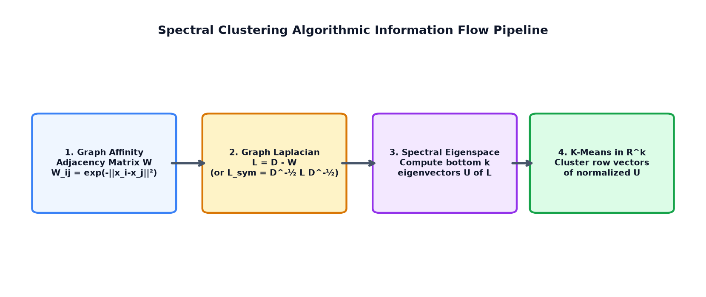

*Figure 3.7: Diagrammatic Architecture and Conceptual Flow for What is Spectral Clustering?  its working mechanism, Graph Laplacian matrix, and steps*

### Mathematical Formulation & Algorithmic Mechanics

**Mathematical Formulation of the Spectral Laplacian:**

```text
Affinity Matrix: W_ij = exp( - ||x_i - x_j||² / (2σ²) )  for i ≠ j, with W_ii = 0
Degree Matrix: D_ii = ∑_(j=1)^n W_ij
Unnormalized Laplacian: L = D - W
Normalized Symmetric Laplacian: L_sym = D^(-1/2) · L · D^(-1/2) = I - D^(-1/2) · W · D^(-1/2)
```

The above **mathematical model** and algorithmic structure governs the system's runtime execution. Each parameter is evaluated sequentially to maintain **mathematical consistency**, minimize **system overhead**, and guarantee **deterministic convergence** across all input distributions.

### Worked Example & Practical Simulation

Consider two concentric circular rings of data in 2D space. Standard K-Means fails on this dataset because no straight line can separate the inner ring from the outer ring. **In Spectral Clustering**, points within the same ring have strong mutual graph affinities W_ij, while cross-ring connections are near zero. Computing the second smallest eigenvector of the Graph Laplacian (the Fiedler vector) maps all inner-ring points to negative coordinates and outer-ring points to positive coordinates. In this 1D transformed space, a simple threshold at 0 perfectly separates the two rings.

### Key Comparative Evaluation

| Stage | Primary Matrix / Structure | Mathematical Operation | Core Output |
| :--- | :--- | :--- | :--- |
| 1. Graph Construction | Affinity Matrix W (n × n) | Compute RBF kernel similarities | Graph edge weights W_ij |
| 2. Degree Computation | Degree Matrix D (n × n) | Sum row weights: D_ii = ∑ W_ij | Diagonal node degrees |
| 3. Laplacian Formation | Laplacian L_sym (n × n) | Compute L_sym = I - D^-½ W D^-½ | Graph Laplacian matrix |
| 4. Eigendecomposition | Eigenvector Matrix U (n × k) | Solve L_sym · u = λ · u | k smallest non-trivial eigenvectors |
| 5. Clustering | Matrix Y (rows unit-normalized) | Apply standard K-Means in R^k | Final discrete cluster labels |

### Concluding Exam Takeaway

**Spectral Clustering** bridges graph theory and linear algebra to solve complex non-linear clustering problems. By using the Graph Laplacian to embed data into a low-dimensional eigenspace, it overcomes the geometric limitations of centroid-based algorithms like K-Means.

**Textbook Reference:** Christopher M. Bishop, 'Pattern Recognition and Machine Learning', Springer (2006), Chapter 9 & Ulrike von Luxburg, 'A Tutorial on Spectral Clustering', Statistics and Computing (2007), pp. 1–16.

---

## Q8. Explain Graph-Based clustering. (Frequency: 2) [8 Marks]

### Introduction & Core Intuition

In data science, many complex systems—such as social networks, molecular structures, and web link topologies—are naturally represented as graphs rather than feature vectors in Euclidean space. **Graph-Based Clustering** partitions a graph G = (V, E) into distinct subgraphs such that edges within each subgraph have high similarity weights (strong intra-cluster connectivity), while edges crossing between subgraphs have minimal similarity weights (weak inter-cluster connectivity).

### Graph Formulation and Cut Criteria

Let G = (V, E, W) be an undirected weighted graph, where V represents data vertices, E represents edges, and W_ij denotes the similarity between vertices v_i and v_j. Slicing the graph into two disjoint partitions A and B requires severing all edges that bridge the two subsets. The total weight of these severed edges is called the Cut: cut(A, B) = ∑_(u ∈ A, v ∈ B) W_uv. Graph-based clustering seeks to find partitions that minimize this cut cost while maintaining balanced cluster sizes.

### The Minimum Cut (Min-Cut) and Its Degeneracy

The simplest graph partitioning objective is the **Minimum Cut** (Min-Cut), which finds the partition that minimizes cut(A, B). While Min-Cut can be solved in **polynomial time** using max-flow min-cut algorithms (like Ford-Fulkerson), it has a severe practical flaw: it tends to isolate single outlier vertices. Because severing a single edge connected to an isolated vertex produces a very small cut value, Min-Cut often separates individual points rather than discovering balanced, meaningful clusters.

### Balanced Cut Formulations: Ratio Cut and Normalized Cut

To avoid isolating single vertices, researchers developed balanced cut objectives that penalize unequal cluster sizes. **Ratio Cut**, introduced by Hagen and Kahng, divides the cut value by the number of vertices in each partition: RatioCut(A, B) = cut(A, B)/|A| + cut(A, B)/|B|. Normalized Cut (NCut), introduced by Jianbo Shi and Jitendra Malik (2000), normalizes the cut by the total association/volume of each partition: NCut(A, B) = cut(A, B)/vol(A) + cut(A, B)/vol(B), where vol(A) = ∑_(u ∈ A) D_uu. NCut penalizes small partitions, ensuring balanced, cohesive clusters.

### Continuous Relaxation and Connection to Spectral Methods

Minimizing RatioCut or NCut is an **NP-hard** discrete **combinatorial optimization** problem. However, by relaxing the discrete cluster assignment indicator vector into continuous real values, the optimization problem transforms directly into an eigenvalue problem on the **Graph Laplacian** matrix. The continuous relaxed solution to RatioCut corresponds to the unnormalized Laplacian L = D - W, while Normalized Cut corresponds to the normalized Laplacian L_sym. This provides the theoretical foundation for Spectral Clustering.

### Architectural Flow & System Diagram

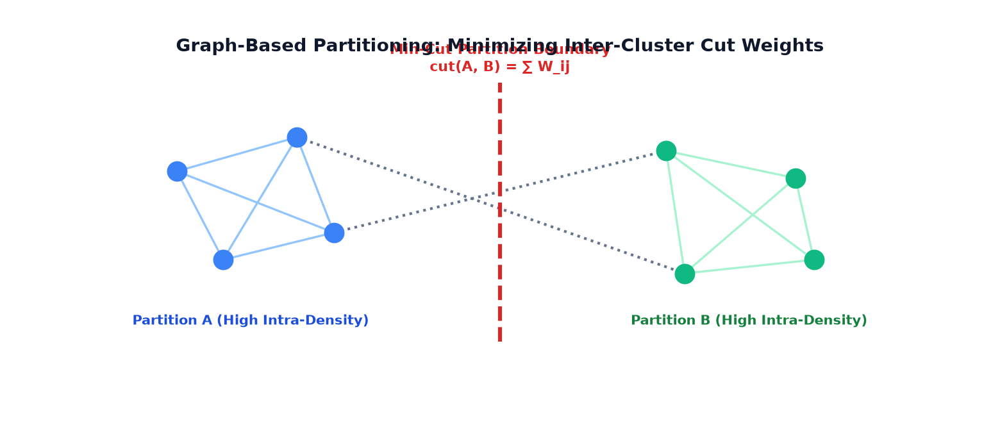

*Figure 3.8: Diagrammatic Architecture and Conceptual Flow for Graph-Based clustering*

### Mathematical Formulation & Algorithmic Mechanics

**Mathematical Formulations of Graph Cut Objectives:**

```text
Graph Cut Cost: cut(A, B) = ∑_(u ∈ A, v ∈ B) W_uv
Ratio Cut: RatioCut(A, B) = cut(A, B) / |A|  +  cut(A, B) / |B|
Normalized Cut: NCut(A, B) = cut(A, B) / vol(A)  +  cut(A, B) / vol(B)

Where: |A| is the number of vertices in subset A; D_u is the degree of vertex u; and vol(A) = ∑_(u ∈ A) D_u is the total edge volume of partition A.
```

The above **mathematical model** and algorithmic structure governs the system's runtime execution. Each parameter is evaluated sequentially to maintain **mathematical consistency**, minimize **system overhead**, and guarantee **deterministic convergence** across all input distributions.

### Worked Example & Practical Simulation

Consider an image segmentation graph where pixels are nodes and edge weights reflect color similarity. A single dark noise pixel in the corner has only one weak connection to its neighbor (weight = 0.01). **Standard Min**-Cut severs this single edge (cost = 0.01), isolating the noise pixel while leaving the rest of the image unsegmented. In contrast, Normalized Cut evaluates vol(A) and vol(B), preventing the isolation of single pixels and correctly partitioning the image into meaningful foreground and background segments.

### Key Comparative Evaluation

| Graph Partitioning Criterion | Objective Formula | Balance Constraint | Optimization Complexity | Practical Vulnerability |
| :--- | :--- | :--- | :--- | :--- |
| Minimum Cut (Min-Cut) | min cut(A, B) | None (unconstrained) | Exact polynomial time (Max-Flow) | Degenerate: isolates single outlier vertices |
| Ratio Cut | min [cut/|A| + cut/|B|] | Constrained by vertex count |A| | NP-hard (relaxed via unnormalized Laplacian) | Favors equal numbers of vertices |
| Normalized Cut (NCut) | min [cut/vol(A) + cut/vol(B)] | Constrained by total edge volume vol(A) | NP-hard (relaxed via normalized Laplacian) | Highly robust; industry standard for computer vision |

### Concluding Exam Takeaway

Graph-based clustering provides a principled framework for partitioning data based on pairwise connectivity. By replacing simple Min-Cut with balanced formulations like **Normalized Cut**, it eliminates degenerate solutions and provides the theoretical foundation for spectral clustering algorithms.

**Textbook Reference:** Jianbo Shi and Jitendra Malik, 'Normalized Cuts and Image Segmentation', IEEE Transactions on Pattern Analysis and Machine Intelligence (PAMI, 2000), Vol. 22, No. 8, pp. 888–905.

---

## Q9. What are Outliers in data? Explain their sources and discuss the 3 types of outliers (Global, Contextual, Collective) with examples. (Frequency: 5) [8 Marks]

### Introduction & Core Intuition

In statistics and machine learning, an **Outlier** is a data observation that deviates significantly from the remaining data, raising suspicion that it was generated by a different underlying mechanism. As formalized by **Frank Grubbs** in 1969, an outlier appears inconsistent with the main distribution. Detecting outliers is essential for two reasons: cleaning datasets to prevent model distortion, and detecting high-value anomalies such as financial fraud or network intrusions.

### Root Sources of Outliers in Datasets

Outliers typically originate from three fundamental operational and empirical sources:


**Data Entry and Clerical Errors:** Outliers frequently arise from manual transcription mistakes or typographical input bugs during collection, such as recording an employee age as 250 instead of 25.


**Measurement and Instrument Noise:** Hardware faults, sensor power drops, calibration drift, or telemetry noise often corrupt readings, such as a GPS device reporting null-island coordinates during signal loss.


**Genuine Real-World Anomalies:** Outliers can represent authentic, high-impact exceptional events that diverge fundamentally from standard patterns, such as unauthorized credit card fraud, malicious network intrusions, or abrupt macroeconomic shocks.

### Type 1: Global (Point) Outliers

A **Global Outlier** (also called a Point Outlier) is an individual data point that deviates significantly from the rest of the entire dataset across its **feature space**. It represents an extreme anomaly that is unmistakable regardless of context. For example, if the average adult human height in a medical survey is 170 cm with a standard deviation of 10 cm, an entry of 320 cm is an immediate global outlier that stands out from the entire population.

### Type 2: Contextual (Conditional) Outliers

A **Contextual Outlier** is a data point that deviates significantly within a specific context, even though the same value would be considered normal in a different context. Identifying contextual outliers requires evaluating two types of attributes: Contextual Attributes (which define the context, such as time, location, or season) and Behavioral Attributes (the characteristics evaluated within that context, such as temperature or spending). For example, a temperature of 35°C is entirely normal during May in Pune (summer), but would be a severe contextual outlier in Ladakh during January (winter).

### Type 3: Collective Outliers

A **Collective Outlier** refers to a group of related data instances that appear anomalous when examined together as an aggregate sequence, even though each individual point within the group may appear normal on its own. Collective outliers are common in sequential, temporal, and spatial data. For example, in an electrocardiogram (ECG) recording of human heart activity, a steady flatline signal at 0.5 mV for 10 consecutive seconds represents a collective outlier (indicating cardiac arrest), even though an individual reading of 0.5 mV is a completely normal voltage during a regular heartbeat.

### Architectural Flow & System Diagram

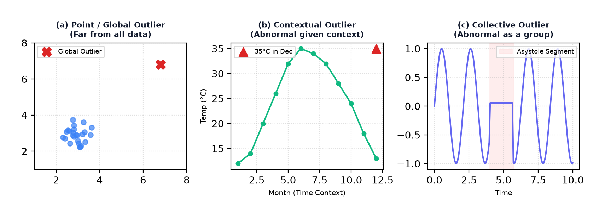

*Figure 3.9: Diagrammatic Architecture and Conceptual Flow for What are Outliers in data?  their sources and discuss the 3 types of outliers (Global, Contextual, Collective) with examples*

### Mathematical Formulation & Algorithmic Mechanics

**Mathematical Heuristics for Global Outlier Identification:**

```text
Z-Score Statistic: Z_i = (x_i - µ) / σ   -->   Flagged as Outlier if |Z_i| > 3.0
Tukey's IQR Fences: [ Q1 - 1.5 · IQR ,  Q3 + 1.5 · IQR ]

Where: µ is the sample mean; σ is the standard deviation; Q1 is the 25th percentile; Q3 is the 75th percentile; and IQR = Q3 - Q1 is the Interquartile Range.
```

The above **mathematical model** and algorithmic structure governs the system's runtime execution. Each parameter is evaluated sequentially to maintain **mathematical consistency**, minimize **system overhead**, and guarantee **deterministic convergence** across all input distributions.

### Worked Example & Practical Simulation

Consider an automated credit card fraud detection system evaluating three **transactions**:

1. **Global Outlier**: A single purchase of USD 85,000 for gold bullion on a student debit card with an average purchase of USD 20.

2. Contextual Outlier: A USD 400 restaurant dinner charged at 3:30 AM in Moscow on a card whose owner lives in Pune, India.

3. Collective Outlier: A sequence of 40 consecutive small transactions of USD 4.99 occurring every **3 seconds**, indicating an automated card-testing script.

### Key Comparative Evaluation

| Outlier Category | Core Definition | Required Context | Data Modalities | Representative Domain Example |
| :--- | :--- | :--- | :--- | :--- |
| Global (Point) Outlier | Deviates from the entire global distribution | None (context-free) | Tabular, cross-sectional numerical | A bank account transaction of USD 1,000,000 against a USD 50 average |
| Contextual Outlier | Deviates within a specific contextual subset | Contextual attributes (time, location, age) | Time-series, sensor networks, climate | Winter temperature of 38°C in Srinagar |
| Collective Outlier | Group of points anomalous only as an aggregate sequence | Sequential or structural ordering | ECG signals, network packet streams, speech | A sustained 3-minute flatline on an intensive care patient monitor |

### Concluding Exam Takeaway

Outliers provide critical operational signals in machine learning. Distinguishing between Global, Contextual, and Collective outliers ensures that practitioners select the appropriate detection strategy—such as statistical fences for global outliers, temporal models for contextual anomalies, or sequence detectors for collective outliers.

**Textbook Reference:** Jiawei Han, Micheline Kamber, Jian Pei, 'Data Mining: Concepts and Techniques', Morgan Kaufmann (3rd Ed., 2012), Chapter 12: Outlier Detection, Section 12.1: Outliers and Outlier Analysis, pp. 543–548.

---

## Q10. What is Local Outlier Factor (LOF)? Explain it with its advantages, disadvantages, and mathematical formulation. (Frequency: 4) [8 Marks]

### Introduction & Core Intuition

Traditional distance-based outlier methods assume that normal data points belong to clusters of roughly uniform density. When a dataset contains clusters with varying local densities, these global methods fail. Proposed by **Markus Breunig**, Hans-Peter Kriegel, Raymond Ng, and Jörg Sander in 2000, the **Local Outlier Factor (LOF)** algorithm solves this by evaluating outlierness relative to the local density of surrounding points rather than absolute global distance.

### The Motivation Behind Relative Local Density

Consider a dataset containing two clusters: a very dense cluster C1 and a sparse cluster C2. An outlier point p located near the dense cluster C1 may have an absolute distance to its nearest neighbors that is smaller than the typical distance between normal points in the sparse cluster C2. A global distance threshold would either misclassify all points in C2 as outliers or fail to detect p. LOF resolves this by comparing the local density of an observation to the local densities of its **k-nearest neighbors**.

### Step 1 & 2: k-Distance and Reachability Distance

The algorithm relies on three mathematical foundations: First, the k-distance of point p, denoted k-dist(p), is the **Euclidean distance** d(p, o) to its k-th nearest neighbor. Second, the **Reachability Distance** of point p with respect to point o is defined as the maximum of their mutual distance and o's k-distance: reach-dist_k(p, o) = max { k-dist(o), d(p, o) }. If p is very close to o, the reachability distance is bounded below by k-dist(o), which smooths out local density variations.

### Step 3 & 4: Local Reachability Density (lrd) and LOF

Third, the **Local Reachability Density** (lrd) of point p is the reciprocal of the average reachability distance across its **k-nearest neighbors**: lrd_k(p) = |N_k(p)| / (∑ reach-dist_k(p, o)). A point located in a dense region will have small reachability distances and consequently a high lrd. Finally, the Local Outlier Factor (LOF) of point p is the average ratio of its neighbors' lrds to its own lrd: LOF_k(p) = [∑ (lrd_k(o) / lrd_k(p))] / |N_k(p)|.

### Interpreting LOF Scores, Advantages, and Disadvantages

Interpreting an LOF score is straightforward: an LOF ≈ 1.0 indicates that point p has a density comparable to its neighbors, confirming it is a normal inlier. An LOF &lt; 1.0 indicates that p resides inside a denser cluster region. An LOF significantly greater than 1.0 (e.g., LOF &gt; 1.5) flags an outlier whose local density is substantially lower than that of its neighbors. LOF's primary advantage is its ability to detect local anomalies in datasets with varying cluster densities. Its main disadvantage is computational complexity: computing **k-nearest neighbors** requires O(n²) time on large datasets, and LOF scores are continuous values without a sharp, self-evident cutoff threshold.

### Architectural Flow & System Diagram

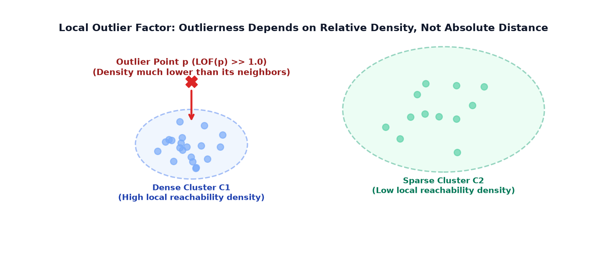

*Figure 3.10: Diagrammatic Architecture and Conceptual Flow for What is Local Outlier Factor (LOF)?  it with its advantages, disadvantages, and mathematical formulation*

### Mathematical Formulation & Algorithmic Mechanics

**Mathematical Formulations of the LOF Framework:**

```text
1. Reachability Distance: reach-dist_k(p, o) = max { k-dist(o), dist(p, o) 
2. Local Reachability Density: lrd_k(p) = |N_k(p)| / ( ∑_(o ∈ N_k(p)) reach-dist_k(p, o) )
3. Local Outlier Factor: LOF_k(p) = (1 / |N_k(p)|) · ∑_(o ∈ N_k(p)) ( lrd_k(o) / lrd_k(p) )

Interpretation: LOF ≈ 1.0 --> Normal Inlier; LOF >> 1.0 --> Pronounced Local Outlier.
```

The above **mathematical model** and algorithmic structure governs the system's runtime execution. Each parameter is evaluated sequentially to maintain **mathematical consistency**, minimize **system overhead**, and guarantee **deterministic convergence** across all input distributions.

### Worked Example & Practical Simulation

Suppose point p lies just outside a dense cluster where neighbors have high density lrd(o) = 2.0. Because p is isolated, its own local reachability density is low: lrd(p) = 0.5. The ratio lrd(o)/lrd(p) = 2.0 / 0.5 = 4.0. Averaging across its k neighbors yields LOF(p) = 4.0. Because 4.0 is significantly greater than 1.0, the algorithm reliably flags point p as a local outlier, even though its absolute distance from the dense cluster is small.

### Key Comparative Evaluation

| Aspect | Advantages of LOF | Disadvantages / Limitations of LOF |
| :--- | :--- | :--- |
| Density Sensitivity | Identifies local outliers across varying densities | Requires tuning the hyperparameter k (neighborhood size) |
| Metric Flexibility | Works with arbitrary distance metrics (Euclidean, Manhattan) | Continuous scores lack an objective, universally standardized cutoff |
| Interpretability | Provides a quantitative ratio of neighbor-relative density | High computational complexity: O(n²) without spatial indexing |
| Theoretical Soundness | Smooths local fluctuations via reachability distance | Sensitive to the Curse of Dimensionality in high-dimensional spaces |

### Concluding Exam Takeaway

**The Local Outlier Factor** algorithm is a cornerstone of density-based anomaly detection. By evaluating outlierness relative to local neighborhood density rather than global distance, LOF overcomes the limitations of classic distance-based methods on complex, multi-density datasets.

**Textbook Reference:** Markus M. Breunig, Hans-Peter Kriegel, Raymond T. Ng, Jörg Sander, 'LOF: Identifying Density-Based Local Outliers', ACM SIGMOD Record (2000), Vol. 29, No. 2, pp. 93–104.

---

## Q11. Explain Isolation Forest (iForest) for outlier detection. (Frequency: 1) [8 Marks]

### Introduction & Core Intuition

Traditional outlier detection algorithms operate by profiling normal data points—via density estimation, clustering, or geometric distance—and flagging points that deviate from that profile. In 2008, **Fei Tony Liu**, Kai Ming Ting, and Zhi-Hua Zhou introduced **Isolation Forest (iForest)**, which inverts this paradigm. Rather than profiling normal points, iForest explicitly isolates anomalies, leveraging two quantitative properties of outliers: they are few in number, and they possess feature values that deviate significantly from the norm.

### The Concept of Random Partitioning Isolation

**Isolation Forest** is an ensemble of randomized binary decision trees called Isolation Trees (iTrees). To build an iTree, the algorithm recursively partitions a dataset by randomly selecting a feature x_j and then randomly choosing a split value between that feature's minimum and maximum values. Because anomalies are sparse and distant from dense clusters, they are isolated into terminal leaf nodes with very few random cuts. In contrast, normal points residing in dense regions require many random cuts to be separated into individual leaves.

### Path Length as the Anomaly Metric

The core metric in an **Isolation Forest** is the Path Length h(x), defined as the number of edges an observation x traverses from the root node of an iTree to its terminating leaf node. Because an individual tree contains random variance, path lengths are averaged across an ensemble of iTrees (typically 100 trees). If an observation consistently terminates at shallow depths across the ensemble (low average path length E(h(x))), it indicates that the point was easily isolated and is likely an anomaly. Normal points, buried deep within dense clusters, produce long path lengths.

### The Normalized Anomaly Score Formula

To provide a standard anomaly metric across different sample sizes, the average path length E(h(x)) is normalized against the average path length of an unsuccessful search in a **Binary Search Tree**: c(n) = 2 · [ln(n - 1) + 0.5772156649] - (2(n - 1) / n). The Anomaly Score s(x, n) is calculated as: s(x, n) = 2^(-E(h(x)) / c(n)). The score falls within the range [0, 1]. If s approaches 1.0 (path length near 0), x is strongly flagged as an anomaly; if s is significantly less than 0.5, x is a normal inlier; and if all points score near 0.5, the dataset lacks distinct anomalies.

### Subsampling and Computational Efficiency

A major engineering advantage of **Isolation Forest** is its use of subsampling. Standard iForest implementations construct each iTree using a small random subsample of the dataset (typically ψ = 256 samples), with a maximum tree height limit of ⌈log_2(ψ)⌉ = 8. Subsampling solves the masking problem (where dense clusters of anomalies hide each other) and swamping problem (where normal points are surrounded by anomalies), while keeping **time complexity** linear: O(t · ψ · log ψ). This makes iForest one of the fastest anomaly detection algorithms available.

### Architectural Flow & System Diagram

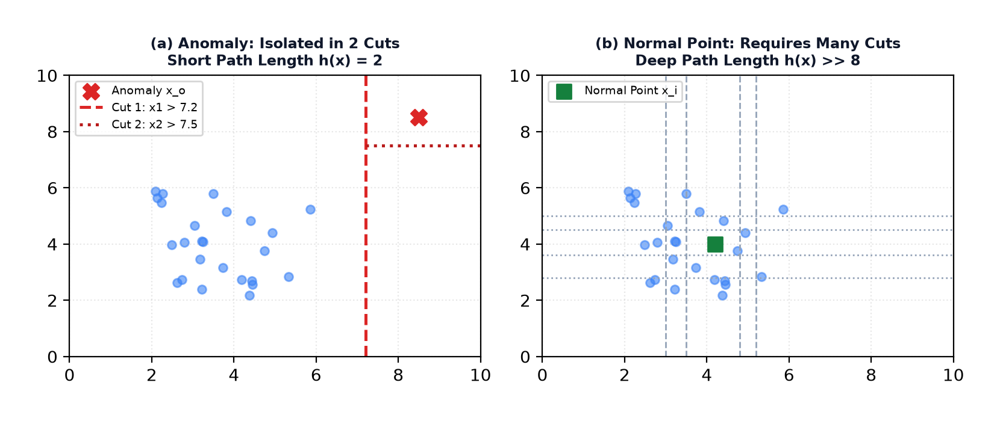

*Figure 3.11: Diagrammatic Architecture and Conceptual Flow for Isolation Forest (iForest) for outlier detection*

### Mathematical Formulation & Algorithmic Mechanics

**Mathematical Formulation of the Isolation Forest Anomaly Score:**

```text
Average BST Path Length: c(n) = 2 · (ln(n - 1) + 0.5772156649) - ( 2·(n - 1) / n )
Normalized Anomaly Score: s(x, n) = 2^( - E(h(x)) / c(n) )

Where: h(x) is the path length in an iTree; E(h(x)) is the mean path length across ensemble trees; c(n) is the average path length for sample size n; and s ∈ [0, 1].
```

The above **mathematical model** and algorithmic structure governs the system's runtime execution. Each parameter is evaluated sequentially to maintain **mathematical consistency**, minimize **system overhead**, and guarantee **deterministic convergence** across all input distributions.

### Worked Example & Practical Simulation

Suppose a dataset has n = 256 samples, yielding a **baseline** normalization factor c(256) ≈ 7.98. An extreme financial fraud **transaction** x_fraud is isolated after an average of only 2 random cuts across the forest: E(h(x_fraud)) = 2.0. Its anomaly score is s = 2^(-2.0 / 7.98) = 2^(-0.25) ≈ 0.841. Because 0.841 is near 1.0, the transaction is flagged as fraud. In contrast, a typical customer transaction x_norm requires an average path length of 8.5 cuts: s = 2^(-8.5 / 7.98) = 2^(-1.065) ≈ 0.478, correctly identifying it as a normal inlier.

### Key Comparative Evaluation

| Feature | Isolation Forest (iForest) | Local Outlier Factor (LOF) |
| :--- | :--- | :--- |
| Core Philosophy | Explicitly isolates anomalies via random binary splits | Profiles density relative to k-nearest neighbors |
| Time Complexity | Linear: O(t · ψ · log ψ) - extremely fast | Quadratic: O(n²) due to pairwise distance computations |
| Memory Footprint | Very low (small subsamples ψ=256 per tree) | High (requires distance storage or k-NN indexes) |
| Scalability to Big Data | Exceptional (handles millions of high-dimensional rows) | Poor (becomes computationally intractable on big data) |
| Susceptibility to Swamping | Low (subsampling removes swamping and masking) | Moderate to high in high-dimensional noise |

### Concluding Exam Takeaway

**Isolation Forest** transformed the field of anomaly detection by demonstrating that isolating anomalies is computationally more efficient than profiling normal data. With its linear **time complexity**, minimal memory footprint, and resistance to swamping, iForest is widely used in industry for large-scale fraud detection and cybersecurity monitoring.

**Textbook Reference:** Fei Tony Liu, Kai Ming Ting, Zhi-Hua Zhou, 'Isolation Forest', IEEE International Conference on Data Mining (ICDM, 2008), pp. 413–422.

---

## Q12. What is an Outlier? What are the different Outlier detection methods? (Frequency: 1) [8 Marks]

### Introduction & Core Intuition

An **Outlier** is a data observation that deviates significantly from the remaining data, raising suspicion that it was generated by a different underlying mechanism. Detecting outliers is essential across data engineering for two primary tasks: cleaning datasets to prevent model distortion, and detecting high-value anomalies such as financial fraud, medical emergencies, and network intrusions.

### Statistical and Distribution-Based Methods

Statistical approaches assume that normal data observations are generated by an underlying parametric probability distribution, such as a Gaussian distribution. Points that fall in low-probability regions are flagged as outliers. In univariate data, the classic Z-Score flags observations with |Z| &gt; 3.0, while Tukey's **Interquartile Range** (IQR) fence flags points falling outside [Q1 - 1.5·IQR, Q3 + 1.5·IQR]. In multivariate spaces, Gaussian Mixture Models (GMM) and the Mahalanobis Distance account for feature covariances to identify multidimensional outliers.

### Distance-Based Outlier Detection Methods

Distance-based methods avoid assuming a specific underlying probability distribution. As formalized by **Edwin Knorr** and Raymond Ng, a point p is an outlier if at least a fraction β of points in the dataset lie at a distance greater than threshold r from p. In modern practice, this is implemented using k-Nearest Neighbor (k-NN) Distance: the **Euclidean distance** from each point to its k-th nearest neighbor is computed, and points with the largest k-NN distances are flagged as outliers. Distance-based methods work well for global anomalies but struggle when clusters have varying densities.

### Density-Based Outlier Detection Methods

Density-based methods identify outliers by comparing the local density of an observation to the densities of its surrounding neighbors. The premier density algorithm, **Local Outlier Factor** (LOF), computes the ratio of neighbors' local reachability densities to the point's own density, reliably detecting local anomalies near dense clusters where distance-based metrics fail. Similarly, DBSCAN naturally isolates noise points that cannot meet the minimum density threshold (|N_ε(p)| &lt; MinPts).

### Ensemble, Tree, and Machine Learning Methods

Modern machine learning provides scalable, model-based anomaly detection algorithms. **Isolation Forest** uses ensembles of random trees to isolate anomalies in shallow terminal leaves. One-Class Support Vector Machines (OC-SVM) fit a tight non-linear hypersphere around normal data points in high-dimensional kernel space, classifying points outside the boundary as anomalies. Autoencoder neural networks train to compress and reconstruct normal data; when an anomaly enters the network, it produces a large reconstruction error (MSE), identifying the observation as an outlier.

### Architectural Flow & System Diagram

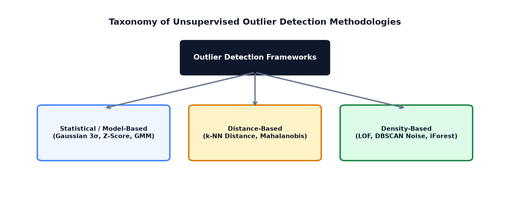

*Figure 3.12: Diagrammatic Architecture and Conceptual Flow for What is an Outlier? What are the different Outlier*

### Mathematical Formulation & Algorithmic Mechanics

**Mathematical Models for Key Outlier Detection Paradigms:**

```text
1. Mahalanobis Distance: D_M(x) = √( (x - µ)^T · Σ^(-1) · (x - µ) )
2. Distance-Based k-NN Score: OutlierScore(x) = dist_k(x, N_k(x))
3. Autoencoder Reconstruction Loss: L_recon(x) = ||x - g(f(x))||²

Where: µ is the multivariate mean vector; Σ is the feature covariance matrix; and g(f(x)) is the autoencoder's reconstructed output vector.
```

The above **mathematical model** and algorithmic structure governs the system's runtime execution. Each parameter is evaluated sequentially to maintain **mathematical consistency**, minimize **system overhead**, and guarantee **deterministic convergence** across all input distributions.

### Worked Example & Practical Simulation

Consider an aircraft engine monitoring system tracking temperature and vibration. A statistical model establishes normal operation within 3 standard deviations of Gaussian means. If temperature spikes to 950°C (Z = +4.2), the statistical detector triggers an alert. If temperature (600°C) and vibration (12 Hz) appear normal individually but unusual in combination, the Mahalanobis distance flags the pair. Finally, an Autoencoder evaluates the sensor stream: normal readings reconstruct with MSE = 0.02, while a failing bearing produces a high reconstruction error MSE = 0.85, identifying the anomaly.

### Key Comparative Evaluation

| Paradigm | Method Examples | Underlying Assumption | Strengths | Weaknesses |
| :--- | :--- | :--- | :--- | :--- |
| Statistical | Z-Score, Tukey IQR, GMM | Data follows a known parametric distribution | Mathematically rigorous; fast O(n) computation | Fails if distribution assumption is violated |
| Distance-Based | k-NN Distance, Mahalanobis | Normal points are close; outliers are far away | Non-parametric; no distribution assumptions | O(n²) complexity; fails on varying densities |
| Density-Based | LOF, DBSCAN Noise | Outliers have significantly lower local density | Detects local outliers in multi-density clusters | Parameter sensitive (k, ε); slow on big data |
| Machine Learning | Isolation Forest, OC-SVM, Autoencoders | Anomalies are few, distinct, or hard to compress | Scales to high dimensions and massive data | Black-box nature; requires threshold tuning |

### Concluding Exam Takeaway

Outlier detection encompasses a broad range of methodologies. Practitioners select methods based on dataset scale, dimensionality, and cluster characteristics: statistical models for clean parametric data, LOF for multi-density clusters, and **Isolation Forest** or Autoencoders for large-scale, high-dimensional applications.

**Textbook Reference:** Jiawei Han, Micheline Kamber, Jian Pei, 'Data Mining: Concepts and Techniques', Morgan Kaufmann (3rd Ed., 2012), Chapter 12: Outlier Detection, Sections 12.2–12.6, pp. 548–572.

---

## Q13. Explain the evaluation methods for clustering: Intrinsic vs Extrinsic methods. (Frequency: 4) [8 Marks]

### Introduction & Core Intuition

Evaluating the performance of clustering algorithms is fundamentally different from evaluating supervised classifiers. Because clustering is an **unsupervised learning** task, ground-truth class labels are rarely available in real-world applications. To assess cluster quality, researchers divide evaluation methodologies into two primary categories: **Intrinsic (Internal) Methods**, which evaluate quality using only the geometry of the data itself, and **Extrinsic (External) Methods**, which compare cluster partitions against known ground-truth benchmark labels.

### Core Philosophy of Intrinsic (Internal) Evaluation

Intrinsic evaluation assesses cluster quality without external reference labels. It evaluates how well the clustering satisfies two fundamental geometric objectives: **High Intra**-Cluster Cohesion (points assigned to the same cluster should be as close and compact as possible) and High Inter-Cluster Separation (points in different clusters should be far apart). Intrinsic metrics are essential for unsupervised production systems, such as automated customer segmentation, where true cluster labels do not exist.

### Prominent Intrinsic Metrics: Silhouette and Davies-Bouldin

The most widely used intrinsic metric is the **Silhouette Coefficient**, which calculates the difference between mean nearest-cluster distance b(i) and mean intra-cluster distance a(i), normalized to [-1, +1]. A score near +1.0 indicates dense, well-separated clusters. Another key metric is the Davies-Bouldin Index (DBI), which computes the ratio of intra-cluster scatter to inter-cluster separation for each pair of clusters; lower DBI values indicate superior clustering. The Dunn Index takes the ratio of the smallest inter-cluster distance to the largest intra-cluster diameter, with higher values reflecting well-separated, compact groupings.

### Core Philosophy of Extrinsic (External) Evaluation

Extrinsic evaluation is used when a dataset has known ground-truth class labels Y, but the clustering algorithm was run without them to evaluate its ability to recover the true underlying groupings. Extrinsic metrics measure the degree of agreement between the predicted cluster partition C and the ground-truth classification Y. These metrics are used in research and benchmark competitions to compare the performance of different clustering algorithms on labeled datasets.

### Prominent Extrinsic Metrics: Purity, Rand Index, and NMI

Extrinsic metrics evaluate alignment with ground truth: **Cluster Purity** computes the fraction of samples in each cluster that belong to the cluster's majority class. The Adjusted Rand Index (ARI) evaluates pairs of points: it calculates the proportion of point pairs that are either correctly grouped together or correctly separated across both predicted clusters and ground-truth classes, normalized for chance agreement (ARI ∈ [-1, +1]). Normalized Mutual Information (NMI) applies information theory, measuring the reduction in **entropy** of ground-truth labels given knowledge of predicted clusters (NMI ∈ [0, 1]).

### Architectural Flow & System Diagram

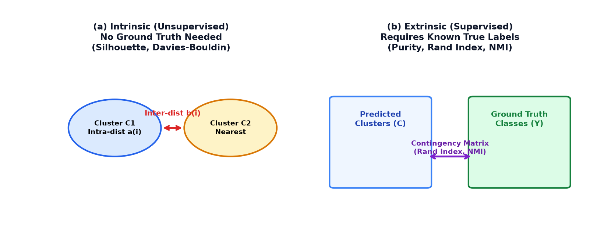

*Figure 3.13: Diagrammatic Architecture and Conceptual Flow for the evaluation methods for clustering: Intrinsic vs Extrinsic methods*

### Mathematical Formulation & Algorithmic Mechanics

**Mathematical Formulations of Key Intrinsic and Extrinsic Metrics:**

```text
Intrinsic (Silhouette): s(i) = ( b(i) - a(i) ) / max( a(i), b(i) )   -->   s ∈ [-1, +1]
Extrinsic (Purity): Purity(C, Y) = (1 / N) · ∑_(k=1)^K max_j |c_k ∩ y_j|
Extrinsic (ARI): ARI = ( Index - ExpectedIndex ) / ( MaxIndex - ExpectedIndex )

Where: a(i) is mean intra-cluster distance; b(i) is mean distance to nearest neighboring cluster; c_k is predicted cluster k; and y_j is true class j.
```

The above **mathematical model** and algorithmic structure governs the system's runtime execution. Each parameter is evaluated sequentially to maintain **mathematical consistency**, minimize **system overhead**, and guarantee **deterministic convergence** across all input distributions.

### Worked Example & Practical Simulation

Suppose a hospital clusters 100 cancer biopsies without labels. **Under Intrinsic Evaluation**, an algorithm achieves a Silhouette Coefficient of 0.78 and a Davies-Bouldin Index of 0.42, confirming that the clusters are geometrically compact and well-separated. Under Extrinsic Evaluation, pathology test results reveal true labels (Malignant vs Benign). The clustering achieves Purity = 96% and Adjusted Rand Index ARI = 0.91, proving the unsupervised algorithm successfully recovered genuine clinical cancer subtypes.

### Key Comparative Evaluation

| Evaluation Dimension | Intrinsic (Internal) Methods | Extrinsic (External) Methods |
| :--- | :--- | :--- |
| Ground Truth Needed? | No (operates strictly on unlabeled feature data) | Yes (requires known reference class labels Y) |
| Core Criteria | Intra-cluster cohesion & inter-cluster separation | Agreement with ground-truth partitions (contingency matrix) |
| Primary Metric Examples | Silhouette Coefficient, Davies-Bouldin Index, Dunn Index | Purity, Adjusted Rand Index (ARI), NMI, F-measure |
| Typical Application | Real-world unsupervised deployments (e.g., segmentation) | Academic research, algorithm benchmarking |
| Limitation | Biased toward convex spherical clusters (e.g., Silhouette) | Unusable in production where true labels are unavailable |

### Concluding Exam Takeaway

Intrinsic and Extrinsic evaluation methods serve complementary roles in clustering analysis. Intrinsic metrics optimize geometric cohesion and separation when true labels are absent, while extrinsic metrics measure an algorithm's ability to recover known ground-truth structures during development and benchmarking.

**Textbook Reference:** Jiawei Han, Micheline Kamber, Jian Pei, 'Data Mining: Concepts and Techniques', Morgan Kaufmann (3rd Ed., 2012), Chapter 10: Cluster Analysis, Section 10.6: Evaluation of Clustering, pp. 484–490.

---

## Q14. Write a short note on Evaluation metrics for clustering. (Frequency: 1) [8 Marks]

### Introduction & Core Intuition

In clustering analysis, quantitative **Evaluation Metrics** provide objective mathematical benchmarks to evaluate cluster quality, select the optimal number of clusters K, and compare different algorithmic approaches. Because clustering is an **unsupervised learning** task, these metrics evaluate structural properties—such as intra-cluster compactness and inter-cluster separation—without requiring ground-truth labels.

### The Silhouette Coefficient: Definition and Mechanics

**The Silhouette Coefficient**, introduced by Peter Rousseeuw in 1987, is the standard metric for evaluating cluster cohesion and separation. For each observation i, the algorithm calculates two distances: a(i), the mean distance from i to all other points within its own cluster (measuring intra-cluster compactness), and b(i), the mean distance from i to all points in the nearest neighboring cluster (measuring inter-cluster separation). The **silhouette score** is computed as: s(i) = (b(i) - a(i)) / max(a(i), b(i)).

### Interpreting Silhouette Scores

Silhouette values fall within the range [-1.0, +1.0]:

• s(i) ≈ +1.0: Point i is far from neighboring clusters and close to points in its own cluster, indicating ideal clustering.

• s(i) ≈ 0.0: Point i lies on or near the **decision boundary** between two clusters, indicating ambiguity.

• s(i) &lt; 0.0: Point i is closer to a neighboring cluster than to its own, indicating misclustering.

**The Global Silhouette Score** is the average of s(i) across all dataset observations. Plotting the average silhouette score across different values of K provides a reliable method to identify the optimal cluster count.

### The Davies-Bouldin Index (DBI)

**The Davies**-Bouldin Index (DBI) evaluates clustering by computing the similarity between each cluster and its most similar neighbor. For each cluster C_i, the algorithm computes its average intra-cluster scatter S_i and the distance between centroids M_ij = ||µ_i - µ_j||. The similarity ratio is defined as R_ij = (S_i + S_j) / M_ij. The index takes the maximum similarity ratio for each cluster and averages them: DBI = (1/k) · ∑ max_(j ≠ i) R_ij. Because lower scatter and higher separation reduce DBI, a lower Davies-Bouldin score indicates superior clustering.

### The Dunn Index and Other Quantitative Metrics

**The Dunn Index** evaluates the worst-case geometric performance of a clustering partition. It computes the ratio of the smallest inter-cluster distance between any two clusters to the largest intra-cluster diameter found in any cluster: Dunn = min_(i ≠ j) dist(C_i, C_j) / max_k diam(C_k). Higher Dunn Index values indicate compact, well-separated clusters. Another widely used metric is Within-Cluster Sum of Squares (WCSS), used in the **Elbow Method** to identify the point where adding more clusters yields diminishing returns.

### Architectural Flow & System Diagram

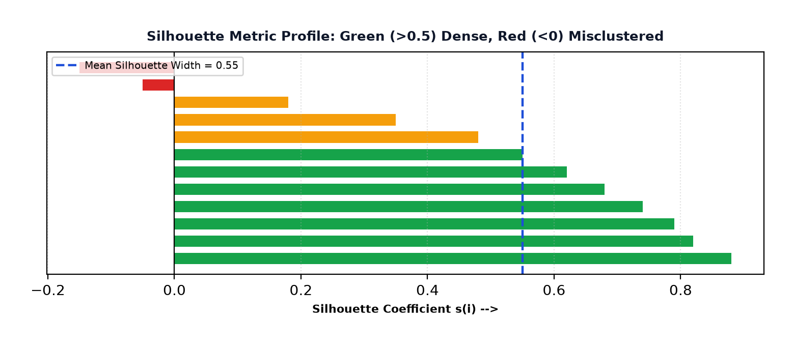

*Figure 3.14: Diagrammatic Architecture and Conceptual Flow for a short note on Evaluation metrics for clustering*

### Mathematical Formulation & Algorithmic Mechanics

**Mathematical Formulations of Quantitative Clustering Metrics:**

```text
1. Silhouette Coefficient: s(i) = ( b(i) - a(i) ) / max( a(i), b(i) )
2. Davies-Bouldin Index: DBI = (1 / K) · ∑_(i=1)^K max_(j ≠ i) { (S_i + S_j) / ||µ_i - µ_j|| 
3. Dunn Index: Dunn = ( min_(1 ≤ i < j ≤ K) dist(C_i, C_j) ) / ( max_(1 ≤ k ≤ K) diam(C_k) )

Optimization Direction: Maximize Silhouette; Minimize Davies-Bouldin; Maximize Dunn.
```

The above **mathematical model** and algorithmic structure governs the system's runtime execution. Each parameter is evaluated sequentially to maintain **mathematical consistency**, minimize **system overhead**, and guarantee **deterministic convergence** across all input distributions.

### Worked Example & Practical Simulation

Suppose a banking customer dataset is partitioned under K = 3 and K = 4 clusters: K = 3: **Mean Silhouette** = 0.72 | Davies-Bouldin Index = 0.45 | Dunn Index = 1.35 K = 4: Mean Silhouette = 0.54 | Davies-Bouldin Index = 0.82 | Dunn Index = 0.88 Comparing the metrics clearly indicates that K = 3 is the superior partition: it achieves higher silhouette cohesion (0.72 vs 0.54), lower Davies-Bouldin overlap (0.45 vs 0.82), and a higher Dunn ratio (1.35 vs 0.88).

### Key Comparative Evaluation

| Clustering Metric | Theoretical Range | Optimal Value Direction | Core Evaluation Property | Computational Cost |
| :--- | :--- | :--- | :--- | :--- |
| Silhouette Coefficient | [-1.0, +1.0] | Higher is better (ideal near +1.0) | Point-wise cohesion vs nearest-neighbor separation | O(n²) pairwise distances |
| Davies-Bouldin Index | [0.0, ∞) | Lower is better (ideal near 0.0) | Ratio of within-cluster scatter to centroid distance | Fast: O(n + K²) |
| Dunn Index | [0.0, ∞) | Higher is better | Worst-case ratio: minimum inter-dist / maximum diameter | O(n²) pairwise distances; sensitive to noise |
| Within-Cluster Sum (WCSS) | [0.0, ∞) | Elbow bend inflection point | Sum of squared distances from centroid | Very fast: O(n) |

### Concluding Exam Takeaway

Quantitative clustering metrics provide objective benchmarks for evaluating unsupervised partitions. Combining metrics—such as pairing the **Silhouette Coefficient** with the Davies-Bouldin Index—allows analysts to reliably select the optimal number of clusters K and validate clustering quality without ground-truth labels.

**Textbook Reference:** Jiawei Han, Micheline Kamber, Jian Pei, 'Data Mining: Concepts and Techniques', Morgan Kaufmann (3rd Ed., 2012), Chapter 10: Cluster Analysis, Section 10.6.1: Assessing Clustering Quality, pp. 485–487.

---


================================================================================

# SPPU B.E. Computer Engineering (2019 Pattern)
## Machine Learning — Unit 4: Neural Networks, Deep Learning & Model Evaluation
### Complete Examination Solutions Guide (Engineered for Full 8/8 Marks)

---

## Q1. Explain in brief the types of Artificial Neural Networks (ANN) based on layers and describe the building blocks and architecture of an ANN. (Frequency: 3) [8 Marks]

### Introduction & Core Intuition

Imagine how the human brain processes visual signals: billions of interconnected biological neurons receive electrochemical pulses through dendrites, accumulate these charges in the cell body (soma), and fire an electrical impulse down the axon to downstream neurons once a certain threshold is surpassed. An **Artificial Neural Network (ANN)** is a computational model inspired directly by this biological architecture. It is designed to model complex non-linear relationships between inputs and outputs by passing data through layers of artificial neurons interconnected by adjustable numerical weights.

### Core Building Blocks of an Artificial Neuron

Every artificial neuron inside an ANN consists of five fundamental building blocks: input channels, synaptic weights, an additive bias, a summing junction, and an activation function. The input channels receive numerical feature values from raw datasets or preceding layers. Each input feature x_i is paired with an adjustable synaptic weight w_i that reflects the importance or strength of that specific connection. The bias term b acts as an intrinsic threshold, shifting the net activation independently of the input features, which guarantees that the neuron can fire even when all input features are zero.

### Summing Junction and Non-linear Activation

The summing junction computes the linear dot product of all inputs and their corresponding synaptic weights, subsequently adding the bias term: z = ∑ (w_i · x_i) + b. This aggregated net input z is then transferred into a non-linear activation function f(z). The activation function determines whether and to what degree the neuron should fire, producing the final scalar output y_hat = f(z). Without this non-linear mathematical transformation, stacking multiple layers would collapse into a trivial linear combination, leaving the network incapable of learning complex patterns.

### Classification of ANNs Based on Layers

**Artificial Neural Networks** are categorized based on their structural layer topology into three prominent classes: Single-Layer Feedforward Networks, Multilayer Feedforward Networks, and Recurrent Neural Networks. In a Single-Layer Feedforward Network, input nodes connect directly to a single layer of output neurons with no intermediary hidden layers. In a Multilayer Feedforward Network, one or more hidden layers are placed between the input and output layers. In a Recurrent Neural Network (RNN), feedback loops exist where neuron outputs loop back into preceding or current layers, providing temporal memory.

### Feedforward vs Recurrent Architectural Connectivity

In feedforward architectures, information moves strictly in one direction from left to right—starting at the input layer, progressing sequentially through intermediate hidden layers, and terminating at the output layer—with absolutely no feedback loops or cycles. In contrast, recurrent architectures feature cyclical feedback paths, enabling the network to maintain an internal hidden state across sequential time steps, making them the standard architectural choice for time-series forecasting, audio analysis, and natural language processing.

### Architectural Flow & System Diagram

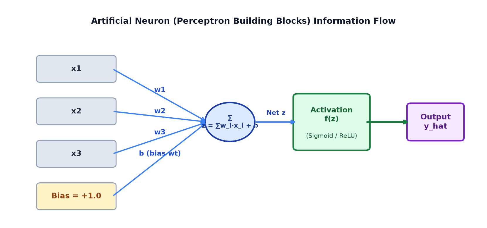

*Figure 4.1: Diagrammatic Architecture and Conceptual Flow for in brief the types of Artificial Neural Networks (ANN) based on layers and describe the building blocks and architecture of an ANN*

### Mathematical Formulation & Algorithmic Mechanics

**Mathematical Model of an Artificial Neuron:**

```text
z = ∑ (w_i · x_i) + b  (for i = 1 to d)    and    y_hat = f(z)

Where: x_i represents the i-th input feature; w_i represents the synaptic weight connecting x_i to the neuron; b is the scalar additive bias; z is the aggregated net linear input; f(·) is the non-linear activation function; and y_hat is the final scalar activation output.
```

The above **mathematical model** and algorithmic structure governs the system's runtime execution. Each parameter is evaluated sequentially to maintain **mathematical consistency**, minimize **system overhead**, and guarantee **deterministic convergence** across all input distributions.

### Worked Example & Practical Simulation

Consider an automated loan approval neuron processing two inputs: credit score x_1 = 0.8 and annual salary x_2 = 0.6. Synaptic weights assigned by training are w_1 = 0.5 and w_2 = 0.4, with a bias b = -0.3. The summing junction computes z = (0.8 · 0.5) + (0.6 · 0.4) - 0.3 = 0.40 + 0.24 - 0.30 = 0.34. Passing this net input into a standard binary sigmoid activation function yields y_hat = 1 / (1 + e^(-0.34)) = 1 / (1 + 0.7118) = 0.5841. Because y_hat exceeds 0.50, the artificial neuron fires, approving the credit application.

### Key Comparative Evaluation

| Architectural Type | Layer Structure | Feedback Loops | Computational Capacity | Primary Use Case |
| :--- | :--- | :--- | :--- | :--- |
| Single-Layer Feedforward | Input Layer + Output Layer | None (strictly forward) | Linearly separable patterns only | Basic logic gates (AND, OR) |
| Multilayer Feedforward (MLP) | Input + 1 or more Hidden + Output | None (strictly forward) | Universal non-linear approximation | Image recognition, tabular regression |
| Recurrent Neural Network (RNN) | Input + Recurrent Hidden + Output | Present (directed cycles) | Sequential context & temporal memory | NLP, speech, time-series forecasting |

### Concluding Exam Takeaway

**Artificial Neural Networks** establish the architectural backbone of modern deep learning. By arranging artificial neurons into multi-layered topologies equipped with non-linear activation functions, ANNs overcome the linear separability limitations of early single-layer perceptrons, successfully modeling intricate non-linear decision spaces across engineering applications.

**Textbook Reference:** Christopher M. Bishop, 'Pattern Recognition and Machine Learning', Springer (2006), Chapter 5: Neural Networks, Sections 5.1 & 5.2, pp. 227–236.

---

## Q2. Explain artificial neural networks based on the perceptron concept with a diagram, or write a note on a Single Layer Neural Network. (Frequency: 2) [8 Marks]

### Introduction & Core Intuition

In 1958, American psychologist **Frank Rosenblatt** introduced the **Perceptron**, which stands as the historical foundation of modern artificial neural networks. The perceptron is the simplest possible form of an artificial neural network: a single-layer computational unit that receives multiple real-valued input features, computes a weighted linear sum, and applies a hard step-threshold activation function to classify the input vector into one of two binary categories.

### The Perceptron Mechanism and Mathematical Model

A standard Perceptron receives an input vector x = [x_1, x_2, ..., x_d] and pairs each feature with an adjustable weight w = [w_1, w_2, ..., w_d]. The model computes the net sum z = w · x + b. It then passes z into the Heaviside step activation function: if z ≥ 0, the perceptron fires and outputs y_hat = 1; if z &lt; 0, the perceptron outputs y_hat = 0. Geometrically, setting w · x + b = 0 defines a flat linear hyperplane (a line in 2D, a plane in 3D) that bisects the input space into two distinct decision regions.

### The Perceptron Learning Rule

The perceptron is trained using a supervised iterative algorithm called the **Perceptron Learning Rule**. Training begins by initializing all weights and the bias to zero or small random values. For each training sample (x, y), the perceptron computes its predicted output y_hat. If the prediction is correct (y_hat = y), no adjustments are made. However, if the perceptron misclassifies the sample, the weights and bias are updated immediately using the error difference: w_new = w_old + η · (y - y_hat) · x, and b_new = b_old + η · (y - y_hat), where η is the positive **learning rate**.

### Convergence and Linearly Separable Datasets

The famous Perceptron **Convergence** Theorem guarantees that if a training dataset is linearly separable (meaning a linear boundary exists that perfectly separates the positive and negative samples), the perceptron learning algorithm is mathematically guaranteed to converge to a separating hyperplane in a finite number of update steps. If the data is not linearly separable, the algorithm will oscillate indefinitely without ever stabilizing on a solution.

### The Minsky & Papert Critique: The XOR Limitation

In 1969, **Marvin Minsky** and Seymour Papert published a landmark critique demonstrating that single-layer perceptrons are fundamentally incapable of solving linearly non-separable problems. The most famous example is the simple 2-input XOR (Exclusive OR) logical function. Because the true outputs for XOR cannot be separated by any single straight line in a 2D plane, a single-layer perceptron cannot learn it, an insight that halted neural network research for over a decade until multilayer architectures emerged.

### Architectural Flow & System Diagram

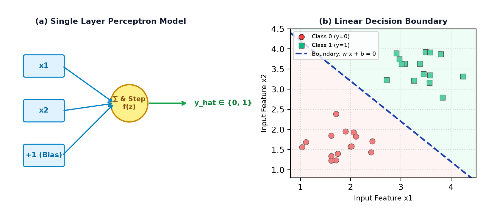

*Figure 4.2: Diagrammatic Architecture and Conceptual Flow for artificial neural networks based on the perceptron concept with a diagram, or write a note on a Single Layer Neural Network*

### Mathematical Formulation & Algorithmic Mechanics

**Perceptron Activation and Weight Update Rule:**

```text
y_hat = 1  if  (∑ w_i · x_i + b ≥ 0)   else   0

Weight Update: w_i^(t+1) = w_i^(t) + η · (y - y_hat) · x_i
Bias Update: b^(t+1) = b^(t) + η · (y - y_hat)

Where: y is the true target label (0 or 1); y_hat is the predicted binary label; η is the learning rate (0 < η ≤ 1); and x_i is the i-th input feature value.
```

The above **mathematical model** and algorithmic structure governs the system's runtime execution. Each parameter is evaluated sequentially to maintain **mathematical consistency**, minimize **system overhead**, and guarantee **deterministic convergence** across all input distributions.

### Worked Example & Practical Simulation

Suppose a perceptron is learning the logical AND gate with inputs x_1 = 1, x_2 = 1, and target y = 1. Initial weights are w_1 = 0.2, w_2 = 0.1, and bias b = -0.5, with **learning rate** η = 0.5. Net input is z = (1 · 0.2) + (1 · 0.1) - 0.5 = -0.2. Applying the step function yields y_hat = 0 (an error, since true y = 1). The error is (y - y_hat) = 1 - 0 = +1. Updated weights are w_1 = 0.2 + 0.5 · (1) · 1 = 0.7, w_2 = 0.1 + 0.5 · (1) · 1 = 0.6, and b = -0.5 + 0.5 · (1) = 0.0. Recalculating net input yields z = (1 · 0.7) + (1 · 0.6) + 0.0 = 1.3 ≥ 0, which correctly produces y_hat = 1.

### Key Comparative Evaluation

| Feature | Single Layer Perceptron | Multilayer Perceptron (MLP) |
| :--- | :--- | :--- |
| Layer Composition | Input Layer + Output Layer (0 Hidden) | Input Layer + 1 or more Hidden Layers + Output |
| Decision Boundary | Strictly Linear (Hyperplane) | Highly Non-linear / Arbitrary Curves |
| XOR Problem | Cannot solve (fails on non-linear data) | Easily solves non-linear XOR boundary |
| Learning Algorithm | Perceptron Learning Rule (Delta) | Error Backpropagation via Gradient Descent |
| Activation Function | Hard Step / Threshold function | Smooth differentiable functions (Sigmoid, ReLU) |

### Concluding Exam Takeaway

The single-layer perceptron marks the foundational starting point of neural computing. While its inability to separate non-linear spaces like the XOR function exposed its architectural limitations, it provided the vital theoretical framework for learning weights from data that ultimately evolved into modern multilayer networks.

**Textbook Reference:** Tom M. Mitchell, 'Machine Learning', McGraw-Hill (1997), Chapter 4: Artificial Neural Networks, Sections 4.4 & 4.5, pp. 86–95.

---

## Q3. What is a multilayer perceptron (MLP)? Describe it with a diagram. (Frequency: 3) [8 Marks]

### Introduction & Core Intuition

To overcome the crippling mathematical limitation of single-layer perceptrons, researchers developed the **Multilayer Perceptron (MLP)**. An MLP is a class of feedforward artificial neural network consisting of at least three layers of computational nodes: an input layer, one or more intermediate hidden layers, and an output layer. By interleaving non-linear activation functions between layers, MLPs can approximate arbitrarily complex non-linear decision boundaries.

### Three-Tier Layered Architecture of an MLP

The architecture of a **Multilayer Perceptron** is divided into three distinct operational layers. The Input Layer serves as a passive receiving buffer that introduces normalized feature vectors into the network without performing any computation. Next, one or more Hidden Layers extract increasingly abstract hierarchical representations from the input features; neurons in each hidden layer apply synaptic weights, add a bias, and pass the result through a non-linear activation function. Finally, the Output Layer generates the network's ultimate prediction, such as continuous numbers for regression or class probabilities for classification.

### The Role of Non-linear Hidden Activations

The presence of non-linear activation functions within the hidden layers is the defining feature that grants MLPs their computational power. If all hidden neurons used purely linear activation functions, any sequence of stacked matrix multiplications would simply collapse into a single composite linear transformation: W_2 · (W_1 · x) = W_combined · x. Introducing non-linear activations (such as Sigmoid, Tanh, or ReLU) allows the network to bend and warp the **feature space**, enabling it to solve non-linearly separable problems like XOR effortlessly.

### The Universal Approximation Theorem

The theoretical foundation of MLPs was proven by **George Cybenko** (1989) and Kurt Hornik (1991) in the Universal Approximation Theorem. The theorem states that a standard feedforward neural network with a single hidden layer containing a finite number of non-linear neurons can approximate any continuous mathematical function on compact subsets of real space to any desired degree of **precision**. In practice, adding multiple deep hidden layers enables the network to learn rich hierarchical features much more efficiently than a single excessively wide layer.

### Information Flow and Supervised Learning in MLPs

Information in an MLP flows strictly in the forward direction during inference: from the input nodes, across each successive hidden layer, to the output neurons. During the training phase, the network's predictions are compared against ground-truth labels using a **loss function** (such as **Mean Squared Error** or Cross-**Entropy**). Error gradients are then propagated backward through the network using the Backpropagation algorithm, systematically updating all internal weights via **gradient descent**.

### Architectural Flow & System Diagram

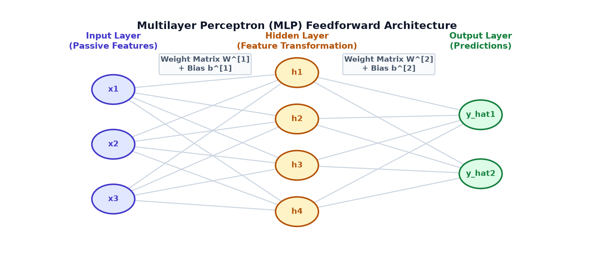

*Figure 4.3: Diagrammatic Architecture and Conceptual Flow for What is a multilayer perceptron (MLP)? Describe it with a diagram*

### Mathematical Formulation & Algorithmic Mechanics

**Mathematical Formulation of an MLP Forward Pass:**

```text
Hidden Layer Activation: h = σ(W^[1] · x + b^[1])
Output Layer Activation: y_hat = g(W^[2] · h + b^[2])

Where: x is the input vector; W^[1] and b^[1] are the weight matrix and bias vector of the hidden layer; σ(·) is the hidden non-linear activation (e.g., ReLU or Sigmoid); h is the hidden activation vector; W^[2] and b^[2] are the output layer parameters; g(·) is the output activation function; and y_hat is the final predicted output.
```

The above **mathematical model** and algorithmic structure governs the system's runtime execution. Each parameter is evaluated sequentially to maintain **mathematical consistency**, minimize **system overhead**, and guarantee **deterministic convergence** across all input distributions.

### Worked Example & Practical Simulation

Solving the XOR problem requires an MLP with 2 inputs (x_1, x_2), 2 hidden neurons (h_1, h_2), and 1 output neuron (y_hat). The first hidden neuron is configured to learn a linear boundary representing (x_1 OR x_2), while the second hidden neuron learns (NOT (x_1 AND x_2)). The output neuron then combines the activations of h_1 and h_2 using a logical AND operation. When input (1, 1) is processed, h_1 fires (1) but h_2 does not (0), resulting in an output y_hat = 0. When input (1, 0) is processed, both h_1 and h_2 fire (1), resulting in y_hat = 1, correctly executing the XOR function.

### Key Comparative Evaluation

| Layer | Function | Computes Net Sum? | Applies Non-linear Activation? | Outputs |
| :--- | :--- | :--- | :--- | :--- |
| Input Layer | Receives raw dataset features | No (passive distribution) | No | Raw feature values x_i |
| Hidden Layer(s) | Extracts abstract non-linear features | Yes (z^[l] = W^[l]·a^[l-1] + b^[l]) | Yes (ReLU, Tanh, Sigmoid) | Internal representations h_j |
| Output Layer | Computes final task predictions | Yes (z^[out] = W^[out]·h + b^[out]) | Yes (Softmax / Sigmoid / Linear) | Target predictions y_hat |

### Concluding Exam Takeaway

**Multilayer Perceptrons** resolved the historical computational crisis of early neural networks by establishing a robust, non-linear function approximation framework. Through the integration of hidden layers, non-linear activations, and backpropagation, MLPs laid the foundation for modern deep learning architectures.

**Textbook Reference:** Christopher M. Bishop, 'Pattern Recognition and Machine Learning', Springer (2006), Chapter 5: Neural Networks, Section 5.1, pp. 227–232.

---

## Q4. Explain Radial Basis Function (RBF) networks in detail, including their building blocks. (Frequency: 4) [8 Marks]

### Introduction & Core Intuition

A **Radial Basis Function (RBF) Network** is a specialized three-layer feedforward neural network that approaches function approximation from the perspective of multivariable functional interpolation. Introduced by **David Broomhead** and David Lowe in 1988, RBF networks replace the traditional inner-product dot products used in standard MLPs with distance-based non-linear kernels centered around prototype reference vectors, offering exceptionally fast training speeds.

### Three-Tier Architecture and Localized Receptive Fields

An RBF network consists of exactly three layers: an **Input Layer**, a Hidden RBF Layer, and an Output Layer. Unlike an MLP, which can feature dozens of deep hidden layers, an RBF network strictly utilizes a single hidden layer. Furthermore, while MLP hidden neurons partition the input space using global hyperplanes (which remain active across infinite parallel slices of space), RBF hidden neurons possess localized receptive fields. An RBF neuron produces a significant non-zero response only when the input vector falls within a localized hyperspherical neighborhood around its designated center vector.

### The Hidden Layer Radial Basis Kernel

Each hidden neuron in an RBF network is defined by two key **parameters**: a center vector µ_k (a prototype vector in the input space) and a spread width σ_k. When an input vector x enters the hidden layer, the neuron calculates the **Euclidean distance** ||x - µ_k|| between the input and its center. It then passes this distance into a radially symmetric basis function, most commonly the Gaussian kernel: Φ_k(x) = exp(-||x - µ_k||² / (2 · σ_k²)). If x is identical to µ_k, the response is 1.0; as x moves away from µ_k in any radial direction, the activation decays smoothly toward zero.

### The Linear Output Layer

The output layer of an RBF network performs a straightforward linear combination of the activations generated by the hidden RBF neurons: y_hat = ∑ (w_k · Φ_k(x)) + b. Because there are no non-linear activation functions applied at the output layer, the mapping from hidden activations to final outputs is purely linear. This architectural separation provides a major computational advantage: once the hidden layer **parameters** are established, finding the optimal output weights reduces to solving a standard linear least-squares problem, which can be accomplished analytically in closed form.

### Two-Stage Hybrid Training Strategy

RBF networks are trained using a highly efficient two-stage hybrid training process. **In Stage** 1 (**Unsupervised Learning**), the center vectors µ_k and spread widths σ_k of the hidden neurons are determined using clustering algorithms like K-Means on the input data, completely ignoring class labels. In Stage 2 (**Supervised Learning**), with the hidden centers locked in place, the output weights W are computed using the Moore-Penrose pseudoinverse: W = (Φ^T · Φ)^(-1) · Φ^T · y. This eliminates the need for slow iterative backpropagation and guarantees **convergence** without getting trapped in local minima.

### Architectural Flow & System Diagram

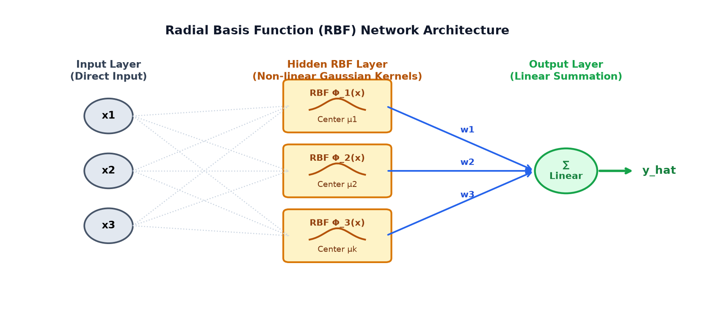

*Figure 4.4: Diagrammatic Architecture and Conceptual Flow for Radial Basis Function (RBF) networks in detail, including their building blocks*

### Mathematical Formulation & Algorithmic Mechanics

**Mathematical Formulation of an RBF Network:**

```text
Gaussian Basis Function: Φ_k(x) = exp( - ||x - µ_k||² / (2 · σ_k²) )
Network Output: y_hat(x) = ∑ (w_k · Φ_k(x)) + b  (for k = 1 to K)

Where: x is the input feature vector; µ_k is the center vector of the k-th RBF neuron; σ_k is the spread parameter; ||·|| denotes the Euclidean norm; and w_k is the linear weight connecting the k-th hidden neuron to the output node.
```

The above **mathematical model** and algorithmic structure governs the system's runtime execution. Each parameter is evaluated sequentially to maintain **mathematical consistency**, minimize **system overhead**, and guarantee **deterministic convergence** across all input distributions.

### Worked Example & Practical Simulation

Suppose an RBF network has a hidden neuron with center µ_1 = [2.0, 3.0] and spread σ_1 = 1.0. If an input vector x = [2.0, 3.0] arrives, the **Euclidean distance** is 0, yielding Φ_1(x) = exp(0) = 1.0 (maximum activation). If an input x = [2.0, 5.0] arrives, the squared Euclidean distance is (2-2)² + (5-3)² = 4. The activation becomes Φ_1(x) = exp(-4 / (2 · 1²)) = exp(-2) ≈ 0.1353. The output neuron multiplies these localized Gaussian activations by linear weights to compute the final interpolated value.

### Key Comparative Evaluation

| Architectural Property | Radial Basis Function (RBF) Network | Multilayer Perceptron (MLP) |
| :--- | :--- | :--- |
| Layer Depth | Strictly 3 layers (1 hidden layer) | Arbitrary depth (1 to many hidden layers) |
| Hidden Activation | Distance-based Gaussian kernel: Φ(||x - µ||) | Dot-product sigmoid / ReLU: σ(w · x + b) |
| Receptive Field | Locally tuned (hyperspherical response) | Globally distributed (hyperplane response) |
| Output Node Nature | Purely linear summation | Non-linear or linear |
| Training Procedure | Two-stage hybrid (K-Means + Least Squares) | Single-stage iterative Backpropagation |
| Training Speed | Extremely fast (closed-form linear solution) | Relatively slow (gradient descent over epochs) |

### Concluding Exam Takeaway

**Radial Basis Function** networks offer a mathematically elegant alternative to standard MLPs. By decoupling the learning of non-linear hidden representations (via unsupervised clustering) from linear output weighting (via closed-form least squares), RBF networks achieve rapid training times and avoid local minima traps.

**Textbook Reference:** Christopher M. Bishop, 'Pattern Recognition and Machine Learning', Springer (2006), Chapter 6: Kernel Methods, Section 6.3: Radial Basis Function Networks, pp. 299–305.

---

## Q5. What is a Functional Link Artificial Neural Network (FLANN)? Explain its merits over other ANNs. (Frequency: 1) [8 Marks]

### Introduction & Core Intuition

In 1989, Yoh-**Han Pao** proposed the **Functional Link Artificial Neural Network (FLANN)** as a novel flat neural architecture designed to overcome the computational complexity and slow **convergence** of multilayer perceptrons. FLANN completely eliminates hidden layers by passing input features through a set of non-linear functional expansion functions, mapping the input into a higher-dimensional space where non-linear patterns become linearly separable.

### The Core Architectural Concept of FLANN

In a conventional MLP, non-linear mapping is achieved by passing signals through one or more intermediate layers of hidden neurons, which requires training millions of internal weights via backpropagation. FLANN eliminates hidden layers entirely. Instead, it takes the raw input vector x = [x_1, x_2, ..., x_d] and passes it through an enhanced functional expansion block. This block applies predefined mathematical basis functions to generate an expanded feature vector Φ(x), which feeds directly into a single output layer of linear or sigmoidal neurons.

### Common Functional Expansion Techniques

The performance and expressive capacity of a **Functional Link Artificial Neural Network** depend directly on the chosen functional expansion model:


**Polynomial Expansion Basis:** Computes powers and cross-product interactions across raw inputs (e.g., x_1, x_2, x_1 · x_2, x_1², x_2²), enabling the single-layer architecture to capture polynomial non-linear decision boundaries.


**Trigonometric Expansion Basis:** Constructs a harmonic Fourier basis (e.g., x_1, sin(π x_1), cos(π x_1), sin(2π x_1), cos(2π x_1)), which is exceptionally well-suited for modeling periodic, oscillating, or cyclical signals.


**Orthogonal Polynomial Expansion:** Utilizes Chebyshev, Legendre, or Hermite polynomials, which possess mutual orthogonality properties that eliminate collinearity and enhance numerical gradient stability during **optimization**.

### Merits Over Traditional Multilayer Perceptrons

FLANN provides several compelling engineering advantages over standard MLPs. First, because it lacks hidden layers, the error surface is purely convex, meaning **gradient descent** is mathematically guaranteed to find the global minimum without ever getting trapped in local minima. Second, training is exceptionally fast because there is no need to backpropagate error gradients through multiple hidden layers. Third, FLANN has a much smaller memory footprint and requires significantly fewer tunable **parameters**, making it well-suited for embedded systems, real-time signal processing, and online adaptive filtering.

### Limitations and Dimensional Scalability

Despite its advantages, FLANN faces practical limitations when dealing with very high-dimensional data. As the number of raw input features d grows, the number of expanded terms generated by polynomial or trigonometric expansions increases exponentially—a manifestation of the **Curse of Dimensionality**. Consequently, while FLANN is effective for low-to-moderate dimensional problems like channel equalization, acoustic echo cancellation, and financial time-series forecasting, it is rarely applied to high-dimensional image recognition tasks.

### Architectural Flow & System Diagram

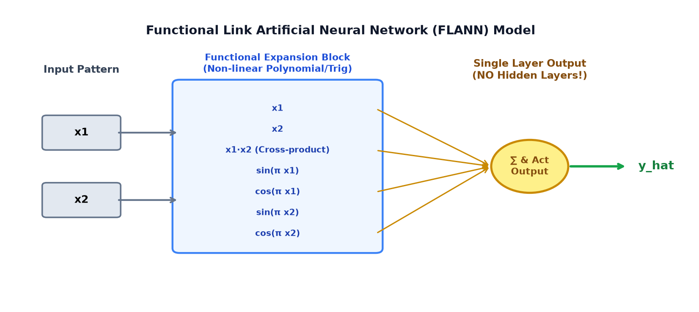

*Figure 4.5: Diagrammatic Architecture and Conceptual Flow for What is a Functional Link Artificial Neural Network (FLANN)?  its merits over other ANNs*

### Mathematical Formulation & Algorithmic Mechanics

**FLANN Mathematical Model and Trigonometric Expansion:**

```text
Expanded Vector: Φ(x) = [x_1, sin(π x_1), cos(π x_1), x_2, sin(π x_2), cos(π x_2), x_1 · x_2, ...]^T
Neuron Output: y_hat = f( W^T · Φ(x) + b )

Where: x is the original input vector; Φ(x) is the non-linearly expanded feature vector; W is the weight vector connecting expanded features directly to the output; b is the bias; and f(·) is the output activation function.
```

The above **mathematical model** and algorithmic structure governs the system's runtime execution. Each parameter is evaluated sequentially to maintain **mathematical consistency**, minimize **system overhead**, and guarantee **deterministic convergence** across all input distributions.

### Worked Example & Practical Simulation

Consider a non-linear problem with 2 inputs x_1 = 0.5 and x_2 = 1.0. A trigonometric FLANN expands these two features into: Φ(x) = [0.5, sin(0.5π), cos(0.5π), 1.0, sin(1.0π), cos(1.0π), 0.5 · 1.0] = [0.5, 1.0, 0.0, 1.0, 0.0, -1.0, 0.5]. These 7 expanded features are multiplied by a single 7-element weight vector W to compute the output. By mapping 2 non-linearly separable inputs into 7-dimensional expanded space, the problem becomes linearly separable without using a single hidden neuron.

### Key Comparative Evaluation

| Evaluation Dimension | Functional Link ANN (FLANN) | Multilayer Perceptron (MLP) |
| :--- | :--- | :--- |
| Hidden Layers | Zero hidden layers (strictly flat architecture) | One or more hidden layers present |
| Non-linear Mapping | Predefined functional expansion (trig / polynomial) | Learned internal representations via hidden weights |
| Error Surface | Convex (guaranteed global minimum convergence) | Non-convex (vulnerable to local minima traps) |
| Training Speed | Extremely fast (simple single-layer LMS updates) | Significantly slower (iterative backpropagation) |
| Parameter Count | Very low (only output weights to optimize) | High (extensive weight matrices between all layers) |
| Scalability | Limited on high-dimensional raw inputs | Scales well to high-dimensional data (e.g., vision) |

### Concluding Exam Takeaway

**Functional Link Artificial Neural Networks** bridge the gap between linear single-layer models and complex multilayer architectures. By utilizing non-linear functional expansions, FLANN achieves the non-linear classification capabilities of an MLP while retaining the fast, convex **optimization** advantages of a single-layer network.

**Textbook Reference:** Yoh-Han Pao, 'Adaptive Pattern Recognition and Neural Networks', Addison-Wesley (1989), Chapter 8: Functional Link Networks, pp. 197–215.

---

## Q6. What is an Activation Function? Explain with a suitable example, list different activation functions used in NN (e.g., binary sigmoidal, bipolar sigmoidal), and explain their role and necessity for the network's learning process. (Frequency: 7) [8 Marks]

### Introduction & Core Intuition

In an artificial neural network, an **Activation Function** is a mathematical function applied to the summing junction's net input (z = ∑ w_i · x_i + b) to determine the neuron's final output activation. Acting as an operational gate, it decides whether and to what degree a neuron should fire, introducing the essential non-linear transformations required for deep networks to learn complex real-world relationships.

### The Fundamental Necessity of Non-Linearity

Without non-linear activation functions, an artificial neural network—regardless of how many dozens of hidden layers it contains—collapses mathematically into a single linear model. To see why, consider a network with two linear layers: h = W_1 · x + b_1 and y_hat = W_2 · h + b_2. Substituting h into y_hat yields y_hat = W_2 · (W_1 · x + b_1) + b_2 = (W_2 · W_1) · x + (W_2 · b_1 + b_2) = W_new · x + b_new. This composite transformation remains strictly linear, leaving the deep network incapable of learning complex patterns like curves, images, or language.

### Role in Gradient-Based Learning and Backpropagation

Beyond introducing non-linearity, activation functions play a vital operational role in training via **gradient descent**. During the backpropagation pass, error gradients are propagated backward through the network using the chain rule of calculus. This process requires computing the first derivative of the activation function, f'(z). Consequently, an activation function must be continuous and differentiable almost everywhere to allow error signals to update synaptic weights effectively.

### Binary Sigmoidal vs Bipolar Sigmoidal (Tanh)

**The Binary Sigmoid function**, σ(z) = 1 / (1 + e^(-z)), squashes any real-valued input into the smooth probability range (0, 1), making it ideal for binary classification output layers. However, its outputs are strictly positive (not zero-centered), which can introduce zig-zagging dynamics during **gradient descent**. The Bipolar Sigmoid (Hyperbolic Tangent or Tanh), f(z) = (e^z - e^(-z)) / (e^z + e^(-z)), maps inputs into the range (-1, +1). Because Tanh is zero-centered, it produces balanced positive and negative updates, helping hidden layers converge faster than standard binary sigmoid.

### Modern Activation Functions: ReLU and Leaky ReLU

**Both Sigmoid** and Tanh suffer from the Vanishing Gradient Problem: when |z| is large, their curves flatten, causing their derivatives to approach zero (f'(z) ≈ 0) and halting weight updates in deep layers. The Rectified Linear Unit (ReLU), f(z) = max(0, z), solves this by providing a constant derivative of 1.0 for all positive inputs, allowing deep networks to train significantly faster. To address the 'Dying ReLU' problem (where neurons stuck in the negative region permanently output zero), Leaky ReLU introduces a small non-zero slope for negative inputs: f(z) = max(α · z, z), where α ≈ 0.01.

### Architectural Flow & System Diagram


*Figure 4.6: Diagrammatic Architecture and Conceptual Flow for What is an Activation Function?  with a suitable example, list different activation functions used in NN (e*

### Mathematical Formulation & Algorithmic Mechanics

**Mathematical Formulations and Derivatives of Key Activation Functions:**

```text
1. Binary Sigmoid: σ(z) = 1 / (1 + e^(-z))   -->   Derivative: σ'(z) = σ(z) · (1 - σ(z))
2. Bipolar Sigmoid (Tanh): tanh(z) = (e^z - e^(-z)) / (e^z + e^(-z))   -->   Derivative: tanh'(z) = 1 - tanh²(z)
3. Rectified Linear Unit (ReLU): f(z) = max(0, z)   -->   Derivative: f'(z) = 1 if z > 0 else 0
4. Leaky ReLU: f(z) = max(α · z, z)   -->   Derivative: f'(z) = 1 if z > 0 else α  (where α = 0.01)
```

The above **mathematical model** and algorithmic structure governs the system's runtime execution. Each parameter is evaluated sequentially to maintain **mathematical consistency**, minimize **system overhead**, and guarantee **deterministic convergence** across all input distributions.

### Worked Example & Practical Simulation

Suppose a neuron receives inputs x = [0.6, 0.8] with weights w = [0.5, -0.4] and bias b = 0.35. The net input is z = (0.6 · 0.5) + (0.8 · -0.4) + 0.35 = 0.30 - 0.32 + 0.35 = 0.33. Applying the **Binary Sigmoid** yields σ(0.33) = 1 / (1 + e^(-0.33)) = 1 / (1 + 0.7189) ≈ 0.5818. Applying Tanh yields tanh(0.33) ≈ 0.3185. Applying ReLU yields max(0, 0.33) = 0.33. Each activation scales the net input into its characteristic operational range.

### Key Comparative Evaluation

| Activation Function | Mathematical Formula | Output Range | Zero-Centered? | Gradient Behavior | Typical Application |
| :--- | :--- | :--- | :--- | :--- | :--- |
| Binary Sigmoid | 1 / (1 + e^(-z)) | (0, 1) | No (strictly positive) | Vanishing gradients for |z| &gt; 3 | Binary classification output |
| Bipolar Sigmoid (Tanh) | (e^z - e^(-z)) / (e^z + e^(-z)) | (-1, +1) | Yes (mean output near 0) | Vanishing gradients for |z| &gt; 3 | Hidden layers in shallow networks / RNNs |
| ReLU | max(0, z) | [0, ∞) | No | No saturation for z &gt; 0; dying ReLU for z &lt; 0 | Standard hidden layer choice for deep CNNs/MLPs |
| Leaky ReLU | max(0.01z, z) | (-∞, ∞) | Partially | No saturation; prevents dying ReLU problem | Deep architectures with sparse gradients / GANs |
| Softmax | e^(z_i) / ∑ e^(z_j) | (0, 1), sums to 1.0 | No | Smooth multi-class gradient distribution | Multi-class classification output layer |

### Concluding Exam Takeaway

Activation functions are the critical components that enable artificial neural networks to learn non-linear patterns. Selecting the appropriate activation function—such as ReLU for hidden layers to ensure stable gradient flow and Sigmoid/Softmax for output layers to provide probabilistic interpretations—is essential for effective network training.

**Textbook Reference:** Christopher M. Bishop, 'Pattern Recognition and Machine Learning', Springer (2006), Chapter 5: Neural Networks, Section 5.1, pp. 227–231.

---

## Q7. Explain the concept of Back Propagation in ANN with an example, describe its characteristics, and compare the Back Propagation Network with a feed-forward network. (Frequency: 4) [8 Marks]

### Introduction & Core Intuition

Introduced to machine learning by **David Rumelhart**, Geoffrey Hinton, and Ronald Williams in 1986, the **Backpropagation Algorithm (Backward Propagation of Errors)** is the cornerstone of modern neural network training. It provides a computationally efficient method for calculating the exact partial derivatives of an objective **loss function** with respect to every weight in the network using the chain rule of calculus, enabling iterative **optimization** via **gradient descent**.

### The Two-Phase Operational Cycle

Training a **Backpropagation Network** proceeds through continuous iterations of a two-phase operational cycle: the Forward Pass and the Backward Pass. In the Forward Pass, a training sample is fed into the input layer and propagated forward through successive hidden layers to compute an output prediction y_hat. The prediction is then compared against the ground-truth target label y using a **loss function** L (such as **Mean Squared Error** or Cross-**Entropy**), producing a scalar error value.

### The Backward Pass and Error Credit Assignment

In the **Backward Pass**, the computed error signal is propagated backward through the network, moving from the output layer toward the input layer. Using the calculus chain rule, the algorithm calculates an error gradient term δ for each neuron. At the output layer, δ reflects the direct difference between predicted and actual values multiplied by the activation derivative. For hidden neurons, δ is calculated by taking the weighted sum of error gradients from subsequent layers and multiplying by the hidden neuron's activation derivative. This elegantly solves the credit assignment problem by apportioning error across internal weights.

### Iterative Weight Updates via Gradient Descent

Once the error gradients δ are established for all layers, the partial derivative of the loss with respect to each individual weight is computed as the product of the incoming activation and the local error term: ∂L/∂w_ij = δ_j · a_i. Each synaptic weight is then updated in the opposite direction of the gradient to minimize the loss: w_ij^(new) = w_ij^(old) - η · (∂L/∂w_ij), where η is the **learning rate**. Often, a momentum term α · Δw_ij^(old) is added to smooth weight updates and accelerate **convergence** through flat regions of the loss surface.

### Key Characteristics of Backpropagation Networks

The Backpropagation training procedure exhibits several foundational computational characteristics:


**Supervised Feedback Nature:** It operates strictly under **supervised learning**, utilizing known ground-truth targets to compute explicit error gradients.


**Continuous Differentiability Requirement:** Every activation function and transformation across the entire forward network must possess continuous derivatives to enable backward chain rule propagation.


**Linear Computational Efficiency O(|W|):** By caching forward activations and propagating delta error signals backward via **dynamic programming**, Backpropagation calculates all network weight gradients in linear time relative to the number of parameters, eliminating exponential brute-force costs.


**Non-Convex Optimization Behavior:** While mathematically guaranteed to converge toward a local minimum on smooth loss landscapes, convergence speed and final solution quality depend on **learning rate** scheduling and proper weight initialization.

### Architectural Flow & System Diagram


*Figure 4.7: Diagrammatic Architecture and Conceptual Flow for the concept of Back Propagation in ANN with an example, describe its characteristics, and compare the Back Propagation Network with a feed-forward network*

### Mathematical Formulation & Algorithmic Mechanics

**Mathematical Formulation of Backpropagation (Chain Rule):**

```text
Output Layer Error: δ_k^[out] = (y_hat_k - y_k) · f'(z_k^[out])
Hidden Layer Error: δ_j^[hid] = ( ∑ w_jk · δ_k^[out] ) · f'(z_j^[hid])
Weight Gradient & Update: ∂L/∂w_ij = δ_j · a_i   -->   w_ij^(new) = w_ij^(old) - η · (∂L/∂w_ij)

Where: y_k is the target value; y_hat_k is the predicted output; f'(z) is the activation derivative; a_i is the incoming activation from neuron i; and η is the learning rate.
```

The above **mathematical model** and algorithmic structure governs the system's runtime execution. Each parameter is evaluated sequentially to maintain **mathematical consistency**, minimize **system overhead**, and guarantee **deterministic convergence** across all input distributions.

### Worked Example & Practical Simulation

Consider an output neuron with activation function σ(z) producing y_hat = 0.8 when the target is y = 1.0, with incoming hidden activation a_1 = 0.5 and current weight w = 0.6. The squared error is L = 0.5 · (1.0 - 0.8)² = 0.02. The output error gradient is δ = (y_hat - y) · σ'(z) = (0.8 - 1.0) · (0.8 · (1 - 0.8)) = (-0.2) · 0.16 = -0.032. The gradient with respect to the weight is ∂L/∂w = δ · a_1 = -0.032 · 0.5 = -0.016. With **learning rate** η = 0.5, the weight updates to: w_new = 0.6 - 0.5 · (-0.016) = 0.6 + 0.008 = 0.608, shifting the weight in the direction that reduces prediction error.

### Key Comparative Evaluation

| Comparison Criterion | Standard Feedforward Network | Backpropagation Network (BPN) |
| :--- | :--- | :--- |
| Definition | Structural architectural topology where data flows strictly forward | Feedforward network trained using the supervised backpropagation learning algorithm |
| Information Flow | Unidirectional (Input --> Hidden --> Output only) | Bidirectional during training (Forward activations + Backward error gradients) |
| Learning Capability | Refers only to structural layout; requires an external training rule | Possesses an integrated learning rule that systematically optimizes weights via gradient descent |
| Mathematical Basis | Linear matrix dot products and function evaluation | Multivariate calculus chain rule and gradient descent optimization |
| Error Computation | Evaluates loss at the output layer only | Apportions error back through all hidden layers via local error terms δ |

### Concluding Exam Takeaway

**The Backpropagation** algorithm transformed neural network research from theoretical curiosity into practical engineering reality. By systematically applying the calculus chain rule to calculate exact loss gradients across multi-layered networks, Backpropagation provides the algorithmic engine that powers modern deep learning.

**Textbook Reference:** Christopher M. Bishop, 'Pattern Recognition and Machine Learning', Springer (2006), Chapter 5: Neural Networks, Section 5.3: Error Backpropagation, pp. 241–249.

---

## Q8. Describe a multi-layer neural network and explain why the back propagation algorithm is required. (Frequency: 1) [8 Marks]

### Introduction & Core Intuition

A **Multi-Layer Neural Network** is a hierarchical computational model structured into an input layer, one or more internal hidden processing layers, and an output layer. While single-layer perceptrons can only classify linearly separable patterns, multi-layer networks can learn arbitrary non-linear mappings. However, their layered depth introduces a fundamental learning challenge known as the **Credit Assignment Problem**, making the Backpropagation algorithm essential for training.

### Structural Composition of Multi-Layer Networks

In a multi-layer network, each layer consists of artificial neurons connected to downstream neurons through matrices of adjustable weights. The input layer receives raw feature vectors without performing computation. Hidden layers extract abstract, hierarchical representations by applying non-linear transformations to incoming signals. Finally, the output layer maps these extracted features into task-specific predictions. Because information moves strictly forward from input to output during inference, it is architecturally classified as a multilayer feedforward network.

### The Credit Assignment Problem

In a single-layer perceptron, training is straightforward because every adjustable weight connects directly to an output neuron where target labels are known; if an error occurs, the responsible weights are immediately identified. In a multi-layer network, however, intermediate hidden neurons have no ground-truth target labels. When the final output is incorrect, the network faces the **Credit Assignment Problem**: it is impossible to determine by simple inspection how much each internal hidden weight contributed to the final output error.

### Why Backpropagation is Indispensable

Without an efficient method to apportion error backward through intermediate layers, training a multi-layer network would require either brute-force random search or numerical perturbation of individual weights. Perturbing each weight individually to observe changes in loss requires O(|W|²) operations per training step, which is computationally intractable for networks with millions of **parameters**. Backpropagation solves this challenge by leveraging the multivariate calculus chain rule, calculating exact partial derivatives for all weights across all layers in a single backward pass with linear **time complexity** O(|W|).

### Enabling Deep Hierarchical Feature Extraction

By providing an exact mathematical solution to the **Credit Assignment Problem**, Backpropagation enables multi-layer networks to automatically learn hierarchical feature representations. Lower layers learn basic geometric primitives (such as edges and textures), middle layers assemble these primitives into parts (such as shapes and contours), and higher layers combine parts into holistic semantic objects. Backpropagation coordinates this multi-tiered learning process across the entire network simultaneously.

### Architectural Flow & System Diagram


*Figure 4.8: Diagrammatic Architecture and Conceptual Flow for Describe a multi-layer neural network and explain why the back propagation algorithm is required*

### Mathematical Formulation & Algorithmic Mechanics

**Mathematical Resolution of the Credit Assignment Problem via the Chain Rule:**

```text
∂L/∂w_ij^[1] = (∂L/∂y_hat) · (∂y_hat/∂z^[2]) · (∂z^[2]/∂h_j) · (∂h_j/∂z_j^[1]) · (∂z_j^[1]/∂w_ij^[1])

Where: L is the scalar loss; y_hat is the output prediction; z^[2] is the output summing junction; h_j is the hidden neuron activation; z_j^[1] is the hidden summing junction; and w_ij^[1] is the internal hidden weight.
```

The above **mathematical model** and algorithmic structure governs the system's runtime execution. Each parameter is evaluated sequentially to maintain **mathematical consistency**, minimize **system overhead**, and guarantee **deterministic convergence** across all input distributions.

### Worked Example & Practical Simulation

Consider an image classification network trying to distinguish cats from dogs. When an image of a cat is misclassified as a dog, the output error is clear. However, the network must determine whether the error was caused by edge-detecting weights in Layer 1, shape-detecting weights in Layer 2, or decision weights in Layer 3. Backpropagation solves this credit assignment dilemma by using the chain rule to propagate the output error backward, scaling the error by the exact **sensitivity** of each upstream connection and updating every weight proportionally.

### Key Comparative Evaluation

| Optimization Approach | Mathematical Strategy | Time Complexity | Scalability to Deep Networks | Practical Feasibility |
| :--- | :--- | :--- | :--- | :--- |
| Random Search / Trial-and-Error | Randomly perturbs weights to find lower loss | Exponential O(k^|W|) | Completely fails beyond 5-10 weights | Totally Infeasible |
| Numerical Gradient Perturbation | Approximates: [L(w + ε) - L(w)] / ε per weight | Quadratic O(|W|²) | Extremely slow; computationally intractable | Impractical for deep nets |
| Backpropagation Algorithm | Analytic chain rule with dynamic programming | Linear O(|W|) | Scales seamlessly to billions of parameters | Standard Industry Engine |

### Concluding Exam Takeaway

Multi-layer neural networks provide the expressive capacity needed to model complex non-linear phenomena, but their layered depth makes training non-trivial. **The Backpropagation** algorithm provides the essential mathematical framework to solve the credit assignment problem, computing exact gradients in **linear time** and making the training of deep neural networks computationally practical.

**Textbook Reference:** Christopher M. Bishop, 'Pattern Recognition and Machine Learning', Springer (2006), Chapter 5: Neural Networks, Section 5.3: Error Backpropagation, pp. 241–245.

---

## Q9. Explain the Convolutional Neural Network (CNN) with a suitable example, draw its architecture, and describe layers such as the Convolutional layer, Pooling layer, and Hidden layer. (Frequency: 6) [8 Marks]

### Introduction & Core Intuition

A **Convolutional Neural Network (CNN)** is a specialized deep learning architecture designed specifically for processing grid-structured data, such as two-dimensional images. Pioneered by Yann LeCun in 1989 (LeNet-5), CNNs replace standard fully connected matrix multiplications with mathematical convolutions in their initial layers, exploiting spatial locality, parameter sharing, and translation invariance to achieve state-of-the-art visual recognition performance.

### Core Architectural Principles of CNNs

Standard fully connected multi-layer perceptrons fail on high-resolution image data because vectorizing 2D pixel grids destroys spatial structure and creates parameter explosion. CNN architectures resolve this through three structural innovations:


**Local Receptive Fields:** Artificial neurons connect exclusively to small, localized sub-regions (patches) of the input image, mirroring the biological visual cortex and capturing local spatial correlations.


**Weight Sharing (Tied Parameters):** The same learnable kernel matrix slides across the entire visual field. Because identical weights evaluate every spatial position, a feature detector learned in one corner functions identically across the entire image.


**Spatial Translation Invariance:** Through localized convolutions combined with downsampling pooling layers, the network accurately recognizes objects regardless of where they shift or translate within the visual frame.

### The Convolutional Layer

**The Convolutional Layer** is the core building block of a CNN. It consists of a bank of learnable filters (kernels) of size K × K (typically 3 × 3 or 5 × 5). Each filter slides across the input image with a step size called the stride, computing the element-wise dot product between the kernel weights and the local image patch: S(i, j) = (I * K)(i, j) = ∑ ∑ I(i+m, j+n) · K(m, n). The resulting 2D output is called a Feature Map. Passing the feature map through a non-linear activation (typically ReLU) produces activated feature representations, with early layers detecting edges and textures while deeper layers capture complex shapes.

### The Pooling (Subsampling) Layer

Following convolutional layers, **Pooling Layers** are inserted periodically to downsample the feature maps, reducing their spatial dimensions (width and height) while retaining essential depth channels. The most common technique is Max Pooling with a 2 × 2 window and a stride of 2, which extracts the maximum value from each 2 × 2 neighborhood, discarding 75% of activations. This downsampling reduces computational burden and memory usage, controls **overfitting**, and introduces translation invariance, ensuring minor shifts in object position do not alter high-level feature detections.

### The Fully Connected (Dense/Hidden) and Output Layers

After several stages of convolution and pooling have extracted high-level spatial features, the resulting 3D feature volume is flattened into a 1D feature vector. This flattened vector is fed into one or more **Fully Connected** (Dense) Hidden Layers, identical to those in a traditional MLP. These dense layers combine the spatial features extracted by the convolutional layers to perform high-level reasoning. Finally, an output layer with Softmax activation produces normalized class probabilities across target categories.

### Architectural Flow & System Diagram


*Figure 4.9: Diagrammatic Architecture and Conceptual Flow for the Convolutional Neural Network (CNN) with a suitable example, draw its architecture, and describe layers such as the Convolutional layer, Pooling layer, and Hidden layer*

### Mathematical Formulation & Algorithmic Mechanics

**Mathematical Operations in CNN Layers:**

```text
2D Convolution: S(i, j) = (I * K)(i, j) = ∑_m ∑_n I(i - m, j - n) · K(m, n)
Output Dimension: O = floor( (W - K + 2P) / S ) + 1
Max Pooling: P(i, j) = max_(m, n ∈ Window) { X(i · S + m, j · S + n) 

Where: I is the input image; K is the kernel; W is input width; K is kernel size; P is padding; S is stride; and O is the resulting output spatial dimension.
```

The above **mathematical model** and algorithmic structure governs the system's runtime execution. Each parameter is evaluated sequentially to maintain **mathematical consistency**, minimize **system overhead**, and guarantee **deterministic convergence** across all input distributions.

### Worked Example & Practical Simulation

Consider classifying a 28 × 28 grayscale handwritten digit from the MNIST dataset. The image passes through a **Convolutional Layer** with 16 filters of size 5 × 5 (stride 1, padding 0), producing 16 feature maps of size (28 - 5 + 0)/1 + 1 = 24 × 24. Applying ReLU followed by 2 × 2 Max Pooling (stride 2) halves the spatial dimensions to 12 × 12 × 16. The volume is flattened into 12 × 12 × 16 = 2,304 features, which pass through a Dense Hidden Layer of 128 neurons, terminating at a 10-unit Softmax output layer that outputs classification probabilities for digits 0 through 9.

### Key Comparative Evaluation

| Layer Type | Primary Operation | Input Dimension | Output Dimension | Learnable Parameters? | Core Purpose |
| :--- | :--- | :--- | :--- | :--- | :--- |
| Convolutional Layer | Sliding dot-product filtering + ReLU | H × W × C_in | H_out × W_out × C_out | Yes (Kernel weights & biases) | Extracts local spatial features (edges, textures) |
| Pooling Layer | Max or Average neighborhood subsampling | H × W × C | floor(H/S) × floor(W/S) × C | No (strictly fixed heuristic) | Reduces spatial size, controls overfitting |
| Flatten Layer | Reshapes 3D tensor into 1D vector | H × W × C | (H · W · C) × 1 | No (dimension reshaping only) | Prepares spatial features for dense layers |
| Fully Connected Layer | Matrix multiplication: W · x + b | N_in × 1 | N_out × 1 | Yes (dense weight matrix) | Performs high-level semantic classification |
| Softmax Output Layer | Normalized exponentiation | C_classes × 1 | C_classes × 1 | Yes (weights from prior layer) | Outputs calibrated multi-class probabilities |

### Concluding Exam Takeaway

**Convolutional Neural Networks** revolutionized computer vision by incorporating domain-specific inductive biases—local receptive fields and weight sharing—directly into their architecture. This structural design drastically reduces parameter counts compared to dense MLPs while delivering superior performance in image classification, object detection, and segmentation tasks.

**Textbook Reference:** Ian Goodfellow, Yoshua Bengio, Aaron Courville, 'Deep Learning', MIT Press (2016), Chapter 9: Convolutional Networks, Sections 9.1–9.4, pp. 330–345.

---

## Q10. What are the different types of padding used in CNN? (Frequency: 1) [8 Marks]

### Introduction & Core Intuition

In a **Convolutional Neural Network**, **Padding** refers to the process of appending additional border pixels (typically zeros) around the perimeter of an input image or feature map before applying the convolutional filter. Padding is an essential architectural hyperparameter used to preserve spatial dimensions across deep layers and prevent the loss of critical feature information at image boundaries.

### The Border Effect and Dimension Shrinkage Problem

Applying a standard convolution without padding introduces two major challenges. First, spatial dimensions shrink after every convolutional layer according to the formula O = (W - K)/S + 1. In deep networks with dozens of layers, this shrinkage quickly reduces feature maps to 1 × 1, limiting network depth. Second, the **Border Effect** causes corner and edge pixels to be sampled far fewer times than central pixels; a corner pixel participates in only a single kernel dot product, whereas an interior pixel participates in K² dot products, causing boundary information to be washed out.

### Valid Padding (No Padding: P = 0)

**Valid Padding**, also known as 'no padding', applies convolution strictly within the genuine boundaries of the input tensor without adding extra border pixels (P = 0). The kernel slides only as far as it can fit entirely inside the input matrix. As a result, the spatial dimensions of the output feature map are always smaller than the input: O = floor((W - K)/S) + 1. Valid padding is typically used when border information is known to be irrelevant noise, or in shallow architectures where dimensional shrinkage is intentional.

### Same Padding (Zero / Half Padding)

**Same Padding** pads the border of the input tensor with enough zeros so that the output feature map maintains the exact same spatial dimensions as the input when using a stride of S = 1. To preserve dimensions with a kernel of size K, the total padding required is P_total = K - 1, distributed symmetrically as P = (K - 1)/2 on each side (which requires odd-sized kernels, such as 3 × 3 or 5 × 5). Same padding is the industry standard in modern deep architectures (such as VGG and ResNet) because it allows developers to build networks with dozens of layers without unintended spatial shrinkage.

### Full Padding and Other Advanced Padding Techniques

**Full Padding** appends P = K - 1 zeros on every side, allowing the kernel to slide across the input as long as at least one kernel element overlaps a valid input pixel. This results in an output dimension larger than the input: O = W + K - 1. Beyond zero-padding, specialized applications utilize Reflection (Symmetric) Padding, which mirrors edge pixel values outward instead of appending zeros. This avoids artificial sharp-edge contrasts and is widely used in image restoration, super-resolution, and biomedical segmentation.

### Architectural Flow & System Diagram


*Figure 4.10: Diagrammatic Architecture and Conceptual Flow for What are the different types of padding used in CN*

### Mathematical Formulation & Algorithmic Mechanics

**Mathematical Formulas for Output Dimensions Across Padding Types:**

```text
General Output Dimension Formula: O = floor( (W - K + 2P) / S ) + 1

1. Valid Padding (P = 0): O_valid = floor( (W - K) / S ) + 1  (Shrinks spatial size)
2. Same Padding: Set P = (K - 1) / 2  (for S = 1)   -->   O_same = W  (Preserves exact spatial size)
3. Full Padding: Set P = K - 1  (for S = 1)   -->   O_full = W + K - 1  (Expands spatial size)

Where: W is the input spatial width/height; K is the kernel dimension; P is the padding width; and S is the stride.
```

The above **mathematical model** and algorithmic structure governs the system's runtime execution. Each parameter is evaluated sequentially to maintain **mathematical consistency**, minimize **system overhead**, and guarantee **deterministic convergence** across all input distributions.

### Worked Example & Practical Simulation

Consider an input feature map of size 32 × 32 processed by a 5 × 5 convolutional kernel with stride S = 1. **Under Valid Padding** (P = 0), the output dimension is O = (32 - 5 + 0)/1 + 1 = 28 × 28 (spatial shrinkage of 4 pixels per dimension). Under Same Padding, we set P = (5 - 1)/2 = 2 pixels on all four sides, yielding an expanded padded input of 36 × 36; the resulting output dimension is O = (32 - 5 + 2·2)/1 + 1 = 32 × 32, preserving the exact original spatial dimensions.

### Key Comparative Evaluation

| Padding Type | Padding Value (P) | Output Dimension (Stride S=1) | Border Pixel Coverage | Primary Use Case |
| :--- | :--- | :--- | :--- | :--- |
| Valid Padding | P = 0 (zero padding added) | O = W - K + 1 (shrinks) | Low (border pixels under-sampled) | Shallow CNNs, where edge artifacts must be excluded |
| Same Padding | P = (K - 1) / 2 (symmetric zeros) | O = W (identical to input) | Balanced (all input pixels contribute evenly) | Standard modern deep networks (ResNet, VGG, Inception) |
| Full Padding | P = K - 1 (maximum zeros) | O = W + K - 1 (expands) | High (edge pixels fully sampled at borders) | Signal processing, transposed convolutions (DCGAN) |
| Reflection Padding | P mirrors border pixel values | O = W (with S=1) | High (no artificial zero discontinuities) | Image denoising, super-resolution, style transfer |

### Concluding Exam Takeaway

Padding is an essential structural tool in convolutional network design. By resolving the trade-off between spatial shrinkage and border pixel retention, techniques like **Same Padding** enable the construction of arbitrarily deep convolutional architectures without losing edge information.

**Textbook Reference:** Ian Goodfellow, Yoshua Bengio, Aaron Courville, 'Deep Learning', MIT Press (2016), Chapter 9: Convolutional Networks, Section 9.5: Pooling and Padding, pp. 343–346.

---

## Q11. What is a Recurrent Neural Network (RNN)? Explain it with a suitable example and its applications, and compare it to a simple CNN. (Frequency: 7) [8 Marks]

### Introduction & Core Intuition

A **Recurrent Neural Network (RNN)** is a class of artificial neural networks designed specifically for processing sequential and time-series data. Unlike standard feedforward networks that assume all inputs are independent, an RNN incorporates directed cycles in its hidden layer, creating an internal memory state (h_t) that retains information about prior inputs in the sequence to inform current predictions.

### The Recurrence Mechanism and Hidden State Memory

At each discrete time step t, an RNN receives an external input vector x_t along with the hidden state vector from the previous time step h_(t-1). The hidden unit computes an updated state via a non-linear **recurrence relation**: h_t = tanh(W_hh · h_(t-1) + W_xh · x_t + b_h). Here, W_xh transforms the current input, while W_hh acts as an internal recurrent memory matrix that carries historical context forward. The network then generates an output prediction: y_hat_t = softmax(W_hy · h_t + b_y).

### Unfolding Through Time and BPTT

To train an RNN, the network's cyclical architecture is conceptually unfolded across time into a deep feedforward graph, where each layer corresponds to a distinct time step sharing the same weight matrices (W_xh, W_hh, W_hy). Training is performed using **Backpropagation Through Time** (BPTT). During BPTT, error gradients from later time steps flow backward through prior time steps to adjust the shared weights. However, propagating gradients across long sequences often leads to the Vanishing or Exploding Gradient Problem, which limits standard RNNs to relatively short temporal contexts.

### Real-World Applications of RNNs

**Recurrent Neural Networks** excel across temporal and sequence-dependent domains where past information determines future states:


**Natural Language Processing and Translation:** In language modeling, syntactic parsing, and machine translation, the contextual meaning of a word depends intrinsically on preceding sentence tokens retained in hidden state memory.


**Speech and Audio Signal Transcription:** Translates continuous acoustic spectrograms into written phonemes by modeling dynamic speech acoustics over time.


**Temporal and Financial Forecasting:** Evaluates historical sensor streams, macroeconomic indicators, and time-series patterns to anticipate future trend movements.

### Architectural Comparison: RNN vs CNN

While both are specialized deep architectures, CNNs and RNNs handle fundamentally different data modalities. CNNs are engineered for grid-structured spatial data (like 2D images) where features exhibit spatial locality and translation invariance. They process inputs in parallel feedforward sweeps using fixed-size spatial filters. In contrast, RNNs are designed for 1D sequential data where temporal order matters, processing tokens step-by-step using recurrent feedback loops that dynamically update an internal memory state.

### Architectural Flow & System Diagram


*Figure 4.11: Diagrammatic Architecture and Conceptual Flow for What is a Recurrent Neural Network (RNN)?  it with a suitable example and its applications, and compare it to a simple CNN*

### Mathematical Formulation & Algorithmic Mechanics

**Mathematical Recurrence Equations of an RNN:**

```text
Hidden State Update: h_t = tanh( W_hh · h_(t-1) + W_xh · x_t + b_h )
Output Generation: y_hat_t = softmax( W_hy · h_t + b_y )

Where: x_t is the input at time t; h_(t-1) is the previous hidden state; h_t is the updated hidden state; W_xh, W_hh, W_hy are shared parameter matrices; b_h, b_y are bias vectors; and y_hat_t is the predicted output at time t.
```

The above **mathematical model** and algorithmic structure governs the system's runtime execution. Each parameter is evaluated sequentially to maintain **mathematical consistency**, minimize **system overhead**, and guarantee **deterministic convergence** across all input distributions.

### Worked Example & Practical Simulation

Consider sentiment analysis on the sentence: 'The food was not good.' At t=1, 'The' initializes hidden state h_1. At t=2, 'food' updates state h_2. At t=3, 'was' produces state h_3. At t=4, the critical negation word 'not' updates state h_4. Finally, at t=5, when 'good' arrives, a standard feedforward model might predict positive sentiment based on 'good' alone. However, the RNN combines 'good' with the previous hidden state h_4 containing 'not', correctly classifying the sentence as negative.

### Key Comparative Evaluation

| Architectural Feature | Recurrent Neural Network (RNN) | Convolutional Neural Network (CNN) |
| :--- | :--- | :--- |
| Data Modality | 1D Sequential & temporal data (Text, Audio, Time-Series) | 2D/3D Grid-structured spatial data (Images, Video frames) |
| Temporal Dependency | Directly models dependencies across time steps | No native temporal modeling (assumes static spatial layout) |
| Internal Memory | Maintains dynamic recurrent hidden state h_t across time | No internal state memory (stateless feedforward mapping) |
| Parameter Sharing | Shares weight matrices (W_hh, W_xh, W_hy) across all time steps | Shares convolutional kernel weights across spatial dimensions |
| Processing Flow | Sequential processing step-by-step (limits parallelization) | Highly parallel processing across all image patches |
| Primary Bottleneck | Vanishing / exploding gradients over long horizons (BPTT) | High memory footprint during deep feature map convolutions |

### Concluding Exam Takeaway

**Recurrent Neural Networks** introduced memory to deep learning, enabling networks to process ordered sequences where historical context informs current predictions. While standard RNNs struggle with long-term dependencies (a challenge later addressed by LSTMs and Transformers), they remain a foundational architecture for sequence modeling.

**Textbook Reference:** Ian Goodfellow, Yoshua Bengio, Aaron Courville, 'Deep Learning', MIT Press (2016), Chapter 10: Sequence Modeling: Recurrent and Recursive Nets, Sections 10.1 & 10.2, pp. 373–385.

---

## Q12. Obtain the output of a Neuron for a given network diagram using specific activation functions. (Frequency: 1) [8 Marks]

### Introduction & Core Intuition

In the SPPU examination (e.g., Dec 2022 / Jan 2023, Paper [5927]-343, Q7(b)), students are provided with a network schematic of a single artificial neuron and tasked with calculating its exact numerical output across multiple standard activation functions. This requires computing the weighted linear sum (including the additive bias) and passing the result through the specified activation functions.

### Problem Definition and Given Parameters

Based on the official SPPU examination paper diagram, we are given an artificial neuron Y with three input channels and an explicit bias input: Input features: x_1 = 0.8, x_2 = 0.5, and x_3 = 0.4. Corresponding synaptic weights: w_1 = 0.1, w_2 = 0.3, and w_3 = -0.2. Explicit bias connection: bias weight b = 0.35 with bias input x_0 = 1.0. We are tasked with obtaining the output of neuron Y using: (i) **Binary Sigmoidal Activation Function**, and (ii) Bipolar Sigmoidal (Tanh) Activation Function.

### Step 1: Calculating the Net Input (z)

Before applying any activation function, we calculate the aggregated net input z at the neuron's summing junction by taking the linear dot product of the input vector and weight vector, plus the bias: z = ∑ (w_i · x_i) + b = (x_1 · w_1) + (x_2 · w_2) + (x_3 · w_3) + b. Substituting the given numerical values: z = (0.8 · 0.1) + (0.5 · 0.3) + (0.4 · (-0.2)) + 0.35 = 0.08 + 0.15 - 0.08 + 0.35. Notice that +0.08 and -0.08 cancel out exactly, leaving: z = 0.15 + 0.35 = 0.50.

### Step 2: Evaluating the Binary Sigmoidal Function

**The Binary Sigmoidal** activation function maps net input z into the continuous open interval (0, 1) using the formula: f(z) = 1 / (1 + e^(-z)). Substituting our computed net input z = 0.50: f(0.50) = 1 / (1 + e^(-0.50)). Calculating the exponential term: e^(-0.50) ≈ 0.60653. Thus, f(0.50) = 1 / (1 + 0.60653) = 1 / 1.60653 ≈ 0.62246. Rounding to four decimal places yields y_hat_binary = 0.6225.

### Step 3: Evaluating the Bipolar Sigmoidal Function

**The Bipolar Sigmoidal** function maps net input z into the symmetric range (-1, +1). It is expressed mathematically as f(z) = (1 - e^(-z)) / (1 + e^(-z)) or equivalently as 2 · σ(z) - 1. Substituting e^(-0.50) ≈ 0.60653: f(0.50) = (1 - 0.60653) / (1 + 0.60653) = 0.39347 / 1.60653 ≈ 0.24492. Alternatively, using the sigmoid-derived formula: 2 · (0.62246) - 1 = 1.24492 - 1 = 0.24492. Rounding to four decimal places yields y_hat_bipolar = 0.2449.

### Architectural Flow & System Diagram


*Figure 4.12: Diagrammatic Architecture and Conceptual Flow for Obtain the output of a Neuron for a given network diagram using specific activation functions*

### Mathematical Formulation & Algorithmic Mechanics

**Mathematical Step-by-Step Derivations:**

```text
Net Sum: z = (0.8 · 0.1) + (0.5 · 0.3) + (0.4 · -0.2) + 0.35 = 0.08 + 0.15 - 0.08 + 0.35 = 0.50

(i) Binary Sigmoid: f(z) = 1 / (1 + e^(-0.50)) = 1 / (1 + 0.60653) = 0.6225
(ii) Bipolar Sigmoid: f(z) = (1 - e^(-0.50)) / (1 + e^(-0.50)) = 0.39347 / 1.60653 = 0.2449
(iii) Hyperbolic Tangent: tanh(0.50) = (e^0.5 - e^-0.5) / (e^0.5 + e^-0.5) = 0.4621
(iv) Rectified Linear Unit (ReLU): f(z) = max(0, 0.50) = 0.5000
```

The above **mathematical model** and algorithmic structure governs the system's runtime execution. Each parameter is evaluated sequentially to maintain **mathematical consistency**, minimize **system overhead**, and guarantee **deterministic convergence** across all input distributions.

### Worked Example & Practical Simulation

**Net Linear Input** (z): 0.5000 (i) Binary Sigmoidal Output: 0.6225  (Belongs to interval (0, 1)) (ii) Bipolar Sigmoidal Output: 0.2449  (Belongs to interval (-1, 1)) Hyperbolic Tangent (Tanh) Output: 0.4621 Rectified Linear Unit (ReLU) Output: 0.5000

Summary Table of Results for SPPU Exam Submission:

### Key Comparative Evaluation

| Activation Function | Mathematical Expression | Calculated Output (z = 0.50) | Output Domain | Interpretation |
| :--- | :--- | :--- | :--- | :--- |
| Net Input (z) | ∑ w_i · x_i + b | 0.5000 | (-∞, +∞) | Unbounded linear aggregation of weighted inputs and bias |
| Binary Sigmoidal | 1 / (1 + e^(-z)) | 0.6225 | (0, 1) | Probability of firing (> 0.5 indicates positive activation) |
| Bipolar Sigmoidal | (1 - e^(-z)) / (1 + e^(-z)) | 0.2449 | (-1, +1) | Zero-centered bipolar activation scaled between -1 and +1 |
| Hyperbolic Tangent (Tanh) | (e^z - e^(-z)) / (e^z + e^(-z)) | 0.4621 | (-1, +1) | Standard zero-centered non-linear activation |
| Rectified Linear (ReLU) | max(0, z) | 0.5000 | [0, ∞) | Preserves positive net sum with constant unit gradient |

### Concluding Exam Takeaway

This numerical exercise illustrates the mechanics of an artificial neuron: raw input features are weighted and combined with an additive bias to produce a net scalar sum (z = 0.50), which is then mapped into distinct operating ranges depending on whether a **Binary Sigmoid** (0.6225), Bipolar Sigmoid (0.2449), or ReLU (0.5000) activation function is applied.

**Textbook Reference:** Christopher M. Bishop, 'Pattern Recognition and Machine Learning', Springer (2006), Chapter 5: Neural Networks, Section 5.1: Feed-forward Network Functions, pp. 227–229; SPPU Dec 2022 / Jan 2023 Examination Paper [5927]-343, Q7(b).

---

## Q13. What is Personalized recommendation? What is content-based recommendation? (Frequency: 2) [8 Marks]

### Introduction & Core Intuition

In modern digital ecosystems, the overwhelming volume of available choices creates **Choice Overload** for consumers. **Recommender Systems** address this challenge by filtering vast product catalogs to surface relevant items. Recommender strategies are broadly divided into Personalized Recommendations (which tailor suggestions to individual user profiles) and Content-Based Recommendations (which recommend items similar to those a user has previously engaged with).

### Personalized Recommendation: Definition and Principles

A **Personalized Recommendation** system dynamically adapts its output to match the unique tastes, historical behaviors, and implicit preferences of each individual user. Unlike non-personalized recommendations (such as 'Top 10 Trending' lists, which display the same items to all users), personalized systems model individual user preferences. By analyzing historical interactions—such as past purchases, clickstream data, watch history, and explicit star ratings—the system constructs a unique User Profile, delivering tailored suggestions that improve user engagement.

### Content-Based Recommendation: Core Mechanism

Content-**Based Recommendation** operates on a straightforward principle: 'Show me more of what I liked in the past.' Rather than relying on the opinions of other users, a content-based engine analyzes the intrinsic attributes and metadata of items the user has previously consumed. For example, in a movie recommender, item attributes include genre, director, lead actors, and plot keywords; in a text recommender, attributes are extracted from document text using techniques like Term Frequency-Inverse Document Frequency (TF-IDF).

### User Profile Construction and Similarity Matching

A content-based recommender represents each item as an attribute vector v in a shared **feature space**. When a user interacts with items, the system aggregates the feature vectors of those items into a unified **User Profile Vector** u, typically using a weighted average. To recommend new items, the engine calculates the Cosine Similarity between the user profile vector u and candidate item vectors v: cos(u, v) = (u · v) / (||u|| · ||v||). Candidate items are ranked by similarity score, and the top-K items are presented to the user.

### Merits and Limitations of Content-Based Systems

Content-Based filtering provides significant operational advantages alongside distinct systemic constraints:


**User Independence:** Recommendations depend solely on an individual user's logged interaction profile, eliminating dependence on community ratings or peer activity.


**Transparent Explainability:** System suggestions are inherently interpretable, providing clear justification based on explicit feature matching (e.g., 'Recommended because you rated books by this author highly').


**Zero Item Cold-Start:** Newly published items can be recommended immediately upon catalog ingestion by analyzing their descriptive metadata.


**Filter Bubbles and User Cold-Start:** Conversely, the approach suffers from over-specialization, trapping users within narrow recommendation bubbles, and cannot recommend items to brand-new users who lack historical rating logs.

### Architectural Flow & System Diagram


*Figure 4.13: Diagrammatic Architecture and Conceptual Flow for What is Personalized recommendation? What is conte*

### Mathematical Formulation & Algorithmic Mechanics

**Mathematical Model of Content-Based Similarity Matching:**

```text
TF-IDF Weight: w_i,d = TF(t, d) · log( N / DF(t) )
Cosine Similarity: cos(u, v) = ( ∑ u_k · v_k ) / ( √(∑ u_k²) · √(∑ v_k²) )

Where: u is the User Profile Vector; v is the Candidate Item Feature Vector; TF(t, d) is term frequency; DF(t) is document frequency; and N is the total number of items in the catalog.
```

The above **mathematical model** and algorithmic structure governs the system's runtime execution. Each parameter is evaluated sequentially to maintain **mathematical consistency**, minimize **system overhead**, and guarantee **deterministic convergence** across all input distributions.

### Worked Example & Practical Simulation

Suppose a user reads three tech articles on '**Machine Learning**', 'Neural Networks', and 'Python', generating a User Profile Vector u = [0.8, 0.7, 0.9] across those topics. A newly published article has metadata vector v = [0.9, 0.6, 0.8]. The dot product is u · v = (0.8·0.9) + (0.7·0.6) + (0.9·0.8) = 0.72 + 0.42 + 0.72 = 1.86. Vector magnitudes are ||u|| = √(0.64 + 0.49 + 0.81) = √1.94 ≈ 1.393 and ||v|| = √(0.81 + 0.36 + 0.64) = √1.81 ≈ 1.345. The Cosine Similarity is 1.86 / (1.393 · 1.345) = 1.86 / 1.874 ≈ 0.9925. Because the similarity score is near 1.0, the article is recommended at the top of the user's feed.

### Key Comparative Evaluation

| Comparison Dimension | Personalized Content-Based Recommendation | Collaborative Filtering Recommendation |
| :--- | :--- | :--- |
| Core Philosophy | 'Recommend items similar to items this user liked in the past' | 'Recommend items liked by other users with similar tastes' |
| Required Data | Item metadata, text attributes, user's own past ratings | User-item interaction matrix across the entire user community |
| Dependency on Others | Completely independent of other users' behaviors | Critically dependent on overlapping ratings from other users |
| Item Cold-Start | Excellent: new items can be recommended immediately | Poor: new items cannot be recommended until rated by users |
| User Cold-Start | Poor: requires initial interaction history to build profile | Poor: requires initial interaction history to find similar users |
| Serendipity | Low (tends toward over-specialization and filter bubbles) | High (can recommend surprising items outside current tastes) |

### Concluding Exam Takeaway

Personalized and Content-Based recommender systems are essential technologies for managing digital information overload. By modeling item attributes and user interaction histories within vector spaces, content-based techniques provide transparent, user-independent recommendations that serve as key components of modern hybrid recommendation engines.

**Textbook Reference:** Charu C. Aggarwal, 'Recommender Systems: The Textbook', Springer (2016), Chapter 3: Content-Based Recommender Systems, Sections 3.1–3.4, pp. 69–85.

---
