# SPPU B.E. Computer Engineering (2019 Pattern)
## Software Testing and Quality Assurance — Unit 1: Fundamentals of Software Testing & Static Testing
### Complete Examination Solutions Guide (Engineered for Full 8/8 Marks)

---

## Q1. What do you think about static techniques? Identify how the different Static Test Case Design Techniques are useful for Software Testing. (Frequency: 2) [8 Marks]

### Introduction & Core Intuition

**Static Testing** Techniques represent a comprehensive **class** of software **verification** methods where software **artifacts**—including requirements documents, architectural designs, user stories, and source code—are meticulously examined, analyzed, and evaluated without executing the program on a machine. Rather than waiting for an executable build to crash or throw **errors** at runtime, static techniques discover underlying **defects**, omissions, contradictions, and structural flaws at the earliest possible stages of the Software Development Life Cycle.

### **The Foundational Philosophy of Non-Execution Verification**

In software engineering, testing is divided into **verification** (ensuring we build the product right) and **validation** (ensuring we build the right product). **Static testing** constitutes the primary verification engine. By scrutinizing human work products through intellectual evaluation rather than automated runtime **execution**, engineers catch **defects** while they are still abstract concepts in text or logic diagrams Detecting a requirement ambiguity during an informal review costs up to one-tenth to one-fiftieth of what it would cost to repair that same defect once it manifests as a production failure.

### **Manual Review Techniques: The First Line of Defense**

**Manual** **static** **techniques** **involve** individuals or multidisciplinary teams reading and evaluating documentation or code line by line. These manual methods fall along a continuum of formality. At the informal end, **Informal Peer Reviews** involve two engineers casually examining a **specification** or code diff over a cup of coffee to spot obvious oversights. Progressing in rigor, Walkthroughs are author-led meetings where the creator of the artifact guides peers through the operational logic to gather constructive feedback. At the most rigorous extreme lies the **Fagan Inspection**, an intensely structured process with predefined entry criteria, distinct roles (moderator, reader, tester, scribe), formal checklists, and measurable exit criteria that prevents flawed documents from proceeding down the development pipeline.

### **Automated Static Code Analysis**

Alongside human reviews, automated **static analysis** tools evaluate source code against syntactic rules, coding standards, and formal mathematical **models**. Tools such as linters, compiler analyzers, and **security** scanners parse source code into abstract syntax **trees** to detect anomalies. They uncover uninitialized variables, dead code **paths** that can never be reached, potential **memory** leaks, type mismatches, division by zero possibilities, and violations of organizational styling guides. Because static analysis examines all code branches regardless of runtime execution feasibility, it achieves broad structural coverage effortlessly.

### **Data Flow and Control Flow Verification**

**Advanced** **static** **analyzers** construct **Control Flow Graphs** (CFGs) and **perform** rigorous **Data** Flow Analysis. By tracking variable lifecycles across sequences of definitions (d), usages (u), and kills (k), static analyzers detect critical anomalies such as define-define anomalies (overwriting a variable before it is ever read), define-kill anomalies (destroying a variable without utilizing its computed value), and undefined-reference anomalies (attempting to read an unassigned pointer or variable). These mathematical checks eliminate lurking bugs that might only trigger under rare operational concurrency conditions.

### **Strategic Value and Cost-Yield in Software Engineering**

The utility of static techniques lies in their unmatched cost efficiency and root-cause precision. When dynamic testing uncovers a failure, developers must undertake an expensive and time-consuming debugging process to trace the symptom back through memory dumps and stack traces to locate the offending line of code. In contrast, static reviews and inspections identify the defect directly at its source. Furthermore, static testing uniquely detects non-executable software qualities—such as code maintainability, modularity, adherence to architectural patterns, security compliance, and documentation clarity—which dynamic test suites can never measure.

### Architectural Flow & System Diagram

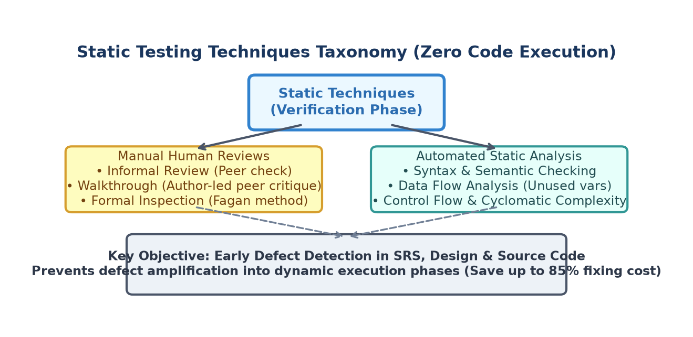

*Figure 1.1: Architectural Flow and Conceptual System Diagram for What do you think about static techniques? Identify how the different Static Test Case Design Techniques are useful for Software Testing*

### Mathematical Formulation & Algorithmic Mechanics

**Mathematical Cost-to-Fix Metric across Software Lifecycle Phases:**

```text
Cost of Defect Repair Progression:
Cost(Phase) = Base_Cost · 10^(Phase_Index - 1)
Requirement Review Phase: Base Cost = 1 Unit
Design Verification Phase: 5 to 10 Units
```

The mathematical cost progression defined above models the exponential increase in defect resolution expenditure across software development lifecycle phases. Resolving a requirements defect during static inspection incurs a normalized baseline cost; however, if the defect escapes undetected into design, coding, testing, or post-release production, the remediation cost escalates by powers of ten, formally justifying early static verification.

### Worked Example & Practical Simulation

**Practical Static Review** of an E-Commerce SRS Requirement: Requirement Statement: 'The payment processing **system** shall respond quickly to customer **transactions**.' Static Review Finding: Ambiguous and untestable specification! The word 'quickly' is non-verifiable. **Defect** Resolution in Review: Rewritten to 'The payment processing system shall authorize credit card **transactions** within **1.5 seconds** for 99.5% of requests under a concurrent load of 2,000 requests per minute.' Result: Prevents catastrophic architectural under-provisioning before a single line of backend code is created.

### Key Comparative Evaluation

| Dimension | Static Testing Techniques | Dynamic Testing Techniques |
| :--- | :--- | :--- |
| Execution Required | Zero code execution; analyzes static documents and text | Requires fully compiled, executing code in a runtime environment |
| Target Artifacts | SRS, Architecture diagrams, Design specs, Source code, Test plans | Compiled executables, APIs, database instances, UI builds |
| Defect Discovery | Identifies the exact root-cause defect directly in the artifact | Observes runtime failures; requires debugging to trace the root fault |
| Lifecycle Stage | Initiates immediately in the Requirements and Architecture phase | Begins only after code is written, compiled, and deployed |

### Concluding Exam Takeaway

**Static testing** serves as the **foundation** of **proactive** quality engineering, identifying **defects** at their conceptual origin and saving significant organizational resources prior to dynamic **execution**. For optimal SPPU examination scoring, answers must present this complete structure: rigorous theoretical definitions with bold keywords, an accurate architectural flow diagram, clear mathematical formulation, and a structured worked simulation to secure the full 8/**8 marks**.

**Textbook Reference:** Desikan, S., & Ramesh, G. (Pearson Education), Chapter 2: 'Static Testing: Principles and Review Techniques', pp. 31-52.

---

## Q2. What do you think about dynamic techniques? Interpret the different Dynamic Test Design Techniques. (Frequency: 2) [8 Marks]

### Introduction & Core Intuition

**Dynamic Testing** Techniques encompass all testing methodologies that validate software behavior by compiling, deploying, and executing source code with explicit input datasets under controlled operational **conditions**. Unlike static **verification**, dynamic testing evaluates the living software **system** in action, comparing actual output responses, **memory** behavior, transactional latencies, and **state** transitions against formally documented expected results to reveal functional discrepancies and runtime failures.

### **The Dynamic Execution Paradigm and Test Oracles**

**Dynamic testing** is built upon the fundamental interaction between an executable **Artifact Under Test** (AUT), a well-structured set of input stimuli, and a **Test** Oracle—a mechanism or **specification** that defines the true expected behavior of the **system**. Dynamic testing executes the program's instructions through CPU registers, manipulates volatile RAM, queries persistent databases, and exercises hardware-software interfaces. It is the only mechanism capable of uncovering runtime anomalies such as memory leaks, race conditions, stack overflows, dynamic pointer errors, and unexpected latency bottlenecks.

### **Black-Box Dynamic Design Techniques (Specification-Based)**

Black-box dynamic techniques design **test** cases purely based on external **requirements** and functional **specifications**, treating the internal code implementation as an opaque box. **Key** techniques include: (1) **Equivalence Class** Partitioning (ECP), which partitions the entire input domain into mutually exclusive valid and invalid subsets, selecting a representative value from each; (2) **Boundary Value Analysis (BVA)**, which rigorously evaluates edge conditions where relational operators frequently fail; (3) **Decision Table Testing**, which maps complex combinatorial Boolean logic into tabular condition-action matrices; and (4) **State Transition Testing**, which models finite state machines to ensure that state changes follow prescribed business paths.

### **White-Box Dynamic Design Techniques (Structure-Based)**

White-box dynamic techniques examine the internal source code, logic **paths**, and control structures to design **test** cases. By mapping the code into a **Control Flow Graph**, white-box techniques aim for quantifiable code **coverage**: (1) **Statement Coverage** ensures that every physical executable instruction is triggered at least once; (2) **Branch/Decision Coverage** mandates that every conditional decision evaluates to both True and False outcomes; (3) **Condition Coverage** verifies that individual Boolean operands within a compound condition evaluate to both states; and (4) **Path Coverage** exercises all linear independent execution pathways through the routine.

### **Grey-Box Dynamic Techniques (Hybrid Approach)**

Grey-box **dynamic** **techniques** combine the user-centric perspective of **black-box testing** with the architectural knowledge of **white-box testing**. Testers possess partial insight into the internal **data** structures, backend database schemas, and API **contracts** without necessarily analyzing line-by-line code. Grey-box techniques are the cornerstone of modern web application testing, microservice integration, and API contract validation. Testers craft inputs directly targeting database constraints, manipulate HTTP headers, inject SQL fragments, or analyze server log responses to uncover subtle architectural defects.

### **Experience-Based Dynamic Techniques**

Complementing formal black-box and white-box methods, **Experience-based techniques** leverage the cognitive domain expertise, historical knowledge, and intuition of seasoned software engineers. Through **Error Guessing**, testers anticipate specific programming traps—such as submitting empty strings, injecting special characters, or interrupting active network connections—that automated scripts often overlook. In **Exploratory Testing**, test design, execution, and learning occur simultaneously in focused, timeboxed sessions, maximizing creative defect discovery in complex, evolving user interfaces.

### Architectural Flow & System Diagram

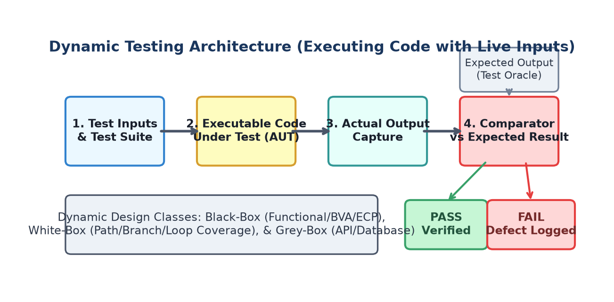

*Figure 1.2: Architectural Flow and Conceptual System Diagram for What do you think about dynamic techniques? Interpret the different Dynamic Test Design Techniques*

### Mathematical Formulation & Algorithmic Mechanics

**Dynamic Test Evaluation and Coverage Metrics:**

```text
Defect Detection Rate (DDR) = ( Detected Defects / Total Test Execution Time )
Statement Coverage = ( Executed Statements / Total Executable Statements ) · 100%
Branch Coverage = ( Exercised Branch Outcomes / Total Decision Branches ) · 100%
Path Coverage = ( Executed Independent Paths / McCabe Cyclomatic Complexity V(G) ) · 100%
```

The dynamic test evaluation metrics defined above quantify test execution throughput and structural test effectiveness. Defect Detection Rate (DDR) calculates verified faults uncovered per execution hour, while code coverage metrics evaluate the percentage of physical statements and decision outcomes triggered during dynamic test execution, ensuring test suite adequacy across active execution paths.

### Worked Example & Practical Simulation

**Dynamic Testing** of a Bank ATM **Withdrawal Routine**: Account **Balance** = Rs. 10,000; **Daily** Withdrawal Limit = Rs. 20,000. **Test** Case 1 (Valid Input): Request Rs. 5,000 -> Expected: Dispense cash, New Balance = Rs. 5,000 (**Pass**). Test Case 2 (Boundary Input): Request Rs. 10,000 -> Expected: Dispense cash, New Balance = Rs. 0 (Pass). Test Case 3 (Overdraft Input): Request Rs. 10,500 -> Expected: Reject with 'Insufficient Funds', Balance = Rs. 10,000 (Pass). Test Case 4 (Dynamic Boundary Stress): Disconnect network cable during dispense phase -> Expected: Rollback transaction atomically without debiting balance (Pass).

### Key Comparative Evaluation

| Dynamic Category | Primary Basis | Internal Code Visibility | Target Defect Types |
| :--- | :--- | :--- | :--- |
| Black-Box Testing | SRS requirements & functional specs | Completely hidden (Opaque box) | Omitted requirements, wrong business rules, incorrect I/O mapping |
| White-Box Testing | Control Flow Graphs & source code logic | Completely visible (Transparent box) | Dead code, unhandled logic branches, infinite loops, memory leaks |
| Grey-Box Testing | High-level architecture, DB schemas, APIs | Partially visible (Translucent box) | Data format mismatches, query deadlocks, improper API error handling |
| Experience-Based | Tester intuition, past defect patterns, heuristics | Variable depending on tester skill | Edge-case exceptions, usability bottlenecks, security corner-cases |

### Concluding Exam Takeaway

**Dynamic testing** validates that the **compiled** **software** **executes** correctly and reliably in live operational environments, complementing **static analysis** to deliver robust software quality. For optimal SPPU examination scoring, answers must present this complete structure: rigorous theoretical definitions with bold keywords, an accurate architectural flow diagram, clear mathematical formulation, and a structured worked simulation to secure the full 8/**8 marks**.

**Textbook Reference:** Desikan, S., & Ramesh, G. (Pearson Education), Chapter 3: 'Dynamic Testing: Black-Box & White-Box Approaches', pp. 55-88.

---

## Q3. Write a brief outline of Experience-based techniques. State in your own words Error guessing and exploratory testing. (Frequency: 3) [8 Marks]

### Introduction & Core Intuition

Experience-**Based Testing Techniques** are intuitive, non-formalized **test** design methodologies where test **cases** are derived primarily from the tester's personal experience, domain knowledge, psychological insight into developer behavior, and historical **defect** trends rather than strictly following formal requirements **specifications**. They serve as an indispensable complement to algorithmic and specification-driven testing, uncovering obscure bugs that formal test suites consistently miss.

### **The Cognitive Mechanics of Experience-Based Testing**

Traditional **specification**-based testing **relies** on rigid **requirements** documents, **assuming** that software faults occur exclusively where functional criteria are explicit. However, complex human software development involves cognitive fatigue, architectural misinterpretations, and common implementation oversights. Experience-based testing leverages human intuition and mental **heuristics**. Testers draw upon years of observing how developers write code, recognizing patterns where edge **cases** are forgotten, boundary conditions are miscalculated, and default error handlers fail silently.

### **Error Guessing Explained in Plain Language**

**Error Guessing** is an **intuitive** **testing** **technique** where the tester anticipates the occurrence of specific **errors**, **defects**, and failures based on past project experiences and specialized knowledge of human fallibility. Instead of following a pre-planned script, the tester asks: 'If I were a programmer rushing to meet a deadline on a Friday afternoon, what silly mistake would I make here?' The tester systematically targets vulnerable scenarios such as dividing by zero, inputting blank spaces, submitting strings containing SQL injection characters, entering dates like February 29 on non-leap years, or triggering rapid multiple button clicks on payment gateways.

### **Systematizing Error Guessing: Fault Catalogs**

Although **error** guessing relies heavily on personal intuition, mature testing teams formalize this knowledge by maintaining **Fault Catalogs** (Error Checklists). These catalogs categorize recurring **defects** encountered across previous enterprise releases—such as null pointer exceptions, unclosed file descriptors, timezone discrepancies, and race **conditions** during simultaneous user logins. When testing a newly developed **feature**, the tester systematically steps through this fault catalog, probing the software with tailored inputs to verify that historical errors have not been re-introduced.

### **Exploratory Testing Explained in Plain Language**

**Exploratory Testing** is an **agile**, **investigative** testing approach defined by software luminary Cem Kaner as 'a style of **software testing** that emphasizes the personal freedom and responsibility of the individual tester to continually optimize the quality of his or her work by treating **test**-related learning, test design, test **execution**, and test result interpretation as mutually supportive activities that run in parallel throughout the project.' Rather than executing pre-scripted tests like an automaton, the tester actively explores the running application, learns its behavior dynamically, forms immediate hypotheses about potential vulnerabilities, and executes targeted tests on the fly.

### **Session-Based Test Management (SBTM)**

To prevent exploratory testing from devolving into unstructured wandering, modern teams structure it using **Session-Based Test Management (SBTM)**. Under SBTM, exploration is organized around three pillars: (1) **The Charter**: A clear, concise mission statement specifying the exact scope, features, and risk areas to be explored; (2) **The Timebox**: A dedicated, uninterrupted period of 60 to 90 minutes where the tester focuses exclusively on that mission; and (3) **The Session Log & Debrief**: A structured record documenting discovered defects, coverage areas, execution notes, and outstanding risks, followed by a formal debriefing with the QA lead.

### Architectural Flow & System Diagram

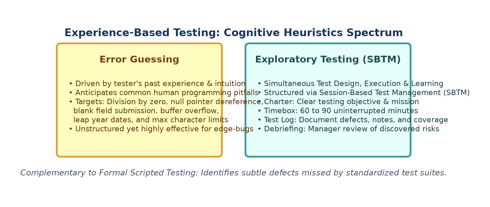

*Figure 1.3: Architectural Flow and Conceptual System Diagram for a brief outline of Experience-based techniques*

### Mathematical Formulation & Algorithmic Mechanics

**Session-Based Test Metrics and Defect Discovery Efficiency:**

```text
Defect Detection Yield (DDY) = ( Discovered Experience Defects / Total Session Hours )
On-Charter Time Ratio = ( Time Spent on Charter Objectives / Total Session Time ) · 100%
Target On-Charter Allocation: 70% Charter Work, 15% Bug Investigation, 15% Setup / Overhead
Heuristic Coverage: H(t) = Sum( Explored User Personas + Target Risk Vectors )
```

The mathematical formulations defined above formalize defect discovery efficiency and time allocation in Session-Based Test Management (SBTM). Defect Detection Yield (DDY) calculates discovered defects relative to uninterrupted charter hours, while the on-charter ratio evaluates testing focus, providing measurable visibility into unscripted exploratory testing performance.

### Worked Example & Practical Simulation

**Session**-**Based Exploratory Test** for an Online Travel Booking Portal: • Charter: Explore the multi-city flight reservation checkout flow under fluctuating network connectivity. • Timebox: 60 minutes. • **Test** Action 1: Add a 3-city flight itinerary, apply a promo coupon, and switch the browser language midway. • Test Action 2: Trigger payment **authorization** while throttling the network **bandwidth** to 2G speeds, then click 'Refresh'. • **Defect** Uncovered: Double debit occurred; backend server accepted both payment threads because the idempotency key was lost upon network timeout. • Session Outcome: Critical financial vulnerability discovered that no formal scripted test covered.

### Key Comparative Evaluation

| Feature | Error Guessing | Exploratory Testing (SBTM) | Formal Scripted Testing |
| :--- | :--- | :--- | :--- |
| Primary Driver | Intuition & mental fault catalogs | Active exploration, dynamic learning & mission charters | Predefined requirement specifications and test cases |
| Execution Structure | Informal, reactive, and opportunistic | Semi-structured via timeboxed charters (60-90 mins) | Rigid, highly structured step-by-step test scripts |
| Documentation | Minimal notes or bug tickets | Formal session logs, defect recordings, and debrief notes | Detailed test plans, test steps, inputs, and expected results |
| Lifecycle Timing | Any phase, especially post-formal testing | Agile sprints, rapid builds, and early feature drops | Formal system and acceptance test phases |

### Concluding Exam Takeaway

**Experience**-based **techniques** **empower** **skilled** testers to think like real-world end users and malicious actors, discovering subtle **vulnerabilities** that escape rigid procedural scripts. For optimal SPPU examination scoring, answers must present this complete structure: rigorous theoretical definitions with bold keywords, an accurate architectural flow diagram, clear mathematical formulation, and a structured worked simulation to secure the full 8/**8 marks**.

**Textbook Reference:** Desikan, S., & Ramesh, G. (Pearson Education), Chapter 4: 'Experience-Based and Exploratory Testing Methodologies', pp. 89-108.

---

## Q4. Explain the following test case design techniques: Informal Reviews, Walkthroughs, and Inspection. (Frequency: 1) [8 Marks]

### Introduction & Core Intuition

**Static Review Techniques** represent a structured spectrum of human evaluation **processes** designed to identify **defects**, ambiguities, and architectural oversights in software work products before code **execution**. The three primary peer review paradigms recognized in software engineering standards (IEEE 1028) are Informal Reviews, Technical Walkthroughs, and Formal **Inspections**, each offering varying levels of formality, procedural structure, and **defect**-detection rigor.

### **Informal Reviews: Low-Cost Casual Verification**

**An Informal Review** is the **simplest**, most **adaptable** static evaluation method. It is characterized by the absence of rigid procedural **rules**, formal meeting agendas, or standardized **defect**-logging paperwork. Informal reviews frequently take the form of pair programming, **desk checking**, or a brief desk-side consultation where one developer or analyst asks a colleague: 'Could you glance over this requirement logic or algorithm design to see if I missed anything?' Because informal reviews require zero administrative setup and incur negligible scheduling overhead, they serve as a rapid, daily filter for obvious oversights, though they lack traceability and quantitative metrics.

### **Walkthroughs: Author-Led Knowledge Sharing and Evaluation**

A **Walkthrough** is an **intermediate**-formality review **session** led **directly** by the author of the work product. The primary objectives are twofold: educating team members on the inner workings of the **artifact** and gathering collective feedback regarding functional validity, edge **cases**, and design alternatives. The author prepares the document, distributes it to invited peers, and walks the audience through the material step-by-step during a scheduled meeting. Attendees ask questions, highlight ambiguities, and suggest architectural simplifications. The author typically records meeting minutes and notes action items. Walkthroughs excel at fostering team consensus and onboarding new engineers.

### **Formal Inspections: The Fagan Inspection Discipline**

A **Formal Inspection**—originally invented by Michael Fagan at IBM—is the most rigorous, structured, and effective **static testing** technique known in software engineering. Unlike a walkthrough, an **inspection** is never led by the author; it is strictly directed by a trained, impartial Moderator. The inspection **process** follows six **immutable** formal phases: Planning, Overview, Preparation, Inspection Meeting, Rework, and Follow-Up. Inspections enforce strict quantifiable entry criteria (e.g., document has passed a grammar check and follows standard templates) and exit criteria (e.g., all high-severity defects resolved and verified), guaranteeing exceptional defect yields.

### **Specialized Roles in a Formal Inspection**

The **success** of a formal **inspection** hinges upon well-**defined**, non-overlapping roles assigned to participants: (1) **The Moderator** manages the **process**, schedules meetings, maintains pace, ensures psychological safety, and enforces **entry**/exit standards; (2) The Author answers factual queries regarding intent but remains passive rather than defending the work; (3) The Reader presents the document line-by-line in their own words, revealing misinterpretations and ambiguities; (4) **The Scribe (Recorder)** accurately documents every discovered defect, its location, and severity in the official defect log; and (5) **The Inspector/Tester** evaluates the artifact against defect checklists from an adversarial verification standpoint.

### **Comparative Analysis and Organizational Cost Dynamics**

Organizations select review types based on project criticality, budget, and maturity. While informal reviews cost almost nothing to organize, their defect-detection efficiency rarely exceeds 20% to 30%. Walkthroughs achieve moderate defect yields (40% to 50%) while serving as powerful educational tools. Formal inspections, while requiring approximately 10% to 15% of total project effort, achieve defect removal efficiencies between 60% and 85%, eliminating the vast majority of architectural faults long before dynamic compilation begins.

### Architectural Flow & System Diagram

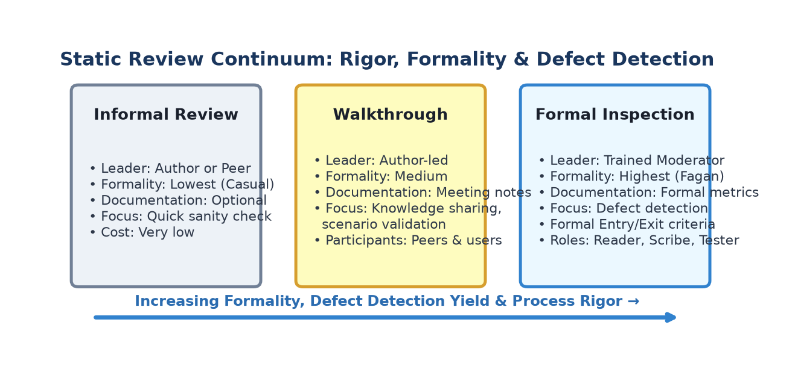

*Figure 1.4: Architectural Flow and Conceptual System Diagram for the following test case design techniques: Informal Reviews, Walkthroughs, and Inspection*

### Mathematical Formulation & Algorithmic Mechanics

**Formal Inspection Metrics and Defect Yield Equations:**

```text
Inspection Preparation Rate = ( Pages of Artifact Reviewed / Preparation Hours )
Optimal Preparation Velocity: 10 to 12 pages/hour for text; 150 to 200 LOC/hour for code
Defect Density = ( Total Defects Detected / Size of Artifact in Pages or KLOC )
Defect Removal Efficiency (DRE) = ( Defects_Inspection / ( Defects_Inspection + Defects_Downstream ) ) · 100%
```

The formal inspection metrics defined above govern the efficiency and quality yield of structured peer reviews. The inspection preparation rate bounds artifact review speed (pages per hour) to ensure thorough anomaly detection, while the inspection defect density metric measures process yield, ensuring that artifacts satisfy formal quality exit criteria before entering downstream development.

### Worked Example & Practical Simulation

**Inspection** of a Banking Microservice **Transaction** Gateway Specification: • **Artifact** Size: 15 pages of technical design specification. • Team: Moderator (QA Architect), Reader (Backend Lead), Author (Senior Dev), Scribe (QA Engineer). • Preparation Phase: Each participant spends **1.5 hours** reviewing with a security checklist. • Meeting: Reader presents Section 3.2 on idempotency **keys**. Inspector identifies that concurrent retries with identical keys lack database-level row locking. • Scribe Logs: **Defect** #14 (Severity: Critical - Race condition in fund transfer). • Rework & Follow-Up: Author updates SQL logic to use SELECT ... FOR UPDATE; Moderator verifies and approves exit.

### Key Comparative Evaluation

| Attribute | Informal Review | Walkthrough | Formal Inspection |
| :--- | :--- | :--- | :--- |
| Formality Level | Lowest (Unstructured & casual) | Medium (Semi-structured) | Highest (Rigidly structured IEEE 1028 standard) |
| Session Leadership | None; author or peer | Author of the work product | Trained, independent Moderator |
| Primary Goal | Quick feedback and sanity checking | Knowledge transfer & scenario validation | Rigorous defect detection and prevention |
| Entry & Exit Criteria | None | Optional / loosely enforced | Strict, mathematically audited criteria |

### Concluding Exam Takeaway

A balanced software quality management **system** incorporates informal reviews for daily code development, walkthroughs for architectural **consensus**, and formal **inspections** for mission-critical core **components**. For optimal SPPU examination scoring, answers must present this complete structure: rigorous theoretical definitions with bold keywords, an accurate architectural flow diagram, clear mathematical formulation, and a structured worked simulation to secure the full 8/**8 marks**.

**Textbook Reference:** Desikan, S., & Ramesh, G. (Pearson Education), Chapter 2: 'Static Testing: Reviews, Walkthroughs, and Inspections', pp. 35-50.

---

## Q5. Differentiate between black box and white box testing. State in your own words Black Box Testing / White Box Testing. Explain White box testing and Grey box testing in detail. (Frequency: 4) [8 Marks]

### Introduction & Core Intuition

In software engineering, testing methodologies are categorized based on the tester's visibility into the internal codebase and architecture of the application. **Black Box Testing** treats the **system** as an opaque entity, focusing purely on input-output behavioral compliance with **specifications**. White Box Testing operates with total transparency, validating internal logic **paths**, **data** structures, and control flow. Grey Box Testing combines both paradigms, leveraging partial architectural visibility—such as database schemas and API contracts—to design targeted tests.

### **Defining Black Box Testing in Plain Words**

**Black Box Testing** (also known as behavioral or **specification**-based testing) is a methodology where the tester has zero visibility into the internal source code, implementation **algorithms**, or internal database architectures. The software application is viewed as an impenetrable black box. The tester interacts with the **system** exclusively through its external **interfaces**—such as web UI forms, command-line prompts, or external API endpoints. The tester injects specific input stimuli, captures the resulting outputs, and verifies whether the system behaves in strict accordance with the functional specifications.

### **Defining White Box Testing in Plain Words**

**White Box Testing** (also **known** as **structural**, **glass**-box, or clear-box testing) is a methodology where the tester has complete, unrestricted access to the underlying source code, algorithmic logic, database schemas, and **system** architecture. The tester **functions** like a structural engineer inspecting the internal wiring and plumbing of a building. Instead of treating the application as a mistery box, the white-box tester writes unit tests and trace harnesses to exercise specific execution pathways, conditional branches, exception handlers, and nested loops, guaranteeing high internal structural integrity.

### **Core White Box Testing Techniques and Structural Coverage**

White box testing is driven by formal **graph**-theoretic analysis of the program's **Control Flow Graph** (CFG). **Key** techniques include: (1) **Statement Coverage**, which requires designing enough **test** cases so that every single executable statement of code executes at least once; (2) Branch/**Decision Coverage**, which mandates that every Boolean decision outcome (True and False) is evaluated at least once; (3) **Condition Coverage**, which ensures every sub-clause within a compound Boolean expression is evaluated independently; and (4) **Basis Path Coverage**, developed by Thomas McCabe, which computes the cyclomatic complexity V(G) to determine the exact number of linearly independent paths required to ensure baseline coverage.

### **Grey Box Testing Explained in Detail**

**Grey Box Testing** is a **powerful** **hybrid** testing approach where the tester has partial knowledge of the internal structures, **data** flow, and architecture of the application, but **tests** the software through external **interfaces** or API boundaries. The grey-box tester does not necessarily review every line of backend source code, but understands the database schema, message queue protocols, cache layers, and RESTful API endpoints. With this structural insight, the tester designs intelligent test scenarios targeting architectural fault lines—such as submitting malformed JSON payloads, simulating database deadlock conditions, testing API rate limits, or injecting malicious SQL fragments.

### **Industry Applications and Testing Hierarchy**

In modern DevSecOps pipelines, these three paradigms work synergistically at different stages of the lifecycle. White-box testing is predominantly performed by software developers during the coding and unit testing phase using frameworks like JUnit, PyTest, or NUnit. Grey-box testing is performed by automation and security engineers during integration and API contract testing using tools like Postman and OWASP ZAP. Black-box testing is conducted by dedicated QA teams and end users during system, usability, and User Acceptance Testing (UAT) phases to ensure genuine business alignment.

### Architectural Flow & System Diagram

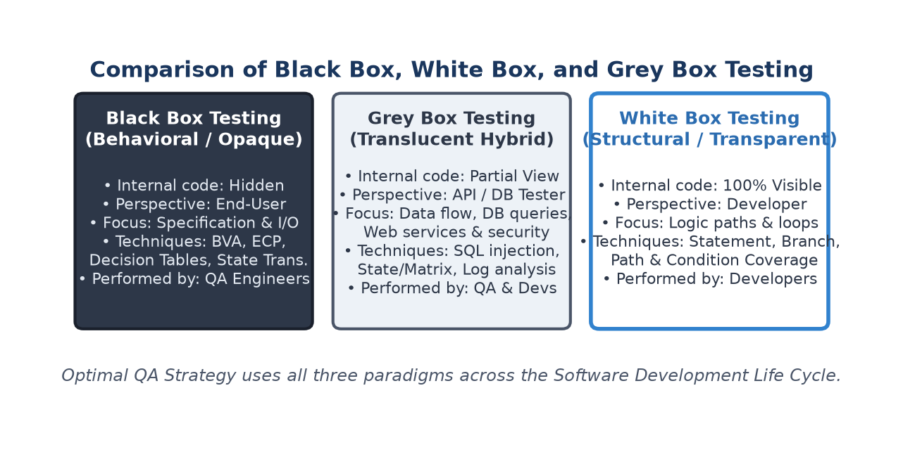

*Figure 1.5: Architectural Flow and Conceptual System Diagram for Differentiate between black box and white box testing*

### Mathematical Formulation & Algorithmic Mechanics

**McCabe Cyclomatic Complexity and Structural Coverage Bounds:**

```text
McCabe Cyclomatic Complexity Formula: V(G) = E - N + 2P
Alternative Formulation: V(G) = Predicate_Nodes + 1
Coverage Hierarchy Invariant: Path_Coverage => Branch_Coverage => Statement_Coverage
Note: 100% Statement Coverage does NOT guarantee 100% Branch Coverage!
```

The mathematical formulations defined above establish McCabe's Cyclomatic Complexity $V(G) = E - N + 2P$ and structural coverage bounds for white-box testing. Cyclomatic complexity defines the exact number of linearly independent execution paths through a program's control flow graph, establishing the theoretical minimum number of test cases required to guarantee complete basis path coverage.

### Worked Example & Practical Simulation

**Comparison** **across** an **Online Banking Fund Transfer Function**: • **Black**-Box Approach: Enter Account Number, Transfer Amount = Rs. 5,000, click 'Submit'. Verify that balance decreases by Rs. 5,000 and an SMS confirmation is received (Checks functional outcome only). • Grey-Box Approach: Send POST /api/transfer with an expired JWT token or inspect the SQL database to verify that the ACID **transaction** locks both user accounts simultaneously without creating dirty reads. • White-Box Approach: Execute unit **test** with mock data to force the catch(DatabaseTimeoutException e) block on line 142, verifying that rollbackTransaction() executes cleanly and releases the connection pool.

### Key Comparative Evaluation

| Comparison Parameter | Black Box Testing | Grey Box Testing | White Box Testing |
| :--- | :--- | :--- | :--- |
| Internal Code Knowledge | Zero knowledge (Completely opaque) | Partial knowledge (Architecture, DB, APIs) | Full, transparent knowledge of source code |
| Performed By | QA Engineers, Business Analysts, End Users | QA Automation Engineers, Security Testers | Software Developers, Lead Architects |
| Primary Basis | Requirements documents (SRS) & User Stories | High-level design, DB schemas, API specs | Detailed low-level design & source code |
| Key Testing Types | System testing, Acceptance testing, BVA, ECP | Integration testing, API testing, DB testing | Unit testing, Mutation testing, Code coverage |

### Concluding Exam Takeaway

**Achieving** **exceptional** software **reliability** requires a comprehensive strategy combining white-box structural **verification**, grey-box integration audits, and black-box behavioral **validation**. For optimal SPPU examination scoring, answers must present this complete structure: rigorous theoretical definitions with bold keywords, an accurate architectural flow diagram, clear mathematical formulation, and a structured worked simulation to secure the full 8/**8 marks**.

**Textbook Reference:** Desikan, S., & Ramesh, G. (Pearson Education), Chapter 3: 'Black Box & White Box Testing Paradigms', pp. 58-85.

---

## Q6. Explain any two functional testing. Differentiate between Functional testing and Non-functional testing. (Frequency: 3) [8 Marks]

### Introduction & Core Intuition

In modern software quality engineering, **software testing** is bifurcated into two foundational pillars: **Functional Testing**, which validates what the **system** does by verifying business workflows and **features** against explicit **requirements**, and Non-Functional Testing, which evaluates how well the system performs in terms of operational readiness, **performance**, responsiveness, and security.

### **The Nature and Scope of Functional Testing**

**Functional Testing** is a **specification**-based **verification** process **focused** **entirely** on the behavioral aspects of a software application. Its core mandate is to ensure that every functional capability specified in the Software **Requirements** Specification (SRS) operates correctly under valid, invalid, and boundary input stimuli. Functional testing does not concern itself with how quickly an operation completes, how many concurrent users it can sustain, or how aesthetically pleasing the user interface appears. Instead, it tests the functional logic: given input X, does the system produce the specified output Y and transition to state Z?

### **Detailed Examination of Functional Type 1: Unit Testing**

**Unit Testing** represents the most **granular** and **foundational** tier of functional testing. It is the **process** of isolating the smallest testable units of software—such as an individual **function**, procedure, method, or **class**—and verifying its operational correctness in total isolation from the rest of the application ecosystem. Conducted predominantly by software developers during the coding phase using xUnit frameworks (like JUnit, NUnit, or PyTest), unit testing employs stubs, mocks, and fakes to simulate external dependencies like databases or network sockets. By verifying individual algorithmic building blocks early, unit testing eliminates foundational logic bugs before they propagate into higher architectural tiers.

### **Detailed Examination of Functional Type 2: Smoke and Sanity Testing**

**Smoke Testing** (also **known** as Build **Verification** Testing) is a **rapid**, **preliminary** suite of high-priority **tests** executed whenever a new software build is created. Originating from hardware testing—where a technician plugs in a board to see if smoke rises—smoke testing verifies that the critical functionalities of the application (such as launching the application, authenticating a user, or loading the primary database) function at a baseline level. If a smoke test fails, the build is immediately rejected and returned to development, saving QA teams from wasting hours testing an inherently broken release. In contrast, **Sanity Testing** is a focused, subset test performed on a stable build after a bug fix to quickly verify that the specific defect is resolved and no obvious adjacent features were broken.

### **The Multi-Dimensional Spectrum of Non-Functional Testing**

While functional testing determines whether an application **functions**, Non-**Functional Testing** evaluates the operational quality and user experience of that functionality under diverse environmental stresses. Non-functional testing encompasses critical attributes specified in ISO/IEC 25010: **performance** efficiency (response latency, throughput, resource consumption), security (**confidentiality**, **integrity**, **non-repudiation**), reliability (mean time between failures, fault tolerance), usability (learnability, accessibility, aesthetic satisfaction), and compatibility (cross-browser, cross-platform interoperability). A software application may execute functional calculations with 100% accuracy, yet prove completely unusable if each calculation requires 45 seconds to render on a mobile browser.

### **Strategic Synergy in the Quality Lifecycle**

A successful quality assurance strategy requires a deliberate sequence combining both testing dimensions. Functional testing must always precede non-functional testing: verifying the performance or security of a feature is meaningless if that feature fails to produce correct functional results. Once functional stability is established, non-functional testing subjects the system to realistic real-world conditions, preventing production outages, security breaches, and catastrophic performance degradations under heavy user concurrency.

### Architectural Flow & System Diagram

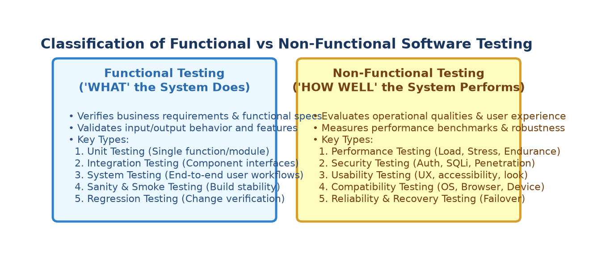

*Figure 1.6: Architectural Flow and Conceptual System Diagram for any two functional testing*

### Mathematical Formulation & Algorithmic Mechanics

**Functional Quality vs Non-Functional Performance Metrics:**

```text
Functional Defect Density = ( Confirmed Functional Bugs / Size in KLOC )
Requirement Traceability Matrix (RTM) Coverage = ( Verified Requirements / Total SRS Requirements ) · 100%
System Throughput = ( Successful Completed Transactions / Total Measurement Time in Seconds )
Response Latency 99th Percentile: T_p99 = Latency value beneath which 99% of requests resolve
```

The mathematical formulations defined above contrast functional defect density metrics with non-functional performance benchmarks. Functional defect density measures verified logic bugs per thousand lines of code (KLOC), while non-functional metrics quantify server throughput (transactions per second), average end-to-end response latency, and hardware utilization limits under concurrent load.

### Worked Example & Practical Simulation

Functional vs Non-Functional **Verification** of a **Hospital Management Portal**: • Functional Test: A doctor submits a prescription for 500mg Amoxicillin. The **system** validates the drug code, checks patient allergy history, writes the record to the pharmacy queue, and issues an alert if a penicillin allergy is present (**Pass**/Fail functional behavior). • Non-Functional Test (**Performance**): Simulate 1,500 doctors submitting prescriptions simultaneously during a morning shift. Verify that the server response latency remains below **1.2 seconds** with zero dropped connections. • Non-Functional Test (Security): Attempt SQL injection and cross-site scripting (XSS) in the prescription dosage field to verify HIPAA patient data confidentiality.

### Key Comparative Evaluation

| Comparison Parameter | Functional Testing | Non-Functional Testing |
| :--- | :--- | :--- |
| Primary Focus | Validates WHAT the system does (behavior & features) | Evaluates HOW WELL the system performs (quality & user experience) |
| Verification Basis | Software Requirements Specification (SRS) & User Stories | Non-functional requirements, SLAs, and performance benchmarks |
| Execution Prerequisite | Can be executed manually or automated; tested first | Usually requires specialized automation tools; executed on stable builds |
| Key Testing Categories | Unit, Integration, System, Sanity, Smoke, Regression | Load, Stress, Endurance, Security, Usability, Compatibility |

### Concluding Exam Takeaway

**Functional** **testing** **validates** that software meets core business **requirements**, while non-functional testing ensures it delivers the speed, **security**, and scalability demanded in production environments. For optimal SPPU examination scoring, answers must present this complete structure: rigorous theoretical definitions with bold keywords, an accurate architectural flow diagram, clear mathematical formulation, and a structured worked simulation to secure the full 8/**8 marks**.

**Textbook Reference:** Desikan, S., & Ramesh, G. (Pearson Education), Chapter 5: 'Functional vs Non-Functional Testing Foundations', pp. 110-136.

---

## Q7. Discuss Boundary Value Analysis and Equivalence Class Partition. (Frequency: 2) [8 Marks]

### Introduction & Core Intuition

**Equivalence Class** Partitioning (ECP) and **Boundary Value Analysis** (BVA) are the two most fundamental, universally applied black-box **test** case design techniques in software engineering. ECP reduces an infinitely large input space into a manageable, finite set of representative test **classes**, while BVA systematically targets the vulnerable boundaries between these partitions where the vast majority of software **defects** historically **cluster**.

### **The Mathematical Foundations of Equivalence Class Partitioning (ECP)**

**Testing** an **application** with every conceivable input value is practically impossible due to **combinatorial** explosion. **Equivalence Class** Partitioning resolves this problem through the mathematical concept of equivalence relations. ECP divides the input domain of a program into mutually exclusive partitions (**equivalence classes**) such that every value within a given **class** is assumed to be processed in exactly the same manner by the software. If a test case derived from a specific partition reveals a bug, all other values in that partition are presumed to reveal the same bug. Conversely, if that test case passes, all other values in that partition are presumed to pass.

### **Constructing Valid and Invalid Equivalence Partitions**

When applying ECP, the tester identifies two distinct categories of partitions for every input **condition** specified in the **requirements**: (1) Valid **Equivalence Classes**, which represent normal, legitimate inputs that the application must successfully accept and **process** according to business logic; and (2) **Invalid Equivalence Classes**, which represent abnormal, illegal, or out-of-range inputs that the application must gracefully detect, reject, and respond to with informative error messages without crashing. To ensure rigorous defect localization, testers follow the golden rule of ECP: combine multiple valid classes into a single test case, but test each invalid class in strict isolation to prevent one error from masking another.

### **The Theoretical Underpinnings of Boundary Value Analysis (BVA)**

**Decades** of **empirical** **software** **engineering** research demonstrate that programming faults are not uniformly distributed across the input domain; rather, they concentrate overwhelmingly at the boundaries of input partitions. Developers frequently commit off-by-one **errors** when writing relational conditional statements—such as using greater-than (>) instead of greater-than-or-equal-to (>=), or indexing arrays from 1 instead of 0. **Boundary Value** Analysis** is a test design technique that complements ECP by explicitly selecting test values at the extreme edges, immediately inside, and immediately outside the boundaries of input partitions.

### **Boundary Selection Methodologies: Two-Value vs Three-Value BVA**

In standard **boundary value analysis**, boundaries are **evaluated** **using** **standardized** sampling points. For a closed range [min, max], standard Two-Value BVA evaluates the boundary value itself and its immediate neighboring value across the boundary line: (min, min - 1) and (max, max + 1). **Advanced Three**-Value BVA (also known as Robustness Testing) **tests** five distinct points per boundary: min - 1 (invalid boundary), min (boundary minimum), min + 1 (just above minimum), nominal (safe typical middle value), max - 1 (just below maximum), max (boundary maximum), and max + 1 (invalid boundary). By systematically evaluating these edge conditions, BVA reveals subtle relational calculation faults.

### **Combined Industrial Synergy and Coverage Optimization**

In professional software testing environments, ECP and BVA are never used in isolation; they are applied as an integrated, two-step methodology. First, the QA engineer analyzes the functional specifications to decompose every input parameter into valid and invalid equivalence classes. Second, the engineer applies BVA to extract the boundary values of each numerical or range-based partition. This structured approach reduces test suite size by over 95% compared to exhaustive testing while maintaining high defect detection rates for edge-case faults.

### Architectural Flow & System Diagram

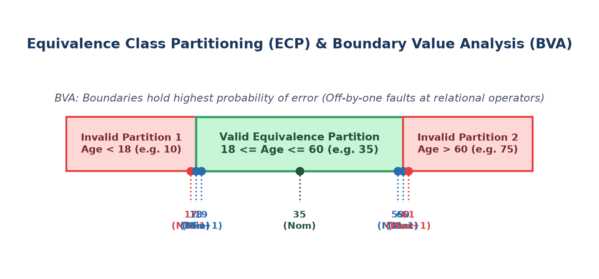

*Figure 1.7: Architectural Flow and Conceptual System Diagram for Boundary Value Analysis and Equivalence Class Partition*

### Mathematical Formulation & Algorithmic Mechanics

**Mathematical Test Case Generation Formulas for ECP and BVA:**

```text
Single Parameter Input Range: X ∈ [Min, Max]
Standard BVA Test Set (4n + 1 values for n variables):
T_BVA = { Min, Min + 1, Nominal, Max - 1, Max 
Robust BVA Test Set (6n + 1 values for n variables):
```

The mathematical formulations defined above define test case generation bounds for Equivalence Class Partitioning (ECP) and Boundary Value Analysis (BVA). For an input variable bounded by $[\text{Min}, \text{Max}]$, standard BVA systematically generates $4n + 1$ test cases evaluated at boundary extremities, while robust BVA derives $6n + 1$ vectors, maximizing defect yield at boundary transition edges.

### Worked Example & Practical Simulation

ECP and BVA **Design** for an **Online Banking Loan Eligibility Field**: **Requirement**: Applicant Age must be an **integer** between 21 and 60 years inclusive. • ECP Partitions: - Invalid **Class** 1: Age < 21 (e.g., Age = 15) -> Expected: Rejection **error** message. - Valid Class: 21 <= Age <= 60 (e.g., Age = 35) -> Expected: Loan application accepted. - Invalid Class 2: Age > 60 (e.g., Age = 72) -> Expected: Rejection error message. • Robust BVA Test Values: - Age = 20 (Min - 1): Reject (Validates lower boundary transition). - Age = 21 (Min): Accept (Validates lower boundary inclusion). - Age = 22 (Min + 1): Accept. - Age = 40 (Nominal): Accept. - Age = 59 (Max - 1): Accept. - Age = 60 (Max): Accept (Validates upper boundary inclusion). - Age = 61 (Max + 1): Reject (Validates upper boundary transition).

### Key Comparative Evaluation

| Evaluation Aspect | Equivalence Class Partitioning (ECP) | Boundary Value Analysis (BVA) |
| :--- | :--- | :--- |
| Underlying Concept | Divides entire input domain into equivalent behavior sets | Focuses specifically on the extreme edges of input ranges |
| Target Defect Types | General functional omissions and broad logic failures | Off-by-one errors, incorrect relational operators (< vs <=) |
| Input Type Applicability | Applies to continuous, discrete, string, and set inputs | Applies primarily to ordered, continuous, or sequential ranges |
| Test Selection Logic | Picks any arbitrary representative value inside the class | Picks values exactly at, immediately above, and below boundary edges |

### Concluding Exam Takeaway

**Together**, ECP and BVA **provide** a **mathematically** rigorous framework that maximizes **defect** detection while minimizing redundant test **execution** effort. For optimal SPPU examination scoring, answers must present this complete structure: rigorous theoretical definitions with bold keywords, an accurate architectural flow diagram, clear mathematical formulation, and a structured worked simulation to secure the full 8/**8 marks**.

**Textbook Reference:** Desikan, S., & Ramesh, G. (Pearson Education), Chapter 3: 'Black Box Testing Techniques: ECP & BVA', pp. 62-75.

---

## Q8. Can you explain path coverage testing, conditional coverage testing, statement coverage testing, branch coverage testing, and loop coverage testing (and its types) in detail? (Frequency: 4) [8 Marks]

### Introduction & Core Intuition

White-Box Structural **Coverage** Testing comprises a hierarchical set of code-based **verification** metrics that evaluate how thoroughly a **test suite** exercises the internal logic, conditional branches, control flow graphs, and loop constructs of a program. These metrics—ranging from basic **Statement Coverage** to rigorous **Path Coverage**—provide mathematical guarantees regarding which portions of the source code have been verified under execution.

### **Statement Coverage (Node Coverage)**

**Statement Coverage** (also known as line **coverage** or **node** coverage) is the most basic **metric** in structural testing. It measures the percentage of executable source code statements that have been executed at least once during test **execution**. While achieving 100% statement coverage ensures that there is no completely dead, uncompiled, or unvisited code in the build, it is notoriously weak. It cannot detect unhandled else conditions; for example, if an if statement without an else branch is tested with an input that evaluates to True, statement coverage registers 100%, completely failing to test the implicit false branch.

### **Branch / Decision Coverage (Edge Coverage)**

**Branch Coverage** (also known as **decision coverage**) resolves the fundamental limitation of **statement coverage** by requiring that every conditional decision point in the program evaluates to both True and False at least once. In a **Control Flow Graph** (CFG), this is equivalent to traversing every directed edge leaving every decision node. Achieving 100% branch **coverage** mathematically subsumes 100% statement coverage (Branch Coverage implies Statement Coverage). It ensures that all alternative execution branches—including empty or implicit else paths—are verified under dynamic runtime execution.

### **Condition Coverage and Compound Conditions**

In **modern** **software**, **decisions** **rarely** consist of simple Boolean flags; they frequently contain compound Boolean expressions connected by logical operators (AND, OR, NOT), such as if ((A > 10) and (B == 0)). **Condition Coverage** mandates that every individual Boolean operand within a compound decision evaluates to both True and False independently across **test** runs. A more rigorous variant, **Multiple Condition Coverage (MCC)**, tests all 2^k possible combinations of truth values for k conditions, while **Modified Condition/Decision Coverage (MC/DC)**—mandated in safety-critical avionics (DO-178C)—proves that each condition can independently affect the overall decision outcome using only k + 1 test cases.

### **Path Coverage and McCabe's Cyclomatic Complexity**

**Path Coverage** is the most comprehensive and stringent white-box **metric**. It requires that all linearly independent **execution** pathways from program **entry** to exit are traversed. Because nested loops and branching logic cause exponential **path** growth, complete exhaustive path testing is generally impossible for non-trivial programs. Consequently, software engineers use Thomas McCabe's **Basis Path Testing**. By calculating the **Cyclomatic Complexity V(G) = E - N + 2P** from the program's CFG, engineers determine the exact basis set of independent paths needed to construct a linearly independent foundation that guarantees full coverage.

### **Loop Coverage and Its Structural Variants**

Loops are ubiquitous programming constructs that are highly susceptible to initialization faults, off-by-one boundary failures, and infinite execution locks. **Loop Coverage** specifically targets loop structures through four specialized classes: (1) **Simple Loops**: Tested by executing the loop 0 times (bypass), exactly 1 time, 2 times (typical), m times (where m < max), max - 1 times, max times, and max + 1 times (if boundary checks allow); (2) **Nested Loops**: Tested by holding outer loops at minimum iterations while varying the innermost loop across its boundary values, then working outward; (3) **Concatenated Loops**: Tested as independent simple loops if loop variables are disjoint, or as nested loops if dependencies exist; and (4) **Unstructured Loops**: Deconstructed and refactored into structured loops prior to testing.

### Architectural Flow & System Diagram

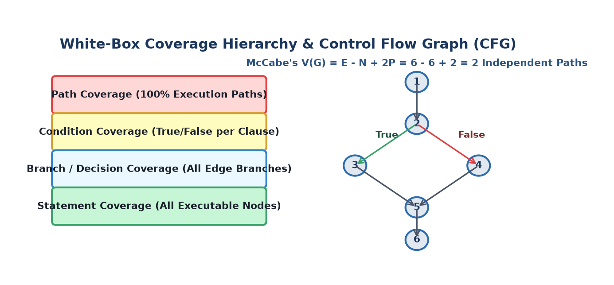

*Figure 1.8: Architectural Flow and Conceptual System Diagram for Can you explain path coverage testing, conditional*

### Mathematical Formulation & Algorithmic Mechanics

**Mathematical Formulations of Structural Code Coverage:**

```text
Statement Coverage = ( Statements Executed / Total Executable Statements ) · 100%
Branch Coverage = ( Decision Outcomes Exercised / Total Decision Outcomes 2·D ) · 100%
McCabe Cyclomatic Complexity: V(G) = E - N + 2P = Predicate_Nodes + 1
Condition Coverage: C = ( Truth Values Evaluated / 2 · Total Conditions ) · 100%
```

The mathematical formulations defined above establish the structural code coverage hierarchy across white-box testing methodologies. Statement coverage measures physical instruction execution, branch coverage verifies boolean decision outcomes, and condition/path coverage evaluates complete combinatorial decision tables, proving that 100% statement coverage does not guarantee decision or loop adequacy.

### Worked Example & Practical Simulation

**Analyzing** a **Discount Calculator Routine**: Code **Fragment**: 1: **float** calc(int age, bool student) { 2: float disc = 0.0; 3: if (age < 18 or student == true) 4: disc = 0.20; 5: return disc; } • **Test** 1: age = 16, student = false -> Evaluates (T or F) = T. Runs lines 1, 2, 3, 4, 5. **Statement Coverage** = 100%! • The Flaw: The False branch of line 3 was never tested If age >= 18 and student == false, disc remains 0.0, but this was unverified. • Branch Coverage Fix: Add Test 2: age = 25, student = false -> Evaluates (F or F) = F. Jumps line 3 to 5 directly. Branch Coverage = 100%.

### Key Comparative Evaluation

| Coverage Metric | Target Graph Element | Subsumes Lower Metrics? | Typical Industry Application |
| :--- | :--- | :--- | :--- |
| Statement Coverage | Graph Nodes (Executable lines) | Baseline metric; subsumes nothing | General commercial applications (Standard target: 80%) |
| Branch Coverage | Graph Edges (Decision branches) | Subsumes Statement Coverage | Enterprise software, banking, and e-commerce systems |
| Condition Coverage | Boolean clauses inside predicates | Does not strictly subsume branch | Complex business rule engines and state machines |
| MC/DC Coverage | Independent Boolean decision influence | Subsumes Branch and Condition | Avionics (DO-178C Level A), automotive (ISO 26262) |

### Concluding Exam Takeaway

**Understanding** the structural **coverage** hierarchy **enables** **engineering** teams to select appropriate testing rigor, balancing **verification** costs against the risk profile of the application. For optimal SPPU examination scoring, answers must present this complete structure: rigorous theoretical definitions with bold keywords, an accurate architectural flow diagram, clear mathematical formulation, and a structured worked simulation to secure the full 8/**8 marks**.

**Textbook Reference:** Desikan, S., & Ramesh, G. (Pearson Education), Chapter 4: 'White Box Testing: Coverage Metrics & Cyclomatic Complexity', pp. 88-105.

---

## Q9. What do you mean by unit and integration testing? What are the approaches used in integration testing? (Frequency: 3) [8 Marks]

### Introduction & Core Intuition

In the hierarchical **Software Testing** Life Cycle (STLC), **Unit Testing** and **Integration Testing** represent the two foundational technical **verification** phases. Unit testing focuses on verifying the microscopic logic of individual isolated modules in source code, while integration testing evaluates the macroscopic interactions, **data** exchanges, and **protocol** interfaces between these integrated units.

### **Unit Testing: The Microscopic Foundation**

**Unit Testing** is the disciplined **verification** of the smallest standalone **components** of software—such as **functions**, procedures, methods, or **classes**—performed in total isolation from the rest of the software **system**. Conducted primarily by developers using automated testing frameworks like JUnit, PyTest, or Mockito, unit testing isolates the target code using test doubles: **Stubs** (which provide hardcoded return values to incoming calls) and **Mocks** (which verify that the unit under test makes expected calls with correct parameters). By verifying discrete units in isolation, unit tests provide fast feedback and pinpoint the exact source of logic bugs.

### **Integration Testing: Bridging Component Boundaries**

Once individual **modules** pass **unit testing**, they are assembled into larger architectural subsystems. **Integration Testing** verifies that these interacting components cooperate correctly, pass **data** across interfaces without corruption, observe communication **protocols**, and maintain **state** synchronization. While individual modules may work in isolation, integration often exposes interface mismatches, parameter type inconsistencies, timing delays, resource contention, and unhandled network errors.

### **Approach 1 & 2: Top-Down vs Bottom-Up Integration**

**Structured** **integration** **follows** distinct architectural strategies. In **Top-Down Integration**, testing starts with top-level control **modules** (such as the UI controller) and progresses down the call hierarchy. Because subordinate subroutines are not yet integrated, developers write Stubs—dummy modules that simulate the behavior of lower-level **components** This approach enables early demonstration of high-level system workflows, though lower-level utility errors are discovered late. Conversely, in **Bottom-Up Integration**, low-level utility and database routines are integrated first using **Drivers**—temporary harness routines that invoke the modules with sample inputs. This method ensures that data-handling primitives are robust before assembling higher-level logic.

### **Approach 3: Big Bang Integration**

**In Big Bang Integration**, all developed **modules** are **compiled** and **linked** **together** simultaneously in a single step, and the entire **system** is tested as one monolithic assembly. While conceptually simple and requiring neither stubs nor drivers, Big Bang integration is widely discouraged in professional software engineering. When failures occur, isolating the faulty module or interface is extraordinarily difficult, often leading to prolonged debugging and missed project delivery schedules. Its use is justifiable only for small academic utilities.

### **Approach 4: Sandwich (Hybrid) Integration**

To combine the strengths of both top-down and bottom-up approaches, enterprise projects employ **Sandwich (Hybrid) Integration**. The system architecture is conceptualized as three tiers: a top user interface layer, a middle core logic layer, and a bottom data storage/utility layer. Top-down integration is applied to the UI layer using stubs, while bottom-up integration is applied to the utility layer using drivers. Both layers converge on the middle business logic tier. This hybrid approach enables parallel development and testing across frontend and backend teams while minimizing the effort required to build temporary test harnesses.

### Architectural Flow & System Diagram

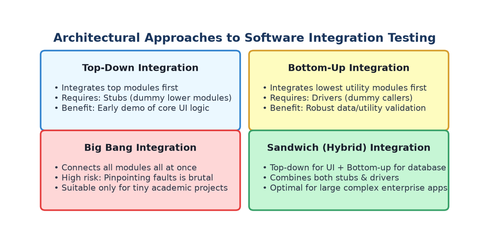

*Figure 1.9: Architectural Flow and Conceptual System Diagram for What do you mean by unit and integration testing?*

### Mathematical Formulation & Algorithmic Mechanics

**Mathematical Modeling of Interface Complexity and Stubs/Drivers:**

```text
Maximum Bilateral Component Interfaces: I_max = ( N · (N - 1) ) / 2
For N = 10 Integrated Modules: I_max = ( 10 · 9 ) / 2 = 45 Potential Interfaces
Top-Down Stub Overhead: Count(Stubs) ≈ Sum( Out-Degree of Unimplemented Child Nodes )
Bottom-Up Driver Overhead: Count(Drivers) ≈ Sum( In-Degree of Unimplemented Parent Nodes )
```

The mathematical formulations defined above model bilateral interface complexity and integration scaffold overhead across software modules. For $N$ interacting subsystems, maximum bilateral communication channels scale as $I_{\text{max}} = \frac{N(N - 1)}{2}$, determining the exact stub and driver complexity required during Top-Down, Bottom-Up, and Sandwich integration testing.

### Worked Example & Practical Simulation

**Integration Testing** of an E-**Commerce Checkout Pipeline**: **Modules**: UI Controller (M1), Cart Engine (M2), Inventory Service (M3), Payment Gateway (M4). • Top-Down Approach: **Test** M1 using Stubs for M2, M3, and M4. The stub for M4 returns a dummy HTTP 200 'Payment Approved' string, enabling immediate **verification** of order confirmation UI screens. • Bottom-Up Approach: Test M3 (Inventory) directly by building a Driver script that invokes reserveItem(sku='A10', qty=2). Verifies database row locking under concurrent calls before UI integration. • Sandwich Convergence: Merge M1, M2, M3, and M4 to verify end-to-end checkout transactions.

### Key Comparative Evaluation

| Dimension | Top-Down Integration | Bottom-Up Integration | Big Bang Integration | Sandwich Integration |
| :--- | :--- | :--- | :--- | :--- |
| Integration Order | Top level downwards | Lowest utilities upwards | All modules simultaneously | Concurrently from top and bottom |
| Auxiliary Harness | Requires Stubs (dummy children) | Requires Drivers (dummy callers) | Neither stubs nor drivers needed | Requires both stubs and drivers |
| Early Working Demo? | Yes, high-level UI demo early | No, UI available only at the end | No, nothing works until the end | Yes, UI and backend tested in parallel |
| Fault Isolation | Moderate; localized to current child | High; isolated to added caller | Very poor; extremely difficult to debug | High; isolated within respective tiers |

### Concluding Exam Takeaway

While **unit testing** ensures the **health** of **individual** code **blocks**, **integration testing** bridges architectural boundaries, guaranteeing robust communication across the entire software application. For optimal SPPU examination scoring, answers must present this complete structure: rigorous theoretical definitions with bold keywords, an accurate architectural flow diagram, clear mathematical formulation, and a structured worked simulation to secure the full 8/**8 marks**.

**Textbook Reference:** Desikan, S., & Ramesh, G. (Pearson Education), Chapter 6: 'Integration Testing: Principles and Architectural Approaches', pp. 140-165.

---

## Q10. How would you explain System Testing and Acceptance Testing? (Frequency: 3) [8 Marks]

### Introduction & Core Intuition

In the classic **V-Model** of software development, **System Testing** and **Acceptance Testing** represent the highest levels of black-box software **validation**. **System Testing** verifies the end-to-end, integrated software system against the technical Software Requirements Specification (SRS), while Acceptance Testing validates the software against real-world customer expectations, business needs, and operational contracts.

### **System Testing: Comprehensive End-to-End Technical Verification**

**System Testing** is a rigorous **black-box testing** phase where the completely integrated software application is evaluated against the comprehensive technical **specifications** documented in the SRS. Conducted by an independent, dedicated **Quality Assurance** team in a production-like staging environment, **system** testing evaluates the entire software solution. This includes verifying hardware **interfaces**, external third-party web services, database connections, and background batch jobs. System testing encompasses both functional end-to-end user workflows and non-functional requirements such as performance under load, failover recovery, and data security.

### **Key Categories of System Testing**

**System testing** involves several specialized **verification** categories: (1) End-to-**End Workflow Testing**, which validates complete user journeys through the application from login to final **transaction**; (2) Configuration Testing, which validates **system** compatibility across diverse hardware profiles, network configurations, and operating system updates; (3) Recovery and Failover Testing, which intentionally forces server crashes, power failures, or network disconnections to evaluate the system's fault-tolerant recovery; and (4) **Security and Vulnerability Testing**, which probes system defenses against penetration, unauthorized privilege escalation, and data theft.

### **Acceptance Testing: Business Alignment and Customer Validation**

While **system testing** proves that the **software** **meets** technical **specifications**, **Acceptance Testing** determines whether the software is acceptable for delivery to business stakeholders and paying customers. It answers the fundamental **validation** question: 'Have we built the RIGHT product to solve the user's business problem?' Acceptance testing is conducted primarily by business analysts, domain specialists, and actual end users. Rather than focusing on low-level technical bugs, acceptance testing evaluates workflow usability, business rule fidelity, financial report accuracy, and overall operational fitness for purpose.

### **Phases of Acceptance Testing: Alpha, Beta, and UAT**

**Acceptance testing** progresses through distinct operational stages: (1) **User Acceptance Testing** (UAT), where business users validate daily operational workflows using realistic business data against User Requirement Specifications; (2) **Alpha Testing**, conducted at the developer's site by internal employees or select client representatives in a controlled environment to catch remaining usability **defects**; (3) **Beta Testing**, where a pre-release version is deployed to an external audience of real-world end users in their own environments to uncover real-world corner cases; and (4) **Contractual & Regulatory Acceptance Testing**, which verifies that the software satisfies legal contracts, government regulations (such as HIPAA or GDPR), and industry standards.

### **The Structural Transition from System to Acceptance Testing**

The transition between system testing and acceptance testing represents an important operational handover. System testing is developer- and QA-centric, focusing on technical specifications, architectural compliance, and defect identification. In contrast, acceptance testing is user- and business-centric, focusing on user confidence, operational viability, and contractual sign-off. Passing system testing is a mandatory entry criterion for acceptance testing, ensuring that business users evaluate a stable, functionally complete software product.

### Architectural Flow & System Diagram

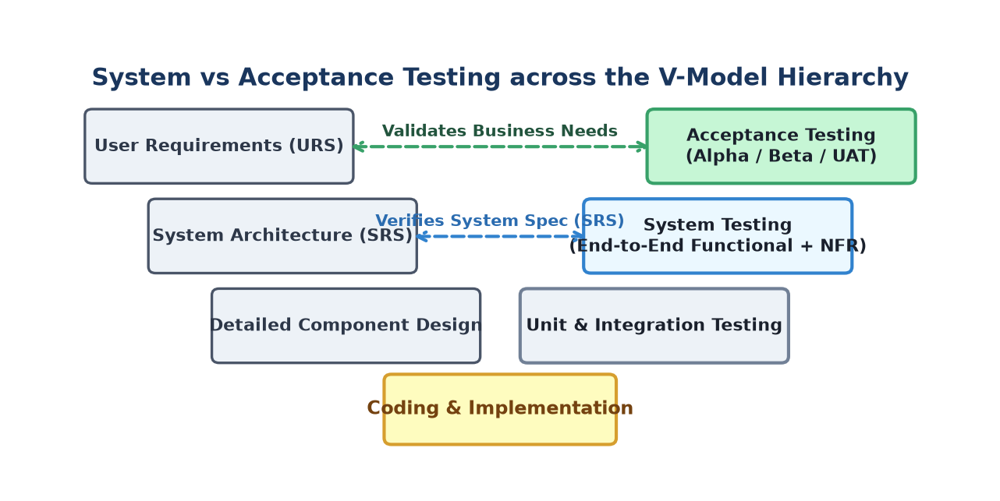

*Figure 1.10: Architectural Flow and Conceptual System Diagram for How would you explain System Testing and Acceptanc*

### Mathematical Formulation & Algorithmic Mechanics

**System Test Pass Criteria and Acceptance Sign-Off Formulas:**

```text
System Test Completion Metric (STCM):
STCM = ( Verified Test Cases / Planned Test Cases ) · 100% ≥ 98%
Critical Defect Residual Threshold: Severity_1 (Blocker) = 0, Severity_2 (Critical) = 0
User Acceptance Quality Index (UAQI):
```

The mathematical metrics defined above govern System Test Completion (STCM) and User Acceptance Testing (UAT) sign-off criteria. Release readiness requires achieving a 100% execution rate across planned test suites, zero unresolved Severity-1 or Severity-2 blocking defects, and verified acceptance sign-offs across all functional business workflows.

### Worked Example & Practical Simulation

System vs **Acceptance Testing** for a **Core Banking Platform**: • **System Testing** Scenario: QA team configures an automated cluster of 50 virtual machines to simulate 10,000 **transactions** per second against the database cluster while simulating a hard failure on the primary database node. Verifies that the automated failover switches to the standby replica within **3.5 seconds** with zero **transaction** loss (Validates technical SRS recovery specification). • Acceptance Testing Scenario: Bank branch tellers, loan officers, and compliance auditors use the platform for two weeks to execute real loan approvals, mortgage calculations, and statutory Reserve Bank of India (RBI) financial reporting. They verify that interest rates, processing fees, and customer tax deductions match exact regulatory formulas (Validates business fit and legal compliance).

### Key Comparative Evaluation

| Comparison Parameter | System Testing | Acceptance Testing (UAT / Beta) |
| :--- | :--- | :--- |
| Primary Goal | Validate entire integrated system against technical SRS | Validate system against business needs and user expectations |
| Target Audience | Dedicated QA Engineers and System Integration Testers | Real end users, clients, domain experts, business analysts |
| Testing Environment | Staging environment simulating production infrastructure | Actual client operational environment or live beta deployment |
| Primary Scope | Comprehensive: Functional, Performance, Security, Failover | Business process workflows, usability, contractual compliance |

### Concluding Exam Takeaway

**System testing** confirms that the **software** **works** **correctly** from an engineering perspective, while **acceptance testing** confirms that it delivers tangible business value to the end customer. For optimal SPPU examination scoring, answers must present this complete structure: rigorous theoretical definitions with bold keywords, an accurate architectural flow diagram, clear mathematical formulation, and a structured worked simulation to secure the full 8/**8 marks**.

**Textbook Reference:** Desikan, S., & Ramesh, G. (Pearson Education), Chapter 7: 'System and Acceptance Testing Life Cycle', pp. 170-205.

---

## Q11. Identify the importance of Regression Testing / State in your own words why Regression Testing is important, and explain it. (Frequency: 3) [8 Marks]

### Introduction & Core Intuition

**Regression Testing** is the disciplined **verification** process of re-executing a selective suite of previously passed **test** cases whenever source code, configuration files, or **runtime** environments are modified. Its primary objective is to guarantee that recent bug fixes, software enhancements, refactoring activities, or architectural **optimizations** have not introduced unintended side effects, broke existing operational functionalities, or resurrected previously resolved **defects**.

### **Defining Regression Testing in Plain Words**

In **everyday** **terms**, software **systems** are **complex** webs of **interconnected** logic where changing one part can inadvertently cause unexpected issues in completely unrelated areas. When a developer fixes a bug on line 42, that change might alter shared **state** in memory or modify a database schema that five other modules depend upon. **Regression Testing** acts as an automated safety net. It continuously verifies that when new features are added or existing bugs are repaired, the core functionalities that worked yesterday continue to work seamlessly today without degradation.

### **Why Regression Testing is Mission-Critical (The Ripple Effect)**

The absolute necessity of **regression testing** stems from the phenomenon known as the **Ripple Effect** (or **defect** propagation). Research in software engineering demonstrates that approximately 20% to 50% of code modifications introduce new **defects** into previously stable **features**. Without continuous regression testing, an engineering team fixing 10 bugs might inadvertently create 5 new ones, causing the software to destabilize over successive release cycles. Regression testing provides the psychological confidence required for development teams to refactor legacy code, update third-party libraries, and deploy continuous updates rapidly.

### **Core Regression Testing Strategies**

Because re-**running** an **entire** enterprise **test suite** for every **minor** code commit is cost-prohibitive, QA organizations employ three primary regression strategies: (1) **Retest All**: The most exhaustive and conservative strategy, where 100% of existing **test** cases in the repository are executed. While it provides the highest defect detection guarantee, it consumes substantial time and computing resources, making it viable primarily before major milestone releases; (2) **Regression Test Selection (RTS)**: An intelligent strategy that utilizes code-change impact analysis to identify and execute only those test cases that traverse the modified code paths and their direct dependencies; and (3) **Test Case Prioritization (TCP)**: A scheduling strategy that ranks test cases based on historical fault-detection rates, business risk, and code churn, running the most critical tests first to catch defects early in the continuous integration pipeline.

### **Regression Testing in Agile and CI/CD Pipelines**

In **modern** **Agile** and **DevOps** frameworks, **regression testing** shifts from a manual, end-of-cycle chore to an automated, continuous **verification** heartbeat. Within automated **Continuous Integration** / Continuous Deployment (CI/CD) pipelines (using tools like Jenkins, GitHub Actions, or GitLab CI), regression suites are partitioned into tiers. A lightweight 'Sanity Regression Suite' executes within 5 to 10 minutes on every pull request, a broader 'Nightly Regression Suite' executes comprehensive functional workflows overnight, and an exhaustive 'Full Regression Suite' runs across distributed clouds prior to staging deployment.

### **The Maintenance Challenge: Test Suite Smells and Flakiness**

As software matures, regression test suites grow exponentially, leading to two significant operational challenges: test suite bloat and test flakiness. Over time, obsolete test cases accumulate, tests become redundant, and unstable tests produce intermittent false alarms due to asynchronous timing delays. Effective regression management requires continuous test suite maintenance—pruning obsolete test cases, refactoring brittle UI selectors into robust Page Object Models (POM), and replacing slow end-to-end browser tests with fast, deterministic API and unit tests.

### Architectural Flow & System Diagram

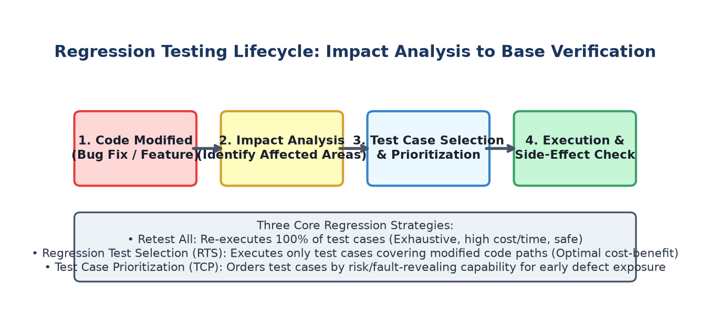

*Figure 1.11: Architectural Flow and Conceptual System Diagram for Identify the importance of Regression Testing / State in your own words why Regression Testing is important, and explain it*

### Mathematical Formulation & Algorithmic Mechanics

**Mathematical Optimization Models for Regression Test Selection:**

```text
Regression Test Selection Coverage Ratio: CR = ( |T_selected| / |T_full| ) · 100%
Cost-Benefit Metric for Automated Regression:
ROI_Regression = ( ( N_runs · Cost_Manual ) - ( Cost_Automation_Dev + N_runs · Cost_Maintenance ) ) / Cost_Automation_Dev
Fault Detection Velocity (FDV) = ( Discovered Regressions / Execution Duration in Hours )
```

The mathematical models defined above formalize regression test selection and test suite optimization. The selection coverage ratio evaluates the minimal subset of historical test cases that exercise modified code blocks and impacted dependencies, maximizing defect detection velocity while minimizing total regression execution duration and infrastructure cost.

### Worked Example & Practical Simulation

Regression **Defect** in an E-**Commerce Payment Gateway**: • The Scenario: Developers update the shipping address **validation** logic to support 6-digit postal PIN codes. • The Side Effect: The address normalization library trims trailing whitespace, which inadvertently truncates credit card CVV strings from 4 digits to 3 digits on American Express cards. • Regression Detection: The automated nightly regression **test suite** executes **Test** Case #412: '**Process** Amex Card with 4-Digit CVV'. • The Result: The regression test fails immediately, flagging a fatal payment rejection bug before the build is deployed to production, saving millions in lost customer transactions.

### Key Comparative Evaluation

| Regression Strategy | Execution Scope | Execution Cost & Time | Defect Detection Safety |
| :--- | :--- | :--- | :--- |
| Retest All | 100% of entire historical test repository | Highest resource consumption; very slow | Maximum safety; zero risk of missed regressions |
| Regression Test Selection (RTS) | Subset of tests covering modified code paths | Moderate resource consumption; fast | High safety; dependent on accurate impact analysis |
| Test Case Prioritization (TCP) | Ordered by business risk and historical failure | Optimized execution; provides rapid early feedback | High defect discovery velocity; fast triage |
| Random Selection | Arbitrary sampling of test repository | Low resource consumption; unpredictable | Very low safety; not recommended for enterprise QA |

### Concluding Exam Takeaway

**Regression testing** is the **primary** **quality** **safeguard** in evolving software **systems**, ensuring that continuous innovation does not compromise foundational application stability. For optimal SPPU examination scoring, answers must present this complete structure: rigorous theoretical definitions with bold keywords, an accurate architectural flow diagram, clear mathematical formulation, and a structured worked simulation to secure the full 8/**8 marks**.

**Textbook Reference:** Desikan, S., & Ramesh, G. (Pearson Education), Chapter 8: 'Regression Testing: Methodologies, Prioritization, and Automation', pp. 210-238.

---

## Q12. How would you explain performance & security testing? Explain in detail performance testing with an example. (Frequency: 4) [8 Marks]

### Introduction & Core Intuition

In modern enterprise software engineering, **Performance Testing** and **Security Testing** represent the two most vital non-functional quality disciplines. Performance testing evaluates an application's speed, responsiveness, scalability, and resource efficiency under varying operational workloads. Security testing evaluates the application's resistance to malicious attacks, unauthorized data access, and **vulnerabilities**, ensuring the **confidentiality**, **integrity**, and **availability** of digital assets.

### **The Multi-Dimensional Architecture of Performance Testing**

**Performance Testing** is a **rigorous** non-**functional** evaluation methodology designed to determine how a software **system** performs in terms of responsiveness and stability under defined workloads. Rather than testing whether a **feature** produces the correct answer, **performance** testing measures how fast that answer is delivered, how many concurrent requests the system can sustain without degradation, and how efficiently it consumes CPU, memory, network bandwidth, and database connections. Its primary objective is to eliminate performance bottlenecks before software is released to the public.

### **The Four Primary Types of Performance Testing**

**Performance testing** is structured into four distinct operational testing paradigms: (1) **Load Testing**: Evaluates application behavior under anticipated real-world peak workloads (e.g., verifying that a portal supports 5,000 concurrent active users with sub-two-second response times); (2) **Stress Testing**: Evaluates **system** behavior beyond normal operational capacity until it breaks, identifying the maximum **throughput** threshold and ensuring graceful degradation rather than catastrophic crashing; (3) **Endurance (Soak) Testing**: Subjects the application to a sustained, moderate load over prolonged periods (such as 24 to 72 hours) to detect slow-developing faults like memory leaks, unclosed database connection pools, and disk storage exhaustion; and (4) **Spike Testing**: Evaluates system stability when subjected to sudden, drastic surges in traffic (such as flash sales or breaking news events), measuring how rapidly the system recovers to normal performance once the surge subsides.

### **Key Performance Metrics and Benchmarks**

Engineers quantify **performance** using specific, industry-standard **metrics**: (1) **Response Time** (**Latency**): The total elapsed duration from when a client dispatches an HTTP request to when the complete server response is received, typically measured across 90th, 95th, and 99th percentiles; (2) **Throughput**: The total volume of **transactions** or requests successfully processed per unit of time, expressed as Transactions Per Second (TPS) or Requests Per Second (RPS); (3) **Resource Utilization**: The percentage of CPU, volatile RAM, disk I/O, and network bandwidth consumed under load; and (4) **Error Rate**: The percentage of requests that fail or time out relative to total requests dispatched.

### **The Principles and Pillars of Security Testing**

**Security Testing** evaluates a system's **vulnerability** to cyber attacks and unauthorized access, grounded in the classic **CIA triad**: **Confidentiality** (ensuring sensitive data is visible only to authorized users), **Integrity** (ensuring data is never altered or deleted during storage or transmission), and **Availability** (ensuring services remain accessible to legitimate users despite distributed denial-of-service attempts). Key security testing types include: (1) **Vulnerability Scanning**, which uses automated scanners to detect known CVE weaknesses; (2) **Penetration Testing (Ethical Hacking)**, where security experts simulate real-world cyberattacks to breach defenses; and (3) **Security Auditing**, which inspects source code and infrastructure configurations against security benchmarks such as OWASP Top 10 and CWE.

### **Strategic Synergy Between Performance and Security**

In production architectures, performance and security are deeply intertwined. For example, security mechanisms such as SSL/TLS encryption, JWT cryptographic signature verification, and multi-factor authentication consume considerable CPU cycles, introducing latency that performance testing must measure. Conversely, Distributed Denial-of-Service (DDoS) attacks exploit performance bottlenecks—such as thread pool starvation and unindexed database queries—to crash enterprise services. Both testing disciplines must be integrated into comprehensive continuous delivery pipelines.

### Architectural Flow & System Diagram

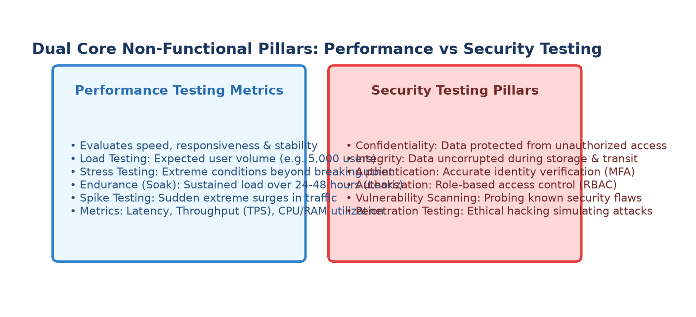

*Figure 1.12: Architectural Flow and Conceptual System Diagram for How would you explain performance & security testing?  in detail performance testing with an example*

### Mathematical Formulation & Algorithmic Mechanics

**Mathematical Performance Metrics and Little's Law:**

```text
Little's Law for Queuing Systems: N = λ · W
Server Throughput: TPS = ( Total Successful Requests / Total Test Duration in Seconds )
Error Rate Percentage: ER = ( Total Failed HTTP 5xx / 4xx Requests / Total Requests Dispatched ) · 100%
Security Defect Vulnerability Index: SVI = Sum( Severity_Weight_i · Vulnerability_Count_i )
```

The mathematical formulations defined above apply Little's Law ($N = \lambda \cdot W$) and performance scaling laws to software load testing. In a queuing system, concurrent active transactions ($N$) equal arrival throughput ($\lambda$) multiplied by average system response latency ($W$), allowing performance engineers to identify server saturation thresholds and thread contention bottlenecks.

### Worked Example & Practical Simulation

**Performance Testing** of an **Online Railway Ticket Booking System** (IRCTC Tatkal Simulation): • The Test Objective: Validate ticket booking **performance** during peak morning Tatkal booking window (10:00 AM to 10:15 AM). • Load Generation Setup: Apache JMeter deployed across 10 distributed cloud load generators configured to simulate 50,000 concurrent user sessions executing **search**, seat selection, and payment **transactions**. • Observations under Normal Load (10,000 users): Average response time = 1.2s; Throughput = 3,**500 TPS**; CPU usage = 45% (Healthy performance). • Stress Test Threshold (45,000 users): Response time degraded to 8.7s; Database connection pool hit 100% capacity; CPU peaked at 98%. • The Bottleneck: Unindexed foreign key lookups in the passenger reservation table caused severe database table locks. • Engineering Resolution: Added composite B-Tree database indexes and implemented Redis caching for train schedules, reducing response times under 50,000 concurrent users to 1.8s.

### Key Comparative Evaluation

| Comparison Parameter | Performance Testing | Security Testing |
| :--- | :--- | :--- |
| Primary Goal | Evaluate system speed, scalability, throughput, and stability | Identify vulnerabilities, assess risks, and prevent unauthorized breaches |
| Primary Basis | Service Level Agreements (SLAs) & non-functional requirements | OWASP Top 10, CWE, regulatory mandates (PCI-DSS, HIPAA) |
| Key Testing Types | Load testing, Stress testing, Soak testing, Spike testing | Vulnerability scanning, Penetration testing, Security audits |
| Typical Tools | Apache JMeter, LoadRunner, Gatling, k6 | OWASP ZAP, Burp Suite, SonarQube, Wireshark, Nmap |

### Concluding Exam Takeaway

**Performance testing** ensures an **application** **operates** **efficiently** under heavy load, while **security testing** protects organizational assets from malicious compromise. For optimal SPPU examination scoring, answers must present this complete structure: rigorous theoretical definitions with bold keywords, an accurate architectural flow diagram, clear mathematical formulation, and a structured worked simulation to secure the full 8/**8 marks**.

**Textbook Reference:** Desikan, S., & Ramesh, G. (Pearson Education), Chapter 9: 'Non-Functional Testing: Performance & Security Methodologies', pp. 245-280.

---

## Q13. Can you illustrate Adhoc Testing with an example? (Frequency: 1) [8 Marks]

### Introduction & Core Intuition

**Adhoc Testing** is an informal, non-structured **software testing** methodology conducted without adhering to formal **requirements** documents, **test** plans, or pre-scripted test **case** steps. It relies entirely on the tester's creativity, intuition, deep **system** understanding, and opportunistic exploration to break the application and reveal elusive bugs that formal procedural testing often fails to detect.

### **The Philosophy of Adhoc Testing**

Traditional **software testing** is largely procedural: testers derive **test** cases from specifications, document explicit **execution** steps, and systematically compare actual results against expected results. While essential for compliance and regression **verification**, this formal approach has a fundamental limitation known as the **Pesticide Paradox**—repeating the same scripted tests over and over eventually ceases to find new **defects** Adhoc testing deliberately abandons rigid scripts. It adopts an improvisational approach where the tester actively attempts to break the system through unexpected workflows, unusual inputs, and chaotic usage patterns.

### **Key Characteristics of Adhoc Testing**

Adhoc testing is characterized by several defining operational attributes: (1) **Zero Pre**-Planning: Testers do not write formal **test** cases beforehand, eliminating administrative overhead and enabling immediate testing; (2) Opportunistic **Execution**: The direction of testing shifts dynamically based on observations; if an **error** or delay is noticed, the tester immediately explores that **vulnerability** deeper; (3) **Defect** Documentation: Although the test execution itself is unstructured, any discovered defect is documented rigorously with exact reproduction steps, screenshots, and system logs; and (4) **High Defect-Yield for Edge Cases**: Adhoc testing is particularly effective at uncovering obscure concurrency issues, memory leaks, and interface boundary glitches.

### **Specialized Forms and Variations of Adhoc Testing**

**Adhoc** **testing** **manifests** in several structured collaborative formats: (1) **Buddy Testing**: A software developer and a QA engineer collaborate side-by-side on the same workstation immediately after a unit is coded, enabling instant **defect** identification and immediate resolution; (2) Pair Testing: Two QA engineers collaborate on the same **feature**—one executes unpredictable user journeys while the other observes system behavior, records anomalies, and logs bugs; (3) **Monkey (Random) Testing**: The application is subjected to completely random, chaotic inputs, rapid button clicks, and irregular keystrokes without any underlying logic to evaluate system stability and exception handling; and (4) **Iterative Adhoc Testing**: Experienced testers conduct targeted, informal testing sessions focused on historically fragile modules after major architectural modifications.

### **Strategic Timing in the Software Development Life Cycle**

**Adhoc** **testing** is most **effective** when **deployed** strategically within the development lifecycle. It should never completely replace formal, **specification**-based testing; rather, it should be conducted: (1) During early agile sprints, before formal documentation is complete; (2) Immediately after formal **system** test cycles, when traditional scripted tests have been exhausted; and (3) During severe time constraints, such as emergency hotfix deployments where rapid verification is essential.

### **Limitations and Mitigating Best Practices**

Despite its high defect yield, adhoc testing has notable limitations: it lacks test coverage traceability, cannot be easily automated, and makes reproducing intermittent defects difficult if the tester fails to remember their exact keystrokes. To maximize its value while mitigating these risks, engineering teams use screen-recording utilities to capture user sessions, employ highly experienced domain experts who understand real-world customer usage, and incorporate adhoc findings back into the formal regression test suite.

### Architectural Flow & System Diagram

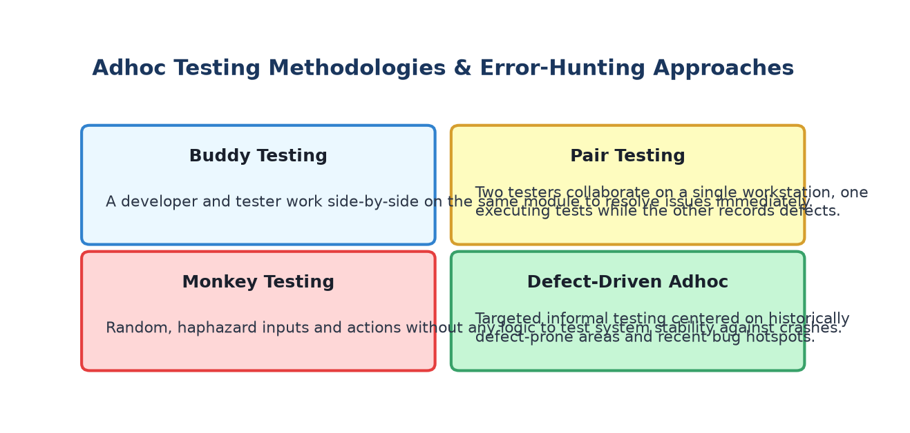

*Figure 1.13: Architectural Flow and Conceptual System Diagram for Can you illustrate Adhoc Testing with an example?*

### Mathematical Formulation & Algorithmic Mechanics

**Adhoc Defect Discovery Rate and Efficiency Metrics:**

```text
Adhoc Defect Yield = ( Unique Discovered Defects / Adhoc Testing Hours )
Defect Uniqueness Ratio: U = ( Adhoc Defects Absent from Formal Scripts / Total Adhoc Defects ) · 100%
Heuristic Search Efficiency: H_eff = ( Total Discovered Anomalies / Explored State Transitions )
Pesticide Paradox Mitigation Factor: M = ( Defects_Adhoc / ( Defects_Adhoc + Defects_Scripted ) )
```

The mathematical metrics defined above quantify exploratory defect discovery yield and bug severity distributions in adhoc testing. By tracking unique defects discovered per unscripted testing hour, quality leads measure tester domain proficiency and pinpoint high-defect clusters that warrant structured automated regression coverage.

### Worked Example & Practical Simulation

**Adhoc Testing** of an **Online** Food **Delivery** **Mobile** App (**Swiggy** / Zomato Scenario): • The Setup: An experienced tester investigates the checkout flow without any formal **test** script. • Action 1: Add a Rs. 500 pizza to the cart, apply a 20% discount coupon code 'WELCOME20' (Cart Total = Rs. 400). • Action 2: Navigate to the final payment screen. Rather than clicking 'Pay', minimize the app, switch device flight mode to ON for 10 seconds, and turn flight mode back OFF. • Action 3: Reopen the app, click the mobile device hardware 'Back' button twice rapidly, and increase the pizza quantity from 1 to 2 in the cart. • The Defect Uncovered: The checkout screen refreshed the cart quantity to 2 pizzas (Rs. 1,000 value), but the backend cache retained the older discounted payment authorization token of Rs. 400! The user successfully placed a Rs. 1,000 order for only Rs. 400. • Value Delivered: Uncovered a severe revenue-leakage vulnerability that standard scripted test paths never explored.

### Key Comparative Evaluation

| Attribute | Adhoc Testing | Formal Scripted Testing | Exploratory Testing |
| :--- | :--- | :--- | :--- |
| Pre-Written Test Cases | Zero pre-written test cases | Mandatory, detailed step-by-step test cases | Guided by a Charter; no pre-scripted steps |
| Execution Methodology | Completely unguided, spontaneous & intuitive | Strict, sequential execution of documented steps | Structured timeboxed exploration with note-taking |
| Repeatability | Low; difficult to recreate unless recorded | 100% repeatable; identical steps followed | Moderate; guided by recorded session notes |
| Documentation Effort | Zero preparation docs; bug tickets only | High effort for test design, review & maintenance | Moderate effort (Test charter and session debrief) |

### Concluding Exam Takeaway

**Adhoc** **testing** acts as a **powerful** creative complement to formal testing, utilizing human curiosity and intuition to discover unexpected **vulnerabilities** that structured **test** scripts overlook. For optimal SPPU examination scoring, answers must present this complete structure: rigorous theoretical definitions with bold keywords, an accurate architectural flow diagram, clear mathematical formulation, and a structured worked simulation to secure the full 8/**8 marks**.

**Textbook Reference:** Desikan, S., & Ramesh, G. (Pearson Education), Chapter 10: 'Adhoc Testing Methodologies & Error Hunting', pp. 285-304.

---

## Q14. Explain any two non-functional testing. Explain Risk Based Testing in detail. Can you explain compatibility testing? What is Cookies testing? Explain Cookies testing with an example. (Frequency: 4) [8 Marks]

### Introduction & Core Intuition

Modern software **quality assurance** encompasses specialized non-functional testing methodologies designed to ensure software **reliability** across diverse deployment environments. This comprehensive domain includes Risk-**Based Testing** (RBT), which prioritizes testing efforts based on business exposure, Compatibility Testing, which validates cross-platform interoperability, and Cookie Testing, which verifies **state** persistence and session **security** in web applications.

### **Two Non-Functional Testing Types: Usability and Reliability Testing**

**Usability Testing** evaluates how **intuitive**, **accessible**, and user-friendly an application is for its intended audience, measuring **metrics** like ease of learning, task completion rates, **error** recovery, and adherence to accessibility standards (such as WCAG 2.1). **Reliability** Testing evaluates whether the software performs its intended functions without failure over extended operational periods under specified environmental conditions, quantified using metrics like Mean Time Between Failures (MTBF) and Mean Time To Recovery (MTTR). Together, these testing types verify that software is both pleasant to use and dependable in production.

### **Risk-Based Testing (RBT) Explained in Detail**

**Testing** every possible **feature**, permutation, and **environment** under real-**world** budget and time constraints is impossible. Risk-**Based Testing** (RBT) solves this challenge by using risk analysis to guide the testing **process**. A risk is defined as the probability of an undesirable event occurring multiplied by the business impact of that event: **Risk = Probability × Impact**. RBT identifies potential product risks early, quantifies their likelihood and business severity, and allocates testing resources proportionally. Critical modules—such as financial payment engines and patient record systems—receive extensive testing, while low-risk decorative features receive minimal verification.

### **The Four Stages of Risk-Based Testing**

RBT **follows** a **structured** four-stage **process**: (1) **Risk Identification**: Brainstorming **potential** failure modes with business stakeholders, developers, and users; (2) Risk Assessment & Scoring: Assigning probability ratings (1 to 5) and business impact ratings (1 to 5) to each failure mode, placing each **feature** on a **Risk Matrix**; (3) **Risk-Driven Test Planning**: Allocating testing budgets, team effort, and coverage levels based on risk scores (High Risk = Comprehensive White/Black Box + Automation; Low Risk = Basic Sanity Check); and (4) **Risk Mitigation & Tracking**: Executing high-risk tests first to uncover critical defects early, tracking risk burn-down as tests pass.

### **Compatibility Testing Explained**

**Compatibility Testing** is a non-functional **verification** methodology that **validates** **whether** an application **functions** consistently across diverse client environments. Because end users access web and mobile software through varied hardware devices, operating **systems**, and browsers, compatibility testing evaluates: (1) Cross-Browser Compatibility (Chrome, Safari, Firefox, Edge); (2) **Cross-Platform OS Compatibility** (Windows, macOS, Linux, iOS, Android); (3) **Device Hardware Compatibility** (varying screen resolutions, CPU speeds, touch vs mouse inputs); and (4) **Network Bandwidth Compatibility** (testing performance across 5G, 4G, 3G, and offline modes).

### **Cookie Testing Explained in Detail with an Example**

**Cookie Testing** is a specialized web application testing technique that validates how HTTP cookies are created, stored, transmitted, and destroyed on client browsers. Cookies are small key-value text files stored by web browsers to maintain session state, track user preferences, and manage authentication across stateless HTTP requests. Cookie testing verifies five critical aspects: (1) **Security Attributes** (ensuring the Secure flag is set so cookies transmit only over HTTPS, and the HttpOnly flag is set to prevent JavaScript access and mitigate XSS attacks); (2) **Expiration & Persistence** (verifying that session cookies delete upon browser closure while persistent cookies expire at their designated timestamp); (3) **Data Encryption** (ensuring passwords or credit card numbers are never stored in plaintext within cookies); (4) **Cookie Disabling Behavior** (verifying that the website degrades gracefully and prompts the user when cookies are disabled in browser settings); and (5) **Cross-Domain Isolation** (ensuring cookies from one domain cannot be read by another).

### Architectural Flow & System Diagram

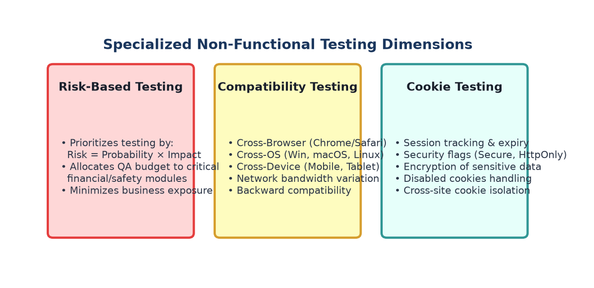

*Figure 1.14: Architectural Flow and Conceptual System Diagram for any two non-functional testing*

### Mathematical Formulation & Algorithmic Mechanics

**Risk Matrix and Cookie Verification Formulations:**

```text
Risk Exposure Formulation: RE = Probability_of_Failure · Impact_of_Failure
Risk Matrix Score: S_risk = P · I,   where P ∈ [1, 5], I ∈ [1, 5] (Score range: 1 to 25)
• Category 1 (Critical: Score 16 - 25): Exhaustive testing, multi-level automation, lead QA ownership
• Category 2 (Medium: Score 8 - 15): Standard functional and regression coverage
```

The mathematical expressions defined above formalize Risk Exposure ($\text{RE} = \text{Probability} \times \text{Impact}$) in risk-based testing alongside cookie security validation. Test prioritization maps features into high-risk quadrants, while cookie expiration and cryptographically signed session tokens enforce stateful session integrity and prevent cross-site session hijacking.

### Worked Example & Practical Simulation

Step-by-**Step Cookie Testing Scenario** for an Online Banking Web Application: • **Test** Action 1 (Cookie Creation & **Security** Flags): User logs into banking portal over HTTPS. Using Chrome DevTools (Application > Cookies), inspect the **session** cookie 'JSESSIONID'. - Verify: 'Secure' flag = True (Ensures cookie is never sent over unencrypted HTTP). - Verify: 'HttpOnly' flag = True (Ensures document.cookie in JavaScript console returns empty, blocking XSS theft). - Verify: 'SameSite' attribute = 'Strict' (**Blocks** Cross-Site Request Forgery attacks). • Test Action 2 (Session Expiry Validation): User remains idle for 15 minutes. Click 'View Account Balance'. - Expected: Session cookie invalidated; server redirects user to login page with message 'Session expired due to inactivity'. • Test Action 3 (Cookie Tampering Check): User intercepts the cookie using a proxy and modifies the user role parameter from 'role=customer' to 'role=admin'. - Expected: Server cryptographic checksum detects signature mismatch, terminates connection, and alerts security.

### Key Comparative Evaluation

| Specialized Testing Type | Primary Quality Focus | Key Verification Mechanism | Business Consequence of Failure |
| :--- | :--- | :--- | :--- |
| Risk-Based Testing | Optimal QA resource & budget allocation | Risk Matrix (Probability × Impact) prioritization | Wasted budget on trivial features; catastrophic bugs in production |
| Compatibility Testing | Universal accessibility across user hardware | Testing across OS, browser, and device matrices | Users on specific devices/browsers experience broken layouts or crashes |
| Cookie Testing | Session persistence, tracking, & web security | Inspecting browser cookie storage, flags & expiry | Session hijacking, XSS attacks, privilege escalation, and data loss |
| Usability Testing | User satisfaction, ease of learning & UX | Heuristic evaluation, user task tracking & feedback | High customer churn, low product adoption, brand abandonment |

### Concluding Exam Takeaway

**Specialized** non-**functional** **methodologies** like Risk-**Based Testing**, Compatibility **Testing**, and Cookie Testing ensure that applications are secure, widely accessible, and commercially viable. For optimal SPPU examination scoring, answers must present this complete structure: rigorous theoretical definitions with bold keywords, an accurate architectural flow diagram, clear mathematical formulation, and a structured worked simulation to secure the full 8/**8 marks**.

**Textbook Reference:** Desikan, S., & Ramesh, G. (Pearson Education), Chapter 11: 'Specialized Testing: Risk-Based, Compatibility, and Web Cookies', pp. 310-345.

---
