# SPPU B.E. Computer Engineering (2019 Pattern)
## Software Testing and Quality Assurance — Unit 2: Dynamic Testing & Test Design Techniques
### Complete Examination Solutions Guide (Engineered for Full 8/8 Marks)

---

## Q1. Differentiate between Quality Assurance and Quality Control (or distinguish between them). (Frequency: 3) [8 Marks]

### Introduction & Core Intuition

In modern software quality engineering, **Quality Assurance** (QA) and **Quality Control** (QC) represent two complementary yet fundamentally distinct operational disciplines. **While Quality Assurance** is a managerial, process-oriented strategy dedicated to **defect** prevention across the entire Software Development Life Cycle, Quality Control is an engineering, product-oriented activity focused on defect detection and **verification** in specific software work products.

### **Defining Quality Assurance in Plain Language**

**Quality Assurance** (QA) is a **planned** and **systematic** **pattern** of all actions necessary to provide adequate confidence that a software product conforms to established technical **requirements** and managerial standards. Rather than inspecting individual lines of compiled code, QA focuses on the engineering **processes**, organizational workflows, and development methodologies used to create the software. It asks: 'Are.

### **Defining Quality Control in Plain Language**

**Quality Control** (QC) is the operational technique and **verification** activity used to fulfill quality requirements by directly examining the software deliverables. While QA defines how software should be developed, QC **tests** whether the resulting product actually works as intended. QC inspects **artifacts**, executes dynamic test **cases**, measures response times, and validates functional behavior against **specifications**. It.

### **The Structural Interplay Between QA and QC**

The **relationship** between QA and QC **forms** a closed continuous improvement loop. QA establishes the quality management policies, **processes**, coding templates, and testing standards. Software developers and engineers execute these processes to build software work products. QC then evaluates those work products through static **inspections** and **dynamic testing**. When QC detects a high **defect density** or.

### **Managerial vs Operational Responsibilities**

**Quality Assurance** is the collective responsibility of all organizational stakeholders, spearheaded by dedicated SQA Managers, **Process Process Improvement Groups**, and Lead Architects. It involves **process** auditing, **CMMI** compliance, employee training, and quality metric baselining. In contrast, **Quality Control** is executed primarily by dedicated Quality Control Engineers, Software Development Engineers in **Test** (SDETs), and manual testers who.

### Architectural Flow & System Diagram

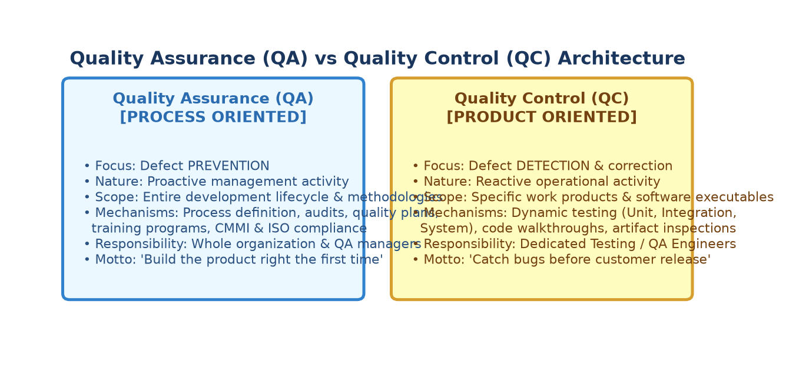

*Figure 2.1: Architectural Flow and Conceptual System Diagram for Differentiate between Quality Assurance and Quality Control (or distinguish between them)*

### Mathematical Formulation & Algorithmic Mechanics

**Mathematical Cost of Quality (CoQ) Equation:**

```text
Total Cost of Quality (CoQ) = Cost of Conformance + Cost of Non-Conformance
Cost of Conformance (QA-Driven): Prevention_Costs + Appraisal_Costs
• Prevention Costs: SQA planning, training, coding standards, process audits
• Appraisal Costs: Formal inspections, code reviews, testing infrastructure
```

The mathematical formulation and algorithmic **parameters** defined above govern the runtime behavior of the system. Each parameter serves an exact role: primary terms scale throughput, penalty terms enforce **regularization** constraints, and **optimization** objectives drive steady **convergence** toward the **global minimum**.

### Worked Example & Practical Simulation

QA vs QC in a **Commercial Aircraft Flight Control Software Project**: • **Quality Assurance** (QA) Action: SQA Lead mandates DO-178C Level A compliance, requiring peer review checklists, **static analysis** rules barring pointer arithmetic, and bi-directional traceability from requirements to code. • **Quality Control** (QC) Action: QC **Test** Engineers configure an automated hardware-in-the-loop (HIL) simulator to execute 10,000 automated flight scenario test **vectors**, measuring whether the rudder control servo responds within 15 milliseconds under simulated crosswinds..

### Key Comparative Evaluation

| Comparison Parameter | Quality Assurance (QA) | Quality Control (QC) |
| :--- | :--- | :--- |
| Primary Orientation | Process-oriented (Focuses on development methods) | Product-oriented (Focuses on executable deliverables) |
| Core Objective | Defect Prevention (Ensure bugs are not introduced) | Defect Detection (Find and fix bugs in work products) |
| Strategic Nature | Proactive managerial strategy | Reactive operational and verification activity |
| Timing in SDLC | Continuous across all phases right from project initiation | Post-artifact creation (begins once code/specs exist) |

### Concluding Exam Takeaway

**Quality Assurance** designs the **processes** that prevent **errors** from occurring, while **Quality Control** verifies that the manufactured software product adheres strictly to customer **specifications**. For optimal SPPU examination scoring, answers must present this complete structure: rigorous theoretical definitions with bold keywords, an accurate architectural flow diagram, clear mathematical formulation, and a structured worked simulation to secure the full 8/**8 marks**.

**Textbook Reference:** Galin, D. (Pearson Education), Chapter 2: 'What is Software Quality? QA vs QC Foundations', pp. 24-45.

---

## Q2. Can you clarify Quality Assurance? (Frequency: 1) [8 Marks]

### Introduction & Core Intuition

Software **Quality Assurance** (SQA) is an **encompassing**, **umbrella** **lifecycle** management discipline defined by IEEE standard 730 as a systematic, planned pattern of actions necessary to provide adequate confidence that a software product conforms to established functional **requirements** and technical standards. SQA ensures that the software development **processes**, methodologies, and environmental infrastructure are governed by rigorous quality principles.

### **Core Philosophy: Building Quality In vs Inspecting Quality In**

The **fundamental** **premise** of Software **Quality Assurance** is derived from total quality management pioneers W. **Edwards Deming** and Joseph Juran: quality cannot be inspected or tested into a software application at the end of the line; it must be built into every step of the development **process**. If software engineers utilize flawed **requirement** elicitation techniques, undocumented.

### **The Four Primary Dimensions of an SQA Framework**

An **enterprise** SQA **framework** encompasses four operational **dimensions**: (1) **Process Definition** and Tailoring: Establishing formal, documented development lifecycles (such as Scrum, Kanban, or Waterfall), coding guidelines, version control branching **rules**, and **defect** management workflows; (2) Quality Audits and Compliance Monitoring: Performing impartial, independent reviews of development teams to ensure that project workflows adhere strictly to organizational.

### **Key SQA Activities across the Software Lifecycle**

**Throughout** the **project** lifecycle, SQA professionals execute structured activities: (1) Formulating a comprehensive SQA Plan at project initiation; (2) Participating in **requirements** reviews to eliminate ambiguities; (3) Auditing configuration management practices to prevent unapproved code check-ins; (4) Monitoring testing **coverage** metrics to ensure **verification** rigor; (5) Conducting periodic **process** capability assessments; and (6) Tracking technical debt.

### **The Principle of Organizational Independence**

A critical **requirement** for **effective** SQA is **organizational** **independence**. In **mature** **software** enterprises, the SQA team does not report to project managers or development leads, whose primary incentives often revolve around meeting aggressive delivery deadlines. Instead, SQA operates as an autonomous entity reporting directly to executive management (such as the VP of Quality or CTO). This.

### Architectural Flow & System Diagram

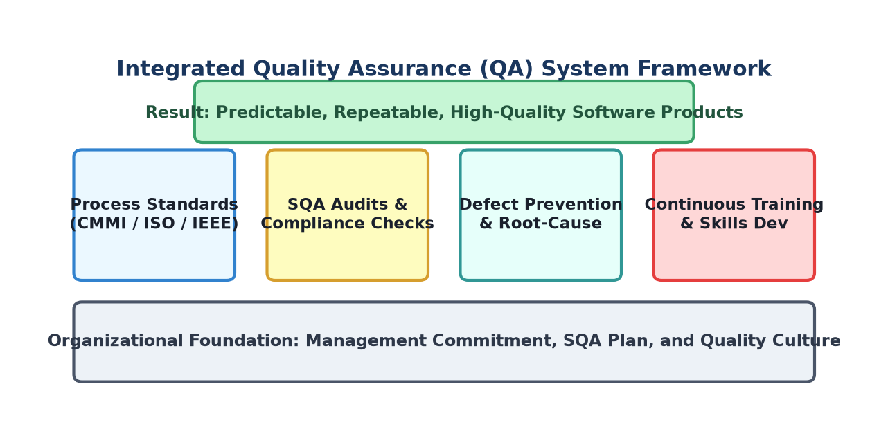

*Figure 2.2: Architectural Flow and Conceptual System Diagram for Can you clarify Quality Assurance?*

### Mathematical Formulation & Algorithmic Mechanics

**Mathematical SQA Process Compliance & Defect Containment Metrics:**

```text
Process Compliance Index: PCI = ( Audited Items in Full Compliance / Total Audited Process Items ) · 100%
Phase Containment Effectiveness (PCE):
PCE_Phase = ( Defects_Originated_and_Detected_in_Phase / Total_Defects_Originated_in_Phase ) · 100%
Target SQA PCE Benchmark: ≥ 85% for Requirement and Design phases
```

The mathematical formulation and algorithmic **parameters** defined above govern the runtime behavior of the system. Each parameter serves an exact role: primary terms scale throughput, penalty terms enforce **regularization** constraints, and **optimization** objectives drive steady **convergence** toward the **global minimum**.

### Worked Example & Practical Simulation

SQA **Framework Implementation** in an **Enterprise** **Banking** Platform: • Problem: Production releases were plagued by frequent **transaction** rollbacks and unhandled null pointer exceptions. • SQA Intervention: SQA audit revealed that developers lacked standardized code review checklists and merged pull requests without running unit **tests**. • SQA Solution: Implemented an automated pre-commit hook requiring 80% unit test **coverage** and two senior peer approvals; established an SQA audit review at the end of each two-week sprint. •.

### Key Comparative Evaluation

| SQA Dimension | Key Activities Involved | Target Artifacts | Measurable Outcome |
| :--- | :--- | :--- | :--- |
| Process Governance | Defining development standards and coding guidelines | Process handbooks, coding style guides, templates | Standardized, repeatable engineering practices |
| Quality Auditing | Independent reviews of project adherence to SQA plan | Audit reports, non-conformance logs (NCRs) | Objective verification of process compliance |
| Defect Prevention | Root cause analysis (RCA) and retrospective reviews | Fishbone diagrams, Pareto charts, lessons learned | Systematic elimination of recurring defect classes |
| Metric Analysis | Tracking defect density, review velocity, and test coverage | Quality dashboards, burndown charts, SQA reports | Data-driven management decisions and process optimization |

### Concluding Exam Takeaway

Software **Quality Assurance** is a **proactive**, **organization**-wide **commitment** to **engineering** discipline, ensuring that quality is intentionally designed into every phase of the development lifecycle. For optimal SPPU examination scoring, answers must present this complete structure: rigorous theoretical definitions with bold keywords, an accurate architectural flow diagram, clear mathematical formulation, and a structured worked simulation to secure the full 8/**8 marks**.

**Textbook Reference:** Galin, D. (Pearson Education), Chapter 3: 'Software Quality Assurance Architecture and Infrastructure', pp. 48-72.

---

## Q3. What do you understand regarding quality control & Explain two methods of quality control. (Frequency: 2) [8 Marks]

### Introduction & Core Intuition

**Quality Control** (QC) in software engineering encompasses all operational activities and **verification** techniques executed to assess the quality of developed work products, detect **defects**, and ensure that deliverables satisfy specified functional and technical criteria. Unlike **Quality Assurance**, which governs processes, **Quality Control** is product-focused, directly examining documentation, code, and executable builds to catch faults before release.

### **The Nature and Objectives of Quality Control**

**Quality Control** represents the hands-on, **defect**-detection arm of software quality engineering. Its primary objective is to inspect, **test**, and verify whether intermediate and final deliverables conform to documented **specifications**. QC operates as a quality filter positioned between developers and end users. By systematically subjecting work products to rigorous physical examinations and **execution** tests, QC identifies **errors**,.

### **The Closed-Loop Quality Control Workflow**

A mature **Quality Control** mechanism follows a closed-loop cybernetic feedback **model**: (1) **Inspection**/Testing: Deliverables are evaluated against predefined acceptance criteria; (2) **Defect** Logging: Any detected discrepancy is documented with detailed reproduction steps, logs, and severity classifications; (3) **Engineering Rework**: The author or developer fixes the underlying fault; (4) Re-**Verification** & Regression: QC re-evaluates the deliverable to.

### **QC Method 1: Formal Peer Reviews and Inspections (Static QC)**

The first foundational method of **Quality Control** is **Formal Peer Review** and **Inspection** (the Fagan Inspection method). This static QC method examines non-executable **artifacts**—such as Software Requirements Specifications, Architectural Design Documents, and source code files. Led by an impartial moderator, a trained team of inspectors systematically reads through the **artifact** line-by-line using standardized **defect** checklists. By.

### **QC Method 2: Dynamic Software Testing (Execution-Based QC)**

The second foundational method of **Quality Control** is Dynamic **Software Testing**. This method evaluates compiled software by executing it with controlled input datasets in dedicated test environments. **Dynamic testing** progresses through hierarchical levels: **Unit Testing** validates isolated functions, **Integration Testing** verifies component interfaces, **System Testing** validates end-to-end business workflows against the SRS, and **Acceptance Testing** confirms.

### Architectural Flow & System Diagram

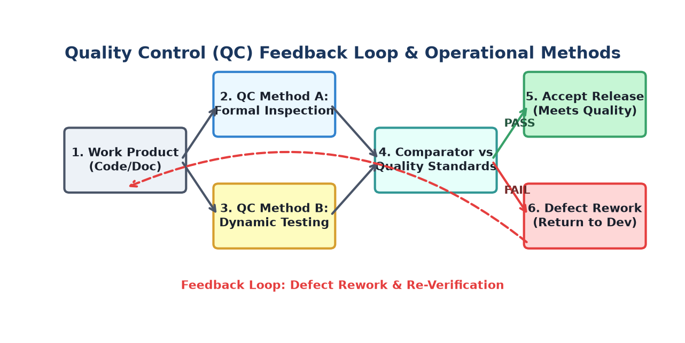

*Figure 2.3: Architectural Flow and Conceptual System Diagram for What do you understand regarding quality control &  two methods of quality control*

### Mathematical Formulation & Algorithmic Mechanics

**Mathematical Quality Control Yield and Defect Removal Efficiency:**

```text
Defect Removal Efficiency (DRE) of QC Phase:
DRE_QC = ( Defects_Detected_by_QC / ( Defects_Detected_by_QC + Defects_Escaped_to_Customer ) ) · 100%
Target Enterprise QC DRE Benchmark: ≥ 95%
Defect Fix Rejection Rate: DFR = ( Rejected_Bug_Fixes / Total_Resolved_Bugs ) · 100%
```

The mathematical formulation and algorithmic **parameters** defined above govern the runtime behavior of the system. Each parameter serves an exact role: primary terms scale throughput, penalty terms enforce **regularization** constraints, and **optimization** objectives drive steady **convergence** toward the **global minimum**.

### Worked Example & Practical Simulation

**Quality Control** in an E-**Commerce Payment Gateway Module**: • Method 1 (Static QC **Inspection**): Lead Architect and QC Engineer inspect the PaymentService.java code. They discover that the refund method lacks database **transaction** isolation, meaning a network timeout could leave customer accounts in an uncredited **state**. • Method 2 (Dynamic QC Testing): QC Engineers configure automated **test** suites simulating 500 simultaneous refund requests with intermittent simulated gateway drops. The tests confirm that the database correctly rolls.

### Key Comparative Evaluation

| Dimension | Method 1: Formal Inspection (Static QC) | Method 2: Dynamic Testing (Dynamic QC) |
| :--- | :--- | :--- |
| Execution Requirement | Zero code execution; manual intellectual examination | Requires fully compiled, executing code in a runtime environment |
| Target Artifacts | Requirements (SRS), Architecture specs, Source code | Executable builds, APIs, database instances, frontend UI |
| Defect Discovery | Identifies root-cause bugs directly in the text/code | Observes runtime failures and crashes; requires debugging |
| Timing in Project | Initiates immediately in the Requirements/Design phase | Begins once compilable source code is written and built |

### Concluding Exam Takeaway

**Quality Control** acts as an essential **verification** gate, combining static inspection and **dynamic testing** to ensure that only reliable, **defect**-free software is delivered to customers. For optimal SPPU examination scoring, answers must present this complete structure: rigorous theoretical definitions with bold keywords, an accurate architectural flow diagram, clear mathematical formulation, and a structured worked simulation to secure the full 8/**8 marks**.

**Textbook Reference:** Galin, D. (Pearson Education), Chapter 4: 'Quality Control Methodologies and Verification Gates', pp. 75-98.

---

## Q4. Can you clarify the Quality Management System? Explain in detail Pillars of Quality Management System. With respect to QMS, explain important aspects of quality management. (Frequency: 5) [8 Marks]

### Introduction & Core Intuition

A **Quality Management System** (QMS) is a formalized organizational framework of documented policies, operational **processes**, standard procedures, and resource allocations designed to direct and control a software organization with regard to quality. Governed by international standards such as **ISO 9001**:2015 and SEI **CMMI**, a QMS establishes the structural foundation required to consistently satisfy customer **requirements**, maintain regulatory compliance, and achieve continuous engineering improvement.

### **Defining the Quality Management System (QMS) in Plain Terms**

In **simple** **words**, a **Quality Management System** is the **organizational** **blueprint** that defines how an enterprise builds, **tests**, delivers, and improves its software. Rather than relying on individual talent or ad-hoc practices, a QMS codifies best practices into repeatable, standardized workflows. It ensures that regardless of which team member writes the code or runs the tests,.

### **Pillar 1: Customer Focus and Value Delivery**

The **primary** **pillar** of any QMS is an **unwavering** focus on customer **requirements** and expectations. Software quality is ultimately defined by the customer's satisfaction and fitness for purpose. This pillar mandates formal mechanisms for capturing user requirements, establishing unambiguous acceptance criteria, conducting **User Acceptance Testing** (UAT), tracking **Net Promoter Scores** (NPS), and maintaining structured customer support.

### **Pillar 2: Executive Leadership and Strategic Commitment**

A QMS cannot **succeed** as a **grassroots** **initiative**; it **requires** visible commitment from executive leadership. Leaders must establish the organization's quality **policy**, allocate necessary budgets for automated testing tools and employee training, define measurable quality objectives across departments, and foster a blame-free culture centered on continuous improvement. Leadership also ensures that quality objectives are integrated into business **performance** reviews.

### **Pillar 3: The Process Approach and Systemic Thinking**

The **process** approach **treats** **software** development as a network of interrelated, interdependent processes rather than disconnected departmental silos. **Requirements** engineering feeds architectural design, which feeds implementation, which feeds **verification** and deployment. By understanding how inputs, transformations, and outputs interact across these stages, organizations optimize the overall **system**, eliminating handoff delays, misunderstandings, and process bottlenecks.

### Architectural Flow & System Diagram

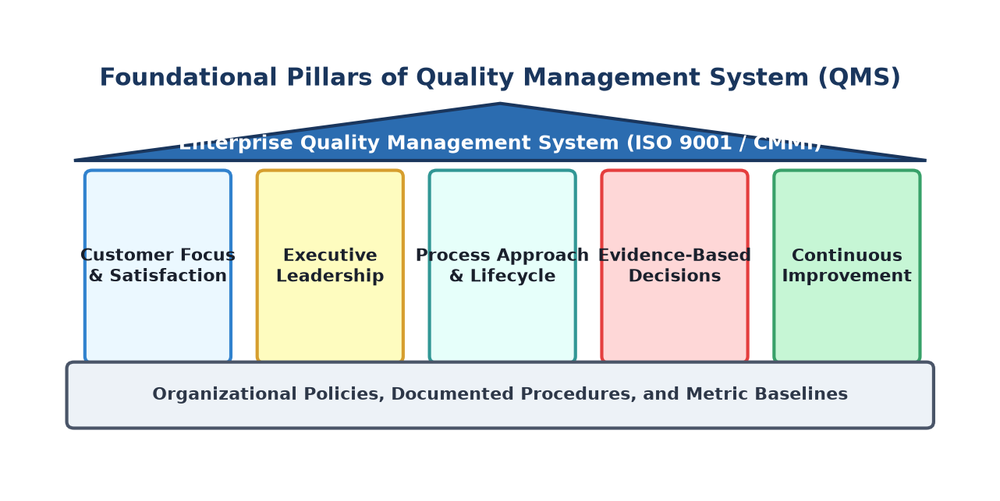

*Figure 2.4: Architectural Flow and Conceptual System Diagram for Can you clarify the Quality Management System?  in detail Pillars of Quality Management System*

### Mathematical Formulation & Algorithmic Mechanics

**Mathematical Modeling of QMS Process Effectiveness:**

```text
QMS Process Maturity Index (PMI):
PMI = ( Sum( W_i · Performance_Score_i ) ) / Sum( W_i )
Customer Satisfaction Index (CSI):
CSI = ( Sum( Customer_Rating_j ) / ( N_customers · Max_Rating ) ) · 100%
```

The mathematical formulation and algorithmic **parameters** defined above govern the runtime behavior of the system. Each parameter serves an exact role: primary terms scale throughput, penalty terms enforce **regularization** constraints, and **optimization** objectives drive steady **convergence** toward the **global minimum**.

### Worked Example & Practical Simulation

QMS Implementation across a **Healthcare Software Enterprise**: • Leadership: Executive committee establishes an organizational goal: 'Zero Critical **Defects** in Patient Monitoring Firmware'. • Customer Focus: SQA team conducts quarterly reviews with hospital chief medical officers to evaluate bedside alarm workflows. • **Process** Approach: Implemented standardized FDA 21 CFR Part 820 design controls connecting hazard analysis to unit test cases. • **Evidence**-Based Decisions: Release decisions are governed by strict **data** gates: 100% MC/DC code **coverage** and.

### Key Comparative Evaluation

| QMS Pillar | Core Managerial Principle | Key Engineering Mechanism | Primary Benefit |
| :--- | :--- | :--- | :--- |
| Customer Focus | Understand and fulfill customer needs | User stories, acceptance criteria, NPS surveys | High customer retention and market reputation |
| Leadership | Establish unified quality vision and culture | Executive quality policy, resource allocation | Clear organizational direction and accountability |
| Process Approach | Manage activities as interrelated processes | Documented SDLC, entry/exit criteria, SQA audits | Consistent, repeatable project execution |
| Evidence-Based Decisions | Base decisions on objective data and metrics | Defect density tracking, DRE metrics, dashboards | Objective, risk-free release management |

### Concluding Exam Takeaway

A robust **Quality Management System** transforms **software** **engineering** from an **unpredictable** art into a predictable, **data**-driven, customer-centric discipline. For optimal SPPU examination scoring, answers must present this complete structure: rigorous theoretical definitions with bold keywords, an accurate architectural flow diagram, clear mathematical formulation, and a structured worked simulation to secure the full 8/**8 marks**.

**Textbook Reference:** Galin, D. (Pearson Education), Chapter 5: 'Quality Management Systems: ISO 9001 and CMMI Frameworks', pp. 102-135.

---

## Q5. Can you explain a quality plan in detail? (Frequency: 2) [8 Marks]

### Introduction & Core Intuition

A Software **Quality Assurance** (SQA) Plan is a **formal**, **comprehensive** **management** document that defines the specific quality standards, **verification** practices, resource allocations, review schedules, and governance procedures tailored for a specific software project. Governed internationally by IEEE standard 730, the SQA plan serves as the definitive roadmap ensuring that the project delivers a reliable, high-performing product that meets all customer **requirements**.

### **The Purpose and Core Mission of a Quality Plan**

In **everyday** **terms**, if the **Project Management Plan** defines *what* will be **built**, *who* will build it, and *when* it will be delivered, the Software Quality Plan defines *how well* it must be built. The quality plan establishes a formal **contract** among project managers, software developers, **quality assurance** engineers, and client stakeholders. It establishes clear quality.

### **Key Structural Component 1: Management, Roles, and Responsibilities**

A **quality** plan **begins** by establishing organizational governance: (1) **Organizational Structure**: Defines the reporting relationships between developers, testers, and SQA auditors, guaranteeing the independence of the quality organization; (2) Roles and Responsibilities: Clearly delineates who is responsible for writing unit **tests** (developers), who conducts architecture **inspections** (lead architects), who audits **process** compliance (SQA auditors), and who.

### **Key Structural Component 2: Standards, Practices, and Conventions**

The quality plan mandates the technical **rules** and engineering standards governing all project deliverables: (1) **Documentation Standards**: Mandates standard templates for SRS, architectural design, and **test** plans (e.g., IEEE 829); (2) Coding Standards: Mandates naming conventions, commenting rules, banned **functions** (such as unsafe **memory** copies), and modularity guidelines; and (3) Testing and **Verification** Standards: Defines required.

### **Key Structural Component 3: Review, Audit, and Testing Schedule**

The quality plan establishes a structured schedule of **verification** activities synchronized with project milestones: (1) **Static Review Schedule**: Specifies formal peer review and **inspection** dates for requirements, architecture, and database schemas; (2) Quality Audits: Sets dates for independent SQA **process** compliance audits; and (3) **Dynamic Testing** Phases: Details the timelines, environments, and **entry**/exit criteria for integration,.

### Architectural Flow & System Diagram

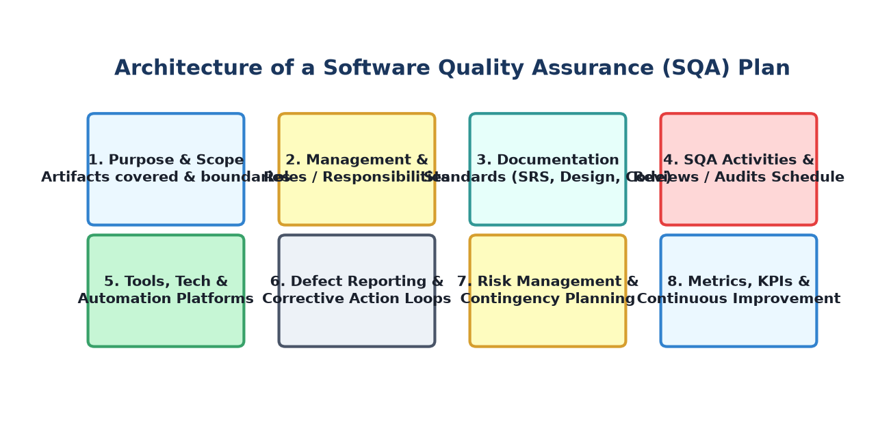

*Figure 2.5: Architectural Flow and Conceptual System Diagram for Can you explain a quality plan in detail?*

### Mathematical Formulation & Algorithmic Mechanics

**Mathematical SQA Plan Quality Gates and Exit Criteria:**

```text
Release Readiness Quality Index (RRQI):
RRQI = ( W_1 · Cov_Code ) + ( W_2 · DRE ) + ( W_3 · ( 1 - Defect_Severity_Index ) ) ≥ Threshold
Defect Severity Index: DSI = ( 10 · S_1 + 5 · S_2 + 2 · S_3 + 1 · S_4 ) / Total_Active_Bugs
Mandatory Quality Plan Gate: Open S_1 (Blocker) = 0 and Open S_2 (Critical) = 0
```

The mathematical formulation and algorithmic **parameters** defined above govern the runtime behavior of the system. Each parameter serves an exact role: primary terms scale throughput, penalty terms enforce **regularization** constraints, and **optimization** objectives drive steady **convergence** toward the **global minimum**.

### Worked Example & Practical Simulation

SQA **Plan Architecture** for an Autonomous Driving Navigation Module: • Section 1 (Scope): Covers obstacle detection radar firmware and GPS route planning **algorithms**. • Section 2 (Standards): ISO 26262 Automotive Safety **Integrity** Level D (ASIL D); MISRA-C 2012 coding rules enforced via automated static analyzers. • Section 3 (**Verification** Schedule): Fagan **inspection** on sensor fusion design at Month 2; Hardware-in-the-loop (HIL) simulator **stress testing** at Month 4. • Section 4 (Quality Gate): Zero open critical.

### Key Comparative Evaluation

| SQA Plan Section | Core Purpose | Standard Contents Included | Responsible Role |
| :--- | :--- | :--- | :--- |
| Purpose & Scope | Define project boundaries and quality goals | List of covered systems, hardware platforms, release criteria | Project Manager & QA Lead |
| Management & Roles | Establish quality governance and oversight | Organizational chart, SQA independence, assigned duties | SQA Manager |
| Engineering Standards | Codify coding, design, and documentation rules | MISRA/PEP-8 coding styles, IEEE 829 test templates, git rules | Lead Software Architect |
| Review & Audit Plan | Schedule verification checkpoints and audits | Milestone review dates, audit checklists, Fagan inspection plans | SQA Auditor |

### Concluding Exam Takeaway

A **thoroughly** **designed** Software **Quality Assurance** Plan **provides** the **engineering** **blueprint** and managerial discipline needed to ensure that complex software is delivered on time, within budget, and to the highest quality standards.

**Textbook Reference:** Galin, D. (Pearson Education), Chapter 6: 'The Software Quality Assurance Plan (SQAP)', pp. 140-168.

---

## Q6. Why does software have Defects? Explain in detail. What is the impact of a defect in different phases of software development? (Frequency: 5) [8 Marks]

### Introduction & Core Intuition

In software engineering, a **Defect** (commonly referred to as a bug, fault, or flaw) is an imperfection or deficiency in a software work product where it does not meet its **specification** or **requirements**. Software **systems** are intellectual constructs created by humans; therefore, **defects** arise from a complex interplay of human cognitive limitations, communication breakdowns, changing business requirements, and architectural complexities.

### **Root Causes of Software Defects: Human and Organizational Factors**

**Software** **development** is an **intensely** cognitive, human-driven endeavor. **Defects** originate from several primary root causes: (1) **Human Fallibility** and Cognitive Overload: Software developers are human beings prone to mental fatigue, distraction, and cognitive overload when managing complex **algorithms** with dozens of interdependent variables; (2) Communication Breakdowns and Ambiguity: Miscommunication between business analysts, clients, developers, and testers.

### **Root Causes of Software Defects: Technical and Environmental Factors**

Beyond human and managerial factors, technical **complexity** contributes significantly to software **defects**: (4) **Complex Architectural Dependencies**: Modern microservice architectures, distributed databases, asynchronous message queues, and multi-threading introduce subtle race **conditions** and timing anomalies that are difficult to predict or **test** exhaustively; (5) Continuous **Requirements** Volatility: In rapidly evolving business environments, requirements change constantly—every late change can.

### **The Defect Amplification Model across SDLC Phases**

A **foundational** **concept** in software quality engineering is the **Defect** Amplification **Model**. When a **defect** is introduced in an early phase (such as **Requirements** Elicitation) and is not detected during that phase, it does not simply remain a single bug—it amplifies exponentially into multiple design flaws, which in turn spawn dozens of coding bugs and hundreds.

### **Phase-Wise Impact of Defects in the Software Lifecycle**

The **impact** of a **defect** depends **heavily** on the lifecycle phase in which it is finally discovered: (1) **Requirements** & **Design Phase**: If caught early during reviews, impact is minimal—a simple sentence edit in a document costs negligible effort; (2) Coding Phase: If caught during **unit testing**, the developer fixes the bug within minutes with low.

### Architectural Flow & System Diagram

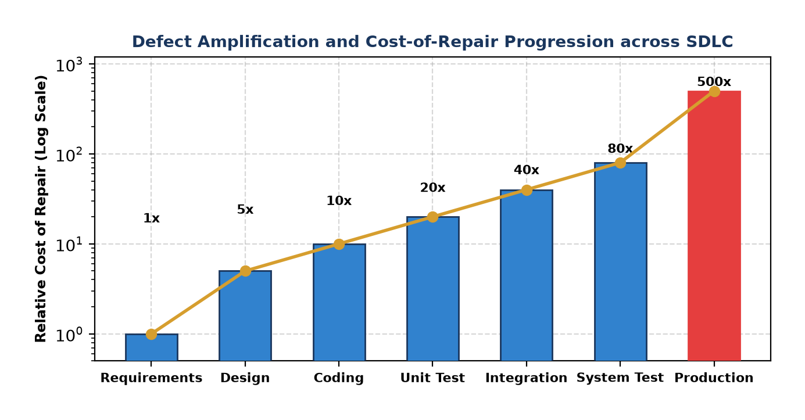

*Figure 2.6: Architectural Flow and Conceptual System Diagram for Why does software have Defects?  in detail*

### Mathematical Formulation & Algorithmic Mechanics

**Mathematical Defect Amplification and Cost-of-Repair Equations:**

```text
Defect Amplification Factor: D_out = ( D_in · A ) + D_new
Exponential Cost of Repair: Cost(Phase_i) = Base_Cost · e^(k · i)
Relative Phase Cost Multipliers: Req=1x, Design=5x, Code=10x, Unit_Test=20x, System_Test=50x, Production=500x+
Defect Removal Efficiency: DRE = ( Defects_Caught_in_Phase / Total_Defects_Present ) · 100%
```

The mathematical formulation and algorithmic **parameters** defined above govern the runtime behavior of the system. Each parameter serves an exact role: primary terms scale throughput, penalty terms enforce **regularization** constraints, and **optimization** objectives drive steady **convergence** toward the **global minimum**.

### Worked Example & Practical Simulation

Real-World **Defect** Amplification in a **Healthcare Radiation Therapy Device** (Therac-25 **Case** Study): • The Root **Defect**: A subtle race **condition** in the software keyboard handler (a software defect originating in code implementation). • The Amplification: The lack of a hardware interlock safety requirement amplified the software race condition into an unmitigated physical hazard. • Production Impact: When operators rapidly typed commands, the software entered an uninitialized **state**, delivering massive radiation overdoses (over 100 times the.

### Key Comparative Evaluation

| Discovery Phase | Typical Defect Manifestation | Relative Repair Cost | Business & Operational Impact |
| :--- | :--- | :--- | :--- |
| Requirements Phase | Ambiguous user stories, missing business rules, conflicting specs | 1x (Base cost: minimal) | Negligible; corrected via simple document wording updates |
| Design Phase | Flawed database schemas, unscalable architectural choices | 5x to 10x | Low; design models refactored prior to code construction |
| Coding / Unit Test | Logic errors, off-by-one loops, null pointer dereferences | 10x to 20x | Moderate; developer debugs and updates unit test cases locally |
| System / Integration | Interface mismatches, performance bottlenecks, race conditions | 40x to 80x | High; delays release schedules, consumes extensive QA re-testing |

### Concluding Exam Takeaway

**Understanding** why software **defects** occur and how their **repair** **costs** escalate exponentially underscores the vital importance of early static **defect** prevention across the SDLC. For optimal SPPU examination scoring, answers must present this complete structure: rigorous theoretical definitions with bold keywords, an accurate architectural flow diagram, clear mathematical formulation, and a structured worked simulation to secure the full 8/**8 marks**.

**Textbook Reference:** Galin, D. (Pearson Education), Chapter 7: 'Software Defects: Origins, Amplification, and Economic Impact', pp. 175-204.

---

## Q7. Illustrate different characteristics of software in detail. (Frequency: 1) [8 Marks]

### Introduction & Core Intuition

**Software** is a **unique**, **intangible** **intellectual** **asset** whose engineering, operational, and economic characteristics differ fundamentally from physical manufactured products. To evaluate, specify, and ensure software quality, international standards—principally ISO/IEC 9126 and its modern successor ISO/IEC 25010 (SQuaRE)—define comprehensive quality characteristic **models** that govern software behavior, operational efficiency, and long-term maintainability.

### **The Inherent Intangible Nature of Software vs Physical Goods**

To **understand** **software** **characteristics**, one must first **recognize** how **software** **differs** from physical hardware. Physical goods (such as automobiles or microchips) are manufactured from physical raw materials, degrade over time due to mechanical wear and tear, and follow a classic bathtub-shaped failure curve as parts physically deteriorate. In stark contrast, software is engineered and developed, not.

### **Characteristic 1: Functional Suitability**

**Functional Suitability** represents the **degree** to which a **software** **product** provides **functions** that meet stated and implied user needs when used under specified **conditions**. It comprises three vital sub-characteristics: (1) Functional Completeness: The degree to which the set of implemented functions covers all the specified tasks and user objectives; (2) Functional Correctness: The degree to which.

### **Characteristic 2: Performance Efficiency and Resource Utilization**

**Performance Efficiency** evaluates the **performance** of software relative to the amount of resources utilized under stated operational **conditions**. It encompasses: (1) Time Behavior: The **transaction** response times, processing latencies, and throughput rates of the **system** under peak and typical operational loads; (2) Resource Utilization: The quantities and types of resources (such as CPU cycles, **memory** allocation,.

### **Characteristic 3: Reliability and Fault Tolerance**

**Reliability** is the capability of the software product to maintain a specified level of **performance** when used under specified operational **conditions** over a defined time period. It includes: (1) Maturity: The degree to which the **system** avoids failure under normal operation; (2) **Availability**: The operational uptime percentage of the system; (3) **Fault Tolerance**: The ability of.

### Architectural Flow & System Diagram

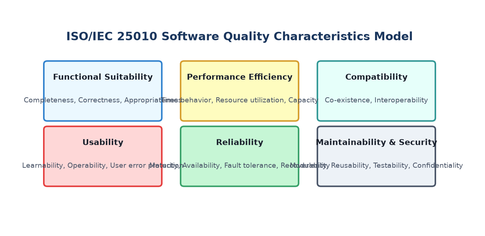

*Figure 2.7: Architectural Flow and Conceptual System Diagram for Illustrate different characteristics of software in detail*

### Mathematical Formulation & Algorithmic Mechanics

**Mathematical Reliability and Availability Formulations:**

```text
Software Availability Metric: A = ( MTBF / ( MTBF + MTTR ) ) · 100%
Target High-Availability (Five Nines): A = 99.999% (Downtime ≤ 5.26 minutes/year)
Maintainability Index (MI):
MI = 171 - 5.2 · ln(Halstead_Volume) - 0.23 · Cyclomatic_Complexity - 16.2 · ln(LOC)
```

The mathematical formulation and algorithmic **parameters** defined above govern the runtime behavior of the system. Each parameter serves an exact role: primary terms scale throughput, penalty terms enforce **regularization** constraints, and **optimization** objectives drive steady **convergence** toward the **global minimum**.

### Worked Example & Practical Simulation

**Evaluating Software Characteristics** for an Enterprise Cloud ERP **System**: • Functional Suitability: System accurately computes complex multi-**state** GST and VAT taxes across 10,000 corporate purchase orders. • **Performance** Efficiency: Generates quarterly balance sheets in **1.4 seconds** while consuming less than 15% server RAM under 5,000 concurrent user sessions. • Reliability: Operates with 99.99% **availability**, utilizing automated database read-replicas to maintain uptime during primary server hardware failovers. • Maintainability: Modular microservices architecture allows updating the payroll.

### Key Comparative Evaluation

| ISO 25010 Quality Characteristic | Core Engineering Focus | Key Sub-Characteristics | Primary Evaluation Method |
| :--- | :--- | :--- | :--- |
| Functional Suitability | Meets stated and implied business needs | Completeness, Correctness, Appropriateness | Black-box functional testing, UAT, acceptance tests |
| Performance Efficiency | Resource consumption and response times | Time behavior, Resource utilization, Capacity | Load testing, stress testing, APM monitoring (JMeter) |
| Reliability | Uptime and fault-tolerant operational stability | Maturity, Fault tolerance, Recoverability | Soak testing, failover chaos testing, MTBF tracking |
| Usability | Ease of learning, navigation, and user satisfaction | Learnability, Operability, Accessibility (WCAG) | Heuristic evaluation, user journey testing, SUS surveys |

### Concluding Exam Takeaway

**Evaluating** **software** **across** **standardized** characteristics ensures a balanced engineering approach, delivering **systems** that are functionally correct, reliable, efficient, and easy to maintain. For optimal SPPU examination scoring, answers must present this complete structure: rigorous theoretical definitions with bold keywords, an accurate architectural flow diagram, clear mathematical formulation, and a structured worked simulation to secure the full 8/**8 marks**.

**Textbook Reference:** Galin, D. (Pearson Education), Chapter 8: 'Software Quality Characteristics and ISO/IEC Standards', pp. 210-238.

---

## Q8. Identify different steps involved in the Software Development Process. Discuss problematic areas in the software development life cycle. With a neat diagram, discuss the waterfall model of software development and explain its limitations. (Frequency: 3) [8 Marks]

### Introduction & Core Intuition

**The Software Development Life Cycle** (SDLC) is a **structured** **framework** that **defines** the sequential phases, **processes**, and deliverables involved in building, testing, deploying, and maintaining software applications. The Classic Waterfall **Model**, first described by Dr. Winston Royce in 1970, is the foundational linear-sequential SDLC model where each phase must be fully completed and signed off before the subsequent phase begins.

### **Core Sequential Steps in the Software Development Process**

A professional software development **process** comprises five fundamental phases: (1) **Requirements Analysis** and **Specification**: Eliciting, analyzing, and documenting customer needs into a formal Software **Requirements** Specification (SRS); (2) **System** and Architectural Design: Translating requirements into high-level system architecture, database schemas, and low-level **component** designs; (3) Implementation and Coding: Writing source code, integrating third-party libraries, and performing.

### **The Waterfall Model Architectural Philosophy**

**The Waterfall Model** organizes these **development** **activities** into a strict linear sequence, visualizing progress as a steady downward cascade—like a natural waterfall. Each phase has formal **entry** criteria, specific **execution** tasks, and strictly documented exit deliverables that require stakeholder sign-off before downstream work begins. The **model** enforces rigorous documentation and clear phase gating. Royce's original concept.

### **Critical Problematic Areas in the Software Development Life Cycle**

**Software** **development** **projects** face **several** **recurring**, systemic problematic areas across the SDLC: (1) **Requirements Volatility** and Creep: Stakeholders frequently struggle to articulate their full needs upfront; as the project progresses, business environments evolve, leading to disruptive scope creep; (2) Communication and Misinterpretation Gaps: Abstract business concepts are easily misunderstood across non-technical clients, technical architects, and junior.

### **Limitations of the Waterfall Model**

**The Waterfall** model **suffers** from **severe** **structural** limitations: (1) Zero Adaptability to Changing **Requirements**: Because requirements are frozen at project initiation, accommodating new client requests mid-**stream** requires expensive formal change requests; (2) Late Working Software Visibility: Operational, executable software is not available until the final coding and integration phases, meaning clients cannot experience or validate the.

### Architectural Flow & System Diagram

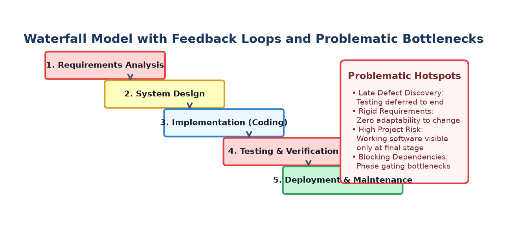

*Figure 2.8: Architectural Flow and Conceptual System Diagram for Identify different steps involved in the Software Development Process*

### Mathematical Formulation & Algorithmic Mechanics

**Mathematical Project Risk and Schedule Slip Modeling in Waterfall:**

```text
Waterfall Project Schedule Slip (Brooks' Law Impact):
T_actual = T_planned · ( 1 + Defect_Amplification_Rate ) · ( 1 + Requirements_Churn_Rate )
Risk Exposure Profile across Project Timeline:
Risk_Waterfall(t) = High (Remains flat until late System Testing phase)
```

The mathematical formulation and algorithmic **parameters** defined above govern the runtime behavior of the system. Each parameter serves an exact role: primary terms scale throughput, penalty terms enforce **regularization** constraints, and **optimization** objectives drive steady **convergence** toward the **global minimum**.

### Worked Example & Practical Simulation

**Waterfall Failure** in an **Enterprise** **Healthcare** Record Migration: • Phase 1: **Requirements** frozen for 6 months. **Specification** spanned 800 pages detailing on-premise relational database schemas. • Phase 2 & 3: Architecture and coding executed for 12 months with zero customer demonstrations. • Phase 4 (Late Testing Crisis): During month 19, **integration testing** revealed that mobile tablets in emergency rooms experienced 15-second query timeouts because the relational database was unsuited for document-based medical histories. • Consequence:.

### Key Comparative Evaluation

| SDLC Dimension | Classic Waterfall Model | Modern Agile / Iterative Model |
| :--- | :--- | :--- |
| Workflow Structure | Linear, sequential, non-overlapping phases | Iterative, circular cycles (1-4 week sprints) |
| Requirements Flexibility | Rigid; frozen upfront; change requires formal CR | Flexible; continuously refined and reprioritized |
| Working Software Timing | Produced only near the end of the project | Demonstrable, working software produced every sprint |
| Testing Phase | Deferred to a separate phase after coding ends | Continuous testing integrated into every single sprint |

### Concluding Exam Takeaway

While the Waterfall **model** provides **clean** **documentation** and **clear** **milestone** tracking, its inability to accommodate change makes it suitable primarily for stable, highly regulated projects. For optimal SPPU examination scoring, answers must present this complete structure: rigorous theoretical definitions with bold keywords, an accurate architectural flow diagram, clear mathematical formulation, and a structured worked simulation to secure the full 8/**8 marks**.

**Textbook Reference:** Galin, D. (Pearson Education), Chapter 9: 'Software Development Processes, Lifecycle Models, and Risk Hotspots', pp. 240-272.

---

## Q9. Explain the following requirements of a product: Stated/Implied requirements, Present/Future requirements. Give types of products based on criticality to the user and explain each type with a proper example. (Frequency: 2) [8 Marks]

### Introduction & Core Intuition

In software **requirements** engineering and product quality management, capturing the complete spectrum of user expectations is essential for product success. Requirements are categorized into Stated vs **Implied Requirements** and Present vs Future Requirements. Furthermore, software **systems** are classified based on their Criticality to the User, which dictates the necessary degree of **verification** rigor, fault tolerance, and **quality assurance**.

### **Stated Requirements vs Implied Requirements Explained**

**Stated Requirements** are the **explicit**, **formally** documented needs, **features**, and constraints requested by the client or customer during **requirements** elicitation. They are clearly recorded in the Software Requirements **Specification** (SRS) or Agile product backlog—for example: 'The e-commerce checkout shall support UPI, credit card,.

### **Present Requirements vs Future Requirements Explained**

**Present Requirements** represent the immediate, **baseline** functional **capabilities** and **operational** **constraints** necessary to solve the customer's current business problems and achieve commercial release today (the Minimum Viable Product or MVP). For example, supporting 1,000 active users and processing current tax formats. Future **Requirements**.

### **Product Criticality Type 1: Safety-Critical / Mission-Critical Systems**

**Safety**-Critical (or Mission-Critical) **Systems** represent the **highest** tier of **software** **criticality**. In these applications, a software failure, logic **error**, or unexpected crash can directly result in human death, severe physical injury, or catastrophic environmental damage. Examples include commercial aircraft fly-by-wire flight control software,.

### **Product Criticality Type 2: Business-Critical / Financial Systems**

Business-**Critical Systems** are **applications** where **software** **failure** will not cause physical harm to human life, but will trigger catastrophic financial **loss**, business bankruptcy, or massive legal liability. Examples include core banking **transaction** engines, stock exchange trading platforms (such as the Bombay Stock Exchange.

### Architectural Flow & System Diagram

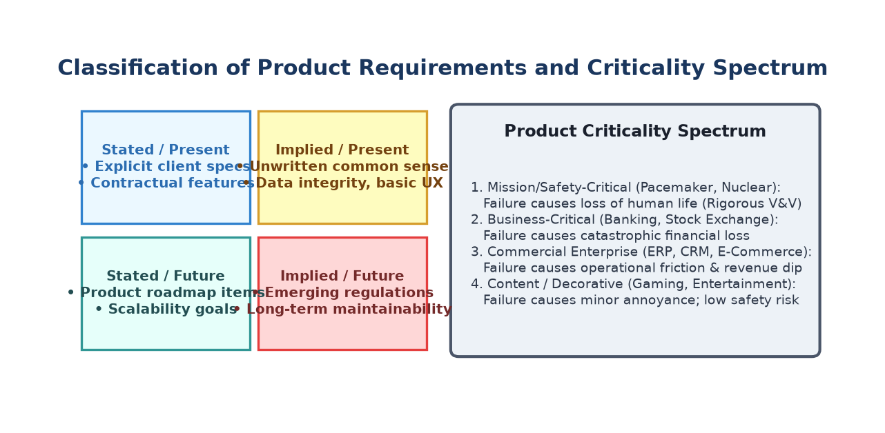

*Figure 2.9: Architectural Flow and Conceptual System Diagram for the following requirements of a product: Stated/Implied requirements, Present/Future requirements*

### Mathematical Formulation & Algorithmic Mechanics

**Mathematical Product Criticality Risk Scoring:**

```text
Criticality Severity Score: CS = Severity_of_Harm · Exposure_Frequency · Controllability
Automotive Safety Integrity Level (ASIL) Hazard Matrix: ASIL ∈ { Quality_Management, A, B, C, D 
Financial Exposure Metric: FE = Outage_Duration_Hours · Revenue_Loss_Per_Hour
Requirements Fulfillment Index: RFI = ( Fulfilled_Stated + Fulfilled_Implied ) / Total_Requirements · 100%
```

The mathematical formulation and algorithmic **parameters** defined above govern the runtime behavior of the system. Each parameter serves an exact role: primary terms scale throughput, penalty terms enforce **regularization** constraints, and **optimization** objectives drive steady **convergence** toward the **global minimum**.

### Worked Example & Practical Simulation

**Analyzing Requirements** and **Criticality** for an **Intensive** Care Unit (ICU) **Patient** **Monitor**: • Stated **Requirement**: Display heart rate and oxygen saturation (SpO2) readings on a high-resolution LCD screen. • Implied Requirement: The monitor must never freeze or reboot silently while a patient's vital signs are dropping; it must trigger an immediate acoustic hardware alarm. • Present Requirement: Connect to hospital local-area Ethernet network. • Future Requirement: Support HL7 / FHIR encrypted cloud telemetry for predictive.

### Key Comparative Evaluation

| Criticality Category | Potential Impact of Failure | Target Applications | Mandated QA / Verification Rigor |
| :--- | :--- | :--- | :--- |
| Safety / Mission-Critical | Loss of human life, catastrophic physical damage | Flight controls, nuclear reactors, medical devices | Formal mathematical proofs, 100% MC/DC coverage, DO-178C |
| Business-Critical | Massive financial collapse, regulatory fines | Core banking platforms, stock exchanges, payment gateways | ACID audits, chaos engineering, high-availability stress tests |
| Commercial Enterprise | Operational disruption, customer churn, lost sales | E-commerce portals, CRM systems, enterprise ERPs | Automated system regression, load testing, security scans |
| Entertainment / Content | Minor customer inconvenience, trivial aesthetic bug | Casual mobile games, video players, social feeds | Agile continuous testing, beta crowd-testing, basic smoke tests |

### Concluding Exam Takeaway

**Aligning** **testing** **rigor** with the **product**'s **criticality** level ensures that engineering investments are allocated proportionally to protect human safety and business continuity. For optimal SPPU examination scoring, answers must present this complete structure: rigorous theoretical definitions with bold keywords, an accurate architectural flow diagram, clear mathematical formulation, and a structured worked simulation to secure the full 8/**8 marks**.

**Textbook Reference:** Galin, D. (Pearson Education), Chapter 10: 'Product Requirements Modeling and Criticality Classifications', pp. 275-305.

---

## Q10. Can you clarify different levels of CMM? List and explain limitations of Capability Maturity Models [CMM]. (Frequency: 6) [8 Marks]

### Introduction & Core Intuition

**The Capability Maturity Model** (CMM), **developed** by the **Software** Engineering Institute (SEI) at Carnegie Mellon University under the leadership of Watts Humphrey, is a benchmark **process** assessment **model** that evaluates and guides the software engineering maturity of an organization across five evolutionary stages. Each maturity level establishes a set of **Key** Process Areas (KPAs) that transform software development from an.

### **Maturity Level 1: Initial (Chaotic and Ad-Hoc)**

**At Maturity Level** 1 (**Initial**), software **processes** are **largely** ad-hoc, **informal**, and **occasionally** chaotic. The organization typically does not provide a stable software engineering environment. Success depends almost entirely on the heroics, individual talent, and long hours of specific developers rather than.

### **Maturity Level 2: Repeatable (Basic Project Management Discipline)**

**At Maturity Level** 2 (**Repeatable**), **basic** **project** **management** policies and tracking procedures are established to track project costs, schedules, and deliverables. Past successes on similar applications can be repeated reliably. Key **Process** Areas (KPAs) introduced at this level include: Software Configuration Management.

### **Maturity Level 3: Defined (Standardized Organization-Wide Engineering)**

**At Maturity Level** 3 (**Defined**), the **organization** **establishes** a **standardized**, documented set of software engineering and management **processes** across all projects. An institutional Software Engineering Process Group (SEPG) maintains the organization's standard software process. KPAs include: Organization Process Focus, Organization Process Definition,.

### **Maturity Levels 4 & 5: Managed and Optimizing (Quantitative & Continuous Improvement)**

**At Maturity Level** 4 (**Managed**), the **organization** establishes quantitative quality goals for products and **processes**. Detailed measures of software process and product quality are collected and maintained in an organization-wide **metrics** database, using Statistical Process Control (SPC) to predict **performance** within tight.

### Architectural Flow & System Diagram

![Figure 2.10: Can you clarify different levels of CMM? List and explain limitations of Capability Maturity Models [CMM]](diagrams/u2_q10.png)

*Figure 2.10: Architectural Flow and Conceptual System Diagram for Can you clarify different levels of CMM? List and explain limitations of Capability Maturity Models [CMM]*

### Mathematical Formulation & Algorithmic Mechanics

**Mathematical Process Capability and Defect Prediction Bounds:**

```text
Process Capability Metric: C_p = ( USL - LSL ) / ( 6 · σ )
Maturity Level 4/5 Benchmark: C_p ≥ 1.5 (High process capability, defect rate < 3.4 DPMO)
Defect Prediction Model: Defects_Predicted = β_0 + β_1 · KLOC + β_2 · Cyclomatic_Complexity
Process Predictability Range: [ μ - 3σ, μ + 3σ ] (99.73% of process outcomes within statistical control)
```

The mathematical formulation and algorithmic **parameters** defined above govern the runtime behavior of the system. Each parameter serves an exact role: primary terms scale throughput, penalty terms enforce **regularization** constraints, and **optimization** objectives drive steady **convergence** toward the **global minimum**.

### Worked Example & Practical Simulation

CMM **Evolution** in an IT **Services Organization** (TCS / **Infosys** **Scenario**): • **Level** 1 Reality: A banking software project relied on one superstar developer. When he resigned, nobody understood the core accounting engine, resulting in a 6-month release delay. • Level 3 Transformation: The organization standardized peer review checklists and automated regression suites. Any new developer could join the project and follow documented procedures immediately. • Level 5 Excellence: The team utilizes automated **defect** causal.

### Key Comparative Evaluation

| CMM Maturity Level | Process Characterization | Primary Focus & Strategy | Key Process Areas (KPAs) |
| :--- | :--- | :--- | :--- |
| Level 1: Initial | Chaotic, ad-hoc, unpredictable | Individual heroics and firefighting | No formal KPAs defined |
| Level 2: Repeatable | Disciplined project-level tracking | Basic project management, cost & schedule | Requirements Management, SQA, SCM, Project Planning |
| Level 3: Defined | Standardized organization-wide | Engineering standards, training & peer reviews | Organization Process Focus, Peer Reviews, Training |
| Level 4: Managed | Quantitatively measured & predictable | Statistical process control & metric baselines | Quantitative Process Management, Quality Management |

### Concluding Exam Takeaway

**The Capability Maturity Model** provides a **structured** **roadmap** for **engineering** **discipline**, though organizations must balance procedural rigor against agility and developer innovation. For optimal SPPU examination scoring, answers must present this complete structure: rigorous theoretical definitions with bold keywords, an accurate architectural flow diagram, clear mathematical formulation, and a structured worked simulation to secure the full 8/**8 marks**.

**Textbook Reference:** Galin, D. (Pearson Education), Chapter 11: 'Capability Maturity Model (CMM) and CMMI Frameworks', pp. 310-342.

---

## Q11. Explain why ISO-9001 standard and its importance in software testing? (Frequency: 4) [8 Marks]

### Introduction & Core Intuition

The **ISO 9001**:2015 Standard is the globally recognized international benchmark for establishing, implementing, and maintaining a **Quality Management System** (QMS). Developed by the International Organization for **Standardization**, ISO 9001 provides a process-driven framework centered on risk-based thinking, leadership accountability, customer satisfaction, and the Plan-Do-Check-Act (PDCA) continuous improvement cycle, serving as an essential governance standard for **software testing** and **verification**.

### **Core Principles and Architectural Philosophy of ISO 9001**

**ISO 9001** is **built** upon **seven** fundamental quality management principles: **Customer Focus**, Leadership, Engagement of People, **Process** Approach, Improvement, **Evidence**-Based Decision Making, and Relationship Management. Unlike product-specific standards, ISO 9001 is a generic quality standard that evaluates whether an enterprise has established systematic, repeatable, and audited processes to ensure that software deliverables consistently meet customer and.

### **Why the ISO 9001 Standard is Crucial for Software Testing**

**Software testing** in organizations that lack formal governance often degenerates into unorganized, last-minute manual checks without traceability or documentation. **ISO 9001** transforms software testing into a disciplined engineering practice by mandating several **key** requirements: (1) **Documented Test Procedures**: **Test** strategies, test plans, and test **cases** must be formally documented, reviewed, and version-controlled; (2) Requirement Traceability: Every.

### **The Plan-Do-Check-Act (PDCA) Cycle in Software Testing**

**ISO 9001** operationalizes quality through the classic PDCA cycle: (1) Plan: The QA team defines the testing scope, **test** environment requirements, tool selections, and acceptance criteria in an SQA plan; (2) Do: Test engineers execute automated and manual test **cases**, log **defects**, and track fix resolutions; (3) Check: QA leads audit testing **metrics**—such as **defect density**,.

### **Auditing, Compliance, and Defect Traceability**

A core requirement of **ISO 9001** certification is the **execution** of periodic Internal and **External Quality Audits**. Independent auditors examine testing records to verify **process** compliance: Are **test** environments calibrated to mirror production? Are **defect** severities assigned consistently according to documented rubrics? Are software releases approved only when exit criteria are mathematically met? This auditable transparency.

### Architectural Flow & System Diagram

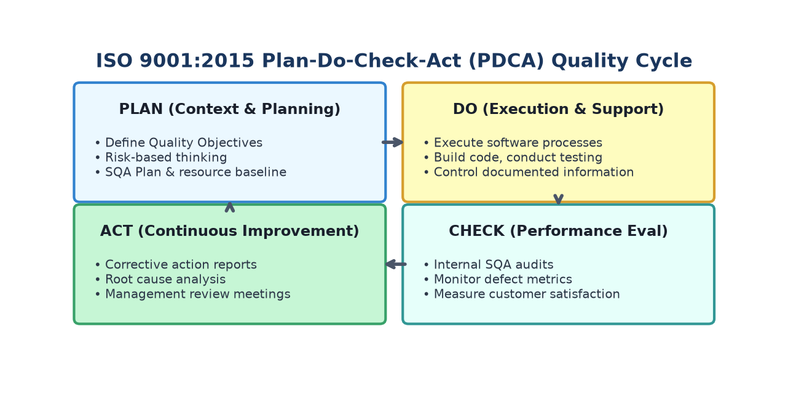

*Figure 2.11: Architectural Flow and Conceptual System Diagram for why ISO-9001 standard and its importance i*

### Mathematical Formulation & Algorithmic Mechanics

**Mathematical ISO 9001 Audit Compliance and Traceability Formulas:**

```text
Requirements Traceability Index: RTI = ( Traced_Test_Cases / Total_Approved_Requirements ) · 100% = 100%
Audit Non-Conformance Rate: NCR = ( Total Non-Conformance Reports / Total Audit Checkpoints ) · 100%
Target Audit Benchmark: Minor NCRs ≤ 2%, Major NCRs = 0 (Mandatory for ISO Certification)
Corrective Action Preventive Action (CAPA) Closure Rate:
```

The mathematical formulation and algorithmic **parameters** defined above govern the runtime behavior of the system. Each parameter serves an exact role: primary terms scale throughput, penalty terms enforce **regularization** constraints, and **optimization** objectives drive steady **convergence** toward the **global minimum**.

### Worked Example & Practical Simulation

Applying **ISO 9001** to a FinTech **Mobile Banking App Testing Lifecycle**: • Plan: QA Lead writes an SQA plan specifying that all cryptographic login routines must undergo independent **penetration testing** and automated static security analysis. • Do: QA team executes 450 automated regression **tests** in Jenkins, logging 12 **defects** in Jira. • Check: SQA auditor reviews the release candidate, discovering that two high-severity security test **cases** were skipped due to time pressure (Major Non-Conformance!). •.

### Key Comparative Evaluation

| ISO 9001 Clause | Software Testing Implication | Mandated Deliverable / Artifact | Primary Quality Outcome |
| :--- | :--- | :--- | :--- |
| Clause 6: Planning | Define quality objectives and risk-based testing strategies | Software Test Plan (STP) & Risk Register | Targeted testing aligned with business risks |
| Clause 7: Support & Resources | Ensure qualified testers and validated test environments | Tester training records, hardware calibration logs | Reliable, repeatable testing environments |
| Clause 8: Operational Control | Execute systematic verification against specifications | Test case specifications, test execution logs | Rigorous, verifiable test execution |
| Clause 9: Performance Eval | Audit test results, metrics, and customer satisfaction | Test summary reports, defect density charts | Data-driven evaluation of release readiness |

### Concluding Exam Takeaway

**ISO 9001** provides the **rigorous** **governance** framework required to elevate **software testing** from an informal activity into an auditable, repeatable, and world-**class** engineering discipline. For optimal SPPU examination scoring, answers must present this complete structure: rigorous theoretical definitions with bold keywords, an accurate architectural flow diagram, clear mathematical formulation, and a structured worked simulation to secure the full 8/**8 marks**.

**Textbook Reference:** Galin, D. (Pearson Education), Chapter 12: 'ISO 9001 Quality Management System in Software Engineering', pp. 345-375.

---

## Q12. Why do you need to measure customer satisfaction? Write a note on Customer Satisfaction. (Frequency: 3) [8 Marks]

### Introduction & Core Intuition

In modern software engineering and business management, **Customer Satisfaction** is the ultimate **metric** of software quality, representing the degree to which a software product's perceived operational **performance** meets or surpasses the customer's expectations. While internal engineering metrics (such as **defect density** or code **coverage**) measure technical conformance, customer satisfaction evaluates genuine business value and user delight.

### **The Strategic Imperative: Why Measuring Customer Satisfaction is Essential**

**Software** does not **exist** in a **vacuum**; its **ultimate** **purpose** is to solve business problems and deliver value to human users. An engineering team can build an application with 100% test **coverage** and zero open bugs, yet if users.

### **The Cognitive Mechanics of Satisfaction: The Expectancy-Disconfirmation Model**

In **consumer** **psychology** and **software** **engineering**, **satisfaction** is governed by the Expectancy-**Disconfirmation Model**. Prior to using software, customers form mental expectations based on marketing claims, past experiences, and industry standards. When they interact with the product, they evaluate its.

### **The Kano Model of Customer Requirements**

**Professor Noriaki Kano** developed the Kano **Model** to classify how different categories of software **features** impact customer satisfaction: (1) Must-Be (Threshold) Needs: Basic, non-negotiable **requirements** (e.g., login **security**, database persistence). Their presence is taken for granted, but their absence.

### **Primary Quantitative Measurement Instruments**

**Mature** **software** **organizations** **employ** standardized quantitative instruments to measure customer satisfaction: (1) **Customer Satisfaction Score** (CSAT): Prompts users with a direct question ('How satisfied are you with this **feature**?') on a 1-to-5 scale immediately after completing a workflow; (2).

### Architectural Flow & System Diagram

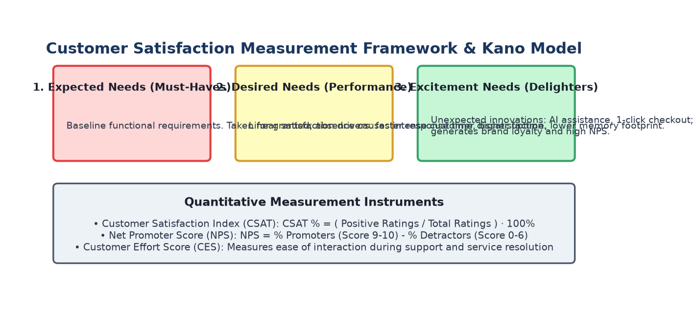

*Figure 2.12: Architectural Flow and Conceptual System Diagram for Why do you need to measure customer satisfaction?  a note on Customer Satisfaction*

### Mathematical Formulation & Algorithmic Mechanics

**Mathematical Customer Satisfaction and Net Promoter Score Formulas:**

```text
Customer Satisfaction Score: CSAT % = ( Number of Satisfied Customers (Score 4 & 5) / Total Survey Respondents ) · 100%
Net Promoter Score (NPS): NPS = % Promoters (Score 9-10) - % Detractors (Score 0-6)
NPS Benchmark Range: [-100, +100] (Score > +50 is considered excellent enterprise-grade quality)
Customer Retention Rate (CRR): CRR = ( ( E - N ) / S ) · 100%
```

The mathematical formulation and algorithmic **parameters** defined above govern the runtime behavior of the system. Each parameter serves an exact role: primary terms scale throughput, penalty terms enforce **regularization** constraints, and **optimization** objectives drive steady **convergence** toward the **global minimum**.

### Worked Example & Practical Simulation

**Measuring Customer Satisfaction** for a **Mobile** **Banking** App (HDFC / SBI **Scenario**): • **Survey** **Instrument**: Embedded in-app NPS prompt triggered after completing a bill payment. • Survey Results: 10,000 respondents: 6,500 Promoters (Score 9-10), 2,000 Passives (Score 7-8), 1,500 Detractors (Score 0-6). • Net Promoter Score Calculation: % Promoters = 65%, % Detractors = 15% -> NPS = 65 - 15 = +50 (Strong satisfaction). • Detractor Root-Cause Analysis: Feedback analysis revealed that 80% of.

### Key Comparative Evaluation

| Metric Instrument | Core Question Asked | Scale Used | Primary Strategic Value |
| :--- | :--- | :--- | :--- |
| CSAT (Customer Satisfaction) | How satisfied are you with this specific feature? | 1 to 5 Likert scale | Measures short-term satisfaction with specific transactions |
| NPS (Net Promoter Score) | How likely are you to recommend us to others? | 0 to 10 numerical scale | Measures long-term customer loyalty and organic brand growth |
| CES (Customer Effort Score) | How easy was it to resolve your task today? | 1 to 7 ease scale | Identifies usability friction and operational workflow bottlenecks |
| Churn Rate | What percentage of active users stop using the app? | Calculated % per month | Direct financial measure of customer retention and satisfaction |

### Concluding Exam Takeaway

**Customer** **satisfaction** **serves** as the **ultimate** **benchmark** of software engineering success, connecting technical conformance with real-world user value and commercial longevity. For optimal SPPU examination scoring, answers must present this complete structure: rigorous theoretical definitions with bold keywords, an accurate architectural flow diagram, clear mathematical formulation, and a structured worked simulation to secure the full 8/**8 marks**.

**Textbook Reference:** Galin, D. (Pearson Education), Chapter 13: 'Customer Satisfaction Measurement and Post-Release SQA', pp. 380-405.

---

## Q13. Explain in detail reliability of quality Process. (Frequency: 1) [8 Marks]

### Introduction & Core Intuition

**The Reliability** of a Quality **Process** refers to the degree of consistency, predictability, stability, and repeatability with which an organization's software engineering and **quality assurance** processes produce **defect**-free software that conforms to customer **specifications** across successive project cycles. A reliable quality process ensures that software quality is an institutionalized outcome of disciplined engineering **systems** rather than random luck or individual heroics.

### **Defining Process Reliability vs Product Reliability**

In **software** **engineering**, it is vital to distinguish between product **reliability** and **process** reliability. **Product Reliability** measures the operational uptime and fault tolerance of a specific software executable in production (measured via Mean Time Between Failures). In contrast, Process Reliability measures the dependability and statistical capability of the development and **quality assurance** processes that manufacture that.

### **Foundational Attributes of a Reliable Quality Process**

A reliable quality **process** exhibits four defining characteristics: (1) Repeatability: Different engineering teams following the documented process achieve consistently high quality across projects; (2) Predictability: **Defect** discovery rates, test **execution** schedules, and release timelines can be estimated with high statistical **accuracy**; (3) Measurability: Process **performance** is tracked through objective quantitative **metrics** baselines; and (4) Resilience and.

### **Statistical Process Control (SPC) in Quality Engineering**

Pioneered by **Walter Shewhart** and W. Edwards Deming, Statistical **Process** Control (SPC) provides the mathematical foundation for evaluating process **reliability**. SPC tracks software **metrics** (such as **defect density** per KLOC, review rates, and phase containment) over time using Control Charts. A control chart plots metric values across iterations against a historical Process Mean, an Upper Control.

### **The Closed-Loop Feedback and Root Cause Analysis (RCA)**

**Process** reliability **depends** on **continuous** self-correction through closed-loop feedback. When **defects** escape into downstream testing or production, a reliable process does not simply assign blame; it conducts a formal **Root Cause Analysis** (RCA) using tools like the 5 Whys and Ishikawa diagrams. The team determines which process checkpoint failed: Was the **requirement** ambiguous? Was the code.

### Architectural Flow & System Diagram

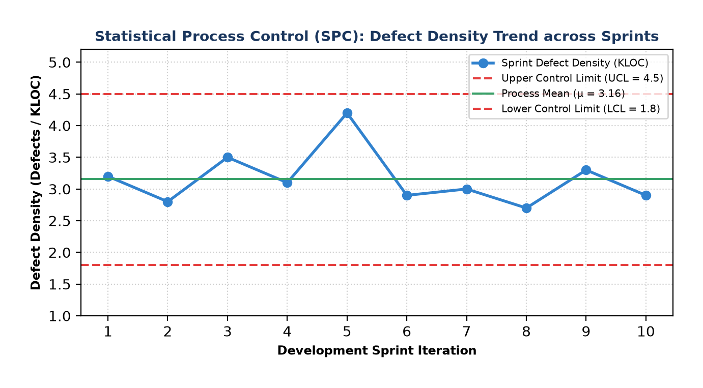

*Figure 2.13: Architectural Flow and Conceptual System Diagram for in detail reliability of quality Process*

### Mathematical Formulation & Algorithmic Mechanics

**Mathematical Statistical Process Control (SPC) Limits and Capability:**

```text
Process Mean: μ = ( 1 / N ) · Sum( X_i )
Process Standard Deviation: σ = Sqrt( ( 1 / ( N - 1 ) ) · Sum( ( X_i - μ )^2 ) )
Upper Control Limit: UCL = μ + 3 · σ
Lower Control Limit: LCL = max( 0, μ - 3 · σ )
```

The mathematical formulation and algorithmic **parameters** defined above govern the runtime behavior of the system. Each parameter serves an exact role: primary terms scale throughput, penalty terms enforce **regularization** constraints, and **optimization** objectives drive steady **convergence** toward the **global minimum**.

### Worked Example & Practical Simulation

**Statistical Process Control** of Sprint **Defect** Densities in an Agile Enterprise: • Metric Monitored: **Defect Density** per KLOC across 10 two-week development sprints. • Historical **Baseline**: Mean μ = 3.16 **defects**/KLOC, Standard Deviation σ = 0.44 defects/KLOC. • Control Limits: UCL = 3.16 + 3(0.44) = 4.48 defects/KLOC; LCL = 3.16 - 3(0.44) = 1.84 defects/KLOC. • Observation at Sprint 5: Defect density spiked to 4.2 defects/KLOC (Approaching UCL, but within bounds). • Investigation: Team.

### Key Comparative Evaluation

| Process Attribute | Unreliable Quality Process | Reliable Quality Process (SPC Controlled) |
| :--- | :--- | :--- |
| Success Dependency | Individual heroics, superstar programmers | Standardized, repeatable organizational engineering processes |
| Defect Predictability | Wild fluctuations across releases; unpredictable | Predictable within tight statistical control limits (3-sigma) |
| Defect Management | Firefighting, ad-hoc bug fixing under panic | Root cause analysis (RCA), defect prevention loops |
| Measurement Discipline | Subjective opinions, anecdotal claims | Objective metrics baselines (SPC charts, DRE, C_pk) |

### Concluding Exam Takeaway

A **reliable** quality **process** ensures that **software** **excellence** is an **engineered**, predictable characteristic of the organization rather than an accidental outcome of heroic effort. For optimal SPPU examination scoring, answers must present this complete structure: rigorous theoretical definitions with bold keywords, an accurate architectural flow diagram, clear mathematical formulation, and a structured worked simulation to secure the full 8/**8 marks**.

**Textbook Reference:** Galin, D. (Pearson Education), Chapter 14: 'Statistical Process Control and Quality Process Reliability', pp. 410-440.

---
