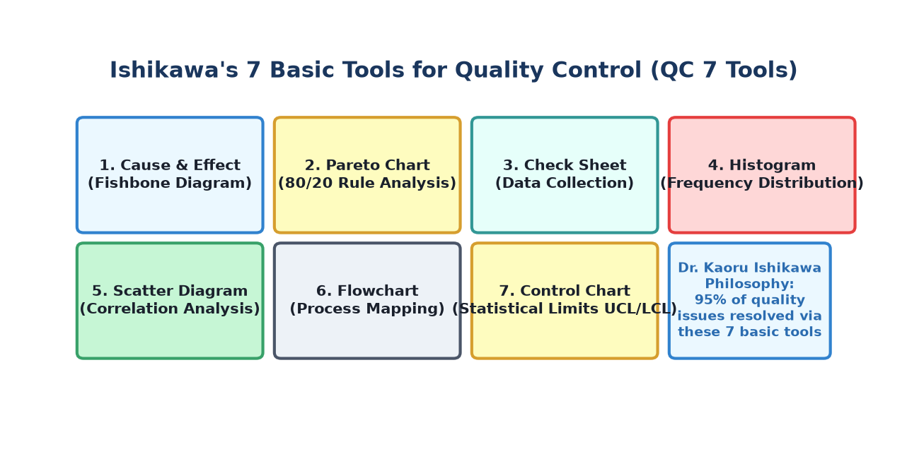
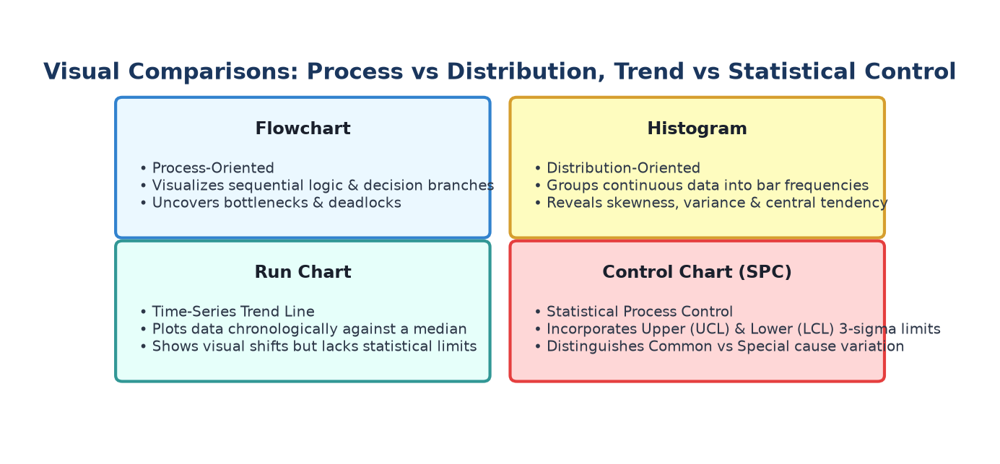
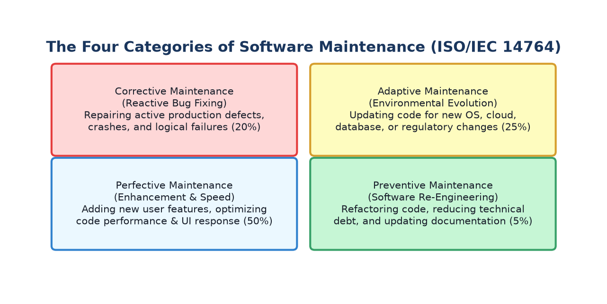
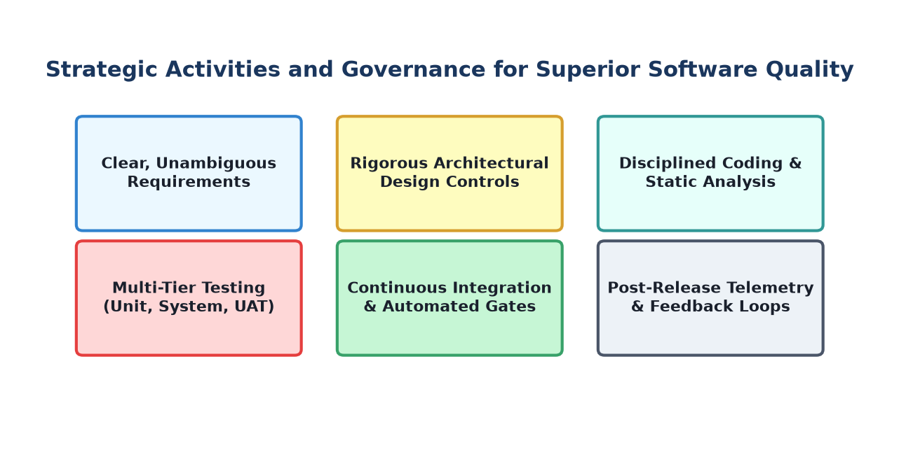
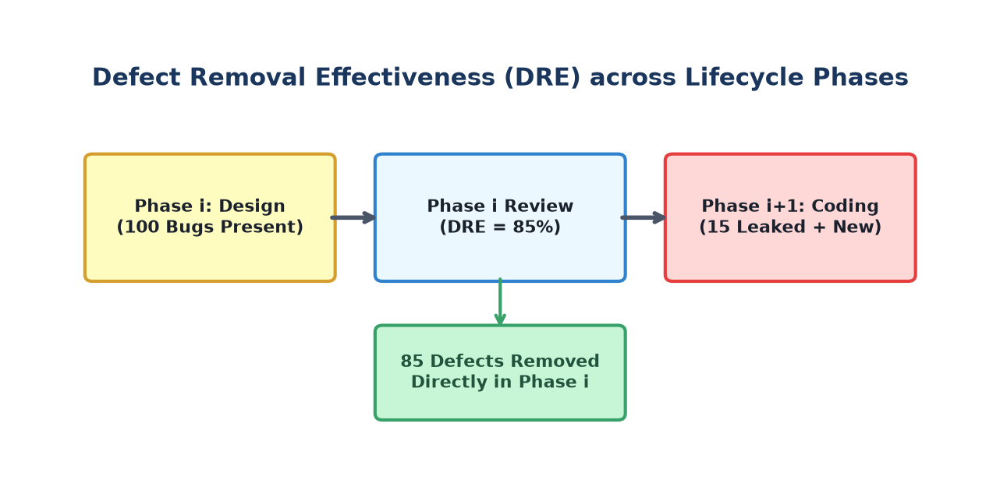
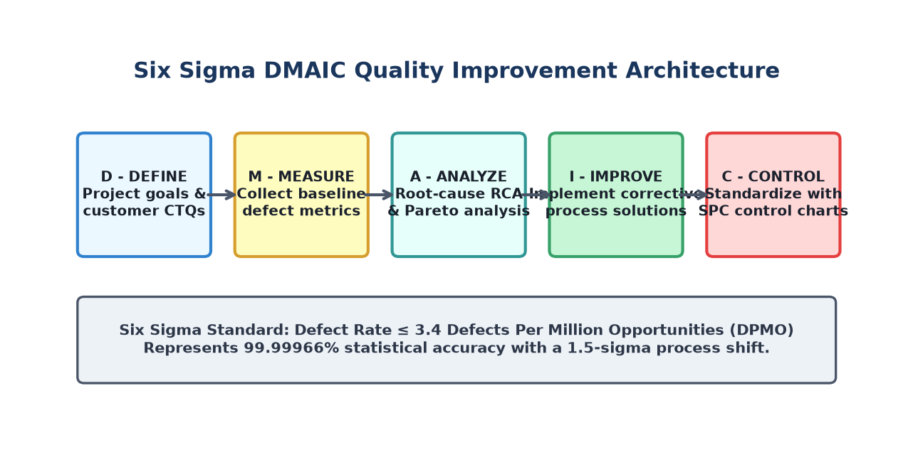
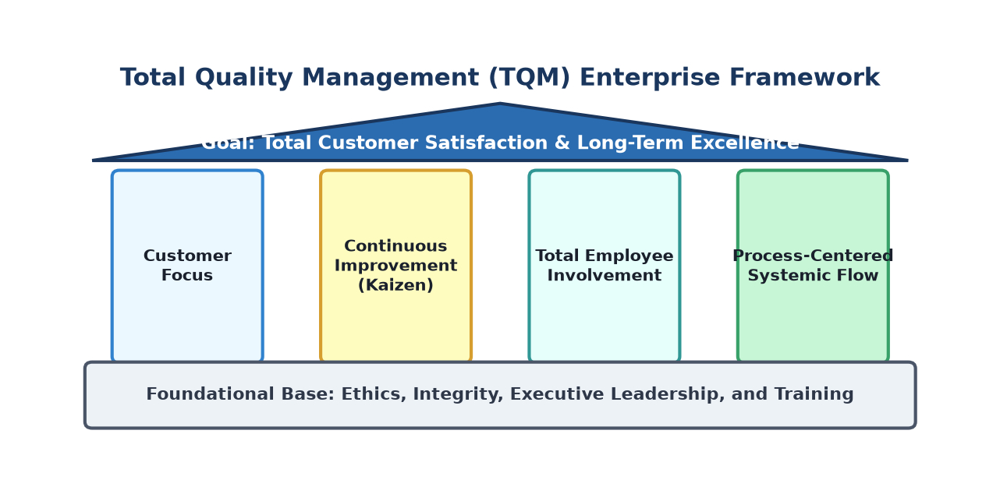
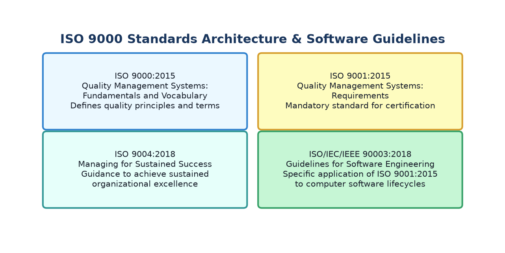

# SPPU B.E. Computer Engineering (2019 Pattern)
## Software Testing and Quality Assurance — Unit 4: Quality Assurance, ISO Standards & CMMI
### Complete Examination Solutions Guide (Engineered for Full 8/8 Marks)

---

## Q1. Explain Ishikawa's basic tools for quality control (or 7 basic tools) in detail. Explain in brief: Histogram, Flowchart, and Control chart. (Frequency: 3) [8 Marks]

### Introduction & Core Intuition

Ishikawa's **Seven Basic Tools** for **Quality Control** (QC 7 **Tools**), **pioneered** by Dr. Kaoru Ishikawa in Japan, represent a foundational set of graphical and statistical instruments designed to analyze **data**, identify **process** bottlenecks, diagnose root causes of failure, and achieve continuous quality improvement. Dr. Ishikawa demonstrated that 95% of quality-related issues in an organization can be resolved using these seven straightforward graphical techniques.

### **The Philosophy of the Seven Basic Quality Tools**

In **traditional** **manufacturing** and **modern** software engineering, statistical process **optimization** often appears mathematically intimidating to frontline employees. Dr. **Kaoru Ishikawa**'s breakthrough was democratizing **quality control** by introducing visual, intuitive, and accessible graphical tools that any engineer, tester, or manager can apply without advanced statistical training. These seven tools enable teams to systematically move from unstructured problem symptoms to concrete, data-backed root causes and corrective actions.

### **Tool 1 & 2: Cause-and-Effect Diagram and Pareto Chart**

(1) Cause-and-**Effect Diagram** (Fishbone / **Ishikawa** **Diagram**): A **structured** **graphical** brainstorming tool that maps out all potential causes contributing to a specific quality **defect**. The problem statement forms the 'head' of the fish, while the 'bones' branch out into standardized causal categories (the 4Ms: Manpower, Methods, Machines, Materials, or Software: People, Process, Technology, Environment), allowing teams to explore root causes via the '5 Whys' technique; and (2) **Pareto Chart**: A dual-axis chart combining bars (ordered by frequency) and a cumulative line graph, built on the Pareto Principle (the 80/20 rule). It demonstrates that roughly 80% of software defects originate from only 20% of code modules or root causes, enabling teams to prioritize high-yield corrective efforts.

### **Tool 3 & 4: Check Sheet and Scatter Diagram**

(3) **Check Sheet**: A **structured**, **tabular** form used for **collecting** and recording qualitative and quantitative **defect** data in real time at the location where the data is generated (e.g., a code review checklist logging **defect** categories per file); and (4) **Scatter Diagram**: A Cartesian coordinate plot that displays the relationship between two continuous variables, enabling engineers to determine whether a statistical correlation (positive, negative, or zero) exists between process inputs (e.g., developer code churn) and quality outcomes (e.g., escaped production bugs).

### **Deep Dive: Histogram (Frequency Distribution Analysis)**

(5) **Histogram**: A **columnar** bar **chart** that **visualizes** the frequency distribution of continuous numerical **data** grouped into specified bins or intervals. Unlike discrete bar charts, the width of each bar represents a numerical range (e.g., **defect** resolution duration in days), while the height represents the frequency of data points falling within that range. In software engineering, histograms are essential for analyzing metric distributions—revealing central tendency (mean/median), process spread (variance), and distribution shapes (bell-shaped normal, bimodal, or skewed), highlighting whether software processes behave predictably.

### **Deep Dive: Flowchart and Statistical Control Chart**

(6) **Flowchart**: A visual diagrammatic representation of a sequential algorithm, business process, or workflow, utilizing standardized geometric symbols (rectangles for tasks, diamonds for decisions, parallelograms for I/O) connected by directional arrows. In software QA, flowcharts map complex test execution sequences, unmasking redundant loops, undocumented branches, and process bottlenecks; and (7) **Control Chart (Statistical Process Control)**: A time-series chart that plots metric values across successive iterations against three statistical lines: the historical Process Mean (μ), Upper Control Limit (UCL = μ + 3σ), and Lower Control Limit (LCL = μ - 3σ). It empowers teams to distinguish between normal random variation and special cause variation requiring immediate intervention.

### Architectural Flow & System Diagram



*Figure 4.1: Architectural Flow and Conceptual System Diagram for Ishikawa's basic tools for quality control (or 7 basic tools) in detail*

### Mathematical Formulation & Algorithmic Mechanics

**Mathematical Statistical Limits in Ishikawa Control Charts:**

```text
Process Mean (Center Line): μ = ( 1 / N ) · Sum( X_i )
Sample Standard Deviation: σ = Sqrt( ( 1 / ( N - 1 ) ) · Sum( ( X_i - μ )^2 ) )
Upper Control Limit (3-Sigma): UCL = μ + 3 · σ
Lower Control Limit (3-Sigma): LCL = max( 0, μ - 3 · σ )
```

The Statistical Process Control (SPC) formulations defined above establish the statistical Center Line (mean $\mu$) and 3-sigma Upper and Lower Control Limits ($\mu \pm 3\sigma$) for Ishikawa quality tools. Tracking defect densities and review yields against control limits allows quality engineers to distinguish normal common-cause noise from actionable special-cause process anomalies.

### Worked Example & Practical Simulation

**Applying Ishikawa Tools** to **Reduce** **Production** **Payment** **Failures** in an E-**Commerce** Portal: • Step 1 (Check Sheet): QA logs 500 payment failure incidents over 30 days across multiple gateway endpoints. • Step 2 (Pareto Analysis): Pareto chart reveals that 410 out of 500 failures (82%) were caused by gateway timeout exceptions in the third-party NetBanking API. • Step 3 (Fishbone / RCA): Team constructs a fishbone diagram; the 'Method' bone reveals that the payment service lacked an exponential backoff retry mechanism. • Step 4 (Control Chart): Team implements resilient retries with circuit breakers; daily payment failure rates drop from 4.2% to 0.15%, remaining stably within 3-sigma control limits.

### Key Comparative Evaluation

| Ishikawa Tool | Core Purpose | Data Type Handled | Primary Software Application |
| :--- | :--- | :--- | :--- |
| Cause & Effect (Fishbone) | Root-cause brainstorming and causal decomposition | Qualitative concepts categorized into 4Ms/People-Process | Post-mortem defect causal analysis (RCA) meetings |
| Pareto Chart | Prioritizing the vital few causes over trivial many | Discrete defect counts and cumulative percentages | Triage meetings; prioritizing highest-impact modules |
| Check Sheet | Structured real-time data collection | Tally counts, checklist items, categories | Code review checklists, audit non-conformance logging |
| Histogram | Visualizing continuous data frequency and variance | Continuous numerical metrics (Latency, LOC, Duration) | Analyzing build duration distribution, bug fix turnaround |

### Concluding Exam Takeaway

**Ishikawa**'s **seven** **basic** **tools** provide a practical, **data**-driven framework that enables software engineering teams to diagnose root causes and sustain exceptional software quality. For optimal SPPU examination scoring, answers must present this complete structure: rigorous theoretical definitions with bold keywords, an accurate architectural flow diagram, clear mathematical formulation, and a structured worked simulation to secure the full 8/**8 marks**.

**Textbook Reference:** Galin, D. (Pearson Education), Chapter 18: 'Ishikawa's Tools for Quality Control and Statistical Analysis', pp. 510-538.

---

## Q2. Compare Ishikawa's Flow chart and Histogram tool. Compare Run charts and Control chart in detail. (Frequency: 6) [8 Marks]

### Introduction & Core Intuition

In statistical **quality control** and **process** engineering, **choosing** the **appropriate** graphical instrument is essential for diagnosing process inefficiencies. A clear architectural distinction exists between Flowcharts (which **model** sequential logical workflows) and Histograms (which display numerical frequency distributions). Similarly, a critical operational distinction separates **Run Charts** (which plot time-series trend lines) from Statistical Control Charts (which enforce mathematically derived upper and lower statistical control limits).

### **Comparative Analysis: Flowchart vs Histogram**

A **Flowchart** is a qualitative, **process**-oriented visual **modeling** tool that maps the step-by-step **sequential** progression of an **algorithm**, business workflow, or testing procedure using standardized geometric symbols (rectangles, diamonds, ovals). Its primary mandate is to illustrate *how a process operates*, uncovering redundant approval steps, infinite loops, and **interface** handoff delays. Conversely, a Histogram is a quantitative, distribution-oriented statistical tool that displays the frequency distribution of continuous numerical data grouped into adjacent bins. It illustrates *how data is spread*, revealing central tendency, skewness, and variance.

### **Structural Differences: Flowchart vs Histogram**

**Structurally**, **flowcharts** do not **utilize** **coordinate** axes; their **power** lies in directed arrows demonstrating causality and conditional branch routing (True/False decisions). In contrast, histograms operate on a Cartesian plane where the horizontal X-axis represents ordered continuous **data** intervals (e.g., response time bins: 0-1s, 1-2s, 2-3s) and the vertical Y-axis represents absolute frequency or count. While a flowchart helps engineers optimize the sequence of a code deployment pipeline, a histogram helps them determine whether build compilation times follow a normal bell curve or exhibit long-tail latency outliers.

### **Comparative Analysis: Run Chart vs Statistical Control Chart**

**Both Run Charts** and **Control** **Charts** are **dynamic**, **chronological** time-series plots that display metric **data** in historical sequence. However, they differ fundamentally in statistical rigor: (1) A Run Chart is a simple time-series plot that connects data points sequentially across time, displaying a single center line—typically the Median. It is used to identify visual shifts, cyclical patterns, or gross trends over time without requiring statistical assumptions; and (2) A **Statistical Control Chart (Shewhart Chart)** augments the time series with mathematically computed statistical boundaries: the **Process Mean (μ)**, an **Upper Control Limit (UCL = μ + 3σ)**, and a **Lower Control Limit (LCL = μ - 3σ)**.

### **Distinguishing Common Cause vs Special Cause Variation**

The **defining** **capability** of a **Control Chart**—absent in a simple Run Chart—is its ability to distinguish between Common Cause Variation and Special Cause Variation. Common cause variation represents the inherent, predictable background noise of a stable **system** (e.g., minor fluctuations in sprint **defect density** caused by varying story **complexity**). Special cause variation represents an external, disruptive anomaly (e.g., a massive spike caused by an unannounced framework migration). While a run chart shows that a spike occurred, a control chart determines whether that spike breaches the 3-sigma threshold, proving statistical out-of-control conditions.

### **Industrial Application Synergy in SQA Governance**

In professional software quality governance, these four tools form a progressive diagnostic pipeline. Engineers first use a **Flowchart** to map and standardize a software review process. They use **Histograms** to analyze review velocity across teams. They monitor daily review throughput using a **Run Chart** to spot preliminary trends. Finally, they institutionalize a **Control Chart** to ensure that defect discovery rates remain within disciplined statistical control limits, establishing a mature, predictable engineering culture.

### Architectural Flow & System Diagram



*Figure 4.2: Architectural Flow and Conceptual System Diagram for Compare Ishikawa's Flow chart and Histogram tool*

### Mathematical Formulation & Algorithmic Mechanics

**Mathematical Statistical Limit Formulations for Control Charts:**

```text
Run Chart Centerline: Median = Middle_Value( Sorted_Data_Series )
Control Chart Centerline: Mean μ = ( 1 / N ) · Sum( X_i )
Standard Error of the Mean: σ_mean = σ / Sqrt( n )
Three-Sigma Bounds: UCL = μ + 3 · ( σ / Sqrt(n) ),   LCL = max( 0, μ - 3 · ( σ / Sqrt(n) ) )
```

The statistical limit formulations defined above differentiate run chart median baselines from control chart 3-sigma bounds. Run charts identify non-random data shifts and trends over time, while control charts verify whether defect discovery processes operate within statistical control, guiding SQA process improvements with quantitative rigor.

### Worked Example & Practical Simulation

**Quality Diagnostic Progression** in an **Agile** **FinTech** Release Pipeline: • Flowchart Application: QA Lead draws a flowchart of the pull request review **process**, discovering that pull requests linger for **48 hours** waiting for manual **security** sign-offs. • Histogram Application: Team plots a histogram of PR review durations; shows a bimodal distribution with peaks at 4 hours and 72 hours, confirming process inconsistency. • Run Chart Application: Team tracks weekly PR review times on a run chart after adopting automated static scanners, noting a visual downward trend. • Control Chart Application: Team implements an X-bar Control Chart with UCL = 12 hours and LCL = 2 hours; proves that PR reviews are now in statistical control.

### Key Comparative Evaluation

| Comparison Parameter | Flowchart | Histogram | Run Chart | Control Chart (SPC) |
| :--- | :--- | :--- | :--- | :--- |
| Primary Dimension | Process logic & sequential steps | Numerical frequency distribution | Chronological trend line | Statistical process stability & variance |
| Visual Structure | Geometric nodes (boxes, diamonds) | Adjacent vertical columnar bins | Time-series line against a Median | Time-series line against Mean, UCL & LCL |
| Statistical Rigor | Zero statistical mathematics | Descriptive statistics (Mean, Variance) | Basic median-based trend rules | Rigorous 3-sigma statistical control limits |
| Distinguishes Causes? | No; shows procedural routing | No; shows aggregate spread | No; shows visual shifts only | Yes; separates common vs special cause variation |

### Concluding Exam Takeaway

**Understanding** the **distinct** **analytical** **capabilities** of **flowcharts**, **histograms**, run charts, and control charts allows software quality leaders to apply the exact right diagnostic tool for each engineering challenge.

**Textbook Reference:** Galin, D. (Pearson Education), Chapter 18: 'Comparative Quality Tools: Flowcharts, Histograms, and Control Charts', pp. 520-545.

---

## Q3. Can you explain how to maintain SQA? What do you understand by software maintenance? Explain in detail. (Frequency: 6) [8 Marks]

### Introduction & Core Intuition

In the long-term **software** **engineering** lifecycle, Software **Quality Assurance** (SQA) Maintenance and **Software Maintenance** represent the operational disciplines required to sustain application **integrity**, operational **performance**, and customer satisfaction post-release. Governed internationally by ISO/IEC 14764, software maintenance accounts for over 60% to 80% of total lifecycle costs, demanding continuous SQA governance to prevent architectural degradation and software rot.

### **Defining Software Maintenance in Plain Language**

In **everyday** **terms**, **delivering** **software** to **production** is not the finish line of engineering; it is the beginning of the application's operational life. **Software Maintenance** is the totality of all modifications made to a software application after its formal commercial delivery to correct discovered defects, improve runtime performance, adapt to new operating systems or cloud environments, and implement new business capabilities. Because software does not physically wear out like machinery, maintenance is driven by environmental evolution, changing user expectations, and the need to eliminate technical debt.

### **The Four Standard Categories of Software Maintenance**

ISO/IEC 14764 **classifies** **software** **maintenance** into four **distinct** **operational** categories: (1) **Corrective Maintenance** (Reactive Bug Fixing): Modifying software to repair reactive failures, logical bugs, and crashes discovered by end users in production (accounts for ~20% of maintenance effort); (2) Adaptive Maintenance (Environmental Adaptation)**: Modifying software to maintain compatibility with changing hardware, operating systems, third-party APIs, database upgrades, or new government regulations (accounts for ~25% of effort); (3) **Perfective Maintenance (User Enhancements & Optimization)**: Implementing new user-requested features, improving UI responsiveness, and optimizing performance (accounts for ~50% of effort—the largest share); and (4) **Preventive Maintenance (Software Re-Engineering)**: Proactively refactoring code, updating documentation, and eliminating technical debt to prevent future failures (accounts for ~5% of effort).

### **How to Maintain SQA during the Maintenance Phase**

**Maintaining** Software **Quality Assurance** during **ongoing** **maintenance** **requires** disciplined governance to prevent the 'Ripple Effect'—where fixing a minor bug inadvertently destabilizes unrelated **features**. SQA maintenance relies on four pillars: (1) Formal Change Control Procedures (CCB): Every proposed modification must be evaluated by a Change Control Board (CCB) for technical impact, cost, and risk before code is touched; (2) **Regression Testing Integrity**: Maintaining an automated regression test suite that is executed on every maintenance release to verify that core baseline functionalities remain intact; (3) **Configuration Management (SCM)**: Strict version control branching, merging, and traceability linking maintenance tickets to modified code diffs; and (4) **Updated Documentation**: Ensuring that SRS documents, architectural schemas, and user manuals are updated alongside code modifications.

### **Challenges in Software Maintenance: Software Rot and Technical Debt**

**Software** **maintenance** faces severe engineering challenges: (1) Software **Entropy** (**Code Rot**): Successive patches and quick bug fixes applied over years by different programmers erode the original architectural structure, increasing codebase **complexity**; (2) **Loss** of Original Team Expertise: The original architects who built the application often move on, leaving maintainers to decipher complex legacy code without documentation; (3) **Regression Risk**: Modifying heavily coupled legacy code carries a high probability of introducing unintended side effects; and (4) **Testing Budget Pressure**: Organizations often treat maintenance as minor, under-budgeting the necessary regression and security testing.

### **The Strategic Value of Preventive Maintenance and Refactoring**

To counter software entropy, mature organizations invest heavily in **Preventive Maintenance**. Using automated code quality analyzers (like SonarQube), teams identify code smells, cyclical dependencies, and dead code paths. SQA schedules dedicated 'refactoring sprints' to restructure brittle code into clean design patterns, update outdated open-source libraries, and improve automated test coverage. This disciplined investment extends application longevity and dramatically reduces long-term operational costs.

### Architectural Flow & System Diagram



*Figure 4.3: Architectural Flow and Conceptual System Diagram for Can you explain how to maintain SQA? What do you understand by software maintenance?  in detail*

### Mathematical Formulation & Algorithmic Mechanics

**Mathematical Maintenance Effort Allocation and Ripple Effect Index:**

```text
Software Maintenance Effort Distribution (Lientz & Swanson Empirical Model):
Effort_Total = Effort_Perfective (50%) + Effort_Adaptive (25%) + Effort_Corrective (20%) + Effort_Preventive (5%)
Maintenance Ripple Effect Metric: RE = ( Affected_Unmodified_Modules / Total_Modules ) · 100%
Software Modifiability Index: SMI = 1 - ( ( M_added + M_changed + M_deleted ) / M_total )
```

The mathematical maintenance effort distribution defined above formalizes the empirical Lientz and Swanson model. Software maintenance effort is divided into corrective bug fixing (~20%), adaptive platform migration (~25%), and perfective user enhancement (~50%), demonstrating that software evolution requires continuous SQA governance long after deployment.

### Worked Example & Practical Simulation

**Maintaining** SQA during an **Emergency Production Patch** in a Core **Banking** Engine: • The Maintenance Trigger: A Corrective Maintenance ticket is logged: foreign wire transfers fail when recipient names contain special accented characters. • SQA Governance: Change Control Board approves the bug fix ticket (CCB-891). • Implementation: Developer patches the string sanitization method in the PaymentGateway **class**. • SQA **Verification**: SQA engineer verifies that the developer added a JUnit **test** covering Unicode characters; Jenkins CI executes the full 3,500-test automated regression suite. • Outcome: Verified that foreign transfers now succeed while domestic NEFT/RTGS transfers remain completely unaffected; documentation updated and release approved.

### Key Comparative Evaluation

| Maintenance Category | Primary Trigger / Cause | Share of Total Effort | Key SQA Verification Activity |
| :--- | :--- | :--- | :--- |
| Corrective Maintenance | Production defects, runtime crashes, calculation errors | ~20% of total maintenance | Defect reproduction verification, targeted regression testing |
| Adaptive Maintenance | New OS, cloud migration, updated browser, legal rules | ~25% of total maintenance | Compatibility testing, interface regression, security audits |
| Perfective Maintenance | User enhancement requests, speed optimization, UI tweaks | ~50% of total maintenance | Requirement review, functional testing, user acceptance testing |
| Preventive Maintenance | Code smells, technical debt, outdated dependencies | ~5% of total maintenance | Static code analysis, cyclomatic complexity checks, unit coverage |

### Concluding Exam Takeaway

**Maintaining** SQA **throughout** the **software** **maintenance** **lifecycle** ensures that continuous application evolution and bug fixing do not compromise foundational architectural stability. For optimal SPPU examination scoring, answers must present this complete structure: rigorous theoretical definitions with bold keywords, an accurate architectural flow diagram, clear mathematical formulation, and a structured worked simulation to secure the full 8/**8 marks**.

**Textbook Reference:** Galin, D. (Pearson Education), Chapter 19: 'Software Maintenance and SQA Governance across the Operational Life Cycle', pp. 550-578.

---

## Q4. Write a note on Software Quality Assurance [SQA] plan. Illustrate/What are the different task goals and metrics in SQA? (Frequency: 3) [8 Marks]

### Introduction & Core Intuition

A Software **Quality Assurance** (SQA) Plan is the **definitive** **managerial** and technical blueprint that defines the quality objectives, **verification** milestones, engineering standards, task goals, and quantitative **metrics** tailored for a specific software project. Governed internationally by IEEE standard 730, the SQA plan bridges project management and engineering **execution**, establishing clear, measurable quality criteria that must be satisfied to ensure project success.

### **The Structural Mandate of the SQA Plan**

In **software** **engineering**, **quality** cannot be left to chance or informal developer discretion; it requires a documented contractual commitment. The SQA Plan formally documents: (1) The organizational structure and reporting independence of the **quality assurance** team; (2) The specific documentation, design, and coding standards to be enforced; (3) The mandatory static review, **inspection**, and **dynamic testing** milestones; (4) The configuration management and change control protocols; and (5) The precise quantitative quality gates required for release clearance.

### **Different Task Goals in Software Quality Assurance**

The operational tasks within an SQA Plan are driven by well-defined **Task Goals** designed to maximize **defect** prevention: (1) **Requirement** Fidelity Goal: Guaranteeing that 100% of functional and non-functional customer requirements are unambiguous, testable, and mapped in a Bi-Directional Requirement **Traceability Matrix** (RTM); (2) Early **Defect** Elimination Goal: Ensuring that at least 80% to 85% of architectural, design, and coding defects are identified and removed via static reviews before dynamic system testing begins; (3) **Process Compliance Goal**: Auditing development teams to verify strict adherence to organizational engineering processes, coding style guides, and branching workflows; and (4) **Zero-Blocker Release Goal**: Ensuring that zero Severity 1 (Blocker) and zero Severity 2 (Critical) defects remain open upon release.

### **Quantitative Metrics in SQA: Defect Metrics**

To eliminate subjective guesswork, an SQA plan establishes standardized, **data**-driven **Quantitative Metrics**: (1) **Defect Density**: Measures the number of confirmed **defects** per unit size of software (e.g., Defects / KLOC or Defects / **Function** Point), evaluating structural code cleanliness; (2) **Defect** Removal Efficiency (DRE): Measures the percentage of defects detected and removed in a development phase relative to total defects present; (3) **Defect Leakage Ratio**: Quantifies the percentage of defects that escape internal QA testing into customer production environments; and (4) **Defect Age and Turnaround Time**: Tracks the average duration from when a bug is logged to when it is fixed and verified.

### **Quantitative Metrics in SQA: Process and Testing Metrics**

Beyond **defects**, SQA tracks operational engineering velocity: (1) **Requirement Traceability Index** (RTI): Measures the percentage of requirements covered by automated and manual test cases (Target = 100%); (2) Code **Coverage** Metrics: Evaluates statement, branch, and **path coverage** under automated unit and integration test execution (Standard Target: **Branch Coverage** >= 85%); (3) Test Execution Velocity and **Pass** Rate**: Tracks the percentage of executed test cases that pass without regression; and (4) **Review Velocity**: Monitors the rate of pages or lines of code inspected per hour during formal Fagan inspections to prevent review blindness.

### **Governance: Audits and Quality Gate Enforcements**

The SQA Plan is operationalized through continuous **Quality Gate Enforcements**. At each major project milestone (such as moving from Design to Coding, or from System Testing to UAT), an independent SQA auditor reviews project metrics against predefined gate criteria. If defect densities breach acceptable limits or unit test coverage falls below the mandated threshold, the SQA gate locks the build, preventing defective code from advancing down the deployment pipeline until remediation is complete.

### Architectural Flow & System Diagram

![Figure 4.4: a note on Software Quality Assurance [SQA] plan](diagrams/u4_q4.png)

*Figure 4.4: Architectural Flow and Conceptual System Diagram for a note on Software Quality Assurance [SQA] plan*

### Mathematical Formulation & Algorithmic Mechanics

**Mathematical Formulations of Core SQA Plan Metrics:**

```text
Defect Density (DD) = ( Total Verified Defects / Size in KLOC )
Phase Defect Removal Efficiency (DRE):
DRE_phase = ( Defects_Caught_in_Phase / ( Defects_Caught_in_Phase + Defects_Escaped ) ) · 100% ≥ 85%
Defect Leakage Ratio: DLR = ( Defects_Found_in_Production / Total_Project_Defects ) · 100% ≤ 5%
```

The mathematical formulations defined above define foundational metrics for Software Quality Assurance plans. Defect Density (defects per KLOC), Review Efficiency, and Test Case Coverage percentages provide quantifiable quality indicators that govern formal phase-gate approvals throughout the engineering lifecycle.

### Worked Example & Practical Simulation

SQA **Plan Task Goals** and Metrics Dashboard for a Healthcare Telemedicine App: • Task Goal 1: Zero HIPAA compliance privacy violations in data transmission. • Task Goal 2: Maintain branch code **coverage** above 85% across all payment and prescription microservices. • Metric 1 (**Defect Density**): Tracked across 12 sprints; stabilized at 0.42 **defects**/KLOC. • Metric 2 (DRE): Requirements review DRE = 88%; **System testing** DRE = 94%. Overall project DRE = 97.2%. • Metric 3 (Release Gate Audit): Month 6 audit revealed Open S1 = 0, Open S2 = 0, Branch Coverage = 88.4%, RTI = 100% -> SQA Manager formally signs off commercial release.

### Key Comparative Evaluation

| SQA Dimension | Specific Task Goal / Objective | Quantitative Metric Instrument | Target Industry Benchmark |
| :--- | :--- | :--- | :--- |
| Requirements Verification | 100% requirements covered by test cases | Requirement Traceability Index (RTI) | 100% Bi-Directional Coverage |
| Code Structural Health | High architectural cleanliness and modularity | Defect Density (Defects / KLOC) | < 1.0 defect / KLOC for enterprise software |
| Phase Quality Containment | Catch defects in the phase they originate | Phase Defect Removal Efficiency (DRE) | ≥ 85% for static review phases |
| Production Leakage | Prevent bugs from reaching paying customers | Defect Leakage Ratio (DLR) | < 5% escaped defects |

### Concluding Exam Takeaway

The SQA Plan **provides** the **structured** task **goals**, rigorous engineering activities, and quantitative **metric** baselines required to guarantee predictable, world-**class** software quality. For optimal SPPU examination scoring, answers must present this complete structure: rigorous theoretical definitions with bold keywords, an accurate architectural flow diagram, clear mathematical formulation, and a structured worked simulation to secure the full 8/**8 marks**.

**Textbook Reference:** Galin, D. (Pearson Education), Chapter 6: 'The Software Quality Assurance Plan: Goals, Activities, and Metrics', pp. 145-172.

---

## Q5. What parameters/facts are required for achieving good software quality? Explain the activities to achieve high software quality in detail. (Frequency: 4) [8 Marks]

### Introduction & Core Intuition

**Achieving** exceptional **Software Quality** is not an **accidental** **event** or the **result** of last-minute heroic testing; it is the planned, disciplined outcome of an integrated quality engineering ecosystem. In modern software engineering, achieving high quality requires a foundation of critical technical **parameters**, managerial commitments, and empirical facts, operationalized through systematic, life-cycle-wide engineering activities.

### **Core Parameters and Facts Required for Achieving Good Software Quality**

To **establish** high **software** **quality**, an organization must align several foundational **parameters** and empirical facts: (1) Unambiguous, **Testable Requirements**: Quality cannot be evaluated against vague desires; **requirements** must have explicit functional boundaries and measurable acceptance criteria; (2) Executive Leadership and Quality Culture**: Quality cannot be treated as a secondary priority beneath schedule deadlines; executive management must actively empower QA teams with independent release-blocking authority; (3) **Empirical Defect Facts**: Recognizing that the cost of fixing defects escalates exponentially across the lifecycle, necessitating early static prevention; (4) **Adequate Infrastructure and Tooling**: Providing engineers with automated testing grids, CI/CD pipelines, and static analysis platforms; and (5) **Continuous Competency Development**: Ensuring developers and testers receive ongoing training in secure coding, architectural patterns, and testing frameworks.

### **Activity 1: Proactive Requirements Engineering and Static Reviews**

The first **foundational** **activity** to **achieve** high software quality occurs before a single line of code is written. Engineering teams conduct **Formal Peer Reviews** and Fagan **Inspections** on user stories and Software Requirements **Specifications** (SRS). Cross-functional teams—including business analysts, lead architects, developers, and QA engineers—scrutinize requirements for completeness, consistency, feasibility, and testability. Catching an architectural oversight or requirement ambiguity at this conceptual stage prevents massive defect amplification downstream.

### **Activity 2: Architectural Design Controls and Modularity**

Software quality depends heavily on clean architecture. During **system** design, architects enforce design principles: **High Cohesion** (each **module** has a single, well-defined responsibility) and Low Coupling (modules interact through stable, well-defined **interfaces**). Architects conduct **threat modeling** for cybersecurity, design automated database failover mechanisms for high availability, and establish clear architectural boundary contracts (RESTful APIs, gRPC protocols). Clean design ensures that the software is scalable, fault-tolerant, and easy to maintain.

### **Activity 3: Disciplined Coding Practices and Automated Static Analysis**

During code **construction**, **developers** **implement** **rigorous** quality practices: (1) Adherence to **Coding Standards**: Mandating language style guides (such as PEP-8 for Python or Google Java Style) to maintain uniform codebase readability; (2) Automated Pre-Commit **Static Analysis**: Enforcing automated linters and security scanners (SonarQube) in git pre-commit hooks to catch null pointer bugs, memory leaks, and banned insecure functions before code is pushed; and (3) **Mandatory Peer Code Reviews**: Requiring that every pull request receives formal approval from at least two senior engineers before merging into the main branch.

### **Activity 4 & 5: Multi-Tier Dynamic Testing and Continuous DevOps Governance**

Dynamic quality is achieved through comprehensive **Multi-Tier Testing** aligned with the Testing Automation Pyramid: Developers write automated unit and component integration tests achieving high branch coverage (>= 85%); QA engineers execute automated end-to-end system regression suites across browser grids; performance engineers conduct JMeter load testing; and business users execute User Acceptance Testing (UAT). Finally, under **DevOps Continuous Delivery Governance**, automated CI/CD pipelines enforce automated quality gates, ensuring that only builds passing 100% of tests are deployed to production.

### Architectural Flow & System Diagram



*Figure 4.5: Architectural Flow and Conceptual System Diagram for What parameters/facts are required for achieving good software quality?  the activities to achieve high software quality in detail*

### Mathematical Formulation & Algorithmic Mechanics

**Mathematical Total Software Quality Index (TSQI) Model:**

```text
Total Software Quality Index (TSQI):
TSQI = ( W_req · RTM_Cov ) + ( W_arch · Modularity_Index ) + ( W_code · ( 1 - Defect_Density ) ) + ( W_test · Branch_Cov )
Phase Containment Index: PCI = ( Defects_Caught_Pre_Release / Total_Defects_Discovered ) · 100% ≥ 95%
Architectural Cohesion-Coupling Ratio: CCR = Module_Cohesion / Module_Coupling > 2.0
```

The Total Software Quality Index (TSQI) defined above computes an aggregate quality score across the software lifecycle. By weighting requirements traceability, architectural compliance, code coverage, defect escape rates, and customer satisfaction, the TSQI provides executive leadership with a single, composite metric of overall software quality.

### Worked Example & Practical Simulation

**Comprehensive Quality Activities** in a Digital Payment Gateway (Razorpay / Stripe **Model**): • **Parameter** Established: Zero **transaction** data **loss** and 99.999% uptime mandate. • Activity 1 (Req Review): Formal inspection of refund API requirements uncovered that partial refund limits were unstated; requirements updated. • Activity 2 (Architecture): Enforced idempotent request headers and distributed Redis locks to prevent duplicate debits. • Activity 3 (Coding): SonarQube static scanner **blocks** any PR with less than 85% unit test coverage or any OWASP Top 10 security flaw. • Activity 4 (Testing): Automated Jenkins CI executes 2,500 regression tests and a 5,000 TPS JMeter load test nightly. • Result: Maintained 99.999% production uptime processing over 50 million monthly transactions.

### Key Comparative Evaluation

| Engineering Phase | Key Quality Parameter / Fact | Primary Engineering Activity | Measurable Quality Deliverable |
| :--- | :--- | :--- | :--- |
| Requirements Phase | Clear, unambiguous, testable user needs | Fagan peer reviews of SRS and user stories | Validated SRS & Bi-Directional RTM Matrix |
| Architecture & Design | High cohesion, low coupling, fault tolerance | Architectural reviews, threat modeling, API specs | Validated Architecture Spec & Design Models |
| Coding & Construction | Clean code standards and early defect prevention | Automated static analysis, mandatory pull request reviews | Clean codebase with zero SonarQube blocker issues |
| Dynamic Verification | Comprehensive functional and non-functional testing | Automated unit, integration, system, and load testing | 100% passing test execution report, Allure logs |

### Concluding Exam Takeaway

**Achieving** **superior** software quality requires a holistic, lifecycle-wide commitment where rigorous engineering activities and objective **parameters** guarantee **reliability** from **requirements** to release. For optimal SPPU examination scoring, answers must present this complete structure: rigorous theoretical definitions with bold keywords, an accurate architectural flow diagram, clear mathematical formulation, and a structured worked simulation to secure the full 8/**8 marks**.

**Textbook Reference:** Galin, D. (Pearson Education), Chapter 20: 'Engineering High Software Quality: Principles, Activities, and Governance', pp. 580-612.

---

## Q6. What do you think about defect removal effectiveness? Explain it in detail. (Frequency: 2) [8 Marks]

### Introduction & Core Intuition

**Defect Removal Effectiveness** (DRE)—also widely designated in software engineering literature as **Defect** Removal Efficiency—is a vital, quantitative software quality metric that measures the capability of a **quality assurance** process, static review activity, or **dynamic testing** phase to successfully identify and remove **defects** relative to the total number of defects present in the software at that point in time.

### **The Mathematical and Conceptual Foundations of DRE**

Software development is an intellectual progression of transformational phases: **Requirements** -> Architecture -> **Detailed Design** -> Coding -> Testing -> Release. During each phase, human engineers inevitably introduce **defects**. **Defect Removal Effectiveness** provides a mathematical measure of how effective a particular **verification** gate is at filtering out those **defects** before they escape into downstream phases. First formulated by Capers Jones, DRE quantifies process quality as the percentage of defects detected and resolved within a phase divided by the sum of defects caught in that phase plus those that escaped into subsequent phases.

### **Phase-Level DRE vs Overall Project DRE**

In **software** **quality** management, DRE is evaluated at two distinct structural tiers: (1) Phase-Level DRE (DRE_phase): Measures the filtering efficiency of an individual development or testing phase. For example, **Requirements** DRE measures how many requirement **defects** were caught during the SRS **inspection** divided by all requirement **defects** (both caught in the review and those discovered later during design, coding, testing, and production). A high phase DRE (>= 85%) prevents defect amplification; and (2) **Overall Project DRE (DRE_total)**: Measures the collective capability of all internal pre-release verification activities (reviews, static analysis, unit, integration, and system testing) combined, evaluating what percentage of total project defects were eliminated before the software was delivered to paying customers.

### **Why DRE is the Single Most Critical Quality Metric**

**Defect Removal Effectiveness** serves as the ultimate diagnostic health indicator of a software organization's **quality assurance** system for several reasons: (1) Direct Cost **Optimization**: Because **defect** repair costs escalate exponentially across SDLC phases, a high early DRE dramatically slashes overall project expenditure; (2) Objective **Process** Evaluation: Unlike raw **defect** counts—which can be misleading (a team that logs 500 bugs might simply have written terrible code)—DRE normalizes performance against total defects present, providing an objective benchmark of QA thoroughness; and (3) **Customer Protection**: A project DRE of 95% guarantees that only 5% of latent defects ever reach the customer, protecting corporate reputation and minimizing warranty support costs.

### **Target Industry Benchmarks and Maturity Correlations**

**Decades** of **empirical** **benchmark** **studies** across thousands of software projects demonstrate a direct correlation between SEI **CMMI** maturity levels and DRE: Immature organizations (CMM Level 1) typically exhibit an overall DRE between 50% and 65%, meaning over one-third of all **defects** escape directly to end users; average commercial software enterprises achieve a DRE between 80% and 85%; mature CMM Level 3/4 organizations achieve DRE between 90% and 95%; and world-class, safety-critical aerospace and medical enterprises (CMM Level 5 / Six Sigma) consistently achieve DRE exceeding 98% to 99.5%.

### **Operational Strategies to Maximize Defect Removal Effectiveness**

To elevate organizational DRE above the 90% benchmark, software engineering leaders implement specific interventions: (1) **Front-Loading Verification via Static Reviews**: Mandating formal Fagan inspections for requirements, architecture, and database designs; (2) **Automated Pre-Commit Code Scans**: Enforcing automated static analyzers and linters; (3) **Comprehensive Automated Unit & Integration Testing**: Requiring minimum 85% branch coverage before code merges; (4) **Independent Quality Audits**: Verifying that testing test cases exhibit 100% requirement traceability; and (5) **Defect Causal Analysis (RCA)**: Conducting retrospectives on escaped production bugs to determine why previous verification filters failed.

### Architectural Flow & System Diagram



*Figure 4.6: Architectural Flow and Conceptual System Diagram for What do you think about defect removal effectiveness?  it in detail*

### Mathematical Formulation & Algorithmic Mechanics

**Mathematical Formulations of Defect Removal Effectiveness (DRE):**

```text
Phase Defect Removal Effectiveness (DRE_i):
DRE_i = ( E_i / ( E_i + D_i ) ) · 100%
Overall Project Defect Removal Effectiveness (DRE_total):
DRE_total = ( Defects_Pre_Release / ( Defects_Pre_Release + Defects_Post_Release ) ) · 100%
```

The Defect Removal Effectiveness (DRE) formula defined above ($DRE = \frac{E}{E + D} \times 100\%$) measures the quality filtration efficiency of each development phase. High-performing engineering organizations achieve DRE exceeding 85% to 95%, ensuring that defects are captured within their phase of origin rather than leaking into customer environments.

### Worked Example & Practical Simulation

**Calculating Phase** and Project DRE in an Enterprise Banking Platform Release: • **Requirements** Review Phase: QA team catches 80 requirement **defects** (E_req = 80). Later in the project, 20 additional requirement **defects** are discovered during coding and testing (D_req = 20). - Requirements DRE = ( 80 / ( 80 + 20 ) ) · 100% = 80.0% (Strong phase filtering). • Project Totals at Release: Across all internal reviews, unit, **system**, and regression **tests**, the team caught and fixed 950 defects (Defects_Pre_Release = 950). • Post-Release Customer Telemetry: During the first 6 months of customer operation, users report 50 defects (Defects_Post_Release = 50). • Overall Project DRE = ( 950 / ( 950 + 50 ) ) · 100% = ( 950 / 1000 ) · 100% = 95.0%! • Assessment: The project achieved an exceptional 95% DRE benchmark, limiting customer leakage to exactly 5%.

### Key Comparative Evaluation

| SDLC Development Phase | Typical Phase DRE Target | Primary Removal Activity | Key Escaped Defect Risk |
| :--- | :--- | :--- | :--- |
| Requirements Phase | 80% - 85% | Formal Fagan peer inspection of SRS | Omitted business logic, unhandled edge cases |
| Architecture & Design | 80% - 85% | Architectural review and threat modeling | Unscalable schemas, high coupling, deadlock flaws |
| Coding & Unit Testing | 85% - 90% | Automated static analysis & JUnit/PyTest | Null pointers, memory leaks, off-by-one loops |
| Integration & System Test | 90% - 95% | Automated end-to-end regression & load tests | Interface mismatches, performance bottlenecks |

### Concluding Exam Takeaway

**Defect Removal Effectiveness** serves as the gold-standard **metric** of **software** **engineering** capability, quantitatively validating how thoroughly pre-release **verification** protects customers from software failure. For optimal SPPU examination scoring, answers must present this complete structure: rigorous theoretical definitions with bold keywords, an accurate architectural flow diagram, clear mathematical formulation, and a structured worked simulation to secure the full 8/**8 marks**.

**Textbook Reference:** Galin, D. (Pearson Education), Chapter 21: 'Defect Removal Effectiveness (DRE) and Quality Metric Modeling', pp. 615-640.

---

## Q7. Explain in detail Six Sigma characteristics in detail. Write a note on the Six Sigma strategy of software quality assurance. (Frequency: 6) [8 Marks]

### Introduction & Core Intuition

**Six Sigma** (6σ), originally conceived by engineer **Bill Smith** at Motorola in 1986 and popularized globally by Jack Welch at General Electric, is a highly disciplined, customer-centric, and **data**-driven quality management methodology designed to eliminate **defects**, minimize **process** variability, and achieve near-perfection in engineering workflows. Statistically, Six Sigma represents a **defect** rate of no more than 3.4 Defects Per Million Opportunities (DPMO)**, equivalent to an exceptional 99.99966% accuracy level.

### **Statistical Foundations and Mathematical Meaning of Six Sigma**

In statistics, the Greek letter sigma (σ) denotes the standard deviation, measuring the spread or dispersion of **data** around a **process** mean. In standard normal distributions, a '**Three Sigma**' process produces roughly 66,807 **defects** per million opportunities (93.3% **accuracy**)—a failure rate completely unacceptable in mission-critical software like flight controls or banking. **Six Sigma** shifts the specification limits so that six standard deviations fit between the process mean and the customer's tolerance boundaries. Accounting for a standard 1.5-sigma long-term process drift, Six Sigma permits only 3.4 defects per million opportunities, representing extraordinary operational predictability.

### **Core Characteristics of the Six Sigma Methodology**

The **Six Sigma** methodology is distinguished by several defining operational characteristics: (1) Customer-**Centric Focus** (Critical-to-Quality - CTQs): Quality is defined entirely by what is critical to the customer; software **features**, **performance** latencies, and **reliability** baselines are mapped directly to customer satisfaction; (2) Relentless Focus on Reducing **Process** Variation: Six Sigma posits that inconsistent processes produce inconsistent code; by reducing variation in coding and testing practices, defect rates drop predictably; (3) **Data-Driven and Evidence-Based**: Decisions are governed exclusively by statistical facts, metric distributions, and hypothesis testing rather than intuition; and (4) **Hierarchical Belt Competency Structure**: Six Sigma organizes practitioners into structured expertise tiers: Yellow Belts (basic awareness), Green Belts (lead departmental projects), Black Belts (full-time statistical leaders and mentors), and Master Black Belts (strategic enterprise coaches).

### **The Six Sigma Strategy in SQA: The DMAIC Framework**

When applying **Six Sigma** to improve existing software **quality assurance** processes, organizations execute the standardized five-phase DMAIC (Define, Measure, Analyze, Improve, Control) strategy: (1) Define: Formulate the project charter, identify business-critical processes, and define customer Critical-to-Quality (CTQ) **requirements**; (2) Measure: Collect **baseline** performance **data**, determine current **defect** densities, and calculate baseline DPMO and sigma levels; (3) **Analyze**: Conduct root cause analysis using Ishikawa fishbone diagrams, Pareto charts, and regression analysis to identify the vital few root causes of defects; (4) **Improve**: Design, test, and implement targeted process improvements (such as automated CI/CD static gates, standardized checklists); and (5) **Control**: Institutionalize improvements using Statistical Process Control (SPC) charts and standard operating procedures to ensure gains are sustained over time.

### **The DMADV Framework for New Software Development**

For **developing** **completely** new software products or radically redesigning legacy architectures where no **baseline** exists, **Six Sigma** employs Design for **Six Sigma** (DFSS) using the DMADV lifecycle: Define client goals, Measure customer needs and competitive benchmarks, Analyze alternative architectural concepts, Design the detailed high-quality software architecture and **modules**, and Verify the design through extensive prototype testing to ensure the new product achieves 6σ quality from launch.

### **Applying Six Sigma to Software Engineering Realities**

While manufacturing parts have physical dimensions with tight tolerances, software is an intellectual, logical construct where 'an opportunity for error' can be defined as a line of code (LOC), a function point, or an individual test assertion. In software organizations, Six Sigma is applied to: (1) Reducing API transaction response latency variance; (2) Driving defect density below 0.1 defects per KLOC; (3) Eliminating flakiness in automated regression test suites; and (4) Streamlining pull request review turnaround times.

### Architectural Flow & System Diagram



*Figure 4.7: Architectural Flow and Conceptual System Diagram for in detail Six Sigma characteristics in detail*

### Mathematical Formulation & Algorithmic Mechanics

**Mathematical Six Sigma Formulations and DPMO Metrics:**

```text
Defects Per Million Opportunities (DPMO):
DPMO = ( ( Total Number of Defects ) / ( Total Units Sampled · Opportunities_per_Unit ) ) · 1,000,000
Sigma Level Calculation (with 1.5σ Shift):
Sigma_Level ≈ 0.8406 + Sqrt( 29.37 - 2.221 · ln( DPMO ) )
```

The Six Sigma Defects Per Million Opportunities (DPMO) formulation defined above ($DPMO = \frac{D}{U \cdot O} \times 10^6$) establishes the benchmark for world-class quality engineering. Achieving Six Sigma capability corresponds to no more than 3.4 defects per million opportunities, driving software defect containment to near-perfection.

### Worked Example & Practical Simulation

**Six Sigma** DMAIC Implementation to **Optimize Code Review Quality** in a Software Enterprise: • Define: CTQ Goal = Reduce customer-reported production **defects** from 4.8 **defects**/KLOC to below 0.5 defects/KLOC. • Measure: **Baseline** data collection revealed team was operating at a 3.1-Sigma level with DPMO = 52,000. • Analyze: Pareto and Fishbone analysis proved that 78% of leaked defects were caused by hasty peer code reviews conducted in under 5 minutes without checklists. • Improve: Implemented an automated SonarQube quality gate and mandated a maximum review velocity of 150 LOC/hour with standardized review checklists. • Control: Implemented automated SPC control charts in Jenkins tracking review times and defect catch rates; process reached a 5.2-Sigma level, saving Rs. 60,00,000 in rework costs.

### Key Comparative Evaluation

| Six Sigma Dimension | DMAIC Strategy (Existing Processes) | DMADV / DFSS Strategy (New Products) |
| :--- | :--- | :--- |
| Primary Application | Optimizing and fixing existing, underperforming software processes | Designing brand-new software products or replacement architectures |
| Phase 1: Define | Define problem statement, project scope, and customer CTQ targets | Define project goals and customer requirements |
| Phase 2: Measure | Measure existing process performance and calculate baseline DPMO | Measure customer needs, market benchmarks, and technical risks |
| Phase 3: Analyze | Analyze process data and identify root causes of defects (Fishbone) | Analyze architectural design options and trade-offs |

### Concluding Exam Takeaway

**Six Sigma** provides a mathematically rigorous, **data**-driven framework that enables software organizations to minimize **process** variability, eliminate **defects**, and achieve near-perfection in engineering delivery. For optimal SPPU examination scoring, answers must present this complete structure: rigorous theoretical definitions with bold keywords, an accurate architectural flow diagram, clear mathematical formulation, and a structured worked simulation to secure the full 8/**8 marks**.

**Textbook Reference:** Galin, D. (Pearson Education), Chapter 22: 'Six Sigma Strategy and Methodologies in Software Quality Assurance', pp. 645-675.

---

## Q8. Explain in detail Total Quality Management. (Frequency: 4) [8 Marks]

### Introduction & Core Intuition

**Total Quality Management** (TQM) is a **holistic**, **organization**-wide management philosophy and operational strategy centered on the principle that long-term business success is achieved through the relentless, continuous improvement of customer satisfaction. In software engineering, TQM integrates all organizational **functions**—including executive management, software architecture, development, **quality assurance**, customer support, and sales—into a unified culture dedicated to delivering **defect**-free software that exceeds customer expectations.

### **The Holistic Philosophy of Total Quality Management**

**Traditional** **management** **often** **relegated** quality to a separate, downstream department (the testing team), treating quality as an **inspection** activity to weed out bad products at the end of the line. **Total Quality Management** fundamentally revolutionizes this paradigm: quality is not the isolated duty of the QA department; quality is the collective, shared responsibility of *every single employee* in the enterprise, from executive leadership down to junior developers. TQM embeds quality consciousness into the organizational DNA, ensuring that every engineering decision, architectural design, and customer interaction is guided by quality principles.

### **Pillar 1: Total Customer Orientation**

Under TQM, **quality** is **defined** **exclusively** by the **customer**—not by **internal** engineering convenience. Software may possess elegant mathematical **algorithms** and clean code, yet if users find it confusing, buggy, or unsuited for their business needs, the software lacks quality. TQM enforces deep customer empathy through formal Voice of the Customer (VoC) programs, user empathy journey mapping, frequent feedback loops during agile sprint demonstrations, and systematic tracking of Customer Satisfaction (CSAT) and Net Promoter Scores (NPS).

### **Pillar 2: Continuous Improvement (The Kaizen Philosophy)**

At the **heart** of TQM lies **Kaizen**, the **Japanese** **philosophy** of **continuous**, **incremental** improvement. In software engineering, Kaizen recognizes that perfection is an ongoing journey rather than a static milestone. Teams continually analyze their daily workflows, seeking small, practical refinements: automating a tedious manual deployment step, improving a code review checklist, refactoring a brittle database query, or eliminating five minutes of meeting overhead. Over successive sprints, these incremental optimizations compound into massive gains in engineering productivity and software stability.

### **Pillar 3: Total Employee Involvement and Empowerment**

TQM **recognizes** that the **individuals** best **positioned** to identify **process** inefficiencies are the **frontline** software engineers and testers executing the work every day. TQM fosters **Total Employee Involvement** through decentralized quality circles, blameless sprint retrospectives, and psychological safety. Any engineer is empowered to halt a release or challenge an unscalable architectural decision without fear of managerial retribution. Furthermore, organizations invest heavily in ongoing employee technical education and professional development.

### **Pillar 4: Integrated System and Process-Centric Approach**

TQM views software development as an interconnected, interdependent business system rather than disconnected departmental silos. Requirements engineering seamlessly feeds architectural design, which feeds coding, which feeds automated testing, which feeds deployment and telemetry monitoring. By optimizing the global system flow rather than local departmental metrics, TQM eliminates cross-functional friction, misunderstanding, and handover delays.

### **Strategic Value and Competitive Excellence**

Adopting Total Quality Management delivers profound commercial advantages: (1) It slashes the Cost of Poor Quality (COPQ) by eliminating expensive rework and production bug firefighting; (2) It fosters high customer loyalty and brand advocacy; (3) It improves employee morale and retention by creating an empowered, disciplined work culture; and (4) It provides sustained organizational adaptability in rapidly evolving technological markets.

### Architectural Flow & System Diagram



*Figure 4.8: Architectural Flow and Conceptual System Diagram for in detail Total Quality Management*

### Mathematical Formulation & Algorithmic Mechanics

**Mathematical Total Quality Management Index (TQMI) Formulation:**

```text
Total Quality Management Index (TQMI):
TQMI = ( W_cust · CSAT ) + ( W_proc · DRE ) + ( W_emp · Employee_Satisfaction ) + ( W_imp · Kaizen_Velocity )
Cost of Poor Quality (COPQ) Ratio:
COPQ % = ( Internal_Failure_Costs + External_Failure_Costs ) / Total_Project_Budget · 100% ≤ 10%
```

The Total Quality Management Index (TQMI) defined above formalizes organizational quality excellence across customer focus, process orientation, employee empowerment, and continuous improvement. Weighting and aggregating scores across each pillar establishes an objective measure of enterprise-wide quality culture.

### Worked Example & Practical Simulation

TQM **Transformation** in a **Multinational Cloud** SaaS **Enterprise** (Microsoft / Salesforce **Model**): • Customer Focus: Product teams shadow real enterprise users for **20 hours** monthly to observe how employees navigate CRM dashboards. • Total Employee Involvement: Initiated bi-weekly 'Quality Circles' where developers, testers, and UX designers collaborate to eliminate user friction points. • Continuous Improvement (Kaizen): Developers dedicate 15% of every sprint exclusively to technical debt reduction and refactoring. • Integrated **System**: Unified git workflows, Jenkins CI automated testing gates, and Datadog production monitoring into a single automated pipeline. • Outcome: Production incident rate plummeted by 68%, customer NPS increased from +32 to +68, and employee retention reached 94%.

### Key Comparative Evaluation

| TQM Foundational Element | Core Managerial Principle | Key Software Engineering Activity | Primary Quality Outcome |
| :--- | :--- | :--- | :--- |
| Customer Focus | Customer defines software quality and value | User feedback loops, NPS surveys, usability labs | High customer retention and brand loyalty |
| Total Employee Involvement | Every employee owns quality across the company | Quality circles, blameless sprint retrospectives | Empowered engineering culture and proactive ownership |
| Process-Centered | Focus on improving processes rather than blaming people | Documented SDLC, automated CI/CD pipelines, SQA audits | Repeatable, predictable, defect-free software delivery |
| Integrated System | Interconnected horizontal workflow optimization | Unified DevOps toolchain connecting code to cloud | Elimination of departmental silos and handoff delays |

### Concluding Exam Takeaway

**Total Quality Management** transforms **software** **quality** from an **isolated** **testing** checkpoint into a comprehensive organizational culture, driving sustained engineering excellence and customer delight. For optimal SPPU examination scoring, answers must present this complete structure: rigorous theoretical definitions with bold keywords, an accurate architectural flow diagram, clear mathematical formulation, and a structured worked simulation to secure the full 8/**8 marks**.

**Textbook Reference:** Galin, D. (Pearson Education), Chapter 23: 'Total Quality Management (TQM) in Software Engineering', pp. 680-710.

---

## Q9. Explain ISO 9000 Standard in detail. (Frequency: 2) [8 Marks]

### Introduction & Core Intuition

The ISO 9000 **Family** of **Standards**, established by the **International Organization** for **Standardization** (ISO) based in Geneva, Switzerland, represents the world's most widely recognized and authoritative quality management framework. Designed to guide organizations in establishing, documenting, implementing, maintaining, and continually improving an effective Quality Management **System** (QMS), the ISO 9000 series provides universal quality principles, **requirements**, and software-specific guidelines (such as ISO/IEC/IEEE 90003) that ensure products consistently satisfy customer needs and regulatory standards.

### **The Structural Architecture of the ISO 9000 Standards Family**

The ISO 9000 **standard** is not a **single** **document**; it is a coordinated family of international standards: (1) ISO 9000:2015 (Fundamentals and Vocabulary): Establishes the theoretical foundation, core quality concepts, and official definitions of terms used across all quality management **systems**; (2) **ISO 9001**:2015 (**Requirements**): The flagship, actionable standard that specifies the formal requirements an organization's QMS must fulfill. It is the *only* standard in the family against which an organization can be formally audited and certified; (3) **ISO 9004:2018 (Managing for Sustained Success)**: Provides advanced guidance and self-assessment methodologies for organizations seeking to exceed ISO 9001 requirements and achieve sustained long-term excellence; and (4) **ISO/IEC/IEEE 90003:2018 (Software Engineering Guidelines)**: A specialized standard that provides explicit, practical guidance on applying ISO 9001:2015 to the acquisition, supply, development, operation, and maintenance of computer software.

### **The Seven Quality Management Principles Governing ISO 9000**

The **entire** ISO 9000 **architecture** is **built** upon seven foundational quality management principles: (1) **Customer Focus**: Meeting customer **requirements** and striving to exceed customer expectations; (2) Leadership: Leaders establish unity of purpose, direction, and an organizational culture committed to quality; (3) Engagement of People: Empowering competent, motivated employees at all levels; (4) **Process** Approach: Managing activities as interrelated, coherent processes that function as a unified system; (5) **Improvement**: Maintaining an ongoing organizational focus on continuous improvement; (6) **Evidence-Based Decision Making**: Basing decisions on objective data analysis and metrics; and (7) **Relationship Management**: Managing relationships with third-party vendors and partners for sustained mutual success.

### **Risk-Based Thinking and the High-Level Structure (HLS)**

**ISO 9001**:2015 follows the **standardized** **Annex** SL High-**Level Structure**, comprising ten **structured** **clauses**: Clauses 1-3 cover Scope, Normative References, and Terms; Clause 4 analyzes the Context of the Organization; Clause 5 establishes Leadership accountability; Clause 6 mandates Planning and Risk-Based Thinking (identifying risks and opportunities before they impact software delivery); Clause 7 governs Support (resources, competence, documented information); Clause 8 details **Operation** (software development and operational controls); Clause 9 covers **Performance Evaluation** (internal audits and customer satisfaction); and Clause 10 drives **Improvement** (corrective actions).

### **Applying ISO 9000 to Software Engineering and Testing**

In **software** **engineering** **organizations**, ISO 9000 (specifically through ISO 90003 guidance) enforces disciplined operational rigor: (1) **Documented Software Processes**: Mandates documented procedures for **requirements** management, architectural design, coding standards, and test **execution**; (2) Software Configuration Management: Enforces strict version control, code review approvals, and release baselining; (3) Bi-Directional Traceability: Mandates that every software requirement is traced forward to test cases and backward to customer needs; and (4) **Corrective and Preventive Action (CAPA)**: Institutionalizes formal root-cause analysis and defect prevention whenever software defects are uncovered.

### **Strategic Commercial and Organizational Value of ISO 9000**

Achieving ISO 9001 certification provides immense commercial value: (1) It serves as a mandatory contractual prerequisite for winning government, defense, banking, and international enterprise software contracts; (2) It elevates customer confidence and market reputation; (3) It reduces operational waste, duplicate effort, and rework costs by standardizing development processes; and (4) It provides a disciplined framework that supports seamless scaling as the engineering organization grows.

### Architectural Flow & System Diagram



*Figure 4.9: Architectural Flow and Conceptual System Diagram for ISO 9000 Standard in detail*

### Mathematical Formulation & Algorithmic Mechanics

**Mathematical ISO 9001 QMS Compliance Index and CAPA Closure Rate:**

```text
QMS Compliance Index: QCI = ( Sum( W_clause · Compliance_Score_clause ) ) / Sum( W_clause ) · 100%
Mandatory ISO 9001 Audit Pass Criterion: QCI ≥ 95% with Zero Major Non-Conformances
Audit Non-Conformance Rate: NCR = ( Total Non-Conformance Reports / Total Audit Checkpoints ) · 100%
Corrective Action Preventive Action (CAPA) Closure Velocity:
```

The ISO 9000 Quality Management System Compliance Index (QCI) and CAPA closure velocity defined above measure audit compliance and remediation responsiveness. Tracking timely closure of corrective and preventive action items ensures that quality deficiencies are systematically analyzed, resolved, and prevented from recurring.

### Worked Example & Practical Simulation

**ISO 9001** Certification and **Software Process Implementation** in an IT Enterprise: • Context: Software outsourcing firm prepares for ISO 9001:2015 certification to bid on European banking **contracts**. • Leadership & Planning (Clause 5 & 6): CTO establishes the organizational quality **policy**: 'Zero Unaudited Code Commits'; defines a comprehensive Risk **Register**. • Operation & Control (Clause 8): Mandates ISO 90003 software guidelines: automated Git branching workflows, peer review checklists, and Jenkins automated testing gates. • **Performance** Evaluation (Clause 9): Internal SQA auditors inspect 25 project repositories, verifying 100% test traceability and zero unapproved schema diffs. • Outcome: Firm successfully achieves accredited ISO 9001 certification with zero major non-conformances, securing a 10-million-euro enterprise banking contract.

### Key Comparative Evaluation

| ISO 9000 Standard Document | Official Title / Role | Core Purpose & Scope | Certification Applicability |
| :--- | :--- | :--- | :--- |
| ISO 9000:2015 | Fundamentals and Vocabulary | Defines the 7 quality principles and standardized terminology | Guidance only (Cannot be certified against) |
| ISO 9001:2015 | Requirements for Quality Management | Specifies mandatory QMS requirements and operational controls | The ONLY standard in the family for official certification |
| ISO 9004:2018 | Managing for Sustained Success | Provides guidance to achieve sustained organizational excellence | Guidance and self-assessment only (No certification) |
| ISO/IEC/IEEE 90003 | Guidelines for Computer Software | Tailors ISO 9001 requirements specifically to software lifecycles | Software-specific implementation guideline for ISO 9001 |

### Concluding Exam Takeaway

The ISO 9000 **family** of **standards** **provides** the globally recognized quality management foundation required to ensure consistent, auditable, and world-**class** software engineering **execution**. For optimal SPPU examination scoring, answers must present this complete structure: rigorous theoretical definitions with bold keywords, an accurate architectural flow diagram, clear mathematical formulation, and a structured worked simulation to secure the full 8/**8 marks**.

**Textbook Reference:** Galin, D. (Pearson Education), Chapter 24: 'ISO 9000 Standards and ISO/IEC/IEEE 90003 Software Quality Guidelines', pp. 715-745.

---
